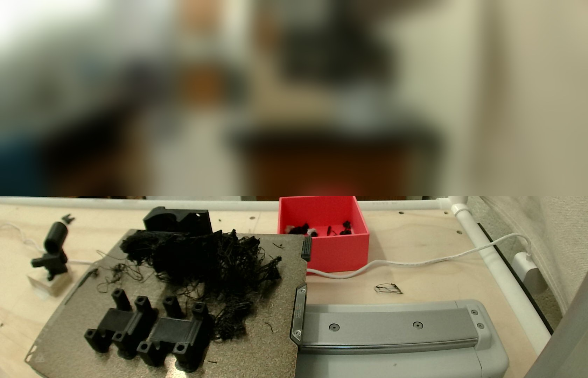

# One more 0.05 mm deck key on the A1 mini: prepared, not sent (2026-10-30)

@jarrettshupe
[asked](https://github.com/vertical-cloud-lab/byu-vcl/pull/269#issuecomment-6529350278) on
PR #269 for another deck key, "with the latest dimensions and modifications used". That was
a plain `@claude` run, which can't log in to the lab's Bambu account, so **nothing was sent
to a printer**. The run checked the file and the printer, so the print run only has to slice,
check the plate and send.

## The key

[`stl/deck_key.stl`](../../stl/deck_key.stl), MD5 `fc2bb14d3cd7b228053a834a42651613`: the
0.05 mm press fit, `keyPress` 0.05 in the model since `85c5d28`. It is the same file, byte for
byte, as the 0.05 key Ben picked in the
[10-22 fit test](../2026-10-22-a1mini-keys/README.md) and as both keys on the
[10-28 compact plate](../2026-10-28-a1mini-compact/README.md). Nothing about the key has
changed since.

| mm | Pocket in the base | Nub | G-code, 10-22 and 10-28 |
|---|---|---|---|
| A, corner to the opposite flat | 6.85 | 6.95 | 6.94 |
| B, across two corners | 7.57 | 7.67 | 7.66 |
| Corner radius | 1.1 | 1.15 | |
| Depth / height | 2.1 | 2.0, with a 0.3 mm × 45° lead-in | |

One dimple on its top face marks it. Both bases, the 56 × 56 mm one and the compact one, have
the same pocket ([README](../../README.md#the-key-nub-and-pocket)).

## Settings for the print run

The same as the 10-22 keys, so the fit comes out as tested:

| | |
|---|---|
| Printer | A1 mini, 0.4 mm nozzle, Textured PEI |
| Filament | Bambu PETG Basic, white (`GFG00`), AMS Lite A4 (0-based slot 3). 245 °C nozzle, 70 °C bed |
| Process | `0.20mm Standard @BBL A1M` with `BUILD.md`'s changes: 4 walls, 30 % infill, 0.15 mm elephant-foot compensation. No supports, no brim |
| Placement | nub up, as in the STL |
| Expect | about 20 min from Send and 2 g. On 10-22 the printer's preparation took 7.5 min, and PETG's 12 s minimum layer time holds the key's 60 layers to at least 12 min |

## The printer at 17:42:06 UTC

Read over the LAN through the CubXL Pi with `bambu_lan.py preflight --printer A1_MINI --via
CUBXL_PI` (`bambu/` on [PR #234](https://github.com/vertical-cloud-lab/byu-vcl/pull/234)'s
branch, `042975e`). It only reads: `pushall`, `get_version` and one camera frame.

| | |
|---|---|
| Identity | TLS CN matches the A1 mini's serial |
| State | `FINISH` after *issue55_sleeves_A1mini_PLA* (242/242 layers). `print_error` 0, no HMS alerts |
| Heaters | off; nozzle 25 °C, bed 26 °C |
| Nozzle | **0.4 mm**, stainless steel |
| AMS Lite | A1 PLA Basic, dark blue · A2 empty · A3 PLA Basic, black · **A4 PETG Basic, white** |
| Other | SD card present, Wi-Fi −54 dBm, chamber light on, firmware 01.08.01.00 |

**The plate is not clear.** The gantry is parked high, so the camera looks down on the
Textured PEI plate. The last job's black parts are on it, two two-post parts at the front
left, and a large tangle of loose black filament covers the middle and back. Someone in the
lab has to clear and clean the plate before the key can print. The room above the table is
blurred.

## Files

| File | What |
|---|---|
| [`20261030T174206Z_camera.jpg`](20261030T174206Z_camera.jpg) | The frame, with everything above the table's back edge blurred |
| [`20261030T174206Z_preflight.json`](20261030T174206Z_preflight.json) | The pre-flight's summary and checks: verdict HUMAN-DECISION, with warnings only for the last job's part and the plate |
| [`20261030T174206Z_report_redacted.json`](20261030T174206Z_report_redacted.json) | The printer's full status report, with the IP, serial, access code and network details taken out |
