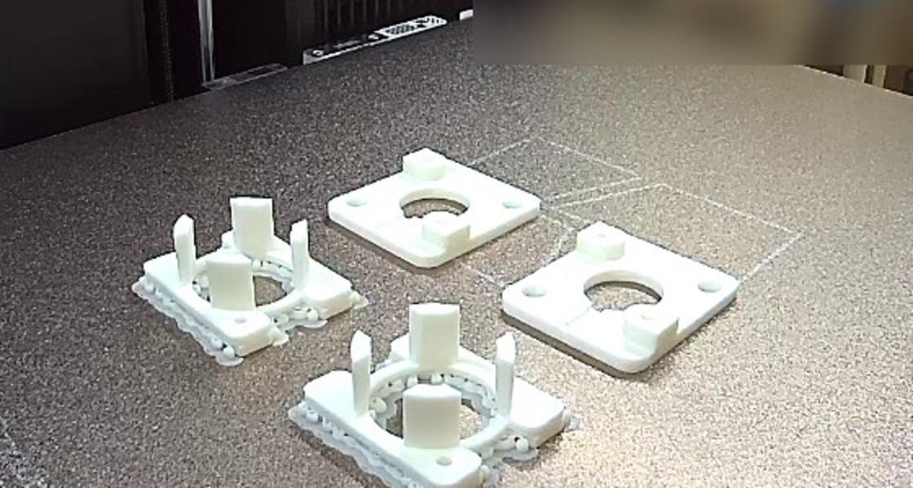
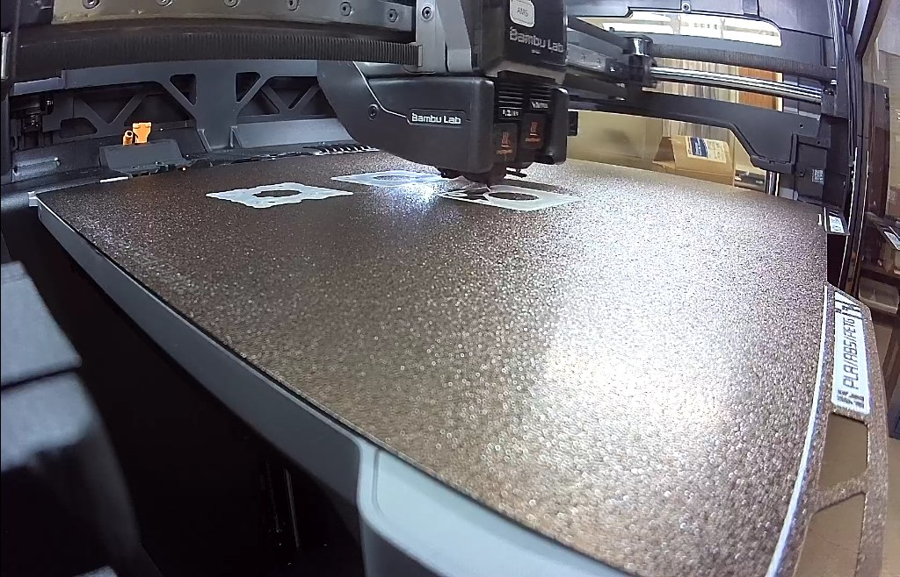
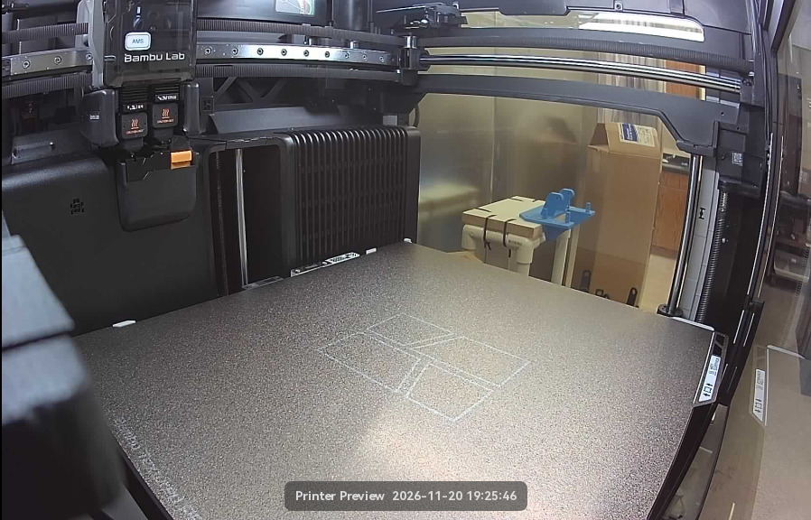

# The under-deck stirrer's frame and collar, two of each, on the H2D (2026-11-20)

@benwhitney5463 asked on [PR #348](https://github.com/vertical-cloud-lab/byu-vcl/pull/348) with
`@claude-print`: *"print the extra parts I would need now for the under the deck stir module (just
the frame and the collar) print two of each."* The parts are the [under-deck](../../under-deck/README.md)
mock-up's two new pieces. Everything else in that design is today's compact stirrer.

**Outcome: printed, with no pause, dialog or HMS alert.** Sent from Bambu Studio at 19:40:28 UTC.
Layer 1 at about 19:49, and layer 100/100 and *Finished* at 21:03:09: 82.7 min after Send, against
Studio's 1 h 17 min plus start-up. Someone at the printer took the four parts off at about 21:04:26.

| The parts on the plate, 21:04:16 UTC | Layer 1, 19:53:46 UTC |
|---|---|
|  |  |

*Left: the two collars (front and left) with their four fingers, still on their tree supports, and
the two frames (back and right) with the carrier bore, the two bosses and the screw holes.
From the live view, enlarged, with the room blurred.*

## What was printed, and two changes from the drawings

| | |
|---|---|
| Parts | 2 × [`collar.stl`](../../stl/under-deck/collar.stl), keys down. 2 × [`frame_no_pads.stl`](frame_no_pads.stl), fan face down, bosses up. Both are from commit `20c21e6` |
| Printer | BYU VCL H2D (Théoden), **left nozzle only**: 0.4 mm hardened steel, standard flow. The right one is 0.6 mm TPU high flow and wasn't used ([Printer Parts](20261120T192706Z_h2d_printer_parts.png), [*Switch diameter*](20261120T192931Z_h2d_switch_diameter.png), [grouping](20261120T193510Z_filament_grouping_left.png)) |
| Plate | Textured PEI, 55 °C |
| Filament | Bambu PLA Basic, AMS A3, white. Nozzle 220 °C |
| Process | `0.20mm Standard @BBL H2D` with `BUILD.md`'s changes: 4 walls, 30 % grid infill, 0.15 mm elephant-foot compensation (the preset's own value). Tree supports (auto) at 30°, on the build plate only. Brim set to auto, and Studio added none: the G-code has no brim or skirt |
| Studio's estimate | 100 layers to 20.0 mm, 28.35 g (9.35 m), 1 h 17 min 8 s ([slice](20261120T193748Z_slice_preview.jpg), [result](20261120T193748Z_slice_result.png)) |
| Send options | job `under_deck_stirrer_frame_collar_x2`, PLA → A3, timelapse off, bed levelling and flow dynamics calibration on, nozzle offset calibration off ([dialog](20261120T194012Z_send_dialog.png)) |
| File sent | [`sent/under_deck_stirrer_frame_collar_x2_H2D_0.4L_PLA.3mf`](sent/under_deck_stirrer_frame_collar_x2_H2D_0.4L_PLA.3mf): Studio's own upload copy, with only `DesignerUserId` blanked. Plate G-code MD5 `f58c49a8e635b44976c2708c85c5af11`, the same as the slice checked in [`gcode_check_presend.json`](gcode_check_presend.json) |

1. **The frame was printed without its four 0.5 mm corner pads.**
   - Printed bosses up, as drawn, the pads would hold the whole fan face (1632 mm²) 0.5 mm off
     the bed. That face is the 0.5 mm clearance over the fan's rotor, so support marks there would
     eat into it, and with no supports it would print as a sagging bridge. Flipped, the
     counterbores, the Hall pocket and the bosses would face the bed.
   - So [`make_print_stls.py`](make_print_stls.py) cuts the pads off `frame.stl` at the plate's
     underside. The result is one watertight body, 1778 mm² on the bed, with no overhang
     ([output](make_print_stls_output.txt)).
   - **Assemble with four 0.5 mm M3 washers at the fan's corners**, as the compact build does.
     Two go on the fan screws. The two at the corners without a screw are loose, so a dab of glue
     keeps them in place while assembling. Stack heights don't change. The plastic under each
     fan-screw head is now 0.63 mm, with the washer under it, so tighten those screws snug only.
2. **PLA, not PETG.** `BUILD.md` asks for PETG. No free printer had it loaded:
   - Thumbelina (A1 mini) has white PETG in AMS Lite A4. But it was showing someone's
     *Part Studio 2 - AOR tester* as *Downloading (100%)* with the bed held at 65 °C, as it was on
     2026-11-19 at 18:40 and 20:46 UTC. It may be stuck and is worth a look.
   - Tinkerbell (A1 mini) had only blue PLA, on its external spool.

   PLA should do for a first fit-and-stir test, since nothing heats these parts. They can be
   reprinted in PETG.

Ben confirmed both in the thread at 19:29:57 UTC, before Send: *"PLA not PETG. I'll use the
washers."*

**After the parts come off:** cut the collars' tree supports away from under the bars and ring. The keys' undersides printed on the bed, so their fit in the slots isn't affected.

## The plate check

This followed the 2026-10-23 rule: the frame comes first, the run reads the plate, the thread
gets at least 90 s to object, and a fresh frame is taken before Send. Nobody had to reply.

| First frame, 19:25:46 UTC | Before Send, 19:38:55 UTC |
|---|---|
|  |  |

- **19:25:46, the first frame:** Studio's *Printer Preview* still from the Device page.
  - The plate was empty and bright enough to tell. All it showed was the textured plate, with
    faint white outlines from an old first layer, which are also in 2026-11-19's frames.
  - Behind the bed, past the chamber's back, were a white stand, a blue part and a cardboard box.
    They were there on 11-19 too.
  - 11-19's vial rack had been taken off.
  - The H2D was idle after `vial_rack_9x20mL_v2` (175/175), with heaters off and HMS showing only
    two lubrication reminders ([HMS](20261120T192651Z_h2d_hms.png),
    [Device page](20261120T192617Z_h2d_device_page.jpg)).
- **19:28:13, posted** at the top of the tracking comment. The post gave the state, the files,
  the nozzles, the plate type and my read of the plate, and flagged the two changes above.
- **19:29:57, Ben's reply:** both changes confirmed.
- **19:38:55, the second frame:** unchanged. Mean luma over the plate was 127.9 in both, with a
  mean difference of 3.9 of 255.
- **19:40:28, Send,** 12 min after the post. The thread was polled at 19:32, 19:35, 19:37,
  19:39 and 19:40:22, and nothing else had come in.

## Timeline (UTC)

| | |
|---|---|
| 19:14 | Run started, approved in the `bambu-print` environment |
| 19:14–19:22 | Studio's apt packages came at 20–60 KB/s through apt. They were fetched with curl instead, checked against apt's signed index (size and hash), and installed from that cache |
| 19:23:21 | Screen recorder started. Studio up, logged out, at 19:23:50 |
| 19:24:18–19:24:49 | Logged in with the password and authenticator code (`bambu-totp`). No e-mailed code |
| 19:25–19:27 | Device page: Thumbelina busy, Tinkerbell PLA only, the H2D idle. First frame, HMS, Printer Parts |
| 19:28:13 | Frame posted |
| 19:29:31 | *Sync info*: left nozzle 0.4 mm chosen |
| 19:35:50 | First slice: Studio warned of G-code path conflicts, because the parts weren't arranged yet and overlapped. Arranged, then re-sliced at 19:37:35 with no warnings |
| 19:38:55 | Second frame |
| 19:40:28 | *Send* |
| 19:41:06 | Homing, layer 0/100 |
| 19:49:20 | Layer 1 (about) |
| 20:12:58 | Layer 11, 37 % |
| 20:47:21 | Layer 34, 80 % |
| 20:59:52 | Layer 83, 95 % |
| 21:03:09 | Layer 100/100, *Finished* |
| 21:04:26 | The parts taken off the plate by someone at the printer |
| 21:06:46 | HMS: still only the two lubrication reminders ([after](20261120T210646Z_h2d_hms_after.png)) |
| 21:07:15 | Signed out of the Bambu account. Studio closed, and its config and slice cache deleted, at 21:07:35 |

The left nozzle held 218–221 °C and the bed 55 °C throughout. The right nozzle was never heated.

## Files

| File | What |
|---|---|
| [`print.json`](print.json) | The request, the printers checked, the plate check and replies, the slice and what was changed in the GUI, the Send options, the watch and the timeline |
| [`make_print_stls.py`](make_print_stls.py), [`frame_no_pads.stl`](frame_no_pads.stl) | The frame without its pads, as printed |
| `*_camera_first.jpg`, `*_camera_presend.jpg` | The two frames before Send |
| `*_device_page.jpg`, `*_hms.png`, `*_printer_parts.png`, `*_switch_diameter.png` | The printer's state and nozzles |
| `*_filament_grouping_left.png`, `*_slice_*`, `*_send_dialog.png`, [`gcode_check_presend.json`](gcode_check_presend.json) | The slice and Send. The G-code check shows the settings, the tool use (`M104 S220 T1` only, `physical_extruder_map 1,0`), and that supports are only under the collars (z 0.2–2.8 mm) |
| [`sent/`](sent/) | The file Studio uploaded |
| [`frames/`](frames/) | Layer 1, layer 11 and the finished parts (live view, room blurred) |
| `*_started_device_page.jpg`, `*_job_panel_finished.png`, `*_hms_after.png` | The start, the job panel at 100 %, and HMS after |
| [`recording/`](recording/) | The cut screen recording, 7.0 min, with [chapters](recording/under_deck_stirrer_H2D_2026-11-20_chapters.txt): Studio's setup, the printer checks, slicing and Send at 2–6×, then the print at 60×. The login, the account's home page, the part removal and the sign-out aren't in it, and the room behind the H2D is blurred. It's made by [`cut_recording_h2d.py`](recording/cut_recording_h2d.py) from the two cut plans. The raw recording was deleted. It isn't on YouTube, because a print run has no YouTube token |
