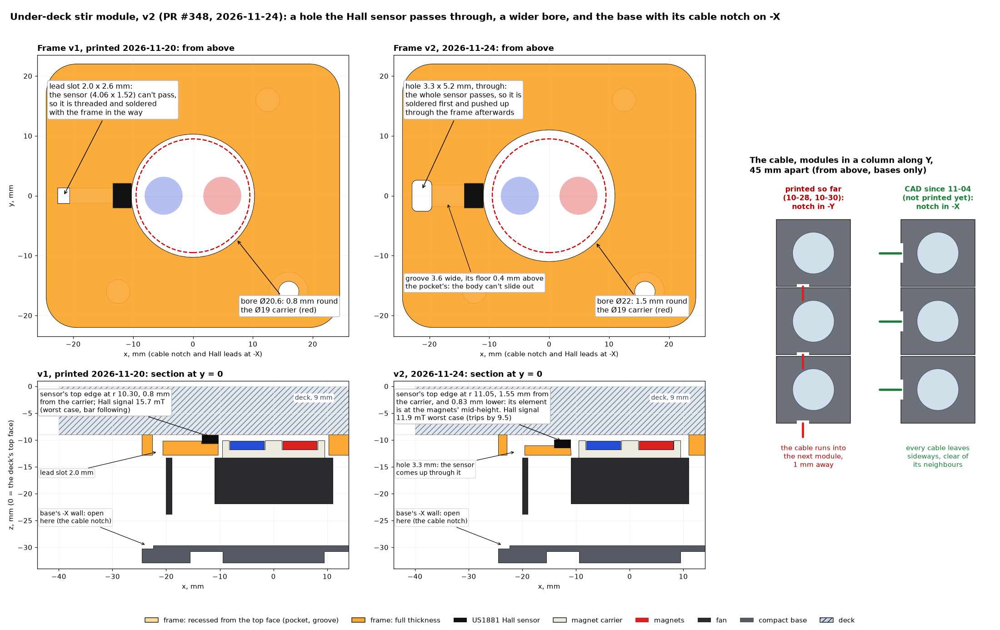
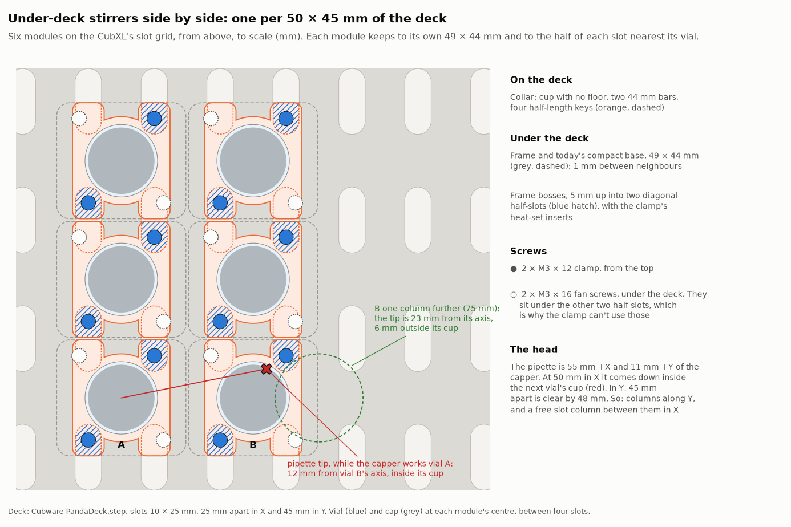
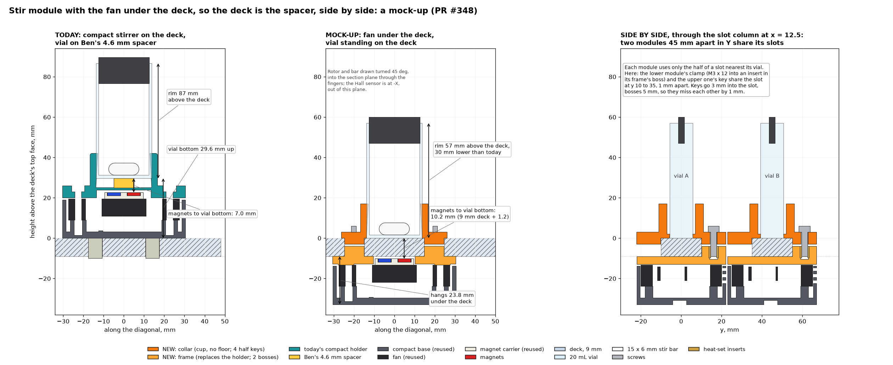
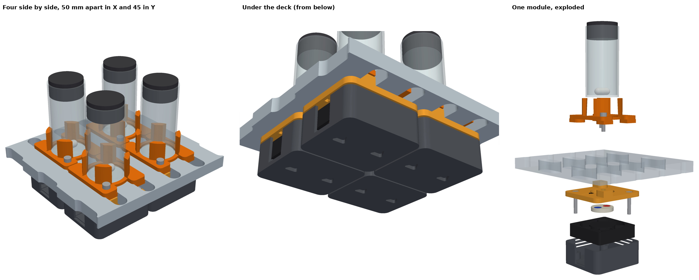

# The fan under the deck, so the deck is the spacer (mock-up, 2026-11-19; side by side, 2026-11-20)

Asked by @benwhitney5463 on [PR #348](https://github.com/vertical-cloud-lab/byu-vcl/pull/348).
On 2026-11-19: the 4.6 mm spacer isn't enough for steady stirring, and a bigger one puts the vial even
higher. Could the fan go under the deck and use the 9 mm deck as the spacer? The vial would then stand
on the deck, held by a holder that isn't under it. On 2026-11-20: *"can you change the design to allow
for the stirrers to sit side by side? There is nothing under the deck right now, and there plenty of
clearance for the stir module."*

**Status: built once, and a v2 frame is drawn.** Two frames and two collars were printed in PLA on
the H2D on 2026-11-20 ([record](../print/2026-11-20-h2d-under-deck/README.md)). The frames were
printed without their 0.5 mm pads, so they need four 0.5 mm M3 washers (see [the parts](#the-parts)).
**First stir test, 2026-11-24** ([record](../../../cubos/results/stir_under_deck_20261124/README.md)):
once turning, it held 600 rpm through CubOS and reached 870–1080 rpm, but hands-off it started
from rest only once in nine tries, and barely moved with the vial out. The record lists what to
check on the drive. For the next modules, the frame has a
[v2](#v2-of-the-frame-2026-11-24-the-hall-sensors-hole-the-cable-a-wider-bore), not printed yet.
The magnet numbers come from the same model as
[`../analysis/coupling_vs_height.py`](../analysis/coupling_vs_height.py), calibrated on the same
observations. The first version, at commit `c549ed6`, reached into the far half of each slot. Its
collar and frame were 71 and 72 mm long, so two of them needed two rows (90 mm) in Y.

## v2 of the frame (2026-11-24): the Hall sensor's hole, the cable, a wider bore

Asked for by @benwhitney5463 on [PR #348](https://github.com/vertical-cloud-lab/byu-vcl/pull/348)
after the first module ran under the deck (*"The under-the-deck module generally works a lot
better!"*):

1. The Hall sensor's holder in the top needs a bigger hole, so that the whole sensor can be pushed
   through it. The sensor can then be soldered to the board without the top in the way.
2. The gap for the cable to the Uno needs to be on the other side of the case (already discussed):
   the modules will be lined up along Y, and the cable gets in the way.
3. The circle in the top needs to be wider. In the first stirs on 2026-11-24, the plate holding the
   magnets caught on the top's wall, because the wires pushed together under the fan stressed it.

The top is the frame. Its outline, bosses, fan screws and clamp are v1's, so **the collars printed
on 2026-11-20 fit it**, and the side-by-side checks above still hold. Only the frame changes:
[`frame_v2.step`](../step/under-deck/frame_v2.step) and [`frame_v2.stl`](../stl/under-deck/frame_v2.stl),
built by `build_under_deck.py` and checked by its `--v2` option
([`v2_check_output.txt`](v2_check_output.txt), 0 failed).



| | v1 (printed 2026-11-20) | v2 |
|---|---|---|
| Hall sensor's way through the frame | lead slot, 2.0 × 2.6 mm | **hole, 3.3 × 5.2 mm**, R0.8 corners |
| Bore round the Ø19 magnet carrier | Ø20.6: 0.8 mm a side | **Ø22.0: 1.5 mm a side** |
| Hall sensor's top edge | r 10.30, at the bore's wall | r 11.05, 0.05 mm behind the wall, 1.55 mm from the carrier |
| Hall sensor's marked face (down), stirrer z | 22.23 | 21.40: 0.83 mm lower, so its element is at the magnets' mid-height |
| Hall signal, worst case: bar following / magnets alone | 15.7 / 18.3 mT | 11.9 / 14.0 mT. The US1881 trips by 9.5 |
| Lead groove | 2.6 mm wide | 3.6 mm wide. Its floor is 0.4 mm above the pocket's, so the body can't slide out along it |
| Under the frame | 0.5 mm pads, cut off for the 11-20 print | flat: four 0.5 mm M3 washers on the fan's corners, as built |
| Printing | fan face down, bosses up, with the pads cut off first ([`frame_no_pads.stl`](../print/2026-11-20-h2d-under-deck/frame_no_pads.stl)) | the same way up, as drawn: no supports, nothing to cut off |

### 1. The Hall sensor goes through the frame

The US1881 is 4.06 × 1.52 mm in section, edge first, with its leads trailing. The hole leaves
0.57 mm a side across its width and 0.89 mm across its thickness, so the 26 AWG extensions and
their heat-shrunk joints go through too. The hole runs from the base's −X inner wall face
(x −22.9) to 0.4 mm over the fan's −X side (x −19.6). Below it is the 2.9 mm gap between the fan
and that wall, where the leads already ran in v1. So the sensor, soldered to the board, comes up
that gap and straight through the hole.

### 2. The cable leaves through −X: print the 2026-11-04 base

Nothing in the frame changes for this. It is the base's notch, and the base in the CAD has had it
in the −X wall since 2026-11-04 ([compact README](../compact/README.md#the-2026-11-04-changes),
asked for by Ben on PR #269). But no base has been printed since: **both compact bases printed so
far, on 10-28 and 10-30, have the notch in the −Y wall.** In a column along Y, that wall faces the
next module 1 mm away (right-hand panel above). They also have the board stop, and their cable
runs about 40 mm under the fan to column A, as a 2 × 2 bundle in the 3.5 mm there. That may be the
"wires pushed together below the fan" of point 3. The 11-04 base takes the cable's cores from the
notch straight into column A, 7 mm at most, and the Hall leads come down the same −X end. Use
[`base_compact.stl`](../stl/compact/base_compact.stl) (or its STEP) for every new module.

### 3. The wider bore, and why not wider

The sensor sits beside the carrier, so a wider bore moves it out, and the field it sees falls by
3–4 mT for every 0.5 mm. The sensor's top edge stays flush with the bore's wall, and it sits lower
than in v1 to win back about 1.5 mT. Worst case, over the four guessed bar cores and the element's
two positions in the package (model of [`../analysis/field_check.py`](../analysis/field_check.py)):

| bore | carrier to the wall, a side | Hall signal, worst case |
|---|---:|---:|
| Ø20.6 (v1, sensor as in v1) | 0.8 mm | 15.7 mT |
| Ø21.6 | 1.3 mm | 13.6 mT |
| **Ø22.0 (v2)** | **1.5 mm** | **11.9 mT** |
| Ø22.5 | 1.75 mm | 10.7 mT |
| Ø23.0 | 2.0 mm | 9.4 mT: under the US1881's worst-case trip point |
| Ø24.0 | 2.5 mm | 7.3 mT |

Ø22 nearly doubles the clearance and keeps 1.25× the worst-case trip point. More room would need
another part, neither of them drawn:
- **A Ø18 carrier**, not Ø19: the same Ø22 bore then gives 2.0 mm a side with the same signal. The
  magnet pockets reach r 8.23, so that leaves 0.77 mm of plastic outside them.
- **A more sensitive latch** than the US1881.

### Building v2

The order changes, because the sensor goes on the board first:

1. **On the bench, base open:** the board, the MOSFET, the cable in through the −X notch, the fan's
   leads, and the Hall sensor on its 60 mm leads, soldered to B6, B5 and B3
   ([BUILD.md stage 5](../BUILD.md#5-wire-the-electronics)). Stagger the joints 10 mm or more from
   the sensor's body, so that they end up in the hole or below it.
2. **Carrier on the hub, fan on its posts**, rotor side up. Bring the Hall leads up the 2.9 mm gap
   between the fan's −X side and the −X wall, with the sensor hanging out above.
3. **Four 0.5 mm M3 washers** on the fan's corners.
4. **Frame on, bosses up.** Feed the sensor up through the hole, body first, and lower the frame
   onto the washers.
5. **Sensor into its pocket:** marked face down (toward the fan), top edge toward the carrier, its
   lead edge against the step, leads in the groove. Its top edge must not stand inside the bore. A
   dab of glue holds it.
6. **Two M3 × 16 fan screws**, snug only. Turn the fan through a vent with a toothpick: the carrier
   touches nothing.
7. **Under the deck**, as before: the collar from the top and two M3 × 12 clamp screws.

**Not done:** v2 isn't printed or test-fitted, and its Hall numbers are the model's, not measured.







## Side by side

- **One stirrer per 50 × 45 mm of deck:** two slot columns in X, one row in Y. That is the
  closest a 40 mm fan allows on this grid, the same as the compact on-deck layout in
  [`../analysis/deck_tiling.py`](../analysis/deck_tiling.py).
- **How:** every part of a module stays inside 49 × 44 mm round its vial. In each of its four
  slots it uses only the half nearest its vial, 10 to 22 mm from the vial's axis. The other half
  belongs to the neighbour 45 mm away in Y. A neighbour 50 mm away in X uses different slots.
- **Why two clamp screws, not four.** The fan's four screws are at (±16, ±16) mm, under the near
  half of every slot. A screw at x = 16 can't come up through a slot whose edge is at x = 17.5. And a
  screw head under a half-slot leaves no room there for a boss and an insert. So two fan screws on
  one diagonal, (16, −16) and (−16, 16), hold the frame, fan and base together. The other diagonal's
  half-slots take the clamp, at (12.5, 16) and (−12.5, −16).
- **Checked in CadQuery** ([`side_by_side_check_output.txt`](side_by_side_check_output.txt)), on a
  block at 50 × 45 mm:
  - Neighbours' parts are 1.0 mm apart in X (frame to frame) and in Y (collar to collar), and 5.6 mm
    apart diagonally.
  - No part overlaps the deck.
  - Each screw has enough thread and doesn't bottom out.
- **Neighbours don't disturb each other's sensing** ([`neighbour_field_output.txt`](neighbour_field_output.txt)):
  - A spinning neighbour puts at most 0.1 mT on this module's Hall sensor, and all eight neighbours
    at once 0.3 mT. The US1881 trips at 9.5 mT.
  - A neighbour 45 mm away in Y puts up to 11 % of this module's own drive field on its bar (8 %
    at 50 mm in X, 2.5 % at 75 mm). Nearly all of that comes from the neighbour's *bar*, with the
    strongest of the four guessed cores. That nudges the bar but shouldn't uncouple it.

### The head decides how close they can be in X

The pipette is 55 mm +X and 11 mm +Y of the capper (the gantry file's offsets).

- **While the capper works vial A**, the pipette hangs over A + (55, 11), with its tip end
  about 21 mm above the deck.
- **While the pipette works deep in A**, the capper hangs over A − (55, 11), at about A's rim.

| neighbour | from that spot to the neighbour's axis | |
|---|---:|---|
| 50 mm away in X | 12 mm | **inside its cup and vial: the pipette would come down on it** |
| 75 mm in X (one free slot column) | 23 mm | 6 mm outside its cup, 9 mm outside the vial |
| 45 mm in Y | 65 mm | clear |
| diagonal, 50 and 45 mm | 34 mm | clear |

- **So put stirrers in a column along Y, 45 mm apart.** If more than one column is needed, leave a
  free slot column between them, 75 mm apart.
- At 75 mm, I don't know whether the capper's jaws clear a capped vial. That needs the capper's
  size, or one slow jog.
- The modules also fit 50 mm apart in X, but only on a deck the head never works that way.
- **The cable says the same:** at 50 mm in X, the compact base's −X cable notch faces the
  neighbour's wall, 1 mm away. In a column along Y, or with a free column between, it is clear.

## The parts

Two new printed parts. Everything else is today's compact stirrer, unchanged.

- **Collar, on the deck (new).**
  - The 9-vial holder's cup (the 2 mm ring, the four spring fingers up to 17 mm, the 3° pocket),
    with **no floor**. The vial goes through it and stands on the deck.
  - Two bars, 12 × 44 × 3 mm, over the slot columns.
  - Four half-length keys, 9.8 mm wide, that go 3 mm into the near half of each slot.
  - Two holes for the clamp screws.
  - It is 37 × 44 mm. Nothing of it is under the vial.
- **The deck is the spacer.** The vial stands between four slots, so it is on solid polycarbonate.
  The nearest slot edge is 14.5 mm from its axis, and the vial's radius is 13.75 mm. In deck
  coordinates that is X ≈ 149.2 + 25n, Y ≈ 67.5 + 45m: midway between two slot columns, like
  today's stirrer, but also midway between two rows.
- **Frame, under the deck (new).** It replaces the vial holder. It is the compact holder's flange,
  49 × 44 mm, up to its recess ceiling (stirrer z 20 → 23.83), with the cup and the 1.2 mm floor
  gone, so its top face sits against the deck's underside. It has:
  - a Ø20.6 bore for the carrier;
  - the Hall sensor's pocket at −X (r 10.2–13.4), open to the deck, so the sensor sits exactly
    where it does today relative to the magnets. Its leads' groove ends in a slot that drops past
    the fan's −X edge into the base, inside the frame's own footprint;
  - 0.5 mm pads on the fan's four corners, outside the blades. They keep today's 0.5 mm over the
    rotor, as the compact build's four 0.5 mm washers do. The pads are printed so that the two
    corners without a screw don't rock;
  - two counterbores for the fan screws, on one diagonal;
  - two half-length bosses that go 5 mm up into the other diagonal's half-slots, each with an
    M3 × 5.7 heat-set insert.
- **Screws:**
  - **Two M3 × 16 fan screws** go through the frame and the fan into the base's post inserts. Their
    heads sit 0.2 mm below the deck's underside. The first version had four M3 × 20, but under a
    3.83 mm frame an M3 × 20 would bottom out 0.7 mm in the base's insert holes.
  - **Two M3 × 12 clamp screws** go in from the top, through the collar's keys, into the bosses'
    inserts. They squeeze the deck between the collar and the frame.
  - Use stainless or brass, as in BOM item 12, not steel.
- **Lining up.** Keys and bosses sit in the same slots, so the magnets line up with the vial to
  within the slots' 0.1 mm a side. Being screwed down, the collar can't come up with a cap
  ([risk 3](../README.md#risks-and-open-questions) goes away).
- **Reused as they are:** the compact base (all four inserts in; two go unused), the fan, the
  magnet carrier and magnets, the Hall sensor, the junction board and the cable.

`build_under_deck.py` draws the two parts from `vial_stirrer.fs`'s numbers, through
`compact/build_compact.py`. They are [`step/under-deck/collar.step`](../step/under-deck/collar.step) and
[`frame.step`](../step/under-deck/frame.step), with STLs in [`stl/under-deck/`](../stl/under-deck).

## What the deck does to the coupling

g is the gap from the drive magnets' top faces to the vial's outside bottom. "Pull" is the
magnets' pull on the bar, relative to where the fan stalled on 11-04 (vial 3 mm up). It sets the
friction under the bar and the thrust on the fan's bearing, which is what the fan has to beat. The
earlier analysis aimed for about 0.5. Ranges are over the four guessed bar cores. The output is in
[`coupling_through_deck_output.txt`](coupling_through_deck_output.txt).

| 15 × 6 mm bar | g, mm | pull | pull-out torque, mN·m |
|---|---:|---:|---:|
| today's holder, vial seated | 2.4 | 2.63–2.76 | 0.29–1.07 |
| vial 3 mm up: the 11-04 stall | 5.4 | 1.00 | 0.14–0.52 |
| on the 4.6 mm spacer (now) | 7.0 | 0.62–0.63 | 0.10–0.37 |
| **under a 9 mm deck** | **10.2** | **0.26–0.28** | **0.05–0.19** |
| under a 9 mm deck, two magnets stacked per pocket | 10.2 | 0.44–0.47 | 0.09–0.34 |
| under a 10 mm deck (Cubware's STEP) | 11.2 | 0.21–0.22 | 0.04–0.16 |

The water drag on the bar is at most 0.019 mN·m at 600 rpm and 0.075 mN·m at 1200 rpm (an upper
bound, with the water held still).

- **The pull drops to about 0.27,** from 0.62 on the spacer: well under half the friction, and
  under the 0.5 aimed for. That is what should let it start from rest every time and hold speed.
- **The coupling holds at 600 rpm** with 2.6–10× margin over the drag bound. **At 1200 rpm** the
  weakest guessed core (0.65×) would slip. Stacking two of today's magnets in each pocket fixes
  that: 1.1–4.5× at 1200 rpm, with the pull still at 0.45. That takes a carrier 1.6 mm thicker,
  and a frame 1.6 mm thicker to keep the gap. Under the deck there is room for both; they aren't
  drawn.
- **The Hall signal gets cleaner.** The bar is further from the sensor, so the smaller peak is
  17.6–19.5 mT (15.9–19.1 on the spacer, 11.7–18.3 seated). The US1881 needs 9.5.
- **The rotor is pulled up less** (the same 0.27×), so the carrier's 1.1 mm gap under the deck is
  less likely to close.
- **Limits:** the same static model as before, calibrated on Ben's ~3 mm by eye. The bar's core,
  the friction and the fan's torque are not known.

## Heights

| | vial bottom, mm above the deck | rim, mm above the deck | rim, CubOS deck Z |
|---|---:|---:|---:|
| 9-vial holder (vial_2) | 18.0 | 75 | 56 |
| stirrer on the 4.6 mm spacer (vial_1) | 29.6 | 87 | 66 (taught) |
| **under-deck mock-up** | **0** | **57** | **≈ 38** |

- **The tip clears a capped vial by much more.** It travels at deck Z 87 with a tip on, and the cap
  is now 28–30 mm lower than on the spacer. The "vial sits too high" problem goes away.
- **CubOS can reach it.** In the G-code from the 11-18 run, decap went to gantry Z = rim − 1 (Z55
  for vial_2, Z65 for vial_1). Here that is Z37. Aspirating at −35 puts the pipette at Z38 (tip end
  at deck Z 3), and blowout at −20 at Z53. All of these are inside the working volume (z_min 0).
- **But the head comes 18 mm lower than it has gone on this deck so far**, 28 mm lower than for
  vial_1 today. While the capper decaps this vial with a tip on, the tip end is at about deck Z 2,
  55 mm +X and 11 mm +Y of the vial (the pipette's offset). Nothing taller than about 20 mm may
  stand there. Check with a mock run and `cubos/tools/capped_vial_keepout.py`, and jog slowly the
  first time.

## What it costs

- **Room under the deck: there is plenty.** Ben, 2026-11-20: nothing is under the deck, and there
  is plenty of clearance. Each module hangs 23.8 mm below the deck's underside, over 49 × 44 mm.
- **One 50 × 45 mm cell per stirrer.** That is two slot columns in X and one row in Y. In X, the
  head needs a free column between stirrers, so in practice it is 75 mm.
- **It stays put.** Moving it means two screws from the top while holding the drive underneath.
- **Liquid:** the vial stands on solid deck, and the drive is under 9 mm of polycarbonate, away from
  anything spilled on the deck.
- **Cable:** it runs under the deck, out of the gantry's way.
- **Printing, as done on 2026-11-20** ([record](../print/2026-11-20-h2d-under-deck/README.md)):
  - **Collar:** keys down, as drawn. Its bars and ring sit 3 mm above the keys, so they print on
    tree supports from the bed (30°, build plate only), only 0.2–2.8 mm high.
  - **Frame:** fan face down and bosses up, **without the 0.5 mm pads**. With the pads, the whole
    fan face (1632 mm²) would sit 0.5 mm above the bed. That face is the clearance over the rotor, so
    support marks there would eat into the 0.5 mm. The print file is `frame.stl` with the pads cut
    off ([`make_print_stls.py`](../print/2026-11-20-h2d-under-deck/make_print_stls.py)), and four
    0.5 mm M3 washers go at the fan's corners, as in the compact build. Two are on the fan screws,
    and the two at the corners without a screw are loose, so a dab of glue keeps them in place
    while assembling. The stack heights are unchanged. Only the plastic under each fan-screw head
    changes: 0.63 mm, with the washer under it, instead of 1.13 mm including the pad. So
    tighten those screws snug only, as `BUILD.md` already says for the fan.
  - Bambu's `0.20mm Standard` with `BUILD.md`'s changes (4 walls, 30 % infill, 0.15 mm
    elephant-foot compensation). These were PLA, since the H2D had no PETG loaded; `BUILD.md` asks
    for PETG.
- **One stirrer per Uno channel.** The firmware drives one fan and reads one Hall sensor. A second
  stirrer needs a second PWM pin and a second Hall interrupt (D3), and a channel in the `30`/`31`
  commands.

## Questions for Ben

1. Is a column along Y, 45 mm apart, the arrangement you want? If two stirrers must sit 50 mm apart
   in X, the protocol can't cap or decap the −X one while the +X one is there.
2. Is the deck 9.0 mm there? At 10 mm the gap is 11.2 mm, which still couples at 600 rpm.
3. Should the collar keep the 9-vial holder's spring fingers? They are what holds the vial while the
   capper twists the cap, so the mock-up keeps them.
4. How many stirrers do you have in mind? See the last point above.

## Run

```bash
pip install cadquery magpylib trimesh shapely networkx matplotlib pyvista    # PIP_TIMEOUT=600 PIP_RETRIES=2
python under-deck/build_under_deck.py --check                      # stl/under-deck/, step/under-deck/, side_by_side_check_output.txt
python under-deck/build_under_deck.py --v2                         # the same files, then v2's checks: v2_check_output.txt
python under-deck/coupling_through_deck.py > under-deck/coupling_through_deck_output.txt
python under-deck/neighbour_field.py > under-deck/neighbour_field_output.txt
python under-deck/render_under_deck.py section                     # img/under_deck_section.png
python under-deck/render_under_deck.py plan                        # img/under_deck_side_by_side_plan.png
xvfb-run -a python under-deck/render_under_deck.py views           # img/under_deck_views.png
python under-deck/render_v2.py                                     # img/under_deck_v2.png
```

Run from `hardware/vial-stirrer-cubxl`.
