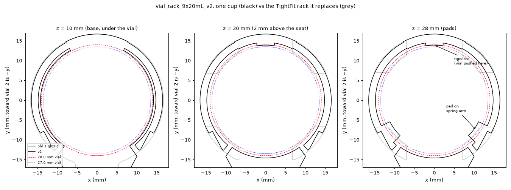
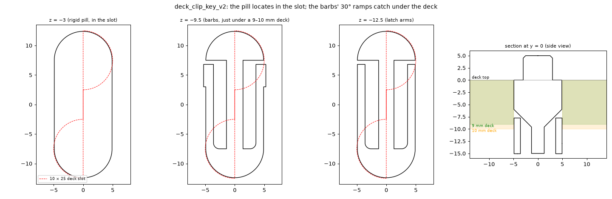
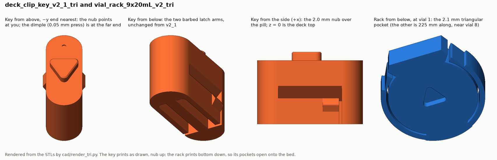
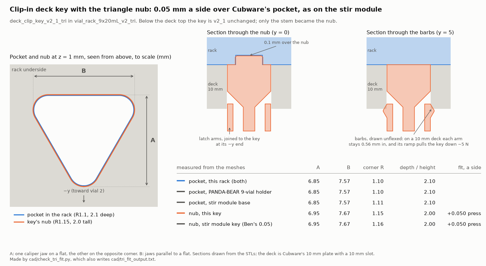
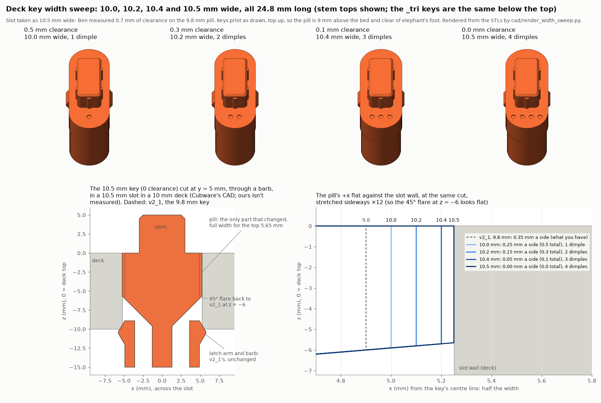
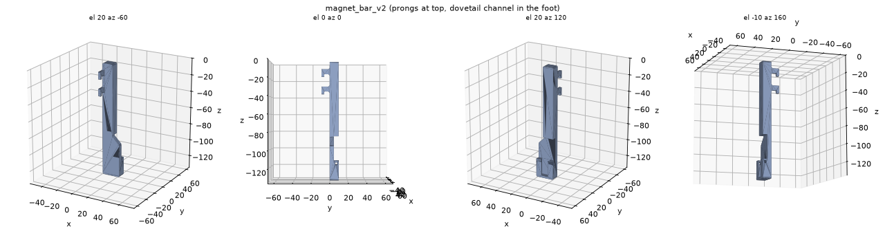

# CubXL capper parts, v2 (issue #354)

These are replacements for three printed parts of the CubXL's electromagnetic capper, from
[issue #354](https://github.com/vertical-cloud-lab/byu-vcl/issues/354):

| Part | Replaces | What was wrong |
|---|---|---|
| `vial_rack_9x20mL_v2` | PANDA-BEAR `9VialHolder20mL_TightFit` ([`../cad/`](../cad/)) | The vials weren't held firmly |
| `deck_clip_key_v2_1` | Cubware's pill key (`9VialHolder-key`) | It sat loose in the deck's 10 × 25 mm slots, 0.10 mm a side, held only by gravity |
| `magnet_bar_v2` | The black bar the electromagnet housing hangs from | One of its two hook prongs broke |

Everything is generated by [`cad/build.py`](cad/build.py) (CadQuery), and every dimension is
in [`cad/params.json`](cad/params.json). The FEA is in [`fea/`](fea/).

**Triangle-interface versions:** `deck_clip_key_v2_1_tri` and `vial_rack_9x20mL_v2_tri` are the
same key and rack joined by the lab's usual triangular nub and pocket instead of the stem. They
are modelled and checked, not printed. See [Triangle-interface versions](#triangle-interface-versions-_tri).

**Status, 2026-11-19:** the rack, four **v2** keys and the bar were printed on the H2D (record:
[`bambu/evidence/2026-11-19/issue-354-cubxl-studio/`](../../../bambu/evidence/2026-11-19/issue-354-cubxl-studio/)).
After the print started, I found that the v2 key's latch arms run into the chamfer above them
(see [the key](#deck_clip_key_v2_1)), and fixed it in **v2_1**, which hasn't been printed yet.

**2026-11-20:** on the CubXL, the rack clipped down with the v2 keys won't lift out but still
wobbles. The slots measure 0.7 mm wider than the keys, so there are now keys in four wider sizes
to find the fit. See [Width sweep](#width-sweep-2026-11-20).

## vial_rack_9x20mL_v2

- **It is a drop-in replacement.** Same 33.4 × 297.4 mm stadium outline, 33.0 mm pitch,
  **18.0 mm seat height** (so CubOS's labware heights don't change), 35 mm height, and keys in
  the same places (under vial 1 and 225 mm away).
- **Each cup has two curved spring arms and one rigid rib.** The arms push the vial toward +y,
  onto the rib, so the rib sets where the vial sits and the arms supply the grip.
- **The arms bend in the horizontal plane.** The old cup's four fingers bend across the
  printed layers, which is PLA's weakest direction and the one that creeps. These arms bend
  along the printed lines: each is 1.7 mm thick, about 31 mm of arc and the full 35 mm tall.
- **The pads** are 2.4 mm proud of the arm, between 22.5 and 34.6 mm above the rack bottom,
  with 45° lead-ins at both ends. With no vial, they sit on a Ø24.8 mm circle.

**Grip versus vial diameter** (FEA: 14 N per mm of pad travel, PLA E = 2.6 GPa). The 20 mL vials
are sold as 28 mm nominal. Nobody has measured ours.

| Vial OD (mm) | Pad travel (mm) | Force per pad (N) | Peak strain in the arm | Pull-out (μ = 0.3, about) |
|---|---|---|---|---|
| 26.0 | 0.06 | ~1 | — | loose |
| 27.0 | 0.85 | 12 | 0.5 % | ~11 N |
| 27.5 | 1.26 | 18 | 0.8 % | ~17 N |
| 28.0 | 1.66 | 23 | 1.0 % | ~22 N |
| 28.5 | 2.05 | 29 | 1.3 % | ~27 N |

Above about 29 mm, the vial no longer fits past the rigid posts (Ø29.2 mm).

## deck_clip_key_v2_1

- **The pill locates the key.** The top 6 mm is the old key's 9.8 × 24.8 mm pill, 0.10 mm a
  side in a 10.0 mm slot, so the rack goes back exactly where it was. The CubXL's slots turned
  out to be about 10.5 mm wide, which leaves 0.35 mm a side: see
  [Width sweep](#width-sweep-2026-11-20).
- **Two latch arms clip under the deck.** They sit below the pill, each with a barb whose upper
  face is a 30° ramp. That ramp catches the deck's bottom edge for any deck from **8.9 to 10.3
  mm** thick, with no vertical play: Cubware's CAD says 10 mm, and PANDA-BEAR's parts list buys
  9.0 mm sheet.
  - FEA: 5.5 N per arm to pass the slot, 1.35 % peak strain at the arm root.
  - That makes it about 12 N to push a key in, and about the same to push it out from below.
- **To unclip,** press up on the bottom of the key from under the deck, or squeeze its two
  arms together, while lifting the rack.
- **The stem** (6.0 × 12.0 × 5.0 mm, six 0.35 mm crush ribs) presses into the rack's 6.1 × 12.1
  mm pocket. Add a drop of CA glue to make it permanent.

**v2 versus v2_1.** In **v2**, the version printed on 2026-11-19, the tops of the latch arms
sit only 0.45 mm (horizontally) under the 45° chamfer above them. The arms have to move
0.75–1.07 mm inward to pass a 10.0 mm slot, so they hit the chamfer partway and have to twist
the rest of the way. The FEA missed this because it models no contact.

My rough estimate for v2 keys is about 3× the force, ~40 N per key, with more stress in the
arms. They may still work, so try one gently and don't force it. **v2_1** moves the arm tops
down to z = −8.9. At full travel, an arm still clears the chamfer by 0.54 mm, checked against
the FEA displacement field.

## Triangle-interface versions (`_tri`)

@benwhitney5463 asked on [#354](https://github.com/vertical-cloud-lab/byu-vcl/issues/354) for the
clip-in key with the triangular interface the other deck parts use, such as the stir module and
the tip rack. These two parts are the key and rack above with only that interface changed. The
stem versions stay, so the two interfaces can be compared on the machine.

- **`deck_clip_key_v2_1_tri`** is v2_1 everywhere below the deck top: the pill, the latch arms,
  the barbs, and everything the FEA covered. On top it has the stir module's nub in place of the
  stem. That nub is Cubware's rounded triangle, a sharp equilateral triangle of 3.1 mm
  circumradius with one corner toward −y, grown all round by 1.15 mm. It is 2.0 mm tall with a
  0.3 mm lead-in round its top.
  - It is 0.05 mm a side bigger than Cubware's pocket (R1.1, 2.1 mm deep), so it presses in. That
    is the size @benwhitney5463 chose for the stir module in the 2026-10-22 fit test.
  - One dimple in its top face marks the 0.05 mm press. It sits at the end away from the nub's
    point, as on the stir module's keys.
- **`vial_rack_9x20mL_v2_tri`** is the v2 rack with Cubware's pockets in place of the stem pockets,
  under vial 1 and 225 mm along the rack (near vial 8). They are in the same place, size and
  orientation as in PANDA-BEAR's `9VialHolder20mL_TightFit`. Nothing else changed.
- **The tri key fits every part with that pocket.** That means the stir module bases, the original
  9-vial holder, and the parts that take the stir module's key, so it can clip any of them to the
  deck. The two interfaces don't mix: the tri key won't go into the stem rack printed on
  2026-11-19, and a stem key won't go into a triangular pocket.

**Checked from the meshes** by [`cad/check_tri_fit.py`](cad/check_tri_fit.py)
([output](cad/tri_fit_output.txt)). A is measured from a corner to the opposite flat, and B across
two corners, parallel to a flat:

| mm | A | B | Corner R | Depth or height |
|---|---|---|---|---|
| Pocket, `vial_rack_9x20mL_v2_tri` (both) | 6.85 | 7.57 | 1.10 | 2.10 |
| Pocket, PANDA-BEAR 9-vial holder (both) | 6.85 | 7.57 | 1.10 | 2.10 |
| Pocket, stir module base (both) | 6.85 | 7.57 | 1.11 | 2.10 |
| **Nub, `deck_clip_key_v2_1_tri`** | **6.95** | **7.67** | **1.15** | **2.00** |
| Nub, stir module key (the 0.05 mm one) | 6.95 | 7.67 | 1.16 | 2.00 |

- **The press is 0.050 mm a side on both A and B,** the same as the stir module's key. Every
  outline has a corner toward −y.
- **A key pressed home in either of the rack's pockets overlaps the rack only in that band** round
  the nub: 2.0 mm³, from z = 0 to 1.75 mm, where the lead-in starts. The key's top face meets the
  rack's underside without overlapping it, and there is 0.10 mm of space over the nub, so the
  rack still sits flat on the deck.

**The latch pulls each key down out of the rack all the time.** On a 10 mm deck, each barb's ramp
stays pressed against the deck's bottom edge, with its arm still flexed 0.56 mm inward. That is
what takes up the vertical play, and it pulls the key down. The rack's underside can't hold the
key up, because it only stops the key moving upward. So the nub's grip carries that pull alone:

| Deck (mm) | Arm still flexed (mm) | Key pulled down (N) |
|---|---|---|
| 9.0 | 0 | 0 |
| 9.5 | 0.28 | 2.4 (1.0–4.3) |
| 10.0 | 0.56 | 4.8 (2.0–8.9) |
| 10.3 | 0.74 | 6.3 (2.6–11.6) |

These figures use the FEA's 7.4 N/mm per arm at the barb and the 30° ramps. The ranges in brackets
assume friction of μ = 0.3 at the deck edge. The 0.05 mm press holds the stir module's and tip
rack's keys well, but those keys only locate a part, so none of them has had to carry a steady
pull. For comparison, the stem was 5 mm deep with crush ribs, and the nub is 2 mm.

- **Check the keys again the day after fitting.** Each key's top face should still be tight
  against the rack's underside. If there's a gap, the nub has crept down.
- **If a key creeps,** take it out, put a small drop of gel CA in the pocket and press the key back
  in. Use gel, not thin CA, which wicks. That is the stir module's fallback too.
- **To take the rack off,** push each key up from under the deck, or squeeze its arms, while you
  lift the rack, as with v2_1. Don't just pull the rack up: the nub may let go before the latch
  does and leave the key in the deck. If that happens, push the key up out of its slot from below
  and press it back into the rack.

**Fitting:** turn each key so its nub points the same way as the pocket's point. Both of the
rack's pockets point toward −y, away from vial 1. Stand two keys nub-up on the bench,
set the rack on them with its pockets over the nubs, and press down over each key until the
rack's underside meets the key's top face. If a thumb isn't enough, use a vise or clamp with a
flat block on each side. Then clip the rack onto the deck as with v2_1.

**Printing:** as the stem versions. The key prints nub-up as drawn, and the rack prints bottom
down, so its pockets open onto the bed. `stl/print_oriented/` has both. 0.05 mm was chosen on the
A1 mini in PETG. If keys from another printer or filament come out loose in the rack, set
`nub_press` to 0.10 (two dimples) and rebuild.

**Rebuild:** `python cad/build.py . rack_tri,key_tri` writes the STEP and STL files. Then run
`python cad/check_tri_fit.py` for the checks and `python cad/render_tri.py` for the renders.
`build.py` with no list rebuilds everything, the printed parts included.

## Width sweep (2026-11-20)

@benwhitney5463 [reported](https://github.com/vertical-cloud-lab/byu-vcl/issues/354#issuecomment-7048533636)
that the rack, clipped down with the keys printed on 2026-11-19, won't come up but still wobbles.
He measured 0.7 mm of clearance between those keys and the deck's slots. Their pills are 9.8 mm
wide, so the slots are about **10.5 mm** wide, not the 10.0 mm in Cubware's CAD. He asked for keys
that leave 0.5, 0.3, 0.1 and 0 mm, made wider but not longer:

| Clearance, total | A side | Pill (mm) | Dimples | Stem top, for `vial_rack_9x20mL_v2` | Triangle nub, for `vial_rack_9x20mL_v2_tri` |
|---|---|---|---|---|---|
| 0.5 | 0.25 | 10.0 × 24.8 | 1 | [`deck_clip_key_v2_1_w10.0_c0.5`](stl/print_oriented/width_sweep/deck_clip_key_v2_1_w10.0_c0.5.stl) | [`deck_clip_key_v2_1_tri_w10.0_c0.5`](stl/print_oriented/width_sweep/deck_clip_key_v2_1_tri_w10.0_c0.5.stl) |
| 0.3 | 0.15 | 10.2 × 24.8 | 2 | [`deck_clip_key_v2_1_w10.2_c0.3`](stl/print_oriented/width_sweep/deck_clip_key_v2_1_w10.2_c0.3.stl) | [`deck_clip_key_v2_1_tri_w10.2_c0.3`](stl/print_oriented/width_sweep/deck_clip_key_v2_1_tri_w10.2_c0.3.stl) |
| 0.1 | 0.05 | 10.4 × 24.8 | 3 | [`deck_clip_key_v2_1_w10.4_c0.1`](stl/print_oriented/width_sweep/deck_clip_key_v2_1_w10.4_c0.1.stl) | [`deck_clip_key_v2_1_tri_w10.4_c0.1`](stl/print_oriented/width_sweep/deck_clip_key_v2_1_tri_w10.4_c0.1.stl) |
| 0 | 0 | 10.5 × 24.8 | 4 | [`deck_clip_key_v2_1_w10.5_c0.0`](stl/print_oriented/width_sweep/deck_clip_key_v2_1_w10.5_c0.0.stl) | [`deck_clip_key_v2_1_tri_w10.5_c0.0`](stl/print_oriented/width_sweep/deck_clip_key_v2_1_tri_w10.5_c0.0.stl) |

The STLs above sit on the bed. As-drawn copies (z = 0 at the deck top) are in
[`stl/width_sweep/`](stl/width_sweep/), and STEP files are in [`step/width_sweep/`](step/width_sweep/).

- **Only the pill changed.** That's the top 6 mm of the key, the part that sits in the slot. Its
  bottom flares out at 45° from v2_1's 9.8 mm outline at z = −6, so it prints without support and
  meets the slot with a lead-in. The full width runs 5.65–5.9 mm down from the top, depending on the key.
- **The rest is v2_1's:** the tops, the transition, the latch arms, the barbs, and the 0.7 mm gap
  at each arm's free end. [`cad/check_width_sweep.py`](cad/check_width_sweep.py) compares each key
  with v2_1 section by section from the meshes ([output](cad/width_sweep_output.txt)).
- **The latch stays as it is, because it already works** (the rack doesn't lift out).
  - In a 10.5 mm slot the barbs reach 0.50 mm past the slot's edge. They were drawn to reach
    0.75 mm in a 10.0 mm slot.
  - Clipping in takes about 3.7 N per arm at 0.9 % peak strain, against the FEA's 5.5 N and
    1.35 % at 0.75 mm.
  - Moving the arms out with the pill would make the wider keys clip in harder as well as fit
    tighter, so the test would change two things at once.
- **The length is still 24.8 mm.** The pill stays a stadium, so its ends get rounder as it widens,
  like the slot's round ends. Every key fits inside the slot's outline, whether the slot is 25.0 mm
  long (Cubware's CAD) or 25.5 mm.
- **Telling them apart:** 1 to 4 dimples at the −y end of the top face, the end where the arms are
  joined on. One dimple is the loosest key, four the tightest. On the triangle-nub keys, the single
  dimple at the other end is still the 0.05 mm nub press.

**Testing them:**

1. **Print one of each.** Use the top that matches your rack: the stem for the rack printed on
   2026-11-19.
   - They print as drawn, top up, with no supports. The pill sits 9 mm above the bed, so elephant's
     foot doesn't reach it.
   - The 0.7 mm was measured on keys from the H2D in PLA, so the closest match is that printer and
     filament again. On another printer, measure the printed pills first.
2. **Measure each pill across its flats with calipers.** If one isn't within about 0.05 mm of its
   nominal width, its clearance shifts by the same amount.
3. **Try each key alone in an empty slot.** Push it in until its top is flush with the deck, then
   rock it side to side. Keep the widest one that goes all the way in by hand and comes back out
   when you push it up from below.
4. **Fit the rack.** Print a second key of that width (two per rack), press both into the rack and
   clip it down. Post the width that fit on #354, so the default keys can be rebuilt at that width.

**If none of them fit:**
- **The 10.5 mm key is still loose:** the slot is wider than 10.5 mm. Measure it, set
  `slot_w_meas` to that width, and rebuild.
- **Even the 10.0 mm key won't go in:** the slot is narrower than 10.5 mm. Set `slot_w_meas` to
  the measured width, or `sweep_clear` to larger values, and rebuild.

**If the rack still lifts a little once the width is right,** measure the deck's thickness. In a
10.5 mm slot, the barbs' ramps meet the slot's bottom edge 9.46 mm below the deck top.
- On a deck at least that thick, nothing moves: on a 10 mm deck, each key is pulled down with about
  2.7 N.
- On a thinner deck, the key can lift by the difference, 0.46 mm on a 9.0 mm deck.
- The fix would be to move the arms out with the pill, so the ramps catch about 8.9 mm down.
  That would be a new version, not a parameter change.

**Rebuild:** `python cad/build.py . sweep` writes all eight. Then run `python cad/check_width_sweep.py`
for the checks and `python cad/render_width_sweep.py` for the figure. Set the sweep with
`slot_w_meas` and `sweep_clear` in `build.py`. The v2_1 and v2_1_tri keys still rebuild byte for
byte.

## magnet_bar_v2

- **No CAD for the original bar exists** in byu-vcl or digital-alloy-lab (any branch), in
  Cubware or in PANDA-BEAR. This one is drawn from Cubware's backboard model and photos of the
  CubXL.
- **Two hook prongs, 20 mm apart, go into two vertically adjacent backboard slots.** The slots
  are 3.0 × 10.0 mm in a 6.04 mm plate.
  - Prong: 2.7 mm wide, 5.6 mm tall, 6.4 mm through the board, then a 3.0 mm hook that drops
    3.2 mm behind it.
  - To fit: tilt the bar, put the hooks through, then let it drop.
  - Ursa's stem is 4.5 mm tall; this one is 5.6. It is also printed lying flat, so its bending
    stress runs along the printed lines.
- **A dovetail channel in the foot takes the existing electromagnet housing's tongue.** That is
  Cubware's `VialDecapperMount`, with a tongue 8.17 → 12.98 mm wide, 5.3 mm deep and 14.5 mm
  tall. The channel has 0.12 mm clearance, and the tongue drops in from above onto a solid stop.
- **A Ø3.2 mm cross hole above the tongue** takes an M3 screw, a 3 mm pin or a zip tie, so a
  capping press can't push the housing up.
- **FEA:** 50 N down on the stop, about 2× the magnet's pull, gives 13 MPa at the prong roots,
  about 5× below PLA's strength.
- **The housing will sit somewhere slightly different from before.** Re-measure the capper
  offset and `engage_depth` in CubOS before running a protocol.

## Fitting, in order

1. **Keys into the rack.** Stand two keys stem-up on the bench, set the rack on them with its
   two pockets over the stems, and press down until the rack touches each key's shoulder.
2. **Rack onto the deck.** Line the keys up with two slots five rows apart (225 mm) and push
   down until both clip.
3. **Vials.** Push them straight down; the pads' lead-ins centre them, and each vial ends up
   against the rib on the +y side of its cup.
4. **Bar.** Hook it into the backboard. Slide the housing's tongue down into the channel until
   it stops, pin it, and then recalibrate the capper. The backboard's slots are 20 mm apart
   vertically, so the magnet's height can be set in 20 mm steps: pick the slot pair closest to
   the old height.

## If it doesn't fit

| Symptom | Likely cause | Change in `params.json`, then rebuild |
|---|---|---|
| Vials loose | vial OD under ~27 mm | `r_pad` smaller, by about 0.8 mm per 1 mm the vial is under 28 mm |
| Vials too hard to insert | OD over ~28.5 mm | `r_pad` larger |
| Rack wobbles on the deck | slots wider than the pill (10.5 mm measured, against 9.8) | Not a `params.json` change: print the [width sweep](#width-sweep-2026-11-20) and use the width that fits (`pill_w` sets the whole key, latch included) |
| Key doesn't clip | deck thicker than 10.3 mm | `barb_top` lower |
| Key rattles up and down | deck thinner than 8.9 mm | `barb_top` higher |
| Stem won't go into the rack | pocket printed small | `pocket_clear` 0.05 → 0.10 |
| Tri key loose in the rack, or creeps out | another printer or filament | `nub_press` 0.05 → 0.10 (two dimples), or gel CA |
| Tri key won't press into the rack | nub printed big | `nub_press` 0.05 → 0.00, and glue it |
| Hook won't drop behind the board | board thicker than 6.3 mm | `prong_len` longer |

## Print settings (2026-11-19, H2D, left 0.4 mm nozzle, PLA)

- Profile: `0.20mm Standard @BBL H2D`, 3 walls, 20 % grid infill, no brim.
- Supports: tree supports on the bar only, threshold 35°.
- Orientation: rack and keys as drawn (the key stem-up), and the bar on its prong face
  (`stl/print_oriented/`).
- Estimate: 4 h 22 min, 134.7 g.
- The fits depend on XY accuracy, which layer height barely changes, so 0.12 mm layers
  (11.5 h) weren't worth it.

## FEA method

[`fea/run_fea.py`](fea/run_fea.py) meshes each part with gmsh (second-order tetrahedra) and
solves with CalculiX 2.21: linear elastic, E = 2.6 GPa, ν = 0.35, no contact.

- **Check:** a cantilever beam matches the hand calculation to 2 % in force.
- **Cup:** one cup, half model; the pad face is pushed 1 mm outward in a cylindrical system.
- **Key:** the barb's root end is pushed 0.75 mm inward.
- **Bar:** 50 N down on the housing stop, with the prongs held where they bear on the board.
- **Results:** [`fea/fea_results.json`](fea/fea_results.json).
- **Peak strains:** taken at the nodes by [`fea/region_max.py`](fea/region_max.py), away from
  the load and support patches.

Rebuild with `pip install cadquery gmsh trimesh` plus `apt install calculix-ccx`, then run
`python cad/build.py` and `python fea/run_fea.py`.

## License

The rack's outline, pitch and key positions follow PANDA-BEAR's GPL-2.0 `9VialHolder20mL_TightFit`
(see [`../cad/NOTICE.txt`](../cad/NOTICE.txt)), so these files are GPL-2.0 as well.
