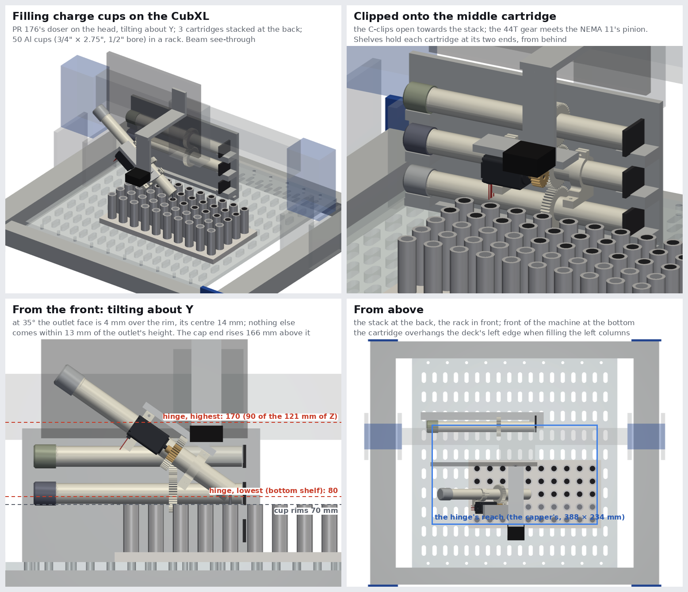
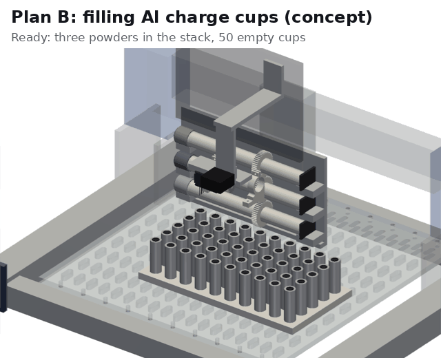

# Plan B: the CubXL filling Al charge cups for the alloy workflow (concept)

@benwhitney5463's idea ([PR 274](https://github.com/vertical-cloud-lab/byu-vcl/pull/274), 2026-10-22): put a powder
doser close to its built size on the CubXL's gantry, tilting about Y. It clips onto one auger at a time from a vertical
stack of augers that lie along X, and fills about 50 aluminium "vials" on the deck. The capper and pipette aren't used.

The vials are the atomizer's charge cups. [PR 277](https://github.com/vertical-cloud-lab/byu-vcl/pull/277)'s shop
drawing has them as made: 3/4" 6063 bar, 2.750" long, with a 1/2" bore 2.25" deep. Today they are filled one at a time
on powder-doser PR 176's doser on its bench
([powder-doser#186](https://github.com/vertical-cloud-lab/powder-doser/issues/186): 3.0432 g and 6.5676 g of 4047 for
the composition spread in [PR 232](https://github.com/vertical-cloud-lab/byu-vcl/pull/232)'s
`atomizer-charge/README.md`).

**This is a concept from CAD and estimates. Nothing has been built or tested.** [`alloy_cubxl.py`](alloy_cubxl.py) draws
it from PR 176's STEP on [`cubxl_shuttle.py`](../miniature-doser/cubxl_shuttle.py)'s stand-in of the CubXL. Only the
deck (Cubware's `PandaDeck.step`) and the doser's parts are real CAD. The rest of the machine is boxes placed from Ben's
measurements of 2026-10-19.

## How it works

1. **Pick.** The drive comes level to the front of a shelf and moves in along +Y. The tube snaps into two C-clips, and
   the cartridge's 44T gear meets the NEMA 11's 20T pinion. The drive lifts 5 mm off the shelf and backs out along −Y.
2. **Fill.** It carries the cartridge level, over the rims, to a cup. It then tilts about Y to 35° (cap end up) and comes
   down until the outlet face is 4 mm over the rim. It turns the auger until the cup has its dose, then goes back to
   level.
3. **Next powder.** It puts the cartridge back on its shelf, the reverse of the pick, and clips onto the next. A cup that
   takes two powders gets them in two visits.
4. **After the run, by hand:** weigh the cups, press the plugs (PR 232 puts the press-fit at over a tonne, far beyond
   the gantry), and bag and label them as now.

## Specs, as drawn

| | |
|---|---|
| **Cups** | PR 277's as-made cup: Ø19.05 × 69.85 mm 6063, a Ø12.7 mm bore 57.15 mm deep. Full, it holds 8.8 ± 0.4 g of 4047 at 1.60 g/cm³ tapped (PR 232). The thin-wall version, with a 5/8" bore, holds 15.9 g |
| **Rack** | 50 cups, 10 along X × 5 along Y at 30 mm pitch (270 × 120 mm between centres), through a 12 mm printed plate keyed to the PandaDeck. The cups stand on the deck, so the rims are 70 mm up |
| **Doses** | 3.1 to 11.5 g of 4047 per cup for the current spread (PR 232's 7.5 to 30 wt%). A second powder (Si, AlSi10Mg) is a second dose into the same cup |
| **Doser** | PR 176's parts: the tube (21 mm bore, 252 mm outlet to cap, its flight, v4 outlet, moulded 44T gear and cap), the NEMA 11 with its 20T pinion, and both split-clamp brackets cut open into C-clips on the side facing the stack |
| **Left off** | PR 176's base, its hinged mounting plate and two tilt servos, the tap collar and solenoid, and the PCB holder. The board can ride on the head or the gantry |
| **New** | A spine over the brackets and stepper, a hinge 42 mm above the auger's axis, one MG996R-size tilt servo on it, and a bracket to the head. All are placeholder boxes |
| **Tilt** | About Y: 0° (level) to pick up and to move, 35° to fill. From level to 35°, the outlet drops 27 mm and moves 36 mm towards the hinge |
| **At the cup** | The outlet face is 4 mm over the rim, and the exit at its centre is 14 mm over it, inside the 12.7 mm bore. Nothing else on the drive comes within 13 mm of the outlet's height, so the neighbouring cups are clear |
| **Powders** | 3 cartridges, one per shelf. The axes are 38, 83 and 128 mm above the deck, a 45 mm pitch. The brackets reach 29 mm below the axis and 24 mm above it, and the gear 23 mm either way |
| **Z** | The hinge works between 80 mm (the bottom shelf) and 170 mm (the top shelf) above the deck. That is 90 of the CubXL's 121 mm of Z, and the 155 mm needed for filling falls inside it |
| **X, Y** | The hinge takes the capper's place on the head. Every pose stays inside the capper's 388 × 234 mm reach: CubOS x 77 to 347, y 11 to 229 (229 is the pick, 4.7 mm inside the limit) |
| **Overhang** | The cartridge is 252 mm long and runs to −X of the outlet. For the left column of cups, its cap end is 62 mm past the deck's left edge, and at 35° it is 166 mm above the outlet. In the stand-in that space is clear, in front of the gantry's side plates |
| **Capacity** | The store between the gear and the cap is about 140 mm of the 21 mm bore, about 48 cm³. Half full, that is about 24 cm³, or about 35 to 40 g of 4047 |

## Plausibility

**The geometry works.** One stack of three powders, 50 cups and every pose fit inside the head's reach and its Z
travel. Each powder keeps its own tube, flight and outlet, so nothing the powder touches is shared between powders.

- **Checked in the model** (distances from the drive's vertices to the other parts' surfaces):
  - at every shelf, clipped on, lifted and backed out, the drive stays at least 3 mm from the stack's other
    cartridges and frame;
  - at the bottom shelf, the brackets pass 9 mm over the deck;
  - while filling a corner cup and a middle one, the doser stays at least 13 mm from the neighbouring cups.

Three things limit it, in order of how much they matter.

1. **The doser has to keep feeding 4047 first.** On the bench, PR 176's tube fed 4047 at 60 to 80 mg per turn while it
   flowed. But each dose slowed to about 1 mg/s within 2 to 3 minutes, and the tube stalled or clogged several times
   (powder-doser#186, 2026-10-19 to 21). Each of the two cups so far took several sessions, with reverse turns and
   taps to clear the tube.
   - **The run needs about 300 g** (50 cups × 6 g). At 70 mg per turn and 100 rpm, that is about 45 minutes of auger
     time.
   - **At the 1 mg/s it falls to,** 300 g would take more than 80 hours.
   - **So the order is:** a sustained flow of 4047 on the bench, then the gantry. Nothing on the CubXL makes the flow
     better.
2. **The cartridges hold too little for 50 cups.** About 35 to 40 g per cartridge is 4 to 11 cups' worth at 3 to 9 g.
   A full run would need about 8 refills of the main powder. In order of effort, the fixes are:
   - run 8 to 10 cups per load;
   - give the main powder two shelves;
   - give the cartridge a wider store behind the flight. With a 40 mm bore over the same 140 mm, it holds about 175 cm³,
     about 130 g half full. The gear, the clips and the outlet stay where they are.
3. **Z allows three shelves.** At 45 mm pitch, a fourth shelf would put the top axis at 173 mm. That needs 135 mm of
   Z, more than the CubXL's 121. Slimmer clips (20 mm below the axis) and shelves that alternate their cartridges'
   X positions by about 50 mm, so the gears don't stack, would allow a 40 mm pitch and four shelves. Three or four
   covers what is in use now: 4047, AlSi10Mg, Si and pure Al. A second stack needs shorter cartridges (about 190 mm)
   to fit side by side in X.

**Also untested:**

- Whether the gear meets the pinion cleanly as the tube snaps in. Tooth can land on tooth, so the stepper may need to
  jog a few steps, or the pinion may need a spring.
- Whether the cartridge sheds powder from the outlet while it is carried level. The flight's pockets held powder in
  PR 176's DEM, but loose powder sits in the v4 funnel. Shelves that hold cartridges a few degrees outlet up, and a
  park angle of −5° for moves, would be the first fix (as in the one-servo module, `../miniature-doser/README.md`).
- **The load on the head:** about 0.6 to 0.8 kg with powder, from PR 176's part masses. Nothing has been weighed. The
  4030's Z axis is sold to carry a router.

## Weighing

PR 176 closes its loop on a balance under the cup. There's no room for one under each of 50 cups, so there are three
options:

| Option | How | Cost | Verdict |
|---|---|---|---|
| **By hand, before and after** | The doser fills by turns, calibrated per powder on the bench. Each cup is weighed empty and full, as now, and the composition comes from the weighed masses (PR 232's `charge_composition()`) | No new parts; about 100 weighings per run | Start here |
| **Loss-in-weight on the head** | A load cell between the hinge block and the spine weighs the cartridge. Each dose is the drop in its reading, taken at the same tilt, with the head stopped | A 1 kg single-point cell and an HX711; a settle of a few seconds per reading | Next. This is how industrial loss-in-weight feeders meter |
| **A balance under the rack** | Only one cup takes powder at a time, so the rack's change in mass is the dose. About 2.2 kg on the pan, read to 0.01 g | The balance lifts the rims by its own height, 60 to 100 mm, which the Z travel doesn't have. It would need a cut-out in the deck | Only if the deck can be cut |

## Should it be a separate PR?

**Yes, I'd split it.** It shares only the CAD helpers with this PR (`doser_cad.py` and `cubxl_shuttle.py`). It uses
PR 176's full-size parts and serves the atomizer workflow (#222, #232, #264). The miniature doser is for #150's
"one powder, varying amounts, precise spots". This folder imports those two files from its neighbours, so a new PR
should be based on this branch, or copy them.

## Rendering

[`alloy_cubxl.py`](alloy_cubxl.py) needs what `../miniature-doser/cubxl_shuttle.py` needs: PR 176's STEP from the
powder-doser repo (`509a0bf`), Cubware's `PandaDeck.step`, cadquery-ocp 7.9 and pyvista 0.49. Its docstring has the
command. `--fit` prints the numbers in the table, `--views` draws only `alloy_cubxl_views.png`, and with no flag it also
draws `alloy_cubxl.gif`. It renders in under a minute on 4 cores.
