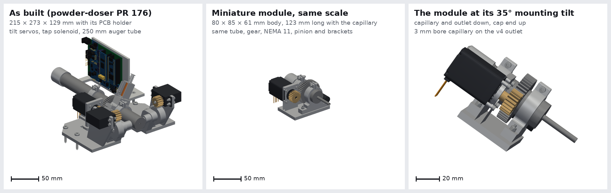
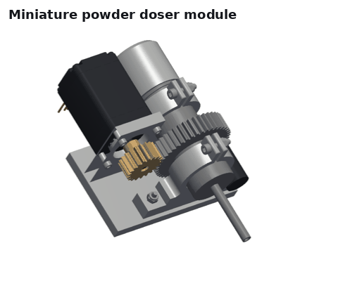
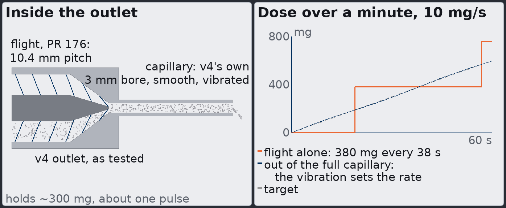
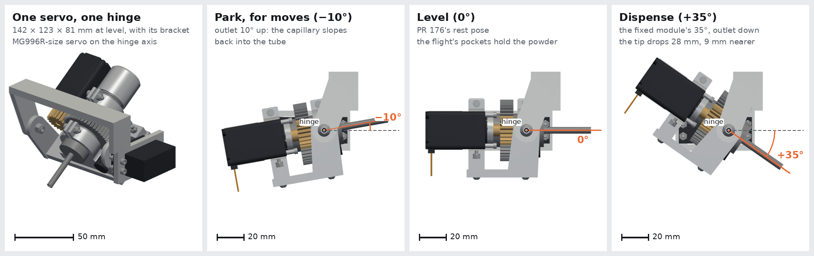
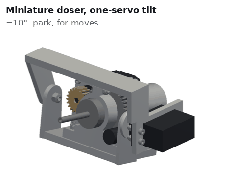
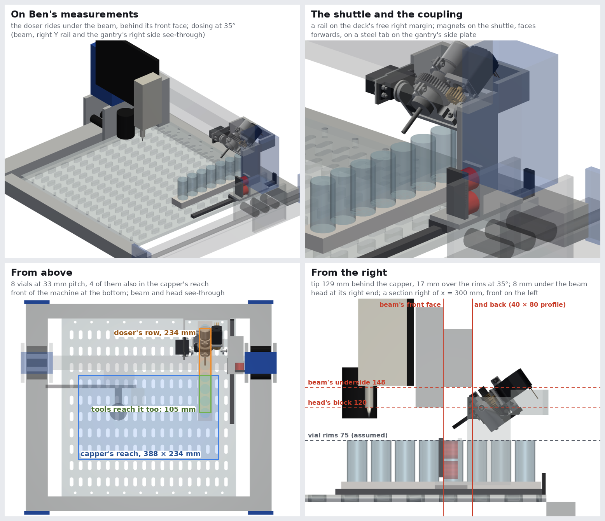
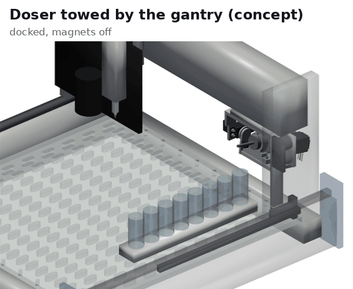
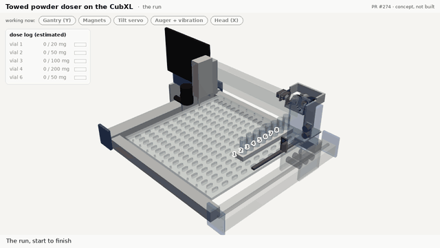
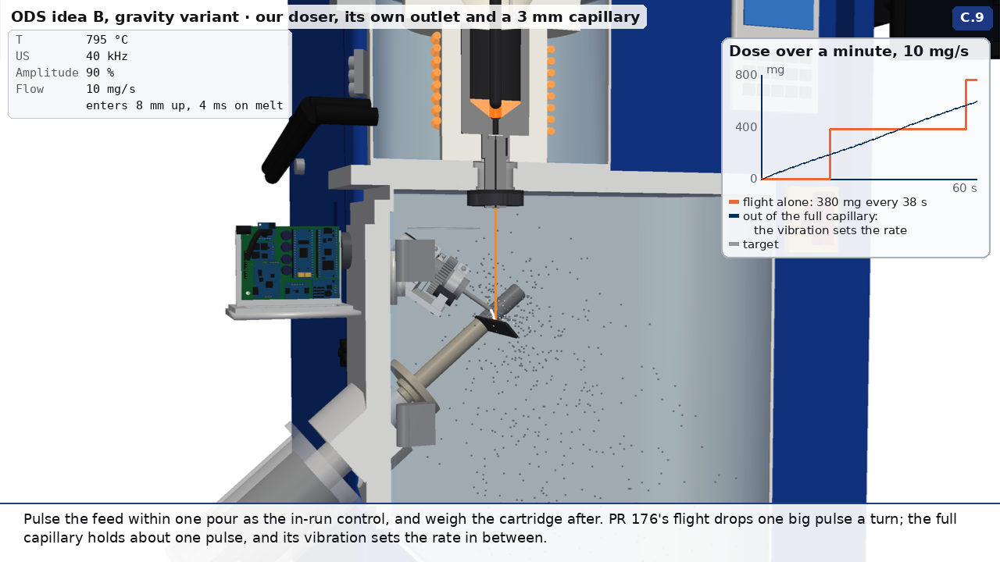

# Miniature powder doser: the lab's doser folded into an 80 × 85 × 61 mm module

This is the smallest version of the lab's powder doser drawn so far. It is built from
[powder-doser PR 176](https://github.com/vertical-cloud-lab/powder-doser/pull/176)'s own parts (branch
`claude/issue-172-20261003-2216`, commit `509a0bf`, `cad/text-to-cad/STEP/assembly_servos_above.step`), folded up, with
a screw-on capillary on the auger's outlet. It was first drawn to fit beside the melt stream inside the rePowder's
chamber (2026-10-06 and 07), where the doser as built (190 × 261 × 103 mm) has no room. The same module is a candidate
for the smaller powder-dosing module mentioned for the CubXL (byu-vcl issues 213 and 150): one powder, dispensed in
varying amounts to a precise spot, with powder changes done by hand.

This note is the self-contained version of the design. **Everything here is a concept from CAD and estimates. Nothing
has been built or tested.**

## What changed from the doser as built

[`doser_cad.py`](../ods-lpbf-gifs/doser_cad.py)'s `compact_meshes(nose=True)` builds the module from PR 176's STEP. Every kept part is
PR 176's own part, moved along the auger axis. The only new parts are a cradle, the capillary and a vibration motor.

- **Kept:**
  - the auger tube (25 mm OD, 21 mm bore, PR 176's internal flight and v4 outlet), its moulded 44T gear and its screw
    cap;
  - the NEMA 11 with its 20T pinion and its upright;
  - both split-clamp brackets and their screws.
- **Cut:** the tube goes from 250 mm to 85 mm, outlet face to cap end (`COMPACT_TUBE` keeps four pieces of it). The
  gear's front face sits 20 mm from the outlet, and the stepper stays behind the gear, now reaching back beside the
  cap. As drawn, the flight keeps the 25 mm between the outlet face and the gear's centre, about 2.4 of PR 176's 8
  turns, and the open store keeps 58 mm of the 21 mm bore, about 20 cm³ (about 12 g of 1.2 g/cm³ granules half
  full). A real build could run the flight further back into the store.
- **Dropped:**
  - the two MG996R tilt servos, the baseplate and the hinged mounting plate: the tilt is fixed ([one servo can come
    back](#one-servo-tilting-back-for-moves));
  - the tap collar and its solenoid: the vibration motor takes over. The solenoid can come back on the side if the
    bench shows the tap is still needed.
- **Added:**
  - a machined cradle under the brackets and the stepper's upright;
  - the capillary on the outlet (below);
  - a vibration motor on the front bracket's foot.
- **Size:** 80 × 85 × 61 mm for the body in its own frame, 123 mm long with the collar and capillary (as built, with
  its PCB holder: 215 × 273 × 129 mm).
- **Tilt:** fixed at 35°. PR 176's DEM gives the full dose per turn anywhere from 22.5° to 45° of tilt. The
  [one-servo version](#one-servo-tilting-back-for-moves) tilts from −10° to 45°.
- `compact_meshes(mirror=True)` builds the mirror image, with the stepper on the other side of the tube.

## The outlet: no funnel, no spout, no taper

Earlier versions added a separate funnel and spout, then a tapered nose. Both were dropped (Sterling's notes,
2026-10-07): powder can sit in an intermediate tube with nothing to move it, and a taper is where it is likely to clog.
What is left keeps PR 176's tested inside and follows the storage augers' rule, keep the bore and drop the flight:

| Along the axis | Inside | What it does |
| --- | --- | --- |
| Behind the outlet face | 21 mm bore, PR 176's flight (10.4 mm pitch, 0.5 mm thick, on an 8 mm core) | As tested: one pulse per turn |
| The last 12 mm behind the face | PR 176's v4 outlet: a short funnel to a 3 mm annular exit round the core's tip | As tested. The only narrowing, and the lab already runs it |
| 0 to 3 mm in front of the face | A collar, 25 mm OD, threaded onto the outlet end | Capillaries swap without reprinting the auger |
| 3 to 38 mm in front of the face | A capillary: 3 mm bore (v4's exit), 5 mm OD, smooth | Places the powder within a few mm of the target. Vibrated and kept full, it sets the rate between the flight's pulses |

The capillary turns with the tube (`NOSE_OUT`, `NOSE_IN` in `doser_cad.py`). The vibration motor shakes the tube and,
with it, the capillary. [`nose_insets.png`](../ods-lpbf-gifs/out/nose_insets.png) is a cutaway of the outlet and a sketch of what the full
capillary does to the pulses.

**Why not a full-bore smooth end?** A 21 mm mouth spills powder off its lowest point, so it can't place powder on a
spot a few mm across. The 3 mm bore is 20 to 60 diameters of a 50 to 150 µm granule, so free-flowing granules shouldn't
arch in it. Cohesive powder might: in PR 176's DEM, cohesive powder bridged in the v4 funnel until a tap freed it. So
the bench tests try 2 and 4 mm bores too.

## Pulses, and how to make the rate steadier

- **The flight delivers one pulse per turn.** PR 176's DEM gives about 0.3 cm³ of bulk powder per turn, about 380 mg
  of 1.2 g/cm³ granules. At 10 mg/s that is one pulse every 38 s.
- **The capillary holds about 250 mm³, about 300 mg,** close to one pulse. Two ways to run it, to compare on the bench:
  - **Screw-metered:** the auger's speed sets the rate, and the vibration only keeps powder moving.
  - **Vibration-metered:** the auger keeps the capillary topped up, and the vibration amplitude sets the rate. A full
    capillary discharges at a rate set by its bore, slope and vibration, more or less independent of the powder above
    it. With the vibration off, it acts as a valve if the bore is narrow enough for the granules to arch.
- **Smaller pulses without a taper:** a two- or three-start flight in the same 21 mm bore. Three starts give three
  pulses of about 127 mg per turn instead of one of 380 mg. That is a bench variant and is not drawn.
- **What vibrating capillaries have shown** ([Edison 02](../doser-atomizer/edison/results/02-steady-low-rate-auger-feeding.md), a literature
  review run through Edison Scientific): about 0.2 mg/s continuously with about 10 µm powder, and 1 mg/s
  at 150 Hz (Matsusaka 1996). Flow starts at about 2.5 m/s² of tube acceleration (1.1 to 3.9), and the maximum rate
  scales roughly as the bore to the power 2 to 2.5. In a larger bore, free-flowing powder kept running after the
  vibration stopped. One pharmaceutical vibrating capillary is reported at 1 to 10 mg/s with under 3 % variation, but
  how that was averaged is unverified.
- **The same review's advice:** don't change the taper, the pitch and the capillary all at once, because each can pack
  powder into a new blockage.
- **Vibration sources:** a coin eccentric-mass motor, a voice coil or piezo shaker, or the stepper itself dithering a
  few microsteps at tens of Hz, which needs no extra part. The render shows a separate motor so the function is
  visible.
- **Blown powder isn't obviously steadier at these rates.** DED powder feeders run at grams per minute. The
  pneumatically assisted microfeeders that reach mg/s meter the powder mechanically first and only then carry it in
  gas.

## Bench tests, before anything else is built

1. **Define steady first.** Log the balance at 10 Hz or faster. Report the delivered mass and its RSD over 0.1, 1, 5
   and 30 s windows, the fraction of time with no flow, the pulse spectrum, and the tail after a stop. A one-minute RSD
   can hide exactly the pulses that matter.
2. **One change at a time,** with a granule surrogate (spray-dried alumina or silica, 50 to 150 µm), at 22.5°, 35° and
   45°:
   - PR 176's tube as is, as the control;
   - two- and three-start flights in the same 21 mm bore, with no capillary;
   - a stationary, separately vibrated short capillary under PR 176's outlet, with adjustable bore and holdup;
   - the capillary on the outlet, turning with the tube: 2, 3 and 4 mm bores, 20 to 40 mm long, vibration on and off,
     watching for holdup and the tail after a stop.
3. **Compare vibration sources:** the existing solenoid tap, a coin eccentric-mass motor, and stepper dithering.
4. **Then a cohesive powder,** to find where the capillary bridges.
5. **Check the shortened flight:** whether 2 to 4 turns meter as well as PR 176's 8.

## Calibration and dose checks

- **The doser closes its loop on a balance under the cup**, as on the bench. Wherever there is room for a balance or
  load cell under the target, that stays the primary measurement: mg per turn and per vibration setting, measured in
  the conditions the dose will see.
- **Weigh the auger cartridge** (tube and cap) before and after a run on a 0.1 mg balance. That gives the total
  delivered, independent of everything else.
- **Video can count the powder in flight**, calibrated against the balance runs. Camera-based powder-flow sensing is
  established in blown-powder DED: an optical sensor converted to mass flow at 125 Hz ran a closed loop
  ([Breese 2021](https://doi.org/10.1007/s00170-021-07438-z)), and a 2025 review counts 34 camera-based methods
  against 4 weight-based ones ([Madeira Araujo 2025](https://doi.org/10.3390/pr13092995)).

## One servo: tilting back for moves

Fixed at 35°, the module rides outlet down with powder in its capillary whenever the gantry moves (Sterling,
2026-10-13). This version puts one servo back, so the module can go level, or a little outlet up, between doses.
[`doser_cad.py`](../ods-lpbf-gifs/doser_cad.py)'s `tilt_meshes(angle)` builds it and [`tilt_views.py`](tilt_views.py) draws it.

- **Hinge:** PR 176's own axis, the x axis 10 mm behind the outlet at the auger's height. Folding the module didn't
  move the outlet, so the axis is where PR 176 has it. The outlet and the capillary, where the loose powder is, move
  least: between level and 35° the tip drops 28 mm and comes 9 mm nearer the hinge, and at park it rises 8 mm.
- **Travel:** −10° (park, outlet up) through 0° (level, PR 176's rest pose) to 45°, with 35° to dispense.
- **Drive:** one servo, direct, with no gears. It is the servo PR 176's parts list has for the tilt, Adafruit #1142, an
  MG996R-size metal-gear servo. Its spline is on the hinge axis on the +x side, and its round metal horn is screwed to
  a cheek on the cradle. Its case sits in a frame with its ears on the frame's inner face, as in PR 176's cradles. It
  needs one of the two servo headers on PR 176's POWDER_DOSER_V2 board.
- **Other side:** a second cheek on −x turns on PR 176's M5 hinge screw, cut to 16 mm, in a fixed arm.
- **Bracket:** the arm and the servo's frame hang from a top plate, which is the mounting face. Nothing fixed is below
  the module, so on the CubXL's head the module still reaches the target first. Like the cradle, the plate and arm are
  placeholders.
- **Added parts:** the two cheeks, the horn, the servo and its frame, the arm and the top plate. The rest is the
  fixed module, unchanged.
- **Size:** 142 × 123 × 81 mm at level, with the bracket. The servo's case sticks out 22 mm past its frame.
- **Checked:** the sweep from −10° to 45° in 0.5° steps. The module clears the top plate by at least 8 mm (at 45°).
  The other fixed parts are outside the module's width, apart from the hinge itself.

**Why tilting back should stop the leaks:**

- **What can come out.** In PR 176's DEM, the flight's pockets held their powder with the tube stopped at 45°, and taps
  alone released nothing. What's loose is what sits below the flight, in the v4 funnel and the capillary. The
  capillary alone holds about 300 mg, close to one pulse.
- **The gantry's own acceleration is small.** The CubXL's controller limits it to 300 mm/s²
  ([`$120` to `$122`](../../../cubos/configs/gantry/cub_xl_ben_pipette_capper.yaml#L40)), which tilts the apparent
  gravity by about 1.8°. The risk is vibration and jolts. A tilted capillary is a vibratory feeder, and in the
  literature its flow starts at about 2.5 m/s² of tube acceleration (1.1 to 3.9; [Edison 02](../doser-atomizer/edison/results/02-steady-low-rate-auger-feeding.md)).
  How hard the head shakes hasn't been measured. An accelerometer on it during a run would show how close that is.
- **Outlet up, the slope runs back.** At −10° the capillary slopes back into the tube, so whatever shaking moves the
  powder moves it towards the funnel, not out of the tip. Level gives no slope either way, and vibratory conveyors move
  powder along level troughs, so a few degrees up is the margin.
- **Its weight turns it outlet up.** The module's centre of mass is about 33 mm behind the hinge and 8 mm below it. If
  the servo goes limp and its gears let the module turn, it falls towards park, not towards dispensing. A stop at the
  park angle would catch it.
- **The cost:** a capillary that drains back has to refill before powder reaches the target. That is about 300 mg, one
  pulse, or about 30 s at 10 mg/s. Parking level might keep it full, so the park angle is a bench question: run the
  same moves parked at −10°, −5° and 0°, and weigh what falls out and how long the first dose takes to start.
- **A possible bonus:** tilting up at the end of a dose may cut the tail after a stop, since the capillary stops
  feeding once its slope reverses.

**Servo sizing, estimated:**

- **Mass:** about 0.41 kg in air. That counts the NEMA 11's 180 g, PR 176's printed parts, an aluminium cradle and
  cheeks, the vibration motor, the 316L collar and capillary, and 12 g of powder.
- **Torque:** at most about 0.14 N·m (1.4 kg·cm), near 13°. The #1142 gives 8.5 kg·cm at 4.8 V, about 6 times that.
- **Speed:** the #1142 turns 60° in 0.20 s at 4.8 V, so park to dispense takes 0.15 s at full speed. Slew it in small
  steps over a second or so, so that the tilt itself doesn't jolt powder out.
- **A smaller servo:** a micro metal-gear servo, about 23 mm along its spline instead of 37 mm, would make the tool
  about 15 mm narrower. At 2 to 3 kg·cm it would leave a margin of only 1.5 to 2.

**Not checked, for this version:**

- Whether parking outlet up holds the powder on the head, which park angle to use, and how long the capillary takes
  to refill. The DEM was not re-run.
- Whether the servo hunts, or wears, while the vibration motor shakes the module it holds.
- The mass and centre of mass are estimates from assumed part masses. Nothing has been weighed.
- At 35° the cradle's front edge is 6 mm lower than the capillary's tip, though 53 mm behind it, so a target near the
  tip has to clear it. The fixed module has the same geometry. At 45° the tip is the lowest point.
- The head's tool interface isn't defined. At 35° the stepper's end rises 11 mm above the top plate, behind it (19 mm
  at 45°), so the head needs room there.
- The horn's screws, how the cheeks fix to the cradle, and any end stops aren't drawn.

## Towed by the gantry: the doser parked in a back corner

@benwhitney5463's sketch ([PR 274](https://github.com/vertical-cloud-lab/byu-vcl/pull/274), 2026-10-16): the doser
lives in the back right corner of the CubXL. Electromagnets on its side hold it to the gantry while the gantry moves in
Y, so it rides behind the tools and doses into vials in one row along Y. Below, the one-servo variant is drawn on a
stand-in of the CubXL, now placed from Ben's measurements of 2026-10-19 and his photo of the right Y rail. Only the
deck, Cubware's `PandaDeck.step`, is real CAD. [`cubxl_shuttle.py`](cubxl_shuttle.py) draws both images and prints the
clearances.

**Ben's measurements** (with the backboard moved out of the way, and in brackets with it in place):

| | |
|---|---|
| The deck's right edge to the right Y rail, in X | 38 mm |
| The beam's front face to the capper's axis, in Y | 115 mm (65 mm to the backboard's front face) |
| The deck to the beam's underside, in Z | 148 mm (120 mm to the bottom of the head's block) |

The model also assumes a beam 40 mm deep (a SainSmart review of the 4030 V2 lists its X axis as a 40 × 80 mm profile
with the ball screw inside), vial rims 75 mm above the deck, and where CubOS's (0, 0) sits on the plate.

**It still fits, with less to spare.** The doser has to stay behind the beam's front face, and under the beam it has to
stay below 148 mm. The previous version guessed the beam's height, and the doser reached about 175 mm. It still does,
but only at its back end, which sits behind a 40 mm beam:

- **Under the beam:** 8 mm of clearance at the worst pose between park (−10°) and dosing (35°). Behind the beam, the
  stepper's end reaches 174 mm. The servo can go to its 45° limit without touching the beam.
- **The head's block doesn't limit the head's X travel.** The block reaches 50 mm in front of the beam and hangs to
  120 mm, but no part of the doser is ever in front of the beam's front face. The block passes in front of the doser at
  any X, and the animation runs the head to its right end to show it. This holds only if nothing on the X carriage
  reaches behind the beam's front face below the beam. Ben's photo doesn't show the back of the carriage.
- **The offset grew:** the tip trails the capper by 129 mm at 35° (it was a guessed 94 mm). The doser's row is still
  the whole Y travel, 234 mm, which takes 8 vials at 33 mm. The tools reach 105 mm of it, so 4 vials can be dosed and
  also capped or pipetted (it was 5).
- **Over the rims:** at 35°, the tip is 17 mm above the rims, as before.

**The fit is tight, so it depends on two numbers that weren't measured.** Clearance under the beam at the worst pose,
in mm, where 4 mm is the target:

| Park, dose | Rims at 75 mm, beam 40 mm deep | Beam 60 mm deep | Rims at 83 mm, beam 40 mm deep |
|---|---|---|---|
| −10°, 35° (as drawn) | 8.3 | −1.6 | 0.3 |
| 0°, 22.5° | 15.4 | 8.4 | 7.4 |

Ben's deck file gives his vials a height of 83 mm. If their rims really are 83 mm above the deck, or the beam is deeper
than about 48 mm, the doser should park level and dose at 22.5°, the shallow end of the range in which PR 176's DEM
gives a full dose per turn. Then the tip is 19 mm over the rims and 124 mm behind the capper. Parking level gives up
the outlet-up park, so the leak question in the one-servo section becomes a bench test.

**What the measurements changed in the drawing:**

1. **The shuttle's rail moved onto the deck.** The 38 mm gap holds the gantry's own side plate: in the photo, the
   inner plate runs between the deck and the rail and carries the wheels. A rail on the Y rail's inner face would be in
   the plate's way. `PandaDeck.step` has no slots outboard of x = 458 mm, so an MGN12 rail (12 mm wide) screws down in
   that 22 mm strip, outside the tools' reach. It runs 285 mm along the deck's right edge, and the carriage docks
   against a stop at the deck's back edge.
2. **The doser hangs from a side frame, not from a top plate.** The one-servo bracket's top plate would sit about
   163 mm up, above the beam's underside. Instead, the shuttle's side plate carries the hinge screw (in place of the
   −x arm), the servo's frame carries the other side, and a cross-member joins them behind the module's sweep. That
   is behind the beam, where there is height.
3. **The magnets and the tab moved down and in.** The tab is bolted to the inner face of the gantry's side plate, in
   line with the beam's front face, and reaches 27 mm in, to just over the deck's edge. The magnets sit on a block on the
   shuttle's foot, 34 and 62 mm up, faces forwards. They work as before: moving back, the tab pushes the shuttle;
   moving forwards, it pulls through the magnets.
4. **Docked, the frame sticks out behind the machine.** At the back of its travel, the doser's frame reaches about
   105 mm past the deck's back edge, 110 to 145 mm up. That space has to be clear of cables and the wall.

**The rest of the reasoning still holds** (from the 2026-10-16 version):

- **Run the doser on its own rail, and don't hang it on the magnets.** A magnet holds well in pull and poorly in
  shear, and an electromagnet lets go when its power is cut. Hung from one, the doser would drop onto the vials at an
  e-stop. On a rail, the rail carries the weight and fixes X and Z, and with the power off the doser stays put.
- **Face the magnets along Y, and give them steel to pull on.** Face-on, the contact face sets the doser's Y, and the
  gantry's plates are aluminium, so the tab is low-carbon steel.
- **Forces:** about 0.7 kg towed, at the controller's 300 mm/s² (`$120` to `$122`), is 0.2 N. With about 1 N of drag
  from the rail's carriage, call it 2 N. Two [Adafruit 3873](https://www.adafruit.com/product/3873) magnets (P25/20,
  5 V, 0.3 A, rated 5 kg each) give 10 to 20 N at the fifth to tenth of the rating Adafruit says to expect.
- **Height:** the doser has no Z axis, but its tilt servo works as one. From park (−10°) to 35°, the tip drops 36 mm.
  Every vial in the row has to be the same height.
- **Homing** drives the gantry to +Y, the back. The dock has to be where homing leaves the doser, with a little
  spring in its stop.
- **Control and wiring:** the doser's own board switches the magnets through a logic-level MOSFET with a flyback
  diode. A switch at the dock and a switch or Hall sensor at the coupling tell CubOS where the doser is. The cable
  follows the shuttle in a small drag chain. In CubOS it would be a new instrument type with a Y offset of about
  +129 mm, a fixed X and Y moves only. That isn't written.
- **Alternatives:** a fixed station, with vials brought to it; a third tool on the head, which reaches any XY but adds
  mass to the head and uses up Z; or the doser on its own Y axis, which costs a motor, a driver and homing.

**Four measurements would settle the fit:**

1. The beam's depth, front face to back face. The model takes 40 mm. Past about 48 mm, the drawn angles leave less
   than 4 mm under the beam.
2. Whether anything on the X carriage (its wheels, or the block) reaches behind the beam's front face below the beam.
3. The height of the rims of the vials to be dosed, above the deck.
4. The free room behind the machine at the back right corner, 110 to 145 mm up.

**Not checked, for this version:**

- Everything but the deck and Ben's three numbers. The frame, gantry, head and tools are boxes and cylinders.
- Whether the MGN12 rail can be screwed into the polycarbonate deck's edge strip, or needs a stiffening bar under it.
- The masses (nothing has been weighed), whether the magnets run warm when left on for a whole run, and whether being
  towed shakes powder out.

### The whole run, as a video

The GIF is the run at about 3× the video's speed. The video,
[`cubxl_shuttle_workflow.mp4`](cubxl_shuttle_workflow.mp4), is 1 min 41 s at 1280 × 720 and is laid out like
[PR 278](https://github.com/vertical-cloud-lab/byu-vcl/pull/278)'s copper-corrosion video.
[`cubxl_shuttle_video.py`](cubxl_shuttle_video.py) draws it from `cubxl_shuttle.py`'s model, and
[`cubxl_shuttle_workflow.json`](cubxl_shuttle_workflow.json) has its chapters and captions, with their times.

| Time | Chapter |
|---|---|
| 0:00 | **The real CubXL**: Ben's photo of it empty (#133), his sketch of the idea and his photo of the right Y rail (both from this PR), in [`media/`](media) |
| 0:05 | **The same machine as a model**, seen from the photo's side, turning to the working view |
| 0:10 | **The doser's parts, one at a time**, each with a name: the vial row, the rail, the dock, the shuttle, the doser and the magnets. Then the tab on the gantry, and the capper and pipette on the head |
| 0:27 | **Before the run, by hand**: load the auger and weigh the cartridge, calibrate on the bench, tare the vials, check the coupling and the board |
| 0:51 | **The run**: home onto the docked shuttle, magnets on, tow to vial 1 outlet up, tilt, dose 20 mg, back to park. Then 50, 100 and 200 mg into vials 2 to 4 and 50 mg into vial 6. Then the head runs past in front, the doser goes back to the dock, and the magnets let go |
| 1:30 | **After the run**: weigh the vials and the cartridge |
| 1:36 | Summary |

In the run:
- the part doing the work is outlined in orange and lit in the "working now" panel (the gantry, the magnets, the tilt
  servo, the auger and vibration motor, or the head);
- its target is ringed;
- the dose log and the heaps in the vials follow the estimates above: about 380 mg per turn, 10 mg/s and 1.2 g/cm³,
  with the heaps drawn at an assumed 30° angle of repose;
- doses longer than 2.6 s are sped up, by up to 8×, and the label says how much.

The vials stay open while the doser works the row, because its body trails over the vials behind the tip.

## Where it was first drawn: inside the atomizer chamber

[`ods_c_gravity.gif`](../ods-lpbf-gifs/out/ods_c_gravity.gif) (5 fps; [`ods_c_gravity.mp4`](../ods-lpbf-gifs/out/mp4/ods_c_gravity.mp4) has every frame, and
[`ods_c_gravity.json`](../ods-lpbf-gifs/out/ods_c_gravity.json) gives each step's caption and frame range; unlisted on YouTube at
https://youtu.be/ZlRDlSrZXf4) shows the problem it was built for:

- **C.1 and C.2:** the doser as built doesn't fit beside the stream on either side.
- **C.3:** the module, on a slide on the chamber door, upslope of the stream, with its capillary 2.6 mm from the
  stream's surface.
- **C.4 to C.9:** its electronics, loading, calibration in place, feeding, the entry-height knob and an in-run
  on/off control.

That version is built for the chamber: a 316L auger printed by laser powder bed fusion, PEEK pinions, a vacuum-rated
stepper, vented stainless fasteners, and the POWDER_DOSER_V2 board kept outside the chamber, with only the stepper,
the vibration motor and a thermocouple inside, wired through a multipin feedthrough. **On a bench or a deck in air,
none of that is needed:** PR 176's printed parts, its normal NEMA 11 and its board apply as they are.

## Not checked

- Nothing has been built. The module is PR 176's parts rearranged in CAD.
- Whether the shortened flight meters as well as PR 176's 8 turns, and whether the 3 mm capillary meters steadily.
  The mg figures are estimates from PR 176's DEM volume per turn and an assumed 1.2 g/cm³ granule bulk density. The DEM
  was not re-run for the new parts.
- The store and flight figures above are computed here from the drawn tube pieces and PR 176's `auger.py`. The
  2026-10-06 note had about 14 cm³ and about 4 turns.
- The cradle is a placeholder box, not a designed part. There is no mounting interface for any deck yet.
- The render shows PR 176's tube from outside. The flight and v4 outlet appear only in the cutaway.

## Rendering

[`module_views.py`](module_views.py) draws `module_views.png` and `module_turntable.gif`. Its docstring has the
checkout and install commands. [`tilt_views.py`](tilt_views.py) draws `tilt_views.png` and `tilt_motion.gif` the same
way, from `doser_cad.tilt_meshes`. [`cubxl_shuttle.py`](cubxl_shuttle.py) draws `cubxl_shuttle_views.png` and
`cubxl_shuttle.gif`, and also needs Cubware's `PandaDeck.step` (its docstring has the command). [`cubxl_shuttle_video.py`](cubxl_shuttle_video.py) draws
`cubxl_shuttle_workflow.mp4`, its GIF and its JSON from the same model, and also needs imageio-ffmpeg. They need the doser's STEP from the powder-doser repo, cadquery-ocp 7.9 (8.0 moved
`TDF_LabelSequence`) and pyvista 0.49. [`doser_cad.py`](../ods-lpbf-gifs/doser_cad.py) reads the STEP once (about 10 s) and caches the
meshes in `.cache/`. [`nose_insets.py`](../ods-lpbf-gifs/nose_insets.py) draws the cutaway; it takes its fonts from the atomizer GIFs' helper module, so to
run it on its own, swap `gifkit.font` for PIL's `ImageFont.truetype`. The chamber GIF's scene code (`ods_gifs.py`) is
not included: it builds on byu-vcl's rePowder viz3d model and also holds the other atomizer concept animations.
