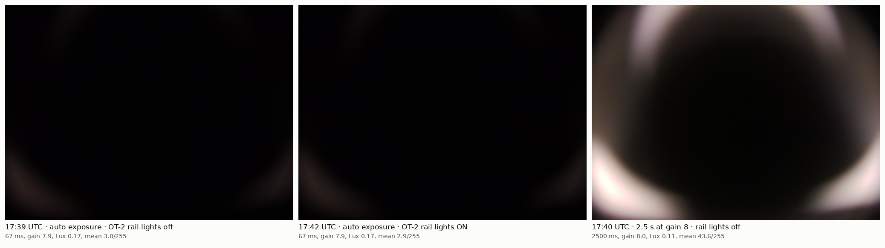
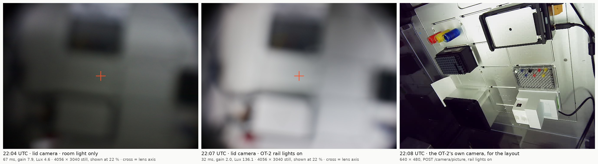
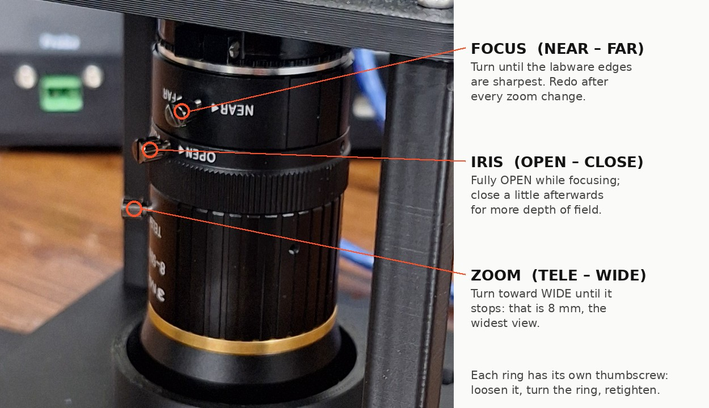
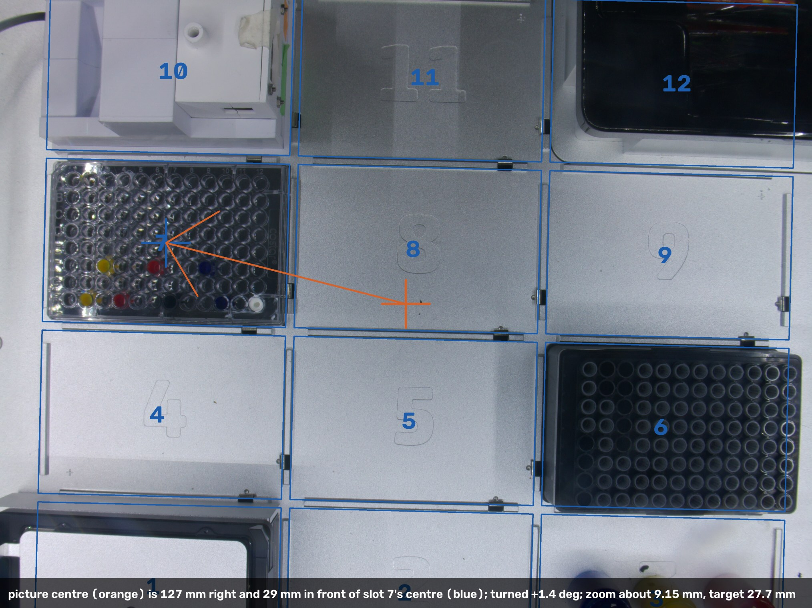
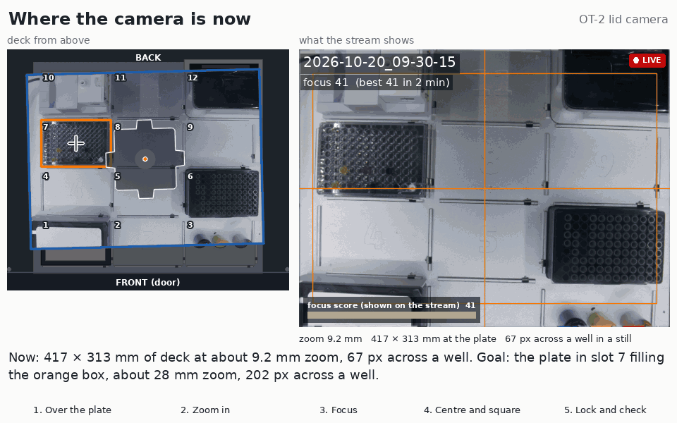
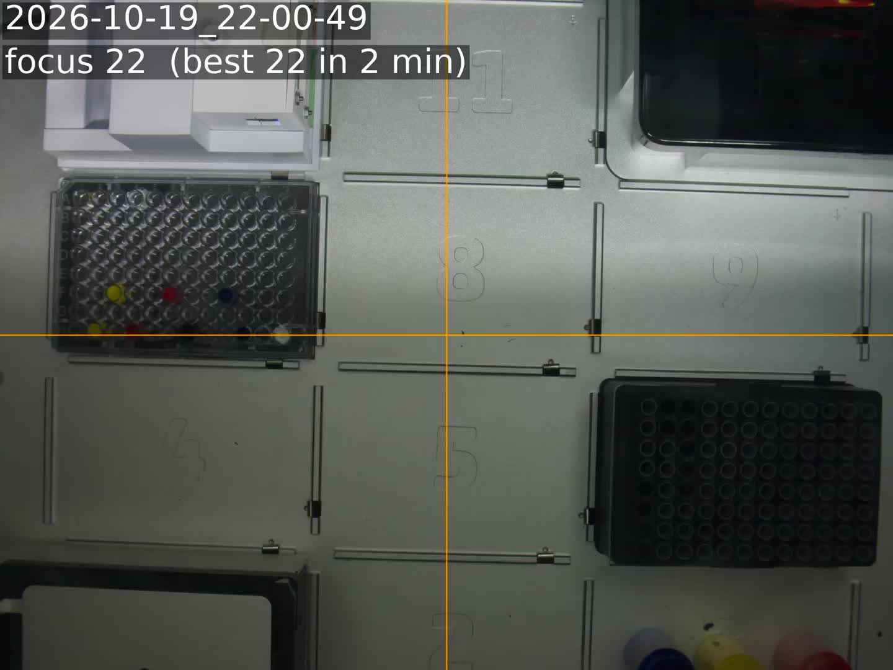

# Seeing what the lid camera sees

The camera is the HQ Camera (IMX477) with the 8–50 mm zoom, on the Pi 5 that sits on the
mount's deck. On the tailnet it is the Pi behind `RPI_STREAM_CAM_HOSTNAME`, which also runs
CubOS and reaches the OT-2 over its wired link. Only one program can hold the camera at a time.
Since 2026-10-20 the stream's own camera process also takes full-resolution stills, so a still
no longer means stopping the stream ([below](#2026-10-20-stills-while-it-streams-and-lining-it-up)).
`preview_server.py`, `rpicam-still` and `rpicam-hello` still need the stream stopped
(`sudo systemctl stop device.service`, then `start` afterwards); see
[`stream/README.md`](stream/README.md). The Pi reboots at 05:00, 13:00
and 21:00 local time, which takes the stream off the air for under a minute; a preview or still
that is running holds the reboot off ([Reboots](stream/README.md#reboots)).

| Way | Needs | Good for |
|---|---|---|
| **Live, anywhere: the YouTube stream** in the [OT2 overhead Livestreams Playlist](https://www.youtube.com/playlist?list=PLM4VC4X_7XKQ) (public, since 2026-10-18; its own playlist since 2026-10-19; see [`stream/`](stream/README.md)) | Nothing | Watching the deck from anywhere, with YouTube's 5–20 s of delay. Full 4:3 field at 1920 × 1440, 3 fps, timestamp top left |
| **Live, in a browser:** [`preview_server.py`](preview_server.py) on the Pi, then open the address it prints | The viewing device on the lab's tailnet, and someone with SSH to the Pi to start it (or a comment asking `@claude` to start it) | Positioning and focusing the mount |
| **Live, on a monitor at the robot:** `rpicam-hello -t 0 --viewfinder-mode 2028:1520:12:P` | A monitor on the Pi's micro-HDMI port, plus a keyboard or an SSH session to start it | Positioning while standing at the OT-2, with no network in the loop |
| **One full-resolution still, while the stream runs:** a comment asking `@claude` for a still from the lid camera, or `curl -s localhost:8081/still` on the Pi | Nothing | Checking the result and measuring. 4056 × 3040 px in about 0.3 s, and the stream carries on. [`measure_still.py`](measure_still.py) turns one into the millimetres to move the mount |

```bash
# on the Pi
curl -s localhost:8081/still > still.jpg       # full resolution, while the stream runs
curl -s localhost:8081/status                  # frame rate, exposure, focus scores
python3 preview_server.py                      # stream stopped first; prints http://<tailnet address>:8000; stops after 30 min
python3 preview_server.py --minutes 90
rpicam-still -n -t 3000 -o still.jpg           # stream stopped first; full resolution
```

`preview_server.py` listens on the Pi's tailnet address only, not on the campus Wi-Fi. The
tailnet policy lets people reach any port on a device, so anyone on the tailnet can open it.

## Use the whole sensor

The live view must cover the same field as a still, or the slots at the edges look cut off when
they aren't. [PR #84's `preview_server.py`](https://github.com/vertical-cloud-lab/byu-vcl/blob/84b8c0b/ot2-overhead-camera/preview_server.py)
asks for a 1536 × 864 stream. For that, libcamera picks the IMX477's 16:9 mode,
`ScalerCrop (108, 440, 3840, 2160)`: 95 % of the sensor's width and 71 % of its height. At 8 mm
from the middle of the deck it hides the front 52 mm of slots 1–3 and the back 52 mm of
slots 10–12 ([figure](../renders/wide_view_8mm.png)). The version here forces the 2028 × 1520
binned mode, `ScalerCrop (2, 0, 4052, 3040)`, and streams 1352 × 1014. Both crops were read
from the camera on 2026-10-15, and this script was run there end to end: 4:3 frames, the page,
the tailnet-only listener, and the stop after `--minutes`.

The live view is a third of full resolution: about 2.8 px/mm at 8 mm, or 19 px across a well.
That's enough to position and focus by, not to measure.

## 2026-10-15, 17:39 UTC: the camera saw nothing of the deck



At 17:39–17:42 UTC the frame was black. Turning the OT-2's rail lights on (17:42:04–17:42:08,
no run active, then back off) changed nothing: the same auto exposure, 67 ms at gain 7.9,
and Lux 0.172 against 0.173. So the lens wasn't looking at the deck. A 2.5 s exposure shows
light only in the corners, and very blurred, which points at something close to the lens.
Check, in this order:

1. the lens cap;
2. the blackout paper on the lid, which needs a hole at least as big as the base's 46 mm
   aperture under the lens;
3. that the mount is over the window;
4. that the iris ring isn't closed.

The numbers are in [`frames/2026-10-15/frames.json`](frames/2026-10-15/frames.json).

## 2026-10-15, 22:04 UTC: the deck is in view, out of focus



Whatever blocked the lens has gone. Turning the rail lights on for 5 s (22:07, no run active,
then back off) raised the camera's Lux reading from 4.6 to 136, and labware shows. But the
frame is badly out of focus.

The zoom already looks at or near the wide end. The dark labware at the top of the frame spans
1,130 of the still's 4,056 px. A 128 mm labware footprint would span 1,086 px at 8 mm,
1,358 at 10 mm and 1,629 at 12 mm. The corners are also dark, at 20–27 % of the centre's
brightness, as expected below about 9 mm. The blur and the labware's height make this good
to about a millimetre.

Zoom, focus and iris are manual rings, each locked by its own thumbscrew, so they can only be
set at the robot:



1. Turn the zoom ring toward WIDE until it stops: that is 8 mm.
2. Open the iris fully, which makes the sharpest point easiest to find.
3. Turn the focus ring until the labware edges are sharp. The lens is varifocal: changing the
   zoom moves the focus, so refocus after every zoom change.
4. Tighten the three thumbscrews. Closing the iris a little afterwards adds depth of field.

If no position of the focus ring gives a sharp picture, check the C–CS adapter: exactly one
ring between the lens and the camera, as in step 6 of [the assembly](../README.md#2-assemble).
In July a misplaced adapter ring is why the camera wouldn't focus (#84). The numbers are in
[`frames/2026-10-15/frames_2204Z.json`](frames/2026-10-15/frames_2204Z.json).

## 2026-10-18: streaming to YouTube

The camera now streams around the clock as `device.service` on the Pi, public. Until
2026-10-19 16:24 UTC it went into the
[OT-2 Livestreams Playlist](https://www.youtube.com/playlist?list=PLdKz1vXA-rfQ); since then it has
its own, [OT2 overhead Livestreams Playlist](https://www.youtube.com/playlist?list=PLM4VC4X_7XKQ),
at 1920 × 1440 and 3 fps. The newest video in the playlist is the live one. That is the way to watch the feed while positioning,
zooming or focusing the mount: YouTube adds 5–20 s of delay, so move, wait, look. The set-up,
settings and how to operate it are in [`stream/README.md`](stream/README.md). The stream holds
the camera, so `preview_server.py` and `rpicam-still` need it stopped first.

**First frames, 04:34–04:38 UTC: black.** Frames were pulled from the live stream on the Pi
(`yt-dlp -g` for the HLS address, then `ffmpeg -frames:v 1`) with the OT-2's rail lights
switched on for 20–40 s at a time (no run active, lights off again afterwards). The robot's own
camera saw a lit deck in the same seconds (mean luma 111 of 255,
[picture](frames/2026-10-18/ot2_camera_0438Z_lights_on.jpg)); the stream frame was black
(mean luma 1.1, [frame](frames/2026-10-18/stream_frame_0438Z_lights_on.jpg)), with and without
the lights. That is the 15 Oct 17:39 UTC situation again: the lens is capped, the iris is closed,
or the blackout cover is over it. Check those at the robot. The stream shows the deck the moment
the lens is clear; nothing needs restarting. The orientation (`CAMERA_VFLIP`/`HFLIP`) could not be
judged for the same reason and is still at the default.

## 2026-10-20: stills while it streams, and lining it up

**Point-and-shoot alongside the stream.** The approach is option A of
[borysgroup/streamingLambda#9](https://github.com/borysgroup/streamingLambda/issues/9), listed first
in [vertical-cloud-lab/streamingLambda#6](https://github.com/vertical-cloud-lab/streamingLambda/issues/6):
one picamera2 process owns the camera, sends the stream its frames, and keeps the full-resolution
picture for stills. In [borysgroup/streamingLambda PR #10](https://github.com/borysgroup/streamingLambda/pull/10)
it ran live to YouTube for 8 h on a Pi Zero 2 W stream cam, with 0 restarts and 95 of 95 stills.
Here it is [`stream/picam_source.py`](stream/picam_source.py), which `device.py` runs in place of
`rpicam-vid` (`CAMERA_SOURCE = "picamera2"`). The ISP makes two pictures from every sensor readout:
4056 × 3040 for stills and 1920 × 1440 for the stream. Measured on the Pi while streaming: 3.0 fps
with no frames dropped, a still in 0.27–0.33 s, 11 % of one core for the camera process. Details
are in the stream's [change record](stream/README.md#change-record-2026-10-20).

```bash
ssh <pi> 'curl -s localhost:8081/still' > still.jpg      # from a machine on the tailnet
python3 measure_still.py still.jpg                       # where it is looking, and what to move
```

### Where it is looking now



Measured by [`measure_still.py`](measure_still.py) from a full-resolution still at 03:58 UTC
([still](frames/2026-10-20/still_0358Z_lit.jpg), OT-2 rail lights on for 10 s, no run active). It
finds the rails in the gaps around slots 5 and 8 and fits them to Opentrons' slot pitch: 0.07 mm
rms. Numbers in [`../exports/lid_camera_setup.json`](../exports/lid_camera_setup.json).

**The goal is one plate, close up.** The mount was designed to look straight down at the one
96-well plate being measured, at about 25 mm of zoom ([README §3](../README.md#3-where-on-the-lid)).
From 2026-10-15 these notes steered toward the 8 mm whole-deck view instead, and the first version
of the steps below (03:40 UTC tonight) lined the camera up for that: a third of the resolution, and
short of the ~100 px across a well that #84's options doc asks for to measure intensity. The target
is now the colour-mixing plate in **slot 7**, where PR #202's runs keep it (it is there in the still
above), filling the picture with about 5 mm of deck either side:

| | Now (03:58 UTC) | Target |
|---|---|---|
| Zoom | about **9.15 mm**: 417 × 313 mm at the plate's top | **27.7 mm**: 138 × 103 mm |
| In a still (4056 × 3040) | 9.7 px/mm, **67 px** across a well | 29.4 px/mm, **202 px** across a well |
| On the stream (1920 × 1440) | 4.6 px/mm, 32 px across a well | 14 px/mm, 96 px across a well |
| Centre of the picture | **127 mm right and 29 mm in front** of the plate's centre | on it, to within about 2 mm |
| Rotation | **+1.4°** (the rails slope down to the right) | under 0.5° |

5 mm either side is tighter than the 12–14 mm that 25 mm leaves (README §3), because the live
stream now places the mount to a millimetre or two. It still allows for the plate sitting a
millimetre off in its slot and for the last fraction of a degree of rotation. Another margin is
`setup_video.py --margin`.

### Lining it up over the plate: slide, zoom, focus, centre and square, lock



Labelled video to pause on: [YouTube](https://www.youtube.com/watch?v=a5qfAB4CNxU) (unlisted, 1:34, a chapter per step) or
[`../renders/setup_steps.mp4`](../renders/setup_steps.mp4); made by
[`../cad/setup_video.py`](../cad/setup_video.py) from the measured start, so it can be re-rendered
after the next still (`--slot` for another slot's plate). The whole-deck version of 03:40 UTC
([YouTube](https://www.youtube.com/watch?v=ZStu8aZcogI)) is superseded.

**Before you start.** Turn the room lights and the OT-2's rail lights on: the focus score is noise
in the dark. Open the stream on a phone (the newest video in the
[OT2 overhead Livestreams Playlist](https://www.youtube.com/playlist?list=PLM4VC4X_7XKQ)). While
`SETUP_OVERLAY = True` it shows an **orange cross** through the middle of the picture; an **orange
box** (`SETUP_BOX`, since 2026-10-20 05:57 UTC) where the plate's outline lands when the zoom is
right; and, under the timestamp, **`focus N (best M in 2 min)`**, a sharpness score for the middle
of the full-resolution picture, worked out for every frame. YouTube is 5–20 s behind, so after each
change wait about 20 s before you judge.

1. **Slide the mount over the plate.** Lift the tape and slide the **whole mount** about
   **127 mm to the left and 29 mm toward the back** (seen from the door), with the arrow on the base
   still pointing at the door, until the cross lands on the middle of the plate: between wells D6,
   D7, E6 and E7. Within about 5 mm is enough for now. On the lid that puts the lens axis about
   123 mm right of the line through the two left window screws and 231 mm behind the line through
   the two front ones (slot 7 in [README §3](../README.md#3-where-on-the-lid)).
2. **Zoom in until the plate fills the box.** Loosen the zoom thumbscrew and turn the zoom ring
   toward **T** until the plate's left and right edges reach the box's sides, at about 27–28 mm.
   Tighten the thumbscrew. If the plate runs out of the box on one side as it grows, slide the
   mount a little that way. The picture goes soft: this lens is varifocal, so zoom moves focus.
3. **Focus.** Open the iris fully (toward 1.4) to make the sharpest point easy to find. Turn the
   focus ring about 1/16 of a turn, wait, read the score; keep going while it rises, and when it
   falls go back to the best. Tighten the focus thumbscrew. Then close the iris to about **f/8**:
   the depth of field is then about 24 mm, enough for the wells' rims and the paint 11 mm below them
   to be sharp together. The auto exposure makes up the light.
4. **Centre and square.** Nudge the mount until the plate sits evenly in the box, with the same
   strip of deck at its left and right and at its top and bottom. Then turn it **clockwise, seen
   from above, by about 1.4°** (a tab's tip moves about 1.8 mm) until the plate's edges run
   parallel to the box. At this zoom 1 mm of deck is 14 px on the stream, so small moves.
5. **Lock and check.** Tighten all three thumbscrews, tape the base down
   ([phase 1](../README.md#4-install-phase-1-tape-no-cutting)), and comment
   `@claude take a still with the lid camera and measure it`. `measure_still.py --plate 7` fits the
   plate's 96 wells and reports what is left to move. Done when the plate's centre is within about
   2 mm of the picture's centre and the rotation is under 0.5°. Then ask for
   `SETUP_OVERLAY = False`, which takes the cross, the box and the score off the stream.

If the protocol moves the plate to another slot, the mount moves with it: slot 8 is the nearest
to where the mount is now (about 29 mm toward the back and 5.5 mm to the right). The box fits any
SBS-footprint plate of about the same height.


