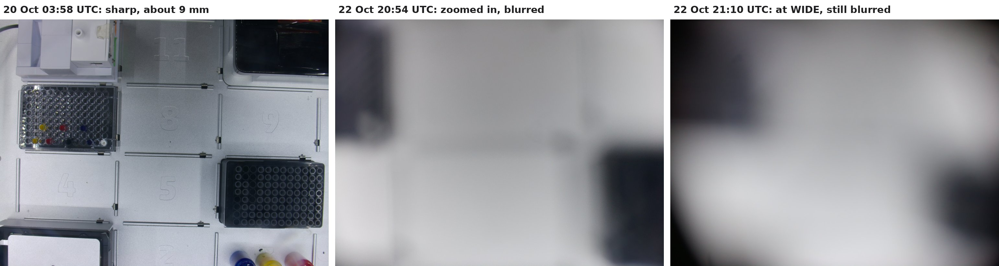
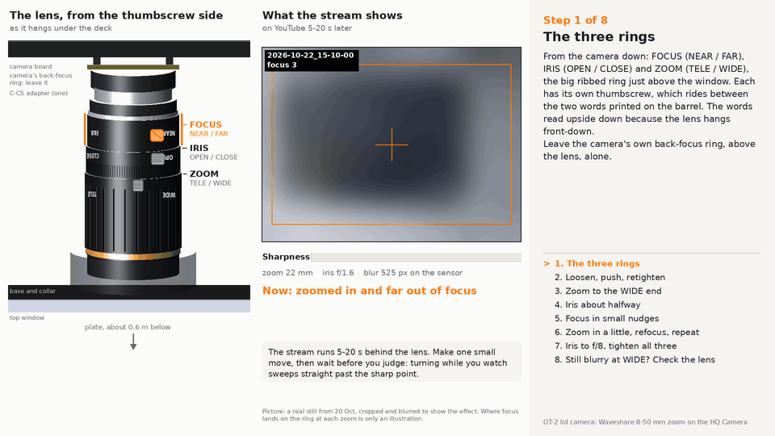
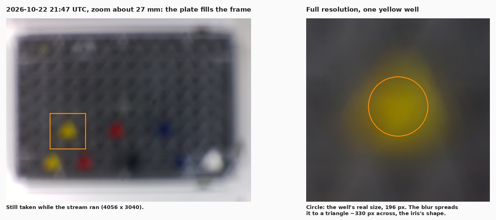
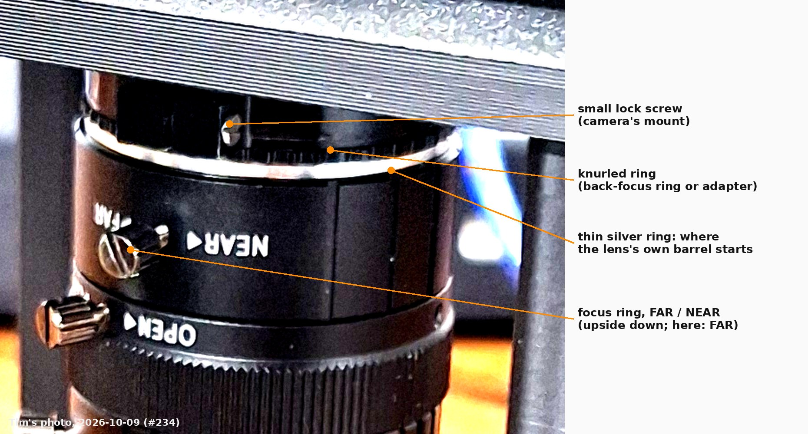
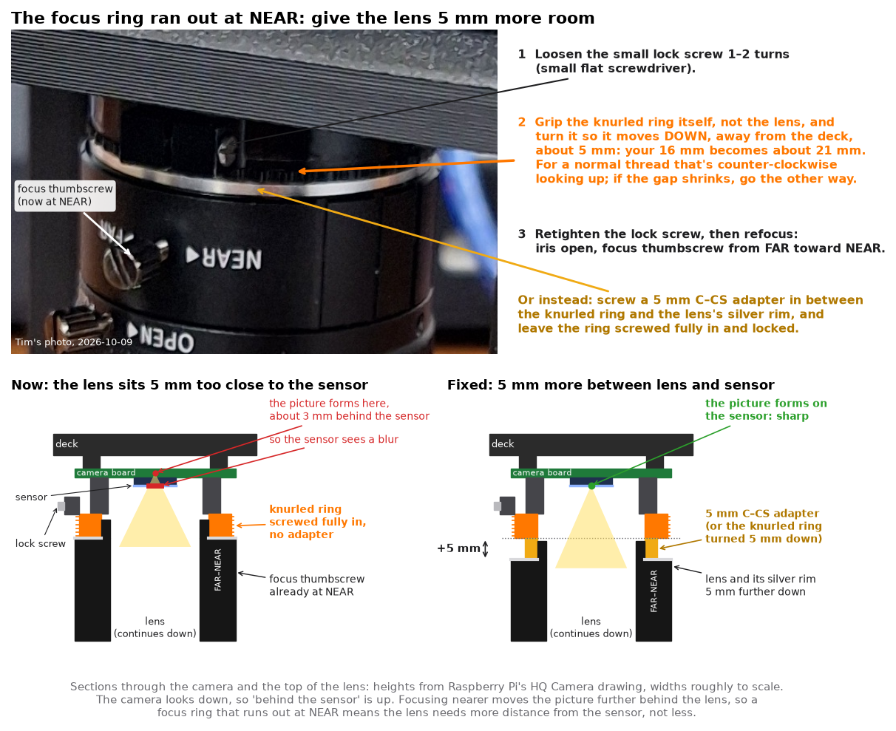
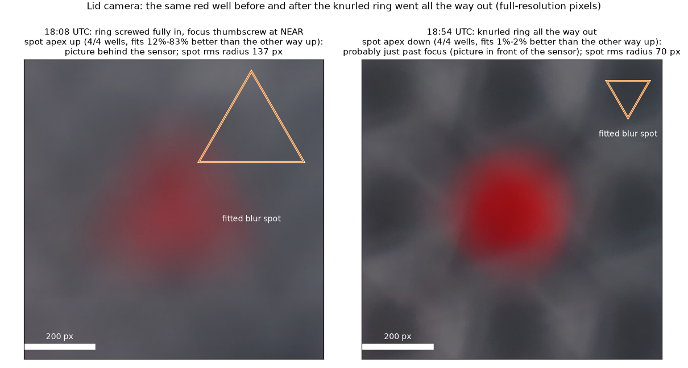
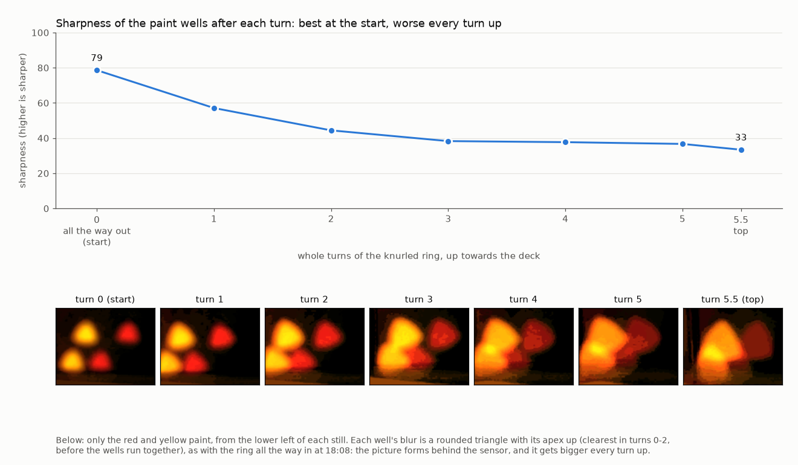
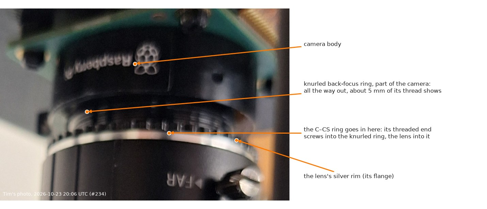

# Seeing what the lid camera sees

The camera is the HQ Camera (IMX477) with the 8–50 mm zoom, on the Pi 5 that sits on the
mount's deck. On the tailnet it is the Pi behind `RPI_STREAM_CAM_HOSTNAME`, which also runs
CubOS and reaches the OT-2 over its wired link. Only one program can hold the camera at a time.
Since 2026-10-20 the stream's own camera process also takes full-resolution stills, so a still
no longer means stopping the stream ([below](#2026-10-20-stills-while-it-streams-and-lining-it-up)).
`preview_server.py`, `rpicam-still` and `rpicam-hello` still need the stream stopped
(`sudo systemctl stop device.service`, then `start` afterwards); see
[`stream/README.md`](stream/README.md). The Pi reboots at 05:00, 13:00
and 21:00 local time, which takes the stream off the air for under a minute; a preview or still
that is running holds the reboot off ([Reboots](stream/README.md#reboots)).

| Way | Needs | Good for |
|---|---|---|
| **Live, anywhere: the YouTube stream** in the [OT2 overhead Livestreams Playlist](https://www.youtube.com/playlist?list=PLM4VC4X_7XKQ) (public, since 2026-10-18; its own playlist since 2026-10-19; see [`stream/`](stream/README.md)) | Nothing | Watching the deck from anywhere, with YouTube's 5–20 s of delay. Full 4:3 field at 1920 × 1440, 3 fps, timestamp top left |
| **Live, in a browser:** [`preview_server.py`](preview_server.py) on the Pi, then open the address it prints | The viewing device on the lab's tailnet, and someone with SSH to the Pi to start it (or a comment asking `@claude` to start it) | Positioning and focusing the mount |
| **Live, on a monitor at the robot:** `rpicam-hello -t 0 --viewfinder-mode 2028:1520:12:P` | A monitor on the Pi's micro-HDMI port, plus a keyboard or an SSH session to start it | Positioning while standing at the OT-2, with no network in the loop |
| **One full-resolution still, while the stream runs:** a comment asking `@claude` for a still from the lid camera, or `curl -s localhost:8081/still` on the Pi | Nothing | Checking the result and measuring. 4056 × 3040 px in about 0.3 s, and the stream carries on. [`measure_still.py`](measure_still.py) turns one into the millimetres to move the mount |

```bash
# on the Pi
curl -s localhost:8081/still > still.jpg       # full resolution, while the stream runs
curl -s localhost:8081/status                  # frame rate, exposure, focus scores
python3 preview_server.py                      # stream stopped first; prints http://<tailnet address>:8000; stops after 30 min
python3 preview_server.py --minutes 90
rpicam-still -n -t 3000 -o still.jpg           # stream stopped first; full resolution
```

`preview_server.py` listens on the Pi's tailnet address only, not on the campus Wi-Fi. The
tailnet policy lets people reach any port on a device, so anyone on the tailnet can open it.

## Use the whole sensor

The live view must cover the same field as a still, or the slots at the edges look cut off when
they aren't. [PR #84's `preview_server.py`](https://github.com/vertical-cloud-lab/byu-vcl/blob/84b8c0b/ot2-overhead-camera/preview_server.py)
asks for a 1536 × 864 stream. For that, libcamera picks the IMX477's 16:9 mode,
`ScalerCrop (108, 440, 3840, 2160)`: 95 % of the sensor's width and 71 % of its height. At 8 mm
from the middle of the deck it hides the front 52 mm of slots 1–3 and the back 52 mm of
slots 10–12 ([figure](../renders/wide_view_8mm.png)). The version here forces the 2028 × 1520
binned mode, `ScalerCrop (2, 0, 4052, 3040)`, and streams 1352 × 1014. Both crops were read
from the camera on 2026-10-15, and this script was run there end to end: 4:3 frames, the page,
the tailnet-only listener, and the stop after `--minutes`.

The live view is a third of full resolution: about 2.8 px/mm at 8 mm, or 19 px across a well.
That's enough to position and focus by, not to measure.

## 2026-10-15, 17:39 UTC: the camera saw nothing of the deck


At 17:39–17:42 UTC the frame was black. Turning the OT-2's rail lights on (17:42:04–17:42:08,
no run active, then back off) changed nothing: the same auto exposure, 67 ms at gain 7.9,
and Lux 0.172 against 0.173. So the lens wasn't looking at the deck. A 2.5 s exposure shows
light only in the corners, and very blurred, which points at something close to the lens.
Check, in this order:

1. the lens cap;
2. the blackout paper on the lid, which needs a hole at least as big as the base's 46 mm
   aperture under the lens;
3. that the mount is over the window;
4. that the iris ring isn't closed.

The numbers are in [`frames/2026-10-15/frames.json`](frames/2026-10-15/frames.json).

## 2026-10-15, 22:04 UTC: the deck is in view, out of focus


Whatever blocked the lens has gone. Turning the rail lights on for 5 s (22:07, no run active,
then back off) raised the camera's Lux reading from 4.6 to 136, and labware shows. But the
frame is badly out of focus.

The zoom already looks at or near the wide end. The dark labware at the top of the frame spans
1,130 of the still's 4,056 px. A 128 mm labware footprint would span 1,086 px at 8 mm,
1,358 at 10 mm and 1,629 at 12 mm. The corners are also dark, at 20–27 % of the centre's
brightness, as expected below about 9 mm. The blur and the labware's height make this good
to about a millimetre.

Zoom, focus and iris are manual rings, each locked by its own thumbscrew, so they can only be
set at the robot:


1. Turn the zoom ring toward WIDE until it stops: that is 8 mm.
2. Open the iris fully, which makes the sharpest point easiest to find.
3. Turn the focus ring until the labware edges are sharp. The lens is varifocal: changing the
   zoom moves the focus, so refocus after every zoom change.
4. Tighten the three thumbscrews. Closing the iris a little afterwards adds depth of field.

If no position of the focus ring gives a sharp picture, check the C–CS adapter: exactly one
ring between the lens and the camera, as in step 6 of [the assembly](../README.md#2-assemble).
In July a misplaced adapter ring is why the camera wouldn't focus (#84). The numbers are in
[`frames/2026-10-15/frames_2204Z.json`](frames/2026-10-15/frames_2204Z.json).

## 2026-10-18: streaming to YouTube

The camera now streams around the clock as `device.service` on the Pi, public. Until
2026-10-19 16:24 UTC it went into the
[OT-2 Livestreams Playlist](https://www.youtube.com/playlist?list=PLdKz1vXA-rfQ); since then it has
its own, [OT2 overhead Livestreams Playlist](https://www.youtube.com/playlist?list=PLM4VC4X_7XKQ),
at 1920 × 1440 and 3 fps. The newest video in the playlist is the live one. That is the way to watch the feed while positioning,
zooming or focusing the mount: YouTube adds 5–20 s of delay, so move, wait, look. The set-up,
settings and how to operate it are in [`stream/README.md`](stream/README.md). The stream holds
the camera, so `preview_server.py` and `rpicam-still` need it stopped first.

**First frames, 04:34–04:38 UTC: black.** Frames were pulled from the live stream on the Pi
(`yt-dlp -g` for the HLS address, then `ffmpeg -frames:v 1`) with the OT-2's rail lights
switched on for 20–40 s at a time (no run active, lights off again afterwards). The robot's own
camera saw a lit deck in the same seconds (mean luma 111 of 255,
[picture](frames/2026-10-18/ot2_camera_0438Z_lights_on.jpg)); the stream frame was black
(mean luma 1.1, [frame](frames/2026-10-18/stream_frame_0438Z_lights_on.jpg)), with and without
the lights. That is the 15 Oct 17:39 UTC situation again: the lens is capped, the iris is closed,
or the blackout cover is over it. Check those at the robot. The stream shows the deck the moment
the lens is clear; nothing needs restarting. The orientation (`CAMERA_VFLIP`/`HFLIP`) could not be
judged for the same reason and is still at the default.

## 2026-10-20: stills while it streams, and lining it up

**Point-and-shoot alongside the stream.** The approach is option A of
[borysgroup/streamingLambda#9](https://github.com/borysgroup/streamingLambda/issues/9), listed first
in [vertical-cloud-lab/streamingLambda#6](https://github.com/vertical-cloud-lab/streamingLambda/issues/6):
one picamera2 process owns the camera, sends the stream its frames, and keeps the full-resolution
picture for stills. In [borysgroup/streamingLambda PR #10](https://github.com/borysgroup/streamingLambda/pull/10)
it ran live to YouTube for 8 h on a Pi Zero 2 W stream cam, with 0 restarts and 95 of 95 stills.
Here it is [`stream/picam_source.py`](stream/picam_source.py), which `device.py` runs in place of
`rpicam-vid` (`CAMERA_SOURCE = "picamera2"`). The ISP makes two pictures from every sensor readout:
4056 × 3040 for stills and 1920 × 1440 for the stream. Measured on the Pi while streaming: 3.0 fps
with no frames dropped, a still in 0.27–0.33 s, 11 % of one core for the camera process. Details
are in the stream's [change record](stream/README.md#change-record-2026-10-20).

```bash
ssh <pi> 'curl -s localhost:8081/still' > still.jpg      # from a machine on the tailnet
python3 measure_still.py still.jpg                       # where it is looking, and what to move
python3 measure_still.py still.jpg --plate 7             # zoomed in on a plate: from its 96 wells
```

### Where it is looking now


Measured by [`measure_still.py`](measure_still.py) from a full-resolution still at 03:58 UTC
([still](frames/2026-10-20/still_0358Z_lit.jpg), OT-2 rail lights on for 10 s, no run active). It
finds the rails in the gaps around slots 5 and 8 and fits them to Opentrons' slot pitch: 0.07 mm
rms. Numbers in [`../exports/lid_camera_setup.json`](../exports/lid_camera_setup.json).
`--plate 7` measures from the plate's own wells instead, which is what works once the camera is
zoomed in and the rails are out of view. On this still it found 95 of the 96 rims (0.38 mm rms)
and agrees with the rails: turned 1.45°, picture centre 126 mm right and 29 mm in front of the
plate ([render](../renders/lid_camera_plate.jpg), [numbers](../exports/lid_camera_plate.json)).

**The goal is one plate, close up.** The mount was designed to look straight down at the one
96-well plate being measured, at about 25 mm of zoom ([README §3](../README.md#3-where-on-the-lid)).
From 2026-10-15 these notes steered toward the 8 mm whole-deck view instead, and the first version
of the steps below (03:40 UTC tonight) lined the camera up for that: a third of the resolution, and
short of the ~100 px across a well that #84's options doc asks for to measure intensity. The target
is now the colour-mixing plate in **slot 7**, where PR #202's runs keep it (it is there in the still
above), filling the picture with about 5 mm of deck either side:

| | Now (03:58 UTC) | Target |
|---|---|---|
| Zoom | about **9.15 mm**: 417 × 313 mm at the plate's top | **27.7 mm**: 138 × 103 mm |
| In a still (4056 × 3040) | 9.7 px/mm, **67 px** across a well | 29.4 px/mm, **202 px** across a well |
| On the stream (1920 × 1440) | 4.6 px/mm, 32 px across a well | 14 px/mm, 96 px across a well |
| Centre of the picture | **127 mm right and 29 mm in front** of the plate's centre | on it, to within about 2 mm |
| Rotation | **+1.4°** (the rails slope down to the right) | under 0.5° |

5 mm either side is tighter than the 12–14 mm that 25 mm leaves (README §3), because the live
stream now places the mount to a millimetre or two. It still allows for the plate sitting a
millimetre off in its slot and for the last fraction of a degree of rotation. Another margin is
`setup_video.py --margin`.

### Lining it up over the plate: slide, zoom, focus, centre and square, lock


Labelled video to pause on: [YouTube](https://www.youtube.com/watch?v=a5qfAB4CNxU) (unlisted, 1:34, a chapter per step) or
[`../renders/setup_steps.mp4`](../renders/setup_steps.mp4); made by
[`../cad/setup_video.py`](../cad/setup_video.py) from the measured start, so it can be re-rendered
after the next still (`--slot` for another slot's plate). The whole-deck version of 03:40 UTC
([YouTube](https://www.youtube.com/watch?v=ZStu8aZcogI)) is superseded.

**Before you start.** Turn the room lights and the OT-2's rail lights on: the focus score is noise
in the dark. Open the stream on a phone (the newest video in the
[OT2 overhead Livestreams Playlist](https://www.youtube.com/playlist?list=PLM4VC4X_7XKQ)). While
`SETUP_OVERLAY = True` it shows an **orange cross** through the middle of the picture; an **orange
box** (`SETUP_BOX`, since 2026-10-20 05:57 UTC) where the plate's outline lands when the zoom is
right; and, under the timestamp, **`focus N (best M in 2 min)`**, a sharpness score for the middle
of the full-resolution picture, worked out for every frame. YouTube is 5–20 s behind, so after each
change wait about 20 s before you judge.

1. **Slide the mount over the plate.** Lift the tape and slide the **whole mount** about
   **127 mm to the left and 29 mm toward the back** (seen from the door), with the arrow on the base
   still pointing at the door, until the cross lands on the middle of the plate: between wells D6,
   D7, E6 and E7. Within about 5 mm is enough for now. On the lid that puts the lens axis about
   123 mm right of the line through the two left window screws and 231 mm behind the line through
   the two front ones (slot 7 in [README §3](../README.md#3-where-on-the-lid)).
2. **Zoom in until the plate fills the box.** First focus at the WIDE end (step 3), then loosen
   the zoom thumbscrew and push it toward **TELE** a few millimetres at a time, refocusing after
   each, until the plate's left and right edges reach the box's sides, at about 27–28 mm.
   Tighten the thumbscrew. If the plate runs out of the box on one side as it grows, slide the
   mount a little that way. Each zoom move makes the picture go soft: this lens is varifocal, so
   zoom moves focus ([how to set the rings](#setting-the-zoom-iris-and-focus-rings)).
3. **Focus.** Set the iris about halfway (about f/4). Fully open, the sharp zone is so thin that a
   stream running 5–20 s behind skips past it (this replaces "open the iris fully", 2026-10-22).
   Nudge the focus thumbscrew 1–2 mm, wait about 20 s, read the score; keep going while it rises,
   and when it falls go back one nudge. Tighten the focus thumbscrew. Then close the iris to about **f/8**:
   the depth of field is then about 24 mm, enough for the wells' rims and the paint 11 mm below them
   to be sharp together. The auto exposure makes up the light.
4. **Centre and square.** Nudge the mount until the plate sits evenly in the box, with the same
   strip of deck at its left and right and at its top and bottom. Then turn it **clockwise, seen
   from above, by about 1.4°** (a tab's tip moves about 1.8 mm) until the plate's edges run
   parallel to the box. At this zoom 1 mm of deck is 14 px on the stream, so small moves.
5. **Lock and check.** Tighten all three thumbscrews, tape the base down
   ([phase 1](../README.md#4-install-phase-1-tape-no-cutting)), and comment
   `@claude take a still with the lid camera and measure it`. `measure_still.py --plate 7` fits the
   plate's 96 wells and reports what is left to move. Done when the plate's centre is within about
   2 mm of the picture's centre and the rotation is under 0.5°. Then ask for
   `SETUP_OVERLAY = False`, which takes the cross, the box and the score off the stream.

If the protocol moves the plate to another slot, the mount moves with it: slot 8 is the nearest
to where the mount is now (about 29 mm toward the back and 5.5 mm to the right). The box fits any
SBS-footprint plate of about the same height.


## 2026-10-22, 20:46 UTC: live, far out of focus

Asked on [#234](https://github.com/vertical-cloud-lab/byu-vcl/pull/234#issuecomment-6350897923)
for the live broadcast, to line the camera up over the plate in slot 7. The stream was up from
the 19:00 UTC scheduled reboot as [`c4p-guvavJA`](https://www.youtube.com/watch?v=c4p-guvavJA)
(public, in the playlist, with the cross, the box and the focus score), with no frames dropped.
Frames pulled back from YouTube ran 12–14 s behind the camera.

The picture was a featureless grey blur
([frame](frames/2026-10-22/stream_frame_2049Z_lights_on.jpg)): focus score 3–6, against 22–34
when the deck was sharp on 2026-10-20. That is far blurrier than the out-of-focus wide view of
15 Oct, where the labware could still be made out, so the zoom has most likely been turned toward
T without refocusing. The OT-2's own camera showed the same layout as on 18 Oct, with the plate in
slot 7 ([picture](frames/2026-10-22/ot2_camera_2050Z.jpg)). The numbers are in
[`frames_2046Z.json`](frames/2026-10-22/frames_2046Z.json).

**Rail lights for the line-up.** Under room light alone the camera saw 6 lux and ran at its
maximum gain, where the focus score is mostly noise. Nobody at the robot can switch the rail
lights, since the OT-2 answers only the Pi. So they went on at 20:48:51 UTC, with no run active
(104 lux, gain 2.5). A transient timer on the Pi switches them off at 23:00 UTC (17:00 MDT):

```bash
systemd-run --user -G --unit=ot2-rail-lights-off --on-calendar="2026-10-22 23:00:00 UTC" \
    /usr/bin/python3 /tmp/ot2-rail-lights-off.py
```

The script leaves the lights alone if a maintenance or protocol run is active, and deletes itself
afterwards; the timer goes with it. A reboot of the Pi before then drops the timer and leaves the
lights on. The lights coming on probably also put a one-frame spike of 28 into the overlay's
"best in 2 min", while the picture stayed the same. A light switching on or off, or a hand in
view, can do that, so trust a score that holds for a few seconds.

## 2026-10-22, 20:54–21:10 UTC: blurry at every ring setting



While the mount was moved over slot 7 and the rings were turned (20:54–21:10 UTC), stills from
the stream's camera process stayed far out of focus. A sharp edge was spread over 400–560 px, a
blur circle of roughly 1.1–1.4 mm on the sensor, and the centre focus score was 2–7, against 34
when the camera was sharp on 20 Oct. By 21:10 the corners had gone dark, which puts the zoom at
or near WIDE, and the blur was no smaller. At that end the focus ring moves the image only a few
tenths of a millimetre, so blur that large points at the lens sitting at the wrong distance from
the sensor: the lens backed out of its thread (0.8 mm a turn), the C–CS adapter, or the camera's
own back-focus ring. While the iris was shut (20:59:22–37) the score read 450–778; that is sensor
noise over a near-black picture, not focus. By 21:15 the plate was in the middle of the picture
at about 16 mm and the edge spread had fallen to 243 px, still soft but closing in
([still](frames/2026-10-22/still_2115Z_closer.jpg)). The numbers, and the score every 3 s, are in
[`frames/2026-10-22/blur_2026-10-22.json`](frames/2026-10-22/blur_2026-10-22.json).

### Setting the zoom, iris and focus rings



Video to pause on: [YouTube](https://www.youtube.com/watch?v=n70VlKjrlQc) (unlisted, a chapter per
step) or [`../renders/lens_rings.mp4`](../renders/lens_rings.mp4); where each step ends:
[`../renders/lens_rings_sheet.png`](../renders/lens_rings_sheet.png). Made by
[`../cad/lens_video.py`](../cad/lens_video.py). The picture in it is the 20 Oct still, cropped for
the zoom and blurred for focus; where focus lands on the ring at each zoom is only an illustration.

From the camera down the rings are **focus** (NEAR / FAR), **iris** (OPEN / CLOSE) and **zoom**
(TELE / WIDE), the big ribbed ring just above the window. Each thumbscrew rides between the two
words printed on the barrel, which read upside down because the lens hangs front-down. Loosen a
thumbscrew about a turn (don't take it out), push it toward the word you want, and retighten it
finger tight. The stream runs 5–20 s behind the lens, so make one small move, then wait.

1. **Zoom to the WIDE end first.** Focus is easiest to find there, and the camera was sharp there
   on 20 Oct.
2. **Iris about halfway** (about f/4), not fully open.
3. **Focus in small nudges:** 1–2 mm at the thumbscrew, then wait about 20 s. Keep going while the
   picture and the focus number get better; when they get worse, go back one nudge.
4. **Zoom in a little, refocus, repeat:** a few millimetres toward TELE, then refocus as in 3, until
   the plate fills the orange box (about 27–28 mm).
5. **Iris to about f/8, then tighten all three thumbscrews.**
6. **Never sharp, even at WIDE?** Then no ring can fix it. Hold the camera board still and try to turn
   the whole lens body; if it moves, screw it back in until snug. Check that the one C–CS adapter is
   screwed fully into the camera, and that the camera's own back-focus ring (just above the adapter)
   is locked by its small screw.

## 2026-10-22, 21:47 UTC: focus at the end of its travel, still blurred



@mcwilliams03 reported the focus thumbscrew at the end of its travel with the picture still
blurred, and the iris closed down to make it look less soft. A still taken while the stream ran
([full frame](frames/2026-10-22/still_2147Z_plate_fills_frame.jpg)) has the zoom close to the
target: the plate fills the frame at about 28–29 px/mm, about 27 mm. But every well is smeared
from 196 px to a rounded triangle about 330 px across. The triangle is the half-closed iris's
shape, the signature of defocus. The camera is at its exposure and gain limits (66.7 ms, gain
15.8), so the overlay's focus score is now mostly noise. The numbers are in
[`frames/2026-10-22/focus_end_2147Z.json`](frames/2026-10-22/focus_end_2147Z.json).

**No ring on the lens can cause this.** If the lens is seated at the standard C-mount spacing, the
plate lies inside the focus ring's travel at every zoom. At 27 mm it sits about a third of the way
from FAR to NEAR, using Waveshare's 0.20 m minimum focus distance. At 21:10, at a wide zoom, the blur
circle was 1.3 mm. That needs at least 1.8 mm of defocus, even at f/1.4, and at 8–12 mm no focus
setting gives more than 0.2–0.5 mm. So the distance from the lens to the sensor (flange back, in
broadcast terms) has changed since the sharp stills of 20 Oct. The ribbon cable to the Pi can't
blur a picture; a bad one gives no frames or broken ones.

### If focus runs out: check the lens-to-sensor spacing



From the deck down, the stack is: the camera board, then the camera's mount with its knurled
**back-focus ring** (held by a small **lock screw**), then **one 5 mm C–CS adapter**, then the
lens's own thread. Every turn of a thread is 0.79 mm.

**Support the lens before turning anything**: if it has backed out, it may be held by only a
turn or two above the window.

1. **Note which word the focus thumbscrew stopped at.**
   - **FAR:** the lens is too far from the sensor, so even at FAR it focuses nearer than the plate.
   - **NEAR:** the lens is too close to the sensor, so it can't focus as near as the plate.
2. **Measure the gap** from the deck's underside down to the thin silver ring where the lens's own
   barrel starts. In the CAD it is **24.4 mm** with one adapter and everything screwed fully in,
   good to about a millimetre. Each extra millimetre there puts the lens a millimetre too far from
   the sensor. About 29 mm means two adapters are stacked; about 19 mm means there is no adapter.
3. **For FAR (or a gap of 26 mm or more):**
   - Hold the camera's mount (just under the deck) still and screw the whole lens in until it is
     snug. Turn it like a bulb into a ceiling socket: clockwise looking up at it, so the side facing
     you moves to your right. This takes up whichever joint has backed out.
   - Remove a second adapter if there is one. The lens and the camera each came with one.
   - Loosen the lock screw (small flat screwdriver), screw the back-focus ring in until it stops,
     and retighten the screw.
4. **For NEAR (or a gap of 22 mm or less):**
   - Fit the one adapter if it's missing.
   - If the adapter is there and everything is snug, use the back-focus ring as a spacer: loosen
     the lock screw, unscrew the ring half a turn, refocus, and repeat until the plate comes sharp
     with the focus thumbscrew clear of NEAR. Then tighten the lock screw. This is the broadcast
     flange-back adjustment.
5. **Refocus with the iris open.** Open the iris fully, so focus is easiest to see and the
   triangles become round, and keep the rail lights on. Move the focus from FAR toward NEAR in
   1–2 mm nudges, waiting about 15 s after each. Then close the iris to about f/5.6–8 and tighten
   all three thumbscrews.

Don't close the iris to hide blur while focusing. It makes the sharp point harder to find, and it
drives the camera to its gain limit, where the stream is noisy and the focus score is noise.

## 2026-10-23, 18:08 UTC: focus ran out at NEAR, with the stack at its shortest



@timothy-commins found the focus thumbscrew stopped at **NEAR**, and the gap from the deck to the
lens's silver rim at **about 16 mm, with no way to make it shorter**. He asked whether the knurled
piece could come off. A still taken while the stream ran
([half resolution](frames/2026-10-23/still_1808Z_focus_at_near.jpg)) hasn't changed since 21:47 the
day before: the plate fills the frame at about 27 mm, and every well is still smeared into the iris's
triangle. Exposure and gain are at their limits with the rail lights on, so the iris is still well
closed. The numbers are in [`frames/2026-10-23/still_1808Z.json`](frames/2026-10-23/still_1808Z.json).
[`back_focus_fix.py`](back_focus_fix.py) draws the figure.

**Both readings say the lens sits too close to the sensor:**

- **The ring stopped at NEAR.** Focusing nearer moves the picture further behind the lens, and NEAR
  is the end of the ring that moves it furthest. If the plate is still soft there, the picture is
  forming behind the sensor, so the lens needs more distance from the sensor, not less.
- **The stack is at its shortest.** A stack that can't get shorter means the knurled back-focus
  ring is screwed fully in.
  - Tim's 9 Oct photo shows no C–CS adapter between that ring and the lens's silver rim.
  - In that state the lens sits at the 12.5 mm CS flange distance. A C-mount lens is built for
    17.53 mm, so it is 5.0 mm too close.
  - Raspberry Pi's drawing puts the ring's face 14.4 mm in front of the camera board. That is
    **16.4 mm from the board's back**, which matches Tim's 16 mm, and about 19.7 mm from the deck
    plate itself.
  - With one adapter, the same two gaps are about 21.5 and 24.8 mm.
- **How it got there:** on 20 Oct the deck was sharp at the wide end, which can't happen 5 mm short.
  So the ring must have been backed out to make up for the missing adapter, as Seth did in July
  ([#84](https://github.com/vertical-cloud-lab/byu-vcl/pull/84#issuecomment-5049822601): "the
  adapter ring was pushed in too far"). It has been screwed back in since. It is easy to take for
  one of the lens's own rings.

**Don't take the knurled ring off.** The lens screws into it, and taking spacing out would move the
lens further the wrong way.

### The fix: 5 mm more between the lens and the sensor

> **Corrected at 21:20 UTC:** the knurled ring on its own moves the lens only about 5 mm, so
> option 2's ring all the way out is the end of its travel, not mid-range. It gives about the same
> spacing as option 1. See [below](#2026-10-23-2120-utc-a-ccs-ring-fits-and-the-knurled-ring-gives-only-about-5-mm).

Support the lens throughout.

1. **Best: fit one C–CS adapter.** It is a plain black threaded ring about 5 mm thick; the camera
   and the lens each shipped with one.
   - Unscrew the lens: counter-clockwise looking up, so the side facing you moves to your left.
   - Screw the adapter into the knurled ring until it seats.
   - Screw the lens into the adapter until it is snug.
   - Leave the ring screwed fully in and its lock screw tight, so the spacing can't drift.
2. **Without an adapter: use the knurled ring as the spacer.**
   - Loosen its lock screw 1–2 turns.
   - Grip the ring itself, not the lens, and turn it so it moves down, away from the deck. For a
     normal thread that is counter-clockwise looking up; if the gap shrinks, turn it the other way.
   - Stop when the gap has grown by about 5 mm (Tim's 16 mm to about 21 mm). The ring covers 12.5 to
     22.4 mm of back focus
     ([product brief](https://datasheets.raspberrypi.com/hq-camera/hq-camera-product-brief.pdf)),
     so 5 mm out is mid-range.
   - Retighten the lock screw.
3. **Refocus.**
   - Open the iris fully.
   - Start the focus thumbscrew at FAR and nudge it toward NEAR, waiting about 15 s for the stream
     each time. At about 27 mm zoom the plate should come sharp about a third of the way from FAR.
   - Close the iris to about f/8 and tighten all three thumbscrews.

If the plate now comes sharp only at FAR, the spacing is too long: back the ring in a little. If
it's never sharp, post the new gap.

## 2026-10-23, 18:54 UTC: ring all the way out, much sharper, probably just past focus

> **Corrected at 20:28 UTC:** the turn-by-turn sweep [below](#2026-10-23-20162028-utc-one-still-per-turn-of-the-knurled-ring)
> shows the lens was still too close with the ring all the way out, not past focus. The advice in
> this section to turn the ring back in is wrong; add spacing instead.



@timothy-commins backed the knurled ring all the way out, finding the picture better the further
it went, and asked for another extender. Two stills taken while the stream ran
([18:54](frames/2026-10-23/still_1854Z_ring_all_the_way_out.jpg) and, after the Pi's scheduled
13:00 MDT reboot, [19:04](frames/2026-10-23/still_1904Z_ring_all_the_way_out.jpg), unchanged) show:

- **Much sharper.** The blur spot's rms radius is about 70 px, half the 137 px of 18:08. The wells'
  rims and the gaps between them show, but it isn't sharp yet.
- **A third bigger.** The well pitch is 348 px (38.7 px/mm, 105 × 79 mm in view), against 261 px on
  22 Oct. Moving the lens away from the sensor magnifies the picture, and a 9.9 mm move (the ring's
  12.5–22.4 mm travel) accounts for all of it if the zoom wasn't touched.
- **Probably just past focus.** [`focus_side.py`](focus_side.py) fits each paint-filled well as a
  disc blurred by a triangular spot, apex up or down. At 18:08 (picture behind the sensor) all four
  wells fit apex up, by 12–83 %. Today all eight fits lean apex down, the iris's shape turned over,
  which is what happens once the picture forms in front of the sensor. The lean is only 0.2–6 %, so
  on its own it is a hint. What makes it likely is the alternative: if the spot hadn't turned over,
  halving it with a 9.9 mm move would leave about 10 mm still to add, which would focus this lens on
  something 7–12 cm away rather than the plate at 60 cm. Turned over, the picture is about 3.3 mm in
  front of the sensor, so the right spot for the ring is about two thirds of the way out. The numbers
  are in [`frames/2026-10-23/still_1854Z.json`](frames/2026-10-23/still_1854Z.json) and
  [`focus_side.json`](frames/2026-10-23/focus_side.json).

**So don't add a spacer to the ring as it is now unless step 1 below says the lens is still too
close.** If it is past focus, a spacer moves the lens further the wrong way.

### Settling it at the robot, then finishing

Watch the stream, keep the rail lights on, and wait about 15 s after each move.

1. **Which way?** Nudge the focus thumbscrew 2–3 mm.
   - Sharper towards **FAR**, or blurrier towards NEAR: the lens is too far from the sensor. Go to 2.
   - Sharper towards **NEAR**: the lens is still too close. Go to 3.
2. **Too far (the likely case):** set the focus thumbscrew at FAR. Loosen the ring's lock screw and
   turn the knurled ring back in (the lens moves up, towards the deck) about 1 mm at a time, about
   3 mm in all. By Tim's measure that is a deck-to-silver-rim gap of about 22–23 mm, from 16 mm fully
   in. Then nudge the focus from FAR towards NEAR until it is sharpest, and tighten the lock screw.
3. **Still too close:** the ring has no travel left, so fit one 5 mm C–CS ring between the knurled
   ring and the lens, and focus again from FAR.

**A 5 mm C–CS ring is worth having either way.** With the knurled ring all the way out, it is at the
end of its travel, with fewer turns of thread holding the lens, so the lens can wobble or tilt. In case 2 the same lens
position comes from the C–CS ring plus the knurled ring only 1–2 mm out from fully in, with the
lock screw holding it mid-thread. The camera and the lens each normally come with one, so check
their boxes first. Otherwise any 5 mm "C to CS" spacer ring fits, for example
[this one on Amazon](https://www.amazon.com/dp/B09STVLLVY) ($6.99, 4.4 stars from 42 ratings on
2026-10-23).

Once it is sharp, close the iris to about f/8 and tighten all the thumbscrews. Then ask `@claude`
for a still to check it.

## 2026-10-23, 20:16–20:28 UTC: one still per turn of the knurled ring

> **Corrected at 21:20 UTC:** the knurled ring's whole travel is about 5 mm, not 9.9 mm. So the
> spacing still missing is about 5 mm (2.5–7.5), not 11 mm (5–15), and the open question below
> has an answer. See [below](#2026-10-23-2120-utc-a-ccs-ring-fits-and-the-knurled-ring-gives-only-about-5-mm).



@timothy-commins started with the knurled ring all the way out and turned it up, towards the deck,
one whole turn at a time: 5.5 turns to the top. The focus thumbscrew stayed near NEAR throughout,
and the rail lights were on. After each turn he posted the turn number on
[#234](https://github.com/vertical-cloud-lab/byu-vcl/pull/234#issuecomment-6373840191), and a
full-resolution still was taken while the stream ran. The 1600 px copies are in
[`frames/2026-10-23/back_focus_sweep/`](frames/2026-10-23/back_focus_sweep/).
[`back_focus_sweep.py`](back_focus_sweep.py) measures them and draws the figure. The numbers are in
[`back_focus_sweep.json`](frames/2026-10-23/back_focus_sweep.json).

| Turn | 0 (start) | 1 | 2 | 3 | 4 | 5 | 5.5 (top) |
|---|---|---|---|---|---|---|---|
| Sharpness | **79** | 57 | 44 | 38 | 38 | 37 | 33 |

Sharpness is the red and yellow wells' colour contrast against the grey plate's brightness. A
well is a uniform disc, so once the blur spot is bigger than a well its colour is spread over the
spot. The auto white balance held still to 0.1 % through the sweep, so the numbers compare.

- **The start is the sharpest, and every turn up is blurrier.** The picture also shrinks as the
  ring goes up: at the start only the plate's front edge is in view, and at the top the whole plate
  fits with room around it. So turning up moves the lens towards the sensor.
- **So the picture forms behind the sensor at every ring position.** If it formed in front, moving
  the lens towards the sensor would sharpen it first. In turns 0–2, before the wells run together,
  the blur spot is also a triangle with its apex up, as at 18:08 with the ring all the way in.
- **The lens needs more room than the ring's whole travel gives,** with the focus thumbscrew near
  NEAR. Very roughly, 1/√sharpness (about proportional to the spot's diameter while the spot is
  bigger than a well) extrapolates to zero about 6 turns beyond all the way out. If 5.5 turns is the
  ring's whole 12.5–22.4 mm travel, that is about 11 mm. Take it as 5–15 mm.
- **The 18:54 reading was wrong.** It rested on fits that leaned the turned-over way by only
  0.2–6 %. The 19:04 still was sharper than this sweep's start, with the ring in about the same place
  (the picture is the same size to within 3 %), because the iris was narrower: with the rail lights on both
  times, the camera now needs a sixth of the exposure (49.96 ms × 3.39 against 66.65 ms × 15.52). A
  wider iris turns the same focus error into a bigger blur.
- **Open question:** this doesn't fit a C-mount lens on the HQ Camera. With the ring all the way
  out, the stack is 4.9 mm longer than a C-mount lens needs, which should overshoot rather than fall
  short. So the lens or the stack isn't what the drawings assume. A side photo of the stack beside a
  ruler would show which.
- **The iris thumbscrew** broke off at 20:06 UTC. Until it is replaced, set the iris by gripping its
  ring.

### Next: add spacing between the knurled ring and the lens

1. **Get two 5 mm C–CS rings,** or a C-mount extension tube set. One may not be enough.
2. **Fit one** between the knurled ring and the lens, keep the ring all the way out, and ask
   `@claude` for a still. If it is sharper but the wells' blur is still a triangle with its apex up,
   fit the second.
3. **Zoom out** until the plate's outline fills the orange box. More spacing also makes the picture
   bigger. Then finish with the focus thumbscrew, and turn the knurled ring up if it overshoots.

## 2026-10-23, 20:42 UTC: before adding spacing, zoom out, and mind the window

> **Checked at 21:20 UTC:** the table below assumes 9.9 mm of knurled-ring travel and a lens
> 4.5 mm shorter than Waveshare's drawing. The two errors nearly cancel, so its answer stands: one
> C–CS ring fits and a second doesn't. The corrected table is [below](#2026-10-23-2120-utc-a-ccs-ring-fits-and-the-knurled-ring-gives-only-about-5-mm).

@timothy-commins read the sweep the same way: turn 0 is the sharpest, so the lens needs another
spacer. Two things limit how far that goes, and one of them may make it unnecessary.

- **Only about 6 mm more fits under the deck.** The CAD puts the lens front 11.5 mm above the
  window's top face with the stack at C-mount spacing (17.53 mm). With no C–CS ring and the knurled
  ring all the way out the stack is 22.4 mm, so the front is already 4.9 mm lower, about 6.6 mm up:

  | Stack | Lens to sensor | Lens front above the window |
  |---|---|---|
  | Today: no spacer, knurled ring all the way out | 22.4 mm | 6.6 mm |
  | One 5 mm C–CS ring, knurled ring all the way out | 27.4 mm | 1.6 mm |
  | Two 5 mm rings, knurled ring all the way out | 32.5 mm | **−3.4 mm: pushes on the window** |
  | Two 5 mm rings, knurled ring 2.5 turns up | 28.0 mm | 1.1 mm |

  So any stack tops out near 28 mm, about 5.6 mm more than today, unless the deck is raised.
  Printed risers between the post tops and the deck would do that, held with the lab drawer's
  M3 × 18 (for 8 mm risers) or M3 × 25 (for 15 mm). The lens front's height rests on the estimated
  4.5 mm of thread behind the flange, so allow a millimetre or two. After fitting a spacer, set the
  mount down on the window gently: if the base rocks instead of sitting flat, the lens is touching;
  turn the knurled ring up a turn.
- **The zoom is set too long.** At turn 0 the wells are 357 px apart (39.7 px/mm), so the frame
  covers 102 × 77 mm and the plate's 12 columns do not fit. The orange box needs 29.4 px/mm, so the
  picture is already 35 % too big, and it grows as it sharpens. The well spacing grew 24 % between
  the ring all the way in (18:08) and all the way out (turn 0), which puts the exit pupil about
  52 mm in front of the sensor, so another 5–11 mm of spacing would add 10–21 %. Sharp at today's
  zoom, the plate would be at 43–48 px/mm, a focal length of about 39–42 mm. The box needs about
  27 mm. The 22 Oct estimate of 27 mm came from a picture taken with the ring all the way in, which
  was blurred and so a quarter to a third smaller than a sharp one.
- **A shorter zoom needs less spacing.** For a plate about 60 cm away a lens needs f²/(u − f) beyond
  its infinity setting: 2.8 mm at 40 mm, 1.2 mm at 27 mm. This lens bears that out: on 20 Oct it was
  sharp at about 9 mm zoom with a stack of at most 22.4 mm (the 9 Oct photo shows no C–CS ring), yet
  at about 40 mm it falls short at 22.4 mm.

### What to do

1. **Now, without buying anything:** zoom towards WIDE until all 12 columns sit inside the orange
   box with a little room to spare; the picture grows again as it sharpens. Turn the knurled ring all
   the way out and lock it. Then nudge the focus thumbscrew from NEAR towards FAR, waiting about 15 s
   for the stream after each nudge.
   - **Sharpest somewhere in between:** stop there. No spacer needed.
   - **Sharpest at FAR, still soft:** too much spacing now. Turn the knurled ring up a turn at a time
     and refocus.
   - **Sharpest at NEAR, still soft:** go to step 2.
2. **Fit one 5 mm C–CS ring** between the knurled ring and the lens, check that the base sits flat
   on the window, and focus again. Zoom so that the plate fills the box, then refocus.
3. **Still sharpest at NEAR with the ring fitted:** the deck has to go up before more spacing can go
   in. Ask `@claude` for the risers.

## 2026-10-23, 21:20 UTC: a C–CS ring fits, and the knurled ring gives only about 5 mm



@timothy-commins asked whether [Amazon B09STVLLVY](https://www.amazon.com/dp/B09STVLLVY) would screw
onto the spacer already on the camera. [`c_cs_ring.py`](c_cs_ring.py) draws the figure from a crop
of his photo.

- **It fits.** The listing (read 2026-10-23) is a pack of two aluminium C-to-CS rings for $6.99: 30
  mm across, a 25 mm threaded bore and 5 mm of spacing. Its "9 mm" thickness includes the threaded
  end, about 4 mm, which goes inside the part it screws into. The threaded end screws into the
  knurled ring where the lens is now, and the lens screws into the ring, 5 mm further from the
  sensor. The listing's side photo shows two rings screwed together.
- **The spacer already attached is the camera's own knurled back-focus ring.** No C–CS ring is
  fitted: in the 20:06 photo the lens's silver rim sits right against the knurled ring, as it did on
  9 Oct.
- **Both boxes should hold one.** Raspberry Pi's
  [product brief](https://datasheets.raspberrypi.com/hq-camera/hq-camera-product-brief.pdf) says the
  CS-mount HQ Camera "ships with a C- to CS-mount adapter", and Waveshare lists a "C-CS adapter" in
  [this lens's package](https://www.waveshare.com/8-50mm-Zoom-Lens-for-Pi.htm).

**The knurled ring alone moves the lens only about 5 mm.** Earlier sections read the brief's "Back
focus length of lens: 12.5mm–22.4mm (CS Mount variant)" as the knurled ring's own travel. It can't
be: the same brief says "C-mount lenses require the use of the C-CS adapter included with this
variant", and a C-mount lens needs only 17.53 mm. So the range includes the 5 mm adapter: about
12.5–17.4 mm without it and 17.5–22.4 mm with it. Two things at the robot agree:

- With the ring all the way out, the 20:06 photo shows 4.3–5.5 mm of its thread below the camera
  body, scaled from the lens's 36.6 mm diameter at its silver rim.
- The whole travel took 5.5 turns, about 0.9 mm a turn: an ordinary fine thread, not 1.8 mm.

That answers the sweep's open question. With no C–CS ring and the knurled ring all the way out, the
lens sits at the 17.53 mm it is built for, or just short of it, not 4.9 mm beyond. Even so it can't
focus on the plate at today's zoom of about 40 mm, so Waveshare's 0.2 m minimum focus distance
probably doesn't hold at the long end. At 0.9 mm a turn the sweep's "about 6 turns" of missing
spacing is about 5 mm (2.5–7.5), which one C–CS ring with the knurled ring turned out covers.

**The lens is 4.5 mm longer than the CAD model.** [Waveshare's drawing](https://www.waveshare.com/img/devkit/accBoard/8-50mm-Zoom-Lens-for-Pi/8-50mm-Zoom-Lens-for-Pi-details-size.jpg)
gives 68.30 mm from the front to the flange, plus a 5.00 mm thread behind the flange.
[`cad/lid_mount.py`](../cad/lid_mount.py) counts a 4.5 mm thread inside the 68.3 mm, so its lens
front sits 4.5 mm too high. With both corrections, and the deck as printed, the lens front sits
this far above the window, to about a millimetre:

| Stack | Lens to sensor | Lens front above the window |
|---|---|---|
| Today: no C–CS ring, knurled ring all the way out | about 17.4 mm | about 7 mm |
| One C–CS ring, knurled ring fully in (the stack as designed) | 17.5 mm | about 7 mm |
| One C–CS ring, knurled ring all the way out | about 22.4 mm | **about 2 mm** |
| Two C–CS rings, knurled ring fully in | about 22.5 mm | about 2 mm |
| Two C–CS rings, knurled ring all the way out | about 27.4 mm | **−3 mm: pushes on the window** |

The photo agrees with the first row: the gold ring, about 17 mm from the lens front on Waveshare's
drawing, sits a few millimetres above the collar's rim, which is 20 mm above the window. A second
ring gains about a millimetre at most before the lens reaches the window, so it is a spare. The CAD model isn't
changed here: it builds the stack up from the lens front, so correcting the lens alone would move
the printed parts.

### Fitting the C–CS ring

Support the lens throughout.

1. **Zoom** so that the plate's outline fits the orange box ([What to do](#what-to-do), step 1). A
   shorter zoom needs less spacing.
2. **Fit the ring.** Lift the mount off the window. Unscrew the lens from the knurled ring:
   counter-clockwise looking up. Screw the ring's threaded end into the knurled ring by hand until
   it seats, then screw the lens into the ring until it is snug. If a thread binds, back it off and
   start again rather than forcing it: aluminium threads gall.
3. **Start with the knurled ring screwed fully in**, with its lock screw loosened. That puts the lens
   where it is now.
4. **Turn the knurled ring out one turn at a time**, about 0.9 mm each, and ask `@claude` for a still
   after each turn, as in the 20:16 sweep. Stop at the sharpest, finish with the focus thumbscrew,
   and tighten the lock screw.
5. **Set the mount down gently.** With the knurled ring all the way out, the lens front is only
   about 2 mm above the window. If the base rocks instead of sitting flat, the lens is touching:
   turn the knurled ring in a turn.

If it is still sharpest with the knurled ring all the way out, the deck has to go up before more
spacing can go in. Ask `@claude` for the risers.
