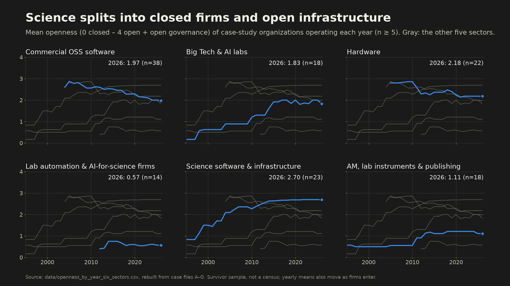

# Findings brief: the value of open science in the age of AI (issue #380)

This two-page version of [`README.md`](README.md) gives every number with its source file.

**Videos:** [Part 1](https://www.youtube.com/watch?v=Aakq7PNsFpE) (11:41), [Part 2](https://www.youtube.com/watch?v=uujMO9R1tMc) (4:53) and [Part 3](https://www.youtube.com/watch?v=8P7iqUaVHyE) (3:40). **Playbook:** [`RECOMMENDATIONS.md`](RECOMMENDATIONS.md).

## Twelve numbers

1. **$4.15B vs. $8.8T.** Open-source software would cost $4.15B to rewrite, but firms would need $8.8T to
   replace it themselves. 96% of that value comes from 5% of developers (Hoffmann, Nagle & Zhou 2024;
   [verified](VERIFICATION.md)).
2. **About 800×.** The Protein Data Bank costs $6.9M a year to run and is used for $5.5B a year of research
   time. That is use value, not net benefit; the conservative R&D return ($1.1B) is about 160×. It held 172,801 open structures by 2020, the year AlphaFold 2 won CASP14
   ([PDB data](data/pdb_released_per_year.csv)).
3. **12–27% more patent citations** to NIH-funded research after its 2008 open-access mandate, a causal
   estimate ([Edison](edison/open_science_roi_answer.md)).
4. **87% cheaper.** That is the average material-cost saving of open scientific hardware vs. the commercial price
   (Pearce 2020; excludes labour, with comparators for about 45 of 119 designs). Open SDL hardware costs $100–2,000, vs. about $10k for general-purpose commercial systems and
   about $1M for specialized ones.
5. **$375B vs. $8.8T.** The value captured by about 30 commercial open-source companies is a sliver of the
   value created. Databricks ($190B), Red Hat ($34B) and MongoDB ($23B) top the list
   ([case files](companies/companies_master.csv)).
6. **7× and 14×.** Median IPO and M&A exit values for VC-backed open-source startups vs. matched closed
   peers ($1.3B vs. $171M; $482M vs. $34M). The source is the LF/Serena/COSSA 2025 report, co-written by
   a VC that backs open source.
7. **16 → 31 closing moves, 11 → 30 opening moves.** Licence changes in the 2010s vs. 2020–26 (video snapshot, groups A–F). Per organization-year the rate still more than doubled, from 3.4 to 8.2 per 100 ([rates](data/licence_events_per_org_year.csv)). With the AI-for-science models and AI-era startups added, 2020–26 is 36 closing vs. 50 opening. All
   eight well-known forks checked are alive (most closing moves drew no fork). Valkey, Pekko, OpenVox and
   LibreOffice now out-commit the originals ([fork data](data/fork_vs_original.csv)).
8. **−0.61 raw, but −0.09 adjusted (95% CI −0.45 to +0.28).** Companies founded since 2000 became less
   open than pre-2000 companies, but almost all of that gap comes from where they started: open starters
   close and closed starters open, which is convergence to the middle. This was corrected after an
   independent review; the videos' "VC-era firms close up" is overstated. Government, academic and
   foundation infrastructure almost never closed: 1 of 24 ([corrected analysis](data/kinds_corrected.csv)).
9. **21% → 81% vs. ~40%.** Academia's open-weight share of US AI models (2018–19 → 2024–25), against
   industry's, which stayed near 40% (restricted weights included; unrestricted fell from 33% to 16%). In
   2026 to date, the largest closed training run is about 50× the largest open one, a volatile maximum
   (Epoch AI).
10. **76% vs. 72%.** In 2024 US industry papers were more often open access than academic ones overall,
    but not in the physical sciences (OpenAlex). The pattern is open papers and closed weights.
11. **2.8 vs. 1.6.** AI-for-science model releases average 2.8 on the 0–4 openness scale, against 1.6 for
    frontier-LLM companies. That is indicative only, because releases and companies are scored differently. 14 of 17 trained on public data
    ([group I](companies/I/_summary.md)).
12. **$2.24 a kit.** That was the stated profit on the $80 SDL-demo kit sold through GroupGets. The
    institutional lab bought equipment rather than selling any, and closed vendor equipment was its most
    frequent complaint ([digest](gh-mining/commercialization_digest.md)).

## Added late in the run (Part 3)

- **The well-known forks survived.** All eight checked are alive, and Valkey, Pekko, OpenVox and LibreOffice
  now out-commit the originals ([fork data](data/fork_vs_original.csv)). Most closing moves drew no fork at all.
- **AI-era open-source startups (17) have not moved to SSPL or BSL, so far.** They are young; group A firms
  first closed at a median age of about 10. Their mean openness held at 2.29, while the 2010s database cohort
  fell from 2.72 to 1.67. 7 had exits, mostly to compute and chip companies, with no IPOs
  ([group J](companies/J/_summary.md)).
- **Academic path:** US university licensing earned $2.94B in 2018, yet most tech-transfer offices
  don't break even. Open hardware succeeds by "publishing the design and selling what publication doesn't
  supply". The review literature records CLSLab:Light's 39 kits
  ([Edison](edison/academic_osh_commercialization_answer.md)).
- **Agents write most of our record, by volume:** in byu-vcl, Claude wrote 6.4M characters against humans'
  1.4M. By record count, humans wrote 71%.

## Five patterns

- **Openness creates value; the service, the data and the hardware capture it.** Commercial OSS, Big Tech
  and hardware average about 2 on the 0–4 scale in 2026. Science splits into closed lab-automation and
  AI-for-science firms (0.57) and open software and infrastructure (2.70); AM and instrument makers sit near 1.
- **Hardware is not software.** Open hardware buys cost savings and longevity, not valuations. Clones,
  bills of materials and liability are real costs, and open *standards* (RISC-V, OCP) are where hardware
  openness scales.
- **The physical sciences run on public open infrastructure.** PDB, the Materials Project, LAMMPS, DOE's
  code (93.6% open source) and arXiv are cheap and heavily used. They are also thinly funded: arXiv left
  Cornell and ran a deficit, and OSF stopped new projects in November 2026.
- **The AI labs now talk about science, not openness.** Anthropic's and OpenAI's science language rose
  about 10× into 2026, in the documents we sampled (which over-represent their 2025–26 science posts). Both court the national labs with access and credits, and open their *tooling*
  (MCP, skills, SDKs) rather than their weights. Anthropic calls safe open-weight models "a public good"
  and has never advocated a ban.
- **DAL and #318 already fit the winning pattern: open orchestration on closed instruments.** The open
  questions are whether compositions are published or protected (the drafts disagree) and how to open the
  driver and data layer between closed instruments and AI ([audit](dal/dal_openness_audit.md)).

