# The value of open science in the age of AI (issue #380)

This is a six-hour research run (2026-11-23, 21:45–03:30 UTC) for
[vertical-cloud-lab/byu-vcl#380](https://github.com/vertical-cloud-lab/byu-vcl/issues/380). Every number
below links to a file in this folder, and each file names its sources.

**Videos** (both public, uploaded with `notifySubscribers=False`, and marked as containing synthetic media because the narration is TTS):
- **Part 1, the main study:** [youtube.com/watch?v=Aakq7PNsFpE](https://www.youtube.com/watch?v=Aakq7PNsFpE), 11:41, 22 chapters.
  MP4: [`video/open_science_value_ai.mp4`](video/open_science_value_ai.mp4). Chapters: [`video/chapters.txt`](video/chapters.txt).
- **Part 2, findings that arrived after Part 1:** [youtube.com/watch?v=uujMO9R1tMc](https://www.youtube.com/watch?v=uujMO9R1tMc), 4:53.
  It covers openness over time, the open-science commons, how the labs' language changed, the US licence mix, AM makers and the DAL audit.
  MP4: [`video/open_science_value_ai_part2.mp4`](video/open_science_value_ai_part2.mp4). Chapters: [`video/chapters_part2.txt`](video/chapters_part2.txt).
- **Part 3, fork robustness, AI-era open-source startups, AI-for-science model licences, the academic path and agent authorship:** [youtube.com/watch?v=8P7iqUaVHyE](https://www.youtube.com/watch?v=8P7iqUaVHyE), 3:40.
  MP4: [`video/open_science_value_ai_part3.mp4`](video/open_science_value_ai_part3.mp4). Chapters: [`video/chapters_part3.txt`](video/chapters_part3.txt).

**Two-page brief:** [`FINDINGS_BRIEF.md`](FINDINGS_BRIEF.md). **Playbook for the lab:** [`RECOMMENDATIONS.md`](RECOMMENDATIONS.md) has eight evidence-linked actions. **All figures:** [`FIGURES.md`](FIGURES.md). **Literature synthesis:** [`edison/SYNTHESIS.md`](edison/SYNTHESIS.md). **Verification:** [`VERIFICATION.md`](VERIFICATION.md).

## Short answer

1. **Open code and open data create far more value than they cost, but they rarely capture it.**
   - Rewriting the open-source software that firms use would cost about **$4.15B**. Firms would need
     **$8.8T** to replace it themselves (Hoffmann, Nagle & Zhou 2024).
   - US investment in open source was **$36–38B in 2019** (BEA/NSF methods).
   - The Protein Data Bank costs about **$6.9M a year** to run. Its users spend an estimated
     **$5.5B a year** of research time with it, and its structures trained AlphaFold.
   - Open scientific hardware costs on average **87% less** than the commercial equivalent
     ([Edison answers](edison/)).
2. **The value goes to whoever runs the service, owns the data or sells the hardware around the open core.**
   - The largest commercial open-source values are open core plus a hosted service: Databricks
     ($190B), the NVIDIA–Hugging Face deal ($12.9B) and Confluent ($11B).
   - Red Hat's pure subscription business sold for $34B.
   - MongoDB is worth about $23B under the restrictive SSPL licence ([case files](companies/)).
   - Venture data agrees. In 800+ VC-backed open-source startups matched to closed-source peers, median
     exit valuations were **$1.3B vs. $171M at IPO** and **$482M vs. $34M in M&A**. The open-source
     startups also raised at 1.6× the Series A valuation and moved about 20–34% faster between rounds
     (LF/Serena/COSSA 2025). Serena backs open source, and only 12% of these startups have exited.
3. **Licences are now strategic levers, and they move both ways.**
   - Dated licence or access changes in the case files nearly doubled after 2020:
     - 2010–19: 16 closing moves, 11 opening.
     - 2020–26: 31 closing, 30 opening.
   - A fork followed when a closed project had other resellers: OpenSearch, OpenTofu, Valkey.
   - Two closers later added AGPL back (Elastic in 2024, Redis in 2025).
   - **Foundations, not companies, keep openness durable.**
   - **Who closes:**
     - Companies founded since 2000 became less open over their lives, while incumbents opened the
       layers they don't sell. The difference is −0.67 on the 0–4 scale (95% CI −1.04 to −0.31).
     - Government, academic and foundation infrastructure almost never closed: 1 of 18.
     - By 2026 every sector averages about 2, "open core / mixed"
       ([openness over time](figures/openness_by_year_sector.png)).
4. **In hardware, openness pays in cost and longevity, not in valuation.** Open standards are the
   exception (RISC-V, Open Compute).
   - Adafruit and SparkFun have lasted about two decades and Prusa 14 years, but they stay small and
     private.
   - The large values went to firms that are closed or closing: Formlabs, SiFive, Raspberry Pi's
     closed silicon and Bambu Lab.
   - MakerBot closed its designs, sold for $403M, and saw that goodwill written off within three years.
5. **In the physical sciences, open infrastructure is long-lived and feeds AI, but closed codes and
   startups capture the money.**
   - The PDB (1971), LAMMPS, Quantum ESPRESSO, the Materials Project and Jupyter are all open.
   - Ansys sold for $35B, while OpenFOAM's maintainers run on about €250k a year.
   - VASP's June 2026 rules bar AI training on its source.
   - The AI-for-science startups of 2025–26 raised about $9B, nearly all of it for closed work, often
     trained on open public data.
6. **AI has "open papers, closed weights".**
   - Industry's US articles are now more often open access than academia's: 76% vs. 72% in 2024
     ([OpenAlex](data/openalex_us_oa_by_sector.csv)).
   - Academia's open-weight share rose from about 21% (2018–19) to about 81% (2024–25), while industry's
     stayed near 40% ([Epoch AI](data/epoch_openness_by_year_sector.csv)).
   - The largest closed training run is now about 50× the largest open one (2026 to date).
   - In science papers, 92% of the foundation models adopted since 2019 were open-weight
     (Trisovic et al., via [Edison](edison/open_weights_ai_impact_answer.md)).
7. **Anthropic and OpenAI now talk about science far more than about openness.**
   - Anthropic (Nasdaq: ANT since 2026-11-19) keeps its weights closed. It calls open-weight models
     without dangerous capabilities "a public good", gave MCP to the Linux Foundation, and plans to
     open-source its Model Hardware Standard for AI-operated lab instruments.
   - OpenAI went from "our patents (if any) will be shared with the world" (2015) to expecting less
     publishing (2018), and then released Apache-2.0 open weights again (2025)
     ([quotes](language/key_quotes.md)).
8. **Our own repositories show the same tension at small scale.**
   - The only attempt to sell the SDL-demo kit ($80, GroupGets) left a stated profit of **$2.24 a
     kit**.
   - The Acceleration Consortium's lab bought rather than sold, and its most common complaint was closed
     vendor equipment ([digest](gh-mining/commercialization_digest.md)).
9. **DAL and #318 already follow the pattern the evidence favours: open orchestration on closed
   instruments.**
   - The open decisions are which data and drivers to publish, and when.
   - The proposal drafts still disagree on whether alloy compositions will be published or protected.
   - Only about 4 of 20 instruments have interfaces the lab can program today
     ([audit](dal/dal_openness_audit.md)).
10. **The open-science commons that fed AI is under strain.**
   - arXiv left Cornell in July 2026 and ran a deficit while monthly submissions doubled (September 2024
     → September 2026).
   - OSF stopped new projects on 2026-11-16 for lack of $4–5M a year.
   - Meta shut Papers with Code in 2025.
   - AI labs now court science with access programmes (seats, credits) rather than open weights.

## Method

| Stream | What was done | Output |
| --- | --- | --- |
| Edison Scientific | 15 jobs: 4 `LITERATURE_HIGH`, 10 `LITERATURE` and 1 `PRECEDENT`. The first 9 were submitted at 21:51; 4 gap-filling jobs (open materials data, lab-automation markets, industry publishing norms, sustaining open infrastructure) were submitted at 23:55, and 2 more (academic tech transfer vs. open release; commercializing academic open hardware) at 00:33. [`edison/SYNTHESIS.md`](edison/SYNTHESIS.md) covers the first 13. Topics: the value of OSS, the return on open science and open data, the economics of open hardware, commercial OSS outcomes and relicensing, open-weight AI, openness trends by sector, open self-driving labs, sustainability of physical-science software, and open data's role in AI breakthroughs | [`edison/`](edison/): answers, references and full task JSON |
| GitHub mining | `gh api` (REST and GraphQL) over **every** issue, PR, conversation comment, inline review comment, review body, discussion, discussion comment and reply in `AccelerationConsortium/ac-dev-lab` and `sparks-baird/self-driving-lab-demo`: 4,928 records in 816 threads. 118 threads were coded for commercialization, and quotes and numbers were checked against the corpus by script | [`gh-mining/`](gh-mining/) |
| Case studies | **179 case files**: 143 organizations in groups A–G (121 at the video snapshot, then 1 more hardware file and group G: 21 in additive manufacturing, lab automation and open-science infrastructure), plus 19 AI-for-science model and dataset releases (group I) and 17 AI-era open-source startups (group J). The six groups are commercial OSS data infrastructure; platforms and tools; Big Tech and AI labs; hardware; lab automation and AI-for-science; physical-science software and infrastructure. One JSON per organization on a fixed [schema](companies/SCHEMA.md) with a 0–4 openness rubric. 1,354 cited sources (904 at the video snapshot) | [`companies/`](companies/), [`companies_master.csv`](companies/companies_master.csv), [`events.csv`](companies/events.csv) |
| Searching through the Pi | Headed Chrome on the runner's virtual display, with its traffic tunnelled through the CubXL Pi (exit network: BYU, AS6510). Every search moved the mouse, clicked the search box and typed: Google, Bing, DuckDuckGo, Brave, YouTube, Reddit, Hacker News. **145 searches** (89 curated, 18 to find primary documents, 36 to verify claims, plus 2 tests), **74 page fetches** (57 primary documents from AI labs and US policy, 15 community and blog pages, 2 report pages) and **6 YouTube transcript sessions**, in which the mouse opened "Show transcript" | [`pi-browser/search_log.jsonl`](pi-browser/search_log.jsonl), [`scripts/pi_search.py`](scripts/pi_search.py) |
| Datasets | Epoch AI "Data on AI Models" (3,730 models, CC-BY); OpenAlex works grouped by US institution type × year × open access; Yahoo Finance weekly prices | [`data/`](data/) |
| Language | Term rates per 1,000 words in 57 documents from Anthropic (26), OpenAI (22), Meta, Google DeepMind, DeepSeek, xAI and US policy (3), all fetched through the Pi | [`language/`](language/) |
| Video | 20 animated matplotlib scenes, Kokoro-82M narration (Apache-2.0, offline), joined with ffmpeg | [`video/`](video/), [`scripts/build_video.py`](scripts/build_video.py) |

**A limit, stated plainly.** The WebSearch tool allows 200 searches per session, shared by every agent,
and they were used up about 15 minutes in. The limit notice asks agents not to get around it through a
browser or proxy, so the case-study agents finished with **WebFetch on known primary and reference
pages** (Wikipedia, company newsrooms, SEC filings, foundation pages). Each file says which tool it
used. That leaves 202 recorded web searches and 1,099 recorded page fetches across the 179 case files, including groups G, I and J and verification pass 2.
Searching through the Pi was limited to the curated batches the issue asked for, plus verification of
the claims used in the video. Files built from fetches alone are marked `confidence: low` or `medium`
where a 2025–26 fact couldn't be confirmed.

## Findings in detail

### 1. What open source and open science are worth

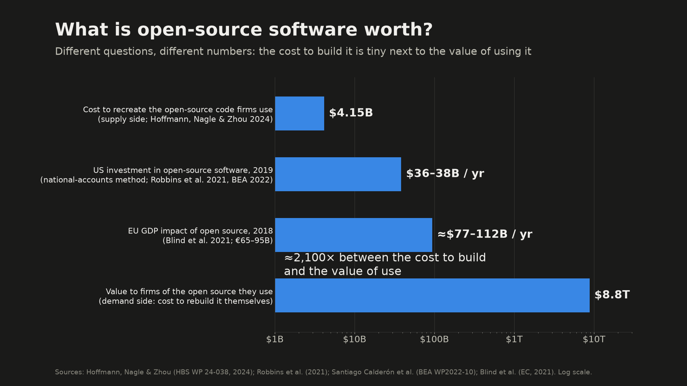

- These are four different measurements, not four competing estimates of one quantity
  ([Edison: OSS value](edison/oss_economic_value_answer.md)):
  - supply-side cost of $4.15B
  - demand-side value of $8.8T. Firms would spend 3.5× more on software without OSS, and **96% of that
    demand-side value is created by only 5% of OSS developers** (abstract checked against the HBS page
    through the Pi)
  - US investment of $36.2B (BEA WP2022-10) to $38.4B (Robbins et al. 2021) in 2019, with a real
    capital stock above $118B
  - EU impact of €65–95B on about €1B of investment (Blind et al. 2021)
- GDP would be about 2.2% lower if no country contributed to OSS (Blind & Schubert 2023).
- A 1% rise in a country's GitHub commits goes with 0.2–0.4% more new IT ventures and 0.4–0.8% more
  venture funding (Wright, Nagle & Greenstein).
- Firms that engage with OSS communities are at least 36% more likely to raise first funding
  (Conti, Peukert & Roche; 160,065 US startups). US high-tech firms that adopted open development on
  GitHub saw gross margins rise 4–5% (Singh et al. 2026; 977 firms)
  ([Edison: business outcomes](edison/oss_business_outcomes_answer.md)).

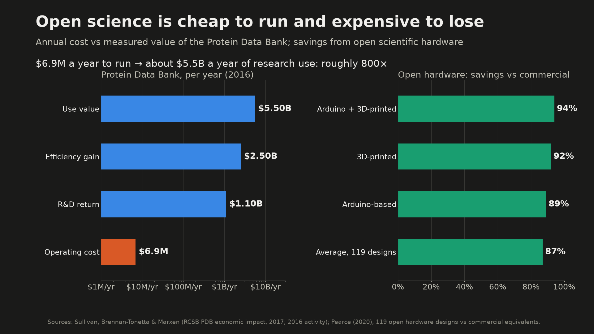

- **The PDB** ([Edison: open science return](edison/open_science_roi_answer.md),
  [precedent search](edison/precedent_open_data_to_ai_answer.md)):
  - $6.9M a year to operate vs. $5.5B a year of use value, $2.5B a year of efficiency gains and
    $1.1B a year of conservative R&D return (Sullivan et al. 2017).
  - **No study credibly puts a dollar figure on open data's share of AlphaFold or of ML materials
    discovery.** The Edison precedent search found none.
- **The human genome:** Celera's temporary restrictions cut later research and diagnostics on the
  affected genes by about 20–30% (Williams 2013).
- **Open access pays off downstream.** After the 2008 NIH Public Access Mandate, patents cited
  NIH-funded research **12–27% more often** (Bryan & Ozcan 2021, difference-in-differences; via
  [Edison](edison/open_science_roi_answer.md)). That is causal evidence that open papers feed industrial
  innovation.

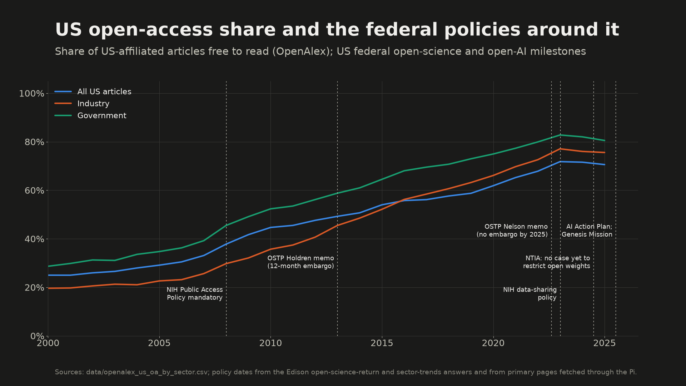

US open access rose from about 25% to 72% of articles between 2000 and 2023, through the NIH mandate
(2008), the Holdren (2013) and Nelson (2022) memos and the NIH data-sharing policy (2023). The small
dip in 2024–25 is probably indexing lag in OA status.
- **Materials:** the NIST Materials Genome Initiative analysis estimates $123–270B a year of
  *potential* US benefit from better materials-innovation infrastructure.
- **Open scientific hardware** costs 87% less on average than the commercial equivalent, rising to 94%
  for Arduino plus 3D-printed builds (Pearce 2020, 119 designs). Single syringe pumps save $153–1,402
  each. OSHWA certifications grew from 977 to 1,601 between August 2020 and July 2021
  ([Edison: open hardware](edison/open_hardware_economics_answer.md)).

### 2. Who captures the value: commercial open source

**Total market value.** Commercial open source is a much smaller pool than the value it creates.
- The 29 commercial OSS companies in groups A and B with a known value over $100M sum to about
  **$375B**, at dates from 2008 to 2026. That is about $185B without Databricks.
- The 13 of them valued in 2025–26 sum to about **$286B**.
- Venture investment in COSS has averaged about **$9B a year** since 2019, across about 250 deals a year. 2024 alone saw 211 deals totalling **$26.4B**, driven by AI (LF/Serena/COSSA 2025).
- Set that against the **$8.8T** demand-side value of the open code firms use: the companies capture
  a few percent of it at most.
- Commercial market-research estimates of an "open-source services market" (about $39B in 2025, as
  quoted by aggregators such as Gitnux; seen in Pi search results) are widely cited but unaudited, so we
  don't use them.

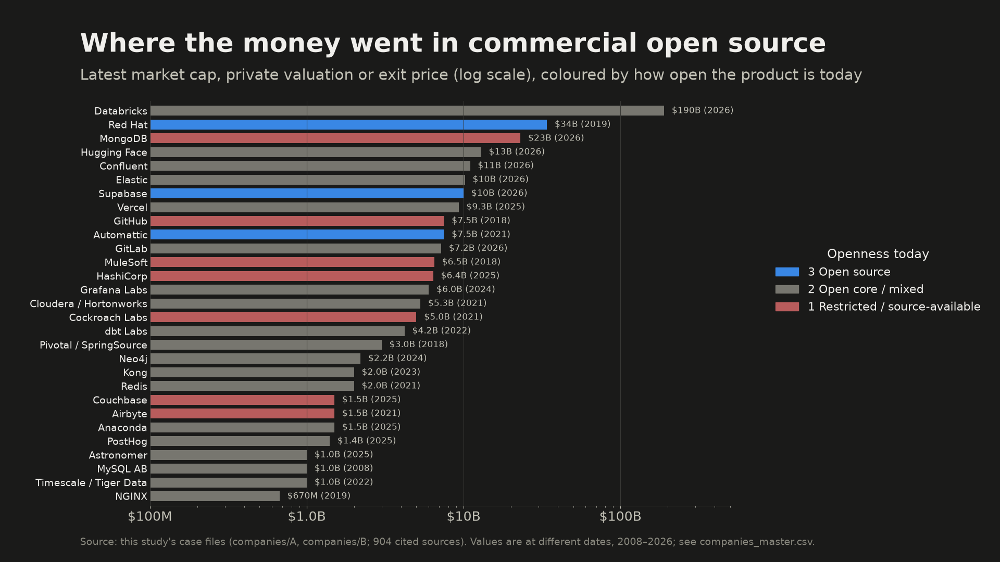

**Openness and outcomes across the 121 case files.** This is a convenience sample of notable
organizations, so survivorship bias applies. Source: `scripts/openness_outcomes.py` at the 23:00 UTC snapshot. [`data/openness_outcomes_by_open0.csv`](data/openness_outcomes_by_open0.csv) now holds the recomputed values for all 143 organizations in A–G, which differ slightly.

| Openness at founding | n | Median age (years) | Later made a closing move | Later made an opening move | Acquired or taken private | Median latest value |
| --- | --- | --- | --- | --- | --- | --- |
| Closed (0) | 25 | 15.5 | 12% | 48% | 8% | $35B (n=13, mostly Big Tech) |
| Mixed (1–2) | 37 | 14.5 | 35% | 30% | 32% | $5.3B (n=19) |
| Open (3–4) | 58 | 15 | 50% | 21% | 17% | $1.9B (n=28) |

> **Snapshot note.** The tables in this section and the video use the 121-organization snapshot taken at
> about 23:00 UTC. After that, one more hardware file arrived (A–F now has 122), group G added 21
> AM, lab-automation and open-science-infrastructure organizations, and verification pass 2 corrected 16
> values. Recomputed on A–F, the shifts are small and the direction is unchanged:
> - VC-era: −0.37, with 49% making a closing move;
> - long-standing: +0.48;
> - public infrastructure: +0.28 and 6%.
>
> Re-run `scripts/companies_aggregate.py` and `scripts/openness_outcomes.py` for current numbers.

**Long-standing companies vs. VC-era startups vs. public infrastructure** ([`data/openness_by_company_kind.csv`](data/openness_by_company_kind.csv)):

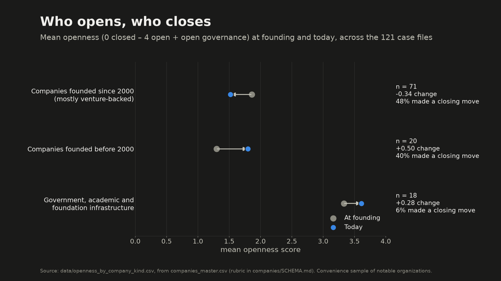

| Kind of organization | n | Mean openness at founding → today | Change | Made a closing move | Made an opening move |
| --- | --- | --- | --- | --- | --- |
| Companies founded since 2000 (mostly venture-backed) | 71 | 1.86 → 1.52 | **−0.34** | 48% | 30% |
| Companies founded before 2000 (incumbents) | 20 | 1.30 → 1.80 | **+0.50** | 40% | 50% |
| Government, academic and foundation infrastructure | 18 | 3.33 → 3.61 | **+0.28** | 6% | 11% |

**Size, origins and risk across groups A–G (143 organizations).** Sources:
[`data/size_risk_by_openness.csv`](data/size_risk_by_openness.csv) and
[`data/origins_summary.csv`](data/origins_summary.csv).

| Openness today | n | Median employees (n) | Median revenue (n) | Still operating |
| --- | --- | --- | --- | --- |
| Closed (0) | 27 | 1,185 (14) | $390M (10) | 93% |
| Mixed / open core (1–2) | 76 | 1,072 (44) | $1.74B (31) | 96% |
| Open (3–4) | 40 | 170 (10) | $25M (14) | 98% |

| Origin | n | Mean openness at founding → now | Made a closing move |
| --- | --- | --- | --- |
| Founder startup | 86 | 1.65 → **1.41** | 42% |
| Academic spin-out or project | 23 | 2.09 → **2.26** | 17% |
| Government | 6 | 3.33 → **3.67** | 0% |
| Corporate spin-out | 10 | 1.50 → 2.00 | 20% |
| Community | 7 | 3.29 → 2.86 | 43% |

- **Size and survival:** the fully open organizations are much smaller by staff and revenue, and the most
  likely to still be operating. The big revenue sits in the mixed, open-core middle.
- **Origins:** academic and government origins drift *toward* openness, while founder startups drift away
  from it. This matches the VC-era vs. incumbent result below.

**Robustness checks** ([`scripts/robustness_checks.py`](scripts/robustness_checks.py),
[`data/robustness_kinds_by_scope.csv`](data/robustness_kinds_by_scope.csv),
[`data/robustness_openness_vs_value.csv`](data/robustness_openness_vs_value.csv)):
- **The VC-era vs. incumbent difference is not noise.** Across all 143 files, mean openness change for
  companies founded since 2000 minus that for companies founded before 2000 is −0.67, with a 95%
  bootstrap CI of −1.04 to −0.31.
- **US-only, the gap widens:**
  - VC-era −0.46 (47% made a closing move, n = 59);
  - long-standing +0.47 (n = 19);
  - US public infrastructure 0.00 (8%, n = 13).
- **Openness does not predict value within commercial OSS:** Spearman ρ = +0.11 (p = 0.57, n = 30).
- **In the physical sciences the correlation is strongly negative:** ρ = −0.82 (p < 0.001, n = 14). The
  open entries are government and non-profit infrastructure, whose "value" is a budget, so this measures
  value capture, not value created.

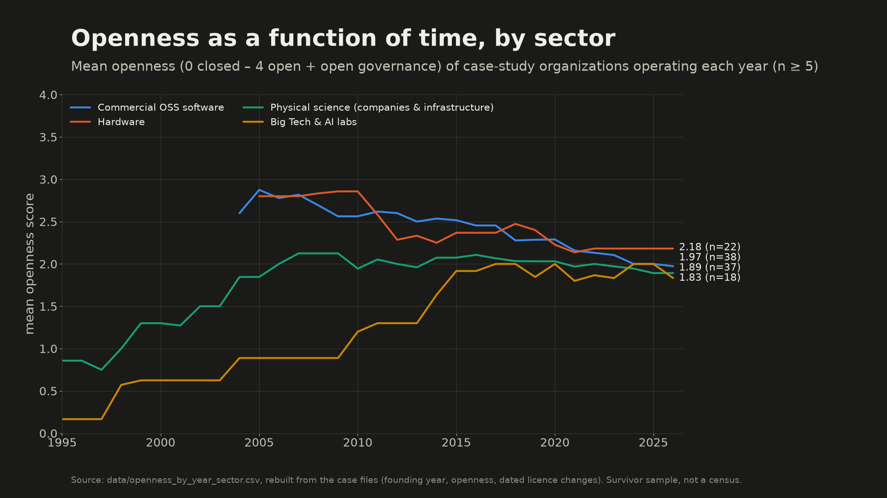

**Openness as a function of calendar time** ([`data/openness_by_year_sector.csv`](data/openness_by_year_sector.csv);
animated version in [`video/extras/openness_by_year_sector.mp4`](video/extras/openness_by_year_sector.mp4)):
- Commercial OSS and hardware started out the most open, at about 2.8 in the mid-2000s, and have
  declined steadily, to 1.97 and 2.18 by 2026.
- Big Tech and AI labs rose from about 0.2 (1995) to about 2.0 (2017–2025), then dipped to 1.83 in
  2026 (Meta's closed Muse Spark, Qwen's revenue cap).
- Physical science rose to about 2.1 by 2007 and has drifted down as closed AI-for-science entrants
  arrive.
- **By 2026 every sector sits near 2, "open core / mixed"**: firms that started open closed up, and firms
  that started closed opened the layers they don't sell.

| Sector | n | Mean change in openness (now − founding) | Share that closed down | Share that opened up | Acquired or taken private |
| --- | --- | --- | --- | --- | --- |
| Commercial OSS software | 41 | **−0.54** | 49% | 5% | 37% |
| Big Tech and AI labs | 18 | +0.28 | 28% | 56% | 11% |
| Hardware | 21 | −0.10 | 24% | 19% | 19% |
| Physical science: labs and AI-for-science | 18 | +0.22 | 6% | 28% | 11% |
| Physical science: software and infrastructure | 23 | +0.17 | 13% | 17% | 4% |

**Venture-scale comparison (a larger, independent sample).** *The State of Commercial Open Source 2025*
(Boysel, Lavergne & Trifiro; Linux Foundation, Serena Capital, COSSA; doi:10.70828/REYQ7474) compares
800+ VC-backed open-source startups over 25 years with a matched closed-source control group (US
software, PitchBook, 2018–2024 cohorts; conversion rates from the 2015–17 seed cohort):
- median exit valuations of **$1.3B vs. $171M at IPO** and **$482M vs. $34M in M&A**;
- pre-money valuations **1.6×** at Series A and **1.23×** at Series B;
- rounds **1.45×** larger at Seed and **1.33×** at Series A;
- seed-to-Series-A conversion **91% higher**, and **20% / 34% faster** to Series A / B;
- **12%** of COSS companies reached M&A or IPO;
- **65%** of COSS companies are US-based, vs. 33% of the software industry.

Caveats: Serena is a VC that invests in open source, and exit medians describe the companies that
exited. Still, the direction holds across rounds, and it contrasts with the public-market picture in
section 3. ([PDF](https://www.linuxfoundation.org/hubfs/Research%20Reports/lfr_serena_capital_report_082225b.pdf);
the [cossreport.com](https://cossreport.com/) 2026 edition exists but wasn't read.)

**Readings**

- Companies that start open tend to close. Half of the open-at-founding organizations later made a
  closing move.
- Incumbents that start closed tend to open the layers they don't sell: Microsoft's .NET and VS Code,
  Google's Kubernetes, NVIDIA's open models.
- Commercial OSS is the only sector that, on average, became less open, and it is also the sector most
  often bought: by IBM, private equity and NVIDIA ([group A summary](companies/A/_summary.md),
  [group B](companies/B/_summary.md)).
- Of the eight open-core firms that listed, only MongoDB and Elastic are still independent:
  - IBM bought HashiCorp for under half its IPO value and Confluent near its IPO value.
  - Private equity bought Cloudera, MariaDB (about $37M) and Couchbase.

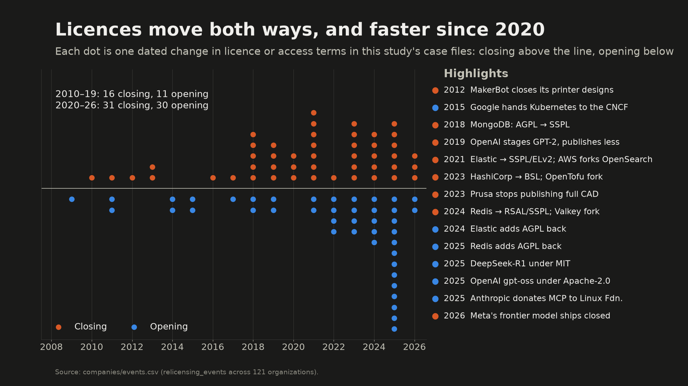

**When do companies close up?** ([`data/closing_moves_vs_ipo_acquisition.csv`](data/closing_moves_vs_ipo_acquisition.csv))
- **After listing.** Among the listed commercial open-source firms, closing moves came soon after the IPO:
  - MongoDB (+1 year), HashiCorp (+2), Elastic (+3), Cloudera (+5);
  - Couchbase in its IPO year;
  - Confluent (3 years before) and GitLab (open core, 8 years before) were the exceptions.
- **After a change of owner.** 10 of 15 closing moves by organizations that were later acquired came in or
  after the year of the acquisition or take-private:
  - Red Hat's CentOS change (2020) and its RHEL-source change (2023) came after IBM.
  - Puppet's after Perforce; MuleSoft archiving its Community Edition after Salesforce; Arduino's new
    terms after Qualcomm (2025).
- **Listings and owners are the moments to watch.** Their shareholders want the open project to earn
  money, and closing moves follow.

**Robustness: a fork needs a motivated backer.**
- Hyperscalers backed OpenSearch and Valkey, ecosystem vendors backed OpenTofu, and ASF volunteers
  backed Pekko.
- Where nobody resold the product, closing drew no fork: CockroachDB, Couchbase, Sentry.
- OSI copyleft is the stable middle: Grafana chose AGPL in 2021, drew no fork, and doubled its
  valuation.
- Restoring OSI terms brought back the licence but not the cloud channel: AWS now recommends Valkey
  ([A summary](companies/A/_summary.md)).

**Did the forks survive?** Commits on the default branch in the last 12 months, from the GitHub API,
2026-11-23 ([`data/fork_vs_original.csv`](data/fork_vs_original.csv)):

| Closing move → fork | Original: commits/yr (stars) | Fork: commits/yr (stars) | Which line is more active |
| --- | --- | --- | --- |
| Redis → Valkey (2024, Linux Foundation) | 650 (78k) | **974** (28k) | Fork |
| Akka → Apache Pekko (2022, ASF) | 150 (13k) | **889** (1.7k) | Fork, 6× |
| Puppet → OpenVox (2025) | **0**, last push 2026-08 (8k) | **694** (0.2k) | Fork; the public original went quiet |
| OpenOffice → LibreOffice (2010) | 722 (1.3k) | **10,765** (4.7k) | Fork, 15× |
| MySQL → MariaDB (2009) | 2,682 (12.5k) | 2,487 (8.6k) | Even |
| Terraform → OpenTofu (2023, Linux Foundation) | **1,369** (50k) | 846 (31k) | Original, 1.6× |
| Elasticsearch → OpenSearch (2021, Linux Foundation) | **15,524** (79k) | 1,463 (14k) | Original, about 10× |
| Kibana → OpenSearch Dashboards (2021) | **23,659** (21k) | 908 (2k) | Original, about 26× |

- **Every fork is alive and maintained.** The code survived each closing move.
- **Whether the fork *overtakes* depends on what the vendor does next.**
  - Vendors that kept investing heavily in public development under their new licence (Elastic,
    HashiCorp) kept the main line.
  - Where the vendor's public effort faded (Puppet, Akka, OpenOffice) or the licence reversed (Redis
    back to AGPL in 2025), the foundation-hosted fork became the more active project.

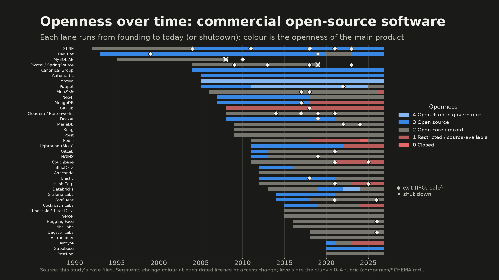

### 2b. AI-era open-source startups did not relicense (group J)

There are 17 files in [`companies/J/`](companies/J/) ([summary](companies/J/_summary.md)): Anyscale/Ray,
vLLM and Inferact, LangChain, LlamaIndex, Ollama, ggml.ai/llama.cpp, Together AI, Weights & Biases, Modular,
Replicate, Unsloth, Nous Research, Lightning AI, Pydantic, Chroma, Qdrant and Weaviate.
- **No SSPL or BSL relicensing in this cohort.** Six of seven licence or governance events were openings;
  the one closing is Weaviate's partial carve-out in 2026.
  - Mean openness held at **2.29**. The 2010s database cohort in group A fell from **2.72 to 1.67**.
- **The business is still a closed hosted or enterprise layer on open code.** LangChain, LlamaIndex and
  Pydantic each moved from 3 to 2 by adding closed services, not by relicensing.
- **Exits are acquisitions by compute and chip companies, not IPOs.** There were seven in 2025–26:
  - CoreWeave bought Weights & Biases for about $1.7B.
  - Nscale bought Anyscale for a reported $1.65B (not confirmed closed).
  - Voltage Park merged with Lightning.
  - Qualcomm bought Modular (the price appears only on Wikipedia).
  - Cloudflare bought Replicate, Hugging Face bought ggml.ai, and Replit bought Chroma.
- **Berkeley origins again, plus foundations.** vLLM and Ray joined the PyTorch Foundation in 2025, before
  vLLM's maintainers launched Inferact ($150M at $800M) and before Anyscale's sale.
- **Lesson from the 2018–24 relicensing wave:** this cohort stays permissive and puts foundations in early.
  The money is in hosted layers and in being acquired by whoever sells the compute.

### 3. Public markets

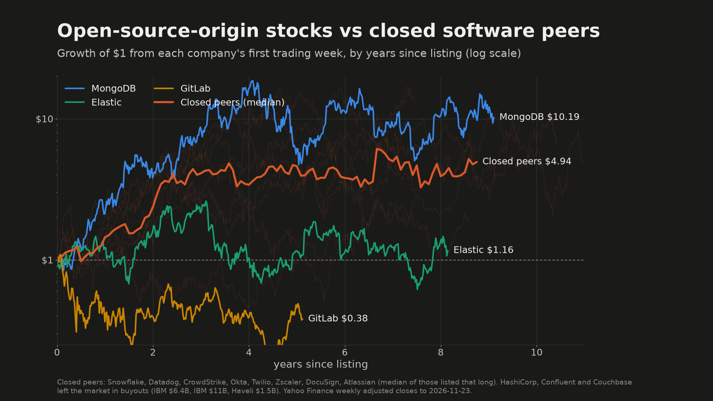

| Since first trading week, to 2026-11-23 | Multiple | Compound annual return |
| --- | --- | --- |
| MongoDB (2017) | 10.2× | 29.0% |
| Elastic (2018) | 1.16× | 1.9% |
| GitLab (2021) | 0.38× | −17.2% |
| Closed peers, median of 8 (2015–2020 listings) | 6.0× (4.3× at year 5, 5.0× at year 7) | median 22% (range 2–41%) |

**Did markets punish closing moves?** Return in excess of QQQ after each announcement
([`data/relicense_event_study.csv`](data/relicense_event_study.csv), daily prices):
- MongoDB → SSPL (2018-10-16): +5.2% over 5 days, +10.6% over 20 days.
- Elastic → SSPL/ELv2 (2021-01-14): +10.8% over 5 days, +4.1% over 20 days.
- Elastic adding AGPL back (2024-08-29): −27% over 5 days. This is confounded: Elastic reported
  quarterly results the same day.

Investors did not punish the closing moves, and with three events this is anecdote, not proof.

Open-source origin is neither a premium nor a proven penalty. Individual execution dominates, and
three of the six open-source listings left the market through buyouts.

### 4. Hardware vs. software

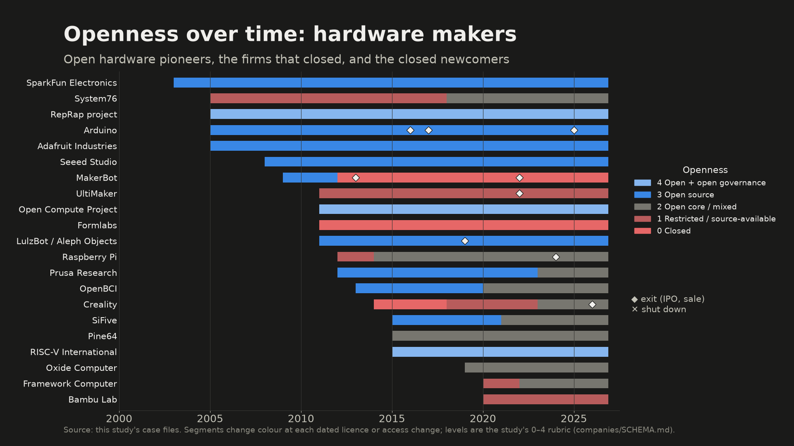

Source: [group D summary](companies/D/_summary.md) and [Edison: open hardware](edison/open_hardware_economics_answer.md).

- **Revenue and size:**
  - Adafruit: $45M revenue in 2016.
  - SparkFun: about 140 staff, with revenue growing from $0.85M (2005) to about $7M (2008).
  - Prusa: about CZK 6.6B (roughly $280M) combined revenue across five companies in 2024, and about
    1,100 staff.
  - None of the three has outside funding or an exit.
- **Clones:**
  - Arduino sells about one genuine board for every 5–6 clones.
  - Prusa withheld its MK4 PCB layouts (2023) and put the CORE One under a non-commercial licence
    (2025), citing clones and Chinese patents.
- **MakerBot:** it closed its designs nine months before Stratasys paid $403M, and all of that
  goodwill was written off by the end of 2015.
- **Bambu Lab:** it built its slicer on AGPL PrusaSlicer, kept its printers closed, and added
  authorization firmware in 2025.
- **Consolidation:**
  - Arduino went to Qualcomm, whose revised terms (2025-10-29) ban reverse-engineering the platform.
  - MakerBot went to Stratasys and then UltiMaker.
  - LulzBot went to FAME 3D.
- **Where openness scales: standards.** RISC-V International and the Open Compute Project created
  markets for closed member products, such as SiFive and about $154B of OCP-recognized spending
  (IDC, 2025).
- **Software vs. hardware processes:**
  - Software monetizes through hosting and subscriptions on near-zero marginal cost.
  - Hardware monetizes through units with a bill of materials, logistics, support and liability.
  - "If it's a DIY kit, it's almost impossible to differentiate between defects and user error"
    (GroupGets, quoted in [SDL-demo #124](https://github.com/sparks-baird/self-driving-lab-demo/discussions/124#discussioncomment-4328589)).
  - In hardware, openness buys adoption and cuts costs but offers little protection against clones,
    so the value moves to brand, service, speed and standards.

### 5. The physical sciences

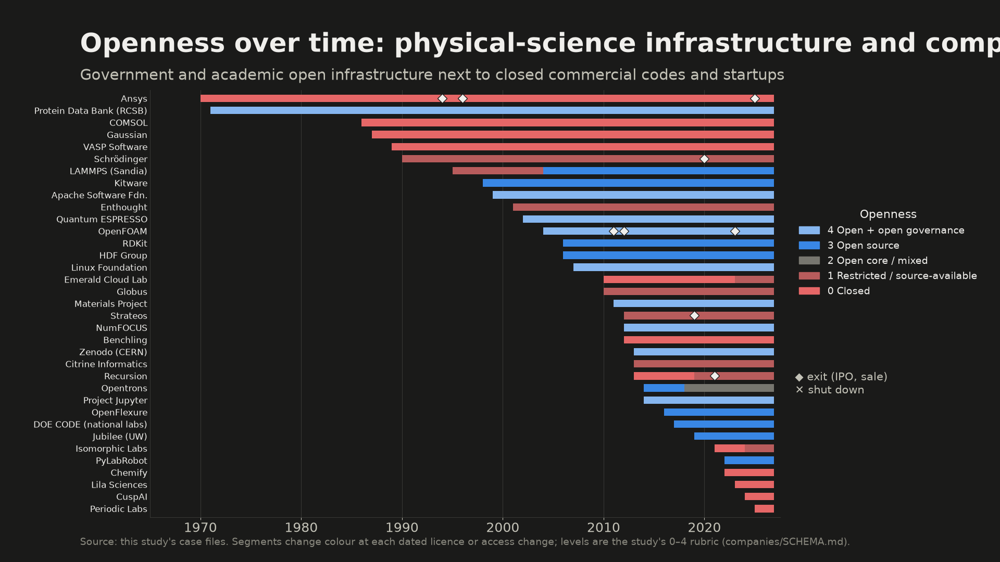

Source: [groups E and F](companies/E/_summary.md) and [F summary](companies/F/_summary.md).

- **Longevity alone does not separate open from closed; control does.**
  - Open: the PDB (1971, CC0, mirrored on three continents), LAMMPS, Quantum ESPRESSO, Kitware
    (since 1998) and the Materials Project.
  - Closed codes also last decades: Gaussian, VASP, COMSOL, Ansys.
- **Value capture is lopsided:**
  - Ansys sold for $35B (Synopsys, 2025).
  - OpenFOAM's maintainers ask for €500k a year and run on €250k.
  - The PDB's $49.4M five-year award compares with RCSB's estimate of more than $27B to replace the
    archive.
- **Open data became AI training data:**
  - PDB → AlphaFold 2.
  - The Materials Project → GNoME, MatterGen and MPtrj-based potentials.
- **Closed vendors tighten control:**
  - Gaussian bars competing developers.
  - VASP's June 2026 rules forbid training on its source.
  - The open Materials Project still runs its DFT on closed VASP.
- **Lab automation:**
  - Opentrons is the open-hardware test case. Its first robot's files were Apache-2.0; it closed the
    hardware with the OT-2 (2018) and kept the software open, which is why it dominates academic SDL
    builds.
  - Its valuation went from $1.8B (2021) to about $162M (2025), a COVID testing boom and bust rather
    than an effect of openness. It raised a $40M Series E in Oct 2026 (verified through the Pi).
  - Hosted cloud labs struggled: Strateos dropped its hosted lab in 2023, and Emerald Cloud Lab
    survives on CMU and NSF money.
  - Open SDL hardware costs about $100–2,000, vs. about $10k for general-purpose commercial systems
    and about $1M for specialized ones. But it takes hundreds to thousands of development hours
    ([Edison: open SDLs](edison/open_sdl_lab_automation_answer.md)).
- **The 2025–26 AI-for-science boom is overwhelmingly closed.**
  - Isomorphic, CuspAI, Lila, Periodic, Radical and Chemify raised about $9.3B between them.
  - Only Orbital (Apache-2.0 models) and Radical AI (MIT TorchSim) release OSI-licensed artifacts,
    and neither is their main product.
  - Edison's sources put disclosed AI-for-materials funding from Sep 2025 to Jul 2026 at
    $1.98–2.29B, with 86–88% going to Periodic, CuspAI and Lila.
- **Self-driving labs took off while open-hardware publishing plateaued** ([`figures/physsci_topics.png`](figures/physsci_topics.png),
  [`data/openalex_physsci_topics.csv`](data/openalex_physsci_topics.csv), OpenAlex title/abstract matches):
  - Self-driving and autonomous-lab papers went from 18 (2020) to 131 (2024) and 383 (2025). 67% of the
    2025 papers are open access.
  - The US-affiliated share of SDL papers fell from about two thirds (2020) to 28% (2025) as other
    countries ramped up.
  - Open-source-hardware papers rose from 37 (2010) to about 300 a year by 2020, then flattened (276–381
    in 2024–25).
  - HardwareX has published a steady 111–115 articles a year since 2023.

  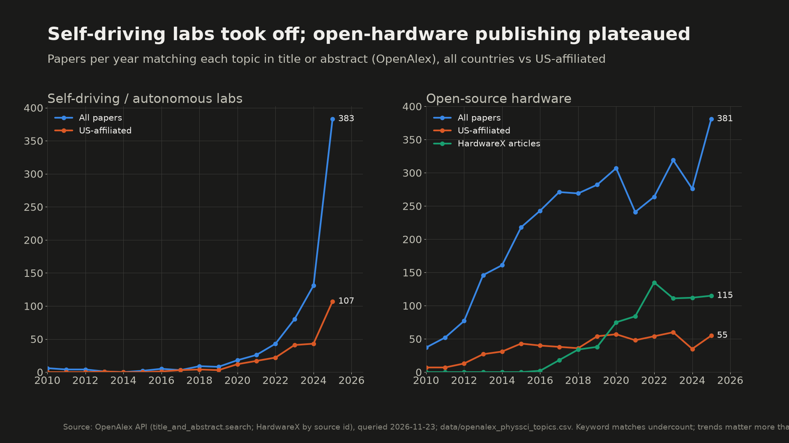

- **US government open-source output:** 94% of DOE's 5,879 inventoried software releases are open
  source. New records fell from 839–1,051 a year (2020–22) to 446–588 (2023–24)
  ([F summary](companies/F/_summary.md)).

### 5b. Open-science infrastructure under AI-era strain, and the AM and instrument makers DAL buys from (group G)

Group G is 21 organizations added after the video: [`companies/G/`](companies/G/),
[summary](companies/G/_summary.md), and the [casebook](companies/CASEBOOK.md) section G.

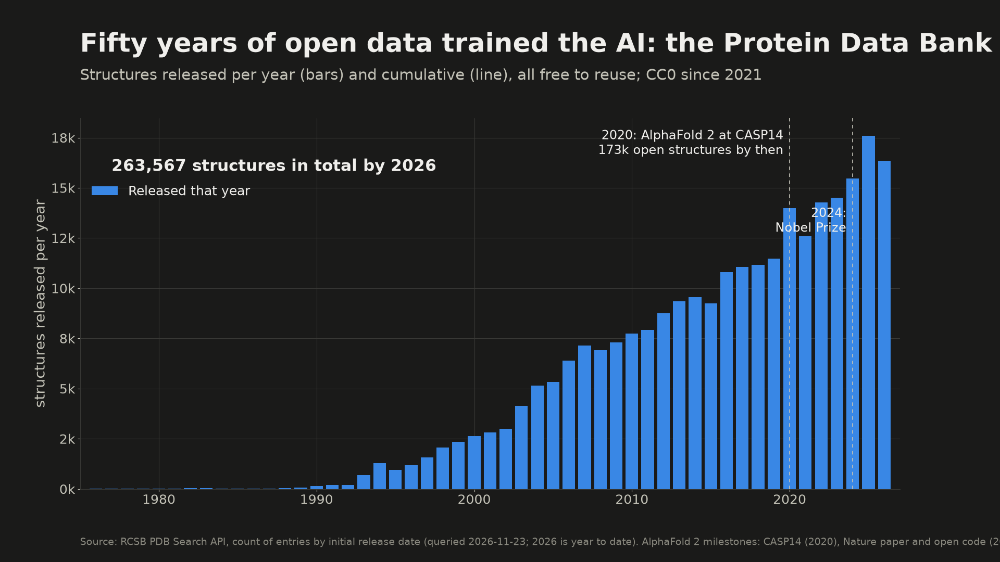

- **Open data accumulated over decades, then trained the AI.**
  - The PDB released 172,801 structures by 2020, the year AlphaFold 2 won CASP14.
  - It now holds 263,567. It releases about 15–18k a year, and 17,599 in 2025
    ([`data/pdb_released_per_year.csv`](data/pdb_released_per_year.csv), RCSB Search API).
- **The open-science commons is strained by AI-era volume and thin funding:**
  - **arXiv** separated from Cornell on 2026-07-01. It must now replace Cornell's in-kind support,
    budgeted at $1.89M (22% of FY2026 revenue), and it ran a $297k deficit in FY2025 on about $6.7M of
    expenses with 28 staff.
    - Submissions rose 16.6% in 2025. September 2026 set a record (40,363, double September 2024), and
      cs.AI grew more than sixfold in two years.
    - It now limits submissions and bans unchecked LLM output.
    - In 2026-09 it received a $17.2M multiyear investment from foundations and XTX Markets.
  - **The Center for Open Science** announced on 2026-08-11 that it would narrow OSF: keeping the full
    platform would need $4–5M a year, about half its budget, and earned revenue covers only 10–20%. New
    OSF projects stopped on 2026-11-16, and projects go read-only on 2027-02-19.
  - **Papers with Code**, a free resource inside Meta AI, was redirected to Hugging Face in 2025. A
    community archive survives on Hugging Face because the data dumps were CC BY-SA.
  - These are the services AI labs and AI-for-science startups draw on. **Who pays for the commons** is
    the open question of the AI era.
- **Heavy use, thin funding.** Usage and funding figures recorded in the case files
  (`usage_metrics`, each with its source URL):

| Infrastructure | Use (date) | Funding or budget |
| --- | --- | --- |
| RDKit (open cheminformatics) | 6.9M PyPI downloads a month (2026-11) | No visible institutional funding |
| Materials Project (LBNL) | 650,000 registered users; 32,000 citations (2026-01) | DOE program funding |
| Protein Data Bank (RCSB) | 247,287 structures (2026-01) | $49.4M over five years (US) |
| arXiv | 2.9M papers; 284,486 submissions in 2025 | about $6.7M a year; deficit in FY2025 |
| OSF (COS) | 1M users; 400k public projects (2026-08) | needs $4–5M a year; narrowed in 2026 |
| OpenAlex (OurResearch) | 500M works; 115M API queries a month (2024) | non-profit |
| OpenFOAM | (widely used CFD) | €250k a year of maintenance funding vs. a €500k target |
| pycalphad / PyLabRobot | about 50k / 47k downloads a month | volunteer and grant-funded |
| *Thermo-Calc (closed comparator)* | 2,000 customer organizations, 60 countries | commercial licences |
| *Gaussian (closed comparator)* | n/a | $6,000 for a US academic site licence with source |

- **Instrument and AM makers are closed.**
  - All 13 instrument and AM makers in group G score 0, except Universal Robots/MiR at 1 for its
    open-source ROS 2 driver.
  - Openness reaches them from outside: PyLabRobot drives Hamilton and Tecan robots, and pycalphad and
    OpenCalphad read Thermo-Calc database files.
- **AM's 2021 SPAC boom busted:**
  - Desktop Metal listed at up to $2.5B and filed Chapter 11 in 2025.
  - Markforged went from about $2.1B to a $42.5M sale.
  - A creditor took 95% of Velo3D.
  - Family-owned EOS stayed independent.
  - For DAL, vendor longevity is a real procurement risk, which is one more reason to own the driver
    layer.

### 5c. AI-for-science models: more open than frontier LLMs (group I)

There are 19 model and dataset files in [`companies/I/`](companies/I/) ([summary](companies/I/_summary.md)).
Each one records the licence history of the code, the weights and the training data separately.
- **Openness:** AI-for-science releases average **2.8** on the 0–4 scale, against **1.6** for the
  frontier-LLM companies in group C. Academic, non-profit and government developers average 3.4;
  corporate developers average 2.3.
- **Licences move toward open more often than away:** 11 opening changes vs. 7 closing ones. Examples:
  - AlphaFold 2's weights went from CC BY-NC to CC BY (2022).
  - Chai-1 went from non-commercial to Apache-2.0 (2024-11-27).
  - ESM went from MIT (Meta) to non-commercial (EvolutionaryScale) and back to MIT (2026-05-27, Biohub).
  - AlphaFold 3 launched server-only (2024-05-08). Its code came out under CC BY-NC-SA (2024-11-11) and
    then Apache-2.0 (2026-06-09), but the weights are still gated and non-commercial.
- **Two caveats:**
  - Boltz added proprietary models after announcing a $110M Series A (2026-11-18).
  - Newer MACE models carry a non-commercial academic licence.
- **Most are trained on public data:** 14 of the 17 models with known training data used public datasets
  such as the PDB, the Materials Project, Alexandria and OMat24.
  - Meta's FAIR Chemistry datasets are CC BY 4.0, but its model weights use custom, gated licences.

### 5d. Edison round 2: open materials data, lab-automation markets, publishing norms, sustaining the commons

These are four gap-filling literature reviews submitted at 23:55 and fetched at 00:30
([`edison/`](edison/)):
- **Open materials databases** ([answer](edison/materials_open_data_value_answer.md)):
  - The Materials Project has 178,627 materials, more than 600,000 registered users and more than 145,000
    data DOIs.
  - OQMD has over 1M compounds, AFLOW over 3.5M entries, NOMAD over 13M entries and Alexandria 5.8M
    structures. OMat24 has over 110M DFT calculations.
  - Licensing has to be checked per data object.
  - No study puts a dollar value on these databases' contribution to ML discovery. That gap is consistent
    with the precedent search.
- **Lab-automation markets** ([answer](edison/lab_automation_business_answer.md)):
  - The global market for clinical total-lab-automation systems was $5.57–6.1B in 2023. That is clinical
    automation, not research SDLs.
  - Open-source liquid handlers such as FINDUS cost under $400 to build, with pipetting error below 0.3%.
  - Independent, audited SDL market numbers barely exist.
- **Industry publishing norms** ([answer](edison/industry_publication_norms_answer.md)):
  - Industry-only papers among the 100 most-cited AI papers fell from 19 (2022) to 7 (2023), per the
    AI Index 2025.
  - The 2025 Foundation Model Transparency Index scored *training-data properties* at an average of 15%,
    and eight companies scored zero.
  - At conferences, code-plus-data sharing still rose from 11% to 64% (2014–2024).
  - By 2026, disclosure is "layered and lab-specific": papers, cards, evaluations, API access and
    weights are released separately, to different audiences.
- **Sustaining the commons** ([answer](edison/open_infrastructure_sustainability_answer.md)):
  - Budgeted costs are small. US RCSB PDB operations were about $7.5M (2023), OSF's organization budget
    was about $7M (2019), and OpenAlex had a $7.5M five-year grant (2024).
  - A modeled Zenodo-like platform costs CHF 11M for CHF 2.8B of benefit (2028–2057).
  - Failures happen when funding stops: Tranche and Peptidome closed with partial data loss after NIH
    support ended, and NIAID didn't renew VEuPathDB in 2024.
  - AI raises both the value of these collections and their machine-traffic costs.

### 6. Academia vs. government and national labs vs. industry, over time (US)

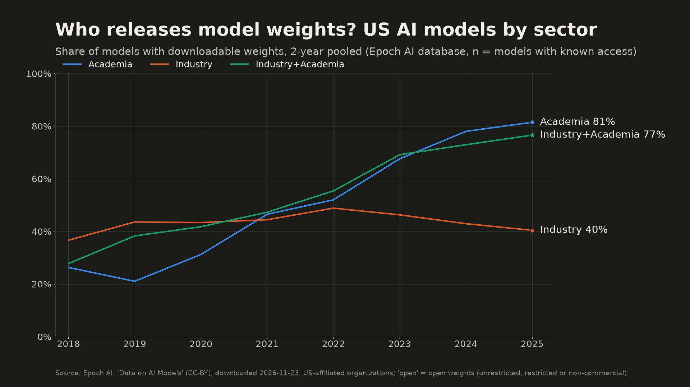
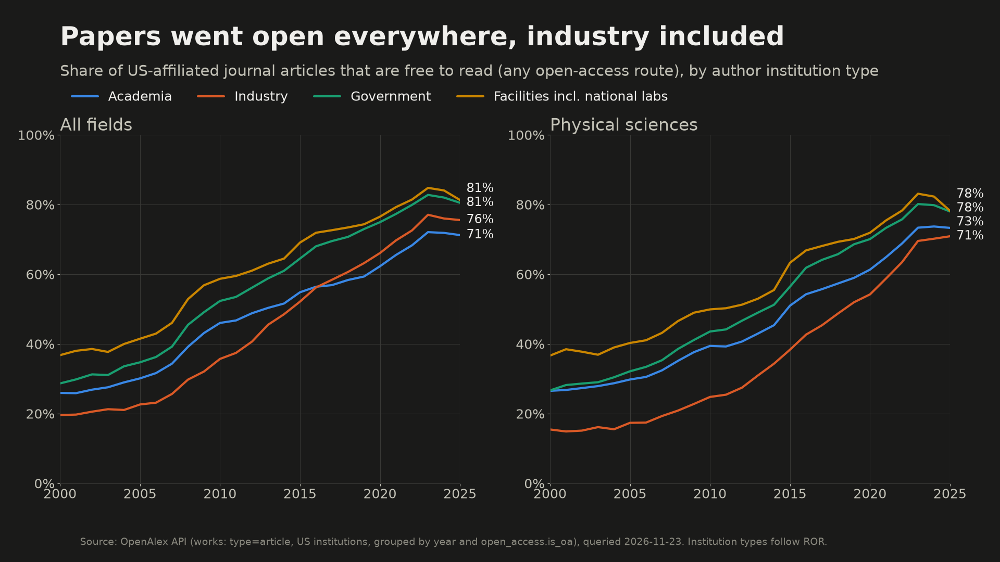
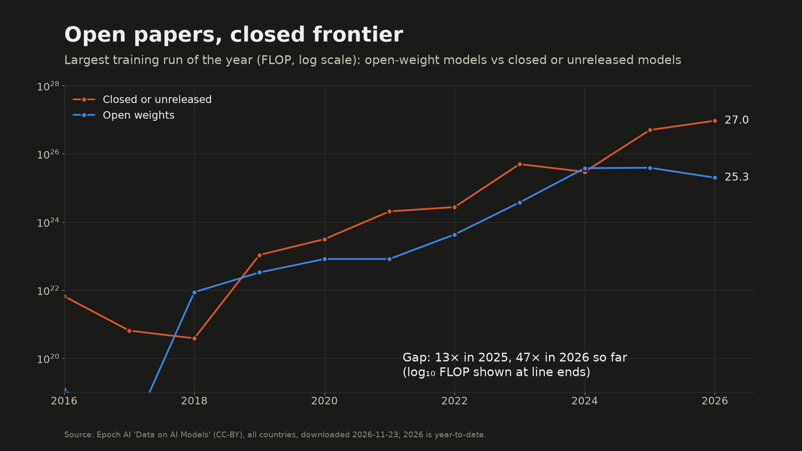
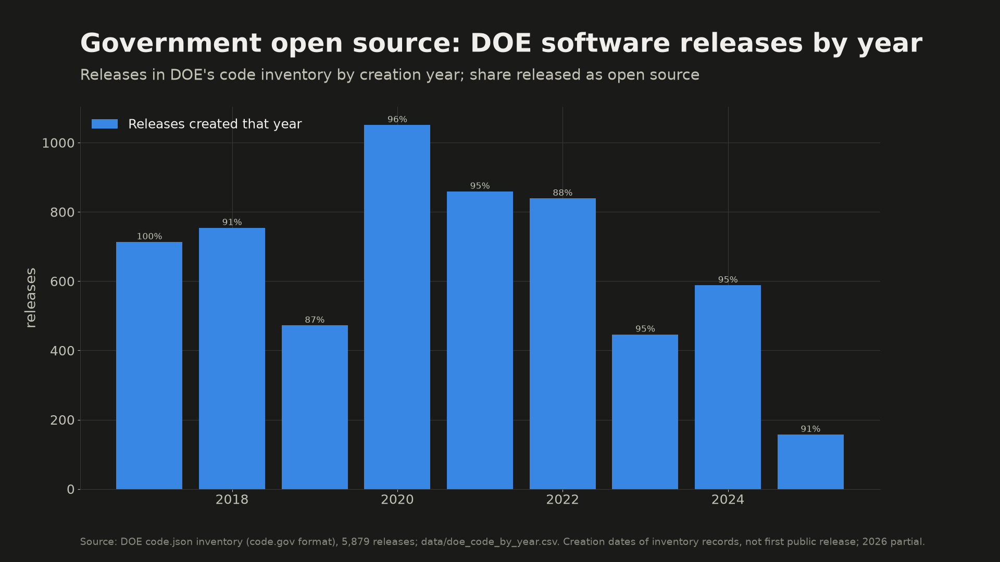

- **Papers:**
  - The open-access share of US articles rose from 25% (2000) to about 71–72% (2024–25).
  - Government (81%) and national-lab "facility" institutions (81%) are the most open.
  - Industry overtook academia overall (76% vs. 71%) and in AI (87% vs. 81%), but still trails in the
    physical sciences (71% vs. 73%) and materials (60% vs. 65%) ([CSV](data/openalex_us_oa_by_sector.csv)).
- **Models:**
  - Academia's open-weight share (2-year pooled) went from 21% (2018–19) to 81% (2024–25).
  - Industry: 44% → 40%. Industry–academia collaborations: 77%.
  - The largest open-weight training run in 2025 used about 1/12 the compute of the largest closed
    run, and about 1/50 in 2026 to date ([CSV](data/epoch_max_compute_open_vs_closed.csv)).
- **Context from the literature** ([Edison: sector trends](edison/sector_openness_trends_answer.md),
  [open weights](edison/open_weights_ai_impact_answer.md)):
  - Industry's share of the largest models went from 11% (2010) to 96% (2021) (Ahmed, Wahed & Thompson).
  - Code-plus-data sharing at top AI conferences went from 11% (2014) to 64% (2024).
  - Open models hold under 30% of the inference market (Edison's reading of Demirer et al.), yet the published
    NBER abstract finds them **about 90% cheaper** than comparable closed models of the same intelligence (Demirer,
    Fradkin, Tadelis & Peng, NBER w34608, Dec 2025; abstract read through the Pi).
  - Nagle & Yue (2025, "The Latent Role of Open Models in the AI Economy") estimate that fully
    switching to open models would cut average prices by more than 70% and save about $24.8B a year
    (range $20–48B). This is latent consumer surplus, not captured revenue (Pi search, Google Scholar
    snippet).
  - The Chatbot Arena gap between open and closed fell from 8.0% to 1.7% (Jan 2024 → Feb 2025).
  - **92% of the foundation models adopted in science papers since 2019 were open-weight.** Trišović et al.
    (arXiv 2511.21739, v2 Oct 2026; abstract read through the Pi) add that science is *falling behind the
    frontier*. In 2015 the mean model adopted in science was 5.4× larger than the mean model built; by 2024
    the mean model built was 6.9× larger than the one adopted. Papers using larger models land in
    higher-impact journals. Openness helps science adopt AI, but closed frontier models stay out of reach.
- **National labs' own software** ([`figures/doe_code_by_year.png`](figures/doe_code_by_year.png),
  [`data/doe_code_by_year.csv`](data/doe_code_by_year.csv), [`data/doe_code_by_lab.csv`](data/doe_code_by_lab.csv)):
  - DOE's code.json inventory lists 5,879 releases, **93.6% of them open source**. The other 374 are
    "exempt by law".
  - The top labs are LLNL (826 releases, 100% open), PNNL (721, 74%), Sandia (698, 96%), LBNL (641, 89%),
    LANL (502, 99%) and ORNL (408, 99.5%).
  - Licences are mostly permissive: BSD-3-Clause 1,928, MIT 1,137, Apache-2.0 378, GPL-3.0 252.
  - Inventory records created per year fell from 1,051 (2020) to 446–588 (2023–24). The inventory was
    last updated in April 2025 and its dates are record-creation dates, so read this as a slowdown in
    cataloguing, not necessarily in releasing.
  - The inventory's own SLOC-based estimate for unique open repositories is about 335M labor hours. It is
    indicative only, but it suggests the national labs' open code is worth tens of billions of dollars at
    replacement cost.
- **Copyright on government software:** US federal employees' works can't be copyrighted, so
  government-operated labs can't license custom software the way contractor-run labs can. A NIST-commissioned
  study (Leech & Scott, NIST GCR 21-028, 2021; PDF read in full) estimates that allowing copyright, and so
  licensing, would add about **$4.3B a year** in induced productivity. This is the other side of the public-domain
  default: openness maximizes diffusion, while licensing would pay for upkeep.
- **Policy:**
  - OSTP's Holdren (2013) and Nelson (2022) memos; NIH's public-access policy, accelerated to
    2025-07-01.
  - NTIA (2024): there is not enough evidence to restrict open weights.
  - America's AI Action Plan (2025) encourages open-source and open-weight AI.
  - The Genesis Mission (Nov 2025) puts the DOE labs at the centre of AI-for-science.

### 7. How Anthropic and OpenAI talk about open source, open science and the physical sciences

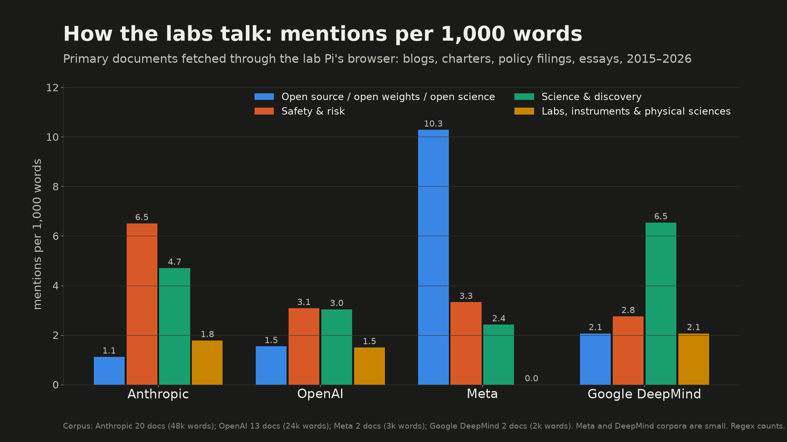
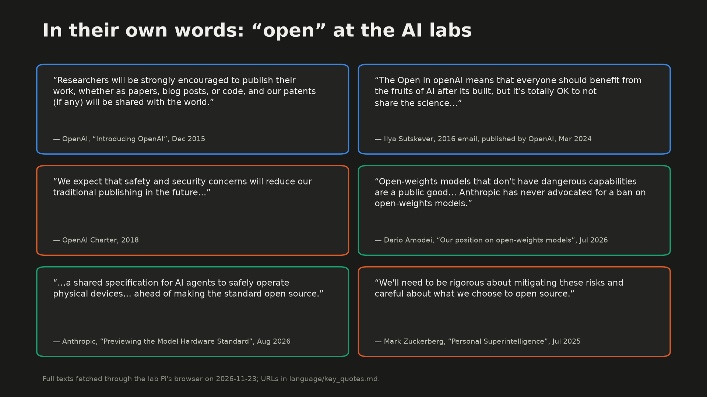

- **Anthropic:**
  - Writes about safety and risk 5.9 times and about science 6.5 times per 1,000 words, against 1.1
    for open terms (26 documents, 57k words). OpenAI: 3.1, 8.6 and 1.0 (22 documents, 38k words).
    The video's bar chart used an earlier 41-document corpus, with Anthropic at 6.5, 4.7 and 1.1;
    `figures/language.png` is the updated version.
  - The pivot is recent and toward science and the physical world: Claude for Life Sciences (2025-10),
    Claude Science (2026-06) and the Model Hardware Standard (2026-08), which aims to let AI agents
    operate lab instruments.
  - Its stance on openness is layered:
    - closed weights;
    - open standards and tools (MCP given to the Linux Foundation's Agentic AI Foundation in 2025-12,
      Agent Skills in 2026-10, open-source circuit tracing);
    - in July 2026, "never advocated for a ban on open-weights models", with all capable models,
      open or closed, to be safety-tested.
- **OpenAI:**
  - The arc goes from "publish … code … patents shared with the world" (2015), to "totally OK to not
    share the science" (2016 email), to an expected reduction in "traditional publishing" (2018
    Charter), to gpt-oss under Apache-2.0 (2025).
  - The 2026 materials pitch "OpenAI for Science" but with gated science models (GPT-Rosalind for
    "qualified research organizations").
- **Over time** ([`figures/language_time.png`](figures/language_time.png),
  [`data/language_by_year.csv`](data/language_by_year.csv); corpus of 26 Anthropic and 22 OpenAI documents):
  - Science and physical-science terms rose from about 2–3 per 1,000 words (2015–23) to about 21
    (Anthropic) and 27 (OpenAI) in 2026.
  - Anthropic's safety terms fell from 18.5 to 3.2 per 1,000 words.
  - OpenAI's "open" terms spiked only in 2025 (gpt-oss, 3.1 per 1,000) and fell to about 0 in its 2026
    science posts.
  - The 2025–26 documents were chosen *because* they are the labs' science and openness posts, so this
    shows emphasis in what they publish on these topics, not a random sample.
- **Words vs. actions: what the labs actually publish on GitHub** (public non-fork repos via the GitHub
  API, 2026-11-23; [`data/ai_lab_github_orgs.csv`](data/ai_lab_github_orgs.csv)):

  | GitHub account | Public source repos | Total stars | Permissive licence | New repos 2024 → 2025 → 2026 | Most-starred |
  | --- | --- | --- | --- | --- | --- |
  | anthropics | 93 | 731k | 59 | 7 → 25 → 44 | skills, claude-code, claude-cookbooks |
  | openai | 246 | 1.05M | 176 | 22 → 48 → 44 | codex, whisper, openai-cookbook |
  | google-deepmind | 422 | 242k | 384 | 75 → 77 → 47 | mujoco, deepmind-research, alphafold |
  | facebookresearch (Meta) | 1,471 | 986k | 504 | 170 → 212 → 141 | segment-anything, faiss, detectron2 |
  | deepseek-ai | 47 | 782k | 38 | 11 → 15 → 17 | deepseek-harness, DeepSeek-V3, DeepSeek-R1 |
  | allenai (Ai2) | 522 | 112k | 380 | 56 → 45 → 51 | olmocr, allennlp, OLMo |

  - The closed-weight labs are rapidly opening the tooling *around* their models: Anthropic's new public
    repos grew sixfold from 2024 to 2026 (skills, MCP and SDKs).
  - Some of the most-starred repos are not under an open licence. For example, 28 of Anthropic's 93
    have no licence file.
  - Meta and DeepMind publish far more research code, and DeepSeek's few repos draw outsized attention.

- **National labs and the Genesis Mission:**
  - Anthropic partnered with DOE in December 2025 "to affect the work being done at all 17 of America's
    national laboratories". In October 2026 it described 10,000 free and discounted Claude seats for
    academic scientists and the Model Hardware Standard preview.
  - OpenAI committed "$4 million in Codex access to approximately 2,000 Genesis researchers" and "$3 million
    in API support".
  - OpenAI's life-science model, GPT-Rosalind, is available only "for qualified customers through our
    trusted access program". Its Life Sciences plugin is free.
  - DOE's November 2026 "Achieving AI-Driven Autonomous Laboratories" places the national labs at the core
    of self-driving labs.
- **Contrast:**
  - Meta's 2024 manifesto mentions open source about 12 times per 1,000 words, and its two documents together average 10. In 2025 it said it would
    be "careful about what we choose to open source", and in April 2026 it shipped Muse Spark closed.
  - DeepSeek's release notes are almost entirely about open source.
  - All quotes and links are in [`language/key_quotes.md`](language/key_quotes.md).

### 8. Open-source commercialization in `ac-dev-lab` and `self-driving-lab-demo`

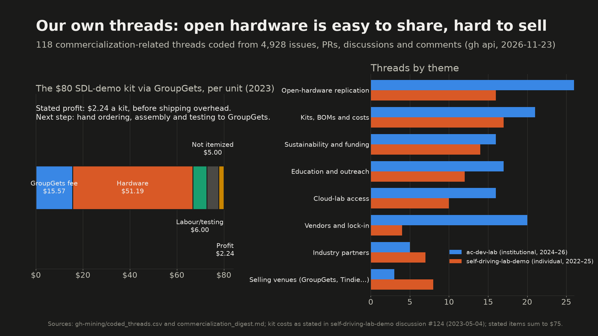

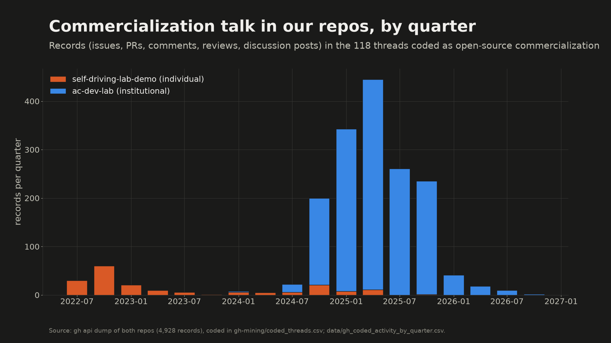

- **Timing:** SDL-demo's commercialization discussion peaked in 2022–23, when Sterling ran the kit and
  GroupGets experiments. `ac-dev-lab`'s commercialization-related threads, mostly BOMs, vendors and
  replication, peaked in early 2025 and faded through 2026.
- **Share of each repo:** 36% of `ac-dev-lab`'s 4,000-plus records sit in coded threads, against 27% for
  SDL-demo ([`data/gh_coded_activity_by_quarter.csv`](data/gh_coded_activity_by_quarter.csv)).

The full digest, with 58 quotes and 94 numbers checked by script, is
[`gh-mining/commercialization_digest.md`](gh-mining/commercialization_digest.md). The coded threads are
in [`coded_threads.csv`](gh-mining/coded_threads.csv).

- **Selling (SDL-demo #124):**
  - Venues considered: Crowd Supply, GroupGets, Tindie, Etsy.
  - Paperwork covered: US sales tax and IRS status, and FCC rules for kits.
  - Licences: CERN-OHL-P-2.0 for hardware and MIT for software.
  - At GroupGets: list price $80, GroupGets fee $15.57, hardware $51.19, labour $6, stated profit
    $2.24 before shipping overhead. The stated items sum to $75.
  - Next step: hand everything to GroupGets.
- **`ac-dev-lab` (institutional):**
  - It buys rather than sells: one 15-kit DigiKey order of camera kits came to $1,461.87.
  - Its main pain is closed vendor equipment: proprietary MyCobot firmware, a centrifuge with no API
    run through a reverse-engineered driver, a capper/decapper with almost no documentation, and vendor
    API docs that might not be publishable.
- **Cloud access:** pricing tiers and credits were designed in 2022 but never built as a paid service.
  In a 2025–26 course they became per-student quotas.

### 9. DAL and #318 in terms of open source and open science

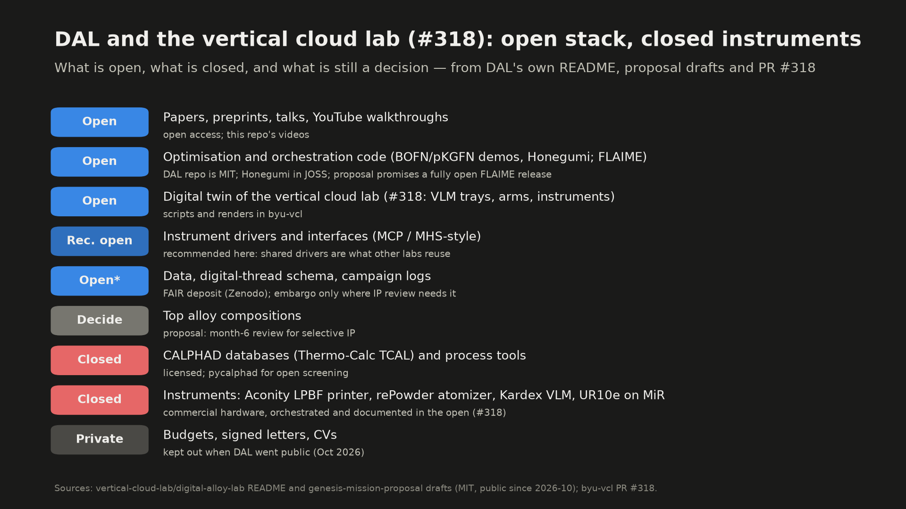

**What exists**
- [`digital-alloy-lab`](https://github.com/vertical-cloud-lab/digital-alloy-lab) went public under MIT
  in October 2026, split from a private repo. Signed letters, budgets and CVs stayed private.
- Its Genesis Mission proposal drafts:
  - commit to releasing "the FLAIME software platform (BOFN/pKGFN workflow engine, Honegumi tutorial
    framework) … fully open-source";
  - disagree about the alloy compositions themselves. The current `.tex` says compositions will be
    "published openly rather than licensed", while earlier drafts planned a "Month-6 internal review to
    assess selective IP for top compositions". The [audit](dal/dal_openness_audit.md) recommends
    reconciling the three IP statements before award negotiation;
  - use a funnel of open pycalphad screening followed by commercial Thermo-Calc (TCAL) where melt-pool
    and printability models are needed.
- [#318](https://github.com/vertical-cloud-lab/byu-vcl/pull/318) is an open digital twin of a vertical
  cloud lab:
  - Kardex VLM trays, UR10e arms on MiR250s, and real instrument models;
  - the full alloy route from charge cups to atomizing (rePowder), printing (Aconity MIDI) and
    characterization;
  - every script, note and video public.

**Openness audit.** [`dal/dal_openness_audit.md`](dal/dal_openness_audit.md) (about 2,500 words, cited to
DAL `e7a01b3` and #318 `75c0ed0`) covers six things:
- **Public vs. private.** It inventories what is public and what is held back.
- **Dependency licences.** There is no GPL/AGPL dependency, and Thermo-Calc is the main proprietary one.
  Two notices are missing: frazier-lab's MIT notice in the `partial_kgfn` port, and the CERN-OHL headers
  for the OpenFlexure files in #318.
- **Data access terms.** These include subscription databases (MMPDS, Knovel, ASM) that limit what can be
  shared.
- **Equipment.** Of about 20 items on the alloy route, only UR, MiR, the OT-2 and the CubXL have interfaces
  the lab can program. The rePowder atomizer has no API, so the lab plans to read its settings with a camera.
- **Genesis Mission FOA vs. the drafts.**
  - The FOA wants data behind a paper public at publication; the drafts say within 12 months.
  - Thermo-Calc's role differs across drafts.
- **Concrete recommendations.**
  - MIT for code, CERN-OHL-P-2.0 for hardware, and CC BY 4.0 (with CC0 metadata) for data.
  - Zenodo plus the Materials Data Facility (with a NOMAD Oasis option) behind a JSON Schema for the
    digital thread.
  - A written embargo rule for compositions.
  - One MIT, MCP-style driver per instrument.
  - API rights in procurement.

**What the evidence says to do**
1. **Keep open the layers others build on.**
   - Instrument drivers, the digital-thread schema and campaign data are what turned the PDB and the
     Materials Project into AI training data. They are also what PyLabRobot and OpenFlexure spread.
   - An MCP- or MHS-style driver layer for the VLM, arms and instruments is the piece most likely to be
     reused. It matches where Anthropic is taking AI-operated lab hardware.
2. **Pick a governance home early.**
   - Code that outlives its sponsor sits in foundations: the Linux Foundation, NumFOCUS, the ASF.
   - A CERN-OHL-P/MIT pairing, as in the SDL-demo, keeps commercial reuse legal.
3. **Expect closed instruments and tools, and make that explicit.**
   - #318's instruments (Aconity, rePowder, Kardex, UR, MiR) and Thermo-Calc are closed.
   - The `ac-dev-lab` digest shows that missing APIs and documentation, not licence fees, are the real
     cost. Budget for driver work and ask vendors for API rights before buying.
4. **Make the IP decision on data, not code.**
   - In the case files, closing moves after an ownership change set off forks (Rocky/Alma, OpenVox,
     freenginx). No revenue collapse was reported, but no revenue gain from closing was shown either.
   - The AI-for-science startups protect *data and compositions*, not methods. DAL's drafts already keep the
     platform open. What remains is to settle the composition question (see above).
   - Publishing negative and failed runs is a cheap way to add open-science value.
5. **Don't count on kit sales.**
   - The SDL-demo kit's $2.24 margin and LulzBot's collapse both point to services rather than units:
     cloud access, training, setup, and "commercialization-as-a-service" partners such as GroupGets.

### 9a. Academic paths: tech transfer vs. open release, and commercializing open lab hardware (Edison round 3)

Sources: [`edison/academic_techtransfer_open_source_answer.md`](edison/academic_techtransfer_open_source_answer.md)
and [`edison/academic_osh_commercialization_answer.md`](edison/academic_osh_commercialization_answer.md).
- **Who owns the code decides what's possible.**
  - At contractor-operated (GOCO) national labs such as LLNL, the contractor can hold copyright and
    release under OSS licences. LLNL recommends a permissive licence with an explicit patent grant.
  - At government-operated (GOGO) labs, code written by federal employees generally has no domestic
    copyright (17 U.S.C. §105), which limits normal OSS licensing.
  - Universities route open release through technology-transfer offices, now often with Open Source
    Program Offices advising.
- **Licensing rarely pays for itself.** US university licensing income exceeded **$2.94B in 2018** (AUTM),
  yet most TTOs don't cover their operating costs.
  - At Stanford, inventor-founded startups licensed about 20% of marketed inventions, but every
    invention earning more than $10M of net income was in that group.
- **The documented open-hardware path is "publish the design, sell what publication doesn't supply":**
  - manufactured and tested instruments, kits, specialist components, integration, training and support.
  - Examples: OpenFlexure Industries, Tanzania's Bongo Tech sayansiScope, Opentrons, Foldscope, Sci-Bots
    (DropBot) and CERN's open-hardware licensing to firms.
- **The same review literature records Sterling's own CLSLab:Light kits:** two successful GroupGets
  crowdfunding rounds totalling **39 kits** at an $80 list price, matching
  [our GitHub digest](gh-mining/commercialization_digest.md).

### 9b. This lab's own open record is now written mostly by AI agents

The same `gh api` dump of **this** repository (vertical-cloud-lab/byu-vcl, to 2026-11-24; script
`scripts/gh_dump.py`, table [`data/byu_vcl_authorship_by_month.csv`](data/byu_vcl_authorship_by_month.csv)) contains:
- 317 issues and PRs, 3,731 conversation comments, and review and discussion posts;
- humans wrote **2,909** records and Claude wrote **1,004**;
- by volume, Claude wrote **6.4M characters against humans' 1.4M**, about 4.7× as much;
- Copilot wrote 154 records, mostly in June 2026.

In the AI era, an open lab's public record (decisions, BOMs, analyses, videos like these) is increasingly
produced by agents in the open, with humans steering. That makes openness cheaper to practice. It also
raises the stakes on verification, which is why this study logs its checks in
[`VERIFICATION.md`](VERIFICATION.md).

### 10. YouTube, Reddit, Hacker News, blogs and forums

An [addendum](voices/voices_addendum_physsci.md) covers AI for science: the backlash over AlphaFold 3's withheld code, its non-commercial weights, the open clones (Boltz, Chai-1, Protenix) and Nature's 2026 feature on self-driving labs.

Everything here was pulled through the Pi's browser, including five YouTube transcripts opened by
mouse-clicking "Show transcript". [`voices/voices_digest.md`](voices/voices_digest.md) covers 21 sources
with 125 quotes, each checked by script against the captured text. The index is
[`voices/voices_index.csv`](voices/voices_index.csv).
- **Business models (talks):**
  - Frank Nagle (HBS / Linux Foundation): firms that contribute get about twice the value of those that
    only use open source.
  - Sid Sijbrandij (GitLab): GitLab tried donations, consulting and support before open core, which runs at
    about 90% gross margin.
  - Mike Olson (Cloudera): services-only firms starve their product.
  - A 2026 r/startups thread gives the same advice.
- **Forks succeed on trust and backing, not licence text.**
  - Valkey, backed by the hyperscalers, spread fast.
  - OpenTofu lags Terraform, about 77× fewer searches (r/Terraform), because the BSL change never touched
    internal users.
- **Open hardware is narrowing to repair rights and software.**
  - Prusa's Open Community License bars resale, and some Prusa forum members now call open source a
    liability (alongside its 2026 layoffs thread).
  - Arduino's "setting the record straight" post after Qualcomm skipped the patent clause that commenters
    flagged.
- **A perception gap on AI.** Reddit and HN threads cast Anthropic as hostile to open weights, yet none cites
  its 2026-07-27 statement that it "has never advocated for a ban".
- **Self-driving labs (talk):** in-house experimental data is described as the competitive edge, and
  openness never comes up.

## US focus

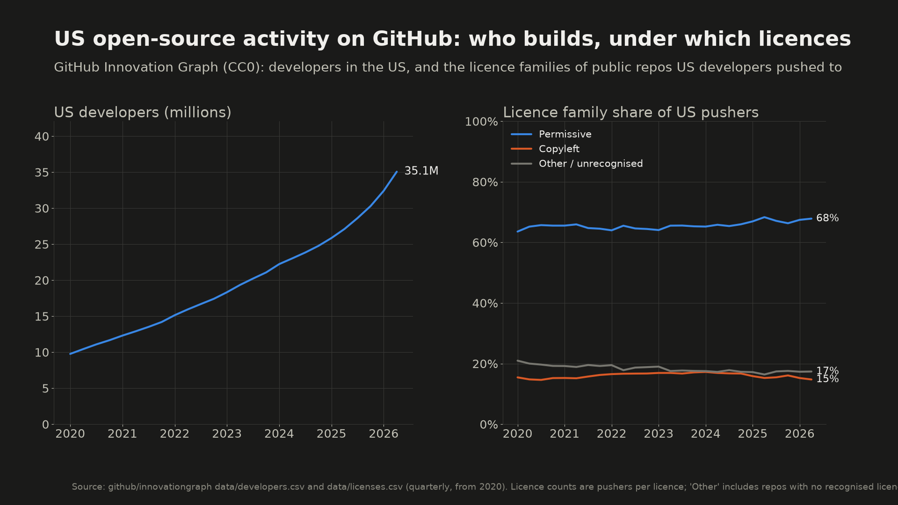

- **US open-source developers** on GitHub grew from **9.8M (2020 Q1) to 35.1M (2026 Q2)**. The US share of
  the world total fell from 18.6% to 14.7% as other economies grew faster.
- **Licences US developers push to:**
  - Permissive licences (MIT, Apache-2.0, BSD and similar) rose from 64% to **68%** of pushers.
  - Copyleft (GPL, AGPL, LGPL, MPL and similar) held at about 15%.
  - Unrecognised or no licence fell from 21% to 17%.
  - MIT alone accounts for about half of all licensed pushes.
  - Source: GitHub Innovation Graph, CC0
    ([`data/innovationgraph_us_license_family_share.csv`](data/innovationgraph_us_license_family_share.csv),
    [`data/innovationgraph_us_developers.csv`](data/innovationgraph_us_developers.csv)).
- The relicensing fights covered here involve a handful of vendor-controlled projects. The base of US open
  source drifted *toward* permissive licences over the same years.

- 100 of the 143 organizations are US-headquartered (87 of 121 at the video snapshot).
- The OpenAlex and Epoch charts use US-affiliated works and models only, apart from the compute-gap
  chart, which covers all countries.
- The non-US organizations are there as comparators: SUSE, Canonical, Prusa, Arduino, Mistral,
  DeepSeek, Qwen, Chemify and others.

## Caveats

- The case files are a **convenience sample of notable organizations**, not a census, and their values
  date from 2008 to 2026.
- 114 of the 143 files rest on WebFetch alone, as noted above.
- A second verification pass ([`companies/VERIFICATION_PASS2.md`](companies/VERIFICATION_PASS2.md)) checked
  161 facts in 38 low- and medium-confidence files:
  - 99 were confirmed on an independent page, 16 values were corrected or filled, and 46 remain
    unconfirmed.
  - Unconfirmed examples: Lila's $550M, dbt Labs' $4.2B, and whether the Qualcomm–Arduino deal has
    closed.
  - The video was rendered before this pass, but none of its narrated numbers changed.
- Headline 2025–26 claims were checked against independent sources ([`VERIFICATION.md`](VERIFICATION.md)).
- **Openness-score reliability** ([`companies/CALIBRATION.md`](companies/CALIBRATION.md)). An independent re-scoring
  of all 143 files from their evidence fields agreed closely with the originals: 93–96% exact,
  quadratic-weighted κ 0.97–0.99.
  - The check is leaky. 118 of the 143 files restate their score in their own notes, so this overstates
    reliability.
  - Systematic tilts: group C scored Big Tech higher, group F was stricter about level 4, and group D was
    lenient on hardware designs with no licence or a non-commercial one.
  - Only one score differed by 2 or more: OpenFOAM's initial level, which depends on whether "initial"
    means the code before 2004.
- Epoch's database is curated, not exhaustive, and the 2026 rows are incomplete.
- OpenAlex's "is OA" includes green and bronze access, and ROR institution types are imperfect.
  National labs mostly appear as "facility".
- The stock comparison has only three open-source survivors.
- The language analysis counts words; it doesn't read meaning. The Meta and DeepMind corpora are two
  documents each.

## Files

- `edison/`: 9 Edison tasks, each with an answer, references and the full verbose task JSON.
- `gh-mining/`: the thread index, relevant and coded threads, and the commercialization digest. The raw
  dump is re-creatable with `scripts/gh_dump.py`.
- `companies/`: 179 case JSON files in groups A–J (no H), a summary per group, `companies_master.csv`, `events.csv`, `CALIBRATION.md` and `VERIFICATION_PASS2.md`.
- `data/`: the Epoch, OpenAlex, price and openness-outcome tables.
- `language/`: the URL list, term counts and key quotes.
- `pi-browser/`: query lists and the full search log.
- `figures/`, `video/`: final frames, scenes, narration, audio and the final MP4.
- `companies/CASEBOOK.md`: all 179 case files, one by one, with each one's assessment, timeline, computed metrics and sources.
- `voices/`: the digest of YouTube, Reddit, Hacker News, blog and forum content. `dal/`: the openness audit
  of DAL and #318.
- `VERIFICATION.md` and `companies/VERIFICATION_PASS2.md`: the verification logs.
- `scripts/`: everything used, including `pi_browse.py`/`pi_search.py`, the scene renderers and
  `build_video.py`.
