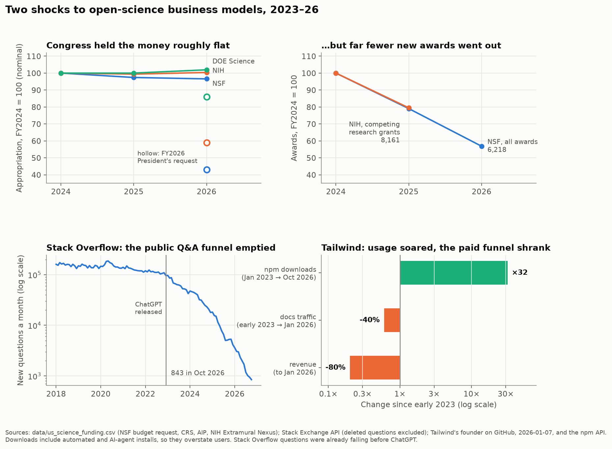

# The investor's view: what worries someone paying for open science (issue #380, round 2)

Sterling asked for a less-biased pass at the first round, written from the chair of someone deciding whether to
invest, with Edison as an independent check. This memo is that pass. The first round asked what open science is
*worth*. This one asks what someone who pays for it *gets back*, and what could go wrong.

Besides answering nine neutral literature questions, Edison red-teamed the first round from its raw files and then
reviewed two drafts of this memo. The first review of the memo found that it had **overcorrected toward a negative
view**, especially for physical-science ventures. After revision, a second check judged the memo "largely corrected"
and found it "has not tipped toward favouring openness". Its one-line takeaway for an investor: ***underwrite the
business, not the openness label.*** The [last section](#edisons-review-of-this-memo) lists what changed.

**Start with:** the [bottom line](#bottom-line) and the [ranked concerns](#the-concerns-ranked). The supporting
files are the [pre-registration](PREREGISTRATION.md) (committed before any new data, in
[`80a45f4`](https://github.com/vertical-cloud-lab/byu-vcl/commit/80a45f4)), the
[bias audit of the first round](BIAS_AUDIT.md), the [Edison answers](edison/) and the
[sourced 2025–26 evidence](evidence/ai_and_funding_evidence.md).

## Bottom line

**Openness can create both public and private value. Whether it is investable depends on what the company sells,
how it keeps some of the value, the entry price and how much capital it needs.** The concerns differ a lot by
investor:

- **A venture investor in an open physical-science spin-out** (for example a company built on DAL) has the most to
  check.
  - Disclosing before filing can forfeit patent claims, and public release removes exclusivity over whatever is
    released.
  - Academic buyers are often budget-constrained, and US science funding has been volatile since 2025.
  - Physical discoveries take years to qualify as products.
  - None of these rules out a business, but each has to be answered in diligence. Edison, reading the first round's
    files from an investment committee's chair, wrote: *"I would not approve an investment on the case
    presented."* It added that it would consider milestone-funded diligence.
- **A public-market investor in open-source software companies** finds lower unadjusted median returns for
  open-source-origin companies in this selected sample. The sample doesn't identify the return attributable to
  open-source origin. I identified 14 listings from 2014–22 of companies whose core product began as open source. A dollar
  invested at their offer prices became a median of 0.52 of what the same dollar in QQQ became, against 0.84 for 25
  closed infrastructure-software peers.
  - The gap is consistent across measures, but its statistical support is weak and depends on the measure:
    permutation p = 0.03 to 0.20.
  - It is not robust to listing year: 7 of the 14 listed in the 2021–22 peak. With listing-year controls the
    estimate is imprecise (ratio 1.17, 95% CI 0.54–2.4).
  - It is a descriptive result about a selected sample, not a causal effect of licensing.
- **A public funder or industry sponsor** values different things. Access and spillovers are possible public
  returns, but so are quality, reproducibility, uptake and maintenance. Award terms can protect patentable
  information and protected data while still requiring access. What to check is what each award actually requires.

Selective disclosure is one possible strategy. The right scope of openness depends on adoption benefits,
complementary assets and financing needs. One version is to open what brings users in and makes results credible: drivers,
methods, interfaces, benchmarks. Decide deliberately what to file on, embargo or keep as know-how before
publishing: compositions, process windows, operating know-how, and data that gives an edge for a while. Openness
and value capture are not opposites. Which way a choice works depends on which asset is released, and when.

## How this round tried to be less biased

| Risk in round 1 | What this round did |
| --- | --- |
| The agent works for a lab that favours openness | Wrote the hypotheses and what would count against each before fetching any new data, and committed them first ([pre-registration](PREREGISTRATION.md), [`80a45f4`](https://github.com/vertical-cloud-lab/byu-vcl/commit/80a45f4)). It wasn't blind: I had read the first round |
| Famous examples stand in for the whole population | Assembled the open-source-origin listings of 2014–22 and a closed cohort chosen by a category rule, with deal terms checked against filings and press releases ([verified terms](data/cohort_listings_verified.csv)). This is not an exhaustive screen of every listing. A completeness check found seven more candidates, which are run as sensitivities |
| The agent grades its own homework | Asked Edison nine questions worded neutrally and without the first round's conclusions ([queries](edison/queries.json)). Had it red-team the first round from its raw files ([answer](edison/inv_redteam_round1_answer.md)) and then this memo ([answer](edison/inv_redteam_round2_answer.md), [audit files](edison/inv_redteam_round2_files/)) |
| Framing leaned one way | Audited the first round's framing ([`BIAS_AUDIT.md`](BIAS_AUDIT.md)), stated the case for openness at its strongest, and applied Edison's 23 suggested wording edits where they were right |

Independence is partial. Edison retrieves and reads its own sources, but it may run on models from the same few
vendors, Claude included, and repeated answers from one system are not independent samples. The same agent wrote
both rounds, and the same person asked for both. The pre-registration was also lopsided. H1 required open source to
beat closed by 5 points a year before the concern would be "weakened", so failing that test does not show that no
premium exists.

## Results against the pre-registered hypotheses

| # | Concern | What the data show | Verdict |
| --- | --- | --- | --- |
| H1 | Open-source origin doesn't earn public investors a premium | **Median value of $1 at the offer price, relative to $1 in QQQ over the same window: 0.52 (14 open-source-origin listings) vs. 0.84 (25 closed).** • The median annualized return relative to QQQ was −17.1 points for the open-source listings and −2.9 for the closed ones. The gap is −14.2 points (bootstrap 95% CI −25.1 to +2.2; permutation p = 0.10). • Measured from the first-day close (all 39 listings, after Edison sourced the two missing closes): −14.5 points (bootstrap CI −24.4 to −0.7; permutation p = 0.09). • Against IGV: −14.4 points (p = 0.03). • 7 of the 14 open-source listings lost money from the offer price, against 9 of 25 closed ones. • With listing-year controls (log relative wealth): ratio 1.17, 95% CI 0.54–2.4. That interval is a 5,000-resample bootstrap of a listing-year fixed-effects regression ([`scripts/h1_vintage.py`](scripts/h1_vintage.py), [`data/h1_pme.csv`](data/h1_pme.csv)). Edison's HC3-robust and small-sample t intervals give 0.54–2.52 and 0.52–2.61 | **The unadjusted gap is negative on every measure, with weak and measure-dependent support.** It isn't robust to listing year, and it isn't causal. The data don't support an open-source premium, and they don't establish a penalty |
| H2 | Openness doesn't raise value captured per dollar raised | First-round case files: Spearman ρ −0.04 (95% CI −0.39 to 0.31), n = 37. Edison's two reanalyses of the same files agree: median value/funding of 7.5× for open-core-or-more-open firms vs. 11.5× for closed or restricted ones, ratio 0.66 (95% CI 0.35–1.30) | **Inconclusive.** Only 37 of 179 rows are usable, almost none of them failures, and the values are private marks rather than returns |
| H3 | Open hardware doesn't reach venture scale | The test was whether an open-hardware company has *ever* reached $1B or more. • Edison's precedent search found one candidate: Opentrons, reported at about $1.8B as a private company. Whether its main products were open hardware when it was valued that way is disputed: OT-2 hardware files are published, but a 2025 dissertation calls the OT-2 "not fully open source". • The largest clearly documented exit is MakerBot's, $403M (2013), after it had closed its designs. | **Unresolved.** There is one disputed precedent and no clean one. Opentrons' later down round doesn't refute "ever", but no open-hardware exit of $1B or more was found |
| H4 | AI weakens the open-source funnel and lowers the cost of copying | • Tailwind: usage at a record, docs traffic −40%, revenue −80%, 75% of engineers laid off (January 2026). • Stack Overflow questions are down 99% since November 2022, though its revenue still rose 12% in its 2026 fiscal year. • Cloudflare re-implemented 94% of the Next.js API in a week for about $1,100 of AI tokens. • **But** GitHub contributions rose 13%, Supabase reached a $10B pre-money valuation, and AI companies bought open-source teams | **Mixed.** It is a real risk for businesses that monetize human attention, such as docs, community and support funnels. Others gained. The net effect depends on the business model |
| H5 | Selling to US academic labs is now riskier | • Congress mostly rejected the deep cuts for FY2026. NIH +1.0% and DOE Office of Science +1.9% on FY2025. NSF −3.4% on its $9.06B base, or −0.9% on what it could actually spend in FY2025. • Awards fell. NSF made 10,937 awards in FY2024 and 6,218 in FY2026 (−43%), and NIH competing research grants fell 20.5% in FY2025, even as NIH research-grant dollars rose 3%. • The FY2027 requests again propose NSF −55% and an NIH 15% indirect-cost cap. • Tools makers report weaker academic demand. Agilent's academic and government sales fell 8% in one 2026 quarter, and Bruker's 10-K reports a "material adverse effect" | **Concern stands as volatility.** Money was roughly flat in nominal terms, so lower after inflation, and new awards fell sharply. Large tools makers have small academic exposure |
| H6 | Open-by-default disclosure makes a physical-science spin-out harder to finance | • Patent *grants* causally help financing. Among first-time patent applicants, a first patent raises the chance of venture funding within three years by 3.0 points (47% over a 6.4% base). For inexperienced founders the effect is about 33 points, but at p = 0.053 (Farre-Mensa, Hegde & Ljungqvist 2020). • The study is about patent grants among applicants. It is not about openness. • Enabling disclosure before filing destroys novelty for the claims it covers. Europe's exceptions are narrow, while the US allows one year for the inventor's own disclosure | **Concern stands for inventions worth patenting.** The standard remedy is to file before publishing. Publishing as such is not the problem |

Details:
- H1: [`data/h1_summary.csv`](data/h1_summary.csv), [`data/h1_permutation.csv`](data/h1_permutation.csv),
  [`data/h1_pme.csv`](data/h1_pme.csv), [`data/h1_vintage.csv`](data/h1_vintage.csv) and
  [`data/h1_returns.csv`](data/h1_returns.csv). Edison's 16 independent H1 specifications are in
  [`h1_sensitivity_results.csv`](edison/inv_redteam_round2_files/0457a348-0f27-488e-a186-97fa34f5b3a7_trajectory_files.zip.d/independent_review/h1_sensitivity_results.csv).
- H2: [`data/h2_summary.csv`](data/h2_summary.csv).
- H3 and H6: [Edison's answers](edison/).
- H4 and H5: the [evidence file](evidence/ai_and_funding_evidence.md).

## The concerns, ranked

Ranked for persona A, a venture investor in an open physical-science spin-out. Severity for the other two personas
is in the [table after the list](#how-the-concerns-change-with-the-investor). Severity rankings are judgments, not
estimates. Each concern is something to check, not a verdict.

### 1. Will the company keep enough of the value it creates?

- **The concern.** Value tends to go to whoever owns the complementary assets (Teece's "profiting from innovation"):
  the cloud that hosts the software, the firm that owns the data, the manufacturer that builds the hardware.
  Releasing a layer lets others reuse it, subject to its licence. How much that costs the company depends on
  whether the released layer is the one it sells.
- **Evidence for.**
  - Hoffmann, Nagle & Zhou (2024) estimate that recreating widely used open-source software once would cost
    **$4.15B**, but that firms would need **$8.8T** to replace it. Those are modelled values, not producer
    revenue.
  - About 30 commercial open-source companies were worth about $375B together. That figure sums 29 marks dated
    2008–26, so it is not a snapshot.
  - AWS sold managed Elasticsearch, while Elastic's own employees wrote over 95% of its code changes (Edison,
    [COSS evidence](edison/inv_coss_financial_evidence_answer.md)).
  - In the physical sciences, the PDB's open structures trained AlphaFold, and Isomorphic Labs commercializes its
    successor.
  - Edison's first red team ranked this concern first.
- **Evidence against.**
  - Red Hat ($34B), MongoDB and Databricks captured value by running something scarce beside the open code: a
    hosted service, support, certification.
  - Value also flows back to the commons: DeepMind funds the open AlphaFold database of over 214M structures.
- **Ask in diligence.** What do customers pay for that stays scarce after the code, designs and data are public?

### 2. Will the customers pay, and keep paying?

- **The concern.** If an open tool is chosen mainly because it is cheap, the buyers may not pay enough to fund
  support. Academic demand also follows grant cycles. The revenue mix of any particular product is unknown until
  it is measured.
- **Evidence for.**
  - US universities spent $117.7B on R&D in FY2024, 55% of it federal (NSF HERD).
  - FY2025–26 brought grant terminations, fewer NIH competing grants and fewer NSF awards (H5).
  - Agilent reports US labs "using available funding to keep their labs running as opposed to investing in new
    capital equipment" ([evidence](evidence/ai_and_funding_evidence.md#b-us-federal-science-funding)).
  - The open-hardware literature describes academic demand as fragmented and price-driven
    ([Edison](edison/inv_open_hardware_risks_answer.md)).
  - This lab's own data points:
    - The $80 SDL-demo kit had a stated profit of $2.24 a kit. The listed costs imply $7.24, and the source table
      doesn't reconcile the $5 difference.
    - The review literature counts 39 kits sold. At $2–7 a kit, paying one engineer $100k a year would take
      roughly 14,000–45,000 kits a year.
- **Evidence against.**
  - Congress largely held FY2026 appropriations flat, and the 15% indirect-cost caps are blocked.
  - NIH research-grant dollars rose 3% even as award counts fell.
  - Big tools makers have small academic exposure: Danaher under 5%, Revvity about 5%. Bruker saw US academic
    demand strengthen in Q3 2026.
  - Early cloud labs sold mainly to industry, at over $100k a method.
- **Ask in diligence.** Measure willingness to pay and reorders separately for academic, industrial and government
  customers.

### 3. Does disclosure before filing give up patents the business needs?

- **The concern.** In materials, chemistry and devices, patents can act as financing instruments. Enabling
  disclosure before filing can prevent patent protection for the claims it covers, depending on jurisdiction and
  the exceptions that apply.
- **Evidence for.**
  - A first patent grant raises a startup's chance of venture funding by 47%, five-year employment growth by 55%
    and sales growth by 80% (Farre-Mensa, Hegde & Ljungqvist 2020).
  - Pending patents signalled quality to investors in 370 semiconductor startups (Hsu & Ziedonis 2013).
  - Open-source engagement had no net effect on funding in highly competitive markets (Conti et al. 2021).
  - All via [Edison](edison/inv_disclosure_ip_physsci_answer.md).
- **Evidence against.**
  - The study compares patent grants, not openness, and not every business needs a patent.
  - File-then-publish (patent–paper pairs) allows both.
  - Tacit know-how, speed and complementary assets protect complex physical processes without patents.
- **Ask in diligence.**
  - Is there a written rule for what is filed before it is published?
  - Who owns the IP: the university, the sponsor, or the inventors?

### 4. Can the hardware make money?

- **The concern.** Hardware ties up cash in tooling, inventory, certification and support. Open designs keep
  manufacturing, quality, brand and distribution barriers, but they make cloning cheaper.
- **Evidence for.**
  - Long-lived open-hardware firms are mostly bootstrapped and mid-sized: SparkFun had about $30M of revenue in
    2013, and Prusa about $157M in 2024. Edison: "a profitable small-to-medium enterprise rather than a
    venture-scale exit".
  - LulzBot grew fast, stayed fully open, and collapsed in 2019. Prusa restricted its newest designs.
  - Bambu Lab, closed, took the consumer market, and this lab bought Bambu printers.
  - Opentrons grew while its products became less open, which is association, not cause
    ([case files](https://github.com/vertical-cloud-lab/byu-vcl/blob/db24bf3/outputs/issue-380-open-science-ai/companies/CASEBOOK.md)).
- **Evidence against.**
  - Closed hardware fails too: Desktop Metal raised $438M and went bankrupt; Markforged went from a ~$2.1B SPAC
    valuation to a $42.5M resale; 3D Systems fell about 97% from its 2013 peak.
  - Openness mainly changes how cheaply a design can be copied, not whether hardware is hard.
- **Ask in diligence.** What is the gross margin after support, calibration and warranty, and what does a clone
  cost to make?

**Where the venture money in physical-science hardware and AI went.** The figures below are from the first round's
case files ([casebook](https://github.com/vertical-cloud-lab/byu-vcl/blob/db24bf3/outputs/issue-380-open-science-ai/companies/CASEBOOK.md)).
Openness is scored 0 (closed) to 4. The values are private marks, market caps or deal prices, not realized
returns.

| Company | Openness, start → now | Raised | Latest value or outcome |
| --- | --- | --- | --- |
| MakerBot | 3 → 0 | $13M | $403M sale (2013), after closing its designs; the buyer later wrote the value off |
| Opentrons | 3 → 2 | $206M | About $170M (latest reported mark) |
| Arduino | 3 → 3 | $54M | Acquired by Qualcomm, price undisclosed |
| SiFive | 3 → 2 | $766M | $3.65B (2026), open ISA with closed cores |
| Formlabs | 0 → 0 | $249M | $2B (2021) |
| Markforged | 0 → 0 | $137M, plus a SPAC | $42.5M resale (2026) |
| Desktop Metal | 0 → 0 | $438M, plus a SPAC | Bankrupt (2025) |
| Benchling | 0 → 0 | $406M | $6.1B (2021 peak) |
| CuspAI | 0 → 0 | Over $650M (reported totals vary) | $2.6B (2026) |
| Lila Sciences | 0 → 0 | $550M | Over $1.3B (2025) |
| Periodic Labs | 0 → 0 | $300M | No valuation disclosed; only blog posts released a year on |

The largest marks went to closed companies, and the busts came from both sides. In the first round's tally, the
2025–26 AI-for-science startups raised about $9B, nearly all of it for closed work. That shows what investors
backed, not what will pay off.

### 5. Is a discovery a product?

- **The concern.** Autonomous labs generate candidates quickly. Customers pay for qualified materials, and
  qualifying them takes years.
- **Evidence for.**
  - Zymergen went from a ~$4.8B peak valuation to a ~$300M sale, after quality and marketing problems with its
    first product.
  - Toyota Research Institute spent ~$70M across 17 university projects (2017–25). Reported dead ends include a
    search that found no winning polymer and a cathode that decayed too quickly to sell.
  - A peer-reviewed reanalysis challenged the A-Lab's novelty claims, and the original team disputes it.
  - All via [Edison](edison/inv_lab_automation_outcomes_answer.md).
- **Evidence against.** Open methods and provenance, failed runs included, make results easier to audit and
  reproduce. Whether that shortens a customer's own qualification remains to be shown.
- **Ask in diligence.** Has anyone outside the lab reproduced a property improvement on production-relevant
  equipment?

### 6. Is there a public-market premium for open-source origin?

- **The concern.** Better operating advantages need not mean higher returns after listing, if the price at entry
  already reflected them.
- **Evidence.** H1 above.
  - The unadjusted medians favour closed companies, weakly. Listing-year adjustment is imprecise.
  - Winners on both sides: MongoDB (12.9× from offer), Talend and MuleSoft (bought at 3.7× and 2.6×); Palantir,
    Cloudflare and Datadog.
  - Busts on both sides: MariaDB (−94.5%), Kaltura, HashiCorp (IBM paid $35 against an $80 IPO); Domo and Jamf.
  - The survivors' reported fundamentals are broadly comparable (Yahoo, 2026-11-24, open-source four vs. closed
    14, defined as in H1; [summary](data/fundamentals_summary.csv)):
    - Gross margin: 74% vs. 76%.
    - Free-cash-flow margin: 24% vs. 25%.
    - EV/revenue: 5.1× vs. 6.2×.
    - Growth: 19% vs. 26%.
    - Counting JFrog as open source moves the open-source medians to 76%, 27%, 6.0× and 21%.
  - A snapshot of survivors can't show whether openness causes a margin penalty or benefit.
  - Edison found no rigorous matched study of open-source vs. proprietary company returns in the literature.
- **Ask in diligence.** Compare against the entry price you are paying, not against the open-source winners.

### 7. What happens if the licence has to change later?

- **The concern.** A plan to start open and restrict later, once competitors arrive, has uncertain payoffs.
- **Evidence for.**
  - Edison's COSS answer cites an analyst who found "no evidence that relicensing improved the financial results
    of the vendors studied".
  - Three of the four best-known relicensings drew forks (OpenSearch, OpenTofu, Valkey).
  - Elastic and Redis later added AGPL back. Redis's CEO said the switch "hurt our relationship with the Redis
    community".
  - MinIO archived its community edition in 2026.
  - No study identifies the causal financial effect of relicensing either way.
- **Evidence against.** MongoDB's SSPL drew no comparable fork, and its stock rose 5.2% against QQQ in the five
  days after the announcement
  ([first round](https://github.com/vertical-cloud-lab/byu-vcl/blob/db24bf3/outputs/issue-380-open-science-ai/data/relicense_event_study.csv)).
- **Ask in diligence.** Choose the licence for the business you want in five years, and hold trademarks and
  contributor agreements from day one.

### 8. How does AI change who captures the value of open work?

- **The concern.** AI can shift costs and bargaining power away from maintainers. It can also raise usage,
  contributions, sponsorship and acquisitions. The net effect depends on the business model.
- **Evidence for a shift away from producers** (all in the [evidence file](evidence/ai_and_funding_evidence.md#a-ai-and-the-open-source-business-funnel)):
  - Tailwind: docs traffic −40% and revenue −80% while usage hit a record.
  - Stack Overflow: questions −99% since November 2022, though they had already fallen 47% from 2014 to 2022.
  - Read the Docs: one AI crawler used 73 TB in a month.
  - Cloudflare re-implemented 94% of Next.js's API for about $1,100 of tokens.
  - In the physical sciences, VASP's June 2026 rules bar AI training on its source (first round).
- **Evidence for gains.**
  - GitHub contributions +13% and merged PRs +29% (Octoverse 2025).
  - Copilot raised OSS contributions 5.9% in one study and 28–40% in another.
  - Stack Overflow's revenue still rose 12% in its 2026 fiscal year.
  - Supabase reports that over 60% of its new databases are launched by AI tools, and its valuation doubled to
    $10B. How much of that is due to openness, as against price, integrations and quality, is unknown.
  - AI companies bought open-source teams (Anthropic–Bun, OpenAI–Astral), and curl's AI-slop problem eased by April
    2026.
- **Ask in diligence.** Does revenue depend on human attention, or on usage that AI agents generate?

### 9. Is the evidence used to sell openness reliable?

- **The concern.** Headline evidence for open-source businesses often comes from survivors and interested parties.
- **Evidence for.**
  - The 7× and 14× venture exit medians come from a report co-written by an open-source-focused VC, a foundation
    and a trade group. They are conditional on an exit, which only 12% of the sample had.
  - Edison adds that the report found no statistically significant IPO capital-efficiency difference
    ([red team](edison/inv_redteam_round1_answer.md)).
  - Only 2 of 118 commercial rows in the first round's case files record a shutdown or bankruptcy.
  - Databricks alone is 51% of the commercial software value in those files.
- **Evidence against.**
  - The academic estimates of value created are independent and careful, and they measure social value.
  - Bryan & Ozcan: NIH's open-access mandate raised patent citations to its research by 12–27%.
  - DOE's national-lab open-access mandate: covered articles were used 42% more in patents, with small firms
    benefiting most, though not cited more by other papers
    ([iScience 2023](https://www.cell.com/iscience/fulltext/S2589-0042(23)01817-5), via Edison's second review).
- **Ask in diligence.** What is the full distribution, failures included, at your entry price?

### 10. Who maintains it, and who would buy it?

- **The concern.** Open projects often depend on a few people, and an acquirer pays for what it can control.
- **Evidence for.**
  - In Hoffmann et al.'s model, 5% of developers produce 96% of the demand-side value of widely used open source.
  - The xz backdoor came through a single overworked maintainer.
  - Of 191 research-data repositories that closed, 47% neither kept access nor named a successor (Strecker et al.,
    via [Edison](edison/inv_public_funding_dependence_answer.md)).
  - Arduino went to Qualcomm at an undisclosed price.
- **Evidence against.**
  - Foundations keep projects alive through changes of owner (PyTorch, Kubernetes, Valkey).
  - Strategic buyers pay for open ecosystems: IBM paid $34B for Red Hat, $6.4B for HashiCorp and $11B for
    Confluent.
- **Ask in diligence.** Name three plausible acquirers and what each would be buying.

### Concerns specific to an autonomous alloy spin-out

Edison's second review found these underweighted. They matter more than openness for a DAL-like company:

- **Paid industrial demand.**
  - A named application and specification owner.
  - The incumbent alternative.
  - A paid pilot and a path from it to an order.
- **Capital through qualification.** Cash needs, follow-on rounds, dilution, university royalties and equity, and
  liquidation preferences.
- **Manufacturability.**
  - Replication across machines, batches and sites.
  - Powder variability, cracking and porosity, and heat treatment.
  - Fatigue, corrosion and creep.
  - Yield and production cost.
- **Beating a serious baseline.** Validated improvement per dollar and per month, compared with expert design and
  conventional optimization, plus logs of interventions, failures and uptime.
- **Data and vendor rights.**
  - Academic licences for CALPHAD tools and databases (Thermo-Calc is proprietary).
  - Rights to train on, and use the outputs of, data from those tools.
  - Instrument API and export rights (the rePowder's data can't yet be exported).
- **Transaction terms.**
  - University assignment, field exclusivity, improvements and sublicensing.
  - Publication obligations, and manufacturing or security requirements in the awards.
- **Safety and liability.** Reactive powders, lasers, furnaces and robots: interlocks, metrology, cybersecurity
  and insurance.

### How the concerns change with the investor

Severity is my judgment: **H** high, **M** medium, **L** low.

| Concern | A. VC in an open physical-science spin-out | B. Public investor in open-source software | C. Public funder or industry sponsor | Strength of evidence |
| --- | --- | --- | --- | --- |
| 1. Keeping enough of the value | H | M | L to M (spillovers can be the goal) | Moderate (mechanism clear, size unmeasured) |
| 2. Customers who will pay | H | L | M | Moderate (sourced funding data; no willingness-to-pay data) |
| 3. Disclosure before filing | H for patentable inventions | L | M (tech transfer) | Strong for patents, not for openness as such |
| 4. Hardware economics | H | n/a | M | Moderate (cases) |
| 5. Discovery to product | H | n/a | M | Moderate (cases) |
| 6. Public-market premium | M | H | L | Weak to moderate (n = 39, measure-dependent) |
| 7. Licence changes | M | H | L | Moderate, not causal |
| 8. AI and value capture | M | H | M (crawler costs, the commons) | Mixed |
| 9. Reliability of the evidence | M | M | M | Strong |
| 10. Maintenance and exit | M | M | H (sustainability) | Moderate |

## The case for openness, stated as strongly as the evidence allows

- **Open source produced some of the best outcomes in the cohort.**
  - MongoDB returned 12.9× its offer price, about 2.8 times QQQ over the same nine years.
  - Talend and MuleSoft were bought at 3.7× and 2.6× their offer prices.
  - Red Hat sold for $34B, and Databricks is the most valuable private software company in the case files.
- **Openness feeds innovation that companies use.** Under DOE's national-lab open-access mandate, covered articles
  were used 42% more in patents, with small firms the main beneficiaries. NIH's mandate raised patent citations
  12–27%. These are the closest physical-science evidence in this study, and they favour openness for spillovers.
- **Openness is distribution.**
  - AI agents launch most of Supabase's new databases.
  - By the first round's account, Opentrons' open API made it the default robot in academic self-driving-lab
    builds.
- **For a public funder, access and spillovers are possible returns.** The PDB costs about $6.9M a year and
  supports research worth far more (first round).
- **Open source threatens closed incumbents.** An event study found proprietary software stocks fell on the day of
  a Chinese open-model release (Edison, [COSS evidence](edison/inv_coss_financial_evidence_answer.md)). Investing
  only on the closed side carries its own risk.
- **Credibility is an asset in science.** Open methods and provenance make results easier to audit.

## What would make an open physical-science company investable

From Edison's two reviews, the IP literature and the cases above:

1. **Name the scarce thing.** Say what customers will keep paying for after everything promised is public.
   Candidates are operating the lab, validated data for a period before release, hardware built to a quality
   standard, certification, integration and a trademark.
2. **File, then publish.** Keep a written rule: provisional patents on compositions and processes with a plausible
   licensee, filed before any enabling disclosure. This is a planning rule, not legal advice.
3. **Choose what to open by its effect on demand and capture.** Open interfaces can win adoption. Revenue can then
   come from hosted execution, integration, support, brand or reliability, without necessarily closing the
   hosted code.
4. **Paid demand from outside academia.** Paid pilots with independent industrial customers, then repeat purchases.
5. **Independent physical validation.** Property improvements reproduced across batches on production-relevant
   equipment, failures disclosed.
6. **Fully burdened unit economics.** Support, calibration, downtime, consumables and the founders' unpaid labour
   included.
7. **Signed legal clarity.** University assignment and licence, award obligations, vendor API rights and data rights.
8. **Funding matched to returns.** Use venture money where the business can produce venture-scale returns,
   whatever its licence. Grants and other non-dilutive money suit infrastructure that serves many users but
   captures little.

## DAL and the SDL kit, through each investor's eyes

**Which company would DAL be?** Edison's first review put it this way: "open orchestration on closed instruments
describes an architecture, not a validated business". There are three different businesses here:

| Possible company | What it sells | What openness does to it | Closest comparables |
| --- | --- | --- | --- |
| Alloy IP licensor | Exclusive rights to compositions and process windows | Enabling disclosure before filing removes patentability for the inventions disclosed. Know-how, capability, trademarks and rights already filed remain | Closed AI-for-materials startups: Periodic Labs ($300M), CuspAI (over $650M reported) |
| Autonomous-lab services ("alloys as a service") | Throughput, validated measurements, turnaround | Open methods may build trust. The value is in operating the lab | Strateos (moved from hosted access to on-site cloud labs in 2023), Emerald Cloud Lab, Radical AI (a closed alloy SDL with open simulation tools) |
| Orchestration software and drivers | Hosted orchestration, support, integrations | Open interfaces may aid adoption. Capture can come from hosted execution, support and reliability. OEMs and AI platforms may set the standards | Opentrons (open API, hardware revenue), Atinary (closed), PyLabRobot (open, no company) |

**The funder's questions are different.** For DOE's Genesis Mission, ONR or an industry sponsor, check what each
award actually requires. The first round's
[DAL audit](https://github.com/vertical-cloud-lab/byu-vcl/blob/db24bf3/outputs/issue-380-open-science-ai/dal/dal_openness_audit.md)
describes provisions to protect patentable information and protected data, and draft IP promises that conflict
with each other. Access obligations can coexist with IP, security, export-control and commercialization terms.
The audit also found no lab dataset with a DOI yet. That is worth fixing for credibility, but on its own a DOI
neither proves nor disproves compliance. One written rule would serve both the funder and a future investor: what
is filed before it is published, embargo periods, and which layers are open.

**The SDL-demo kit is a teaching and outreach product, not a venture.** Its stated $2.24 margin, or $7.24 by its
own cost table, and 39 kits sold put it far from paying for an engineer. Its reported sales and margins don't establish a venture-scale business. Grants, partnerships and commercial
financing should be weighed against a credible plan to scale. Edison's caveat stands: one kit's margin doesn't show that services beat hardware, because
bespoke integration services can have worse economics.

## Edison's review of this memo

Edison's second analysis job received the draft memo, its pre-registration, the bias audit, the evidence file and
all the H1 data ([answer](edison/inv_redteam_round2_answer.md);
[audit files](edison/inv_redteam_round2_files/0457a348-0f27-488e-a186-97fa34f5b3a7_trajectory_files.zip.d/independent_review/)).
Its main finding: **the draft had overcorrected toward a negative view**, with language more categorical than the
evidence.

**What it confirmed:**
- H1's arithmetic. All 20 live-company prices matched to within $0.00001, and the medians reproduced.
- H2's statistics.
- Three of the four offer prices I had from memory (Tenable $23, UiPath $56, C3.ai $42). Amplitude's $35 is a
  reference price, not an offer price.
- The first round's "10 of 15 closing moves at or after an acquisition", after all. Its first review had failed to
  reproduce this, but with the original event table it did.

**What this version changed in response:**
- Neutral wording for 18 sentences it flagged as too negative and 5 it flagged as too favourable to openness. The
  [list](edison/inv_redteam_round2_files/0457a348-0f27-488e-a186-97fa34f5b3a7_trajectory_files.zip.d/independent_review/framing_edits.csv)
  covers, for example, "gives away what investors pay for", "the customers with the least money" and "Supabase's
  growth comes from agents choosing an open default".
- H1. I added SUSE's (€30.00) and New Relic's ($33.99) first-day closes, which it sourced. With them, the
  first-day measure's bootstrap interval excludes zero, so "none of the differences is significant" was wrong. I
  added permutation tests (p = 0.03–0.20 by measure). I replaced "no premium and no proven penalty" with a
  descriptive statement, and dropped "every listing", since there was no exhaustive screen.
- H3. A later down round can't refute "ever reached $1B", so the verdict is now "unresolved".
- Numbers:
  - The survivors' fundamentals now use H1's cohort definition. The draft had mixed definitions and stated 6.0×
    vs. 6.2×.
  - NSF's baseline is now stated.
  - The $4.15B is now described as a recreation estimate.
  - Strateos pivoted. It did not fold.
  - The kit's cost table doesn't reconcile.
  - The $375B mixes dates.
  - The ~33-point patent effect for inexperienced founders is now given with its p = 0.053.
  - The SolarWinds valuation convention is now disclosed under Limits.
- Added the alloy-specific concerns, the DOE open-access study, Stack Overflow's rising revenue and NIH's rising
  grant dollars.

**A third, short check** ([answer](edison/inv_redteam_round3_answer.md)) found the revision "largely corrected, but
still mildly negative", and found it had not tipped toward favouring openness. It verified every number it sampled
against the data files. I applied its four remaining wording edits and documented the method behind the
listing-year interval, which it could not reproduce from the files it was given.

**Where I kept my view:** the ten concerns and their ranking for persona A. Edison's own first review ranked value
leakage, paying demand and the discovery-to-product gap at the top for an alloy spin-out, as this memo does.

## Limits

- **Small, selected samples.** H1 has 39 listings, assembled by rule but not from an exhaustive screen. Its
  unadjusted differences are weak and depend on the measure. Listing-year adjustment is imprecise, and nothing
  here is causal.
- **Cohort rules are mine.** Other reasonable rules exist. JFrog has a strong case for open-source origin
  (Artifactory began as an open-source project), and counting it narrows the gap slightly. Adding the companies
  found after pre-registration narrows it to −8.0 points a year (95% CI −18.0 to +10.3):
  - Open-source origin: Instructure (both listings), ForgeRock, Tenable.
  - Closed: UiPath, C3.ai, Amplitude.
  - Edison notes asymmetries in these rules: open-source security firms are added while closed security firms are
    excluded, SUSE is an EU listing among US-only peers, and reference prices are not offer prices.
- **Valuation conventions.** SolarWinds' N-able shares are valued at their tax-basis average ($14.05), giving
  $17.53 per IPO share. A sale at the first close ($12.50) would give $16.75, and holding them to SolarWinds' exit
  $13.72. None of these changes a median.
- **Public markets are not venture returns.** The listing cohort covers companies that reached an IPO. The private
  failures behind them remain uncounted.
- **Recent facts.** Many 2025–26 facts come from company statements and news. Each is labelled [confirmed] or
  [unconfirmed] in the [evidence file](evidence/ai_and_funding_evidence.md).
- **Search.** The session's web-search budget ran out partway through. Some sensitivity inputs were later verified
  by Edison instead.
- **Severity rankings are judgments.**

## Files

| Path | What it is |
| --- | --- |
| [`PREREGISTRATION.md`](PREREGISTRATION.md) | Hypotheses and tests, committed before the data |
| [`BIAS_AUDIT.md`](BIAS_AUDIT.md) | Where the first round leaned toward openness |
| [`edison/`](edison/) | Twelve Edison jobs: answers, references and full trajectories. Nine neutral questions; a red team of the first round (`inv_redteam_round1_files/`); two reviews of this memo (`inv_redteam_round2_files/`, `inv_redteam_round3_files/`) |
| [`evidence/ai_and_funding_evidence.md`](evidence/ai_and_funding_evidence.md) | Dated, sourced 2025–26 evidence on AI and open source, US science funding and relicensing |
| [`data/cohort_listings_verified.csv`](data/cohort_listings_verified.csv) | Offer prices, deal terms, first-day closes and sources for 43 listings |
| `data/h1_*.csv`, `data/h2_*.csv`, `data/fundamentals_*.csv`, `data/us_science_funding.csv`, `data/stackoverflow_monthly_questions.csv` | Results and inputs |
| [`scripts/`](scripts/) | Every script, run from this folder with the Python 3.12 venv (see [`README.md`](README.md)) |
| [`figures/`](figures/) | Charts |
