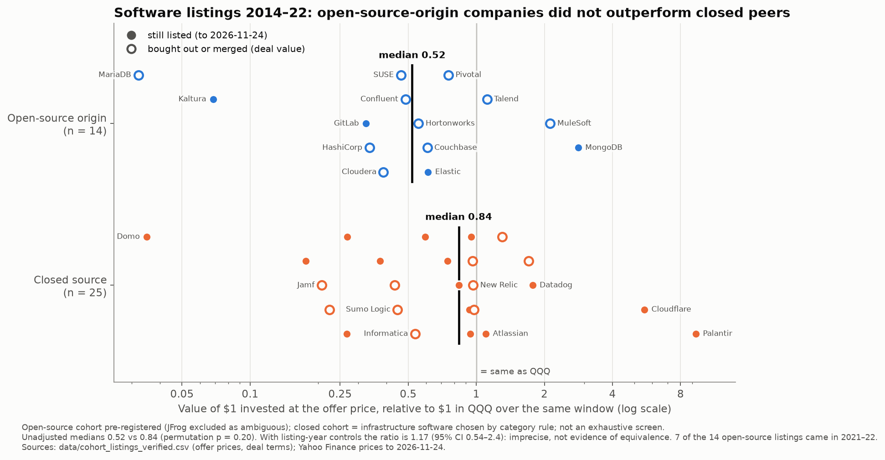

# The investor's view: what worries someone paying for open science (issue #380, round 2)

Sterling asked for a less-biased pass at the first round, written from the chair of someone deciding whether to
invest, with Edison as an independent check. This memo is that pass. The first round asked what open science is
*worth*. This one asks what someone who pays for it *gets back*, and what could go wrong.

**Start with:** the [bottom line](#bottom-line) and the [ranked concerns](#the-concerns-ranked). The supporting
files are the [pre-registration](PREREGISTRATION.md) (committed before any new data, in
[`80a45f4`](https://github.com/vertical-cloud-lab/byu-vcl/commit/80a45f4)), the
[bias audit of the first round](BIAS_AUDIT.md), the [Edison answers](edison/) and the
[sourced 2025–26 evidence](evidence/ai_and_funding_evidence.md).

## Bottom line

**Open science is a good public investment and a hard private one.** For the three kinds of investor this memo
considers:

- **A venture investor in an open physical-science spin-out** (for example a company built on DAL) has the most to
  worry about. Openness gives away what such investors usually pay for: patents, exclusive data, protected
  designs. The customers who most want open tools are the ones with the least money. Edison, reading the first
  round's files from an investment committee's chair, wrote: *"I would not approve an investment on the case
  presented."*
- **A public-market investor in open-source software companies** has seen no premium. Every 2014–22 listing of an
  open-source-origin infrastructure company, failures and buyouts included, returned a median of 0.52 of what QQQ
  returned over the same window, against 0.84 for closed peers. That gap is mostly the timing of the listings:
  with listing-year controls it disappears. So the evidence shows **no premium and no proven penalty**.
- **A public funder** (DOE's Genesis Mission, ONR, NSF) wants the opposite of what the venture investor wants.
  Openness is the point. The funder's worry is that the lab isn't open *enough*: none of DAL's datasets has a DOI
  yet. Its other worry is that nobody will pay to maintain the work once the award ends.

The best investment case for openness is the narrow one. Open the parts that bring users in and make results
credible, such as drivers, methods and tooling. Keep, or file on, the parts customers pay for: compositions,
process windows, operating know-how, and the data that gives an edge for a while.

## How this round tried to be less biased

| Risk in round 1 | What this round did |
| --- | --- |
| The agent works for a lab that favours openness | Wrote the hypotheses and what would count against each **before** fetching any data, and committed them first ([pre-registration](PREREGISTRATION.md), [`80a45f4`](https://github.com/vertical-cloud-lab/byu-vcl/commit/80a45f4)) |
| Famous examples stand in for the whole population | Took **every** listing of an open-source-origin company in 2014–22 and a closed cohort chosen by a category rule, with deal terms checked against filings and press releases ([verified terms](data/cohort_listings_verified.csv)) |
| The agent grades its own homework | Asked Edison nine questions worded neutrally and **without** the first round's conclusions ([queries](edison/queries.json)). Gave Edison the first round's brief and raw dataset and asked it to red-team them ([answer](edison/inv_redteam_round1_answer.md), [full review and code](edison/inv_redteam_round1_files/)) |
| Framing leaned one way | Audited the first round's framing ([`BIAS_AUDIT.md`](BIAS_AUDIT.md)) and stated the case *for* openness at its strongest ([below](#the-case-for-openness-stated-as-strongly-as-the-evidence-allows)) |
| Interested sources | Kept the venture-backed report, the advocacy studies and company statements, but labelled them as interested |

Independence is partial, and the limits are worth knowing. Edison retrieves and reads its own sources, but it may
run on models from the same handful of vendors, Claude included. The same agent wrote both rounds, and the same
person asked for both.

## Results against the pre-registered hypotheses

| # | Concern | What the data show | Verdict |
| --- | --- | --- | --- |
| H1 | Open-source origin doesn't earn public investors a premium | **Median value of $1 at the offer price, relative to $1 in QQQ: 0.52 (14 open-source listings) vs. 0.84 (25 closed).** Annualized, the median open-source listing trailed QQQ by 17.1 points a year and the median closed one by 2.9, a difference of −14.2 points (95% CI −25.1 to +2.2). Half the open-source listings (7 of 14) lost money from the offer price, against 9 of 25 closed ones. 10 of the 14 left the market through a buyout or merger: 6 at or below the offer price and 2 within 7% above it. With listing-year controls the gap goes away (ratio 1.17, 95% CI 0.54–2.4): 7 of the 14 open-source listings came in 2021–22 | **Concern stands** (the pre-registered test needed open source to beat closed by 5 points a year). The stronger claim, that open source is *penalized*, isn't supported |
| H2 | Openness doesn't raise value captured per dollar raised | First-round case files: Spearman ρ −0.04 (95% CI −0.39 to 0.31), n = 37. Edison's independent reanalysis of the same files: median value/funding 7.5× for open-core-or-more-open vs. 11.5× for closed or restricted, ratio 0.66 (95% CI 0.35–1.30) | **Inconclusive.** No premium, no proven harm. Only 37 of 179 rows can be used, and almost none are failures |
| H3 | Open hardware doesn't reach venture scale | The only clearly documented open-hardware exit above a few hundred million dollars is MakerBot's $403M (2013), after it had closed its designs; the buyer wrote that value off within three years. Edison's precedent search offers Opentrons' reported ~$1.8B private valuation as a qualified yes. Opentrons' newest robots aren't fully open hardware, and its latest reported valuation is about $170M, below the $206M it had raised | **Concern stands**, with Opentrons as the near-miss |
| H4 | AI weakens the open-source funnel and lowers the cost of copying | Tailwind: usage up, docs traffic −40%, revenue −80%, 75% of engineers laid off (January 2026). Stack Overflow questions down 99% since November 2022. Cloudflare re-implemented 94% of the Next.js API in a week for about $1,100 of AI tokens. **But** GitHub contributions rose 13%, and Supabase reached a $10B pre-money valuation with over 60% of its new databases launched by AI tools | **Concern stands for businesses that monetize human attention**, such as documentation, community and support funnels. It's weakened for products that AI agents pick by default |
| H5 | Selling to US academic labs is now riskier | Congress mostly rejected the deep cuts for FY2026 (NSF −3.4%, NIH +1.0%, DOE Office of Science +1.9%, all nominal), but awards fell: NSF made 10,937 awards in FY2024 and 6,218 in FY2026 (−43%), and NIH competing research grants fell 20.5% in FY2025. The FY2027 requests again propose NSF −55% and an NIH 15% indirect-cost cap. Tools makers report academic demand down (Agilent −8% in a 2026 quarter; Bruker's 10-K reports a "material adverse effect") | **Concern stands.** Funding was flat in nominal terms, so it fell after inflation, and new awards fell sharply |
| H6 | Open-by-default disclosure makes a physical-science spin-out harder to finance | Causal evidence: a startup's first patent raises its chance of venture funding within three years by 3.0 points, 47% over a 6.4% base, and by about 33 points for first-time founders (Farre-Mensa, Hegde & Ljungqvist 2020). Europe has no grace period, so prior publication forfeits patent rights there. The US allows one year | **Concern stands.** The standard fix is to file before publishing |

Details: H1 in [`data/h1_summary.csv`](data/h1_summary.csv), [`data/h1_pme.csv`](data/h1_pme.csv),
[`data/h1_vintage.csv`](data/h1_vintage.csv) and [`data/h1_returns.csv`](data/h1_returns.csv); H2 in
[`data/h2_summary.csv`](data/h2_summary.csv); H3 and H6 in [Edison's answers](edison/); H4 and H5 in the
[evidence file](evidence/ai_and_funding_evidence.md).

## The concerns, ranked

Ranked for persona A, a venture investor in an open physical-science spin-out. Severity for the other two personas
is in the [table after the list](#how-the-concerns-change-with-the-investor). Severity is my judgment. Strength of
evidence follows what the sources can support.

### 1. The company gives away what investors pay for

- **The concern.** Value goes to whoever owns the complementary asset (Teece's "profiting from innovation"):
  the cloud that hosts the software, the firm that owns the data, the manufacturer that builds the hardware.
  Openness hands the core to competitors and customers.
- **Evidence for.** Firms would need **$8.8T** to replace the open-source software they use, which cost
  **$4.15B** to write (Hoffmann, Nagle & Zhou 2024). Commercial open-source companies are worth about $375B
  together. AWS sold managed Elasticsearch, and Elastic's own employees wrote over 95% of its code changes
  (Edison, [COSS evidence](edison/inv_coss_financial_evidence_answer.md)). In the physical sciences, the PDB's open
  structures trained AlphaFold, and Isomorphic Labs commercializes its successor. Edison's red team ranked this
  concern first.
- **Evidence against.** Red Hat ($34B), MongoDB and Databricks show capture is possible when the company runs
  something scarce alongside the open code: a hosted service, support, certification. Edison's AI answer notes that
  value also flows back: DeepMind funds the open AlphaFold database of over 214M structures.
- **Ask in diligence.** What do customers pay for that stays scarce *after* the code, designs and data are public?

### 2. The customers who want open tools have the least money

- **The concern.** Open lab tools sell mainly to academic labs. Those labs pick them because they are cheap, run on
  grant cycles, and need support that the low price doesn't cover.
- **Evidence for.** US universities spent $117.7B on R&D in FY2024, 55% of it federal (NSF HERD). FY2025–26 brought
  grant terminations, a 20.5% drop in NIH competing grants, and NSF awards down 43% from FY2024 to FY2026. Agilent
  reports US labs "using available funding to keep their labs running as opposed to investing in new capital
  equipment" ([evidence](evidence/ai_and_funding_evidence.md#b-us-federal-science-funding)). The open-hardware
  literature describes academic demand as fragmented, grant-dependent and price-driven
  ([Edison](edison/inv_open_hardware_risks_answer.md)). Two of this lab's own data points:
  - The $80 SDL-demo kit made a stated **$2.24 a kit**.
  - The Acceleration Consortium lab *bought* equipment and never sold any
    ([first round](https://github.com/vertical-cloud-lab/byu-vcl/blob/db24bf3/outputs/issue-380-open-science-ai/gh-mining/commercialization_digest.md)).
- **Evidence against.**
  - Congress largely held FY2026 appropriations flat, and the 15% indirect-cost caps are blocked.
  - Big tools makers have small academic exposure (Danaher under 5%, Revvity about 5%), and Bruker saw US
    academic demand strengthen in Q3 2026.
  - Industrial customers exist: early cloud labs sold mainly to industry, at over $100k a method.
- **Ask in diligence.** What share of revenue comes from non-academic customers who reorder?

### 3. Publishing first forfeits the patents that unlock financing

- **The concern.** In materials, chemistry and devices, patents are financing instruments as much as legal ones.
- **Evidence for.**
  - Patents' effect is causal: a first patent raises a startup's chance of venture funding by 47%, its
    five-year employment growth by 55% and its sales growth by 80% (Farre-Mensa, Hegde & Ljungqvist 2020).
  - Pending patents signalled quality to investors in 370 semiconductor startups (Hsu & Ziedonis 2013).
  - Europe has absolute novelty, so a preprint or an open repository forfeits European rights for good.
  - Open-source engagement had no net effect on funding in highly competitive markets (Conti et al. 2021).
  - All via [Edison](edison/inv_disclosure_ip_physsci_answer.md).
- **Evidence against.**
  - The US one-year grace period exists.
  - File-then-publish (patent–paper pairs) lets a lab publish and patent at once.
  - Tacit know-how and execution speed protect complex physical processes even without patents.
- **Ask in diligence.**
  - Is there a written rule for what gets filed before it is published?
  - Who owns the IP: the university, the funder, or the inventors?

### 4. Openness doesn't fix hardware economics; it removes the protection

- **The concern.** Hardware ties up cash in tooling, inventory, certification and support, and clones undercut
  open designs.
- **Evidence for.**
  - Open-hardware firms that last are bootstrapped and mid-sized: SparkFun had about $30M of revenue in 2013, and
    Prusa about $157M in 2024. Edison's summary: "a profitable small-to-medium enterprise rather than a
    venture-scale exit".
  - LulzBot grew fast, stayed fully open, and collapsed in 2019. Prusa restricted its newest designs.
  - Bambu Lab, closed, took the consumer market. This lab bought Bambu printers.
  - Opentrons closed its hardware to scale ([case files](https://github.com/vertical-cloud-lab/byu-vcl/blob/db24bf3/outputs/issue-380-open-science-ai/companies/CASEBOOK.md)).
- **Evidence against.**
  - Closed hardware is no safe harbour either. Desktop Metal raised $438M and went bankrupt; Markforged went from
    a ~$2.1B SPAC valuation to a $42.5M resale; 3D Systems fell about 97% from its 2013 peak.
  - Hardware is hard whether open or closed. Openness mainly lowers the cost of being copied.
- **Ask in diligence.** What is the gross margin after support, calibration and warranty, and what does a clone
  cost to make?

### 5. A discovery is not a product

- **The concern.** Autonomous labs generate candidates quickly. Customers pay for qualified materials, and
  qualifying them takes years.
- **Evidence for.**
  - Zymergen went from a ~$4.8B peak valuation to a ~$300M sale. Its first product had quality and marketing
    problems.
  - Toyota Research Institute spent ~$70M across 17 university projects (2017–25). Reported dead ends include a
    search that found no winning polymer and a cathode that decayed too quickly to sell.
  - A peer-reviewed reanalysis challenged the A-Lab's novelty claims.
  - Strateos abandoned its hosted cloud lab in 2023.
  - All via [Edison](edison/inv_lab_automation_outcomes_answer.md). In aerospace and defence, a new alloy takes
    years of qualification before anyone buys it at scale.
- **Evidence against.** Open methods and full provenance, failed runs included, make a discovery more credible.
  That can shorten a customer's own validation, which is a genuine argument for openness.
- **Ask in diligence.** Has anyone outside the lab reproduced a property improvement on production-relevant
  equipment?

### 6. Public markets have not paid a premium for open-source origin

- **The concern.** If open source were a better model, it would show in returns.
- **Evidence.** H1 above.
  - Median value at the offer price relative to QQQ: 0.52 open-source vs. 0.84 closed.
  - Winners on both sides: MongoDB (12.9× from offer), Talend and MuleSoft (bought at 3.7× and 2.6×); Palantir,
    Cloudflare and Datadog.
  - Busts on both sides: MariaDB (−94.5%), Kaltura, HashiCorp (IBM paid $35 against an $80 IPO); Domo and Jamf.
  - Survivors look alike today (Yahoo, 2026-11-24, [summary](data/fundamentals_summary.csv)), median open-source
    vs. closed:
    - Gross margin: 76% vs. 76%.
    - Free-cash-flow margin: 27% vs. 25%.
    - EV/revenue: 6.0× vs. 6.2×.
    - Growth: 21% vs. 26%.
  - Edison found **no rigorous matched study** of open-source vs. proprietary company returns in the literature.
    It called the missing failure denominator "decisive".
- **Against.** With listing-year controls the gap disappears. The 2021–22 listings did badly whatever their licence.
- **Ask in diligence.** Compare against the entry price you are paying, not against the open-source winners.

### 7. Licences are unstable, and closing later rarely pays

- **The concern.** Starting open and closing once competitors arrive is a common plan, and the evidence that it
  works is thin.
- **Evidence for.**
  - Edison's COSS answer cites an analyst who found "no evidence that relicensing improved the financial results
    of the vendors studied". Three of the four best-known relicensings drew forks (OpenSearch, OpenTofu, Valkey).
  - Elastic and Redis later added AGPL back. Redis's CEO said the switch "hurt our relationship with the Redis
    community", and AWS and Google now maintain their own fork.
  - MinIO archived its community edition in 2026. An AI-assisted rewrite moved chardet from LGPL to MIT.
- **Evidence against.** MongoDB's SSPL drew no comparable fork, and the market didn't punish it: +5.2% against QQQ
  in the five days after the announcement ([first round](https://github.com/vertical-cloud-lab/byu-vcl/blob/db24bf3/outputs/issue-380-open-science-ai/data/relicense_event_study.csv)).
- **Ask in diligence.** Choose the licence for the business you want in five years, not the one you have now, and
  hold trademarks and contributor agreements from day one.

### 8. AI moves the value of open work to whoever runs the model

- **The concern.** AI answers questions without sending the visit. It trains on open code and data, and it makes
  re-implementation cheap. The open producer bears the costs and loses the funnel.
- **Evidence for.** All in the [evidence file](evidence/ai_and_funding_evidence.md#a-ai-and-the-open-source-business-funnel):
  - Tailwind: docs traffic −40%, revenue −80%, usage at a record.
  - Stack Overflow: questions −99% since November 2022, though they had already fallen 47% from 2014 to 2022.
    Its owner wrote off about $1.18B of it in 2023–24, and more in 2026.
  - Read the Docs: one AI crawler used 73 TB in a month.
  - Cloudflare's vinext covered 94% of Next.js's API for about $1,100 of AI tokens.
  - In the physical sciences, VASP's June 2026 rules bar AI training on its source (first round).
- **Evidence against.**
  - GitHub contributions +13% and merged PRs +29% (Octoverse 2025).
  - Copilot raised OSS contributions 5.9% in one study and 28–40% in another.
  - Supabase's valuation doubled to $10B as agents chose it by default.
  - AI companies bought open-source teams (Anthropic–Bun, OpenAI–Astral) and now sponsor Tailwind.
  - curl's AI-slop problem eased by April 2026.
  - Edison's view: "shifts in bargaining power and unit economics, not evidence that openness has stopped creating
    value" ([answer](edison/inv_ai_age_open_economics_answer.md)).
- **Ask in diligence.** Does revenue depend on human attention, or on usage that AI agents generate?

### 9. The numbers used to sell openness come from survivors and interested parties

- **The concern.** The headline evidence for open-source businesses is weak in ways that flatter it.
- **Evidence for.**
  - The 7× and 14× venture exit medians come from a report co-written by an open-source-focused VC, a foundation
    and a trade group. They are conditional on an exit, which only 12% of the sample had.
  - Edison adds that the report found **no statistically significant IPO capital-efficiency difference**, and that
    its exit-cohort description contains a date inconsistency ([red team](edison/inv_redteam_round1_answer.md)).
  - Only 2 of 118 commercial rows in the first round's case files record a shutdown or bankruptcy, so they cannot
    estimate failure rates.
  - Databricks alone is 51% of the commercial software value in those files.
- **Evidence against.** The academic estimates of value created (Hoffmann et al.; the NIH open-access study) are
  independent and careful. They measure social value, which is what a public funder buys.
- **Ask in diligence.** What is the full distribution, failures included, at your entry price?

### 10. Who maintains it, and who buys it?

- **The concern.** Open projects depend on a few people. An acquirer pays for control, and open IP offers less to
  control.
- **Evidence for.**
  - 5% of developers produce about 96% of the value of widely used open source (Hoffmann et al.).
  - The xz backdoor came through a single overworked maintainer.
  - Of 191 research-data repositories that closed, 47% neither kept access nor named a successor (Strecker et al.,
    via [Edison](edison/inv_public_funding_dependence_answer.md)).
  - Exits for open hardware were small or undisclosed: Arduino went to Qualcomm at an undisclosed price, and
    LulzBot's assets were sold.
  - The AI-era open-source startups mostly sold to compute and chip companies, often as teams.
- **Evidence against.** Foundations keep projects alive through changes of owner (PyTorch, Kubernetes, Valkey).
  Strategic buyers do pay for open ecosystems: IBM paid $34B for Red Hat, $6.4B for HashiCorp and $11B for Confluent.
- **Ask in diligence.** Name three plausible acquirers and what each would be buying.

### How the concerns change with the investor

Severity is my judgment: **H** high, **M** medium, **L** low.

| Concern | A. VC in an open physical-science spin-out | B. Public investor in open-source software | C. Public or industry funder of the lab | Strength of evidence |
| --- | --- | --- | --- | --- |
| 1. Gives away what investors pay for | H | M | L (spillovers are the goal) | Strong |
| 2. Customers with the least money | H | L | M | Strong (dated, sourced) |
| 3. Disclosure forfeits patents | H | L | M (tech transfer) | Strong (causal) |
| 4. Hardware economics | H | n/a | M | Moderate (cases) |
| 5. Discovery ≠ product | H | n/a | M | Moderate (cases) |
| 6. No public-market premium | M | H | L | Moderate (n = 39, not significant) |
| 7. Licence instability | M | H | L | Moderate |
| 8. AI moves the value | M | H | M (crawler costs, the commons) | Mixed |
| 9. Weak, interested evidence | M | M | M | Strong |
| 10. Maintenance and exit | M | M | H (sustainability) | Moderate |

## The case for openness, stated as strongly as the evidence allows

An unbiased memo has to give the other side its best case.

- **Open source produced some of the best outcomes in the cohort.** MongoDB returned 12.9× its offer price, about
  2.8 times QQQ over the same nine years. Talend and MuleSoft were bought at 3.7× and 2.6× their offer prices.
  Red Hat sold for $34B, and Databricks is the most valuable private software company in the case files.
- **At scale, open-source companies look like everyone else.** Their margins and valuation multiples match closed
  peers. Openness isn't a structural margin penalty once there is a hosted product.
- **Openness is distribution, and AI agents are a new distribution channel.** Supabase's growth comes from agents
  choosing an open default. Opentrons' open API made it the default robot in academic self-driving-lab builds, even
  after its hardware closed.
- **For a public funder, openness is the return.** The PDB costs about $6.9M a year and supports research worth far
  more (first round). NIH's open-access mandate raised patent citations to its research by 12–27%.
- **Open source threatens closed incumbents.** An event study found proprietary software stocks fell on the day of
  a Chinese open-model release (Edison, [COSS evidence](edison/inv_coss_financial_evidence_answer.md)). Investing
  only on the closed side carries its own risk.
- **Credibility is an asset in science.** Open methods and provenance, failed runs included, can make customers and
  regulators trust a result sooner.

## What would make an open physical-science company investable

Drawn from Edison's red team ("what would change my assessment"), the IP literature and the cases above:

1. **Name the scarce thing.** Say what customers will keep paying for after everything promised is public.
   Candidates are operating the lab (throughput and uptime), validated data for a period before release, hardware
   built to a quality standard, certification, workflow integration and a trademark.
2. **File, then publish.** Keep a written rule: provisional patents on compositions and processes with a plausible
   licensee, filed before any preprint. Europe gives no grace period.
3. **Open the complement, close the core.** Open drivers, schemas, methods and benchmarks. Close or embargo
   compositions, process windows and failure data for long enough to sell.
4. **Paid demand from outside academia.** Pilots with independent industrial customers, then repeat purchases.
   Letters of interest and GitHub stars don't count.
5. **Independent physical validation.** Property improvements reproduced across batches on production-relevant
   equipment, failures disclosed.
6. **Fully burdened unit economics.** Support, calibration, downtime, consumables and the founders' unpaid labour
   included.
7. **Signed legal clarity.** University assignment and licence, award obligations, vendor API rights and data rights.
8. **Funding matched to the layer.** Grants and non-dilutive money for the open infrastructure; venture money only
   for the closed product.

## DAL and the SDL kit, through each investor's eyes

**Which company would DAL be?** Edison's sharpest point is that "open orchestration on closed instruments describes
an architecture, not a validated business". There are three different businesses here, and openness affects each
differently:

| Possible company | What it sells | What openness does to it | Closest comparables |
| --- | --- | --- | --- |
| Alloy IP licensor | Exclusive rights to compositions and process windows | **Destroys the asset** unless filed before publication. Aerospace and defence licensees want exclusivity, given years of qualification | Closed AI-for-materials startups: Periodic Labs ($300M), CuspAI (over $650M) |
| Autonomous-lab services ("alloys as a service") | Throughput, validated measurements, turnaround | **Neutral to helpful.** Open methods build trust, and the value is in operating the lab | Strateos (folded 2023), Emerald Cloud Lab (survived), Radical AI (a closed alloy SDL with open simulation tools) |
| Orchestration software and drivers | Hosted orchestration, support, integrations | **Helps adoption, hurts capture**, unless the hosted layer stays closed. OEMs and AI platforms may set the standards | Opentrons (open API, hardware revenue), Atinary (closed), PyLabRobot (open, no company) |

**The funder sees a different gap.** For DOE's Genesis Mission or ONR, openness is a requirement, not a risk. The
first round's [DAL audit](https://github.com/vertical-cloud-lab/byu-vcl/blob/db24bf3/outputs/issue-380-open-science-ai/dal/dal_openness_audit.md)
found that no lab dataset has a DOI yet, that sensor and run records sit in a private database, and that the
rePowder's process data can't be exported. To a public funder the lab is **not open enough**. To a venture
investor in a spin-out it may be **too open**. A written rule that separates the two (file, then publish; embargo
periods; which layer is open) serves both.

**The SDL-demo kit is not a venture investment, and that's fine.** At $80 a kit with a stated $2.24 profit, it
needs about ten times the price or a service around it to fund one engineer. It earns its keep as teaching and
outreach. Grants and partners such as GroupGets are the right money for it. Edison adds a fair caveat: one kit's
margin doesn't prove that services beat hardware, because bespoke integration services can have worse economics.

## Where Edison agreed and disagreed

**Agreed** (each reached on its own):

- There is no openness premium in the case files. Edison's statistics on the same 37 rows match this memo's
  exactly.
- Public value is not shareholder value.
- The 7× and 14× venture medians are not an expected return.
- The 87% hardware saving is not an installed-cost comparison.
- Surviving forks show the commons is durable, not that a company captured value.

**Edison went further than this memo:**

- It would not approve the investment as presented.
- It ranked "discovery doesn't transfer to manufacturable alloys" and "integration and support destroy margins"
  third and fourth.
- It could not reproduce the first round's "10 of 15 closing moves came at or after an acquisition". It found 7 of
  14 dated moves.

**Edison pushed back on the bear case:**

- AI also returns value to the commons (the AlphaFold database).
- Coding assistants raise contributions.
- The $2.24 kit margin proves little about services.
- On the precedent question, it counted Opentrons as a qualified open-hardware company worth $1B or more, where
  the first round's case file treats Opentrons' current hardware as closed.

## Limits

- **Small samples.** H1 has 39 listings. None of its differences is significant at 95%, and listing vintage
  explains most of the gap.
- **The rules are mine.** The closed cohort's category rule was written before returns were computed, but other
  reasonable rules exist. The [sensitivity runs](data/h1_summary.csv) add the companies found after
  pre-registration (Instructure ×2, ForgeRock, Tenable; UiPath, C3.ai, Amplitude). They narrow the gap to −8.0
  points a year (95% CI −17.9 to +10.7). The four added offer prices came from memory: the session's web-search
  budget ran out before they could be checked against filings.
- **Public markets are not venture returns.** The listing cohort covers companies that reached an IPO. The private
  failures behind them remain uncounted, the gap Edison calls decisive.
- **Recent facts.** Many 2025–26 facts come from company statements and news. Each is labelled
  [confirmed] or [unconfirmed] in the [evidence file](evidence/ai_and_funding_evidence.md).
- **Severity rankings are judgments.** They are informed by Edison's independent ranking but not derived from data.

## Files

| Path | What it is |
| --- | --- |
| [`PREREGISTRATION.md`](PREREGISTRATION.md) | Hypotheses and tests, committed before the data |
| [`BIAS_AUDIT.md`](BIAS_AUDIT.md) | Where the first round leaned toward openness |
| [`edison/`](edison/) | Nine round-1 Edison jobs: answers, references and full trajectories. The red team's report, code and tables are in [`inv_redteam_round1_files/`](edison/inv_redteam_round1_files/) |
| [`evidence/ai_and_funding_evidence.md`](evidence/ai_and_funding_evidence.md) | Dated, sourced 2025–26 evidence on AI and open source, US science funding and relicensing |
| [`data/cohort_listings_verified.csv`](data/cohort_listings_verified.csv) | Offer prices, deal terms, first-day closes and sources for 43 listings |
| `data/h1_*.csv`, `data/h2_*.csv`, `data/fundamentals_*.csv` | Results tables |
| [`scripts/`](scripts/) | Every script, run from this folder with the Python 3.12 venv (see [`README.md`](README.md)) |
| [`figures/`](figures/) | Charts |
