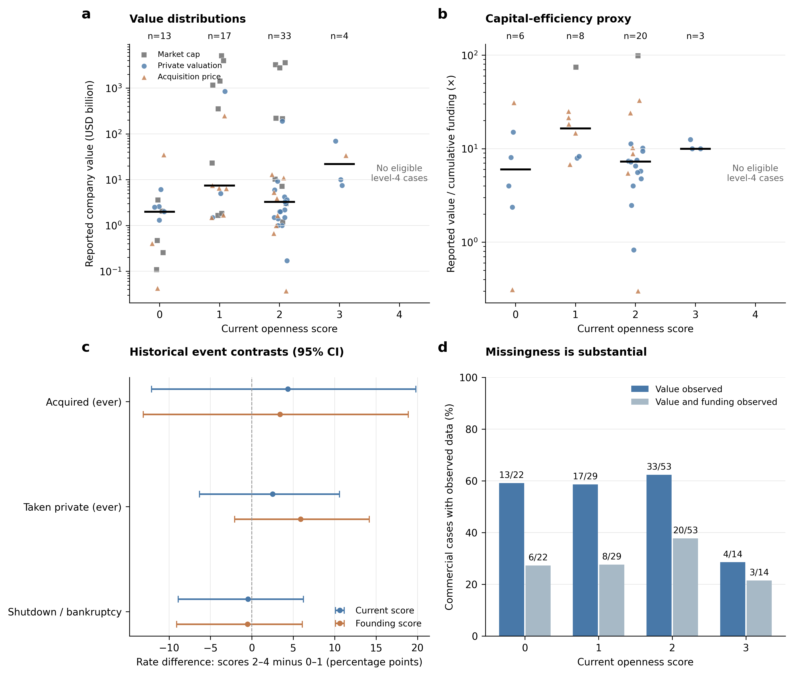

# Open science is not an investment thesis
## Investment committee review: autonomous alloy-discovery spin-out

**Assessment date:** 25 November 2026. **Dataset snapshot convention:** 23 November 2026, the latest dated value in the supplied export. All amounts are nominal US dollars as recorded; I do not independently endorse every company valuation.

## Executive summary

**I would not approve an equity investment on the case presented. I would consider a small, milestone-funded diligence option, not a venture-scale commitment.** The documents make a plausible public-funding and laboratory-operating case. They do not establish a company-level mechanism for capturing a durable share of the value created. Open science can be socially valuable and a poor investment in the entity that pays to produce it. Conversely, openness does not by itself make a company uninvestable.

My recomputation finds **no reliable positive association between openness and the reported value-to-funding proxy**. Among 118 identifiable commercial, non-model entities, only 37 have both an admissible value and positive recorded funding. Scores 2-4 currently have a median proxy of **7.54x** (n=23), versus **11.49x** for scores 0-1 (n=14): median ratio **0.66**, 95% bootstrap interval **0.35-1.30**. At founding, the corresponding medians are **7.90x** (n=25) and **9.69x** (n=12), ratio **0.82** (0.50-1.53). These are neither evidence of an openness premium nor proof that closed strategies win.

The dataset is a curated casebook, not an investable-company census. It contains only **one explicit shutdown and one bankruptcy**, mixes projects with companies, and sometimes puts revenue or grants in the value column. After defensible filtering, there are **no currently level-4 commercial entities**, and the category literally called physical science has **zero usable values or funding multiples**. The relevant lab-automation/AI-for-science group supplies just four multiples, only one for a currently open-core company. It cannot underwrite an alloy-discovery investment.

**The decision should turn on paid customer demand, reproducible physical performance, fully burdened unit economics, an enforceable IP/data boundary and a financing-to-exit plan.** Open drivers can be useful distribution infrastructure. They are not a demonstrated moat.

## 1. Where the argument is weakest

I distinguish overstated implications from numerical mistakes. The brief already acknowledges several limitations: material-only hardware savings, use value rather than net benefit for the Protein Data Bank (PDB), the sponsored venture study, convergence rather than a blanket closing trend, and young AI-tool cohorts. Those corrections deserve credit. The remaining problem is that the recommendations often behave as if those caveats do not constrain the investment conclusion. [1, 2]

### 1.1 Public value is repeatedly substituted for shareholder value

**Brief claims 1, 2, 3 and 5; pattern 1; proposal IP rationale.** The USD 8.8 trillion estimate is the hypothetical replacement cost to user firms if each had to rebuild widely used open-source software. It is not revenue, willingness to pay, an addressable market, or a cash flow belonging to an open-source supplier. The USD 4.15 billion estimate is the cost to recreate the sampled widely used software once, not a price for all open software. The original authors explicitly describe this replacement-value construction. [3]

The USD 374 billion aggregate in this export for 33 commercial software entities does approximately reproduce the brief's USD 375 billion. But comparing mixed-date market capitalizations, acquisition prices and private marks with an economy-wide replacement-cost estimate is not a capture-rate calculation. Databricks alone contributes **50.8%** of that software total; the top three contribute **66.1%**. These examples prove that some businesses commercialize open ecosystems, not that releasing an alloy lab's methods maximizes its equity value. [5]

The PDB's reported 800x use/cost and 160x R&D-return/cost figures do not establish incremental net benefits caused by openness, still less returns to a private provider. I cannot re-audit that calculation from these attachments because its underlying source files are missing. The NIH result is stronger evidence: the primary paper reports 12-27% more in-text patent citations after its access mandate. But the treatment is access to biomedical articles, and the outcome is citations, not patent quality, alloy qualification, revenue, or investor returns. The reader cannot transfer that causal estimate to open hardware or open compositions. [4]

### 1.2 The headline venture study does not establish a causal openness premium

**Brief claim 6; recommendation 4.** The Linux Foundation/Serena/COSSA study reports USD 1.3 billion versus USD 171 million at IPO and USD 482 million versus USD 34 million at acquisition. Its own definition includes accessible code, open weights and mixed proprietary products, not just permissively licensed firms. Its methods describe more than 800 VC-backed companies and normalization by founding year, geography and sector. Those are useful comparisons, not randomized treatments. [6, pp. 8-9, 39-41]

The headline medians condition on successful IPO or acquisition. They do not multiply the probability of success by net proceeds after dilution, liquidation preferences and capital invested, or account for losses on failures. Founder quality, market attractiveness, prior traction and investor selection remain plausible explanations. The report's IPO capital-efficiency slope difference is **not statistically significant (p=0.2134)**; it reports an acquisition-slope difference (p=0.0001). It is not fair to dismiss the whole study as sponsorship, but it is equally unfair to sell its exit medians as an unconditional expected-return advantage.

There is also a reproducibility warning: page 39 literally says its exit comparison uses US infrastructure companies “founded after 2018,” while page 8 describes 2000-2024 data and page 39 gives an eight-year median time to IPO for COSS. Those statements cannot all describe that filtered sample as written. It may be a typo; I would require the cohort definition and underlying denominators before relying on the headline. [6]

### 1.3 “87% cheaper” is not a fully burdened autonomous-laboratory cost comparison

**Brief claim 4; recommendations 1 and 4.** The Pearce review processes 119 published designs and records material costs and available proprietary comparators. It acknowledges fabrication skill, quality assurance and reliability challenges. [7] Published successful designs, incomplete comparators and self-fabrication costs are not representative of industrial installed cost.

Engineering, calibration, validation, uptime, spares, support, safety, warranty and integration labor belong in the denominator. A USD 100-2,000 demonstration device and a USD 1 million specialized industrial system are not substitutes merely because both are called self-driving laboratories. The reported USD 2.24 profit on an USD 80 kit is **2.8%** of price and apparently not an audited, fully burdened margin. It is a warning about that kit, not evidence that all hardware sales fail or that services will work. The labor-intensive alternative could be worse.

### 1.4 “Already fits the winning pattern” is the most investment-relevant overstatement

**Brief final pattern; recommendations 1 and 4.** Open orchestration on closed instruments is an architecture, not a validated business model. Only about 4 of 20 instruments reportedly have programmable interfaces; the supplied supporting audit is absent. Accepting that estimate implies an integration bottleneck, not a moat. The export has only eight usable multiples across the broad hardware/science analogues in groups D-G, and just four in group E itself.

The documents conflate three quite different investees: an automation software supplier, an operator selling lab services, and a materials-IP company licensing qualified alloys. Their costs, gross margins, defensibility, capital requirements and acquirers differ. The lab needs to choose a paying customer and a scarce deliverable before choosing an openness narrative.

### 1.5 Foundation durability, fork activity and founder status are not equity evidence

**Brief claims 7 and 8; recommendations 2 and 7.** Eight deliberately selected, well-known surviving forks are not a denominator of all forks. Commit counts are not equivalent to maintenance quality, paying deployments or shareholder outcomes. A fork's success can preserve the public good while weakening the original vendor's bargaining power.

Neutral governance may credibly prevent a vendor from withdrawing rights. That is valuable to users but can limit a spin-out's exclusive control and saleability. In this rubric, level 4 partly *means* neutral/open governance; using its association with continued openness as independent validation risks circular reasoning. Grants and institutional mandates also change survival incentives. “The university belongs to the category that stayed open” does not imply that a VC-financed spin-out should inherit the same objective function.

The recommendation that **10 of 15 closing moves came at or after acquisition is not reproducible from the supplied event coding under a straightforward historical definition**. I find 15 closing rows at organizations with a recorded acquisition or take-private, one undated; **7 of 14 dated rows** are at or after the first such event year (one is same-year). Restricting instead to currently acquired organizations gives 6 of 11. Cloudera's restriction began in 2019 before its 2021 take-private, although full implementation was in 2021; Docker's 2019 acquisition row concerns a business sale rather than a clean whole-company exit. Different interpretations are possible, but none of this is evidence that acquisition *caused* closing. [5]

### 1.6 The AI-era and open-science measures are not commensurate

**Brief claims 9-11 and added AI-tool cohort.** Open articles, open weights, unrestricted commercial weights, source code, data and governance are different rights. Averaging their scores does not create a common economic treatment. Group I contains **19 releases in this export**, not the brief's earlier 17-release reference; the same corporate parents also appear elsewhere. The 2.84 mean current release score is therefore not 19 independent companies' openness choices.

No SSPL/BSL transitions in a young 17-company AI-tool cohort cannot answer what happens after commercialization pressure arrives. “Seven exits” includes mergers and undisclosed or partial combinations, not seven known profitable exits. A 50x ratio of maximum training runs is unstable and does not measure the economics of physical experiments. Text mentioning science more frequently is marketing evidence, not a signed purchasing commitment. These observations may motivate further study; they do not support a return premium.

### 1.7 The proposal makes potentially irreversible commitments before validating the business

**Recommendations 3, 7 and 8; suggested proposal language.** Publishing all failed runs, composition data and methods while saying that services and data capture value leaves unanswered what data remain scarce and why customers cannot obtain the same result from competitors. A 12-month release clock is not a moat if industrial qualification and selling cycles exceed it. A named prospective licensee at Month 6 is an arbitrary commercial gate without demonstrated customer timing; absence of a licensee then does not imply absence of valuable future IP.

I would not treat “as the award terms allow” as legal clearance. The actual solicitation, award, university ownership rules and third-party licenses need counsel's review. A thin adapter does not automatically cure SDK restrictions. Derived CALPHAD results are not automatically redistributable merely because raw databases are withheld. A provisional filing is neither an issued patent nor freedom to operate. Public-by-default GitHub records can disclose inventions, customer information or operational attack surfaces. [8]

**What I would keep:** negotiate API, export and driver-publication rights before buying instruments; clarify university ownership; maintain attribution and license compliance; define a data schema; and budget for critical dependencies. These reduce operational risk regardless of whether openness commands a valuation premium. The recommendations to release everything, rule out units and call the architecture a winning pattern do not follow from the evidence.

## 2. What the dataset actually says

### 2.1 Denominators and methods

I use the supplied 179-row master and 223-row event export. There is no duplication by slug, but there are composite units (Cloudera/Hortonworks; MySQL/Sun; vLLM/Inferact), projects, foundations, model releases and corporate science programs. Thirteen event rows lack a year. The company export omits the underlying case JSON's source URLs and field-level provenance; I can reproduce the calculations, not certify all inputs. [5, 9]

My primary commercial sample is **118 non-model entities** with an explicit status of public, private VC, private bootstrapped, private PE, acquired or defunct. I do not silently classify unknown organizations as failed or closed. I exclude all 19 model-release rows and statuses indicating public goods/noncommercial ownership. The 17 unknown-status rows remain visible in the audit. An expanded, category-based sample has 133 rows and yields the same 37 financial multiples, although event denominators change. This is a unit-of-analysis choice, not a claim that nonprofits create no value.

Only positive amounts explicitly labeled **market cap, private valuation or acquisition price** enter reported company value. Seven positive `latest_value_usd` entries instead describe annual revenue, grants or awards: Apache, HDF Group, Kitware, Linux Foundation, NumFOCUS, Jupyter and RCSB PDB. I exclude those from values, rather than pricing public goods at zero. The sole current level-4 row with a monetary valuation is **vLLM/Inferact**: a foundation project merged with its private commercial steward. Its USD 800 million value and USD 150 million funding belong to a different economic claimant from the foundation's governance score. It is outside the primary sample and cannot establish a foundation-equity premium.

I define the proxy as:

\[
\text{reported value-to-funding proxy} = \frac{\text{latest admissible reported value}}{\text{positive recorded cumulative funding}}.
\]

**It is not a fund's multiple on invested capital (MOIC), return on investment, or internal rate of return.** Market capitalization, enterprise/deal values, preferred-round marks and partial-asset sale prices are not interchangeable. Debt, option pools, ownership, preferences, secondary sales and timing are unavailable. Funding at an old exit may not be funding at the current mark. Markforged's USD 42.5 million business resale is not necessarily whole-company equity proceeds. Adafruit's recorded zero funding does not imply infinite return.

For outcomes I count each entity once if the event file records an acquisition, take-private, shutdown or bankruptcy, allowing overlaps and all recorded years, including undated historical events. Acquisition and take-private are separate labels; neither is intrinsically a successful investment. `still_operating=False` includes MySQL and Pivotal absorption, so it is not my shutdown definition. Current ownership is a separate check: 28 acquired, five private-PE and one defunct, versus 33 historical acquisition flags, four take-privates and two shutdown/bankruptcy flags.

Tables show medians and interquartile ranges (IQR: 25th-75th percentiles), with sample sizes. Confidence intervals (CI) are 95%: 12,000 case-resampling percentile bootstraps for financial medians/ratios, Wilson intervals for rates, and Newcombe-Wilson intervals for differences between rates. I do not report bootstrap CIs for single-case financial groups. Adjusted exploratory regressions use heteroskedasticity-robust HC3 uncertainty. All intervals condition on this selected casebook; none covers selection, measurement error or the unknown universe. Tests are exploratory and not a basis for subgroup discoveries.

### 2.2 Financial distributions by openness

**Current openness.** Values are USD billions; ratios are in x. Level 4 has no commercial entities under my primary definition. Higher is not monotonically better.

|   Score |   Cases |   Value n | Median value (IQR), USD bn   |   Ratio n | Median ratio (95% CI)   |
|--------:|--------:|----------:|:-----------------------------|----------:|:------------------------|
|       0 |      22 |        13 | 2.00 (0.40-2.60)             |         6 | 6.02 (1.34-23.01)       |
|       1 |      29 |        17 | 7.50 (1.83-852.00)           |         8 | 16.50 (7.90-25.10)      |
|       2 |      53 |        33 | 3.30 (1.50-10.20)            |        20 | 7.28 (5.51-9.76)        |
|       3 |      14 |         4 | 22.00 (9.38-43.00)           |         3 | 10.00 (10.00-12.50)     |

**Founding/initial openness.** “Initial” is the export's score, not a verified, contemporaneous legal audit at incorporation. Initial score 4 contains one commercial science program with no financial observations; it is not a meaningful return cohort.

|   Score |   Cases |   Value n | Median value (IQR), USD bn   |   Ratio n | Median ratio (95% CI)   |
|--------:|--------:|----------:|:-----------------------------|----------:|:------------------------|
|       0 |      35 |        22 | 3.10 (1.70-173.91)           |         7 | 8.03 (2.36-15.02)       |
|       1 |      15 |         8 | 38.75 (1.65-222.90)          |         5 | 10.00 (6.80-21.43)      |
|       2 |      25 |        15 | 3.00 (1.57-5.85)             |         9 | 7.35 (5.46-18.30)       |
|       3 |      42 |        22 | 5.50 (1.12-10.80)            |        16 | 8.54 (5.56-17.06)       |
|       4 |       1 |         0 | — (—-—)                      |         0 | — (—-—)                 |

The current high-openness group's large USD 22 billion median company value rests on only four observations. Its ten missing values cannot be presumed to look like Red Hat or the three private marks. The IQR of level 1 also reflects large diversified technology companies, not a software licensing effect.

For the primary contrast I combine 2-4 against 0-1 because score 2 explicitly includes an OSI-licensed commercial core; **this is not a “fully open versus closed” comparison**. The median proxy ratio is 0.66 (0.35-1.30, n=23 versus 14; Mann-Whitney p=0.287; Cliff's delta=-0.21). Initial scores give 0.82 (0.50-1.53, n=25 versus 12; p=0.833; delta=-0.047). Cliff's delta describes which group's observations tend to rank higher; zero means no tendency.

The median company value is USD 3.90 billion versus USD 3.104 billion currently: median ratio 1.26 (0.35-3.60; n=37 versus 30; p=0.940). These are noisy rankings among observed marks, not comparable cash proceeds.

### 2.3 Acquisition, take-private and failure observations

**Current-score event prevalence** (ever recorded; not annual or age-standardized incidence):

|   Score |   N | Acquisition   | Take-private   | Shutdown    | Bankruptcy   |
|--------:|----:|:--------------|:---------------|:------------|:-------------|
|       0 |  22 | 6/22 (27.3%)  | 0/22 (0.0%)    | 0/22 (0.0%) | 1/22 (4.5%)  |
|       1 |  29 | 7/29 (24.1%)  | 1/29 (3.4%)    | 0/29 (0.0%) | 0/29 (0.0%)  |
|       2 |  53 | 13/53 (24.5%) | 2/53 (3.8%)    | 0/53 (0.0%) | 0/53 (0.0%)  |
|       3 |  14 | 7/14 (50.0%)  | 1/14 (7.1%)    | 1/14 (7.1%) | 0/14 (0.0%)  |

**Initial-score event prevalence:**

|   Score |   N | Acquisition   | Take-private   | Shutdown    | Bankruptcy   |
|--------:|----:|:--------------|:---------------|:------------|:-------------|
|       0 |  35 | 8/35 (22.9%)  | 0/35 (0.0%)    | 0/35 (0.0%) | 1/35 (2.9%)  |
|       1 |  15 | 5/15 (33.3%)  | 0/15 (0.0%)    | 0/15 (0.0%) | 0/15 (0.0%)  |
|       2 |  25 | 7/25 (28.0%)  | 3/25 (12.0%)   | 0/25 (0.0%) | 0/25 (0.0%)  |
|       3 |  42 | 12/42 (28.6%) | 1/42 (2.4%)    | 1/42 (2.4%) | 0/42 (0.0%)  |
|       4 |   1 | 1/1 (100.0%)  | 0/1 (0.0%)     | 0/1 (0.0%)  | 0/1 (0.0%)   |

Across all 118 entities, historical acquisition prevalence is **33/118 = 28.0%** (95% Wilson CI 20.7-36.7%); take-private **4/118 = 3.4%** (1.3-8.4%); explicit shutdown and bankruptcy are each **1/118 = 0.85%** (0.15-4.64%); combined failure **2/118 = 1.7%** (0.47-5.97%). The shutdown is Papers with Code; the bankruptcy is Desktop Metal. Those are recorded histories, not credible population failure-rate estimates.

For current scores 2-4 versus 0-1, acquisition is 20/67 (29.9%) versus 13/51 (25.5%), difference **+4.4 percentage points** (CI -12.1 to +19.8; Fisher p=0.681). Take-private is 3/67 versus 1/51, **+2.5 points** (-6.3 to +10.6; p=0.633). Shutdown is 1/67 versus 0/51, **+1.5 points** (-5.6 to +8.0; p=1). Shutdown/bankruptcy combined is 1/67 versus 1/51, **-0.5 points** (-9.5 to +6.1; p=1). There is no informative safety advantage.

At founding, acquisition is 20/68 versus 13/50, difference **+3.4 points** (-13.1 to +18.9; p=0.836); take-private 4/68 versus 0/50, **+5.9 points** (-2.1 to +14.2; p=0.136); shutdown 1/68 versus 0/50, **+1.5 points** (-5.8 to +7.9; p=1); combined failure 1/68 versus 1/50, **-0.5 points** (-9.1 to +6.1; p=1). Level-by-level and sector-by-level Wilson intervals are in the accompanying tables. Zero events is not evidence of zero risk.

### 2.4 Sector distributions and the physical-science evidence gap

Acq. = historical acquisitions; PE = take-private events; fail = shutdown or bankruptcy. Event denominators are the full sector N, not just observations with financial data.

| Sector              | N / value n / ratio n   | Median value (IQR), USD bn   | Median ratio (95% CI)   | Acq. / PE / fail counts   |
|:--------------------|:------------------------|:-----------------------------|:------------------------|:--------------------------|
| ai lab              | 17 / 9 / 6              | 12.93 (1.66-250.00)          | 9.69 (3.18-23.72)       | 4 / 0 / 0                 |
| big tech            | 9 / 9 / 0               | 2,760.00 (354.42-3,598.00)   | — (—-—)                 | 0 / 0 / 0                 |
| hardware            | 28 / 12 / 5             | 0.83 (0.23-2.16)             | 4.77 (0.31-31.00)       | 8 / 0 / 1                 |
| open infrastructure | 2 / 0 / 0               | — (—-—)                      | — (—-—)                 | 2 / 0 / 1                 |
| physical science    | 2 / 0 / 0               | — (—-—)                      | — (—-—)                 | 0 / 0 / 0                 |
| sci software        | 8 / 4 / 2               | 3.96 (1.75-13.32)            | 11.19 (7.35-15.02)      | 1 / 0 / 0                 |
| software            | 52 / 33 / 24            | 3.90 (1.65-7.50)             | 8.54 (6.80-11.32)       | 18 / 4 / 0                |

Sector-specific *current-score* proxy contrasts (2-4 divided by 0-1) are:

| Sector | Observed ratios, open / restricted | Median ratio | 95% bootstrap CI | Exploratory p |
|---|---:|---:|---:|---:|
| Software | 17 / 7 | 0.41 | 0.26-1.27 | 0.087 |
| AI labs | 3 / 3 | 2.50 | 0.64-13.85 | 0.400 |
| Hardware | 2 / 3 | 0.35 | 0.027-15.34 | 0.800 |
| Scientific software | 1 / 1 | 0.49 | Not estimable | 1.000 |

The table does **not** show that open AI labs outperform or open hardware underperforms. It shows how little comparable evidence there is. There are no usable ratios for Big Tech, the commercial open-infrastructure rows or the literal physical-science category. Full sector-by-score distributions and both score bases are supplied electronically.

The **three physical-science-category rows have no value-to-funding observation**: Emerald Cloud Lab and Chemify enter the primary commercial sample; Strateos has unknown ownership and is excluded there. Expanding to group E (lab automation/AI-for-science) gives 16 identifiable commercial entities, six values and just **four** multiples: Benchling 15.02x, CuspAI 4.00x, Lila Sciences 2.36x, and Opentrons 0.83x. Only Opentrons is currently 2 or higher among those four. Benchling is not an alloy foundry, and Opentrons' recorded private value is not realized proceeds. Across groups D-G more broadly, current open-core cases have median 2.80x (n=2) versus 6.02x (n=6); founding scores reverse that ordering, 4.77x (n=3) versus 4.00x (n=5). These are illustrations of fragility, not underwriting comparables.

### 2.5 Adjustments and sensitivity analyses

I regress log10(proxy) on the numeric openness score, sector indicators and founding year scaled per decade. The ordinal score is not necessarily equally spaced economically, so this is a sensitivity to the grouped and fully disaggregated results, not the preferred causal model.

| Exposure / outcome | n | Effect per one higher score, adjusted for sector and founding year | 95% robust CI | p |
|---|---:|---:|---:|---:|
| Current score / proxy | 37 | -7.7% | -43.4% to +50.6% | 0.748 |
| Initial score / proxy | 37 | +10.7% | -37.0% to +94.5% | 0.723 |
| Current score / company value | 67 | +13.9% | -38.3% to +110.3% | 0.677 |
| Initial score / company value | 67 | +21.2% | -27.3% to +102.1% | 0.461 |

These log-linear effects concern conditional geometric scale, not mean fund returns. The proxy model has six fitted parameters and only 37 cases. Adding valuation type changes the current-score proxy estimate to +1.1% (-38.7 to +66.8%; p=0.966) and initial-score estimate to +7.6% (-46.7 to +117.2%; p=0.839). Type is partly an outcome of company development, so adjustment can itself introduce bias; I show it only as a sensitivity.

An exploratory linear-probability acquisition model with sector/cohort controls (n=112) gives +0.25 percentage points per current score (CI -11.60 to +12.11; p=0.966), versus -2.00 points per initial score (-12.41 to +8.40; p=0.706). Rare-failure regressions are not useful actuarial models; I retain them only in the technical output.

Other checks all weaken a strong causal reading:

- **Use only marks no more than two years old:** current-score proxy median ratio changes from 0.66 to **1.24** (0.40-4.23; n=14 versus 7). Founding ratio remains 0.79 (0.51-4.20; n=12 versus 9). Restricting recent values also changes the cohort composition; it does not fix stale exits.
- **Require current score at least 3:** proxy ratio becomes **1.26** (0.97-1.78), but only **three** observations qualify, versus 34 below that threshold. At founding it is 1.06 (0.59-1.95; n=16 versus 21). These threshold changes are not an excuse to choose the attractive sign.
- **Treat Desktop Metal's missing equity value as zero after bankruptcy:** this explicit zero-recovery assumption changes the current contrast to **0.91** (0.37-1.49; n=23 versus 15). It illustrates how excluding an impaired closed company flatters the closed group; it is not a verified recovery value.
- **Compare like mark types:** private-valuation-only current contrast is 0.91 (0.59-2.31; n=16 versus 6); acquisition-price-only contrast 0.52 (0.16-2.53; n=6 versus 7). Market-cap multiples have one observation in each group and are uninformative.
- **Exclude low-confidence rows:** current contrast is 0.51 (0.31-1.21; n=22 versus 13). Removing Big Tech or requiring founding since 2000 does not change the primary 37 multiples because none is lost. The expanded 133-entity definition also does not add financial observations.

*Figure 1. Commercial non-model entities only. Top panels show all observed values and positive-funding proxies, not representative samples; black bars are group medians. Lower left shows Newcombe-Wilson 95% intervals for differences between scores 2-4 and 0-1; lower right shows observed-data fractions. No current level-4 entity qualifies. Source: executed analysis of the supplied exports; execution 95ddb5a0-c3c5-438f-8083-cacf439a71f0.*

### 2.6 How much bias can I quantify?

**Failure selection dominates.** One shutdown and one bankruptcy in 118 selected commercial entities cannot estimate venture mortality. A functioning acquired brand, an absorbed company and shareholder loss are different endpoints. The list includes distressed acquired hardware brands without coding them as shutdowns. I will not import an external “typical failure rate” and pretend it calibrates this sample.

A simple omission stress test shows the fragility: with no missing successes, adding **seven omitted failures** to the currently open group changes its failure fraction from 1/67 to 8/74 = 10.8%; adding **five** to the restricted group changes 1/51 to 6/56 = 10.7%. To reach 25% would require 21 and 16 omitted failures respectively. These are scenarios, not estimates of how many are actually missing. Actual relative failure risks are unidentified without the sampling frame.

**Outcome disclosure is selective.** Funding is absent in **112/179 (62.6%)** rows. Among the 118 commercial entities, 63 have recorded funding (62 positive), 67 have valid values, and only **37/118 (31.4%)** have a usable proxy. For current scores 2-4 versus 0-1, value coverage is **37/67 (55.2%) versus 30/51 (58.8%)** and proxy coverage **23/67 (34.3%) versus 14/51 (27.5%)**. For strictly current score 3, value coverage falls to **4/14 (28.6%)**, versus 63/104 (60.6%) below 3. More than half of each primary group's proxies are missing, so their full-sample median ordering cannot be bounded without assumptions about the missing cases. Missing funding is not zero funding.

As a deliberately extreme missing-value stress scenario, labeling every commercial entity without a value as failed would give 44.8% for current scores 2-4 and 41.2% for 0-1, instead of 1.5% and 2.0%. Many are operating companies, so that scenario is not a plausible mortality estimate. It demonstrates that complete-case results leave large parts of the portfolio unpriced.

**Marks have different clocks.** Of 67 primary values, **21 (31.3%) are more than two years old**, 17 exceed four years, and the oldest is about 18.7 years old. The set mixes 27 private marks, 22 market caps and 18 acquisition prices. No inflation, liquidity or risk adjustment can make those shareholder proceeds without underlying financing histories. I preserve recorded values and disclose the mismatch rather than invent a mark-down rule.

**Sector and claimant confounding are large.** The nine Big Tech rows contribute nine values and zero usable funding multiples. The top five companies supply **78.8%** of the approximately USD 23.69 trillion commercial value sum. Foundation/government/nonprofit outcomes are not observations of venture-equity capture. Open-model releases are not independent founding-company treatments. Even within companies, current score can follow success, distress, funding or acquisition; measuring it after the outcome creates reverse causality. Initial scores help with ordering but not selection or inconsistent historical definitions.

**Search and scoring bias are visible but not correctable.** Exactly **150/179 rows** have the literal search-tool label “WebFetch (search budget exhausted),” and six have no search-tool label; others include mixed search/fetch descriptions. That is uneven ascertainment, not proof those entries are wrong. The rubric is unblinded and spans incompatible bundles of rights across industries. It grants governance a score increment while companies are judged on proprietary revenue-generating features. There is no inclusion probability, independent score adjudication or complete failed-company roster, so inverse-probability weighting, causal matching and a credible survival curve are not available.

The all-179-row and expanded definitions, per-level rate intervals, full sector-by-score cross-tabs, confidence flags, event timing and concentration calculations remain available in the reproducibility tables. They are not hidden by the primary filter.
