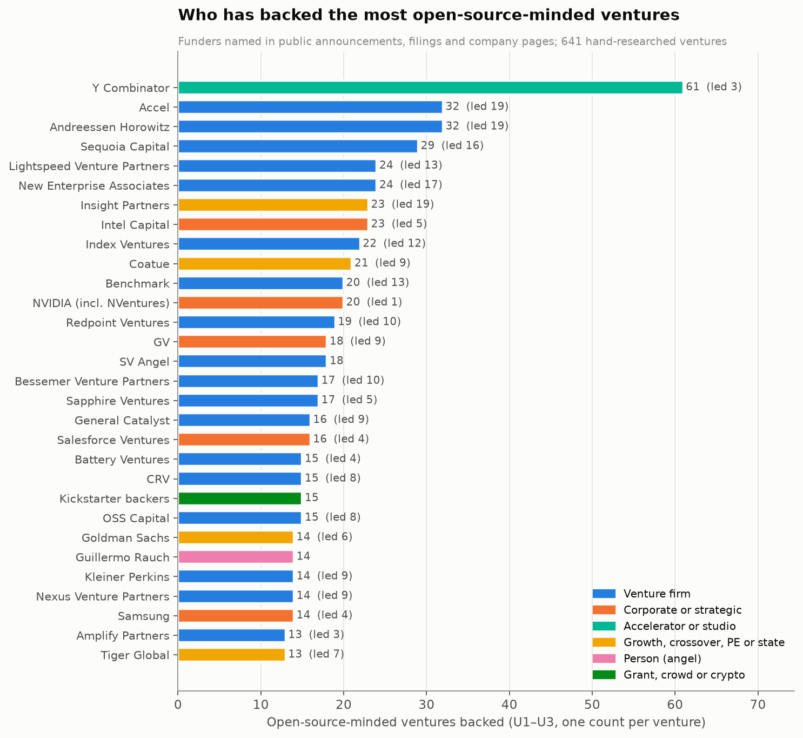
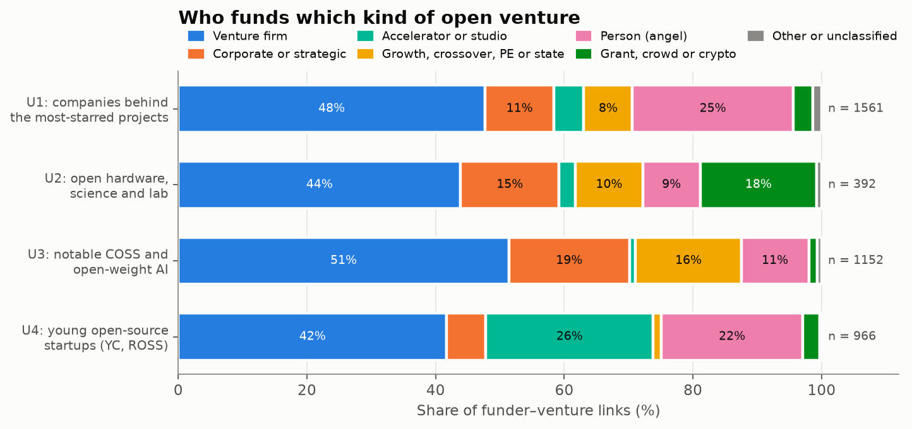

# Who funds open-source-minded ventures? (issue #380, round 2, part 3)

Sterling asked for *"a list of investors, firms, philanthropists, and other VC and VC-like sources that have been
involved in funding a venture that falls into the more open-source minded of startups. Be thorough and manual."*
This folder is that list.

- **[`FUNDER_LIST.md`](FUNDER_LIST.md) lists every funder found**, grouped by type, with each venture it backed
  linked to a page that names it.
- **This file** summarises the list, says what it shows and how far to trust it.
- **[`data/`](data/) holds the tables**:
  - every round (`deals.csv`)
  - every funder–venture pair (`investor_links.csv`)
  - every funder (`investors.csv`)
  - every program-level funder (`programs.csv`)

The scope and counting rules were committed before any funding data was gathered ([`PROTOCOL.md`](PROTOCOL.md),
`448c8c2`).

## Bottom line

- **The list is long and flat.** Across the 641 hand-researched ventures in groups U1–U3,
  455 disclosed outside funding.
  - Public sources name 1,654 distinct funders across 1,266 rounds, 1,177
    of which name at least one funder. A round reported by two sources counts once. Acquisitions, buyouts, IPOs and
    secondary share sales are listed but not counted, because no money went to the venture.
  - 1,241 of those funders appear in only one venture.
  - Only 98 backed five or more, and the ten most frequent account for
    9% of all funder–venture links.
  - There is no small club that funds open source. There is a long tail with a recognisable head.
- **The head is mostly generalist venture firms, an accelerator and chip and cloud companies:**
  - Y Combinator, by count.
  - Accel, Sequoia, Andreessen Horowitz, NEA, Index, Benchmark, Lightspeed and Insight.
  - Corporate investors, counted across all four groups with their arms rolled up to the parent:
    - Alphabet: GV, CapitalG, Gradient and Google together, 43 ventures
    - Intel Capital (24) and NVIDIA (21)
    - Microsoft: M12, GitHub and Microsoft, 18
    - Samsung (20) and Salesforce Ventures (19)
  - The firms that lead open-source rounds most often are Andreessen Horowitz, Accel, Insight, NEA, Sequoia,
    Lightspeed, Index and Benchmark.
- **The funds most associated with open source are small in this count.**
  - OSS Capital has 16 ventures across all four groups and Uncorrelated Ventures
    14, against 20 for Bessemer and 20 for GV.
  - Runa Capital (5), Heavybit (5), Boldstart (4),
    Crane (4) and Open Core Ventures (4) back only a handful
    each.
  - Only two funders in the data have a dedicated open-source mandate: OSS Capital and Open Core Ventures.
    4 more name open source as a focus or run a program for it: Andreessen
    Horowitz, Index, Runa and Databricks Ventures. Another 17 have had a partner quoted
    on open source, mostly in TechCrunch's 2020 survey of investors, which shows interest rather than a mandate.
- **People are a large share of the funders.** Many of the most frequent angels founded or led open-source
  companies themselves, and now back the next ones (ventures here, all groups):
  - Guillermo Rauch of Vercel (19), Clem Delangue of Hugging Face (9) and
    David Cramer of Sentry (10)
  - Tom Preston-Werner (10) and Nat Friedman (9) of GitHub, Paul
    Copplestone of Supabase (7) and Tristan Handy of dbt Labs (5)
- **Open hardware, open science and lab ventures (U2) draw a wider mix.** Venture firms are still the most common
  type: 39 of the 98 U2 ventures have one. Alongside them:
  - Strategic corporates (30 ventures): Bosch, Renesas, Arm, Qualcomm, Sony,
    Intel and NVIDIA.
  - Crowdfunding (19 ventures; Kickstarter backers alone, 13).
  - Hardware-minded venture firms: True Ventures, Foundry Group, Spark Capital, Khosla, Eclipse and Lux.
  - Grants: SBIR, NSF, NIH, Shuttleworth, CZI, Sloan and Moore; for DeSci, crypto funds.
  - Only 13 funders backed three or more of the 98 ventures in this group.
- **Philanthropy and government fund open source mostly at the program level**, and mostly not through companies.
  - Programs: CZI, Sloan, Moore and Schmidt Sciences; DOE's Exascale Computing Project; NSF's POSE and CSSI;
    Germany's Sovereign Tech Agency; the EU's NGI grants through NLnet.
  - Recipients are mostly projects, universities and nonprofits.
- **Read the list as a disclosed, selectively researched inventory, with omissions and some false inclusions.** Its
  counts are neither estimates for the whole population nor guaranteed lower bounds.
  - 93% of the investor names in counted rounds appear in the text of the page their round
    cites. That shows the name is on the page, not that the page shows an investment.
  - Before its rounds were merged in, Edison's blind audit of 40 random ventures found
    86% of this list's names for those ventures. It also found about
    296 funders where this list then had 180, mostly smaller
    participants, angels, grants and lenders.
  - Edison's independent review of a first draft found errors that are now fixed: exits and buyouts counted as
    funding, six companies entered twice, nonprofits and closed products in the counts, and funders split across two
    names. See [Edison's review and what changed](#edisons-review-and-what-changed).
- **Nothing here says these funders made money on open source, or that they would fund a given venture.** The list
  records who put money in, as disclosed. Disclosure favours large rounds and survivors.

## The funders that backed the most open-source-minded ventures (U1–U3)

One count per venture, however many rounds; "led" counts ventures where the funder led at least one round.
Examples list led ventures first. Full list: [`FUNDER_LIST.md`](FUNDER_LIST.md).

| Funder | Type | Ventures backed | Led a round in | Ventures (led first) |
| --- | --- | --- | --- | --- |
| Y Combinator | accelerator / studio | 61 | 3 | Mattermost, PostHog Inc., SigNoz, Activepieces, Airbyte, Anomaly, Apify, BerriAI … |
| Accel | venture firm | 32 | 19 | Airbyte, Astral, CARTO, Cloudera, ForgeRock, Heptio, Laravel, Polars B.V. … |
| Andreessen Horowitz | venture firm | 32 | 19 | Alluxio, Anyscale, Astral, Black Forest Labs, Databricks, GitHub, Imply, Inferact … |
| Sequoia Capital | venture firm | 29 | 16 | Chainguard, Deno Land Inc., Docker Inc., FastAPI Labs, GitHub, LangChain, Observable, Inc., Pydantic Services … |
| Lightspeed Venture Partners | venture firm | 24 | 13 | Chainguard, Grafana Labs, Hasura, Inferact, Marqo, Materialize, Mistral AI, Redpanda Data … |
| New Enterprise Associates | venture firm | 24 | 17 | Acquia, Aerospike, Anyscale, Databricks, Elastic N.V., Metabase, MuleSoft, NGINX … |
| Insight Partners | growth, crossover or PE | 23 | 19 | Anaconda, Inc., Appsmith, Astronomer, Automattic, CARTO, Camunda, CrewAI, Databricks … |
| Intel Capital | corporate / strategic | 23 | 5 | Lightbend, MariaDB, MinIO Inc., Mirantis, Truffle Security, AI21 Labs, Anyscale, Cloudera … |
| Index Ventures | venture firm | 22 | 12 | Chai Discovery, ClickHouse, Confluent, Dagster Labs, Gatsby, Gluster, Kong Inc., Lightning AI … |
| Coatue | growth, crossover or PE | 21 | 9 | ClickHouse, Confluent, Databricks, Kubecost, Nomic AI, SiFive, Stability AI, Starburst … |
| Benchmark | venture firm | 20 | 13 | Airbyte, Buoyant, ClickHouse, Cockroach Labs, Docker Inc., Hortonworks, Hyperic, LangChain … |
| NVIDIA (incl. NVentures) | corporate / strategic | 20 | 1 | MindsDB, AI21 Labs, Black Forest Labs, Cohere, Databricks, EvolutionaryScale, Hugging Face, Lightning AI … |
| Redpoint Ventures | venture firm | 19 | 10 | Chainguard, Couchbase, HumanSignal, Materialize, Mattermost, Preset, Solo.io, Sourcegraph … |
| GV | corporate / strategic | 18 | 9 | Ahana, Buoyant, CoreOS, GitLab Inc., Redpanda Data, Vercel, Warp, Weaveworks … |
| SV Angel | venture firm | 18 | 0 | Airbyte, Anomaly, Buoyant, Civilized Discourse Construction Kit, Expo, FoundationDB, Hugging Face, Lightning AI … |
| Bessemer Venture Partners | venture firm | 17 | 10 | Appwrite, Auterion, Boltz PBC, Coiled, Cypress.io, Imply, Netdata Inc., Teleport … |
| Sapphire Ventures | venture firm | 17 | 5 | Dremio, InfluxData, Jaspersoft, Tetrate, Yugabyte, Alfresco Software, Chai Discovery, Cypress.io … |
| General Catalyst | venture firm | 16 | 9 | Chai Discovery, Gitpod, Ionic, MinIO Inc., Mistral AI, Modular Inc., Tidelift, Together AI … |
| Salesforce Ventures | corporate / strategic | 16 | 4 | Automattic, Black Forest Labs, MuleSoft, Together AI, Airbyte, Astronomer, CARTO, Chainguard … |
| Battery Ventures | venture firm | 15 | 4 | Chef Software, Code Ocean, InfluxData, Orkes, Bitwarden, Chai Discovery, ClickHouse, Cumulus Networks … |
| CRV | venture firm | 15 | 8 | Gatsby, LanceDB, Meilisearch, ProjectDiscovery, Reflection AI, Strapi, Tailscale, Vercel … |
| Kickstarter backers | crowdfunding | 15 | 0 | Augmented Instruments, Backyard Brains, Fonticons, Inc., George Robotics, Great Scott Gadgets, Luxonis, Mycroft AI, OpenBCI … |
| OSS Capital | venture firm | 15 | 8 | AppFlowy, Hoppscotch, OpenBB Inc., Plane, Remix Software, ResearchHub, Tracel Inc., W4 Games … |
| Goldman Sachs | growth, crossover or PE | 14 | 6 | DataStax, GitLab Inc., Harness, NGINX, Redis Ltd., Sonatype, Acquia, Databricks … |
| Guillermo Rauch | person (angel) | 14 | 0 | Astral, Chroma, Comfy Org, Dub Technologies, Mastra, Meilisearch, Oven, Prisma Data, Inc. … |
| Kleiner Perkins | venture firm | 14 | 9 | Chainguard, Materialize, Nebula, Inc., Oven, Prisma Data, Inc., Puppet, RudderStack, Teleport … |
| Nexus Venture Partners | venture firm | 14 | 9 | Fingerprint, Firecrawl, Hasura, MinIO Inc., Nrwl, OpenObserve, Orkes, TileDB, Inc. … |
| Samsung | corporate / strategic | 14 | 4 | AI21 Labs, Mistral AI, ScyllaDB, Tenstorrent, Arcee AI, ClearML, Daytona Platforms, GitLab Inc. … |
| Amplify Partners | venture firm | 13 | 3 | OctoML, Prisma Data, Inc., Temporal Technologies, Anyscale, Boltz PBC, Chainguard, Chef Software, Dagster Labs … |
| Tiger Global | growth, crossover or PE | 13 | 7 | Appwrite, Cohere, OctoML, Prefect Technologies, Redis Ltd., Temporal Technologies, Tiger Data, Automattic … |
| True Ventures | venture firm | 13 | 5 | 3D Robotics, Puppet, Solo.io, Vectorize, Inc., npm, Inc., Automattic, HashiCorp, Inventables … |
| Bain Capital Ventures | venture firm | 11 | 7 | Astronomer, Cube Dev, Docker Inc., Polars B.V., Redis Ltd., Sysdig, Unstructured, Black Forest Labs … |
| Dell Technologies Capital | corporate / strategic | 11 | 4 | MinIO Inc., OpenObserve, Tetrate, Yugabyte, JFrog, Mirantis, Prime Intellect, Red Hat … |
| GGV Capital (US arm now Notable Capital) | venture firm | 10 | 5 | Browserbase, HashiCorp, LocalStack, PingCAP, Vercel, Coder Technologies, Jina AI, Kong Inc. … |
| GIC | state or sovereign investor | 10 | 3 | Grafana Labs, Supabase, Vercel, Anaconda, Inc., ClickHouse, Databricks, LangChain, PingCAP … |
| Greylock Partners | venture firm | 10 | 4 | Docker Inc., Lightbend, LlamaIndex, Zend Technologies, Anomaly, Civilized Discourse Construction Kit, Cloudera, Modular Inc. … |
| Khosla Ventures | venture firm | 10 | 8 | ClickHouse, GitLab Inc., Imply, Mesosphere, Onyx, Opentrons Labworks, Oven, Sakana AI … |
| Lux Capital | venture firm | 10 | 8 | Authorea, EvolutionaryScale, Hugging Face, Reflex, Sakana AI, Together AI, W4 Games, tldraw Inc. … |
| Altimeter Capital | growth, crossover or PE | 9 | 6 | Airbyte, ClickHouse, Cockroach Labs, Prisma Data, Inc., Solo.io, dbt Labs, Confluent, GitLab Inc. … |
| Craft Ventures | venture firm | 9 | 4 | Comfy Org, Fingerprint, Sourcegraph, Supabase, ClickHouse, CrewAI, Logseq Inc., Onehouse … |

### Young open-source startups (U4)

All 402 startups taken from the ROSS Index and Y Combinator's directory were researched. 17 are
out of the counts: six were the same company as another entry, five are nonprofits, and six have a main product
that is not open. Of the other 385, 297 have disclosed funding, most of it only Y
Combinator's. The funders that appear most often:

| Funder | Type | Ventures backed | Led a round in | Ventures (led first) |
| --- | --- | --- | --- | --- |
| Y Combinator | accelerator / studio | 243 | 1 | Imgix, /dev/fast, 0.security, 280 North, Activeloop, Acyclic Labs, Adap, Aden … |
| SV Angel | venture firm | 10 | 1 | Imgix, Citus Data, Composio, Evidence, KERNEL, OpenCode, PipelineDB, Resend … |
| Andreessen Horowitz | venture firm | 9 | 5 | Apollo, Civit, GitButler, Resend, Upstash, Flotype, Rivet, Sesame … |
| Pioneer Fund | venture firm | 9 | 0 | Adap, Airweave, Flower, LiteLLM, Netmaker, Paradev, Sourcebot, Trigger.dev … |
| Gradient Ventures | corporate / strategic | 8 | 3 | LastMile AI, Mage, Orchest, CTGT, Nango, Respan, Vocode, Windmill |
| Kima Ventures | venture firm | 7 | 0 | Kaelio, Lago, Liveblocks, Nango, QuestDB, Windmill, nao Labs |
| Accel | venture firm | 6 | 3 | KERNEL, Lightdash, Raycast, DrDroid, Framer, s2.dev |
| Samsung | corporate / strategic | 6 | 0 | Activeloop, Enso, Ivy, Traceloop, Unify, Webiny |
| Uncorrelated Ventures | venture firm | 6 | 1 | Netmaker, Firezone, Karate Labs, Okteto, QuestDB, s2.dev |
| 468 Capital | venture firm | 5 | 2 | Activeloop, QuestDB, OpenReplay, Paradev, Wasp |
| Felicis | venture firm | 5 | 1 | Adap, Eventual, Flower, Pipedream, Tinfoil |
| Guillermo Rauch | person (angel) | 5 | 0 | LastMile AI, LiveKit, Raycast, Resend, Roboflow |
| Paul Graham | person (angel) | 5 | 0 | Mentra, Paradev, Rescale, Reworkd, Tinfoil |
| SignalFire | venture firm | 5 | 1 | Lago, Enso, Ivy, Jitsu, Unify |
| A Capital | venture firm | 4 | 0 | Evidence, GitButler, Ivy, Unify |
| Alumni Ventures | venture firm | 4 | 0 | Activeloop, Beam, Bluesky, Infracost |
| Amplify Partners | venture firm | 4 | 2 | PostgresML, TigerBeetle, ReadySet, authzed |
| CRV | venture firm | 4 | 2 | Lepton AI, Tipe, Eventual, Pipedream |
| Calvin French-Owen | person (angel) | 4 | 0 | Raycast, Resend, Roboflow, Shuttle |
| Initialized Capital | venture firm | 4 | 1 | Rescale, Apollo, Buttercoin, Robocurve |

## By kind of funder

| Group | Funder–venture links | Venture firm | Corporate or strategic | Accelerator or studio | Growth, crossover, PE or state | Person (angel) | Grant, crowd or crypto | Other or unclassified |
| --- | --- | --- | --- | --- | --- | --- | --- | --- |
| U1 (most-starred projects) | 1561 | 48% | 11% | 5% | 8% | 25% | 3% | 1% |
| U2 (open hardware, science, lab) | 392 | 44% | 15% | 3% | 10% | 9% | 18% | 1% |
| U3 (notable COSS, open AI) | 1152 | 51% | 19% | 1% | 16% | 11% | 1% | 1% |
| U4 (young startups) | 966 | 42% | 6% | 26% | 1% | 22% | 3% | 0% |

### What investors say about open source

Quoted from the firm's own page or from a public interview. The count is ventures in this data, U1–U4. The kind of
statement matters: only a dedicated mandate or a named focus or program says the firm invests in open source as
such. A partner's remark in an interview shows interest; a portfolio-company description or a mission statement
says little about the firm's own policy.

| Investor | Kind of statement | In their words | Ventures here (U1–U4) |
| --- | --- | --- | --- |
| OSS Capital | dedicated open-source mandate | “Open source is eating software faster than software is eating the world.” ([source](https://oss.capital)) | 16 |
| Open Core Ventures | dedicated open-source mandate | “We turn open source projects into durable, venture-scale opportunities.” ([source](https://opencoreventures.com)) | 4 |
| Andreessen Horowitz | named focus or program | “a thriving open source ecosystem is essential to building this future.” ([source](https://a16z.com/supporting-the-open-source-ai-community/)) | 41 |
| Index Ventures | named focus or program | “At Index, we believe in the power of the open source movement. Adopting its spirit, this is a forum for sharing learnings and experiences” ([source](https://www.indexventures.com/opensource)) | 24 |
| Databricks Ventures | named focus or program | “Projects and entrepreneurs that share Databricks' commitment to building on open platforms” ([source](https://www.databricks.com/databricks-ventures)) | 7 |
| Runa Capital | named focus or program | “considers an active developer community instrumental for software businesses” ([source](https://runacap.com/ross-index/)) | 5 |
| Accel | partner's remark | “Open source is upending major enterprise and IT categories.” ([source](https://techcrunch.com/2020/02/05/where-top-vcs-are-investing-in-open-source-and-dev-tools-part-1-of-2)) | 38 |
| Sequoia Capital | partner's remark | “the developer is now at the center of decision-making for the adoption of any product.” ([source](https://techcrunch.com/2020/02/05/where-top-vcs-are-investing-in-open-source-and-dev-tools-part-1-of-2)) | 31 |
| Insight Partners | partner's remark | “Many of these ScaleUps are built around open source or have a major open-source component.” ([source](https://techcrunch.com/2020/02/05/where-top-vcs-are-investing-in-open-source-and-dev-tools-part-2-of-2/)) | 25 |
| New Enterprise Associates | partner's remark | “Open source/open core have become the essential model to get distribution and adoption quickly.” ([source](https://techcrunch.com/2020/02/05/where-top-vcs-are-investing-in-open-source-and-dev-tools-part-2-of-2/)) | 25 |
| Lightspeed Venture Partners | partner's remark | “most open-source startups need to really be hyper-focused on adoption in the beginning.” ([source](https://techcrunch.com/2020/02/05/where-top-vcs-are-investing-in-open-source-and-dev-tools-part-2-of-2/)) | 25 |
| Redpoint Ventures | partner's remark | “We believe in the rise of open source at the application tier.” ([source](https://techcrunch.com/2020/02/05/where-top-vcs-are-investing-in-open-source-and-dev-tools-part-1-of-2)) | 21 |
| Bessemer Venture Partners | partner's remark | “this is one of the most essential ingredients for building a successful open-source project and commercial entity.” ([source](https://techcrunch.com/2020/02/05/where-top-vcs-are-investing-in-open-source-and-dev-tools-part-2-of-2/)) | 20 |
| CRV | partner's remark | “I still think it's an under-heated market.” ([source](https://techcrunch.com/2020/02/05/where-top-vcs-are-investing-in-open-source-and-dev-tools-part-1-of-2)) | 19 |
| Sapphire Ventures | partner's remark | “Open source is a GTM strategy for DevOps tools and infrastructure software.” ([source](https://techcrunch.com/2020/02/05/where-top-vcs-are-investing-in-open-source-and-dev-tools-part-2-of-2/)) | 17 |
| Uncorrelated Ventures | partner's remark | “the phenomenon of innovative companies moving away from open source will weaken that brand.” ([source](https://techcrunch.com/2020/02/05/where-top-vcs-are-investing-in-open-source-and-dev-tools-part-2-of-2/)) | 14 |
| Dell Technologies Capital | partner's remark | “The valley of death is between marketshare and money share.” ([source](https://techcrunch.com/2020/02/05/where-top-vcs-are-investing-in-open-source-and-dev-tools-part-1-of-2)) | 12 |
| M12 | partner's remark | “there is good appetite for the acquirers as well as the public markets, depending on the value proposition” ([source](https://www.linuxfoundation.org/blog/blog/perspectives-open-source-startups)) | 12 |
| SignalFire | partner's remark | “open source being preferred and in many cases mandated from the top.” ([source](https://techcrunch.com/2020/02/05/where-top-vcs-are-investing-in-open-source-and-dev-tools-part-1-of-2)) | 11 |
| Madrona Venture Group | partner's remark | “open source as table stakes for dev tools.” ([source](https://techcrunch.com/2020/02/05/where-top-vcs-are-investing-in-open-source-and-dev-tools-part-1-of-2)) | 7 |
| Boldstart Ventures | partner's remark | “When your open-source project is popular with a large audience of developers, that's great.” ([source](https://www.boldstart.vc/portfolio)) | 4 |
| Zetta Venture Partners | partner's remark | “The beauty of open source from an investor's perspective is distribution, not innovation” ([source](https://www.linuxfoundation.org/blog/blog/perspectives-open-source-startups)) | 3 |
| Serena | partner's remark | “The best performing startups in infrastructure are not hiding their source code—they're sharing it.” ([source](https://www.linuxfoundation.org/press/linux-foundation-cossa-and-serena-report-shows-venture-investment-in-open-source-outperforms-proprietary-counterparts-and-benefits-communities)) | 1 |
| Lux Capital | portfolio-company description | “establish open-source as the default way to incorporate AI.” ([source](https://www.luxcapital.com/companies)) | 11 |
| Mozilla Ventures | mission statement | “Mozilla Ventures is about fueling companies and products that put people before profits.” ([source](https://blog.mozilla.org/en/mozilla/mozilla-launches-first-of-its-kind-venture-fund-to-fuel-responsible-tech-companies-products/)) | 6 |
| Zerodha | mission statement | “A significant portion of our success and growth is owed to FOSS.” ([source](https://techcrunch.com/2024/11/10/open-source-projects-draw-equity-free-funding-from-corporates-startups-and-even-vcs)) | 1 |

### Corporate and strategic investors

Investment arms rolled up to their parent:

| Group | Arms found | Ventures | Examples |
| --- | --- | --- | --- |
| Alphabet | CapitalG, GV, Google, Gradient Ventures | 43 | AI21 Labs, Ahana, Astro, Buoyant, CTGT, Charm, Cockroach Labs, CoreOS, Databricks, Determined AI |
| Intel | Intel Capital | 24 | AI21 Labs, Anyscale, Cloudera, CollabNet, Hugging Face, JBoss, Kaltura, Lightbend, MariaDB, MinIO Inc. |
| NVIDIA | NVIDIA (incl. NVentures) | 21 | AI21 Labs, Black Forest Labs, Cohere, Databricks, EvolutionaryScale, Hugging Face, Lightning AI, MindsDB, Mistral AI, Nous Research |
| Samsung | Samsung, Samsung Venture Investment | 20 | AI21 Labs, Activeloop, Arcee AI, ClearML, Daytona Platforms, Enso, GitLab Inc., H Company, Ivy, Liquid AI |
| Salesforce | Salesforce Ventures | 19 | Airbyte, Astronomer, Automattic, Black Forest Labs, CARTO, Chainguard, Cohere, Databricks, Flotype, Hugging Face |
| Microsoft | GitHub, M12, Microsoft | 18 | Arcee AI, Code Ocean, Databricks, Isovalent, Ivy, Mem0, Mermaid Chart, Mesosphere, Neon, Nous Research |
| Goldman Sachs | Goldman Sachs | 14 | Acquia, DataStax, Databricks, Docker Inc., GitLab Inc., Harness, Kong Inc., Mirantis, NGINX, Redis Ltd. |
| Dell | Dell Technologies Capital, VMware | 13 | JFrog, MinIO Inc., Mirantis, OpenObserve, Prime Intellect, Puppet, Red Hat, Redis Ltd., SpringSource / Pivotal Software, Tetrate |
| Xavier Niel | Kima Ventures | 13 | Docker Inc., Kaelio, Lago, Lightpanda, Liveblocks, Meilisearch, Nango, NuxtLabs, QuestDB, Strapi |
| Alibaba | Alibaba, Ant Group | 8 | 01.AI, Anyscale, Baichuan Intelligence, MariaDB, MiniMax, Moonshot AI, Sealos, Z.ai |
| Saudi Aramco | Aramco Ventures (incl. Prosperity7) | 8 | Arcee AI, Cohere, Rescale, SiFive, StreamNative, Together AI, Z.ai, Zilliz |
| Amazon | Amazon | 7 | Acquia, Databricks, EvolutionaryScale, H Company, Hugging Face, Mentra, Weaveworks |

Individually:

| Funder | Type | Ventures backed | Led a round in | Ventures (led first) |
| --- | --- | --- | --- | --- |
| Intel Capital | corporate / strategic | 24 | 6 | Lightbend, MariaDB, MinIO Inc., Mirantis, TrueFoundry, Truffle Security, AI21 Labs, Anyscale … |
| NVIDIA (incl. NVentures) | corporate / strategic | 21 | 1 | MindsDB, AI21 Labs, Black Forest Labs, Cohere, Databricks, EvolutionaryScale, Hugging Face, Lightning AI … |
| GV | corporate / strategic | 20 | 11 | Ahana, Buoyant, CoreOS, GitLab Inc., Redpanda Data, Roboflow, Vercel, Warp … |
| Samsung | corporate / strategic | 20 | 4 | AI21 Labs, Mistral AI, ScyllaDB, Tenstorrent, Activeloop, Arcee AI, ClearML, Daytona Platforms … |
| Salesforce Ventures | corporate / strategic | 19 | 4 | Automattic, Black Forest Labs, MuleSoft, Together AI, Airbyte, Astronomer, CARTO, Chainguard … |
| Gradient Ventures | corporate / strategic | 14 | 7 | Charm, Infisical, LastMile AI, Mage, Orchest, Payload, Streamlit, Astro … |
| Dell Technologies Capital | corporate / strategic | 12 | 4 | MinIO Inc., OpenObserve, Tetrate, Yugabyte, JFrog, Mirantis, Prime Intellect, Red Hat … |
| M12 | corporate / strategic | 12 | 4 | Arcee AI, Code Ocean, Neon, Webiny, Isovalent, Ivy, Mermaid Chart, Nous Research … |
| Aramco Ventures (incl. Prosperity7) | corporate / strategic | 8 | 5 | Arcee AI, SiFive, StreamNative, Together AI, Zilliz, Cohere, Rescale, Z.ai |
| Cisco Investments | corporate / strategic | 8 | 1 | Puppet, Cohere, Dremio, Isovalent, LangChain, Lightning AI, Mistral AI, MuleSoft |
| AMD | corporate / strategic | 7 | 1 | Liquid AI, Cohere, Hugging Face, Oxide Computer Company, RadixArk, Stability AI, Wafer |
| Alibaba | corporate / strategic | 7 | 5 | 01.AI, Baichuan Intelligence, MariaDB, MiniMax, Moonshot AI, Sealos, Z.ai |
| Amazon | corporate / strategic | 7 | 0 | Acquia, Databricks, EvolutionaryScale, H Company, Hugging Face, Mentra, Weaveworks |
| Databricks Ventures | corporate / strategic | 7 | 0 | Inferact, LanceDB, LangChain, LlamaIndex, Neon, RadixArk, Reflex |
| Tencent | corporate / strategic | 7 | 2 | Baichuan Intelligence, Moonshot AI, DUIX, DeepSeek, MiniMax, StepFun, Z.ai |
| Automattic | corporate / strategic | 6 | 0 | Deno Land Inc., Element, Hoppscotch, Liquid AI, Riot IM, Twenty |
| Google | corporate / strategic | 6 | 1 | Isovalent, AI21 Labs, Hugging Face, K-Dense, Resemble AI, Sakana AI |
| Mozilla Ventures | corporate / strategic | 6 | 0 | Adap, Deno Land Inc., Flower, Hugging Face, Nous Research, Probabl |
| Qualcomm Ventures | corporate / strategic | 6 | 3 | 3D Robotics, Particle, ScyllaDB, Daytona Platforms, Hugging Face, SiFive |
| Atlassian Ventures | corporate / strategic | 4 | 0 | Docker Inc., Liveblocks, Raycast, Tidelift |
| Citi Ventures | corporate / strategic | 4 | 1 | InfluxData, Anaconda, Inc., Docker Inc., Harness |
| Comcast Ventures | corporate / strategic | 4 | 2 | Nebula, Inc., Neural Magic, AI21 Labs, Resemble AI |
| GitHub | corporate / strategic | 4 | 0 | Mem0, ToolJet, Vectify AI, formbricks |
| IBM | corporate / strategic | 4 | 1 | Lightbend, Hugging Face, Mistral AI, Red Hat |
| Red Hat | corporate / strategic | 4 | 1 | Jaspersoft, Mirantis, MongoDB Inc., MySQL AB |

### Accelerators

- **Y Combinator** is the largest single source of early money for open-source startups in this data.
  - YC's own directory lists **183 companies tagged open source**, and **289 tagged or described as open source**
    ([`data/yc_open_source.csv`](data/yc_open_source.csv), from the yc-oss mirror of the directory, 2026-11-25).
  - Most of them are from 2020 on.
- **Other accelerators** appear far less often: HAX/SOSV for hardware (Opentrons, Particle, Crowd Supply), Neo,
  Antler, 500 Global, AI Grant, South Park Commons and Techstars.
- **Open Core Ventures** is a studio that builds companies around existing open-source projects.

| Funder | Type | Ventures backed | Led a round in | Ventures (led first) |
| --- | --- | --- | --- | --- |
| Y Combinator | accelerator / studio | 304 | 4 | Imgix, Mattermost, PostHog Inc., SigNoz, /dev/fast, 0.security, 280 North, Activeloop … |
| Neo | accelerator / studio | 4 | 1 | Bluesky, Dagster Labs, Mage, Warp |
| Open Core Ventures | accelerator / studio | 4 | 0 | GrapesJS, Mermaid Chart, Phaser Studio Inc., Stirling PDF |
| Techstars | accelerator / studio | 4 | 0 | Comet ML, Ionic, Open Bionics, Qovery |
| SOSV | accelerator / studio | 3 | 0 | Crowd Supply, Opentrons Labworks, Particle |
| 500 Global | accelerator / studio | 2 | 0 | Mycroft AI, Sakana AI |
| AI Grant | accelerator / studio | 2 | 0 | Reworkd, Rowan |
| Antler | accelerator / studio | 2 | 0 | NetBird, Nhost |
| Expa | accelerator / studio | 2 | 0 | Metabase, OpenReplay |
| Plug and Play | accelerator / studio | 2 | 0 | Mindverse, Oumi |
| South Park Commons | accelerator / studio | 2 | 0 | Deep Cogito, Expo |
| 5G Open Innovation Lab | accelerator / studio | 1 | 0 | Synadia |

### People (angels)

| Funder | Type | Ventures backed | Led a round in | Ventures (led first) |
| --- | --- | --- | --- | --- |
| Guillermo Rauch | person (angel) | 19 | 0 | Astral, Chroma, Comfy Org, Dub Technologies, LastMile AI, LiveKit, Mastra, Meilisearch … |
| David Cramer | person (angel) | 10 | 0 | Astral, Earendil Inc., FastAPI Labs, Mastra, Million, Pydantic Services, Strapi, Supermemory … |
| Tom Preston-Werner | person (angel) | 10 | 1 | Gitpod, AppFlowy, Liquid AI, Nhost, Nrwl, OpenPipe, SigNoz, Spacedrive Technology … |
| Clem Delangue | person (angel) | 9 | 0 | Adap, FastAPI Labs, Flower, Kestra Technologies, Letta, NanoCo, Prime Intellect, Together AI … |
| Nat Friedman | person (angel) | 9 | 2 | EvolutionaryScale, Logseq Inc., Chroma, Dagger, Daily, Deno Land Inc., Strapi, Vercel … |
| Paul Graham | person (angel) | 8 | 0 | Browser Use, Mastra, Mentra, Paradev, Rescale, Reworkd, Sim, Tinfoil |
| Elad Gil | person (angel) | 7 | 1 | Infisical, LiveKit, Neon, OpenBB Inc., Resend, Streamlit, Warp |
| Naval Ravikant | person (angel) | 7 | 1 | W4 Games, Cal.com, Inc., Chroma, OpenBB Inc., Spacedrive Technology, TrueFoundry, Vercel |
| Paul Copplestone | person (angel) | 7 | 0 | E2B, Infracost, Mem0, Reflex, Resend, Trigger.dev, VoidZero |
| Amjad Masad | person (angel) | 6 | 0 | Chroma, LiveKit, Mastra, Million, ResearchHub, Roboflow |
| Balaji Srinivasan | person (angel) | 6 | 0 | Dub Technologies, LabDAO, Mastra, Molecule, Nous Research, VitaDAO |
| Bob Young | person (angel) | 6 | 0 | AppFlowy, Liquid AI, NocoDB, OpenBB Inc., ResearchHub, W4 Games |
| Logan Kilpatrick | person (angel) | 6 | 0 | Cline Bot Inc., LiveKit, OpenPipe, Pydantic Services, RadixArk, Supermemory |
| Nicolas Dessaigne | person (angel) | 6 | 0 | Kestra Technologies, Medusa, Paradev, Prisma Data, Inc., Strapi, ToolJet |
| Olivier Pomel | person (angel) | 6 | 0 | Daytona Platforms, Fig, Hugging Face, Kestra Technologies, Mem0, RadixArk |
| Calvin French-Owen | person (angel) | 5 | 0 | Airbyte, Raycast, Resend, Roboflow, Shuttle |
| Jeff Dean | person (angel) | 5 | 0 | Letta, LiveKit, Roboflow, Supermemory, marimo |
| Tristan Handy | person (angel) | 5 | 0 | Evidence, Kestra Technologies, Letta, Mastra, Pydantic Services |
| Daniel Gross | person (angel) | 4 | 1 | EvolutionaryScale, Chroma, Streamlit, ggml.ai |
| Dharmesh Shah | person (angel) | 4 | 0 | Composio, CrewAI, Mem0, Twenty |
| Dylan Field | person (angel) | 4 | 1 | Warp, Deno Land Inc., Resend, Zed Industries |
| Eric Schmidt | person (angel) | 4 | 0 | H Company, Reflection AI, Sendmail, Inc., Stability AI |
| Jason Warner | person (angel) | 4 | 0 | Fig, PostHog Inc., Raycast, Svix |
| Paul Buchheit | person (angel) | 4 | 0 | Pachyderm, PipelineDB, RethinkDB, Sim |
| Scott Belsky | person (angel) | 4 | 0 | Gatsby, Mage, Mem0, Roboflow |
| Solomon Hykes | person (angel) | 4 | 0 | Astral, PostHog Inc., Strapi, Streamlit |
| Thomas Dohmke | person (angel) | 4 | 0 | Mem0, Raycast, Shuttle, W4 Games |
| Alex Atallah | person (angel) | 3 | 0 | Mastra, Together AI, W4 Games |
| Anthony Casalena | person (angel) | 3 | 0 | Medusa, Tailscale, Vercel |
| Anthony Goldbloom | person (angel) | 3 | 1 | marimo, Coiled, TrueFoundry |

### Growth, crossover and state investors

These join later and larger rounds, mostly of AI and infrastructure companies:

| Funder | Type | Ventures backed | Led a round in | Ventures (led first) |
| --- | --- | --- | --- | --- |
| Insight Partners | growth, crossover or PE | 25 | 21 | Anaconda, Inc., Apollo, Appsmith, Astronomer, Automattic, Bitrise, CARTO, Camunda … |
| Coatue | growth, crossover or PE | 22 | 10 | ClickHouse, Confluent, Databricks, Kubecost, Nomic AI, Raycast, SiFive, Stability AI … |
| Tiger Global | growth, crossover or PE | 16 | 9 | Appwrite, CloudQuery, Cohere, Daily, OctoML, Prefect Technologies, Redis Ltd., Temporal Technologies … |
| Goldman Sachs | growth, crossover or PE | 14 | 6 | DataStax, GitLab Inc., Harness, NGINX, Redis Ltd., Sonatype, Acquia, Databricks … |
| Altimeter Capital | growth, crossover or PE | 10 | 7 | Airbyte, ClickHouse, Cockroach Labs, LiveKit, Prisma Data, Inc., Solo.io, dbt Labs, Confluent … |
| GIC | state or sovereign investor | 10 | 3 | Grafana Labs, Supabase, Vercel, Anaconda, Inc., ClickHouse, Databricks, LangChain, PingCAP … |
| Bpifrance | state or sovereign investor | 8 | 0 | Genymobile, H Company, HARFANG 3D, Mistral AI, Pollen Robotics, Probabl, Strapi, Talend |
| In-Q-Tel | state or sovereign investor | 5 | 0 | Cloudera, Docker Inc., MongoDB Inc., Sakana AI, Sysdig |
| J.P. Morgan | growth, crossover or PE | 5 | 1 | Databricks, Astronomer, Cockroach Labs, Grafana Labs, Lightning AI |
| Alkeon Capital | growth, crossover or PE | 4 | 0 | Databricks, GitLab Inc., Harness, Yugabyte |
| BlackRock | growth, crossover or PE | 4 | 0 | Anaconda, Inc., Databricks, Mistral AI, Voltron Data |
| DFJ Growth | growth, crossover or PE | 4 | 1 | Mapbox, LangChain, Modular Inc., Sysdig |
| Franklin Templeton | growth, crossover or PE | 4 | 2 | Databricks, HashiCorp, Confluent, GitLab Inc. |
| Hillhouse | growth, crossover or PE | 4 | 1 | Zilliz, Alluxio, MiniMax, Z.ai |
| SoftBank (Vision Fund) | growth, crossover or PE | 4 | 2 | Mapbox, Opentrons Labworks, MinIO Inc., Redis Ltd. |
| T. Rowe Price | growth, crossover or PE | 4 | 1 | Mesosphere, Cloudera, Databricks, SiFive |
| Adams Street Partners | growth, crossover or PE | 3 | 3 | Couchbase, Dremio, Jaspersoft |
| Atreides Management | growth, crossover or PE | 3 | 1 | SiFive, Deep Cogito, Oxide Computer Company |
| BOND | growth, crossover or PE | 3 | 1 | Sentry, ClickHouse, Cockroach Labs |
| Baillie Gifford | growth, crossover or PE | 3 | 0 | Chai Discovery, Databricks, Tenstorrent |

### Who joins early rounds (pre-seed, seed, angel, accelerator, Series A; U1–U4)

Counted rounds only, one count per funder per round. A Series A can be a repeat investment, so this is not a list of
first cheques.

| Funder | Type | Early rounds joined | Of which led | Ventures |
| --- | --- | --- | --- | --- |
| Y Combinator | accelerator / studio | 363 | 2 | /dev/fast, 0.security, 280 North, Activeloop, Activepieces, Acyclic Labs, Adap, Aden |
| Accel | venture firm | 28 | 22 | Airbyte, Appsmith, Astral, Cloudera, Couchbase, ForgeRock, H Company, Heptio |
| Andreessen Horowitz | venture firm | 23 | 15 | Alluxio, Anyscale, Black Forest Labs, Boltz PBC, Civit, Databricks, Flotype, GitButler |
| SV Angel | venture firm | 19 | 1 | Airbyte, Anomaly, Buoyant, Composio, Imgix, KERNEL, Mastra, Modular Inc. |
| Sequoia Capital | venture firm | 18 | 10 | Chainguard, Cockroach Labs, Dagster Labs, Deno Land Inc., FastAPI Labs, Infracost, LangChain, Mermaid Chart |
| Guillermo Rauch | person (angel) | 18 | 0 | Astral, Chroma, Comfy Org, LastMile AI, LiveKit, Mastra, Meilisearch, Oven |
| Amplify Partners | venture firm | 16 | 5 | Anyscale, Boltz PBC, Chainguard, Dagster Labs, OctoML, PostgresML, Prisma Data, Inc., ReadySet |
| Benchmark | venture firm | 15 | 11 | Airbyte, Buoyant, ClickHouse, Cockroach Labs, Deep Cogito, Docker Inc., Hortonworks, Hyperic |
| Lightspeed Venture Partners | venture firm | 15 | 11 | Composio, Grafana Labs, Inferact, Langfuse, Marqo, Materialize, Mistral AI, ProjectDiscovery |
| Nexus Venture Partners | venture firm | 15 | 9 | Browser Use, Deep Cogito, Fingerprint, Firecrawl, Hasura, MinIO Inc., Nrwl, OpenObserve |
| General Catalyst | venture firm | 15 | 8 | Anaconda, Inc., CTGT, Gitpod, Ionic, JuliaHub, Kilo Code, MinIO Inc., Modular Inc. |
| New Enterprise Associates | venture firm | 15 | 7 | Anyscale, Metabase, Neural Magic, Pentaho, Rocket.Chat, Sakana AI, Sentry, Tiger Data |
| OSS Capital | venture firm | 14 | 10 | AppFlowy, Dagster Labs, Hoppscotch, Liquid AI, NocoDB, OpenBB Inc., Plane, Remix Software |
| CRV | venture firm | 14 | 9 | Gatsby, LanceDB, Lepton AI, LocalStack, Meilisearch, ProjectDiscovery, Reflection AI, RethinkDB |
| Lux Capital | venture firm | 14 | 9 | Ahana, Airweave, EvolutionaryScale, Hugging Face, Reflex, Sakana AI, Together AI, W4 Games |
| GV | corporate / strategic | 14 | 5 | Ahana, Cockroach Labs, Meltano, Modular Inc., PostHog Inc., Redpanda Data, Voltron Data, Warp |
| Bessemer Venture Partners | venture firm | 11 | 8 | Appsmith, Appwrite, Boltz PBC, Coiled, Cypress.io, Fern, Herdr, Portainer.io |
| Intel Capital | corporate / strategic | 11 | 2 | Anyscale, MinIO Inc., Mirantis, Oxide Computer Company, Prime Intellect, Tetrate, TileDB, Inc., TrueFoundry |
| Uncorrelated Ventures | venture firm | 11 | 1 | Cube Dev, Fingerprint, Firezone, Meltano, Netmaker, NocoDB, Okteto, QuestDB |
| Mango Capital | venture firm | 11 | 0 | CloudQuery, Coqui, Gatsby, Infracost, Jina AI, Meilisearch, ProjectDiscovery, Unstructured |
| Redpoint Ventures | venture firm | 10 | 8 | Couchbase, Dagger, HumanSignal, LiveKit, Mattermost, Mistral AI, Solo.io, Sourcegraph |
| Gradient Ventures | corporate / strategic | 10 | 6 | CTGT, Infisical, LastMile AI, Mage, Mastra, Orchest, Payload, Streamlit |
| Index Ventures | venture firm | 10 | 6 | ClickHouse, Dagster Labs, Lightning AI, MinIO Inc., Mistral AI, Pentaho, ReadySet, Starburst |
| True Ventures | venture firm | 10 | 4 | 3D Robotics, Iterative, MakerBot Industries, Puppet, Sofar Ocean Technologies, Solo.io, Vectorize, Inc., npm, Inc. |
| Seedcamp | venture firm | 10 | 1 | Appwrite, Liveblocks, Medusa, Meilisearch, Orchest, QuestDB |
| Pioneer Fund | venture firm | 10 | 0 | Adap, Airweave, BerriAI, Fossorial, LiteLLM, Mastra, Netmaker, Paradev |
| 468 Capital | venture firm | 9 | 3 | Activeloop, Fossorial, Iterative, OpenReplay, Paradev, QuestDB, RudderStack, Wasp |
| Tom Preston-Werner | person (angel) | 9 | 1 | AppFlowy, Gitpod, Liquid AI, Nhost, Nrwl, OpenPipe, SigNoz, Zed Industries |
| Clem Delangue | person (angel) | 9 | 0 | Adap, FastAPI Labs, Kestra Technologies, Letta, NanoCo, Prime Intellect, Together AI, marimo |
| David Cramer | person (angel) | 9 | 0 | Astral, FastAPI Labs, Mastra, Million, Pydantic Services, Strapi, Supermemory, VoidZero |

## Open hardware, open science, lab and science-software ventures

Group U2 plus the U1 companies that part 2 found through GitHub's 22 science topics. These are the comparables for
DAL and the SDL kit. Every venture with its funders is in
[`data/tables/science_hardware_ventures.md`](data/tables/science_hardware_ventures.md).

| Funder | Type | Ventures backed | Led a round in | Ventures (led first) |
| --- | --- | --- | --- | --- |
| Kickstarter backers | crowdfunding | 14 | 0 | Augmented Instruments, Backyard Brains, George Robotics, Great Scott Gadgets, Luxonis, Mycroft AI, OpenBCI, OpenMV … |
| Intel Capital | corporate / strategic | 5 | 0 | Hugging Face, Open Bionics, Oxide Computer Company, SiFive, TileDB, Inc. |
| NVIDIA (incl. NVentures) | corporate / strategic | 5 | 0 | EvolutionaryScale, Hugging Face, Orbital Materials, Radical AI, SiFive |
| Crowd Supply backers | crowdfunding | 4 | 0 | Augmented Instruments, Lime Microsystems, MNT Research, Yunnan BinaryStars Technologies |
| Qualcomm Ventures | corporate / strategic | 4 | 2 | 3D Robotics, Particle, Hugging Face, SiFive |
| True Ventures | venture firm | 4 | 1 | 3D Robotics, Inventables, MakerBot Industries, Sofar Ocean Technologies |
| Balaji Srinivasan | person (angel) | 3 | 0 | LabDAO, Molecule, VitaDAO |
| Bessemer Venture Partners | venture firm | 3 | 3 | Auterion, Boltz PBC, Coiled |
| Bpifrance | state or sovereign investor | 3 | 0 | HARFANG 3D, Pollen Robotics, Probabl |
| Costanoa Ventures | venture firm | 3 | 1 | Coiled, Auterion, prefix.dev |
| Digital Science | corporate / strategic | 3 | 0 | Authorea, Figshare, Overleaf |
| Foundry Group | venture firm | 3 | 3 | 3D Robotics, MakerBot Industries, Sofar Ocean Technologies |
| General Catalyst | venture firm | 3 | 1 | Chai Discovery, Anaconda, Inc., JuliaHub |
| Lux Capital | venture firm | 3 | 3 | Authorea, EvolutionaryScale, Hugging Face |
| SOSV | accelerator / studio | 3 | 0 | Crowd Supply, Opentrons Labworks, Particle |
| Sequoia Capital | venture firm | 3 | 1 | Observable, Inc., Chai Discovery, Hugging Face |
| Spark Capital | venture firm | 3 | 3 | Framework Computer, Particle, SiFive |
| Y Combinator | accelerator / studio | 3 | 0 | Curvenote, K-Scale Labs, Opentrons Labworks |
| AMD | corporate / strategic | 2 | 0 | Hugging Face, Oxide Computer Company |
| Addition | venture firm | 2 | 2 | Hugging Face, Seqera |
| AlleyCorp | venture firm | 2 | 1 | TileDB, Inc., Radical AI |
| Amazon | corporate / strategic | 2 | 0 | EvolutionaryScale, Hugging Face |
| Amino Collective | venture firm | 2 | 0 | Molecule, Seqera |
| Andreessen Horowitz | venture firm | 2 | 1 | comma.ai, Boltz PBC |
| Anzu Partners | venture firm | 2 | 1 | Arduino, Framework Computer |
| Arm | corporate / strategic | 2 | 0 | Arduino, Raspberry Pi Holdings / Raspberry Pi Ltd |
| Atreides Management | growth, crossover or PE | 2 | 1 | SiFive, Oxide Computer Company |
| Baillie Gifford | growth, crossover or PE | 2 | 0 | Chai Discovery, Tenstorrent |
| Battery Ventures | venture firm | 2 | 1 | Code Ocean, Chai Discovery |
| Bezos Expeditions | person (angel) | 2 | 0 | MakerBot Industries, Tenstorrent |
| Coatue | growth, crossover or PE | 2 | 1 | SiFive, Hugging Face |
| Compound | venture firm | 2 | 0 | Molecule, Orbital Materials |
| Counterpart Ventures | venture firm | 2 | 0 | Oxide Computer Company, Particle |
| Eclipse Ventures | venture firm | 2 | 1 | Oxide Computer Company, Tenstorrent |
| Gaingels | venture firm | 2 | 0 | Molecule, Trilobio |

### U2 by kind of venture

The 98 U2 ventures, sorted by hand into nine kinds ([`data/u2_kinds.csv`](data/u2_kinds.csv)). Shares are
of the funder–venture links within each kind. Even within a kind, few funders recur. Lab-automation, instrument and
lab-software companies, the closest comparables for DAL and the SDL kit, are few here, with few named funders; Opentrons,
the best known, is in U1 because it came in through GitHub's science topics.

| Kind of U2 venture | Ventures | With named funders | Funder–venture links | Venture firms | Corporate | Grants, crowd or crypto | Angels | Funders in two or more of them (ventures) |
| --- | --- | --- | --- | --- | --- | --- | --- | --- |
| Electronics and devices | 24 | 16 | 66 | 30% | 17% | 39% | 2% | Kickstarter backers (7), Crowd Supply backers (3), Anzu Partners (2), Arm (2), Innovate UK (2), SOSV (2) |
| 3D printing and fabrication | 9 | 6 | 32 | 44% | 9% | 25% | 9% | Kickstarter backers (2), True Ventures (2) |
| Chips and computers | 5 | 5 | 64 | 38% | 28% | 2% | 6% | Atreides Management (2), Eclipse Ventures (2), Intel Capital (2) |
| Robotics and drones | 13 | 10 | 43 | 40% | 16% | 21% | 5% | Foundry Group (2), True Ventures (2) |
| Lab automation, instruments and lab software | 8 | 6 | 18 | 61% | 0% | 28% | 6% | Kickstarter backers (3) |
| Scientific software and computing | 16 | 9 | 45 | 47% | 9% | 13% | 7% | Costanoa Ventures (2), General Catalyst (2), Gordon and Betty Moore Foundation (2) |
| AI for science | 8 | 6 | 44 | 70% | 20% | 0% | 5% | NVIDIA (incl. NVentures) (3) |
| Open-science publishing and research infrastructure | 10 | 7 | 19 | 32% | 37% | 5% | 16% | Digital Science (3) |
| DeSci (decentralised science) | 5 | 4 | 61 | 46% | 2% | 25% | 26% | Balaji Srinivasan (3), IDTheory (2), L1 Digital (2), Seed Club Ventures (2), Shine Capital (2) |

What stands out, reading the venture table rather than the counts:

- **Few repeat backers.** Only 13 funders backed three or more of the 98 U2 ventures; most funders
  of open hardware and science appear once. A general list of open-source investors is a weak guide here.
- **Kickstarter backers are the most frequent single funder name in U2** (13 ventures), but by
  type venture firms are more common: 39 U2 ventures have a venture firm,
  30 a corporate investor and 19 a crowdfunding
  campaign. Kickstarter, Crowd Supply and equity-crowdfunding campaigns funded OpenBCI, Opentrons, Pine64, Bela, OpenMV, Luxonis, Backyard Brains, Great Scott Gadgets, Printrbot,
  MicroPython, MNT Research, LimeSDR, Purism and Mycroft AI, among others.
- **Grants carry the science-software companies.**
  - SBIR/STTR grants from NSF, NIH, DOE, NASA and the Space Force funded Kitware, Enthought, re:3D, Backyard
    Brains, Hello Robot, Open Imaging and PickNik.
  - CZI funded Seqera.
  - Sloan and Moore funded Julia Computing (now JuliaHub); Moore also funded Continuum Analytics (now Anaconda).
  - The Shuttleworth Foundation seeded FarmBot.
  - EU, French, German and Spanish public money funded BCN3D, Probabl, mzio, HARFANG 3D and Pollen Robotics.
- **Large open-hardware rounds come from deep-tech venture firms and strategic corporates.** For example:
  - SiFive: Sutter Hill, Spark, Osage, Qualcomm, Intel, SK hynix, Aramco, Coatue.
  - Tenstorrent: Eclipse, Fidelity, Samsung, Hyundai, LG, Bezos Expeditions.
  - Oxide: Eclipse, USIT, Intel Capital.
  - Arduino: Bosch, Renesas, Arm, Anzu, CDP.
  - Raspberry Pi: Sony, Arm.
  - Framework: Spark.
- **Lab automation draws accelerator money, consumer and growth investors, and climate funds.**
  - Opentrons: HAX/SOSV, Kickstarter backers, Y Combinator, then Khosla Ventures, Lerer Hippeau and SoftBank's
    Vision Fund.
  - Trilobio: Initialized, Lowercarbon and others.
  - PickNik: Stellar Ventures and SBIR awards.
- **AI-for-science companies that release models or tools are funded like AI companies.**
  - EvolutionaryScale: Nat Friedman, Daniel Gross, Lux, NVIDIA, Amazon.
  - Chai Discovery: Thrive, OpenAI, Menlo, Dimension.
  - Orbital Materials: Radical, Plural, Toyota Ventures, NVIDIA.
  - Radical AI: RTX Ventures, NVIDIA, Eni, AlleyCorp.
  - Entalpic: Breega, Cathay, Felicis.
  - Boltz: Bessemer, Andreessen Horowitz, Amplify.
- **Open-science publishing and data businesses draw publishers.** Digital Science (Holtzbrinck) took stakes in
  Overleaf, Figshare and Authorea; Springer Nature bought protocols.io. Code Ocean raised from Battery, M12 and
  EBSCO. PeerJ, an open-access publisher, was backed by O'Reilly Media and OATV from its start and raised a second
  round led by SAGE and O'Reilly in 2014
  ([PeerJ](https://peerj.com/blog/post/91251985913/exciting-times-peerj-secures-next-round-of-funding-led-by-sage-and-oreilly/)).
- **DeSci draws crypto funds and a few angels.** VitaDAO, Molecule and LabDAO raised from L1 Digital, Shine, 1kx,
  Seed Club and IDTheory, from Balaji Srinivasan, and from Pfizer Ventures (VitaDAO).

### Using the list for DAL or the SDL kit

The funders closest to an open physical-science venture are in
[`data/tables/science_hardware_ventures.md`](data/tables/science_hardware_ventures.md), venture by venture, and in
the program tables below.
- To filter, use `data/investor_links.csv` with `universe` = U2, the kinds in `data/u2_kinds.csv`, or the
  ventures' `category` in `data/ventures.csv`.
- Before treating a name as a lead, check three things: what the funder backs now, whether it led or only joined,
  and how long ago.
- The early-round table above shows who joins, and who leads, open-source companies' rounds up to Series A.
- The nearest grant precedents found are Sloan's 2026 grants for an open liquid handler at Duke and for
  open-source autonomous chemistry through Renaissance Philanthropy, its open-hardware fellowships, and Tool
  Foundry's $50,000 awards for low-cost science tools (program tables below).
- The nearest public program is NSF's Programmable Cloud Laboratories test bed: $380M across 20 awardees, with up
  to $20M matched by the Astera Institute for open-science practice
  ([Astera, July 2026](https://astera.org/astera-partnering-with-the-national-science-foundation/)). The awardees
  are not named on that page, and whether companies can take part was not checked.
- A grant to a university is not evidence that the same funder would finance a company.
- The list says who has done this before. It says nothing about who would do it again, or on what terms.

## Philanthropists and foundations

Most of this money goes to projects, universities and nonprofits, not to companies. Sizes are as each source
states them, committed unless marked, over different periods; some overlap, so they can't be added up. "→ firms"
says whether for-profit companies can receive it. Full rows: [`data/programs.csv`](data/programs.csv) (passes p1–p7,
with notes on how firm each figure is and a `check_note` where two rows describe the same money).

| Funder (people behind it) | Program | Years | Size reported | → firms | Recipients, for example |
| --- | --- | --- | --- | --- | --- |
| Chan Zuckerberg Initiative (Priscilla Chan, Mark Zuckerberg); Kavli Foundation and Wellcome joined in 2024 | [Essential Open Source Software for Science](https://chanzuckerberg.com/eoss/) | 2019– | $51.8M in 193 grants over its first five cycles ([CZI's 2024 report](https://zenodo.org/records/11201216)) | no | napari, scikit-image |
| Chan Zuckerberg Initiative | [Open science grants](https://chanzuckerberg.com/science/programs-resources/open-science/grants) | 2019– | n/a | no | bioRxiv, medRxiv, protocols.io, 2i2c, The Carpentries |
| Gordon and Betty Moore Foundation | [Data-Driven Discovery](https://news.berkeley.edu/2014/10/02/funding-for-big-data-projects-in-ecology-astronomy-microscopy) | 2013–18 | $60M | no | 14 Moore Investigators |
| Gordon and Betty Moore Foundation | open-source science software and open hardware ([grants database](https://www.moore.org/grant-detail?grantId=GBMF8599); 27 grants found) | 2006– | about $30M across those 27 | sometimes | Jupyter, Julia Computing, Numba and Dask (to Continuum Analytics), Astropy, Scientific Python, Pangeo, Binder, [Open Science Hardware Foundation](https://www.moore.org/grant-detail?grantId=GBMF13637), [Public Lab](https://www.moore.org/grant-detail?grantId=GBMF7725) |
| Moore, Sloan and Helmsley foundations | [Project Jupyter](https://www.moore.org/newsroom/press-releases/2015/07/07/$6m-for-uc-berkeley-and-cal-poly-to-expand-and-enhance-open-source-software-for-scientific-computing-and-data-science) | 2015– | $6M | no | Jupyter (UC Berkeley, Cal Poly) |
| Alfred P. Sloan Foundation | [Open source in science](https://sloan.org/programs/digital-technology/open-source-in-science); [university OSPOs](https://sloan.org/programs/digital-technology/ospo-loi) | 2015– | $13.9M in 2025–26 alone ([grants database](https://sloan.org/grants-database?subprogram%5B%5D=44)) | no | NumFOCUS, JOSS, The Carpentries, Software Heritage, OSPOs at CMU, Johns Hopkins and the University of Texas; an [open liquid handler at Duke](https://sloan.org/grant-detail/g-2026-79582) ($250k) and [open-source autonomous chemistry](https://sloan.org/grant-detail/g-2026-79581) via Renaissance Philanthropy ($210k) |
| Howard Hughes Medical Institute, Wellcome, Max Planck Society | [eLife](https://en.wikipedia.org/wiki/ELife) | 2012– | $26M from HHMI (initial) | no | eLife |
| FUTO (Eron Wolf) | [microgrants](https://futo.tech/grants/) | 2023– | about $60k listed | no | Blender, KiCad, FFmpeg, GIMP, Asahi Linux |
| NumFOCUS (fiscal host, funded by its sponsors) | [Small Development Grants](https://numfocus.org/programs/small-development-grants) | 2017– | n/a | no | PyMC, GeoPandas, Julia, SciPy, pandas |
| Alfred P. Sloan Foundation with the Open Source Hardware Association | [Open Hardware Trailblazers fellowships](https://opensource.com/article/22/3/trailblazer-funding-open-hardware-academia) | 2022– | n/a | no | academic open-hardware leads |
| Schmidt Sciences (Eric and Wendy Schmidt) | [Virtual Institute for Scientific Software](https://engineering.jhu.edu/news/virtual-institute-scientific-software-johns-hopkins-schmidt-futures) | 2022–27 | $40M | no | Johns Hopkins, UW, Georgia Tech, Cambridge |
| Schmidt Futures and Ken Griffin | [Convergent Research (focused research organisations)](https://www.schmidtfutures.org/schmidt-futures-and-ken-griffin-commit-50-million-to-support-the-next-big-breakthroughs-in-science/) | 2021– | $50M | no | Forest Neurotech |
| Arnold Ventures (Laura and John Arnold) | [Center for Open Science](https://www.cos.io/about/news/center-open-science-receives-75-million-additional-funding-laura-and-john-arnold-foundation) | 2013–19 | $12.75M | no | COS, OSF |
| Arcadia Fund (Lisbet Rausing, Peter Baldwin) | OurResearch: [2021](https://blog.openalex.org/arcadia-2021-grant/), [2024](https://blog.openalex.org/?p=2066) | 2021–29 | $4.5M, then $7.5M | no | OpenAlex, Unpaywall |
| The Navigation Fund and Astera Institute (Jed McCaleb) | [open-science grants](https://blog.openalex.org/arcadia-2021-grant/); [Astera residency](https://astera.org/residency) | 2022– | n/a | sometimes | OpenAlex, 2i2c, Open Science Hardware Foundation |
| Shuttleworth Foundation (Mark Shuttleworth) | [fellowships](https://en.wikipedia.org/wiki/Shuttleworth_Foundation) | 2007–24 | n/a | no | Open Source Ecology, FarmBot (seed grant) |
| Kyutai founders: Xavier Niel (Iliad), Rodolphe Saadé (CMA CGM), Eric Schmidt | [Kyutai open-science AI lab](https://techcrunch.com/2023/11/17/kyutai-is-an-french-ai-research-lab-with-a-330-million-budget-that-will-make-everything-open-source/) | 2023– | about €300M | no | Kyutai |
| Paul G. Allen | [Allen Institute for AI](https://en.wikipedia.org/wiki/Allen_Institute_for_AI) | 2014– | n/a | no | OLMo, Semantic Scholar |
| Gil Elbaz | [Common Crawl](https://en.wikipedia.org/wiki/Common_Crawl) | 2007– | n/a | no | Common Crawl |
| Brian Armstrong | [ResearchHub](https://www.researchhub.com/about) | 2021– | $1.5M+ paid out | no | open peer review and bounties |
| Patrick Collison, Tyler Cowen and co-donors | [Fast Grants](https://en.wikipedia.org/wiki/Fast_Grants) | 2020–22 | $50M+ (about 250 grants) | no | COVID-19 research |
| Mozilla Foundation | [Mozilla Open Source Support](https://www.mozilla.org/moss) | 2015–20 | $3.5M+ | sometimes | open-source projects Mozilla relies on |
| Gates Foundation | [digital public infrastructure](https://www.biometricupdate.com/202209/gates-foundation-commits-200m-to-digital-id-and-other-public-infrastructure) | 2022– | $200M | sometimes | MOSIP, Mojaloop |
| Mellon Foundation | [open scholarly infrastructure](https://www.mellon.org/grant-details/code-for-science-and-society-inc.-20453350) | 2005– | n/a | no | Coko, Invest in Open Infrastructure, Code for Science & Society |
| Craig Newmark Philanthropies | [open-source security](https://www.memorysafety.org/blog/2026-craig-newmark/) | 2019– | n/a | no | ISRG Prossimo, Wikimedia |
| Renaissance Philanthropy with Biohub, Wellcome and Kavli | [Open Source for Science Fund](https://www.renaissancephilanthropy.org/insights/open-source-for-science-fund-launches) | 2026– | $20M | not stated | research software |
| Ford and Sloan foundations | [Digital Infrastructure Insights Fund](https://www.fordfoundation.org/the-latest/news/major-philanthropies-tackle-inequality-by-strengthening-how-open-source-code-is-developed-and-maintained/) | 2018– | $1.3M (2020 round) | no | research on open infrastructure |
| Stability AI, Hugging Face, Canva, CoreWeave and others | [EleutherAI Institute](https://techcrunch.com/2023/03/02/stability-ai-hugging-face-and-canva-back-new-ai-research-nonprofit) | 2023– | n/a | no | GPT-NeoX, The Pile |
| Gordon and Betty Moore Foundation and Schmidt Futures, through Luminary Labs | [Tool Foundry accelerator](https://www.toolfoundry.org/) for low-cost science tools | 2019 | $50,000 per team, five teams | sometimes | teams building science tools |
| Schmidt Futures, Moore Foundation and Footprint Coalition, through Experiment | [Low-Cost Tools for Science](https://experiment.com/grants/tools) challenge | | projects of about $10,000 each, crowdfunded | sometimes | dNinja open-source digital PCR, an open-source radio imager for plant health, Binomica Labs |
| Coefficient Giving | grants to [Our World in Data](https://ourworldindata.org/funding) and to the Center for Open Science's [LLM-agent benchmarking project](https://www.cos.io/benchmarking-llm-agents-on-scientific-tasks) | | n/a | no | Our World in Data, Center for Open Science |
| Thiel Foundation; Mercatus Center | [Thiel Fellowship](https://en.wikipedia.org/wiki/Thiel_Fellowship); [Emergent Ventures](https://en.wikipedia.org/wiki/Emergent_Ventures) | 2010–; 2018– | $250k per fellow; $1M launch grant | sometimes | individuals |

Philanthropy also reaches open-source companies directly, in the deal data:
- CZI granted to Seqera (Nextflow).
- Sloan granted to Julia Computing.
- Moore's grant pages name the company as the grantee: Julia Computing in 2015 and 2019
  ([GBMF4856](https://www.moore.org/grant-detail?grantId=GBMF4856), $600,000;
  [GBMF8433](https://www.moore.org/grant-detail?grantId=GBMF8433), $1,057,443) and Continuum Analytics, now
  Anaconda, for Numba and Dask in 2016 ([GBMF5423](https://www.moore.org/grant-detail?grantId=GBMF5423), $700,000).
- The Shuttleworth Foundation granted FarmBot its seed money.
- Knight Foundation co-led Authorea's 2016 round with Lux Capital.
- Jed McCaleb and Sam Altman fund Arcadia Science.

The funders of the five nonprofits that had been in U4 (Our World in Data, VotingWorks, Recidiviz, Democracy Earth
and the ARC Prize Foundation) are now in the program table, not the deal counts, as the protocol says: Wellcome, the
Gates Foundation, the Skip Foundation, Coefficient Giving and the Mohn Westlake Foundation for Our World in Data;
Democracy Fund, Schmidt Futures, the New Venture Fund, CISA, NSF and individual donors for VotingWorks; and Y
Combinator's nonprofit places for all five.

Several philanthropists also invest in open-source ventures in their own names (deal data):
- Xavier Niel: personally in Mistral AI, H Company and Odoo, and through Kima Ventures in 13 ventures, among them
  Docker, Strapi and Meilisearch.
- Eric Schmidt: H Company, Reflection AI and Stability AI, and through Innovation Endeavors.
- Bob Young, co-founder of Red Hat: AppFlowy, NocoDB, OpenBB, ResearchHub and Liquid AI.
- Mark Shuttleworth: Inktank.
- Jeff Bezos: Kong and Rescale, and through Bezos Expeditions MakerBot and Tenstorrent.
- Patrick Collison: Daytona and Logseq.

## Governments and public programs

Grants unless marked as investment. "→ firms" says whether companies can receive it.

| Government or public body | Program | Years | Size reported | → firms | Recipients, for example |
| --- | --- | --- | --- | --- | --- |
| US Department of Energy | [Exascale Computing Project](https://science.osti.gov/-/media/ascr/ascac/pdf/meetings/2024/ECP-OverviewASCACMay2024pptx.pdf) | 2016–24 | $1.8B (whole project, mostly open-source software) | no | E4S, Spack, about 70 software products |
| US National Science Foundation | [POSE (Pathways to Enable Open-Source Ecosystems)](https://www.nsf.gov/funding/opportunities/pose-pathways-enable-open-source-ecosystems) | 2022– | about $100M obligated across 146 awards (NSF awards API; approximate) | sometimes | ecosystem organisations around university projects |
| US National Science Foundation | [CSSI](https://simpler.grants.gov/opportunity/358751) (successor to SI2) | 2010– | $34M (one solicitation) | no | research software at universities |
| US National Science Foundation and NVIDIA | [Open Multimodal AI Infrastructure, led by Ai2](https://blogs.nvidia.com/blog/national-science-foundation-ai2-open-ai-models/) | 2025–30 | $152M ($75M NSF, $77M NVIDIA in kind) | no | Ai2's open models |
| NIH Office of Data Science Strategy | [Sustainable software tools for open science](https://grants.nih.gov/grants/guide/rfa-files/rfa-od-24-010.html) | 2020– | n/a | no | biomedical research software |
| NASA Science Mission Directorate | [open-source tools, frameworks and libraries; TOPS](https://science.nasa.gov/researchers/open-science/nasa-open-science-funding-opportunities) | 2020s– | $6.5M (one TOPS round) | no | open-science software |
| DARPA | [POSH open-source hardware](https://linux.com/?p=471279) and IDEA | 2018– | $35M+ (POSH) | sometimes | open-source chip-design tools |
| DARPA and ARPA-H | [AI Cyber Challenge](https://www.darpa.mil/news/2025/ai-cyber-challenge-winners-def-con-33) | 2023–25 | $8.5M in final prizes | yes | open-source cyber-reasoning systems |
| Open Technology Fund (US) | [FOSS Sustainability Fund](https://docs.opentech.fund/otf-application-guidebook/our-funds-and-fellowships/free-and-open-source-software-foss-sustainability-fund) | 2012– | n/a | sometimes | Tor, Signal |
| In-Q-Tel (US intelligence community), investment | [stakes in open-source companies](https://techcrunch.com/2012/09/18/mongodb-maker-10gen-closes-undisclosed-round-from-u-s-intelligence-investors/amp/) | 2009– | n/a | yes | 10gen (MongoDB), Lucidworks, Cloudant, D2iQ |
| US SBIR/STTR (NSF, NIH, DOE), in the deal data | small-business grants | | | yes | Kitware, Enthought, re:3D, Backyard Brains |
| Germany: Sovereign Tech Agency | [Fund, Resilience, Fellowship, Challenges](https://www.sovereign.tech/tech) | 2022– | €11.5M in its first year (Osborne et al. 2024, via Edison) | sometimes | curl, OpenSSH, systemd, PHP, conda-forge |
| Germany: Prototype Fund (research ministry) | [grants to individuals](https://prototypefund.de/en/faq) | 2016– | n/a | no | civic and open-source prototypes |
| EU: Next Generation Internet, via NLnet | [NGI Zero Entrust, Core, Commons Fund](https://nlnet.nl/NGI0/) | 2020s– | n/a | sometimes | F-Droid, Pixelfed, open-hardware projects |
| EU: European Innovation Council | [EIC Accelerator](https://eic.ec.europa.eu/news/38-start-ups-and-smes-secure-eic-support-latest-round-eic-accelerator-2026-06-15_en) (grant plus equity) | 2021– | n/a | yes | deep-tech start-ups |
| France: national AI strategy | scikit-learn and open data-science tools (Osborne et al. 2024, via Edison) | 2021– | €32M announced | not stated | scikit-learn (later Probabl) |
| France: Bpifrance, investment | [AI plan](https://www.bpifrance.com/2025/03/27/bpifrance-deploys-e10-billion-to-develop-the-ai-ecosystem-and-facilitate-the-adoption-of-artificial-intelligence-by-french-companies), stakes | 2023– | €10B plan to 2029 | yes | Mistral AI, AMI Labs, Pollen Robotics, Probabl |
| US National Science Foundation with the Astera Institute | [Programmable Cloud Laboratories test bed](https://astera.org/astera-partnering-with-the-national-science-foundation/) | 2026– | $380M from NSF across 20 awardees, plus up to $20M matched by Astera | not stated | automated, cloud-accessible lab infrastructure (awardees not named on the page) |
| UK: UKRI (EPSRC, MRC) and the Royal Society | [grants and fellowships behind the OpenFlexure microscope](https://openflexure.org/about/funding), including EPSRC's "Open Lab Instrumentation" | 2017– | n/a | no | OpenFlexure, a university-led open microscope project |
| UK: UKRI and the Software Sustainability Institute | [Research Software Maintenance Fund](https://www.software.ac.uk/research-software-maintenance-fund/round-2) | 2022– | n/a | no | research software |
| Netherlands, Australia, Canada | [eScience Center](https://www.esciencecenter.nl/about-us/), [ARDC](https://www.ardc.edu.au/about/), [CANARIE](https://www.canarie.ca/software/) | | n/a | no | research software and data |
| China: state and municipal funds, investment | [Zhipu AI and others](https://www.caixinglobal.com/2025-07-03/chinas-zhipu-ai-secures-140-million-investment-from-shanghai-state-funds-amid-ipo-push-102337464.html) | 2024– | n/a | yes | Zhipu AI, MiniMax, DeepSeek |
| Singapore: GIC and Temasek, investment | [open-weight AI and open-source companies](https://techcrunch.com/2025/10/09/reflection-raises-2b-to-be-americas-open-frontier-ai-lab-challenging-deepseek/) | 2025– | n/a | yes | Reflection AI, AMI Labs, Supabase, ClickHouse |

## Corporate open-source funds, platforms, crypto public goods and crowdfunding

| Funder | Program | Years | Size reported | → firms | Notes |
| --- | --- | --- | --- | --- | --- |
| GitHub (Microsoft) | [GitHub Sponsors](https://github.blog/open-source/maintainers/100-million-for-open-source-a-milestone-built-by-the-community/) | 2019– | $100M paid out cumulatively | sometimes | maintainers and projects |
| GitHub with M12 | [GitHub Fund and GitHub Accelerator](https://github.com/open-source/accelerator) | 2023– | GitHub reports "$130MM+ invested in open source" | yes | ToolJet, Unsloth |
| GitHub | [Accelerator, 2023 cohort](https://github.blog/2023-04-12-github-accelerator-our-first-cohort-and-whats-next/) | 2023 | $20k for each of 20 projects | sometimes | htmx, Nuxt, Datasette, tRPC, Dioxus, Formbricks |
| Andreessen Horowitz | Open Source AI Grant, batches [1](https://a16z.com/2023/08/30/supporting-the-open-source-ai-community/), [2](https://a16z.com/announcing-our-latest-open-source-ai-grants/), [3](https://a16z.com/advancing-open-source-ai-through-benchmarks-and-bold-experimentation/) | 2023– | n/a | no (equity-free) | TheBloke, Axolotl, SkyPilot, LMSYS, SGLang, Open WebUI's author |
| Nat Friedman and Daniel Gross | [AI Grant](https://aigrant.com/) | 2017– | $250k SAFE per startup in recent batches | yes | ggml, Replicate, Browserbase, Perplexity |
| OSS Capital (Joseph Jacks) | [three seed funds for commercial open source](https://techcrunch.com/2024/10/20/joseph-jacks-bets-on-open-source-startups-a-paradox-of-philanthropy-and-capitalism/) | 2018– | about $150M (three funds of about $50M) | yes | Cal.com, AppFlowy, Plane, Hoppscotch, OpenBB, W4 Games |
| Open Source Endowment | [endowment for maintainers](https://endowment.dev/) | 2026– | $0.77M | no | maintainers |
| GitHub with partners | [Secure Open Source Fund](https://techcrunch.com/2024/11/19/github-launches-1-25m-open-source-fund-with-a-focus-on-security) | 2024– | $1.25M | no | security of critical projects |
| Microsoft, Google, Amazon, Citi and others | [OpenSSF Alpha-Omega](https://openssf.org/community/alpha-omega/) | 2022– | $12.5M (2026 round) | no | security of critical projects |
| Sentry and member companies | [Open Source Pledge](https://opensourcepledge.com/) | 2024– | $9.8M pledged | no | $2,000 per developer a year to maintainers |
| Zerodha | [FLOSS/fund](https://zerodha.com/open-source/2025-report/) | 2024– | $1M a year | no | Krita, OpenSSL, FFmpeg, Blender |
| Bloomberg, Indeed, Spotify, Microsoft | FOSS contributor funds ([Bloomberg](https://www.bloomberg.com/company/stories/bloomberg-ospo-launches-foss-contributor-fund), [Indeed](https://github.com/indeedeng/FOSS-Contributor-Fund), [Spotify](https://engineering.atspotify.com/2022/4/announcing-the-spotify-foss-fund), [Microsoft](https://github.com/microsoft/foss-fund)) | 2019– | about $10,000 per award | no | projects the sponsor depends on |
| Google | [Summer of Code](https://opensource.googleblog.com/2025/08/google-summer-of-code-2025-contributor-statistics.html); [Open Source Peer Bonus](https://opensource.googleblog.com/2024/06/google-open-source-peer-bonus-program-first-group-2024-recipients.html) | 2005– | n/a | no | 1,280 contributors in 2025 |
| Meta | [Llama Impact Grants](https://ai.meta.com/blog/llama-3-1-impact-grants-call-for-applications/) | 2023–25 | $0.5M, then $2M | yes | CognitiveLab |
| Sequoia; Andreessen Horowitz | [Open Source Fellowship; Open Source AI Grant](https://techcrunch.com/2024/11/10/open-source-projects-draw-equity-free-funding-from-corporates-startups-and-even-vcs/) | 2023– | n/a | no (equity-free) | FastAPI's author, vLLM, LMSYS |
| Mozilla | [Mozilla Ventures](https://techcrunch.com/2022/11/02/mozilla-launches-35m-venture-capital-fund-for-early-stage-responsible-startups) (investment); [Builders Accelerator](https://blog.mozilla.org/en/mozilla/14-ai-projects-to-watch-mozillas-first-builders-accelerator-cohort-kicks-off/) | 2022– | $35M fund; up to $100k a project | yes | Flower, Nous Research |
| Cloudflare; Fastly; Vercel | [Vite Ecosystem Fund](https://blog.cloudflare.com/launching-vite-ecosystem-fund); [Fast Forward](https://itsfoss.com/news/fastly-open-source-initiative/); [open-source program](https://vercel.com/open-source-program) | 2022– | $1M; $50M in free services; credits | no | infrastructure for projects |
| Tidelift (now Sonar) | [paying maintainers](https://prnewswire.com/news-releases/tidelift-reaches-milestone-of-one-million-dollars-committed-to-pay-open-source-software-maintainers-300713996.html) | 2018– | $1M+ committed by 2018 | no | maintainers of packages |
| Open Collective | [Open Source Collective](https://opencollective.com/opensource) (fiscal host for 2,735 collectives); [Open Collective Foundation](https://opencollective.com/foundation/updates/announcement-we-are-dissolving-open-collective-foundation-at-the-end-of-this-year) (dissolved 2024) | 2017– | n/a | no | fiscal hosting for projects |
| Gitcoin | [Gitcoin Grants](https://www.gitcoin.co/impact) | 2019– | $60M+ distributed | sometimes | quadratic funding for open source and web3 |
| Optimism Collective | [Retro Funding](https://optimism.io/blog/850m-op-dedicated-to-the-evolution-of-retro-funding) | 2022– | paid in OP tokens | sometimes | retroactive public-goods funding |
| Ethereum Foundation | [Ecosystem Support Program](https://blog.ethereum.org/category/ecosystem-support-program) | 2019– | about $32.6M in Q1 2025 alone | sometimes | client teams, tooling, research |
| Filecoin Foundation for the Decentralized Web; Protocol Labs | [grants](https://www.businesswire.com/news/home/20210928005396/en/Filecoin-Foundation-for-the-Decentralized-Web-Supports-Free-Speech-and-Empowers-Journalists-with-Grant-to-the-Freedom-of-the-Press-Foundation) | 2020– | n/a | sometimes | Internet Archive, Freedom of the Press Foundation |
| VitaDAO; Molecule | [longevity research funding](https://www.lifespan.io/?p=118091); [IP-NFTs](https://molecule.xyz/blog/we-have-raised-12-7-million-in-seed-funding-to-build-the-future-of-decentralized-science-and-biotech) | 2021– | $3M+ funded; $12.7M seed for Molecule | sometimes | DeSci research projects |
| Kickstarter, Crowd Supply, Indiegogo backers | reward crowdfunding | 2009– | e.g. Pine64's PINE A64, [$1.7M](https://silicon.co.uk/workspace/first-15-supercomputer-kickstarter-184595) | yes | Opentrons, OpenBCI, Bela, OpenMV, Luxonis, MNT Reform, LimeSDR |
| StartEngine, Wefunder, Crowdcube investors | equity crowdfunding | | e.g. Purism [$0.2M](https://www.linux-magazine.com/Online/News/Purism-Crowdfunding-Launched) | yes | Purism, Mycroft AI, Framework |

On crowdfunding, the strongest evidence Edison found is about open source itself. Across about 28,000
Kickstarter projects, open-source projects raised about 39% more relative to their goals than comparable projects,
and patent-based ones about 33% less (Bort et al. 2024; [Edison answer](edison/fund_who_funds_open_source_answer.md)).

## How good is the list?

Six checks of different kinds, then an independent review (next section). The names the list has are mostly
supported by their sources, and a fuller search finds more. None of the checks proves that every named funder put
money into the round shown, and the review found definitional errors, now fixed. So the counts are neither complete
nor guaranteed lower bounds.

| Check | What it tests | Result |
| --- | --- | --- |
| Every investor name in a counted round against the page its round cites ([`data/source_checks_deals.csv`](data/source_checks_deals.csv)) | that the name is on the page the row cites (a name match, not proof of an investment) | Of 5,228 names whose page could be fetched: 4,862 (93%) appear in the page text; 191 more appear only in its markup, which is how company pages show investor logos; 175 don't appear at all. Those are mostly Chinese names recorded in English, pages that load by script, and some real errors. Two verification passes reopened 99 of them by hand: 68 confirmed on the cited page, 16 on another page, 10 not supported (left out of the counts) and 5 unclear |
| A hand check of 12 links drawn at random | that the name is a funder of that venture, in context | 9 confirmed in the cited sentence; 3 on pages that couldn't be read (a bot wall, a product page, a press release that loads by script). None was wrong |
| A second hand check, after the review: 40 links drawn at random with a fixed seed, 30 from U1–U3 and 10 from U4 ([sample](data/verify/spot_check_sample.csv), [verdicts](data/verify/spot_check_verdicts.csv)) | the same, reading the passage that names the funder | Of the 36 whose page could be read, 33 confirmed (one only as a logo among the company's backers, one with its round unclear). One was in a round reported as not yet closed; such rounds are now left out of the counts. One name was a logo under "community supporters", with no stated role, and one could not be checked on its cited page, a 36Kr database entry (the row says the name came from a separate 36Kr article). 4 pages could not be read (HTTP 403 or 429) |
| Investors' own portfolio pages ([`data/portfolio/`](data/portfolio/)) | recall, from the investors' side | Of 105 portfolio pages, 77 could be read. They link to 70 ventures in this list by website. 44 of those links were already in the deal data; 24 of the other 26 were confirmed on the page and added, and 2 were false matches |
| Edison's blind audit of 40 randomly drawn ventures ([`edison/fund_deal_audit_answer.md`](edison/fund_deal_audit_answer.md), [comparison](data/edison_audit_comparison.csv)) | recall and precision, independently, with web search; measured before the audit's rounds were merged in | Edison named 296 funders for the 40 ventures and this list 180. **86% of this list's names are in Edison's**, but this list has only 52% of Edison's. Most of Edison's extra names fall into three groups: • more participants in rounds this list already has; • funders of the 8 audited ventures where this list found none (e.g. Coqui, Terrastruct, Bitcraze, Antmicro); • angels, government grants, lenders and crowdfunding. Edison also counted one project's corporate sponsors as funders. Edison found nothing for any venture where this list found funders |
| Edison's literature answer ([`edison/fund_who_funds_open_source_answer.md`](edison/fund_who_funds_open_source_answer.md), [check](data/edison_literature_check.csv)) | whether well-known funders are missing | When checked, 45 of the 47 funders it names were in the deal data or the program tables. The two then missing are now in: Indiegogo backers in the deal data, and the Footprint Coalition in the program table, as a supporter (with Moore and Schmidt Futures) of Experiment's Low-Cost Tools for Science challenge |

After the comparison, the audit's high- and medium-confidence rounds were added to the data as pass `xed`. The 40
audited ventures are now covered better than the rest, and the audit's percentages describe the list before that
merge, not now.

Two sensitivity checks, the first set by the protocol and the second asked for by Edison's review:

- **Source quality.** 116 of the 3,105 U1–U3 funder–venture links
  rest only on databases or Wikipedia. Dropping them leaves 20 of the top 20 in place.
  Across all four groups it takes the list from 1,955 funders to
  1,904.
- **Openness.** 82 of the U1–U3 ventures with named funders are
  only partly open (`open_ok` = partial: open core, some open-weight releases, chip firms with open instruction sets
  or software). Keeping only the 360 that passed outright keeps
  16 of the top 20. Out go NVIDIA (incl. NVentures), General Catalyst, Salesforce Ventures, Battery Ventures; in come
  Nexus Venture Partners, Guillermo Rauch, OSS Capital, Amplify Partners.

## Edison's review and what changed

Edison reviewed a full draft of this file and its data independently
([review](edison/fund_review_files/review.md), [summary](edison/fund_review_answer.md)). It recomputed the tables from
the CSVs (448 table cells agreed) and ranked eleven problems. What was done about each:

| Finding | What changed |
| --- | --- |
| 1. Acquisitions, buyouts, an IPO and secondary share sales were counted as funding (Cloudera's $5.3B buyout, SUSE's sales, Odoo's secondaries) | 45 such rows, plus 3 purchases of control ([`data/round_exclusions.csv`](data/round_exclusions.csv)), stay in `deals.csv` with `counted` = no and the reason. Buyers of secondary shares, such as CapitalG and Sequoia buying Odoo shares in 2024, no longer count as funders of that round |
| 2. Nonprofits and ventures whose main product is not open were in the counts | 5 nonprofits and 6 closed-product ventures, all in U4, are out of the counts (`in_scope` in `ventures.csv`, reasons in [`data/out_of_scope.csv`](data/out_of_scope.csv)). The nonprofits' funders moved to the program table. Partly open ventures stay in, and the openness sensitivity above shows how much they matter |
| 3. Six companies were entered twice: Embedchain and Mem0, Danswer and Onyx, Pynecone and Reflex, ComfyUI and Comfy Org, APITable and AITable, Zinc and ZincSearch | merged ([`data/venture_aliases.csv`](data/venture_aliases.csv)) |
| 4. The count of "funding events" could not be reproduced | Rows that describe the same round now share a `round_id`; the text gives rounds, not rows |
| 5. "Accurate; every count is a lower bound" overstated the checks | reworded; the source check is described as a name match; the source-quality sensitivity is reported |
| 6. Funders were split across names (SAP Ventures and Sapphire Ventures, Partech and Partech International, LDVP and LDV Partners, spelling variants) and many types were guessed from the name | merged, with one spelling per funder and about 20 more aliases; every funder with two or more ventures, and every funder that had no type, is now typed by hand, and the one-venture funders typed by rule were read over by hand |
| 7. "Crowdfunding is the most common single source" and "first cheques" | reworded: Kickstarter backers are the most frequent single name in U2, venture firms the most common type; the early-round table is not a first-cheque table |
| 8. The audit's percentages read as current, and the missing-funder list was stale | marked as measured before the merge; both missing funders added |
| 9. Missing examples | PeerJ added to U2 (pass `h01`); Tool Foundry, Experiment's Low-Cost Tools for Science with Footprint Coalition, the Royal Society and UKRI behind OpenFlexure, Coefficient Giving, and the NSF–Astera cloud-lab test bed added to the programs (pass `p7`). CZI's EOSS total now comes from CZI's own report |
| 10. Moore's grants to companies were not shown to go to companies, and "26 funders state an open-source thesis" mixed mandates with remarks | Moore's grant pages name Julia Computing and Continuum Analytics as grantees; the three grants are now in the deal data (pass `xh1`). The thesis table now says what kind of statement each quote is |
| 11. Changes to the protocol were not logged | logged below |

One more fix came from checking the data again: a "Lux Capital" that a Hong Kong paper lists among DeepSeek's
shareholders is kept apart from the US firm of that name, as is the "Sequoia Capital" that DUIX names without saying
which arm ([`data/contextual_aliases.csv`](data/contextual_aliases.csv)).

## How the list was made

1. **Scope first.** [`PROTOCOL.md`](PROTOCOL.md) fixed what counts as an open-source-minded venture and as a
   funder, and the counting rules, before any funding data was gathered (`448c8c2`).
2. **Four groups of ventures**, kept apart in every table:
   - **U1**: all 387 companies behind the most-starred open-source projects on GitHub, from part 2. Nobody picked
     them for their funding.
   - **U2**: 98 open hardware, open science, lab and science-software ventures, picked by hand for relevance to DAL
     and the SDL kit. PeerJ, the 98th, was added after Edison's review
     ([`scripts/late_additions.py`](scripts/late_additions.py)).
   - **U3**: 156 well-known commercial open-source and open-weight AI ventures since 1998. This group
     over-represents successes.
   - **U4**: 402 young open-source startups from two third-party lists, Runa Capital's ROSS Index (2020–26) and Y
     Combinator's directory. They were added after the first passes had started, because there was time, and
     researched more lightly.
3. **Leads without a search engine.** Every research session shares one web-search budget, which ran out in part 2
   and again here after about 15 passes. So `scripts/investor_leads.py` first collected funding sentences for every
   venture from:
   - TechCrunch, SiliconANGLE, BetaKit and TechNode (their public WordPress APIs)
   - Hacker News links, which are often the company's own announcement
   - Wikipedia and Wikidata
   - the company's own site
4. **Deal passes.** Research agents (Claude Sonnet, 46 passes of 13–25 ventures) read the leads and the pages they
   point to. For each round they recorded the lead and the other named investors, with a source URL. Where nothing
   was disclosed they recorded "none found". Once the search budget was spent, they searched with
   `scripts/find_pages.py`, the same open APIs.
5. **Deepening passes.** Then 32 deepening passes went back to 344 ventures whose history
   came back thin:
   - well-funded ventures with few named funders
   - U1 companies where part 2 had found funding and this list had none
   - startups that Runa lists as funded
   - "none found" results the researchers themselves doubted

   They added rounds from company newsrooms, Wikipedia's cited articles, SEC prospectuses and archived press
   releases. Late passes found little that was new, a sign that these sources were exhausted.
   - A separate check confirmed 24 investor–venture links from investors' own portfolio pages; it rejected 2.
   - At the end, the ventures with no funding found were swept once more without search: their own home and about
     pages and the READMEs of their top GitHub repositories (`data/verify/none_found_sweep*.csv`), plus part 2's
     matches to SEC Form D filings. That found funding for four in U1 (pass `xs1`: VoltAgent's angels, EveryApp's
     Y Combinator backing, and Form D equity sales by Agno and DoltHub, whose investors the filings do not name) and
     four in U4 (pass `xs2`: DUIX, Stition, Atri Labs and UP9).
6. **Program passes.** Six passes listed the programs that fund open source and open science outside equity
   rounds: foundations (twice, the second through the Moore and Sloan grants databases), governments and public
   investors, corporate funds, crypto, accelerators, fellowships and crowdfunding. They also recorded investors
   that state an open-source thesis, in their own words. A seventh (`p7`) added the programs Edison's review named,
   each from a page fetched and read for this.
7. **Merge.** `scripts/build_funders.py` normalises names with a hand-made alias table
   ([`data/investor_aliases.csv`](data/investor_aliases.csv)) and types each funder from a hand-made table
   ([`data/investor_types.csv`](data/investor_types.csv), by the firm's own description; people count as angels).
   - A round that a source reports only as talks, a rumour or a raise in progress is kept, but its names are not
     counted (`counted` column in `deals.csv`). So are acquisitions, buyouts, IPOs, secondary share sales and
     purchases of control, which put no money into the venture.
   - Rows that describe the same round share a `round_id`: same venture and round type, and either amounts within
     5% with dates at most six months apart, or the same month where one amount is missing. Rounds are counted by
     `round_id`.
   - Ventures entered twice are merged, and nonprofits and ventures whose main product is not open are marked
     out of scope (`in_scope` in `ventures.csv`).
   - Claude Opus planned the passes, wrote the scripts, reviewed the rows and wrote this file.

### Changes to the protocol

[`PROTOCOL.md`](PROTOCOL.md) was committed before any data. These changes came later:

- **U1 has 387 companies, not 392.** The protocol counted GitHub organisations. Five of the 392 belong to companies
  already counted, so there are 387 companies: Docker (`docker`, `moby`), VoidZero (`vitejs`, `oxc-project`) and
  FIT2CLOUD (`1Panel-dev`, `halo-dev`, `jumpserver`, `dataease`). The `owners` column of `data/ventures_input.csv`
  lists each company's organisations.
- **U4 was added after the first passes had started**, because there was time. It is researched more lightly and
  reported separately.
- **The web-search budget ran out early**, so most passes used open news APIs, Wikipedia and company pages instead
  (step 3 above).
- **Edison's blind-audit rounds were merged in** (pass `xed`) after the audit had been scored.
- **After Edison's review:** exits and secondary sales were taken out of the counts, duplicate ventures merged,
  nonprofits and closed products marked out of scope, PeerJ added to U2, and Moore's grants to Julia Computing and
  Continuum Analytics added from Moore's grant pages.

## Limits

- **Disclosure is selective.** Big rounds, well-known investors and companies that survived are reported more.
  Seed angels, small funds, failures and private companies outside the US and Europe are reported less. Counts
  therefore favour large, visible firms.
- **Coverage is uneven.** The search budget ran out early, so many ventures were researched only from news APIs,
  Wikipedia and company pages.
  - Web search was available only for the program passes, all five U2 passes, three U3 passes and about four
    U1 passes; the rest relied on the open APIs and direct fetches.
  - Chinese-language sources were read for a handful of companies only.
  - U4 (young startups) was researched lightly by design: for most of it, YC's own page and a quick look at the
    company site.
- **"None found" means none found.** Of the companies behind the most-starred projects, 143 have no
  disclosed outside funding in this data, and 22 in U2 and 9 in U3 have none either.
  Some will have raised money that was never announced or that these sources don't reach. Edison's audit found
  funders for several such ventures, so a re-check with web search, which this session could no longer do, would
  likely add some.
- **U2, U3 and U4 are not random.** U2 was picked for relevance and U3 for fame. U4 comes from lists kept by an
  accelerator (YC) and an investor (Runa), which both have an interest in the companies on them.
- **A count is not a return.** Nothing here measures whether these funders made money on open source. Edison found
  no study that does. Being on the list doesn't mean a funder would back a new open venture.
- **Names are normalised by hand.** Fund vehicles roll up to the firm, and corporate arms stay separate but roll up
  to their parent in one table. Some aliases will be missed, and a few distinct firms share a name; two known cases,
  DeepSeek's "Lux Capital" and DUIX's "Sequoia Capital", are kept apart. Funders with one venture were typed by rules on their names (people as
  angels), then read over once by hand, which moved about 100 corporate arms, crypto funds, state funds and growth
  investors out of "venture firm".
- **Some ventures in the counts are only partly open**: open-core companies, AI labs that release some weights, and
  chip firms with open instruction sets or software around closed chips. VitaDAO and LabDAO (DAOs that sold tokens
  to investors) and Proton AG (whose main shareholder is the nonprofit Proton Foundation) are also kept. The
  openness sensitivity above shows how much the partly open ones matter.
- **Rounds are as sources describe them.** Labels (seed, Series A) and amounts follow the source, and sources
  sometimes disagree; the rows say so in `note`.

## Files

| Path | What it is |
| --- | --- |
| [`FUNDER_LIST.md`](FUNDER_LIST.md) | Every funder found, by type, with each venture linked to a page naming it |
| [`PROTOCOL.md`](PROTOCOL.md) | Scope and counting rules, committed before any data |
| [`deal_rules.md`](deal_rules.md), [`deepen_rules.md`](deepen_rules.md), [`program_rules.md`](program_rules.md) | The instructions each research pass followed |
| `data/ventures_input.csv` | The 1,043 ventures, their group (U1–U4) and the list each came from |
| `data/ventures.csv` | One row per venture: what is open, status, whether funding was found, whether it is in scope, part 2's funding total for U1 |
| `data/deals.csv` | One row per round as a source reports it: type, date, amount, lead and other investors (as written and normalised), source URL and kind, whether it is counted and why not, and `round_id` |
| `data/venture_aliases.csv`, `data/out_of_scope.csv`, `data/round_exclusions.csv`, `data/contextual_aliases.csv` | Hand-made corrections after Edison's review: ventures entered twice, ventures out of scope, purchases of control, and one name that means a different firm in one venture |
| `data/thesis_kinds.csv` | What kind of statement each open-source quote is |
| `data/u2_kinds.csv` | The kind of each U2 venture (devices, 3D printing, chips, robotics, lab automation and instruments, science software, AI for science, publishing, DeSci), set by hand |
| `data/verify/` | Hand checks: verdicts on doubtful names, and the random sample of 40 links read in context |
| `data/science_topic_keys.csv` | The ventures in the open hardware, science and lab tables: U2 plus the U1 companies found through GitHub's science topics |
| `data/investor_links.csv` | One row per funder–venture pair, with rounds, leads, first year and sources |
| `data/investors.csv` | One row per funder: type, ventures by group, leads, years, examples, stated open-source thesis |
| `data/programs.csv` | Program-level funders: foundations, governments, corporate funds, crypto, accelerators, crowdfunding |
| `data/investor_aliases.csv`, `data/investor_types.csv` | Hand-made name normalisation and funder types |
| `data/yc_open_source.csv`, `data/u4/ross_index.csv` | YC companies tagged or described as open source; every ROSS Index entry read |
| `data/portfolio/` | Investors' own portfolio pages, and the ventures matched on them |
| `data/source_checks_deals.csv`, `data/source_checks_programs.csv` | Whether each name or amount appears on the page it cites |
| `data/leads/` | The leads each pass started from |
| `data/deal_passes/`, `data/program_passes/` | Raw pass outputs, as written |
| `data/tables/` | The tables in this file, and the full open hardware, science and lab venture table |
| `edison/` | Edison's literature answer, blind audit and review of this file, with full trajectories |
| `scripts/` | Everything that produced the above; run order in [`README.md`](README.md) |
| `figures/` | The two charts |
