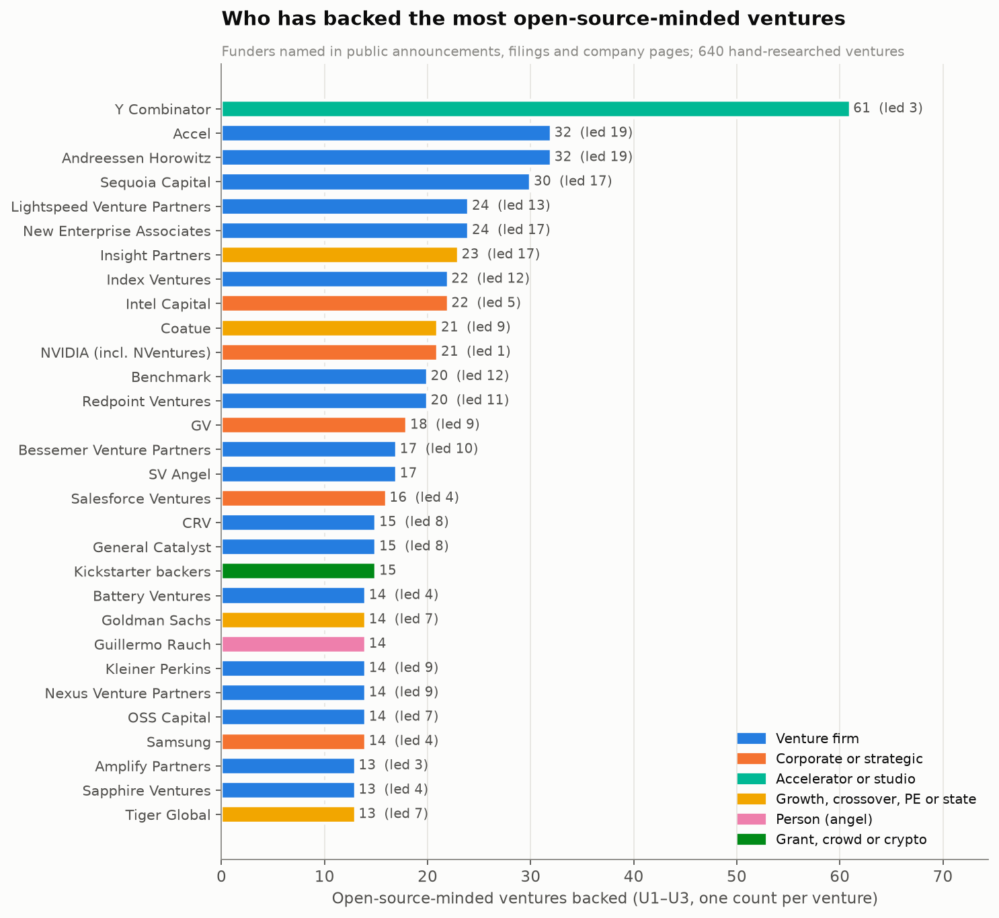

# Who funds open-source-minded ventures? (issue #380, round 2, part 3)

Sterling asked for *"a list of investors, firms, philanthropists, and other VC and VC-like sources that have been
involved in funding a venture that falls into the more open-source minded of startups. Be thorough and manual."*
This folder is that list.

- **[`FUNDER_LIST.md`](FUNDER_LIST.md) lists every funder found**, grouped by type, with each venture it backed
  linked to a page that names it.
- **This file** summarises the list, says what it shows and how far to trust it.
- **[`data/`](data/) holds the tables**:
  - every round (`deals.csv`)
  - every funder–venture pair (`investor_links.csv`)
  - every funder (`investors.csv`)
  - every program-level funder (`programs.csv`)

The scope and counting rules were committed before any funding data was gathered ([`PROTOCOL.md`](PROTOCOL.md),
`448c8c2`).

## Bottom line

- **The list is long and flat.** Across the {{U1-U3.researched}} hand-researched ventures in groups U1–U3,
  {{U1-U3.with_funding}} disclosed outside funding.
  - Public sources name {{U1-U3.funders}} distinct funders in {{U1-U3.rounds}} funding events.
  - {{U1-U3.funders_1}} of those funders appear in only one venture.
  - Only {{U1-U3.funders_5plus}} backed five or more, and the ten most frequent account for
    {{U1-U3.top10_share_of_links}} of all funder–venture links.
  - There is no small club that funds open source. There is a long tail with a recognisable head.
- **The head is mostly generalist venture firms, an accelerator and chip and cloud companies:**
  - Y Combinator, by count.
  - Accel, Sequoia, Andreessen Horowitz, NEA, Index, Benchmark, Lightspeed and Insight.
  - NVIDIA and Intel Capital, then Alphabet's and Microsoft's investment arms and Salesforce Ventures.
  - The firms that lead open-source rounds most often are Andreessen Horowitz, Accel, Insight, NEA, Sequoia,
    Index and Benchmark.
- **Funds built around open source exist, but most are small in this count.**
  - OSS Capital is the exception: {{focus.oss_capital}} ventures across all four groups, about as many as Bessemer
    ({{focus.bessemer_venture_partners}}) or GV ({{focus.gv}}). Uncorrelated Ventures has {{focus.uncorrelated_ventures}}.
  - Runa Capital ({{focus.runa_capital}}), Heavybit ({{focus.heavybit}}), Boldstart ({{focus.boldstart_ventures}}),
    Crane ({{focus.crane_venture_partners}}) and Open Core Ventures ({{focus.open_core_ventures}}) back only a handful
    each.
  - {{n_thesis_funders}} funders in the data state an open-source thesis in their own words. Most of them are large
    generalists: Andreessen Horowitz, Accel, Sequoia, Index, NEA and Redpoint.
- **People are a large share of the funders.** Many of the most frequent angels founded or led open-source
  companies themselves, and now back the next ones (ventures here, all groups):
  - Guillermo Rauch of Vercel ({{focus.guillermo_rauch}}), Clem Delangue of Hugging Face ({{focus.clem_delangue}}) and
    David Cramer of Sentry ({{focus.david_cramer}})
  - Tom Preston-Werner ({{focus.tom_preston_werner}}) and Nat Friedman ({{focus.nat_friedman}}) of GitHub, Paul
    Copplestone of Supabase ({{focus.paul_copplestone}}) and Tristan Handy of dbt Labs ({{focus.tristan_handy}})
- **Open hardware, open science and lab ventures draw a different mix**: crowdfunding backers, strategic
  corporates, a few hardware-minded venture firms, grants and, for DeSci, crypto funds.
  - Strategic corporates: Bosch, Renesas, Arm, Qualcomm, Sony, Intel and NVIDIA.
  - Hardware-minded venture firms: True Ventures, Foundry Group, Spark Capital, Khosla, Eclipse and Lux.
  - Grants: SBIR, NSF, NIH, Shuttleworth, CZI and Sloan.
  - Only {{U2.funders_3plus}} funders backed three or more of the 97 ventures in this group.
- **Philanthropy and government fund open source mostly at the program level**, and mostly not through companies.
  - Programs: CZI, Sloan, Moore and Schmidt Sciences; DOE's Exascale Computing Project; NSF's POSE and CSSI;
    Germany's Sovereign Tech Agency; the EU's NGI grants through NLnet.
  - Recipients are mostly projects, universities and nonprofits.
- **Nothing here says these funders made money on open source, or that they would fund a given venture.** The list
  records who put money in, as disclosed. Disclosure favours large rounds and survivors.

## The funders that backed the most open-source-minded ventures (U1–U3)

One count per venture, however many rounds; "led" counts ventures where the funder led at least one round.
Examples list led ventures first. Full list: [`FUNDER_LIST.md`](FUNDER_LIST.md).

<!-- TABLE:top_all_u123.md:40 -->

### Young open-source startups (U4)

{{U4.researched}} of the 402 startups from the ROSS Index and Y Combinator's directory were researched; {{U4.with_funding}}
have disclosed funding, most of it only Y Combinator's. Beyond YC, these funders appear most often:

<!-- TABLE:top_u4.md:20 -->

## By kind of funder

<!-- TABLE:type_mix.md -->

### Investors that say they invest in open source

Quoted from the firm's own page or from a public interview. The count is ventures in this data, U1–U4.

<!-- TABLE:thesis.md -->

### Corporate and strategic investors

Investment arms rolled up to their parent:

<!-- TABLE:corporate_groups.md:12 -->

Individually:

<!-- TABLE:top_corporate.md:25 -->

### Accelerators

- **Y Combinator** is the largest single source of early money for open-source startups in this data.
  - YC's own directory lists **183 companies tagged open source**, and **289 tagged or described as open source**
    ([`data/yc_open_source.csv`](data/yc_open_source.csv), from the yc-oss mirror of the directory, 2026-11-25).
  - Most of them are from 2020 on.
- **Other accelerators** appear far less often: HAX/SOSV for hardware (Opentrons, Particle, Crowd Supply), Neo,
  Antler, 500 Global, AI Grant, South Park Commons and Techstars.
- **Open Core Ventures** is a studio that builds companies around existing open-source projects.

<!-- TABLE:top_accelerators.md:12 -->

### People (angels)

<!-- TABLE:top_angels.md:30 -->

### Growth, crossover and state investors

These join later and larger rounds, mostly of AI and infrastructure companies:

<!-- TABLE:top_growth.md:20 -->

### Who joins early rounds (pre-seed, seed, angel, accelerator, Series A; U1–U4)

<!-- TABLE:top_early.md:30 -->

## Open hardware, open science, lab and science-software ventures

Group U2 plus the U1 companies that part 2 found through GitHub's 22 science topics. These are the comparables for
DAL and the SDL kit. Every venture with its funders is in
[`data/tables/science_hardware_ventures.md`](data/tables/science_hardware_ventures.md).

<!-- TABLE:top_science_hardware.md:35 -->

What stands out, reading the venture table rather than the counts:

- **Few repeat backers.** Only {{U2.funders_3plus}} funders backed three or more of the 97 U2 ventures; most funders
  of open hardware and science appear once. A general list of open-source investors is a weak guide here.
- **Crowdfunding is the most common single source.** Kickstarter, Crowd Supply and equity-crowdfunding campaigns
  funded OpenBCI, Opentrons, Pine64, Bela, OpenMV, Luxonis, Backyard Brains, Great Scott Gadgets, Printrbot,
  MicroPython, MNT Research, LimeSDR, Purism and Mycroft AI, among others.
- **Grants carry the science-software companies.**
  - SBIR/STTR grants from NSF, NIH, DOE, NASA and the Space Force funded Kitware, Enthought, re:3D, Backyard
    Brains, Hello Robot, Open Imaging and PickNik.
  - CZI funded Seqera.
  - Sloan funded Julia Computing (now JuliaHub).
  - The Shuttleworth Foundation seeded FarmBot.
  - EU, French, German and Spanish public money funded BCN3D, Probabl, mzio, HARFANG 3D and Pollen Robotics.
- **Large open-hardware rounds come from deep-tech venture firms and strategic corporates.** They had each made
  open-source deals before:
  - SiFive: Sutter Hill, Spark, Osage, Qualcomm, Intel, SK hynix, Aramco, Coatue.
  - Tenstorrent: Eclipse, Fidelity, Samsung, Hyundai, LG, Bezos Expeditions.
  - Oxide: Eclipse, USIT, Intel Capital.
  - Arduino: Bosch, Renesas, Arm, Anzu, CDP.
  - Raspberry Pi: Sony, Arm.
  - Framework: Spark.
- **Lab automation draws accelerator money, consumer and growth investors, and climate funds.**
  - Opentrons: HAX/SOSV, Kickstarter backers, Y Combinator, then Khosla Ventures, Lerer Hippeau and SoftBank's
    Vision Fund.
  - Trilobio: Initialized, Lowercarbon and others.
  - PickNik: Stellar Ventures and SBIR awards.
- **AI-for-science companies that release models or tools are funded like AI companies.**
  - EvolutionaryScale: Nat Friedman, Daniel Gross, Lux, NVIDIA, Amazon.
  - Chai Discovery: Thrive, OpenAI, Menlo, Dimension.
  - Orbital Materials: Radical, Plural, Toyota Ventures, NVIDIA.
  - Radical AI: RTX Ventures, NVIDIA, Eni, AlleyCorp.
  - Entalpic: Breega, Cathay, Felicis.
  - Boltz: Bessemer, Andreessen Horowitz, Amplify.
- **Open-science publishing and data businesses sold to publishers.** Digital Science (Holtzbrinck) took stakes in
  Overleaf, Figshare and Authorea; Springer Nature bought protocols.io. Code Ocean raised from Battery, M12 and
  EBSCO.
- **DeSci draws crypto funds and a few angels.** VitaDAO, Molecule and LabDAO raised from L1 Digital, Shine, 1kx,
  Seed Club and IDTheory, from Balaji Srinivasan, and from Pfizer Ventures (VitaDAO).

### Using the list for DAL or the SDL kit

The funders closest to an open physical-science venture are in
[`data/tables/science_hardware_ventures.md`](data/tables/science_hardware_ventures.md), venture by venture, and in
the program tables below.
- To filter, use `data/investor_links.csv` with `universe` = U2 or the ventures' `category` in `data/ventures.csv`.
- Before treating a name as a lead, check three things: what the funder backs now, whether it led or only joined,
  and how long ago.
- The early-round table above shows who has written first cheques to open-source companies.
- The nearest grant precedents found are Sloan's 2026 grants for an open liquid handler at Duke and for
  open-source autonomous chemistry through Renaissance Philanthropy, and its open-hardware fellowships (program
  table below).
- The list says who has done this before. It says nothing about who would do it again, or on what terms.

## Philanthropists and foundations

Most of this money goes to projects, universities and nonprofits, not to companies. Sizes are as each source
states them, committed unless marked; "→ firms" says whether for-profit companies can receive it. Full rows:
[`data/programs.csv`](data/programs.csv) (passes p1–p3, with notes on how firm each figure is).

| Funder (people behind it) | Program | Years | Size reported | → firms | Recipients, for example |
| --- | --- | --- | --- | --- | --- |
| Chan Zuckerberg Initiative (Priscilla Chan, Mark Zuckerberg); Kavli Foundation and Wellcome joined in 2024 | [Essential Open Source Software for Science](https://chanzuckerberg.com/eoss/) | 2019– | about $47M over six cycles (sum of the program page) | no | napari, scikit-image |
| Chan Zuckerberg Initiative | [Open science grants](https://chanzuckerberg.com/science/programs-resources/open-science/grants) | 2019– | n/a | no | bioRxiv, medRxiv, protocols.io, 2i2c, The Carpentries |
| Gordon and Betty Moore Foundation | [Data-Driven Discovery](https://news.berkeley.edu/2014/10/02/funding-for-big-data-projects-in-ecology-astronomy-microscopy-and-more/) | 2013–18 | $60M | no | 14 Moore Investigators |
| Gordon and Betty Moore Foundation | open-source science software and open hardware ([grants database](https://www.moore.org/grant-detail?grantId=GBMF8599); 27 grants found) | 2006– | about $30M across those 27 | sometimes | Jupyter, Julia Computing, Numba and Dask (to Continuum Analytics), Astropy, Scientific Python, Pangeo, Binder, [Open Science Hardware Foundation](https://www.moore.org/grant-detail?grantId=GBMF13637), [Public Lab](https://www.moore.org/grant-detail?grantId=GBMF7725) |
| Moore, Sloan and Helmsley foundations | [Project Jupyter](https://www.moore.org/newsroom/press-releases/2015/07/07/$6m-for-uc-berkeley-and-cal-poly-to-expand-and-enhance-open-source-software-for-scientific-computing-and-data-science) | 2015– | $6M | no | Jupyter (UC Berkeley, Cal Poly) |
| Alfred P. Sloan Foundation | [Open source in science](https://sloan.org/programs/digital-technology/open-source-in-science); [university OSPOs](https://sloan.org/programs/digital-technology/ospo-loi) | 2015– | $13.9M in 2025–26 alone ([grants database](https://sloan.org/grants-database?subprogram%5B%5D=44)) | no | NumFOCUS, JOSS, The Carpentries, Software Heritage, OSPOs at CMU, Johns Hopkins and the University of Texas; an [open liquid handler at Duke](https://sloan.org/grant-detail/g-2026-79582) ($250k) and [open-source autonomous chemistry](https://sloan.org/grant-detail/g-2026-79581) via Renaissance Philanthropy ($210k) |
| Howard Hughes Medical Institute, Wellcome, Max Planck Society | [eLife](https://en.wikipedia.org/wiki/ELife) | 2012– | $26M from HHMI (initial) | no | eLife |
| FUTO (Eron Wolf) | [microgrants](https://futo.tech/grants/) | 2023– | about $60k listed | no | Blender, KiCad, FFmpeg, GIMP, Asahi Linux |
| NumFOCUS (fiscal host, funded by its sponsors) | [Small Development Grants](https://numfocus.org/programs/small-development-grants) | 2017– | n/a | no | PyMC, GeoPandas, Julia, SciPy, pandas |
| Alfred P. Sloan Foundation with the Open Source Hardware Association | [Open Hardware Trailblazers fellowships](https://opensource.com/article/22/3/trailblazer-funding-open-hardware-academia) | 2022– | n/a | no | academic open-hardware leads |
| Schmidt Sciences (Eric and Wendy Schmidt) | [Virtual Institute for Scientific Software](https://engineering.jhu.edu/news/virtual-institute-scientific-software-johns-hopkins-schmidt-futures/) | 2022–27 | $40M | no | Johns Hopkins, UW, Georgia Tech, Cambridge |
| Schmidt Futures and Ken Griffin | [Convergent Research (focused research organisations)](https://www.schmidtfutures.org/schmidt-futures-and-ken-griffin-commit-50-million-to-support-the-launch-of-a-new-model-for-scientific-research/) | 2021– | $50M | no | Forest Neurotech |
| Arnold Ventures (Laura and John Arnold) | [Center for Open Science](https://www.cos.io/about/news/center-open-science-receives-75-million-additional-funding-laura-and-john-arnold-foundation) | 2013–19 | $12.75M | no | COS, OSF |
| Arcadia Fund (Lisbet Rausing, Peter Baldwin) | OurResearch: [2021](https://blog.openalex.org/arcadia-2021-grant/), [2024](https://blog.openalex.org/?p=2066) | 2021–29 | $4.5M, then $7.5M | no | OpenAlex, Unpaywall |
| The Navigation Fund and Astera Institute (Jed McCaleb) | [open-science grants](https://blog.openalex.org/arcadia-2021-grant/); [Astera residency](https://astera.org/residency) | 2022– | n/a | sometimes | OpenAlex, 2i2c, Open Science Hardware Foundation |
| Shuttleworth Foundation (Mark Shuttleworth) | [fellowships](https://en.wikipedia.org/wiki/Shuttleworth_Foundation) | 2007–24 | n/a | no | Open Source Ecology, FarmBot (seed grant) |
| Kyutai founders: Xavier Niel (Iliad), Rodolphe Saadé (CMA CGM), Eric Schmidt | [Kyutai open-science AI lab](https://techcrunch.com/2023/11/17/kyutai-is-an-french-ai-research-lab-with-a-330-million-budget-that-will-make-everything-open-source/) | 2023– | about €300M | no | Kyutai |
| Paul G. Allen | [Allen Institute for AI](https://en.wikipedia.org/wiki/Allen_Institute_for_AI) | 2014– | n/a | no | OLMo, Semantic Scholar |
| Gil Elbaz | [Common Crawl](https://en.wikipedia.org/wiki/Common_Crawl) | 2007– | n/a | no | Common Crawl |
| Brian Armstrong | [ResearchHub](https://www.researchhub.com/about) | 2021– | $1.5M+ paid out | no | open peer review and bounties |
| Patrick Collison, Tyler Cowen and co-donors | [Fast Grants](https://en.wikipedia.org/wiki/Fast_Grants) | 2020–22 | $50M+ (about 250 grants) | no | COVID-19 research |
| Mozilla Foundation | [Mozilla Open Source Support](https://www.mozilla.org/moss) | 2015–20 | $3.5M+ | sometimes | open-source projects Mozilla relies on |
| Gates Foundation | [digital public infrastructure](https://www.biometricupdate.com/202209/gates-foundation-commits-200m-to-digital-id-and-other-public-infrastructure) | 2022– | $200M | sometimes | MOSIP, Mojaloop |
| Mellon Foundation | [open scholarly infrastructure](https://www.mellon.org/grant-details/code-for-science-and-society-inc.-20453350) | 2005– | n/a | no | Coko, Invest in Open Infrastructure, Code for Science & Society |
| Craig Newmark Philanthropies | [open-source security](https://www.memorysafety.org/blog/2026-craig-newmark/) | 2019– | n/a | no | ISRG Prossimo, Wikimedia |
| Renaissance Philanthropy with Biohub, Wellcome and Kavli | [Open Source for Science Fund](https://www.renaissancephilanthropy.org/insights/open-source-for-science-fund-launches) | 2026– | $20M | not stated | research software |
| Ford and Sloan foundations | [Digital Infrastructure Insights Fund](https://www.fordfoundation.org/the-latest/news/major-philanthropies-tackle-inequality-by-strengthening-digital-infrastructure/) | 2018– | $1.3M (2020 round) | no | research on open infrastructure |
| Stability AI, Hugging Face, Canva, CoreWeave and others | [EleutherAI Institute](https://techcrunch.com/2023/03/02/stability-ai-hugging-face-and-canva-back-new-ai-research-nonprofit/) | 2023– | n/a | no | GPT-NeoX, The Pile |
| Thiel Foundation; Mercatus Center | [Thiel Fellowship](https://en.wikipedia.org/wiki/Thiel_Fellowship); [Emergent Ventures](https://en.wikipedia.org/wiki/Emergent_Ventures) | 2010–; 2018– | $250k per fellow; $1M launch grant | sometimes | individuals |

Philanthropy also reaches open-source companies directly, in the deal data:
- CZI granted to Seqera (Nextflow).
- Sloan granted to Julia Computing.
- Moore granted to Julia Computing and, for Numba and Dask, to Continuum Analytics (now Anaconda).
- The Shuttleworth Foundation granted FarmBot its seed money.
- Knight Foundation co-led Authorea's 2016 round with Lux Capital.
- Jed McCaleb and Sam Altman fund Arcadia Science.

## Governments and public programs

Grants unless marked as investment. "→ firms" says whether companies can receive it.

| Government or public body | Program | Years | Size reported | → firms | Recipients, for example |
| --- | --- | --- | --- | --- | --- |
| US Department of Energy | [Exascale Computing Project](https://science.osti.gov/-/media/ascr/ascac/pdf/meetings/2024/ECP-OverviewASCACMay2024pptx.pdf) | 2016–24 | $1.8B (whole project, mostly open-source software) | no | E4S, Spack, about 70 software products |
| US National Science Foundation | [POSE (Pathways to Enable Open-Source Ecosystems)](https://www.nsf.gov/funding/opportunities/pose-pathways-enable-open-source-ecosystems) | 2022– | about $100M obligated across 146 awards (NSF awards API; approximate) | sometimes | ecosystem organisations around university projects |
| US National Science Foundation | [CSSI](https://simpler.grants.gov/opportunity/358751) (successor to SI2) | 2010– | $34M (one solicitation) | no | research software at universities |
| US National Science Foundation and NVIDIA | [Open Multimodal AI Infrastructure, led by Ai2](https://blogs.nvidia.com/blog/national-science-foundation-ai2-open-ai-models/) | 2025–30 | $152M ($75M NSF, $77M NVIDIA in kind) | no | Ai2's open models |
| NIH Office of Data Science Strategy | [Sustainable software tools for open science](https://grants.nih.gov/grants/guide/rfa-files/rfa-od-24-010.html) | 2020– | n/a | no | biomedical research software |
| NASA Science Mission Directorate | [open-source tools, frameworks and libraries; TOPS](https://science.nasa.gov/researchers/open-science/nasa-open-science-funding-opportunities) | 2020s– | $6.5M (one TOPS round) | no | open-science software |
| DARPA | [POSH open-source hardware](https://linux.com/?p=471279) and IDEA | 2018– | $35M+ (POSH) | sometimes | open-source chip-design tools |
| DARPA and ARPA-H | [AI Cyber Challenge](https://www.darpa.mil/news/2025/ai-cyber-challenge-winners-def-con-33) | 2023–25 | $8.5M in final prizes | yes | open-source cyber-reasoning systems |
| Open Technology Fund (US) | [FOSS Sustainability Fund](https://docs.opentech.fund/otf-application-guidebook/our-funds-and-fellowships/free-and-open-source-software-sustainability-fund) | 2012– | n/a | sometimes | Tor, Signal |
| In-Q-Tel (US intelligence community), investment | [stakes in open-source companies](https://techcrunch.com/2012/09/18/mongodb-maker-10gen-closes-undisclosed-round-from-u-s-intelligence-agency/) | 2009– | n/a | yes | 10gen (MongoDB), Lucidworks, Cloudant, D2iQ |
| US SBIR/STTR (NSF, NIH, DOE), in the deal data | small-business grants | | | yes | Kitware, Enthought, re:3D, Backyard Brains |
| Germany: Sovereign Tech Agency | [Fund, Resilience, Fellowship, Challenges](https://www.sovereign.tech/tech) | 2022– | €11.5M in its first year (Osborne et al. 2024, via Edison) | sometimes | curl, OpenSSH, systemd, PHP, conda-forge |
| Germany: Prototype Fund (research ministry) | [grants to individuals](https://prototypefund.de/en/faq) | 2016– | n/a | no | civic and open-source prototypes |
| EU: Next Generation Internet, via NLnet | [NGI Zero Entrust, Core, Commons Fund](https://nlnet.nl/NGI0/) | 2020s– | n/a | sometimes | F-Droid, Pixelfed, open-hardware projects |
| EU: European Innovation Council | [EIC Accelerator](https://eic.ec.europa.eu/news/38-start-ups-and-smes-secure-eic-support-latest-round-eic-accelerator_en) (grant plus equity) | 2021– | n/a | yes | deep-tech start-ups |
| France: national AI strategy | scikit-learn and open data-science tools (Osborne et al. 2024, via Edison) | 2021– | €32M announced | not stated | scikit-learn (later Probabl) |
| France: Bpifrance, investment | [AI plan](https://www.bpifrance.com/2025/03/27/bpifrance-deploys-e10-billion-to-develop-the-ai-ecosystem-by-2029/), stakes | 2023– | €10B plan to 2029 | yes | Mistral AI, AMI Labs, Pollen Robotics, Probabl |
| UK: UKRI and the Software Sustainability Institute | [Research Software Maintenance Fund](https://www.software.ac.uk/research-software-maintenance-fund/round-2) | 2022– | n/a | no | research software |
| Netherlands, Australia, Canada | [eScience Center](https://www.esciencecenter.nl/about-us/), [ARDC](https://www.ardc.edu.au/about/), [CANARIE](https://www.canarie.ca/software/) | | n/a | no | research software and data |
| China: state and municipal funds, investment | [Zhipu AI and others](https://www.caixinglobal.com/2025-07-03/chinas-zhipu-ai-secures-140-million-investment-from-shanghai-state-backed-funds-102338133.html) | 2024– | n/a | yes | Zhipu AI, MiniMax, DeepSeek |
| Singapore: GIC and Temasek, investment | [open-weight AI and open-source companies](https://techcrunch.com/2025/10/09/reflection-raises-2b-to-be-americas-open-frontier-ai-lab-challenging-deepseek/) | 2025– | n/a | yes | Reflection AI, AMI Labs, Supabase, ClickHouse |

## Corporate open-source funds, platforms, crypto public goods and crowdfunding

| Funder | Program | Years | Size reported | → firms | Notes |
| --- | --- | --- | --- | --- | --- |
| GitHub (Microsoft) | [GitHub Sponsors](https://github.blog/open-source/maintainers/100-million-for-open-source-a-milestone-built-by-the-community/) | 2019– | $100M paid out cumulatively | sometimes | maintainers and projects |
| GitHub with M12 | [GitHub Fund and GitHub Accelerator](https://github.com/open-source/accelerator) | 2023– | GitHub reports "$130MM+ invested in open source" | yes | ToolJet, Unsloth |
| GitHub with partners | [Secure Open Source Fund](https://techcrunch.com/2024/11/19/github-launches-1-25m-open-source-fund-with-a-focus-on-security/) | 2024– | $1.25M | no | security of critical projects |
| Microsoft, Google, Amazon, Citi and others | [OpenSSF Alpha-Omega](https://openssf.org/community/alpha-omega/) | 2022– | $12.5M (2026 round) | no | security of critical projects |
| Sentry and member companies | [Open Source Pledge](https://opensourcepledge.com/) | 2024– | $9.8M pledged | no | $2,000 per developer a year to maintainers |
| Zerodha | [FLOSS/fund](https://zerodha.com/open-source/2025-report/) | 2024– | $1M a year | no | Krita, OpenSSL, FFmpeg, Blender |
| Bloomberg, Indeed, Spotify, Microsoft | FOSS contributor funds ([Bloomberg](https://www.bloomberg.com/company/stories/bloomberg-ospo-launches-foss-contributor-fund/), [Indeed](https://github.com/indeedeng/FOSS-Contributor-Fund), [Spotify](https://engineering.atspotify.com/2022/4/announcing-the-spotify-foss-fund), [Microsoft](https://github.com/microsoft/foss-fund)) | 2019– | about $10,000 per award | no | projects the sponsor depends on |
| Google | [Summer of Code](https://opensource.googleblog.com/2025/08/google-summer-of-code-2025-contributor-statistics.html); [Open Source Peer Bonus](https://opensource.googleblog.com/2024/06/google-open-source-peer-bonus-program-first-group-2024-recipients.html) | 2005– | n/a | no | 1,280 contributors in 2025 |
| Meta | [Llama Impact Grants](https://ai.meta.com/blog/llama-3-1-impact-grants-call-for-applications/) | 2023–25 | $0.5M, then $2M | yes | CognitiveLab |
| Sequoia; Andreessen Horowitz | [Open Source Fellowship; Open Source AI Grant](https://techcrunch.com/2024/11/10/open-source-projects-draw-equity-free-funding-from-corporates-startups-and-even-the-u-s-government/) | 2023– | n/a | no (equity-free) | FastAPI's author, vLLM, LMSYS |
| Mozilla | [Mozilla Ventures](https://techcrunch.com/2022/11/02/mozilla-launches-35m-venture-capital-fund-for-early-stage-responsible-tech-startups/) (investment); [Builders Accelerator](https://blog.mozilla.org/en/mozilla/14-ai-projects-to-watch-mozillas-first-builders-accelerator-cohort/) | 2022– | $35M fund; up to $100k a project | yes | Flower, Nous Research |
| Cloudflare; Fastly; Vercel | [Vite Ecosystem Fund](https://blog.cloudflare.com/launching-vite-ecosystem-fund); [Fast Forward](https://itsfoss.com/news/fastly-open-source-initiative/); [open-source program](https://vercel.com/open-source-program) | 2022– | $1M; $50M in free services; credits | no | infrastructure for projects |
| Tidelift (now Sonar) | [paying maintainers](https://prnewswire.com/news-releases/tidelift-reaches-milestone-of-one-million-dollars-committed-to-paying-open-source-maintainers-300754389.html) | 2018– | $1M+ committed by 2018 | no | maintainers of packages |
| Open Collective | [Open Source Collective](https://opencollective.com/opensource) (fiscal host for 2,735 collectives); [Open Collective Foundation](https://opencollective.com/foundation/updates/announcement-we-are-dissolving-open-collective-foundation) (dissolved 2024) | 2017– | n/a | no | fiscal hosting for projects |
| Gitcoin | [Gitcoin Grants](https://www.gitcoin.co/impact) | 2019– | $60M+ distributed | sometimes | quadratic funding for open source and web3 |
| Optimism Collective | [Retro Funding](https://optimism.io/blog/850m-op-dedicated-to-the-evolution-of-retro-funding) | 2022– | paid in OP tokens | sometimes | retroactive public-goods funding |
| Ethereum Foundation | [Ecosystem Support Program](https://blog.ethereum.org/category/ecosystem-support-program) | 2019– | about $32.6M in Q1 2025 alone | sometimes | client teams, tooling, research |
| Filecoin Foundation for the Decentralized Web; Protocol Labs | [grants](https://www.businesswire.com/news/home/20210928005396/en/Filecoin-Foundation-for-the-Decentralized-Web-Launches-to-Preserve-Humanity%E2%80%99s-Most-Important-Information) | 2020– | n/a | sometimes | Internet Archive, Freedom of the Press Foundation |
| VitaDAO; Molecule | [longevity research funding](https://www.lifespan.io/?p=118091); [IP-NFTs](https://molecule.xyz/blog/we-have-raised-12-7-million-in-seed-funding-to-build-the-future-of-decentralized-science/) | 2021– | $3M+ funded; $12.7M seed for Molecule | sometimes | DeSci research projects |
| Kickstarter, Crowd Supply, Indiegogo backers | reward crowdfunding | 2009– | e.g. Pine64's PINE A64, [$1.7M](https://silicon.co.uk/workspace/first-15-supercomputer-kickstarter-184595) | yes | Opentrons, OpenBCI, Bela, OpenMV, Luxonis, MNT Reform, LimeSDR |
| StartEngine, Wefunder, Crowdcube investors | equity crowdfunding | | e.g. Purism [$0.2M](https://www.linux-magazine.com/Online/News/Purism-Crowdfunding-Launched) | yes | Purism, Mycroft AI, Framework |

On crowdfunding, the strongest evidence Edison found is about open source itself. Across about 28,000
Kickstarter projects, open-source projects raised about 39% more relative to their goals than comparable projects,
and patent-based ones about 33% less (Bort et al. 2024; [Edison answer](edison/fund_who_funds_open_source_answer.md)).

## How good is the list?

Four checks of different kinds. Together they say the list is **mostly right but incomplete**: the names it has
are well supported, but a fuller search finds more. Treat every count as a lower bound.

| Check | What it tests | Result |
| --- | --- | --- |
| Every investor name against the page its round cites ([`data/source_checks_deals.csv`](data/source_checks_deals.csv)) | that the source says what the row says | Of {{source_check.fetched}} names whose page could be fetched: {{source_check.found}} ({{source_check.share_found}}) appear in the page text; {{source_check.markup_only}} more appear only in its markup, which is how company pages show investor logos; {{source_check.not_on_page}} don't appear at all. Those are mostly Chinese names recorded in English, pages that load by script, and some real errors. A verification pass reopened {{verify.checked}} of them from news and database sources: {{verify.confirmed}} confirmed on the cited page, {{verify.other_source}} on another page, {{verify.not_supported}} not supported (left out of the counts) and {{verify.unclear}} unclear |
| Investors' own portfolio pages ([`data/portfolio/`](data/portfolio/)) | recall, from the investors' side | Of 105 portfolio pages, 77 could be read. They link to {{portfolio_check.domain_links}} ventures in this list by website, and {{portfolio_check.already_in_deals}} of those links were already in the deal data |
| Edison's blind audit of 40 randomly drawn ventures ([`edison/fund_deal_audit_answer.md`](edison/fund_deal_audit_answer.md), [comparison](data/edison_audit_comparison.csv)) | recall and precision, independently, with web search | Edison named {{edison_audit.edison_names}} funders for the 40 ventures and this list {{edison_audit.our_names}}. **{{edison_audit.ours_confirmed_by_edison}} of this list's names are in Edison's**, but this list has only {{edison_audit.recall_vs_edison}} of Edison's. Most of Edison's extra names fall into three groups: • more participants in rounds this list already has; • funders of the {{edison_audit.ventures_we_missed_entirely}} audited ventures where this list found none (e.g. Coqui, Terrastruct, Bitcraze, Antmicro); • angels, government grants, lenders and crowdfunding. Edison also counted one project's corporate sponsors as funders. Edison found nothing for any venture where this list found funders |
| Edison's literature answer ([`edison/fund_who_funds_open_source_answer.md`](edison/fund_who_funds_open_source_answer.md), [check](data/edison_literature_check.csv)) | whether well-known funders are missing | {{edison_literature.found}} of the {{edison_literature.named}} funders it names are in the deal data or the program tables. The two missing are Indiegogo backers and the Footprint Coalition, which ran a 2023 low-cost science-tools grant with Moore and Schmidt Futures |

After the comparison, the audit's high- and medium-confidence rounds were added to the data as pass `xed`, so the 40
audited ventures are now covered better than the rest.

## How the list was made

1. **Scope first.** [`PROTOCOL.md`](PROTOCOL.md) fixed what counts as an open-source-minded venture and as a
   funder, and the counting rules, before any funding data was gathered (`448c8c2`).
2. **Four groups of ventures**, kept apart in every table:
   - **U1**: all 387 companies behind the most-starred open-source projects on GitHub, from part 2. Nobody picked
     them for their funding.
   - **U2**: 97 open hardware, open science, lab and science-software ventures, picked by hand for relevance to DAL
     and the SDL kit.
   - **U3**: 156 well-known commercial open-source and open-weight AI ventures since 1998. This group
     over-represents successes.
   - **U4**: 402 young open-source startups from two third-party lists, Runa Capital's ROSS Index (2020–26) and Y
     Combinator's directory. They were added after the first passes had started, because there was time, and
     researched more lightly.
3. **Leads without a search engine.** Every research session shares one web-search budget, which ran out in part 2
   and again here after about 15 passes. So `scripts/investor_leads.py` first collected funding sentences for every
   venture from:
   - TechCrunch, SiliconANGLE, BetaKit and TechNode (their public WordPress APIs)
   - Hacker News links, which are often the company's own announcement
   - Wikipedia and Wikidata
   - the company's own site
4. **Deal passes.** Research agents (Claude Sonnet, {{deal_passes}} passes of 13–25 ventures) read the leads and the pages they
   point to. For each round they recorded the lead and the other named investors, with a source URL. Where nothing
   was disclosed they recorded "none found". Once the search budget was spent, they searched with
   `scripts/find_pages.py`, the same open APIs.
5. **Deepening passes.** Then {{deepen_passes}} deepening passes went back to the {{deepened}} well-funded ventures whose history came
   back thin. They added rounds from company newsrooms, Wikipedia's cited articles, SEC prospectuses and archived
   press releases.
6. **Program passes.** Four passes listed the programs that fund open source and open science outside equity
   rounds: foundations, governments and public investors, corporate funds, crypto, accelerators and crowdfunding.
   They also recorded investors that state an open-source thesis, in their own words.
7. **Merge.** `scripts/build_funders.py` normalises names with a hand-made alias table
   ([`data/investor_aliases.csv`](data/investor_aliases.csv)) and types each funder from a hand-made table
   ([`data/investor_types.csv`](data/investor_types.csv), by the firm's own description; people count as angels).
   - A round that a source reports only as talks, a rumour or a raise in progress is kept, but its names are not
     counted (`counted` column in `deals.csv`).
   - Claude Opus planned the passes, wrote the scripts, reviewed the rows and wrote this file.

## Limits

- **Disclosure is selective.** Big rounds, well-known investors and companies that survived are reported more.
  Seed angels, small funds, failures and private companies outside the US and Europe are reported less. Counts
  therefore favour large, visible firms.
- **Coverage is uneven.** The search budget ran out early, so many ventures were researched only from news APIs,
  Wikipedia and company pages.
  - The first passes for U1, U2 and part of U3 had web search; the rest did not.
  - Chinese-language sources were read for a handful of companies only.
  - U4 (young startups) was researched lightly by design: for most of it, YC's own page and a quick look at the
    company site.
- **"None found" means none found.** Of the companies behind the most-starred projects, {{U1.none_found}} have no
  disclosed outside funding in this data. Some will have raised money that was never announced or that these
  sources don't reach.
- **U2, U3 and U4 are not random.** U2 was picked for relevance and U3 for fame. U4 comes from lists kept by an
  accelerator (YC) and an investor (Runa), which both have an interest in the companies on them.
- **A count is not a return.** Nothing here measures whether these funders made money on open source. Edison found
  no study that does. Being on the list doesn't mean a funder would back a new open venture.
- **Names are normalised by hand.** Fund vehicles roll up to the firm, and corporate arms stay separate but roll up
  to their parent in one table. Some aliases will be missed, and a few distinct firms share a name.
- **Rounds are as sources describe them.** Labels (seed, Series A) and amounts follow the source, and sources
  sometimes disagree; the rows say so in `note`.

## Files

| Path | What it is |
| --- | --- |
| [`FUNDER_LIST.md`](FUNDER_LIST.md) | Every funder found, by type, with each venture linked to a page naming it |
| [`PROTOCOL.md`](PROTOCOL.md) | Scope and counting rules, committed before any data |
| [`deal_rules.md`](deal_rules.md), [`deepen_rules.md`](deepen_rules.md), [`program_rules.md`](program_rules.md) | The instructions each research pass followed |
| `data/ventures_input.csv` | The 1,042 ventures, their group (U1–U4) and the list each came from |
| `data/ventures.csv` | One row per venture: what is open, status, whether funding was found, part 2's funding total for U1 |
| `data/deals.csv` | One row per funding event: type, date, amount, lead and other investors (as written and normalised), source URL and kind |
| `data/investor_links.csv` | One row per funder–venture pair, with rounds, leads, first year and sources |
| `data/investors.csv` | One row per funder: type, ventures by group, leads, years, examples, stated open-source thesis |
| `data/programs.csv` | Program-level funders: foundations, governments, corporate funds, crypto, accelerators, crowdfunding |
| `data/investor_aliases.csv`, `data/investor_types.csv` | Hand-made name normalisation and funder types |
| `data/yc_open_source.csv`, `data/u4/ross_index.csv` | YC companies tagged or described as open source; every ROSS Index entry read |
| `data/portfolio/` | Investors' own portfolio pages, and the ventures matched on them |
| `data/source_checks_deals.csv`, `data/source_checks_programs.csv` | Whether each name or amount appears on the page it cites |
| `data/leads/` | The leads each pass started from |
| `data/deal_passes/`, `data/program_passes/` | Raw pass outputs, as written |
| `data/tables/` | The tables in this file, and the full open hardware, science and lab venture table |
| `edison/` | Edison's literature answer and blind audit, with full trajectories |
| `scripts/` | Everything that produced the above; run order in [`README.md`](README.md) |
| `figures/` | The two charts |
