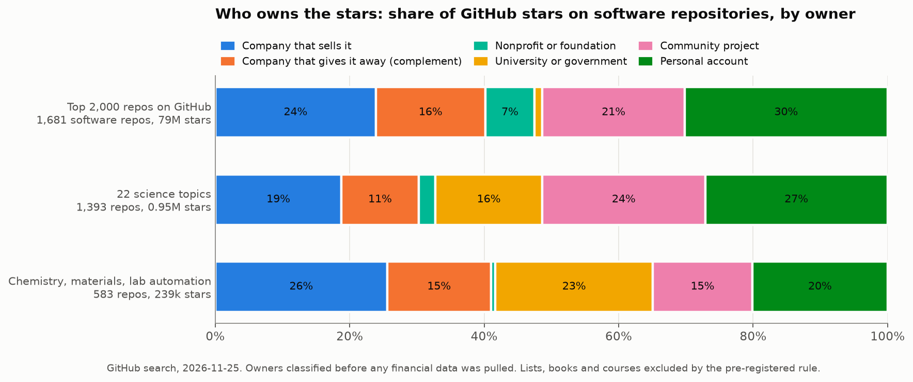
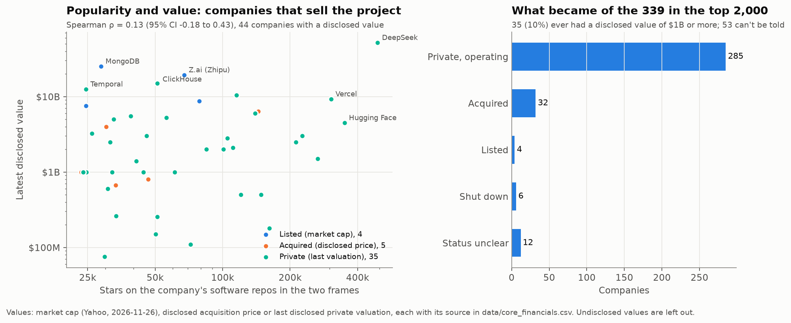

# Who owns popular open source, and what do the owners earn? Findings (issue #380, round 2, part 2)

The first part of this round worked from 39 listings and the first round's case files, which people chose because
the companies were notable. This part starts from the open-source work and follows the money back. It takes the
2,000 most-starred repositories on GitHub (Frame A, at least 22,741 stars each) and the 100 most-starred in each of
22 science topics (Frame B, 1,548 repos). It classifies their 2,930 owners, then looks up what the owners raised,
were worth, earned and became. The hypotheses and tests were committed before any data was fetched
([`PREREGISTRATION.md`](PREREGISTRATION.md), [`608d7c2`](https://github.com/vertical-cloud-lab/byu-vcl/commit/608d7c2)),
and the classes were frozen before any financial figure was looked up
([`efd5a76`](https://github.com/vertical-cloud-lab/byu-vcl/commit/efd5a76)).

## Results against the pre-registered hypotheses

| # | Concern | What the data show | Verdict |
| --- | --- | --- | --- |
| H7 | Most popular open source is paid for by organizations that don't sell it | Of the stars on company-owned software repos in Frame A, **59.5% sit with companies that sell the project in another form** (org-level bootstrap 95% CI 50.3–68.1%). The other 40.5% sit with companies that give it away as a complement, Microsoft and Alphabet above all (2.25M and 2.20M stars). Across all owners, companies hold 40% of the stars: 24% for sellers, 16% for complements. Personal accounts hold 30%, community projects 21%, nonprofits 7% and universities or governments 1% | **Weakened by the pre-registered rule (≥ 50%), but not robustly.** Moving every judgment call against selling gives 38.5%; moving them toward it gives 67.7%. Edison's blind re-classification gives 59.3% |
| H8 | Popularity converts poorly into money | Among companies that sell the project and have a disclosed value, **Spearman ρ between stars and latest value is 0.15 (95% CI −0.17 to 0.45), n = 44**. Counting shutdowns as zero: 0.26 (−0.02 to 0.53), n = 51. Peak value: 0.25 (−0.05 to 0.51). Capital raised: **0.08 (−0.09 to 0.24), n = 168**. Value per star varies 7.4-fold between the 25th and 75th percentiles (median $28,600 per star) | **Concern stands.** Stars barely rank companies by what they are worth, and not at all by what they raised |
| H9 | Outcomes are worse than the famous examples suggest | Of the 339 companies that sell a top-2,000 project: 285 private and operating, 32 acquired, 4 listed, 6 shut down, 12 unclear. **34 (10.0%) ever had a disclosed value of $1B or more**; 54 can't be told. Of the 32 acquisitions, 5 have a disclosed price, and all 5 exceeded the capital raised | **Concern stands by the pre-registered bar** (≥ 25% reaching $1B). But 10% is well above published base rates for Series A companies, and it rises to 26% among companies that raised at least $10M and 24% among the oldest projects. Shutdowns (1.8%) are probably undercounted |
| H10 | Open science software and hardware attracts little private capital | In the 22 science topics, **companies hold 30.3% of software stars** (sellers 18.8%, complements 11.5%), universities and governments 15.9%, community projects 24.2% and personal accounts 27.1%. **Only 5 of the 55 companies selling a science-topic project have raised $10M or more** (Hugging Face, Opentrons, HPC-AI Tech, TileDB, comma.ai). Two reached $1B: Hugging Face and Opentrons | **On the line.** The star share clears the 30% bar by 0.3 points, but moves between 15% and 39% on judgment calls and falls to 25.5% without the largest company owner. The capital test fails (5, against a bar of 10) |
| H11 | The organizations that keep the commons running have thin, flat budgets | Of 21 US nonprofits owning repos in either frame with a recent Form 990, **median revenue was $2.45M in their latest year** ($1.77M without the Linux Foundation). Five had $10M or more. **9 of the 15 with an FY2019 base grew in real terms (60%).** The Linux Foundation alone has 60% of their combined $368M. Community projects: **79 of 609 have an Open Collective with money, with a median yearly budget of $2,125** | **Concern stands** on both tests (bars: median ≥ $10M, two-thirds growing). The Python Software Foundation (−25% real since FY2019) and the Apache Software Foundation (−23%) shrank in real terms |

## What this means for an investor

- **Selling an open project is the most common way a company owns popular open source, but popularity is not the
  thing being priced.** Stars rank companies by value only weakly, and not at all by the capital they raised. An
  investor can't underwrite on GitHub popularity. This matches the literature Edison found: in a non-random sample of
  44 developer-tools projects the stars–funding correlation was r = 0.34 overall, 0.61 for open-core and SaaS
  companies and 0.08 for community-only projects (Pandey 2025). Startups gain financing from substantive GitHub
  engagement rather than from visibility (Conti, Peukert and Roche 2021). Stars are also cheap to fake: about
  6 million suspected fake stars, concentrated in AI and crypto repositories since 2024 (He et al., ICSE 2026).
- **The outcome distribution is better than a random venture cohort and worse than the famous examples.** One
  company in ten reached a disclosed $1B, and one in four of those that raised $10M or more. The oldest projects
  (first repo 2014 or earlier) reached $1B 24% of the time, while those from 2020–22 reached it 4% of the time. That
  is partly time and partly the market they were born into. The companies were selected on traction, so these rates
  are not what a seed investor in an arbitrary open-source company should expect.
- **Exits are frequent but mostly opaque.** There were 32 acquisitions, but only 5 disclosed a price: HashiCorp to
  IBM ($6.4B), Modular to Qualcomm ($4B, reported), Neon to Databricks ($1B, reported), Streamlit to Snowflake
  ($800M) and NGINX to F5 ($670M). Each exceeded the capital raised. 18 of the 32 closed in 2025–26, and several
  went to AI companies that bought the team and the tool: Bun to Anthropic, Astral and Promptfoo to OpenAI, and
  Continue to Cursor. That is a new and real exit route, but at undisclosed prices.
- **For open science specifically (persona A), the private capital is thin.** In the science topics, the companies
  that sell a project are small: 55 of them, 5 with $10M or more raised. Hugging Face, the largest, is a general AI
  platform rather than a science company. Opentrons, the one lab-automation company with a reported $1B mark, shows
  that a lab-hardware company can get there. It also shows the frame's limits: its main repository carries none of
  the 22 topic tags, so only a 12-star side repository brought it in.
- **The commons is mostly run on small budgets, with one large exception.** The Linux Foundation's $221M (2024)
  comes from corporate members that use the software as a complement. Most other foundations that own popular
  projects have a few million dollars a year or less. Edison's literature answer put the Python Software
  Foundation's revenue at "$20–30 million"; its Form 990 says $4.1M for 2024. A project that depends on a foundation
  or on donations should be underwritten as such.

## The data

| Step | What | Result |
| --- | --- | --- |
| Harvest | GitHub search on 2026-11-25 | 2,000 + 1,548 repos (319 and 155 flagged as content by the pre-registered rule), 2,930 owners: 1,713 organizations and 1,217 personal accounts |
| Classes | Every organization, by rules in [`classify_rules.md`](classify_rules.md), before any financial lookup | 387 core, 262 complement, 117 nonprofit, 303 academic, 33 government, 609 community, 2 unknown |
| Audit of the classes | Edison classified a random 120 blind ([answer](../edison/inv_owner_class_audit_answer.md), [files](../edison/inv_owner_class_audit_files/)) | 112 of 120 agree (93.3%, Cohen's κ = 0.908). All 8 disagreements were flagged as judgment calls; Edison chose `core` in 5 of them ([comparison](data/class_audit_comparison.csv)) |
| Company finances | 392 GitHub organizations (the 387 classed `core` and 5 whose company built a project and gave it to a foundation), by rules in [`finance_rules.md`](finance_rules.md) | 387 distinct companies, since some own several organizations. Status for all; disclosed equity funding for 161, capital raised (counting Form D) for 172, a disclosed latest value for 46 ([`core_financials.csv`](data/core_financials.csv)) |
| Source check | [`check_sources.py`](scripts/check_sources.py) fetched every cited page and looked for the figure | 177 of 216 fetchable figures appear on their page (82%). Of the 39 that don't, 36 are funding totals, 28 of them noted as sums of rounds. 44 pages couldn't be fetched (paywalls, blocks) ([`source_checks.csv`](data/source_checks.csv)) |
| SEC Form D | Every Form D of 230 US companies, by legal name ([`sec_form_d.py`](scripts/sec_form_d.py)) | 49 matched; 2 were the wrong company and are excluded (Meteor's filer became Apollo GraphQL; "Tiny Ltd." is a Canadian holding company, not tinygrad's) |
| Listed companies | Yahoo, 2026-11-26 | Elastic $8.8B, MongoDB $25.2B, GitLab $7.5B, Z.ai (Zhipu) $19.4B, plus 48 complement parents |
| Nonprofits | Form 990s from ProPublica ([`nonprofit_finances.py`](scripts/nonprofit_finances.py)) | 26 organizations with data. The Rust Foundation, Ladybird and DigitalPlat have no machine-readable 990, and OpenJS's latest is 2017 ([`h11_nonprofits.csv`](data/h11_nonprofits.csv)) |
| Open Collective | Every owner, by GitHub handle | 268 matches, 133 with money after removing name mismatches ([`h11_opencollective.csv`](data/h11_opencollective.csv)) |
| Donations, for context | FUNDING.yml of every repo, GitHub Sponsors of every owner | 37% of Frame A software repos have a FUNDING.yml (60% of community repos). Of the 532 owners with a Sponsors listing, the median has 2 public active sponsors |

## How the financial research was done, and its weak points

Eight agents researched about 49 companies each, with web search and fetch, each number tied to a URL that states it.
They shared one web-search budget for the session (about 200 searches), which ran out halfway. The 276 rows left
blank, unsourced or resting on memory went to a second pass that used no search engine.
[`news_leads.py`](scripts/news_leads.py) pulled headlines about raises, valuations, acquisitions and shutdowns from
the Hacker News and TechCrunch APIs. It then fetched the best pages and kept the sentences that state amounts
([`leads.jsonl`](data/finance_passes/leads.jsonl)). Eight more agents then wrote complete rows from those leads,
reading further pages where needed. I corrected one row by hand: Opentrons' $1.8B mark, from a 2024 journal article
citing CB Insights that the first part of this round had already found.

- **Coverage leans toward US and VC-backed companies.** Hacker News and TechCrunch cover them well. Small Chinese
  companies (FIT2CLOUD, DCloud, Chaitin, labring and others) and very new 2025–26 AI projects are thinly covered,
  so their blanks mean "not found", not "zero".
- **Some figures come from aggregators or reports,** and are marked so in the notes: Sacra, CB Insights, VCBacked
  and "reported" acquisition prices (Modular, Neon). Several totals are sums of the rounds found, so they understate.
- **`ever_1b` is a floor.** It is `yes` only with a sourced figure. Tailscale, Ollama, Laravel and Zed, among others,
  raised large rounds at undisclosed valuations and count as `unknown`.
- **Shutdowns are undercounted.** A company that quietly stops is less visible than one that raises money. Rows
  with no evidence of any event were recorded as private if the project is still active.
- **Stars measure attention, not use,** and the top of Frame A is now crowded with 2025–26 AI repositories. One of
  them, a single `CLAUDE.md` file, has 235k stars. An exploratory version of H8 that counts only repos created before
  2025 gives ρ = 0.06.

## Deviations from the pre-registration

1. **Research method.** The search budget ran out, so half the rows were researched from news-API leads instead of
   web search, as described above.
2. **Company level, not organization level.** H8 and H9 count each company once, even when it owns several GitHub
   organizations (Docker owns `docker` and `moby`; FIT2CLOUD owns four). H8 drops 2 companies whose only frame repos
   are content-flagged and so have no software stars (Daytona, whose repo is archived with no language, and Letta).
3. **Capital raised** is the larger of the disclosed equity total and the Form D total, since both understate.
4. **Market caps** are from 2026-11-26, two days after the pre-registered date.
5. **H11** leaves out OpenJS, whose latest machine-readable 990 is for 2017. It reports the four fiscal hosts
   separately, because they host projects rather than own them: Open Source Collective $12.1M (+168% in real terms
   since FY2019), NumFOCUS $8.4M (+35%), Software Freedom Conservancy $2.5M (−39%) and Software in the Public
   Interest $0.7M (−42%). Open Collective matches count only if the collective's name matches the owner, or if I
   checked it by hand (Bootstrap, Yjs, MNE-Python). Budgets are in each collective's own currency; 119 of 133 are in
   US dollars.
6. **Additions, labelled exploratory:** H9 by the year of the company's first repository and by capital raised
   ([`h9_by_cohort.csv`](data/h9_by_cohort.csv)); H8 with stars on pre-2025 repos only; Edison's classes as an
   H7/H10 sensitivity; the FUNDING.yml and Sponsors counts.

## Files

| Path | What it is |
| --- | --- |
| [`data/core_financials.csv`](data/core_financials.csv) | One row per GitHub organization of the 392 companies: status, funding, valuations, exit, Form D, market cap and a source URL for every figure, with the pass that produced it |
| [`data/finance_passes/`](data/finance_passes/) | The inputs, the first pass (`output_*.csv`), the leads and second pass (`leads_*.md`, `second_*.csv`) and the hand correction (`third_1.csv`) |
| [`data/h8_correlations.csv`](data/h8_correlations.csv), [`data/h9_outcomes.csv`](data/h9_outcomes.csv), [`data/h9_by_cohort.csv`](data/h9_by_cohort.csv), [`data/h10_core_companies.csv`](data/h10_core_companies.csv), [`data/h11_nonprofits.csv`](data/h11_nonprofits.csv), [`data/results_summary.json`](data/results_summary.json) | Results tables |
| [`data/h7_sensitivity.csv`](data/h7_sensitivity.csv), [`data/h10_sensitivity.csv`](data/h10_sensitivity.csv) | H7 and H10 under every sensitivity |
| [`data/form_d_*.csv`](data/), [`data/form990_*.csv`](data/), [`data/opencollective.csv`](data/opencollective.csv), [`data/listed_financials.csv`](data/listed_financials.csv) | Primary-source pulls |
| [`../edison/inv_github_popularity_financing_answer.md`](../edison/inv_github_popularity_financing_answer.md) | Edison's literature answer on popularity and financing (submitted before any result) |
