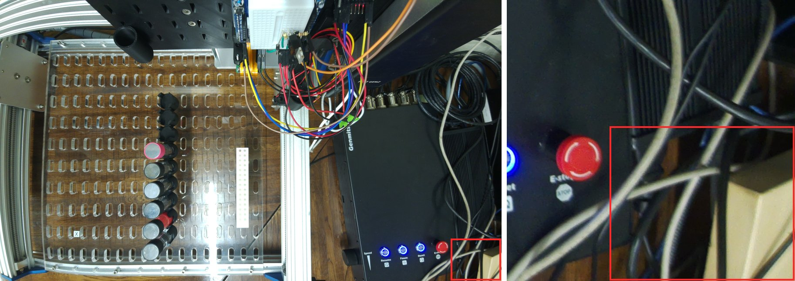
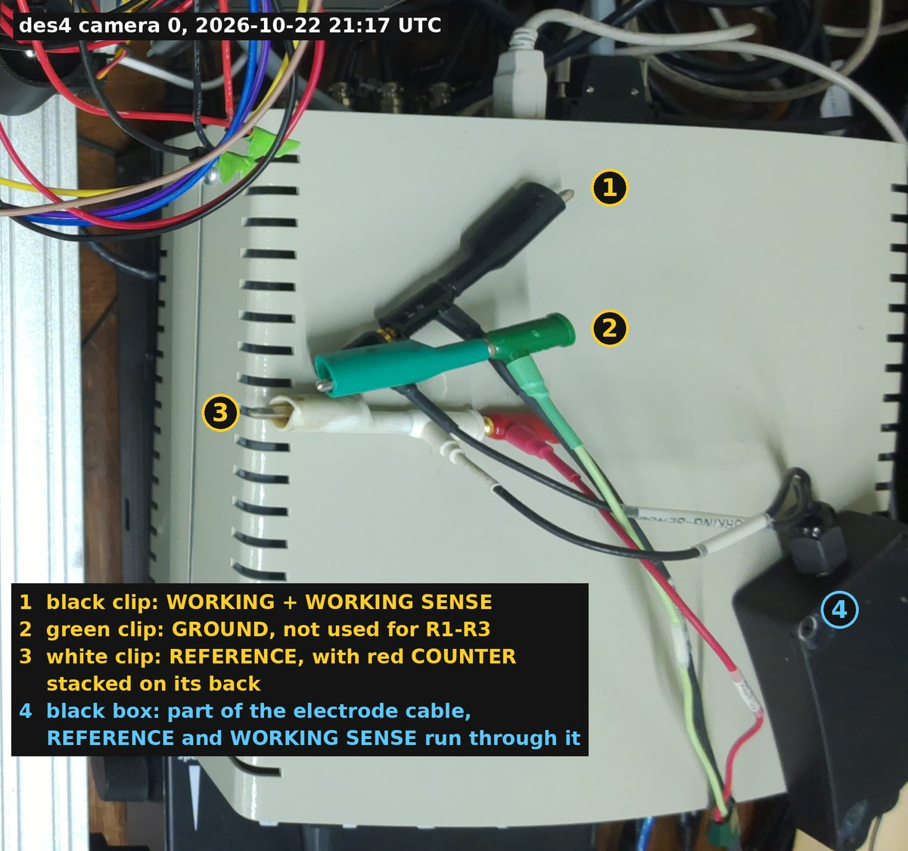
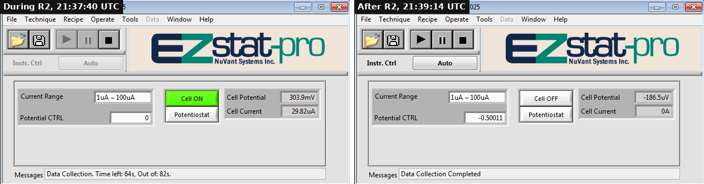
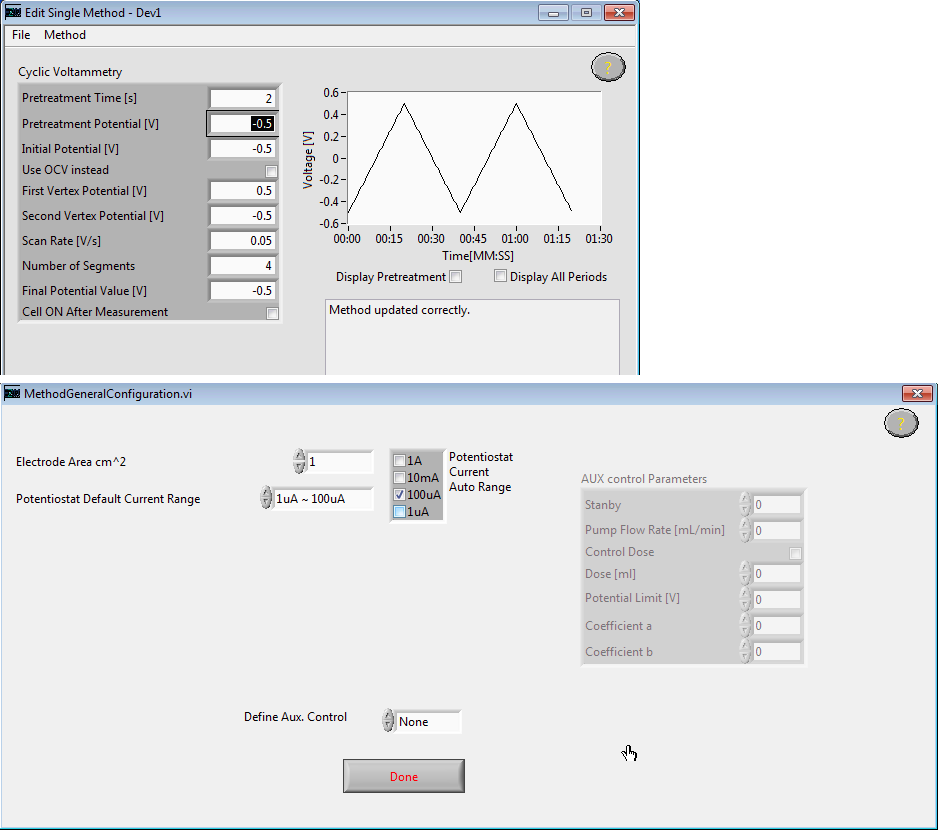
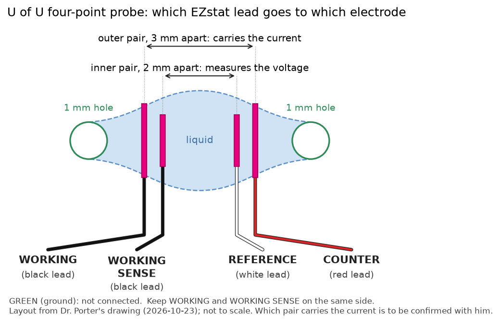
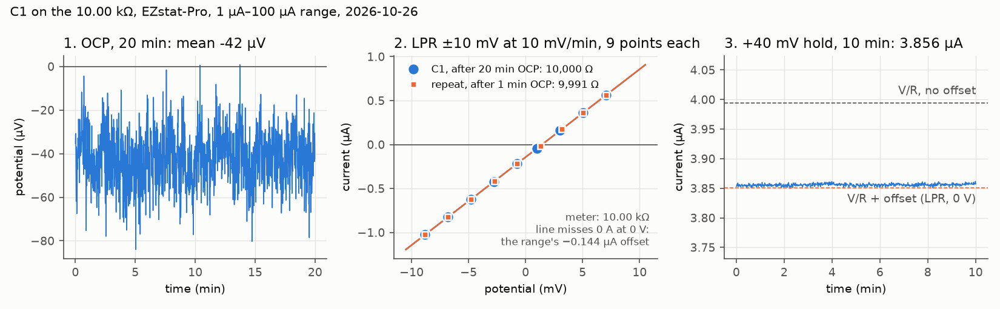

# EZstat-Pro: first hardware runs

Dr. Porter's NuVant **EZstat-Pro**, serial `EZST15073101 V2`, borrowed for
[#231](https://github.com/vertical-cloud-lab/byu-vcl/issues/231). The label says
EZstat-Pro, not EZstat-Pro EIS, so it has **no EIS**. It does have cyclic,
linear-sweep and pulse voltammetry, battery cycling, potential steps, a
galvanostat mode and step impedance spectroscopy (SIS) (manual p. 9).

This folder holds the runbook (this file), the [run log](run-log.csv), two
PowerShell scripts for the Windows PC, a script that checks the first runs, and
[`results/`](results/) for the exported data.

Manual: [EZware Operating Manual, EZware 7.0 (2013)](https://www.nuvant.com/sites/default/files/2022-05/EZware-2013-Manual-compressed2.pdf),
which NuVant lists for EZstats from April 2013 on. Page numbers below are the
manual's.

## 1. It plugs into a Windows PC, not the Pi

The EZstat-Pro is NuVant's analog front end around a National Instruments USB
data-acquisition board. All the software that talks to it is Windows-only:

- EZware-2013 is a 32-bit Windows program built with LabVIEW 2011 SP1 (it
  ships LabVIEW's 11.0.1 analysis library).
- It needs NI's LabVIEW 2011 Run-Time Engine and NI's NI-DAQmx driver.
- NI-DAQmx comes for Windows, and for Linux only on x86-64 PCs ("NI-DAQmx for
  Linux/x86 64-bit Architecture"). There is no build for ARM, so the CubXL's
  Raspberry Pi 5 can't load the driver. Plugged into the Pi, the EZstat would
  just be a USB device that nothing can talk to.

Use the Windows PC that may have come with it (the one with the Watlow
EZ-ZONE programs), or any Windows laptop you have administrator rights on.

That PC runs Windows 7, which no longer gets security updates, so it stays off
BYU's network and the internet. Its Ethernet port is cabled to the CubXL Pi
(des4) and nothing else, and the Pi forwards Remote Desktop to it from the
tailnet ([setup on #231](https://github.com/vertical-cloud-lab/byu-vcl/issues/231#issuecomment-6327249004)).
The Pi only passes that traffic along. The EZstat's USB cable still goes into
the PC.

### The PC, as a Claude session sees it (2026-10-21)

| | |
|---|---|
| PC | Windows 7 Professional SP1 (build 7601), 64-bit, PowerShell 2.0. It's in a workgroup, not a BYU domain, so it uses local accounts. Its clock was within 1 s of UTC |
| Open ports | Remote Desktop (3389) only. File sharing (139, 445), RPC (135) and WinRM (5985, 5986) are closed, so there's no way in without a Remote Desktop login |
| Remote Desktop | NLA is offered but not required, so a client gets to the Windows login screen without a password ([screenshot](images/2026-10-21-pc-login-screen-from-ci.png)) |
| Login | `POTENTIOSTAT_PC_USERNAME` / `POTENTIOSTAT_PC_PASSWORD`, passed to `@claude` runs since #294. The account is a member of Administrators, behind UAC: windows start without admin rights, and installers need **Run as administrator** |
| EZstat | Its board is a **USB-6221 OEM** (`USB\VID_3923&PID_72E0`), plugged into the PC. Not plugged into des4, which is right. Since 2026-10-22 it has its driver: NI MAX lists it as **NI USB-6221 (OEM) "Dev1"**, status Present ([screenshot](images/2026-10-22-nimax-usb-6221-dev1.png)) |

The first check over Remote Desktop is in [`pc-check-2026-10-21.md`](pc-check-2026-10-21.md);
what it means is under [step 0](#step-0-check-the-pc-5-minutes-changes-nothing).

### Driving the PC from a Claude session

The runner can't reach `192.168.231.10` itself, so the Remote Desktop client
runs **on des4**, on a virtual display, and the session drives it over SSH with
[`scripts/ezstat-pc-rdp/`](../../scripts/ezstat-pc-rdp/). `drive.sh` runs on
the runner and copies `pi_drive.sh` to a temporary folder on des4 for each
session. des4 has FreeRDP 3 and Xvfb. `xdotool` isn't installed, but unpacked
in `~/ezrdp/xdo` (`apt-get download xdotool libxdo3 libxtst6`, then `dpkg -x`
each, no `sudo`, 2026-10-21).

```bash
# Screenshots need numpy and Pillow. drive.sh runs Python with -I, which skips
# user site-packages, so put them in a venv.
python3 -m venv /tmp/ezvenv && /tmp/ezvenv/bin/pip install numpy pillow
export PY=/tmp/ezvenv/bin/python

# 1. Log in. The credentials reach xfreerdp3 over stdin, never in a process
#    list. 3300 is a hard stop in seconds, after which the client is killed
#    (a disconnect, not a log-off). RDP_SHARE is optional: the PC then sees
#    that des4 folder as \\tsclient\ez.
RDP_SHARE="/home/$CUBXL_PI_USERNAME/ezrdp/share" scripts/ezstat-pc-rdp/drive.sh start 3300

# 2. Run something: Win+R, type, Enter, wait, screenshot. One step per line;
#    see pi_seq.sh. The PNG lands in /tmp/ezmap/png/s1-a.png, and the
#    script's output in the share, on des4.
printf '%s\n' 'key super+r' 'sleep 2' \
  't cmd /c powershell -NoProfile -ExecutionPolicy Bypass -File \\tsclient\ez\check-ezstat-pc.ps1 > \\tsclient\ez\check.out 2>&1' \
  'key Return' 'sleep 60' 'shot a' | scripts/ezstat-pc-rdp/drive.sh seq s1

# 3. Leave: this disconnects without logging off, and cleans up on des4.
scripts/ezstat-pc-rdp/drive.sh stop
```

- **Check who's on the PC before doing anything.** `query user` and
  `query session` list every Windows session, and `tasklist /v` what's
  running. Run them with `cmd /c ... > \\tsclient\ez\who.txt` and read the file
  on des4. On 2026-10-22 ours was the only session, with the PC's own screen at
  the login prompt.
- **`(` and `)` don't arrive.** FreeRDP drops them from Xvfb's keymap. Type them
  as `key shift+9` and `key shift+0`, or better, put the commands in a `.ps1` in
  the share and type only the `-File` line.
- **Copying files to the PC goes through the share.** robocopy from
  `\\tsclient\ez` ran at about 30 MB/s over the 1 Gbit/s cable: 1,241 files,
  1.95 GB, in 66 s ([`windows/stage-from-des4.ps1`](windows/stage-from-des4.ps1)).
  The slow part is des4's own download, over its Wi-Fi.
- **PowerShell's `Add-Content` writes nothing to `\\tsclient`**, and raises no
  error (2026-10-22). `[IO.File]::AppendAllText`, robocopy's `/LOG:` and
  `cmd`'s `>` all do write there. A `powershell -File` window closes when the
  script ends, taking its output with it, so start scripts as
  `cmd /c powershell ... > \\tsclient\ez\<name>.out 2>&1`.
- **A login takes over the PC's only desktop.** Windows 7 allows one session at
  a time, so whoever is at the PC is locked out until the session ends.
- **Disconnect, don't log off.** Stopping the client leaves the Windows session
  and its programs running, with the PC at its lock screen. Whoever logs in at
  the PC with the same account gets that session back. Logging off would close
  whatever they had open.
- **`/tls:seclevel:0` is required.** Without it OpenSSL 3 refuses Windows 7's
  TLS (`ERRCONNECT_TLS_CONNECT_FAILED`). FreeRDP 3 logs a parse error for that
  line but applies it. FreeRDP 2 on a runner spells it `/tls-seclevel:0`.
- **To test the login without taking over the desktop, add `/auth-only`.** It
  logs Kerberos errors (expected, as this is a workgroup PC) and *Authentication
  only, exit status 1*, yet got as far as licensing with the right password.
  With NLA the PC goes on to licensing only after it accepts the password. A
  wrong password hasn't been tried, so its output is unknown.
- **Don't commit desktop screenshots.** The desktop shows other people's folder
  names, and this repo is public. Crop to the window you need.
- **In EZware's menus, use the keyboard.** A click on a menu's title opens it,
  but neither hovering nor clicking chose an item (2026-10-22). The arrow keys
  then Enter always worked: Down from the title goes to the first item, Up to
  the last, so File → Up → Enter is Exit. Screenshot before pressing Enter.
  Buttons and lists in its dialogs do take clicks. Never send Ctrl+E (cell
  on/off) or Ctrl+A (abort) to EZware.
- **Mind what's under a dialog.** Help → Instrument Info's OK button sits over
  the main window's Potentiostat button, which switches modes. Click OK once,
  or press Enter.
- **Click a window's title bar before its fields.** In an inactive EZware
  window, the first click only activates it, and the keys after it go to
  whatever has focus. On 2026-10-22 that was the editor's **?** button: Enter
  pressed it, and its Help Tip window then blocked the editor until it was
  closed with its X, pressed and released slowly.
- **To set a number,** click in the field, then End, Shift+Home, type, Tab.
  Screenshot the editor afterwards: a field that didn't take still shows its
  old value. Often the first click in a field only activates the window.
- **Screenshot before typing a file name at Start.** LSV and the Corrosion
  Inhibition Test asked for the `.nuvdt` name; Chrono Amperometry didn't
  (2026-10-24), and the Ctrl+A, name and Enter meant for the prompt went to
  EZware's main window, where Ctrl+A is Abort. Nothing happened that time.
  The prompt opens in the last folder used, which may be `\\tsclient\ez`.
- **A `.cmd` started from `\\tsclient\ez`** shows *Open File – Security
  Warning* first, and waits for Run. Typing `cmd /c ...` in Win+R doesn't.
- **Avast may cover the desktop** with a full-screen *"Let's try a restart
  instead"* window, because its updates fail offline. Its Exit button closes
  the window only.

### What des4's cameras see of the EZstat (2026-10-22)

des4 has two cameras. Camera 0 is the CubXL's overhead deck camera, served by
`deckcam` on `127.0.0.1:8743` (`/snapshot.jpg` is one 1280 × 720 frame; while
nobody is watching, `rpicam-still --camera 0 --width 4608 --height 2592` gives
the full sensor). Camera 1 looks along the deck and doesn't show the EZstat.

**At 03:43 UTC, only a corner, maybe.** Camera 0's frame ended at the CubXL's
Genmitsu controller. At the bottom-right edge was the corner of a beige box,
the colour of the EZstat's case.



**At 18:25 UTC, its top and all five leads.** Ben moved the EZstat into
camera 0's view and laid the leads on top of it, and confirmed their labels:
the black ones WORKING and WORKING SENSE, red COUNTER, white REFERENCE, green
GROUND. Each lead ends in a stackable banana plug, with a push-on clip in
front. They're already paired the way R1–R3 need, and were unchanged at 21:17:

| Clip | Plugs on it |
|---|---|
| Black | WORKING SENSE, stacked into the back of WORKING |
| White | REFERENCE, with COUNTER (red) stacked into its back |
| Green | GROUND, on its own |

**It's the metal-cased EZstat-Pro, with no Cell Enable button.** Its front
panel has a Power button and no other switch (Ben, at the bench, 2026-10-22).
That's the metal-cased model in the manual (p. 30, Figure 1, bottom): its
electrode connector is a 15-pin socket, and EZware alone turns its cell on and
off (p. 32). The top that camera 0 sees, painted sheet metal with stamped vent
slots and screws, fits. From above, the camera can't see the front panel.

**The black box is part of the electrode cable.** The REFERENCE and WORKING
SENSE leads connect to it, and it connects back into the EZstat's electrode
connector (Ben, 2026-10-22). Leave it in place. The manual wants counter,
reference, working sense and working all connected (p. 35), and only the
cables supplied with the instrument used (p. 29). A resistor run that passes
checks the box along with the rest of the cable.



**The CubXL's E-stop is beside it, not under it.** Seen from camera 0, the
EZstat now hides the Genmitsu controller's Resume, Pause and Reset buttons and
its red E-stop, which were in plain view at 03:43. A Claude session took that
to mean the EZstat was covering them. It isn't: Ben confirmed at the bench
(2026-10-22) that they're right next to it and all within reach. Only the
camera's view of them is lost, so a remote session can't see whether the E-stop
is pressed.

## 2. Accounts and subscriptions: none needed

| Software | Cost and accounts |
|---|---|
| EZware-2013 | Comes with the instrument. The installer asks for no serial number or activation code. Licence: one program on one machine (manual p. 2) |
| LabVIEW 2011 SP1 Run-Time Engine | Free. It's NI's engine for running finished LabVIEW programs, and needs no activation |
| NI-DAQmx | Free driver, no activation |
| **Not needed** | The LabVIEW development system (a paid subscription), EZware-EIS (EIS model only), NI-Serial (temperature and mass-flow options only), an NI or NuVant account |

The one catch is downloading. NI's download pages now say "Log in to download",
and "Downloading older versions of software requires an active subscription or
service agreement." The direct links in §3 are NI's own file server and
downloaded without logging in on 2026-10-20. If they stop working, ask NuVant
for the installers (info@a3global.com, or the
[support form](https://www.nuvant.com/request-support)).

Installing drivers needs administrator rights on the PC. On a BYU-managed PC
that may mean asking IT.

## 3. Software

All four files were downloaded on 2026-10-20 and checked: version, size,
SHA-256, and that the NI installers carry a code signature.

| Step | What | Version | File (link) | Bytes | SHA-256 |
|---|---|---|---|---|---|
| 1 | LabVIEW Run-Time Engine, 32-bit | 2011 SP1 | [`LVRTE2011SP1std.exe`](https://download.ni.com/support/softlib/labview/labview_runtime/2011%20SP1/LVRTE2011SP1std.exe) | 224,373,344 | `b31615048274ec23c6b181a7a93b786828738f18a7cf8c784a3eec251cbcf29c` |
| 2 | NI-DAQmx, **Windows 7 or 8.0** | 9.7.0 | [`NIDAQ970f0.zip`](https://download.ni.com/support/softlib/multifunction_daq/nidaqmx/9.7.0/NIDAQ970f0.zip) | 1,673,463,452 | `2bbf32fd84a5f593a872c1571f02aba8b03de5b638777e429da9447f854f084f` |
| 2 | NI-DAQmx, **Windows 8.1, 10 or 11** | 14.5.1 | [`NIDAQ1451f1.zip`](https://download.ni.com/support/softlib/multifunction_daq/nidaqmx/14.5.1/NIDAQ1451f1.zip) | 1,748,101,421 | `0e3cba22e4b6cac59cd7d16e45158eabdb51c384810dff343607ed0d1f43708d` |
| 3 | EZware-2013 | 7.1.16.1025 | [`Ins EZware-2013 v.7.1.16.1025.exe`](https://web.archive.org/web/20190517053447id_/http://nuvant.com/downloads/Ins%20EZware-2013%20v.7.1.16.1025.exe) | 14,491,458 | `5f8e8cd4e28f8443441ea05ac530949988a82f2856bded73c28af7ca93349101` |

- **The run-time is 2011 SP1, not the 2012 that the manual links.** The EZware
  program inside the installer asks for LabVIEW Run-Time 11.0, which is 2011.
- **EZware comes from the Wayback Machine.** NuVant listed this installer on
  its downloads page until at least January 2022; its own link now returns 404.
  This copy was saved from nuvant.com in May 2019. It isn't code-signed, so
  Windows will warn about an unknown publisher: check the hash first.
- **No NI-DAQmx release supports both LabVIEW 2011 and Windows 10 or 11.**
  - 9.7 lists Windows 8, 7, Vista and XP, and LabVIEW 2009–2012. It's the
    version NuVant's manual names.
  - 14.5.1 lists Windows 8.1, 8, 7, Vista and XP, and LabVIEW 2011–2014.
  - From 15.0 on, LabVIEW 2011 is dropped.

  So on Windows 10 or 11, 14.5.1 is the best guess, not a supported
  combination. If it fails, ask NuVant which versions they use on Windows 10/11.
- **On Windows 11, "Memory integrity"** (Windows Security → Device security →
  Core isolation) can stop old drivers from loading. The PC check reports
  whether it's on. Whether to turn it off is a decision for whoever looks after
  the PC.
- **The board inside is a USB-6221 OEM** (NI M Series, 16-bit, 250 kS/s),
  as Windows on the lab PC reported it on 2026-10-21. Not a USB-621x, as
  this runbook first guessed from the spec. NI-DAQmx 9.7.0 drives it: its
  driver file `nixswv.inf` lists `USB\VID_3923&PID_72E0` as *USB-6221 (OEM)*,
  and the lab PC's board has worked with it since 2026-10-22. 14.5.1 hasn't
  been checked.

**To download:** run [`windows/get-ezstat-software.ps1`](windows/get-ezstat-software.ps1).
It picks the NI-DAQmx for the PC's Windows version, saves everything to
`Downloads\ezstat-software`, and checks every hash. It downloads only and
installs nothing. It's about 2 GB, so if the lab PC has no internet, run it on
any Windows laptop and carry the folder over on a USB stick. Or use the links
in the table and check each file with `certutil -hashfile "<file>" SHA256`.

**Downloading on a laptop for the Windows 7 PC? Add `-DAQmx 9.7`:**
```
powershell -ExecutionPolicy Bypass -File .\get-ezstat-software.ps1 -DAQmx 9.7
```
Otherwise the script picks the NI-DAQmx for the Windows it's running on, so a
Windows 10 or 11 laptop would fetch 14.5.1. On Windows 7, 9.7 is the supported
version, and the one the manual names. The set is then about 1.9 GB.

## 4. Steps

### Step 0. Check the PC (5 minutes; changes nothing)

1. Open [`windows/check-ezstat-pc.ps1`](windows/check-ezstat-pc.ps1) on GitHub,
   click **Download raw file**, and save it on the PC. The Windows 7 PC is
   offline, so download it on a laptop and bring it over on a USB stick, or
   copy it across in Remote Desktop.
2. In that folder, Shift + right-click → **Open command window here** (Windows 7)
   or **Open PowerShell window here** (Windows 10 or 11), and run:
   ```
   powershell -ExecutionPolicy Bypass -File .\check-ezstat-pc.ps1
   ```
3. It copies its report to the clipboard. Paste it into a comment on the PR.
   - Over Remote Desktop, the clipboard is shared, so paste it on your laptop.
   - Sitting at the offline PC, paste it into Notepad and save it to the USB
     stick.

It reports the Windows version, admin rights, Secure Boot and Memory integrity,
any NuVant, NI and Watlow software with versions, where EZware is installed, any
EZware data files (`*.nuvdt`) and their dates, and any NI USB device plugged in.

If EZware, Run-Time 2011 and an NI-DAQmx that supports LabVIEW 2011 are all
there, skip step 1 and don't update anything.

**Result on the lab PC, 2026-10-21** ([report](pc-check-2026-10-21.md)): only
NI-DAQmx is missing.

| Needed | Found |
|---|---|
| EZware-2013 | 7.1.16.1025, installed 2026-10-20, in `C:\Program Files (x86)\EZware-2013 v.7.1.16.1025\` |
| LabVIEW Run-Time 2011 SP1 | 11.0.448.0, installed 2013 (Run-Times 2012 SP1, 2013 and 2014 too) |
| NI-DAQmx | **Missing.** Only *NI-DAQmx/LabVIEW shared documentation 9.7.5* is left, and no driver version in the registry |
| NI MAX | 5.5.1 |
| The EZstat | Windows sees a **USB-6221 OEM** with **problem code 28**, "the drivers for this device are not installed" |

So on this PC, step 1 was NI-DAQmx alone. A Claude session installed it from
des4 on 2026-10-22, with the EZstat left plugged in, then restarted the PC
([how](#installing-from-des4-with-nobody-at-the-pc)). NI-PAL 14.0 and NI-VISA
14.0.1 from 2019 were already there, newer than the ones NI-DAQmx 9.7 bundles;
the installer didn't object to them, and kept them.

**Result after the install and restart, 2026-10-22** ([report](pc-check-2026-10-22.md)):

| | |
|---|---|
| NI-DAQmx | **9.7.0**, in the registry and the programs list |
| The EZstat's board | **Working.** Device Manager error code 0 (was 28), status OK, NI's kernel driver `nixsrkw` loaded. Nobody unplugged it |
| NI MAX | **NI USB-6221 (OEM) "Dev1"**, serial 01A801CD, status Present ([screenshot](images/2026-10-22-nimax-usb-6221-dev1.png)). EZware's Tools → Configure should offer `Dev1` |
| Everything else | Nothing removed: the report has only additions. EZware, Run-Time 2011 SP1 and NI MAX 5.5.1 are as they were. The installer also added the older LabVIEW Run-Times it bundles (8.2.1, 2009 SP1, 2010 SP1) |
| Calibration | The board's last external calibration and self-calibration were both on 2015-07-16, and NI recommended the next external one for 2016-07-16. R1 and R2 in step 3 will show whether it still meets the 1 % slope check |
| The restart | Windows last started at 02:44:42 UTC, two minutes after setup finished, and nothing is waiting for another restart ([check](nidaqmx-check-2026-10-22.md)) |
| NI-DAQmx's own list | Its C library lists **Dev1: USB-6221 (OEM)**, serial 0x1A801CD (the same number as in the USB device ID), not simulated. `nilvaiu.dll`, the file EZware couldn't find, is there, 32- and 64-bit |
| EZware | **Starts properly** (03:00 UTC). The `nilvaiu.dll` prompt is gone. It shows its version in the title, its own menus and all three windows ([screenshot](images/2026-10-22-ezware-starts.png)). It says no instrument is selected yet, which is step 2.6. Closed with File → Exit, without configuring or running anything |

**9.7.0 does know this board.** Its driver file `nixswv.inf` (in
`Products\NI-DAQmx_Core\MIO\nimioi64.cab`, dated 2013-02-08) lists
`USB\VID_3923&PID_72E0` as *USB-6221 (OEM)*.

### Step 1. Install what's missing, in this order (manual p. 40)

Keep the EZstat's USB cable unplugged from the PC until step 2. If it's already
plugged in, and Device Manager shows the board with code 28 ("the drivers for
this device are not installed"), leave it: install, restart, and Windows finds
the board's new driver as it starts up. That's what happened on the lab PC on
2026-10-22. The manual's order only matters so that Windows finds the driver
the first time it sees the board; a restart gives it another look. A restart
also disables the cell (§5).

1. Run `LVRTE2011SP1std.exe` with the default options. Restart.
2. Unzip the NI-DAQmx zip and run `setup.exe` inside it, with the default
   options. Restart.
3. Run `Ins EZware-2013 v.7.1.16.1025.exe`. No restart needed.

#### Installing from des4, with nobody at the PC

The PC is offline, so des4 does the downloading. This is how NI-DAQmx 9.7.0
went onto the lab PC on 2026-10-22, and works for any installer in §3.

1. **On des4:** download at a capped rate, since des4 is on Wi-Fi, check the
   hash against §3, unzip into a new folder, and write a manifest of every file:
   ```bash
   mkdir -p ~/ezrdp/nidaqmx970/share && cd ~/ezrdp/nidaqmx970
   curl -fL --limit-rate 4M -C - -O https://download.ni.com/support/softlib/multifunction_daq/nidaqmx/9.7.0/NIDAQ970f0.zip
   sha256sum NIDAQ970f0.zip      # 2bbf32fd...f854f084f
   mkdir share/NIDAQ970f0 && (cd share/NIDAQ970f0 && unzip -q ../../NIDAQ970f0.zip)
   (cd share/NIDAQ970f0 && find . -type f -print0 | sort -z | xargs -0 sha256sum | sed 's#  \./#  #') > share/NIDAQ970f0.sha256
   ```
   At 4 MB/s the 1.67 GB took 6 min 38 s. Put
   [`windows/stage-from-des4.ps1`](windows/stage-from-des4.ps1) and
   [`windows/install-nidaqmx.ps1`](windows/install-nidaqmx.ps1) in `share/`
   with Windows line endings (`sed 's/$/\r/'`).
2. **Log in** with `RDP_SHARE` set to that `share` folder
   ([above](#driving-the-pc-from-a-claude-session)), and check nobody else is
   on the PC.
3. **Copy and check:** Win+R,
   `cmd /c powershell -NoProfile -ExecutionPolicy Bypass -File \\tsclient\ez\stage-from-des4.ps1 > \\tsclient\ez\stage.out 2>&1`.
   It copies the folder to `Downloads\ezstat-software\` and checks every file's
   SHA-256: 1,241 files in 66 s, then about 2 min to hash them.
4. **Install:** the same with `install-nidaqmx.ps1`. Windows asks for admin
   approval: check that the prompt names *National Instruments Installer*,
   verified publisher *National Instruments Corporation*, then press Alt+Y. It
   runs NI's `setup.exe /qb /AcceptLicenses yes /r:n`: default features, a
   progress bar and no questions. Those are the switches the installer's own
   help text documents. It doesn't mention `/log` or `/disableNotificationCheck`,
   so they weren't used. It took 23.5 min, including 6 min with the bar
   stopped at 65% and the PC nearly idle, probably waiting out a network
   timeout, since the PC has no internet.
   PowerShell 2.0's `Start-Process -Verb RunAs` returns no exit code, so the
   script reports the version in the registry instead.
5. **Check nobody else is on the PC, then restart** from the session:
   `cmd /c shutdown /r /t 10`. It needs no admin approval. This ends the
   Remote Desktop session too. The lab PC was back on port 3389 2.5 min later.
   Log in again and rerun the [PC check](windows/check-ezstat-pc.ps1). For a
   closer look at the driver, run [`windows/check-nidaqmx.ps1`](windows/check-nidaqmx.ps1)
   the same way. It reports when Windows last started, whether it's still
   waiting for a restart, NI-DAQmx's DLLs, and the devices NI-DAQmx lists,
   through property reads only.

des4 keeps the checked zip in `~/ezrdp/nidaqmx970/`; the unzipped copy there was
deleted afterwards. The PC keeps its copy in `Downloads\ezstat-software\NIDAQ970f0`.

### Step 2. Plug in the EZstat: now, and not before

1. Nothing connected to the leads. Plastic-cased EZstats have a **Cell
   Enable** button: have it out (off). This one is metal-cased and has no such
   button; EZware alone enables the cell (manual p. 32).
2. Plug the USB cable into the back of the EZstat, but not into the PC yet.
3. Plug in the power supply, at least 1 ft from the EZstat to keep its noise
   out of the signal (manual p. 36). Press the power switch: it lights green and
   the fan starts.
4. Now plug the USB cable into the PC. Windows reports new hardware, then NI's
   Measurement & Automation Explorer (NI MAX) does (manual p. 40).
5. Open NI MAX → **Devices and Interfaces** and note the device's name, for
   example "NI USB-6211". **Don't open its Test Panels**: they can drive the
   outputs that set the cell potential.
6. Open EZware. Choose **Tools → Configure**, highlight the device, click
   **Done**. If it asks for the model, choose **EZstat-Pro**: the wrong model
   stops it working properly (manual p. 43).
7. Turn off sleep and Windows Update for good. If the PC freezes, or restarts
   for an update mid-run, the cell can stay on, uncontrolled (manual p. 26),
   and a sleeping PC stops answering Remote Desktop.
   [`windows/set-sleep-and-updates.ps1`](windows/set-sleep-and-updates.ps1)
   does both: it reports by default, and with `-Apply` it makes the changes as
   administrator (one UAC prompt) and reports again.

**Result on the lab PC, 2026-10-22** (a Claude session over Remote Desktop,
03:49–04:01 UTC, with the EZstat already plugged in and on;
[details](pc-settings-2026-10-22.md)):

| Item | Result |
|---|---|
| 6. Configure | The list showed **Dev1 – USB-6221 (OEM)**. After **DONE** there was no model prompt: EZware identified the EZstat-Pro itself. Its titles now end in *Dev1*, the EZstat-pro logo shows, and Messages reads *Hardware Initialized and Running* ([screenshot](images/2026-10-22-ezware-configured.png)). Help → Instrument Info gives *DAQ card SN: 1A801CD*, NI MAX's serial |
| It sticks | Closed and reopened, EZware comes straight up on Dev1. The choice is in `%LOCALAPPDATA%\NuVant\EZware\Instr_config\EZstat_general_conf.xml`, in the Windows user's own profile, so **another Windows account has to repeat item 6** |
| Idle reading | Cell OFF, Potentiostat, 10 mA – 1 A range: **Cell Potential 10.65 V, Cell Current 0 A**, steady. That looks like an input with nothing on the leads, sitting at the top of its range. Unconfirmed at the bench. With a resistor connected and the cell still off, it should drop to near 0 V |
| 7. Sleep | Never sleep or hibernate, in all four power plans, plugged in and on battery. USB selective suspend off, so Windows can't power down the EZstat's board. Hibernation off. Start → Sleep still works if someone picks it |
| 7. Windows Update | It had been set to **install updates automatically**, with its service running and 430 MB of downloaded updates waiting. Now: never check, Automatic Updates disabled by policy, no automatic restart with someone logged on, and the service stopped and disabled |

To install a Windows update by hand later (an `.msu` from a USB stick), first
set the service back with `sc config wuauserv start= demand` as administrator:
`wusa` won't install while it's disabled. Disable it again afterwards.

### Step 3. First runs, on dummy loads (no chemistry)

**Leads** (manual pp. 31 and 35): counter red, reference white, working black,
working sense black (the second black one), ground green. On this EZstat each
lead is labelled with its name (checked at the bench, 2026-10-22). Connect only
with the cell disabled, in the order ground, reference, counter, working sense,
working. Disconnect in the reverse order.

For R1–R3, each pair shares one clip: working sense stacked into the back of
working, and counter into the back of reference. That's how they were left on
2026-10-22 ([picture](#what-des4s-cameras-see-of-the-ezstat-2026-10-22)). The
manual asks for both: "If no reference electrode is used, the reference lead
must be connected to the counter electrode lead" (p. 31), and working sense goes
with working (p. 103). So the order above becomes the white clip, then the black
clip. Ground isn't used for a dummy load, so leave the green clip free. Lay the
load on paper or plastic, with no clip touching another clip or anything metal.
The EZstat's case is metal, screws included, so not straight on its top.

**Wiring check, with the cell still off.** With nothing on the leads, EZware
reads Cell Potential 10.65 V (2026-10-22). With a resistor clipped on, it
should read about 0 V, since no current flows with the cell off. If it still
reads about 10.65 V, check the clips before going on.

**There's no Cell Enable button: EZware alone switches the cell.** On this
metal-cased EZstat the cell is on whenever EZware has turned it on (p. 32), and
nothing on the instrument shows it. The Power button's light means power only.
(An earlier version of this runbook assumed the plastic-cased model, whose
Cell Enable button has to be pressed in as well.) So:

- A remote session can run a method from start to finish, with nobody pressing
  anything.
- Before touching a clip, make sure EZware shows Cell OFF, or isn't running:
  exiting EZware disables the cell (p. 32). While a Claude session is logged
  in, the PC's own screen shows only its lock screen, so wait until the session
  says the cell is off. A session ends each run with the cell off and EZware
  closed.
- In an emergency, the Power button switches the whole EZstat off.

**Parts:** 1 kΩ and 10 kΩ resistors (1 %), a 1 µF film capacitor, a
multimeter. Measure each resistor with the multimeter and write the value in the
run log, since the check is against that value rather than the label. Note the
meter's model too: a handheld meter's own resistance accuracy is often 0.2–1 %,
not far off the 1 % pass band.

The bench meter is a **Neoteck NT8233D Pro** (2000 counts). Neoteck's own
figure wasn't found online; listings for the same pocket 8233D Pro meter under
other names (MS8233D Pro, and the similar PEAKMETER PM8233A) give ±(0.8 % +
2 digits) on 200 Ω–200 kΩ, and the meter's manual will say for certain. That
is ±100 Ω at 10.00 kΩ and ±10 Ω at 1.000 kΩ: **±1.0 %, as wide as the pass band.** Against it, the 1 %
check can't resolve an EZstat error from a meter error. Give the checker
`--meter-pct 1.0` and it also reports whether the fit is within 1 % plus the
meter's error. For a decisive check, use 0.1 % resistors, or measure on a bench
meter of 0.05 % or better.

On 2026-10-22 the bench had a 10 kΩ but no 1 kΩ, so **R2 went first.** Its
resistor measured 10.00 kΩ.

| Run | Load and wiring | Recipe | Passes if |
|---|---|---|---|
| R1 | 1 kΩ. Working and working sense on one end, reference and counter on the other (manual p. 103) | **Technique → Sweep Techniques → Cyclic Voltammetry.** Pretreatment 2 s at −0.5 V; initial −0.5 V; vertex 1 +0.5 V; vertex 2 −0.5 V; 4 segments (two cycles); final −0.5 V; 50 mV/s. **Method → General Settings**: potentiostat current range 10 mA, no auto-range. *Cell ON After Measurement* unticked | A straight line through zero, ±0.5 mA at ±0.5 V, and both cycles on top of each other. Slope within 1 % of 1/R from the meter |
| R2 | 10 kΩ, same wiring | Same CV, with current range 100 µA | ±50 µA, slope within 1 % |
| R3 | Dummy cell: 1 kΩ in series with (10 kΩ in parallel with 1 µF). Working and working sense on the 1 kΩ end, reference and counter on the other | **Technique → Step Techniques → Step Impedance Spectroscopy** (runs at controlled current). Initial current 0 A; pulse amplitude 50 µA; pulse width 0.1 s; relaxation 0.5 s; sampling interval as short as it allows, ideally 0.01 ms | At the pulse edge the potential jumps 50 mV (the 1 kΩ), then rises to about 0.55 V with a 10 ms time constant. EZware's SIS analysis (manual p. 90) gives Rs ≈ 1 kΩ, Rct ≈ 10 kΩ, Cdl ≈ 1 µF. With 1 ms sampling, only the 0.55 V plateau and the 10 ms time constant can be checked: the 50 mV jump can't be told apart from the start of the rise |

- R1 and R2 are each NuVant's own instrument check (manual p. 103), which asks
  for "a resistor", of no particular value. If one fails, the instrument or
  software is at fault, not a cell.
- R2 checks the 100 µA current range, R1 the 10 mA one, so either can go
  first. R2 needs only its own resistor; R1 and R3 both need the 1 kΩ.
- With 10 kΩ, nothing in R2 can overheat: even at the EZstat's ±25 V
  compliance limit (p. 9), the resistor carries 2.5 mA and 63 mW.
- R3 checks the galvanostat and the step-impedance analysis. Without EIS, SIS is
  this instrument's way to measure solution resistance from a current step, which
  is what a conductivity reading needs (Block B in #231).
- Write down any field EZware shows that isn't listed here, such as a sampling
  interval for the CV, and keep its default.

**In EZware 7.1 (2026-10-22):**

- **The CV editor has no sampling field.** EZware sampled every 40 ms (2 mV at
  50 mV/s) and didn't record the pretreatment.
- **General Method Settings starts with auto-range on all four ranges.** In
  *Potentiostat Current Auto Range*, all four boxes (1A, 10mA, 100uA, 1uA) were
  ticked. For a fixed range, pick it in *Potentiostat Default Current Range*
  and untick the other three boxes.
- **Start asks for the `.nuvdt` file first.** The run begins after you name
  it. It goes in `Documents\EZware_user_Files`, under a date-and-time name by
  default, and is written when the run ends.

**Result, R2, 2026-10-22** (a Claude session over Remote Desktop, 21:37 UTC;
[files and analysis](results/20261022_dummy-loads/README.md)):

| Check | Result |
|---|---|
| Wiring, cell off | −0.06 to −0.16 mV, down from 10.65 V with nothing connected |
| Line, offset, both cycles | Straight (R² 0.999997). −49.6 / +49.4 µA at −0.5 / +0.5 V. Offset −0.24 µA. Cycles 10,108.0 and 10,107.9 Ω |
| Slope | **10,108 Ω, +1.08 %** from the meter's 10.00 kΩ. **Fails the 1 % check by 0.08 points**, but is within 1 % plus the meter's ±1.0 %. Fitting against the potential EZware applied, not the one it measured, gives 10,093 Ω, so the gap lies between the EZstat's current reading and the meter |
| ±50 mV range | Below about 50 mV the potential input switches to its ±50 mV range, which reads 0.94 % low against the setpoint and the ±10 V range. It shows as steps in the residuals at ±50 mV |





### Step 4. Save every run and add it here

1. **File → Save** as `<run_id>.nuvdt`. That's EZware's own format, and it keeps
   the recipe (manual p. 79).
2. **Tools → File Export → Data Configuration**: tick time, potential and current,
   plus anything else offered. Then **File → Export as** `<run_id>.csv`.
   Both are in the [Display Cell Data] window. In 7.1 the dialog offers five
   columns and ticks only Voltage and Current, so tick the three time columns
   too. Export as opens in EZware's program folder, so give a full path. A
   remote session can type `\\tsclient\ez\<run_id>.csv` to write straight into
   des4's share.
3. Fill in a row of [`run-log.csv`](run-log.csv). Use run IDs like
   `20261021-R1`.
4. Put the files in `results/<YYYYMMDD>_<short-name>/` on this PR's branch
   ([how](results/README.md)), or attach a zip to a comment on the PR.
5. Mention Claude in a comment on the PR. It will check the runs against the
   "passes if" column and plot them with
   [`analysis/check_dummy_runs.py`](analysis/check_dummy_runs.py), which anyone
   can run too (Python with numpy and matplotlib):
   ```
   python analysis/check_dummy_runs.py R1 results/20261021_dummy-loads/20261021-R1.csv --r-ohm 998.7
   python analysis/check_dummy_runs.py R3 results/20261021_dummy-loads/20261021-R3.csv
   ```
   It finds the time, potential and current columns by name, reads units such
   as "(mA)" or "[V]" from the header, and writes a `.check.png` plot and a
   `.check.json` summary next to each CSV. Since 2026-10-22 it reads EZware
   7.1's export as it comes. The first real export broke it, because its two
   text time columns weren't numbers. If a future export trips it up, it has
   options to name the columns.

## 5. Safety (manual pp. 26–37)

- Never connect or disconnect a lead while the cell is enabled. On this
  EZstat, only EZware shows whether it is (step 3).
- Don't leave a run unattended. A shutdown, restart or power cut disables the
  cell, but a frozen PC can leave it on and uncontrolled. This EZstat has no
  Cell Enable button to cut it off by hand, only Power.
- Plug the power supply into an earthed outlet, with its cord where someone can
  pull it out (p. 28). Keep the power supply at least 1 ft from the EZstat
  (p. 36).
- Stand the EZstat on a flat, hard surface, with 2 in of space behind and above
  it, 3 in at the sides, nothing in front of it, and nothing on top of it
  (pp. 28 and 37). Its fan is at the back.
- Keep the CubXL's E-stop and its Resume, Pause and Reset buttons within
  reach. Where the EZstat has stood since 2026-10-22, they're right beside
  it, though hidden from the overhead camera ([pictures](#what-des4s-cameras-see-of-the-ezstat-2026-10-22)).
- Its case is metal: keep clips and bare resistor leads off it.
- Use only the cables that came with it.

## 6. After the dummy loads

The 15 and 19 October plans in #231 put the chemistry runs next: the U of U
probe (Block B, below) and the ferricyanide CV (Block C).

**From 2026-10-24 the corrosion work for alloys comes first** (Sterling,
[on #291](https://github.com/vertical-cloud-lab/byu-vcl/pull/291#issuecomment-6379392718)).
Its checks are in [§7](#7-corrosion-checks-for-the-alloy-work). Later that
day he added that "demonstrating atomization is the priority right now", and
that he wasn't sure it would be wise to try to get a corrosion test done
([#291](https://github.com/vertical-cloud-lab/byu-vcl/pull/291#issuecomment-6388624186)).

**The corrosion checks don't use the probe, so Block B is on hold** (asked on
#291, 2026-10-26):

- **It measures the liquid, not the metal.** The corrosion runs (C4–C6)
  measure an alloy specimen against an Ag/AgCl reference, with a graphite or
  Pt counter, and C1–C3 check the instrument and the references for them. The
  probe's four electrodes are platinum, which isn't a stable reference, so
  none of them can stand in for the references C3–C6 need.
- **Seawater's own resistance barely touches the corrosion readings:** 60 Ω
  in the CubXL well, about 0.1 mV during an LPR
  ([DAL's protocol](https://github.com/vertical-cloud-lab/digital-alloy-lab/blob/81923f2/alloy-corrosion/copper/protocol.md)).
  To check each electrolyte batch's conductivity,
  [DAL's BOM](https://github.com/vertical-cloud-lab/digital-alloy-lab/blob/81923f2/alloy-corrosion/bom/README.md)
  lists a dip probe (row H09), not this one.
- **It belongs to the conductivity and spectroscopy work with Dr. Porter**
  ([DAL #148](https://github.com/vertical-cloud-lab/digital-alloy-lab/issues/148)).
  On 22 October Sterling ranked the spectroscopy work behind copper corrosion
  and automated dosing ([#298](https://github.com/vertical-cloud-lab/byu-vcl/issues/298)),
  and suggested putting it on hold, perhaps to come back as a BYU IDR grant
  with Dr. Porter ([comment](https://github.com/vertical-cloud-lab/byu-vcl/issues/298#issuecomment-6352253304)).

Until that restarts, the plan below stands but isn't scheduled. Keep the probe
dry, packed as it came and away from the salt water, or give it back to Dr.
Porter: that's Sterling's call.

### The U of U four-point probe (Block B)

On 2026-10-23 Dr. Porter offered his lab's four-point conductivity probe:
platinum electrodes printed on wafers, made for his lab by the University of
Utah, *"so this is not ideal, but we got good conductivity numbers using
them."* He has written instructions for it, which haven't reached this repo
yet, and sent a drawing of how his lab mounts it
([on #291](https://github.com/vertical-cloud-lab/byu-vcl/pull/291#issuecomment-6376217402)).
Until the instructions arrive, this section is a plan. Where they differ,
follow them.

**The drawing matches the flow cell he described to Ben on 14 September**
([video, 07:33–11:51](https://youtu.be/RKp4XslErJo?t=453)). The chip lies face
down on a gasket on his ATR-FTIR. Electrolyte flows through a channel cut in
that gasket, under the electrodes and over the ATR's diamond, so the infrared
spectrum and the conductivity come from the same liquid at the same moment.
From the drawing:

- Four electrodes in a row across the channel: the **outer pair 3 mm apart**,
  the **inner pair 2 mm apart**, centred on the 2 mm diamond.
- Two 1 mm holes through the chip, 6 mm apart, outside the electrodes. Liquid
  comes in through one and leaves through the other.
- The bottom gasket's eye-shaped cutout is the channel, so the gasket's
  thickness sets how deep the liquid is. A round top gasket, 27 mm across, with
  two holes, sits between the chip and a flow-cell block that the ATR's clamp
  presses down.

There's no ATR at the CubXL. The drawing is the map of the electrodes, and the
template for a CubXL holder later.

**Wiring.** The outer pair carries the current and the inner pair measures the
voltage: *"two of the electrodes are for applying a fixed current, and two are
for measuring"* (Dr. Porter, 14 Sep). The EZstat drives current from working
to counter and measures between working sense and reference (pp. 31, 35), so:

| Lead | Electrode |
|---|---|
| WORKING (black) | Outer, side A |
| WORKING SENSE (black) | Inner, side A |
| REFERENCE (white) | Inner, side B |
| COUNTER (red) | Outer, side B |
| GROUND (green) | Not connected |



- **Undo the pairs used for R2.** Each lead now goes to its own electrode. With
  separate working and working sense leads, all four must be connected (p. 31).
- **Working and working sense on the same side.** Across from each other, the
  reading has the wrong sign, and in potentiostat mode the EZstat would then
  push the cell as hard as it can.
- Connect with the cell off (EZware closed, or showing Cell OFF), in the order
  reference, counter, working sense, working (p. 35). Disconnect in reverse.
- Clip onto the probe's wires or contact pads, however the instructions say.
  Not onto the printed platinum, which scratches, and not hard onto the wafer,
  which cracks.

**Before the first run:**

1. Photograph both sides of the probe and its connections, and post them on
   #291.
2. Follow the printed lines by eye from each wire or pad to its electrode, and
   label them outer A, inner A, inner B, outer B. In the drawing, each side has
   one line to its outer electrode and one to its inner. Then a dry check with
   the multimeter, on the wires or pads: no two electrodes connect to each
   other (the meter reads OL).
3. KCl standards: 0.01 M (0.746 g/L dried KCl; 1413 µS/cm at 25 °C) and 0.1 M
   (7.46 g/L; 12.88 mS/cm), or certified bottles. A thermometer: conductivity
   changes about 2 % per °C.
4. Optional, no chemistry: run the recipe below on the 10 kΩ, wired as for R2,
   at ±3 µA. It should read close to R2's 10.0–10.1 kΩ. That checks the recipe,
   the export and the analysis before the probe.

**Holding the liquid.** The cell constant depends on the shape of the liquid
between the electrodes, so that shape has to be the same for every run,
standards and samples alike. All four electrodes must be under liquid, with no
bubbles on them. Without an ATR, the drawing's stack still works on a glass
slide in place of the diamond plate: slide, bottom gasket, chip face down,
filled through one hole until liquid comes out of the other, and held down by a
clip or a printed clamp. That needs Dr. Porter's gaskets, or ones cut to the
drawing.

**Recipe.** This EZstat has no EIS, the AC method that conductivity meters use,
so use DC with reversing current, as planned for Block B on 15 and 19 Oct:

- **Galvanostat mode** (current control), on the 1–100 µA range. Not
  potentiostat mode, as R2 used: if a sense electrode dries or its clip slips
  off, a potentiostat drives the outer pair as hard as its current range allows,
  which can strip printed platinum and make bubbles. In galvanostat mode the
  current stays at the setpoint.
- **Technique → MISC → Programmable Potential Waveform – Hold/Ramp/Step**, with
  each step set to current control (p. 54): +I for 5 s, then −I for 5 s, three
  times, then 0. Cell ON After Measurement unticked.
- **Start at I = 1 µA**, then pick I so the inner pair reads 20–40 mV. From the
  drawing's spacing and a channel 0.1–0.5 mm deep, the inner pair should read
  roughly 1–60 kΩ in the two standards; R2's 10 kΩ sits in that range.
  20–40 mV keeps every reading on the EZstat's ±50 mV input range, with its
  3 µV resolution (p. 9); check in the export that none goes past ±50 mV.
  R2 found that range and the ±10 V one differ by 0.94 %, so keep all runs,
  standards and samples, on the same one.
- **R = (V at +I − V at −I) / 2I**, from the second half of each step.
  Reversing cancels the inner pair's own offset and any offset in the current,
  and leaves no net charge at the outer pair.
- Watch the outer electrodes for bubbles. If any appear, lower I.

**Calibration.** Every probe has its own cell constant, so each one is
calibrated (Dr. Porter, 14 Sep). K = σ × R for one standard; then
measure the other as if it were unknown, σ = K / R. If it comes out within a
few % of its value, reversing DC works on this probe over that range: Block B's
question, answered against known standards rather than against EIS. Note each
solution's temperature. R2's open +1.08 % doesn't matter here: a gain error
cancels when K comes from a standard measured the same way.

**Running it remotely, as for R2.** The probe sits beside the EZstat, in camera
0's view, on paper or plastic, not on the EZstat's metal case. Someone at the
bench fills it, checks for bubbles, notes the temperature and comments
`@claude`. A session logs in from des4 and checks with the cell off that the
inner pair reads millivolts: about 10.65 V means a sense electrode isn't
connected or isn't wet. Then it runs the recipe, turns the cell off, closes
EZware and exports. Rinse with DI water between solutions, then with a little
of the next one.

**To ask Dr. Porter:**

1. Which electrodes carry the current? This section assumes the outer pair.
2. What gave your good numbers: which instrument, EIS or DC, and at what
   frequency or current? Has reversing DC worked on these probes?
3. Each probe's cell constant, if known, and your calibration solutions.
4. Can we borrow the gaskets? How much liquid, and what flow rate?
5. Anything to avoid: solvents, cleaning, a maximum current?
6. May his instructions and drawing go in this public repo?

**Later, on the CubXL.** Dr. Porter's own setup runs a loop: two syringes,
high and low salt, mixed in about 15 ratios, each flowed through the chip and
measured ("dose, measure, dose, measure", 14 Sep). On the CubXL the same loop
needs a holder like the drawing's, without the ATR, with ports the gantry or a
pump can fill. And EZware has no programming interface; its Custom ASCII
technique is the nearest thing ([map, §3.3](ezware-map.md#33-techniques)).

## 7. Corrosion checks for the alloy work

*Added 2026-10-24.* Copper corrosion testing comes first, ahead of powder
dosing and spectroscopy ([#298](https://github.com/vertical-cloud-lab/byu-vcl/issues/298)).
The plan is in [digital-alloy-lab](https://github.com/vertical-cloud-lab/digital-alloy-lab)
(DAL):

- **The protocol** ([DAL #180](https://github.com/vertical-cloud-lab/digital-alloy-lab/pull/180),
  [`alloy-corrosion/copper/protocol.md`](https://github.com/vertical-cloud-lab/digital-alloy-lab/blob/81923f2/alloy-corrosion/copper/protocol.md)):
  - **Alloys:** naval Cu–Ni (C70600, C71500) and nickel–aluminium bronze
    (NAB, C95800), in substitute ocean water.
  - **The cell:** a 150 µL O-ring well on the CubXL.
  - **One spot:** OCP 30 min, then LPR ±10 mV at 0.167 mV/s, OCP 5 min, a
    hold at E_corr + 50 mV for 10 min, and OCP 5 min. The liquid goes to
    ICP-MS.
  - **Its first experiment** (§5 there) is the well against a 1 cm² bench
    cell, on purchased reference alloys.
- **The ONR YIP copper draft** ([DAL #117](https://github.com/vertical-cloud-lab/digital-alloy-lab/pull/117),
  [`cubxl-electrochemistry.md`](https://github.com/vertical-cloud-lab/digital-alloy-lab/blob/a7c4e9a/near-term-submissions/onr-yip/cubxl-electrochemistry.md))
  names a borrowed potentiostat, Dr. Porter's, as the reference instrument for
  the flat-cell cross-checks.
- **DAL's BOM** ([`bom/README.md`](https://github.com/vertical-cloud-lab/digital-alloy-lab/blob/81923f2/alloy-corrosion/bom/README.md))
  lists "a potentiostat and a leak-free reference for the shakedown" to borrow
  from his lab (row H08). This EZstat is that potentiostat. It already sits
  beside the CubXL, and des4 drives both.

**The checks, in the order they unblock DAL's plan.** C1 needs nothing new
and can run remotely as soon as the 10 kΩ is back on the leads.

| # | Check | Needs | Passes if | Unblocks |
|---|---|---|---|---|
| C1 | DAL's sequence on the 10.00 kΩ | R2's wiring | Rp within 3 % of 10.00 kΩ every time; the hold and its charge within 3 %; the method runs through over Remote Desktop and ends with Cell OFF | The method, range and export for C4–C6. **Passed 2026-10-26** ([below](#c1-dals-sequence-on-the-1000-kω-no-chemistry)) |
| C2 | Low currents: 100 kΩ, 1 MΩ (and 10 MΩ) | Three resistors, each measured on the meter; 5 % ones will do | 100 kΩ and 1 MΩ within 5 %; 10 MΩ is recorded, not judged | The well (13 nA–1.7 µA in DAL's protocol); passive aluminium (~1 nA) |
| C3 | Reference against a master | Two Ag/AgCl references | Within 5 mV of each other, drifting under 1 mV in 10 min | Every potential in C4–C6 |
| C4 | Shakedown on the C63000 NAB we have | Bench cell, graphite counter, 3.5 % NaCl | Three slices: E_corr SD ≤ 10 mV, log₁₀ Rp SD ≤ 0.15, no attack at the O-ring edge | The lab's first copper corrosion data; a baseline for NAB from the atomizer |
| C5 | Bench-cell anchor on DAL's reference alloys | C71500, C95800, then C70600; D1141 seawater | C4's limits, with means near the published values | DAL §5's calibration; the ONR draft's reference alloys, measured every round |
| C6 | One CubXL well against the bench cell | DAL's well lid, 2 mm reference, Pt wire | Not pass/fail: does the well's bias match DAL's simulation? | The first CubXL corrosion spot |

All the limits here are proposals. DAL's protocol leaves its own as *choose*.

### C1. DAL's sequence on the 10.00 kΩ (no chemistry)

Wire as for R2: the 10.00 kΩ between the black and white clips, on paper,
green clip free. Fix the current range at **1 µA–100 µA** and untick
auto-range. That's the range a 0.92 cm² bench cell of Cu–Ni or NAB needs:
from the published Rp values in C5, ±1.1–4.4 µA at ±10 mV. The 10 kΩ gives
±1.0 µA, the same order.

1. **Technique → Corrosion Studies → Corrosion Inhibition Test** (in 7.1's
   menu but not in the manual; [map, §3.3](ezware-map.md#33-techniques)).
   Open-circuit monitoring for 20 min, logged every 1 s, with a
   corrosion-resistance measurement every 20 min (the most it allows): a
   polarization range of ±10 mV, a scan rate of 10 mV/min (0.167 mV/s), and
   solution-resistance subtraction off. If it won't run on this unit, use Linear Sweep Voltammetry
   from −10 to +10 mV at 0.167 mV/s. On a resistor, OCV is 0, so it's the same
   sweep.
2. **Time Base Techniques → Extended Time Base** at +40 mV for 10 min, in
   potentiostat mode, with a Cutoff Current Limit of 1E-7 A (see below). This
   stands in for DAL's +50 mV hold. +40 mV keeps the reading below the ±50 mV
   boundary, where R2's residuals step.
3. OCV 5 min, then export. In the Data Analyser (Display Cell Data → Data →
   Analyze Selected), run **Analysis → Corrosion Analysis** on one LPR
   (p. 102), and note what EZware itself reports.

**Expect:** OCV within ±1 mV of 0 (R2's wiring check read −0.06 to
−0.16 mV), Rp ≈ 10.0–10.1 kΩ from every sweep, 4.00 µA and 2.40 mC in the hold.

**Changes from the dummy runs** (2026-10-24, leads open; [results](results/20261024_dummy-runs/README.md)):
- **One LPR per Corrosion Inhibition Test.** Each LPR is placed around the OCP just measured, not
  around 0 V, as intended. But the `.nuvdt` keeps only the open-circuit points, and the CSV export only the last
  LPR. So set the monitoring time equal to the measurement interval: the one LPR then
  comes at the end, and it's the one exported. "Monitoring time" counts open-circuit time only. The
  interval tops out at 20 min (C1, 2026-10-26), so 20 min each, and the run lasts about 22 min.
- **Expect 9 points per LPR.** EZware records one point per 2 mV at any scan rate, and the last two of
  a sweep never reach the export.
- **Hold with Extended Time Base, not Chrono Amperometry.** Chrono Amperometry coerced a 120 s step to
  60 s, and records every 1 ms whatever its sampling field says.
- **Take the offset off the hold current.** With the leads open, the 1 µA–100 µA range reads
  −0.146 µA, which is 3.7 % of 4.00 µA, more than the 3 % allowed. Subtract an open-leads reading taken
  the same day (`check_corrosion_runs.py` reports one), or allow 5 %. Rp is a slope, so it's unaffected.
- **Check with [`analysis/check_corrosion_runs.py`](analysis/check_corrosion_runs.py)**, which reads
  the `.nuvdt` as well as the CSV: `--r-ohm 10000` checks Rp and the hold against the resistor.

**Result, C1, 2026-10-26: passes, once the range's offset is taken off the hold.** A Claude
session over Remote Desktop, 19:51–20:54 UTC, with Ben's 10.00 kΩ wired as for R2
([files and analysis](results/20261026_c1-10k/README.md)):

| Check | Result |
|---|---|
| OCP, 20 min | −42 µV, SD 13 µV, no drift |
| Rp | **10,000 Ω** (+0.004 %), and 9,991 Ω (−0.09 %) in a repeat. EZware's own figure for the repeat: 9,990.6 Ω |
| +40 mV hold, 10 min | 3.856 µA as measured, −3.5 % from V/R (fails 3 %). **3.9995 µA, +0.13 %**, with the range's −0.144 µA offset taken off. Charge 2.401 mC corrected, against 2.40 |
| Remote run | Every run ended with Cell OFF; EZware closed at the end |

The 10,000 Ω is agreement within the meter's ±1.0 %, not 0.004 % accuracy: in a ±10 mV LPR, the
two ~1 % errors R2 found pull opposite ways and nearly cancel.



**What C1 found in EZware 7.1:**
- **The Corrosion Inhibition Test writes its own results**, as `<run name>.csv` next to the
  `.nuvdt`, with a row for the LPR: time, "Corrosion Potential" and "Corrosion Resistance".
  Presumably one row per LPR; every run so far had just one. The
  resistance is 1/slope of a straight-line fit, the same as `check_corrosion_runs.py` gives. The
  potential is where that line crosses zero current, so it's shifted by the range's offset times
  Rp (+1.43 mV on the 10 kΩ); take E_corr from the OCP before the LPR instead.
- **Export LPRs under a different name from the run's.** An export saved, or copied, as
  `<run name>.csv` replaces EZware's results file without asking. That's how C1's own was lost.
- **The measurement interval tops out at 20 min**; 30 is coerced to 20 with no message.
- **A monitoring time shorter than the interval doesn't end the run.** 5 min against 20 was still
  monitoring at 6 min.
- **Stopping a Corrosion Inhibition Test with Stop saves nothing**, not even the open-circuit points.
- **Extended Time Base opens in galvanostat mode, applying 0.1 A.** Pick Potentiostat in Source
  Mode first. Its potentials are absolute (no "vs OCP"), and it doesn't record the pretreatment.
- **Its Cutoff Current Limit ends a potentiostatic hold once the current is *below* it**, as a
  battery charger ends its constant-voltage stage. 1E-5 A ended a 3.86 µA hold after one point.
  Set it well below the current expected; 1E-7 A worked here.
- **Check the export's columns every time.** Tools → File Export → Data Configuration had only
  Voltage and Current ticked; tick the three time columns.
- **The file prompt takes `%USERPROFILE%\Documents\EZware_user_Files\<name>`**, which keeps the
  file on the PC when the prompt opens in `\\tsclient\ez`.

**Why it matters:**
- It's the first run of EZware's corrosion technique and analysis.
- At about 45 min, it's the first long run over Remote Desktop. R2's cell was
  on for 82 s.
- A Cu–Ni bench cell sits at 6.5–9.0 kΩ (C5), so this resistor is a good
  stand-in for one.

### C2. Low currents: the CubXL well and passive aluminium

C1's LPR alone on 100 kΩ, 1 MΩ and 10 MΩ: ±100 nA, ±10 nA and ±1 nA. Fix the
range at **10 nA–1 µA**. Its first use, on open leads (D1, 2026-10-24), read an
offset of −0.55 nA with 0.02 nA of noise, so even 10 MΩ's ±1 nA is 50 times the
noise.
- **Why these values:** DAL's protocol puts LPR currents on its -006 well
  between 13 nA and 1.7 µA for copper. Passive aluminium goes down to about
  1 nA (byu-vcl PR #278, now DAL #180).
- **5 % (gold-band) resistors will do** (asked 2026-10-26). Tolerance only says how far the real
  value may be from the printed one, and C2 compares the EZstat with the meter's reading, not the
  colour bands. Listings for the bench meter give ±(0.8 % + 2 digits) up to its 200 kΩ range and
  ±(1.0 % + 2 digits) on 2 MΩ and 20 MΩ: ±1.0 % at 100 kΩ and ±1.2 % at 1 MΩ and 10 MΩ, well inside
  C2's 5 %. A 1 % resistor would be known no better than that.
- **Measure each one off the clips, without holding both ends.** Clipped on, the EZstat's leads are
  across it too, and a hand across a 1 MΩ or 10 MΩ pulls the reading low. Note each reading and the
  meter's range.
- **If the 1 MΩ trace is noisy,** put the resistor in a closed metal box (a
  cookie tin) and clip the green ground lead to the box.
- **If 1 MΩ fails,** the well needs a larger O-ring or a more sensitive
  instrument, such as DAL's EmStat Pico option. Better to know that before
  printing lids.

### C3. Reference electrode against a master

Two Ag/AgCl references in the same KCl: working and working sense on one,
reference and counter on the other. OCP only, for 10 min.
- **Never turn the cell on in this wiring.** It would drive current through a
  reference electrode's frit.
- **Repeat it at the start of every bench session,** and log the offset. Keep
  the master for this check alone.
- **What it also checks:** it's the first time the reference input, through
  the black box, sees a real high-impedance electrode.
- **What a bad reference looks like:** with nothing between reference and
  working, the open-circuit reading climbs to volts within minutes (D2). An OCP
  that reads volts or keeps climbing means the reference isn't wetted or
  connected.
- **Parts:** two Ag/AgCl references, and 3 M KCl to fill them. They're likely
  the slowest thing to get, so the options are below.

#### Getting the two Ag/AgCl references (checked 2026-10-24, 00:00–01:00 MDT)

DAL's BOM row B20, Ossila C2015B1 ($165), ships from the UK: dispatched Monday,
it arrives Friday 30 Oct at the earliest. Faster, in order:

1. **Borrow from a BYU lab this week.** These labs have published work with an
   aqueous Ag/AgCl reference or run aqueous potentiostats. Contact details are
   from BYU's public directories.

   | Who | Why them | Contact |
   |---|---|---|
   | Quentin Allen, Manufacturing Eng. | Runs ASTM G61 corrosion tests with a Metrohm PGStat 204 and a silver–silver chloride reference ([Bates MS thesis, 2026](https://scholarsarchive.byu.edu/etd/11363)). The closest match to C4, and a good place to check a new electrode against a master | quentin_allen@byu.edu, 801-422-1777, 265 CTB |
   | Brian Iverson, ME | Ag/AgCl reference with a CHI potentiostat ([2024 paper](https://doi.org/10.1002/gch2.202400021)). Office 360J EB, in the same suite as Dr. Porter's 360P | bdiverson@byu.edu, 801-422-7514 |
   | Wally Paxton, Chemistry | An aqueous cyclic-voltammetry lab; on the RAISE board with Dr. Porter | wally.paxton@byu.edu, 801-422-4917, C303 BNSN |
   | Devin Rappleye, ChemE | Four potentiostats for aqueous and molten-salt work, and research on reference electrodes ([PyRO lab](https://pyro.byu.edu/instruments)) | devin_rappleye@byu.edu, 801-422-1611, 330-N EB |
   | Adam Woolley, Chemistry | Aqueous Ag/AgCl reference ([2026 paper](https://doi.org/10.1002/smsc.70249)) | atw33@byu.edu, 801-422-1701, C205 BNSN |
   | David Dearden, Chemistry | Teaches CHEM 523, the instrumental-analysis lab, which runs in Winter only, so its kit is idle now | dvd@chem.byu.edu, 801-422-2355, C307 BNSN |
   | Oliver Johnson, ME | Sterling's MS group (its [alumni list](https://johnson.byu.edu/content/people)). Nothing public shows electrochemistry there, but NSF 1610077 (2016–20) had experimental hydrogen diffusivity in iron, which usually means a permeation cell with references | ojohnson@byu.edu, 801-422-0972, 350M EB |
   | Dean Wheeler, ChemE chair | May know where retired Prof. John Harb's electrochemistry kit went | dean_wheeler@byu.edu, 801-422-4126, 330-T EB |

   Dr. Porter (jasonporter@byu.edu) is on the RAISE electrochemistry journal's
   board with Paxton, Rappleye and Wheeler, so he can introduce. A suggested ask:
   *"Could we borrow two Ag/AgCl reference electrodes (3 M or saturated KCl) for
   about two weeks, for copper-alloy corrosion tests in 3.5 % NaCl on Dr.
   Porter's EZstat-Pro? We'll return them refilled and replace anything we
   damage. If you can't spare them, could we check ours against your master?"*
2. **Amazon Prime, delivered Sunday 25 or Monday 26 Oct.** Four in-stock 6 mm ×
   65 mm glass Ag/AgCl electrodes, shipped by Amazon and sold by J & D TECH INC,
   checked from des4: StonyLab
   [SL000173](https://www.amazon.com/dp/B0CP7M76CF) ($85.99, 3 M KCl type,
   4.8★ from 10 ratings), [SL000172](https://www.amazon.com/dp/B0D2W2Y2NB)
   ($69.36, saturated), and Labasics [LB000632](https://www.amazon.com/dp/B0DP2BJ44P)
   ($68.99) and [LB000634](https://www.amazon.com/dp/B0DP2CZMGP) ($74.59). At
   00:01 MDT on Saturday, Prime offered Sunday delivery for orders placed within
   13 h, so by about 1 pm MDT Saturday; otherwise Thursday 29. The 6 mm tube drops
   through the bench-cell cover's 6 mm hole and the PTFE head rests on top. They're
   unbranded, with no datasheet and a porous "sand core" frit, so C3 is their
   quality check. Buy three of one listing: two for C3 and a spare. Ship Sunday
   deliveries to a home address, since campus buildings are closed.
3. **A brand-name master by Tuesday 27:** Hanna
   [HI5311](https://hannainst.com/hi5311-general-purpose-reference-electrode.html),
   $149.99, double junction, ceramic, 3.5 M KCl, 4 mm banana plug, in stock.
   Hanna offers Next Day Air on "select products" (check at checkout), and
   weekend orders go out Monday. Its body diameter
   isn't published and looks about 12 mm, so use it as C3's master in a beaker,
   or reprint the cover's hole. Or call Pine on Monday (919-782-8320) for
   [RREF0021](https://pineresearch.com/products/reference-ag-agcl-standard-single/)
   (9.5 mm, 4 M KCl with 250 mL of filling solution, in stock, price after login),
   by next-day air: Tuesday or Wednesday.
4. **KCl:** none of these come filled. 3 M KCl is 22.4 g of KCl per 100 mL of
   DI water. BYU's Chem Stores (126 NICB, Mon–Fri 8–5, 801-422-2678,
   chemstores@chem.byu.edu; manager Todd Fluckiger, toddjf@byu.edu,
   801-422-6155) sells to faculty accounts and special-orders anything it
   doesn't stock for $20 an order. It publishes no catalog, so whether it stocks
   electrodes is a Monday phone call.

Couldn't be checked from the runner or des4: Fisher, Sigma-Aldrich,
Cole-Parmer, Thomas Scientific, eBay and CH Instruments' price list all blocked
both. Gamry 930-00015 (9 mm, 76 in stock) says most orders ship within 10 days.
For C6's 2 mm reference, WPI's DRIREF-2 ($158) and
[SDR2 Super Dri-Ref](https://wpiinc.com/products/sdr2-super-dri-ref-reference-electrode)
($219) were both listed as available, shipping by UPS from Florida; the
Innovative Instruments LF-2 in DAL's BOM has no public price.

### C4. Shakedown on the C63000 NAB we already have

The 3 ft of C63000 NAB bar ([McMaster 8203K41](https://www.mcmaster.com/8203K41/))
arrived on 2026-10-23 ([DAL #117](https://github.com/vertical-cloud-lab/digital-alloy-lab/pull/117))
as atomizer feedstock. Three 6 mm slices of it cost under an inch.

- **Cell:** DAL's bench cell, to print:
  - [`bench_cell_body.step`](https://github.com/vertical-cloud-lab/digital-alloy-lab/blob/81923f2/alloy-corrosion/bom/cad/bench_cell_body.step),
    250 mL, with an AS568-013 FKM O-ring window of 0.92 cm² in the floor;
  - [`bench_cell_clamp.step`](https://github.com/vertical-cloud-lab/digital-alloy-lab/blob/81923f2/alloy-corrosion/bom/cad/bench_cell_clamp.step),
    whose 20 × 20 mm pocket takes a 3/4" slice;
  - [`bench_cell_cover.step`](https://github.com/vertical-cloud-lab/digital-alloy-lab/blob/81923f2/alloy-corrosion/bom/cad/bench_cell_cover.step).

  Leak-test it overnight with DI water. Counter: a 10 mm graphite rod (BOM
  B22). Reference: C3's.
- **Specimen:** face the slice flat, grind wet to P1200 ([the polishing
  SOP](https://github.com/vertical-cloud-lab/byu-vcl/blob/157ab1e/SOP/sem-eds-polishing-sop.md),
  #258), rinse with DI water then ethanol, dry, and start within an hour. DAL's
  protocol treats finish and delay as variables, so keep both the same every
  time.
- **Electrolyte:** 3.5 wt % NaCl, i.e. 35 g of reagent NaCl in 965 g of DI
  water. Open to air, unstirred, at room temperature. Note the temperature.
- **Wiring:** working and working sense on the specimen's contact, reference
  and counter on their electrodes, ground free.
- **Method:** C1's, on the 1 µA–100 µA range: OCP 30 min, LPR ±10 mV at
  0.167 mV/s, OCP 5 min, hold at E_corr + 50 mV for 10 min, OCP 5 min.
  - EZware's 20 min cap on the measurement interval means one Corrosion Inhibition Test can't
    give 30 min of OCP and then a single LPR. Either accept 20 min (C1's 20/20), or set 30 min of
    monitoring with a 15 min interval: that adds an LPR at 15 min, whose Rp should still reach the
    results CSV (untested), though only the last LPR's points are exported.
  - For the hold, read E_corr off the OCP and type E_corr + 0.05 V into Extended Time Base, which
    takes absolute potentials. Subtract a same-day offset from its current, as C1 did.
  Optional: carry on with OCP and an LPR every 30 min up to 3 h, the time the
  published Rp values are quoted at.
- **Expect:** on 0.92 cm², about 2.3 kΩ (±4.4 µA at ±10 mV), going by cast
  C95800's 2.08 kΩ·cm² (C5).
  - E_corr near cast C95800's −0.26 V vs SCE. That's about −0.22 V against
    Ag/AgCl in saturated KCl (add 44 mV to an SCE value), or −0.23 V in 3 M
    KCl (add 31 mV).
  - C63000 is wrought, so expect the same order, not the same number.
- **Afterwards:** photograph the spot. Attack under the O-ring's edge
  (crevice) means the run doesn't count.

**Why it matters:**
- These are the first copper corrosion data from this lab.
- It shakes down the cell, the polishing, the method and the analysis before
  the reference alloys arrive.
- The as-received bar is the baseline for NAB from the atomizer. Its first
  copper run's leftovers (skull, splats) can be measured the same way, as DAL's
  aluminium plan does with each run's leftovers.

### C5. The bench-cell anchor on DAL's reference alloys

C71500 and C95800 first, then C70600 (DAL protocol §5). DAL's BOM:
- C71500, 1" × 12" at Online Metals, $121.34 (B43);
- C95800, on quote from Atlas Bronze (B45). It's cast NAB, which is not the
  same as C63000;
- C70600: 3/4" × 1 ft at [McMaster 4644N14](https://www.mcmaster.com/4644N14/),
  $130.26 ([DAL #123](https://github.com/vertical-cloud-lab/digital-alloy-lab/issues/123)),
  or 1" at Online Metals (B44).

Switch to ASTM D1141 substitute ocean water without heavy metals (Ricca
8363-1, about $135, B38), so the bench cell and the well share one
electrolyte. Run C4's method at least 8 times per alloy, over at least two
days.

**Published values to compare with.** These come from DAL's Edison answers,
as tabulated for DAL's well simulation. Nobody here has read the papers yet.

| Alloy | Value | Conditions | Source |
|---|---|---|---|
| C71500 | Rp 8.3 kΩ·cm² | 3 h, stagnant 3.5 % NaCl. Measured on binary Cu–30Ni (at. %), a stand-in | Metikoš-Huković 2011 |
| C70600 | Rp 6.0 kΩ·cm² | The same, on binary Cu–10Ni (at. %) | Metikoš-Huković 2011 |
| C70600 | E_corr −220 to −233 mV vs SCE | Substitute ocean water, 20 °C | Mantzavinos 2001 |
| C95800 | E_corr −0.260 V vs SCE; R_f + R_ct 2.08 kΩ·cm² | 3.5 % NaCl | Ding 2019 |

That's the table DAL's well simulation is calibrated to
([`sim_well_hf.md`](https://github.com/vertical-cloud-lab/digital-alloy-lab/blob/81923f2/alloy-corrosion/copper/sim_well_hf.md)).
DAL's protocol says to report Rp, not a corrosion rate. Oxygen transport limits
the cathodic branch, so an assumed Stern–Geary constant is unreliable for
these alloys.

**Why it matters:** the well's bias can only be measured against this anchor.
In DAL §5's words: "A flat size trend does not clear the well. Only the bulk
cell can."

### C6. One CubXL well against the bench cell, same potentiostat

**Needs:**
- DAL's well lid,
  [`well_lid_v2_006.step`](https://github.com/vertical-cloud-lab/digital-alloy-lab/blob/81923f2/alloy-corrosion/bom/cad/well_lid_v2_006.step).
  Not the older `copper/cad/well_lid.step`, whose O-ring ledge would bow.
- The 2 mm leak-free Ag/AgCl reference (B19, on quote) and Pt wire (B21).
- A slice already measured in the bench cell.

**Run:** the same method in a 150 µL -006 well, filled by hand first, then by
the gantry. The EZstat's leads reach the deck, and des4 runs CubOS as well as
the Remote Desktop session to the PC. So one Claude session can fill the well
and start the method.

**Expect:**
- **NAB:** DAL's simulation puts the well's E_corr 28 mV below the bench
  cell's, and its Rp at 1.75 times, on the O-ring's nominal area.
- **C71500:** E_corr 8 mV above, and Rp 0.60 times.
- **Area:** report on the wetted area, measured from the attack ring, not on
  the nominal one. DAL found that choice matters more than the chemistry.

### What this changes for the other checks

- **R2's +1.08 % needn't be settled for corrosion.** Spot-to-spot spread will
  be far larger, and DAL ranks spots measured the same way. If DAL's dummy
  cell is ordered anyway, its 0.1 % 10 kΩ settles it for about $2 (B26).
- **R1 is low priority.** Its 10 mA range only matters for cyclic
  polarization in the bench cell: 1 mA/cm² on 0.92 cm² is 0.92 mA. DAL keeps
  cyclic polarization to spare spots.
- **R3 and SIS are low priority.** Seawater's solution resistance is small
  next to kΩ of Rp: about 60 Ω in the well, in DAL's simulation.
- **Block C (ferricyanide CV) isn't needed for corrosion.** C3 checks the
  reference directly.

### Before C4: two questions

- **For Dr. Porter:** may his EZstat be used for corrosion runs in salt water?
  His lab has no reference electrodes to lend ("We do not have reference
  electrodes", 19 Oct, [#231](https://github.com/vertical-cloud-lab/byu-vcl/issues/231#issuecomment-6273249484)).
- **Long runs:** DAL's calibration plans overnight runs, but §5 says no
  unattended runs (manual p. 26). Until that's settled, C4–C6 are daytime runs
  with someone in the lab.
