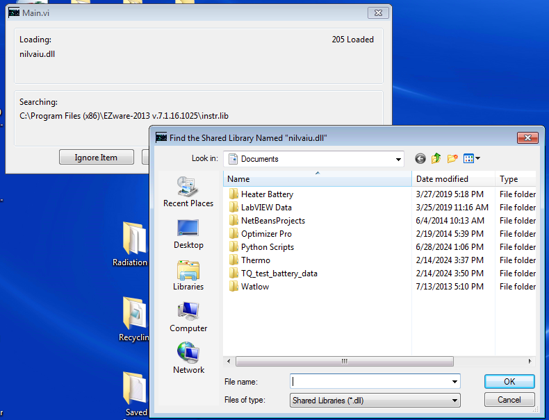
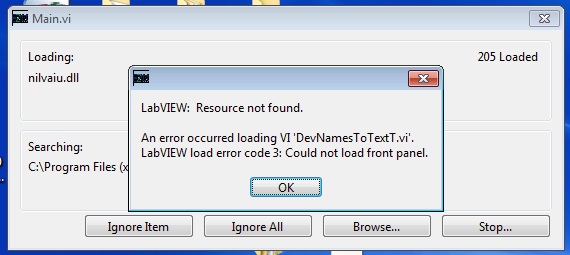
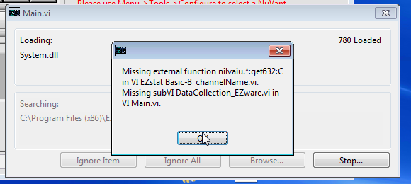
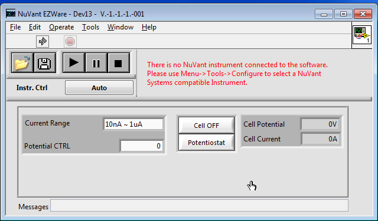
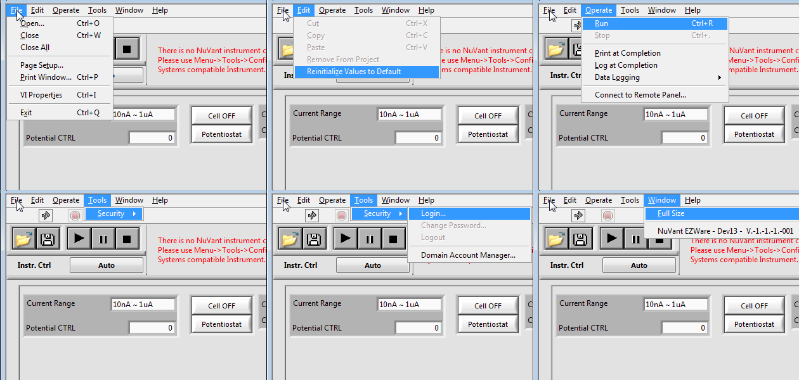

# EZware on the EZstat Pro PC: what's accessible, and a map of what it does

Checked on 2026-10-22 for [#231](https://github.com/vertical-cloud-lab/byu-vcl/issues/231):

- **On the PC** (00:42–00:53 UTC), over Remote Desktop from the CubXL Pi (des4).
- **Offline**, from the archived EZware 7.1.16.1025 installer and NuVant's LabVIEW driver. These were unpacked on a CI runner, never run.
- **Cross-referenced with NuVant's [EZware Operating Manual](https://www.nuvant.com/sites/default/files/2022-05/EZware-2013-Manual-compressed2.pdf)** for EZware 7.0 (2013, 115 pp.). "p. N" below is that PDF's page, and its printed page numbers match.

## Short answer

**EZware can't run on this PC yet, so nothing in it is usable today.**

- **Why:** NI-DAQmx, the driver for the NI USB-6221 board inside the EZstat, isn't installed.
- **What happens:** LabVIEW's loader asks for `nilvaiu.dll`, NI-DAQmx's LabVIEW interface (§1). If you skip it, the main window opens but is a dead shell.
- **The fix:** install NI-DAQmx 9.7 at the bench. That's step 2 of [PR #291's runbook](https://github.com/vertical-cloud-lab/byu-vcl/blob/20af078/potentiostat/ezstat-pro/README.md).

What *is* accessible:

1. **The full menu structure**, taken from the program itself (§3).
   - 10 technique families with 38 techniques. The manual documents 8 of them.
   - Recipes: sequences of methods.
   - Custom waveforms from a CSV file.
   - Self-test, iR compensation and data analysis.
2. **Three ways to script it without clicking**, once it runs (§5):
   - EZware's ActiveX VI Server, which is switched on in its `.ini`
   - NuVant's LabVIEW driver, with LabVIEW 2013 already on the PC
   - NI-DAQmx directly
3. **A remote-control recipe** that worked for everything above: Remote Desktop from des4, with keystrokes and clicks sent through the Pi's virtual display (§7).

## 1. What happens when EZware starts today

Double-clicking the desktop's **EZware-2013** shortcut:

1. **LabVIEW's loader stops at `nilvaiu.dll`.** It shows *Find the Shared Library Named "nilvaiu.dll"* while loading `Main.vi`, 205 VIs in. I clicked Cancel.

   

2. **Load errors follow, one per missing piece.** They name `DevNamesToTextT.vi` (part of NI-DAQmx), and then EZware's own `ActiveDevicesCurrentlyUsedByEZware.vi`, `GetActiveDevices.vi` and `DataCollection_EZware.vi`. The last one reads:

   > Missing external function nilvaiu.\*:get632:C in VI EZstat Basic-8_channelName.vi.
   > Missing subVI DataCollection_EZware.vi in VI Main.vi.

   | | |
   |---|---|
   |  |  |

3. **The main window opens, but as a broken VI.** These are the signs:
   - The title shows the placeholder version `V.-1.-1.-1.-001`.
   - The Run arrow is LabVIEW's broken arrow.
   - The menu bar is the LabVIEW Run-Time Engine's default (File, Edit, Operate, Tools, Window, Help), not EZware's own (§3.2).
   - The other two windows, [Display Cell Data] and [Edit Single Method] (p. 41), never open.

   The red text ("There is no NuVant instrument connected…") and the Cell OFF and Potentiostat buttons are just the panel's saved defaults. Nothing is running behind them.

   | | |
   |---|---|
   |  |  |

   

4. **I closed it** with File → Exit, and afterwards `tasklist` showed no `EZWare-2013.exe` running.

**This couldn't reach the instrument.** With no NI-DAQmx, Windows has no driver for the USB-6221 (Device Manager code 28, per [PR #291's check](https://github.com/vertical-cloud-lab/byu-vcl/blob/20af078/potentiostat/ezstat-pro/pc-check-2026-10-21.md)). So no program on the PC can set the cell's potential, current range or relay. Even so, I didn't press Run, Cell OFF/ON or Potentiostat.

## 2. What's on the PC (read-only checks)

| Check | Result |
|---|---|
| EZware install | `C:\Program Files (x86)\EZware-2013 v.7.1.16.1025\`, installed 2026-10-20 16:27 (PC time). Just 4 files: `EZWare-2013.exe` (11,763,200 bytes, built 2016-11-03), `EZWare-2013.ini`, `EZWare-2013.aliases`, and `data\lvanlys.dll`, LabVIEW's analysis library. No help files, method templates or examples: everything is inside the exe ([screenshot](images/ezware-2026-10-22/07-install-folder.png)) |
| `EZWare-2013.ini` | `server.ole.enabled = True`, `server.vi.callsEnabled = True`, `server.vi.propertiesEnabled = True`, `server.app.propertiesEnabled = True`: **the ActiveX VI Server is on** (§5). TCP VI Server and the web server are off: their `.enabled` keys are absent, and both default to off. `allowmultipleinstances = TRUE` ([screenshot](images/ezware-2026-10-22/08-ini-nidaqmx-licences-python.png)) |
| ActiveX registration | `reg query HKCR /f EZWare /k` and `/f NuVant` found nothing. A LabVIEW-built exe registers its ActiveX server when it runs, which may need admin rights, and this one has never run successfully. Check again once it does |
| NI-DAQmx | `nicaiu.dll` and `nilvaiu.dll` are absent from `System32` and `SysWOW64`. All that's left of 9.7.5 is its help: `National Instruments\NI-DAQ\docs\*.chm` ([screenshot](images/ezware-2026-10-22/09-registry-nidaq-leftovers.png)) |
| LabVIEW 2013 | Installed in `National Instruments\LabVIEW 2013`, with licence files for the Base, Full and Professional editions, App Builder and Student. Someone has used it here: `Documents\LabVIEW Data` holds `VIObjCache`, `Probes` and similar. Whether it's still activated isn't known: `nilm.exe` in `Shared\License Manager\Bin` (dated 2010) opened no window when launched |
| Python | Not installed (`where python py pythonw` found nothing). There's a `Documents\Python Scripts` folder from 2024 |
| NuVant data or settings | None. `dir /s` found no `*.nuv*` under `C:\Users` or `C:\ProgramData`, and no `*NuVant*` under `C:\ProgramData`. So nothing from an earlier EZware install survives here |

## 3. Map of EZware 7.1, cross-referenced with the manual

### Sources and caveats

- **Menus** come from the run-time menu files (`.rtm`) inside the exe, read offline. The bracketed names are their tags.
- **Techniques:** the menu file is only a template. The program also holds a list of 36 techniques, and the menu adds two more (Extended Time Base and Corrosion Inhibition Tests), 38 in all (§3.3). Some listed techniques aren't in the template, so they're presumably added at start-up; `RecipeManagement/MainMenuSupportedMethods.vi` is the likely place. Which ones the EZstat-Pro offers can only be seen once EZware runs. The manual says techniques a model can't do are greyed out (p. 8).
- **The manual's screenshots are of EZware 6.0** (title *NuVant EZware V.6.0.13.0121*). Its menus differ in places from 7.1's.

### 3.1 Windows

| Window | Opens from | What it's for | Manual |
|---|---|---|---|
| [NuVant EZware], `Main.vi` | Start-up | Menus, Start/Pause/Stop, manual control: current range, potential setpoint, Cell ON/OFF, potentiostat/galvanostat, live cell potential and current | pp. 41–43, 64, 66 |
| [Edit Single Method], `SingleMethodEdit.vi` | Start-up | Parameters of the selected technique, with a waveform preview | pp. 44–61 |
| [Display Cell Data] | Start-up | Live and last-run plots, cursors, crop, filters, CSV export | pp. 67–68, 76–79, 94 |
| [Method General Configuration], `MethodGeneralConfiguration.vi` | Edit Single Method → Method → General Method Settings | Electrode area, default current range and auto-range set, thermocouple and mass-flow use, AUX control | pp. 44–45 |
| [Configure Instrument], `EZstatConfigureInstrument.vi` | Tools → Configure | Pick the NI device (e.g. *Dev4 – USB-6221 (OEM)*), plus TCC and MFC channel tables | p. 42 |
| [Model Selection] | After Configure, on older units | Pick the model. Newer units are identified automatically | p. 43 |
| Recipe editor, `RecipeEditor.vi` and `RecipeLineEdit.vi` | Recipe → Create/Modify | Build a sequence of methods | Not documented |
| [Analyze Data] (Data Analyser) | Display Cell Data → Data → Analyze Selected | Baselines, peak area, Tafel and corrosion fits, step impedance | pp. 81–102 |
| [Step Impedance Calculator] | Analyze Data → Analysis → Impedance Analysis | Equivalent-circuit values from a step-impedance run | pp. 90–93 |
| AUX peripherals | Recipe → AUX Ctrl | Temperature controller and mass-flow controller set-up | Not documented |
| Self-test, `SelfTestUI.vi` | Operate → Self-test Hardware | Hardware self-test with a report | Not documented |
| Oscilloscope (service) | Not in the menus | A NuVant service view | Not documented |

### 3.2 Main window menus (`EZware_GUI.rtm`)

| Menu | Items (shortcut) | Manual |
|---|---|---|
| **File** | New (Ctrl+N): reset to defaults · Open… (Ctrl+O) · Save (Ctrl+S): `.nuvdt` with all recipe and method settings · Save as… · Exit (Ctrl+Q) | pp. 46, 79 |
| **Technique** | 10 families; see §3.3 | pp. 46–61 |
| **Recipe** | Create/Modify · Display · Recipe - General · AUX Ctrl | Not documented |
| **Operate** | Ext. Source Ctr. · **Run Method** (Ctrl+R) · **Run Recipe** (Ctrl+Shift+R) · Pause/Cont. · **Abort** (Ctrl+A) · Run Options · **iR Compensation** · Immediate Purge/Stir · Clean Electrode · **Self-test Hardware** · **Cell ON/OFF** (Ctrl+E) | Only Start and Stop, which are toolbar buttons (pp. 64, 66) |
| **Tools** | Configure | p. 42 |
| **Data** | Load Data · Methods list · Plot · Filter · Reload | Not documented |
| **Window** | Open windows | — |
| **Help** | User Manual (Ctrl+H) · Instrument Info · Check for updates · About… | — |

Menu files ship some items disabled, and the program enables them at run time: the whole Data menu, Recipe → Display, Immediate Purge/Stir, Clean Electrode, and File → Save.

**Keyboard shortcuts that matter for a remote session:** **Ctrl+E toggles the cell**, Ctrl+R runs the method, and Ctrl+A aborts. Never send Ctrl+E by accident. In particular, don't use Ctrl+A to "select all" in this window.

### 3.3 Techniques

The program's list ("Lists all Supported methods", with method codes CV, LSV, … GalPC), plus the two techniques only the menu has, against the manual and the menu template. "Not in template" means the technique is in the program's list but not in the menu file, so presumably added at start-up. The manual's 6.0 screenshots do show DPV and NPV in the menu:

| Family | Technique | Manual | In 7.1's menu template | CubOS method |
|---|---|---|---|---|
| Sweep | Cyclic Voltammetry | pp. 46–47, 69–71 | ✓ | `run_CV` |
| | Linear Sweep Voltammetry | pp. 48, 65–68 | ✓ | |
| | Cyclic Waveform | In p. 46's screenshot only | ✓ | |
| | Multi Vertex Wave Form | pp. 49–53 | ✓ | |
| Step | Chrono Coulometry | — | ✓ | |
| | Chrono Amperometry | — | ✓ | `run_CA` |
| | Chrono Potentiometry | — | ✓ | `run_CP` |
| | Step Impedance Spectroscopy | pp. 61, 72–75, 90–93 | ✓ | |
| | Step Waveform ("Step WFRM") | — | ✓ | |
| Pulse | Differential Pulse Voltammetry | p. 59 | Not in template | |
| | Normal Pulse Voltammetry | p. 60 | Not in template | |
| | Sampled Current Polarography | — | ✓ | |
| Square wave | Barker Square Wave Voltammetry/Polarography | — | Not in template | |
| | Osteryoung Square Wave Voltammetry | — | ✓ | |
| AC | AC Voltammetry/Polarography; Phase Selective, Second Harmonic, Triangular Wave and Diff. Triangular Wave AC Voltammetry/Polarography (5) | — | Family only, no items in it | |
| Stripping | Barker Square Wave, Diff. Pulse, Linear Sweep and Osteryoung Square Wave Stripping Voltammetry (4) | Greyed out in p. 46's screenshot | ✓ | |
| Corrosion | Corrosion Inhibition Tests: OCV monitoring plus periodic corrosion-resistance measurements | — | ✓ (menu only; not in the 6.0 menu) | `run_OCP`-like (see below) |
| Hydrodynamic | Rotating Disk Electrode; Hydrodynamic Modulation | Greyed out in p. 46's screenshot | ✓ | |
| Time base | Time Base; Extended Time Base (menu only); Diff. Pulse Time Base; Triple Pulse Time Base | — | ✓ | `run_CA` / `run_CP` (long holds) |
| Energy sources | Battery | p. 58 | ✓ | |
| | Fuel Cell | — | ✓ | |
| MISC | Programmable Potential Waveform – Hold/Ramp/Step | pp. 54–57 | ✓ | |
| | Custom ASCII | — | ✓ | |
| | Bulk Electrolysis with Coulometry; Electrocapillary Measurement; A.C. Impedance; Galvanostatic Polarization Curve | — | ✓, except Galvanostatic Polarization Curve: not in template | |

**What some of the undocumented techniques do**, from the program's built-in help (`HelpMessagesForMethods.vi`) and parameter labels:

- **Custom ASCII:** *"Uses externally supplied waveform from an ASCII file."* Its parameters are:
  - a pretreatment time, value and log interval
  - the data file name (CSV)
  - `dt` [s], the time step between waveform points
  - repetitions
  - a log rate [samples/s]
  - potentiostat or galvanostat mode
  - Cell ON After Measurement, with a standby value

  **This is the most useful technique for automation.** Any potential or current program we can write as a CSV, EZware can apply.
- **Extended Time Base:** applies a potential or current, with cutoff limits on current or potential, a log interval, a time limit and a source mode. These are long constant-potential or constant-current holds, CubOS's `run_CA` and `run_CP`.
- **Corrosion Inhibition Test:** *"Use Open Circuit Monitoring – Idle in OCV"*, a log interval and a monitoring time. It also measures corrosion resistance every N minutes, with a polarization range [mV], a scan rate [mV/min] and an option to subtract solution resistance. Its open-circuit monitoring is the closest match to CubOS's `run_OCP`.
- **"Use OCV instead"** in the sweep methods: *"the Open Circuit Voltage is measured and the scan starts from there."*
- **Scan rate ≤ 0.1 V/s** is needed for current auto-ranging (the program's help and p. 44).

**Not in this program:** EIS. This EZstat is the plain EZstat-Pro, and EIS lives in the separate EZware-EIS program, which needs the EZstat-Pro EIS model (p. 62). The menu's *A.C. Impedance* entry and the program's EIS data-collection VIs are there, but whether the plain Pro offers them can only be seen once it runs.

### 3.4 [Edit Single Method] (`SingleMethodEditMenu.rtm`)

| Menu | Items | Manual |
|---|---|---|
| File | Open · Save (disabled until there's a file) · Save As… (Ctrl+S) · Close (Ctrl+W) | — |
| Method | General Method Settings | p. 44 |

The common fields are:
- Pretreatment Time [s] and Pretreatment Potential/Value
- Initial Potential, or "Use OCV instead"
- Final Potential
- **Cell ON After Measurement**, with a Standby value. *"If selected keeps the Cell ON when the scan is finished."*
- Mode: potentiostat or galvanostat, the green Mode button (p. 46)

**For unattended runs, leave Cell ON After Measurement unticked.** Then the cell turns off at the end of every method.

**General Method Settings** (pp. 44–45):
- Electrode Area [cm²]
- Potentiostat Default Current Range: 10 nA–1 µA, 1 µA–100 µA, 100 µA–10 mA or 10 mA–1 A
- Potentiostat Current Auto Range: 1 A, 10 mA, 100 µA, 1 µA
- Use TC and Use MFC
- Define Aux. Control: Standby, Volt.-Flow Rate, Control the Dose, Dose ml, Potential Limit, Coefficients a and b

### 3.5 [Display Cell Data] (`DataDisplayMenu.rtm`)

| Menu | Items | Manual |
|---|---|---|
| File | Open · Save (Ctrl+S) · **Export as…** · Print Plot · Close | p. 79 |
| Edit | Undo Changes (Ctrl+Z) · Copy Plot | — |
| Data | **Analyze Selected** · Overlay Selected | pp. 82, 90, 97–98 |
| Tools | Buffer size · File Export → **Data Configuration**: pick Absolute Time, Relative Time, Voltage and Current for the CSV | pp. 79–80 |
| Plot | Axes → Time / Voltage / Current auto range | p. 76 |
| Filters | Square · Median · Butterworth | pp. 94–96 |

The window also has:
- buttons: Last Run Data, Update ON/OFF and Clear
- three plot types: Current vs Potential, Potential vs Current, and Potential & Current vs Time
- two cursors with Crop to Cursors

**CSV export is two steps** (p. 79):
1. Tools → File Export → Data Configuration, to pick the columns
2. File → Export as…

`.nuvdt` is EZware's own format. It holds the data plus every recipe and method setting.

### 3.6 [Analyze Data] (`DataAnalysisRuntimeMenu.rtm`)

| Menu | Items | Manual |
|---|---|---|
| File | Open… · Overlay · Print Graph · Exit | — |
| Edit | Undo · Copy Plot | — |
| Plots | Plot Cursors → Free Cursor / **Cursor Along Plot** (Ctrl+click places cursors) / Clear Cursors · Forward or Reverse → All / Forward / Reverse | pp. 82, 99 |
| Analysis | Choose Peak Detect Window Width · Draw Base Line · Calculate Area · Mark Peak · **Corrosion Analysis** · **Tafel Plot** · Baseline Correction · Subtract Overlaid · Impedance Analysis → Step Impedance Spectroscopy | pp. 84–93, 97–102 |
| Filter | Filter · Save Filtered Data | — |
| Help | Manual · About Data Analyser… | — |

- **Calculate Area** gives charge in coulombs, from the scan rate (p. 89).
- **Corrosion Analysis** takes surface area, equivalent weight and density (p. 102).
- **The Step Impedance Calculator** fits one of three cell models, one cell and two batteries, for Rs, Rct, Cdl and related values (pp. 7, 90–93).

### 3.7 Hardware facts the software depends on

- **Cell enable is in software only on metal-cased EZstats.** Plastic-cased ones also have a front-panel Cell Enable switch that must be pressed in (p. 30). Check which case this one has.
- **Exiting EZware disables the cell**, and so do a PC shutdown, a reboot or a power cut. But *"in event of a PC system STOP … the load may remain in an 'ON' but uncontrolled state"* (pp. 26, 30). So turn off sleep and Windows Update before long runs.
- **The back-panel I/O connector**, on plastic-cased units (p. 36):
  - pin 1: analog out AO1
  - pin 2: analog in AI5
  - pins 3–4: digital lines P1.6 and P1.7

  All four are on the same USB-6221, and EZware controls them. They could carry a trigger to or from the CubXL.
- **Current ranges disagree between NuVant's documents.**

  | Mode | 2013 manual (p. 9) | 2022 spec sheet |
  |---|---|---|
  | Galvanostat | ±100 µA, ±1 mA, ±100 mA, ±1 A | ±1 µA, ±100 µA, ±10 mA, ±1 A |
  | Potentiostat | ±1 µA, ±100 µA, ±10 mA, ±1 A | ±1 µA, ±100 µA, ±10 mA, ±1 A |

  EZware 7.1's own range labels are `10nA ~ 1uA`, `1uA ~ 100uA`, `100uA ~ 10mA` and `10mA ~ 1A`, matching the potentiostat ranges. Read the galvanostat ranges off EZware once it runs.

## 4. Manual vs program: what the manual doesn't cover

- **30 of the 38 techniques**, including chronoamperometry, chronopotentiometry and chronocoulometry, Custom ASCII, Extended Time Base and the corrosion test. Only CV, LSV, Multi Vertex, Hold/Ramp/Step, Battery, DPV, NPV and SIS have pages. EIS has one too, but for its separate program.
- **The Recipe menu**, meaning sequences of methods run with Operate → Run Recipe, and its editor.
- **Most of the Operate menu:** iR Compensation, Self-test Hardware, Run Options, Ext. Source Ctr., and Cell ON/OFF (Ctrl+E).
- **The Data menu** and Help → Instrument Info / Check for updates.
- **Version differences.** The manual's screenshots are of 6.0. 7.1 adds Corrosion Studies to the Technique menu and moves Stripping and Hydrodynamic from greyed out to present. Whether they're enabled depends on the model.

The manual's own instrument check (p. 103) is still the first thing to run once EZware works. It's #291's R1: a 1 kΩ resistor, CV from −0.5 to +0.5 V, giving a straight line through ±0.5 mA.

## 5. Routes to automation, once NI-DAQmx is installed

| Route | How | Needs | Notes |
|---|---|---|---|
| **1. Drive the GUI over Remote Desktop** | As in §7: keystrokes and clicks from des4, plus screenshots | Nothing more | Works today. Slow, and positions change if windows move. Menus open reliably by clicking the title then using arrow keys |
| **2. EZware's ActiveX VI Server** | `server.ole.enabled = True` in the `.ini`. A client on the PC (PowerShell 2.0, VBScript, Python with pywin32, LabVIEW) connects to the running EZware, opens a reference to a VI such as `Main.vi` or `SingleMethodEdit.vi`, and reads and sets front-panel controls by label (`GetControlValue` / `SetControlValue`) | EZware running. Find its ActiveX server name under `HKCR` after its first good run (an admin run may be needed to register it) | Sets recipe fields without clicking, but doesn't press menu items. Running a method is still a menu or button event |
| **3. NuVant's LabVIEW driver** | [`EZstat_2013.12.04.LV10.0.zip`](https://web.archive.org/web/20190517034111/http://nuvant.com/downloads/EZstat_2013.12.04.LV10.0.zip) (archived), with `Examples/SimpleEZStatControl.vi`, run in the LabVIEW 2013 already on the PC | NI-DAQmx, and a LabVIEW 2013 licence that's still active (unconfirmed) | Bypasses EZware. We'd write the techniques ourselves |
| **4. NI-DAQmx directly** | e.g. Python's `nidaqmx` package, with NuVant's line assignments from the driver | NI-DAQmx, Python on the PC (not installed), and the line map | Most flexible, most risk. Get the cell-enable and range lines wrong and the hardware does something unintended. It also needs an x86 Windows (or Linux x86) host, since NI-DAQmx has no ARM build, so it can't move to the Pi |

**Custom ASCII is the easiest way to run arbitrary programs** through any of these. Write the waveform as a CSV, point the method at it, and run it.

## 6. Next steps

1. **Install NI-DAQmx 9.7 at the bench.** Follow [#291's step 1](https://github.com/vertical-cloud-lab/byu-vcl/blob/20af078/potentiostat/ezstat-pro/README.md): unplug the EZstat's USB, run the installer as administrator, restart, then plug the EZstat back in.
2. **Then comment `@claude`** to rerun this mapping live. With EZware running, a session can:
   - open each Technique submenu
   - screenshot every recipe editor and General Method Settings
   - read Help → About and Instrument Info
   - see which techniques the EZstat-Pro actually offers

   It would avoid Run, Cell ON/OFF (Ctrl+E) and Self-test.
3. **Run #291's R1–R3** on the dummy cell, using the manual's procedure (p. 103).

## 7. How this was done, and how to rerun it

- **Remote Desktop ran from des4**, which is cabled to the PC; CI runners can't reach it directly.
  - [`scripts/ezstat-pc-rdp/drive.sh`](../../scripts/ezstat-pc-rdp/drive.sh) (runner side) copies [`pi_drive.sh`](../../scripts/ezstat-pc-rdp/pi_drive.sh) and [`pi_seq.sh`](../../scripts/ezstat-pc-rdp/pi_seq.sh) to a `mktemp` dir in `/dev/shm` on des4.
  - They start Xvfb (1280×800) and `xfreerdp3 /args-from:stdin`, with the credentials over stdin, so they're never in argv or on disk.
  - The clipboard is off, and drives and printers aren't redirected.
  - The whole session runs under `timeout` as a safety net.
- **Input and screenshots:**
  - Clicks and keystrokes go through `xdotool`, which was already unpacked (not installed) in `~/ezrdp/xdo` on des4 by #291's session.
  - `drive.sh seq NAME` runs a short step script on the Pi in one SSH call, such as `key Up`, `t cmd` (type text) or `shot name`, and brings the frames back as PNGs.
  - Xvfb's keymap puts `(` and `)` on keys FreeRDP drops, so type them as `key shift+9` / `key shift+0`.
- **Typing paths:** paths with `(x86)` were typed as `C:\PROGRA~2\…` short names instead.
- **Disconnecting:** `drive.sh stop` kills `xfreerdp3`. That's a disconnect (exit 145), not a log-off (exit 2), so the Windows session stays signed in.
- **Redaction:** screenshots were cropped to the windows that matter. `redact_png.py` (from [`c2a80a1`](https://github.com/vertical-cloud-lab/byu-vcl/blob/c2a80a1/scripts/ezstat-pc-rdp/redact_png.py)) found no username in any of them.
- **The offline inventory** came from the archived installer ([#291 §3](https://github.com/vertical-cloud-lab/byu-vcl/blob/20af078/potentiostat/ezstat-pro/README.md#3-software), SHA-256 `5f8e8cd4…93349101`), unpacked with 7-Zip on a CI runner and never run.
  - The `.rtm` menu files and the technique list were read from the LabVIEW resources inside `EZWare-2013.exe`.

**Timeline (UTC, 2026-10-22):**

| Time | Event |
|---|---|
| 00:42:03 | Connected, after the desktop-tidying job disconnected at 00:38:47. Idle desktop |
| 00:42:40 | Opened EZware |
| 00:43:41–00:44:29 | Cancelled the `nilvaiu.dll` prompt and acknowledged the load errors |
| 00:44:48 | Broken main window |
| 00:47:44 | File → Exit |
| 00:48:49–00:52:55 | Read-only Command Prompt checks (`dir`, `type`, `reg query`, `where`, `tasklist`), then closed it |
| 00:52:59 | Disconnected |

Afterwards, on des4: `deckcam` was active with the same PID and 0 restarts, and no `xfreerdp3`, `Xvfb` or temp files were left.

**Changes to the PC:**
- None to its files or settings.
- Two Command Prompt side effects: the Run box's history now has `cmd` on top, and EZware ran once. If a LabVIEW app writes anything on its first run, it would be in its own `.ini` folder, and that `.ini` was unchanged at 00:49.
- One `nilm.exe` launch, which showed nothing and wasn't running afterwards.
