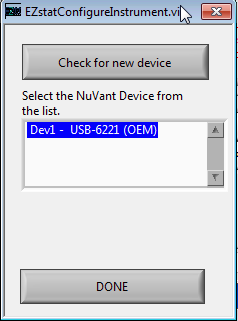
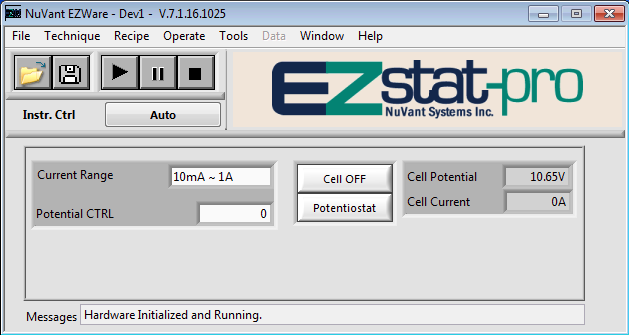

# EZstat PC: sleep, Windows Update and EZware's configuration, 2026-10-22

Runbook step 2, items 6 and 7, done by a Claude session over Remote Desktop
from des4, 03:49–04:01 UTC
([#231](https://github.com/vertical-cloud-lab/byu-vcl/issues/231)). Ours was
the only Windows session before and after, and EZware and NI MAX weren't
running at the start.

## Sleep and Windows Update (item 7)

[`windows/set-sleep-and-updates.ps1`](windows/set-sleep-and-updates.ps1)
`-Apply`, approved at its one UAC prompt (*Windows PowerShell*, verified
publisher *Microsoft Windows*), at 03:50 UTC.

| | Before | After |
|---|---|---|
| Sleep after, hibernate after (all 4 power plans, plugged in and on battery) | Not recorded: the first run couldn't read them (below) | **Never** (0) |
| USB selective suspend (all 4 plans) | Not recorded | **Off** |
| Hibernation | On, with hybrid sleep | **Off** (`powercfg -h off`). Start → Sleep (S3) still works if someone picks it |
| Windows Update, Control Panel | **Install updates automatically** (`AUOptions` 4) | Never check for updates (1) |
| Windows Update, policy | Not set | Automatic Updates disabled (`NoAutoUpdate` 1), no automatic restart with someone logged on (`NoAutoRebootWithLoggedOnUsers` 1) |
| Windows Update service (`wuauserv`) | Automatic, running | **Disabled, stopped** |
| Last successful install / check | 2019-09-12 / 2021-09-05 | unchanged |
| Downloaded updates waiting | **2,774 files, 430 MB** in `SoftwareDistribution\Download` | Still there, but nothing will install them |
| Restart pending | No | No |

The PC is a desktop (no battery) on the *Dell* power plan.

The automatic setting mattered even though the PC is offline: Windows Update
was free to install whatever it had already downloaded at its scheduled time,
and restart, in the middle of a run.

**The first run's "before" sleep values are lost.** Windows 7's
`powercfg -q` takes a plan and a subgroup but not a setting, and answers
`Invalid Parameters` otherwise, so the script printed `?`. The fixed script
reads the whole subgroup. The changes themselves all returned exit code 0, and
`powercfg -q SCHEME_CURRENT SUB_SLEEP` showed sleep and hibernate at 0 right
afterwards.

**To install a Windows update by hand later** (an `.msu` from a USB stick):
`wusa` fails while the service is disabled, so first run
`sc config wuauserv start= demand` as administrator, and set it back to
`disabled` afterwards.

Verification, the script rerun read-only at 03:51 UTC:

```
=== sleep (seconds; 0 = never)
Balanced: sleep after AC 0 / DC 0; hibernate after AC 0 / DC 0; USB selective suspend AC 0 / DC 0 (0 = off)
Dell [active]: sleep after AC 0 / DC 0; hibernate after AC 0 / DC 0; USB selective suspend AC 0 / DC 0 (0 = off)
High performance: sleep after AC 0 / DC 0; hibernate after AC 0 / DC 0; USB selective suspend AC 0 / DC 0 (0 = off)
Power saver: sleep after AC 0 / DC 0; hibernate after AC 0 / DC 0; USB selective suspend AC 0 / DC 0 (0 = off)
hibernation enabled: 0
batteries: 0 (0 = a desktop, so no lid setting to change)
The following sleep states are available on this system: Standby ( S3 )
The following sleep states are not available on this system:
  Standby (S1), Standby (S2): the system firmware does not support this standby state.
  Hibernate: Hibernation has not been enabled.
  Hybrid Sleep
=== Windows Update
policy NoAutoUpdate: 1
policy AUOptions: (not set)
policy NoAutoRebootWithLoggedOnUsers: 1
Control Panel AUOptions (1 never, 2 notify, 3 download, 4 install): 1
last successful install: 2019-09-12 15:04:30
last successful check: 2021-09-05 14:17:33
service wuauserv: start mode Disabled, state Stopped
restart pending for updates: False
restart pending for components: False
downloaded updates waiting: 2774 files, 430.2 MB
```

`sc qc wuauserv` agreed: `START_TYPE 4 DISABLED`, `STATE 1 STOPPED`.

## EZware: Tools → Configure (item 6)

| Time (UTC) | |
|---|---|
| 03:52 | Opened EZware: red *There is no NuVant instrument connected* |
| 03:53 | Tools → Configure. The list showed one device, **Dev1 – USB-6221 (OEM)**. Selected it and pressed DONE |
| 03:54 | No *Model Selection* prompt: EZware identified the EZstat-Pro itself (manual p. 43). Window titles end in *Dev1*, the EZstat-pro logo shows, and Messages reads *Hardware Initialized and Running* |
| 03:58 | File → Exit |
| 03:59 | Reopened: straight to *Dev1* and the logo. The choice sticks |
| 04:00 | Help → Instrument Info: *DAQ card SN: 1A801CD*, the serial NI MAX reports |
| 04:01 | File → Exit. Neither EZware nor NI MAX left running; disconnected without logging off |

| [Configure Instrument] | After DONE |
|---|---|
|  |  |

**Where EZware keeps the choice:** `%LOCALAPPDATA%\NuVant\EZware\Instr_config\EZstat_general_conf.xml`,
written at 03:53:56 UTC, with `DAQmx Device Name` = `Dev1` and the temperature
and mass-flow controllers marked not installed. `SNGL.mthd.cfg.xml` beside it
(the single-method settings) was written at the same moment. It's in the
Windows user's own profile, so **another Windows account has to run Tools →
Configure again**. While EZware holds the board it also writes
`%LOCALAPPDATA%\NuVant\Instr_InUse\27787725.dat` (27787725 is 0x1A801CD, the
board's serial).

**Idle readings, cell OFF:** Potentiostat mode, current range 10 mA – 1 A
(range 4, the coarsest), Potential CTRL 0, **Cell Potential 10.65 V, Cell
Current 0 A**, the same in screenshots 3 s apart and after reopening. That
looks like an input with nothing connected, sitting at the top of its range,
but nobody at the bench has confirmed the leads are free. With R1's resistor
connected and the cell still off, the potential should drop to near 0 V.

Nothing was pressed in EZware except Tools → Configure, DONE, Help →
Instrument Info, OK and File → Exit. Not Run, Cell ON/OFF or Potentiostat.
