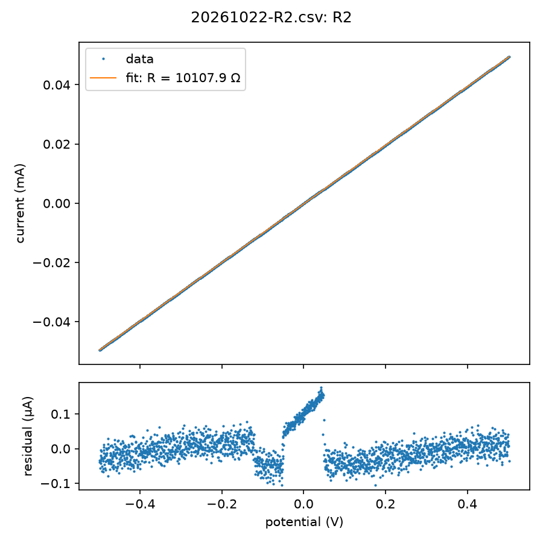

# 2026-10-22: dummy loads, R2 (10 kΩ)

The first run on the EZstat-Pro, for [#231](https://github.com/vertical-cloud-lab/byu-vcl/issues/231).
Ben Whitney clipped the resistor on at the bench. A Claude session ran EZware over Remote Desktop
from des4, 21:31–21:45 UTC. Nobody was at the PC.

| | |
|---|---|
| Instrument | NuVant EZstat-Pro, serial `EZST15073101 V2`, metal case. Board NI USB-6221 (OEM) "Dev1", serial 1A801CD, last calibrated 2015-07-16 |
| PC | Windows 7 Professional SP1, EZware 7.1.16.1025, LabVIEW Run-Time 2011 SP1 (11.0.448.0), NI-DAQmx 9.7.0 ([PC check](../../pc-check-2026-10-22.md)) |
| Load | A 10 kΩ resistor. White clip (reference, counter stacked on it) on one end, black clip (working, working sense) on the other, green clip (ground) free, on paper on the EZstat's top ([photo](20261022-R2-wiring.jpg)) |
| Meter | Neoteck NT8233D Pro, 2000 counts: **10.00 kΩ** on its 20 kΩ range. Listings for the same meter under other names give ±(0.8 % + 2 digits) there, so ±100 Ω, ±1.0 %. Neoteck's own figure, in the meter's manual, wasn't found online |

## R2 result

**The EZstat works, and it's within 1.1 % of the meter. That just misses the runbook's 1 % slope check,
but the meter can't resolve better than about ±1 %, so the slope check is inconclusive.**

| Check (runbook step 3) | Result |
|---|---|
| Wiring, cell off | Cell Potential −0.06 to −0.16 mV before the run (10.65 V with nothing connected) |
| Straight line through zero | Yes: R² = 0.999997, residuals 46 nA rms and 0.18 µA at most. Offset −0.24 µA at 0 V, the same as +2.5 mV of potential offset |
| ±50 µA at ±0.5 V | −49.56 µA at −0.498 V, +49.39 µA at +0.502 V |
| Both cycles on top of each other | Yes: 10,108.0 Ω and 10,107.9 Ω. Each of the four sweeps alone gives 10,107.6–10,108.1 Ω |
| Slope within 1 % of the meter | **10,108 Ω, +1.08 %**: fails by 0.08 points. Within 1 % plus the meter's ±1.0 % (`pass_within_meter_accuracy`) |

**Applied potential agrees with the measured potential.** Fitting the current against the setpoint
EZware programmed (a −0.5/+0.5 V triangle at 50 mV/s), rather than the potential it measured, gives
10,093 Ω. The measured potential follows the setpoint to within 3.2 mV, a gain of 1.0015. So two
independent paths agree to 0.15 %, and the ~1 % gap is between the EZstat's current reading and the
meter's resistance reading. This data can't say which of them is off.

**The steps in the residuals are the potential input changing range.** The EZstat measures potential
on two ranges, ±50 mV and ±10 V, and switches between them on its own (manual p. 9). Here it switched at
about ±50 mV, on each of the four sweeps. Fitted alone:

| Region | Points | R | Measured potential against the setpoint |
|---|---|---|---|
| \|V\| > 60 mV (±10 V range) | 1,761 | 10,108 Ω | gain 1.0015, offset +1.4 mV |
| \|V\| < 45 mV (±50 mV range) | 184 | 9,989 Ω | gain **0.9906**, offset +0.3 mV |

The setpoint and the ±10 V range agree, and the ±50 mV range reads 0.94 % low against both. So its
9,989 Ω, closer to the meter, is probably the ±50 mV range's own error and not evidence that the meter
is right. That's an inference from one run. It matters wherever a result rests on potentials below
50 mV, such as R3's 50 mV step.

**What would settle the 1 %:** a reference better than the meter. Either a 0.1 % 10 kΩ resistor, or
this resistor measured on a bench multimeter of 0.05 % or better. With a better value, rerun the check
with that value in `--r-ohm`; no new run is needed. R1 (1 kΩ, the 100 µA–10 mA range) will show whether
the ~1 % follows the current range.

## Files

| File | What | SHA-256 |
|---|---|---|
| [`20261022-R2.nuvdt`](20261022-R2.nuvdt) | EZware's own file: the method and the data. EZware asked for its name at Start and wrote it when the run ended | `efbcc833…6ac8ef6` |
| [`20261022-R2.csv`](20261022-R2.csv) | Export with all five columns ticked. 2,001 rows, one every 40 ms | `194a2405…f93124383` |
| [`20261022-R2.check.png`](20261022-R2.check.png), [`.check.json`](20261022-R2.check.json) | `python analysis/check_dummy_runs.py R2 results/20261022_dummy-loads/20261022-R2.csv --r-ohm 10000 --meter-pct 1.0` | |
| [`20261022-R2-wiring.jpg`](20261022-R2-wiring.jpg) | des4's camera 0 at 21:30 UTC, seven minutes before the run | |

The PC keeps both data files in `Documents\EZware_user_Files`.

The export's header is `"Absolute Time", "Relative Time HH:MM:SS", "Relative Time [s]", "Cell Potential[V]", "Cell Current[A]"`.
The two text time columns read like `3:37:24.160 PM 10/22/2026` (PC time, MDT) and
`5:00:00.040 PM 12/31/1903`: the second is elapsed time added to LabVIEW's 1904 epoch, shown in local
time. Use `Relative Time [s]`.
