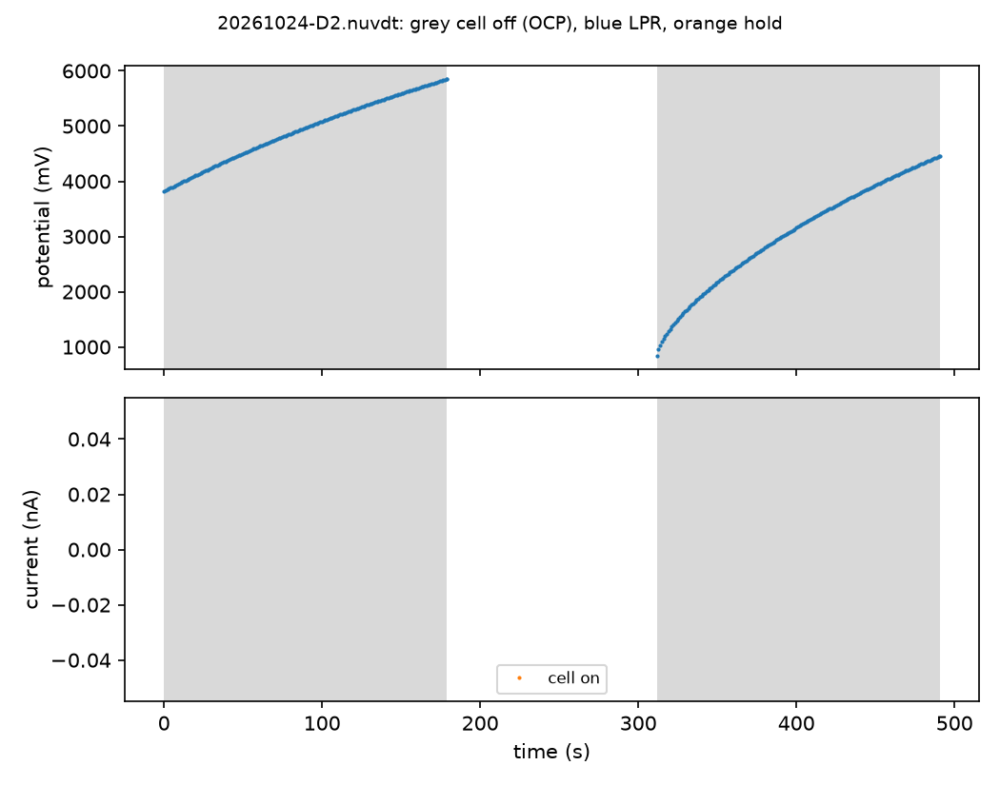
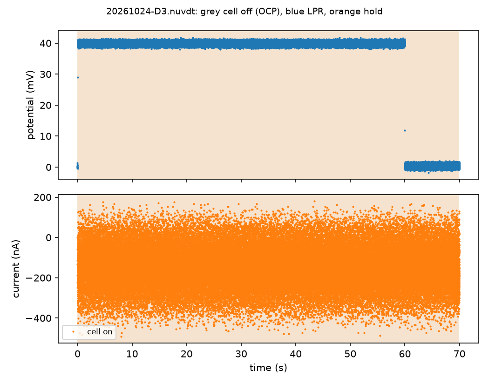

# 2026-10-24: dummy runs of the corrosion checks, leads open

Sterling asked for "whatever you can on the ezstat in current config", as dummy runs of the tests
to come ([PR #291](https://github.com/vertical-cloud-lab/byu-vcl/pull/291)). A Claude session ran
EZware over Remote Desktop from des4, 05:43–06:13 UTC (23:43–00:13 MDT). Nobody was in the lab.

| | |
|---|---|
| Instrument | NuVant EZstat-Pro, serial `EZST15073101 V2`, metal case. Board NI USB-6221 (OEM) "Dev1" |
| PC | Windows 7 Professional SP1, EZware 7.1.16.1025, LabVIEW Run-Time 2011 SP1, NI-DAQmx 9.7.0. Ours was the only Windows session, and EZware wasn't running when we logged in |
| Leads | **Open.** The 10 kΩ from R2 had been taken off. The white clip's hook (reference, with counter stacked on it) rests in the black clip (working, working sense), but they don't touch: the cell-off reading was 10.3 V, as with nothing connected, and D1 found no slope ([photo](20261024-leads-0539.jpg)). Green (ground) free |

Every potential below was applied across open leads, so no current could flow except leakage. What
the runs show is how EZware's methods behave, what they save, and each current range's offset and
noise. They say nothing about a resistor or a cell.

## What ran

| Run | Stands in for | Technique and settings | Range | What it showed |
|---|---|---|---|---|
| D1 | C2's low-current range | Linear Sweep Voltammetry: 5 s at −10 mV, then −10 → +10 mV at 0.167 mV/s. Absolute potentials, "Use OCV instead" unticked | **10 nA–1 µA**, fixed (only the 1uA auto-range box ticked). First use of this range | **Floor: −0.555 nA, SD 0.020 nA**, no slope. **9 points**, one per 2 mV (12 s apart), from −8.8 to +7.0 mV: the export lacks the sweep's last two |
| D2 | C1's sequence | Corrosion Studies → Corrosion Inhibition Tests: open-circuit monitoring, log 1 s, monitoring time 6 min; a corrosion-resistance measurement every 3 min, ±10 mV at 10 mV/min, Rs not subtracted | 1 µA–100 µA, fixed | Ran to the end: OCP 3 min, LPR, OCP 3 min, LPR, 10.4 min in all. **Each LPR is placed around the OCP just measured**, which here floated to 5.8 V and 4.4 V. With the potential rising about 10 mV/s, each sweep started 30–37 mV below the last logged OCP point. LPR current −144.7 nA, SD 0.44 nA, no slope. **The `.nuvdt` holds only the OCP points; the CSV export only the last LPR, 9 points** |
| D3 | C1's +40 mV hold | Step Techniques → Chrono Amperometry: 5 s pretreatment, +40 mV, then 0 V for 10 s. Asked for 120 s at +40 mV, **coerced to 60 s** | 1 µA–100 µA, fixed | **Offset −0.146 µA.** Sampled every 1 ms although the field said 1000 ms: SD 105 nA per point, 1.3 nA for 1 s means. No file-name prompt at Start |

All three ended with **Cell OFF** and "Data Collection Completed". EZware was closed with File → Exit
at 06:12 UTC, and `tasklist` confirmed it had gone.

## What it means for C1–C3

- **C1's hold check needs the offset taken off.** At +40 mV on 10.00 kΩ, C1 expects 4.00 µA within
  3 %, so ±0.12 µA. The 1 µA–100 µA range alone reads −0.146 µA with nothing connected (R2 saw
  −0.24 µA at 0 V on the same range). Subtract an open-leads reading taken the same day, or the check
  fails on the offset alone. Rp comes from a slope, so the offset doesn't touch it.
- **C1's 10-minute hold can't be Chrono Amperometry.** Its step is capped at 60 s, and it records
  1,000 points a second: 70,000 in this 70 s run, 6.7 MB of CSV. Use Time Base Techniques →
  Extended Time Base, which has a log interval and a time limit ([map](../../ezware-map.md#33-techniques)), or
  Hold/Ramp/Step. Neither has been opened yet.
- **An EZware sweep records one point per 2 mV, whatever the scan rate.** R2's CV at 50 mV/s gave a
  point every 40 ms, also 2 mV. At 0.167 mV/s that's one point per 12 s, and the last two never reach
  the export: 9 points for ±10 mV. That's enough to fit a straight line on a resistor, but coarse for
  a real electrode, and the missing points are always at the sweep's end.
- **Save each LPR before the next one starts.** The Corrosion Inhibition Test kept only the open-circuit
  points in its `.nuvdt` (current NaN), and Display Cell Data exported only the second LPR. The
  first LPR's points weren't saved anywhere found. For C1, set the monitoring time equal to the
  measurement interval (30 min each), so the one LPR comes at the end and is the one exported.
- **The low range is quiet enough for C2.** On 10 nA–1 µA the floor is −0.55 nA with 0.02 nA of noise.
  DAL's well (13 nA–1.7 µA in LPR) is well above it. Passive aluminium (~1 nA) is near the offset,
  but its Rp is a slope, which the offset doesn't change.
- **A floating OCP is easy to spot.** With nothing between reference and working, the cell-off
  potential climbed to nearly 6 V within minutes, and started again from under 1 V after each LPR.
  In C3, an OCP that reads volts or keeps climbing means the reference isn't wetted or connected.

## Files

| File | What it is |
|---|---|
| [`20261024-D1.csv`](20261024-D1.csv), [`.nuvdt`](20261024-D1.nuvdt) | D1. The two hold the same 9 points |
| [`20261024-D2.nuvdt`](20261024-D2.nuvdt) | D2's open-circuit monitoring, 344 points; current NaN throughout |
| [`20261024-D2.csv`](20261024-D2.csv) | D2's second LPR, the only one exported |
| [`20261024-D3.nuvdt`](20261024-D3.nuvdt) | D3, all 70,000 points (2.2 MB). Its 6.7 MB CSV export isn't committed: the `.nuvdt` has the same data |
| [`20261024-D3.0.1s-means.csv`](20261024-D3.0.1s-means.csv) | D3 as 0.1 s means, 700 rows, for reading by eye |
| `*.check.json`, `*.check.png` | [`check_corrosion_runs.py`](../../analysis/check_corrosion_runs.py)'s output for each file (`*.nuvdt.check.*` for a `.nuvdt`) |
| [`20261024-leads-0539.jpg`](20261024-leads-0539.jpg) | Camera 0 at 05:39 UTC, cropped to the clips |

The checker reads EZware's `.nuvdt` directly. Its layout was worked out from these files and checked
against R2's: a text header, then from byte 536 one 32-byte big-endian record per point, a LabVIEW
timestamp, the current and the potential. R2's 2,001 records match its CSV export exactly.

```
python analysis/check_corrosion_runs.py results/20261024_dummy-runs/20261024-D2.nuvdt
```





## How the session went

- **Avast** had a full-screen *"Let's try a restart instead"* window open on the desktop (its update
  fails, the PC being offline). Closed with its Exit button. Avast itself was left alone.
- **A `.cmd` run from `\\tsclient\ez`** brings up *Open File – Security Warning* first; it needs Run.
- **The file-name prompt at Start comes and goes.** LSV and the Corrosion Inhibition Test asked for
  the `.nuvdt` name; Chrono Amperometry didn't. The keys meant for that prompt (Ctrl+A, the name,
  Enter) went to EZware's main window instead. Ctrl+A is Abort there. The run carried on and nothing
  changed, but **screenshot before typing a file name.**
- The prompt opens in the last folder used, so D2's `.nuvdt` went straight to des4's share, and D1's
  stayed in `Documents\EZware_user_Files`, whence it was copied.
