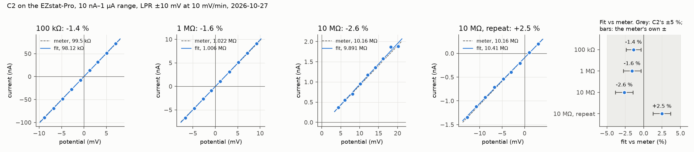

# 2026-10-27: C2, low currents on the 100 kΩ, 1 MΩ and 10 MΩ

C2 of [§7 of the runbook](../../README.md#c2-low-currents-the-cubxl-well-and-passive-aluminium), for
[#231](https://github.com/vertical-cloud-lab/byu-vcl/issues/231). Ben Whitney measured the three
resistors, stayed at the bench and swapped them when asked
([PR #291](https://github.com/vertical-cloud-lab/byu-vcl/pull/291)). A Claude session ran EZware over
Remote Desktop from des4, 21:28–21:59 UTC (15:28–15:59 MDT). The PC's own screen was at its login
prompt throughout, and ours was the only Windows session.

| | |
|---|---|
| Instrument | NuVant EZstat-Pro, metal case. Board NI USB-6221 (OEM) "Dev1" |
| PC | Windows 7 Professional SP1, EZware 7.1.16.1025, LabVIEW Run-Time 2011 SP1, NI-DAQmx 9.7.0. EZware wasn't running when we logged in |
| Loads | 5 % (gold-band) resistors, wired as for R2: white clip (reference, counter stacked on it) on one end, black clip (working, working sense) on the other, on paper on the EZstat's top, green clip free ([photo](20261027-C2-wiring.jpg), camera 0 at 21:27 UTC, the 100 kΩ) |
| Meter | Neoteck NT8233D Pro, each resistor off the clips: **99.5 kΩ, 1.022 MΩ, 10.16 MΩ**. ±1.0 % at 100 kΩ and ±1.2 % at 1 MΩ and 10 MΩ, per listings of the same meter |
| Range | Fixed 10 nA–1 µA (General Method Settings: only the 1uA auto-range box ticked). Electrode area 1 cm² |
| Method | C1's repeat: Corrosion Inhibition Test, open-circuit monitoring 1 min logged every 1 s, measurement interval 1 min, then one LPR: polarization range 10 mV, 10 mV/min, Account for Rs unticked. About 3.3 min per run |

## Result: C2 passes. 100 kΩ and 1 MΩ read 1.4 % and 1.6 % low; the 10 MΩ brackets the meter

| Run | Meter | Rp, fit to the export | EZware's own Rp | Limit (§7) |
|---|---|---|---|---|
| `20261027-C2-100k` | 99.5 kΩ | **98,117 Ω, −1.39 %** (±0.04 %) | 98,117 Ω | 5 % ✅ |
| `20261027-C2-1M` | 1.022 MΩ | **1.0058 MΩ, −1.58 %** (±0.11 %) | 1.0058 MΩ | 5 % ✅ |
| `20261027-C2-10M` | 10.16 MΩ | 9.891 MΩ, −2.65 % (±3.3 %) | 9.8168 MΩ, −3.38 % | recorded, not judged |
| `20261027-C2-10M-rep` | 10.16 MΩ | 10.412 MΩ, +2.48 % (±1.2 %) | 10.401 MΩ, +2.37 % | recorded, not judged |

The ± is one standard error of the slope from the fit's residuals. Every run ended with Cell OFF, and
the 1-min OCPs before the LPRs were −50, −57, −57 and −22 µV (SD 11–17 µV).



- **The two judged resistors read low by about the same amount, just outside the meter's own
  ±1.0–1.2 %.** A likely share of it is the ±50 mV potential range, which read 0.94 % low in R2:
  that alone makes Rp read 0.94 % low in a ±10 mV LPR. On C1's 1 µA–100 µA range it was cancelled
  by that range's +1.08 % on current; on this range nothing cancels it. That's an inference from R2,
  not something these runs measure on their own.
- **10 MΩ is noise-limited, not biased.** At ±10 mV it carries ±1 nA, and the points scatter by
  18–52 pA (residual SD), so one LPR gives Rp to ±1–3 %. The two runs, −2.6 % and +2.5 %, average
  10.15 MΩ, −0.1 % from the meter. Their difference, 5 %, is about what that noise allows.
- **The offset is small on this range.** Where each fit crosses 0 V: +0.16, −0.03, −0.07 and
  −0.09 nA (D1 on open leads, 2026-10-24: −0.55 nA). That's what EZware's "Corrosion Potential"
  reflects: the zero-current crossing, +0.80 and +0.96 mV on the 10 MΩ, against an OCP of
  −0.06 mV. Take E_corr from the OCP, as for C1.

## EZware placed the 10 MΩ sweeps off the OCP

Each LPR should run from 10 mV below the OCP to 10 mV above it. EZware's "Potential CTRL" shows
where each sweep ended, and the exported points where it ran:

| Run | OCP before it | Sweep ended at | So it ran about | Exported points |
|---|---|---|---|---|
| 100 kΩ | −0.05 mV | +9.78 mV | −10.2 to +9.8 mV | −8.80 to +7.06 mV |
| 1 MΩ | −0.06 mV | +12.05 mV | −8.0 to +12.1 mV | −6.67 to +9.20 mV |
| 10 MΩ | −0.06 mV | +22.75 mV | +2.8 to +22.8 mV | +4.34 to +20.16 mV |
| 10 MΩ, repeat | −0.02 mV | +5.57 mV | −14.4 to +5.6 mV | −12.80 to +3.08 mV |

On the 100 kΩ the sweep was centred within 0.2 mV of the OCP. On the 10 MΩ it was off by +12.8 mV
and then by −4.4 mV, so the offset isn't fixed. The logged OCPs don't show anything like it (SD
under 20 µV). **A guess at the cause:** with the cell off, a 10 MΩ load leaves the sense inputs on a
high-impedance node, and whatever reading EZware takes to place the sweep catches a transient, for
example from the relay that switches the cell on. On a resistor it doesn't matter, since Rp is a
slope and a resistor is linear. On a corroding electrode it would: a sweep from +3 to +23 mV is all
anodic. A real electrode's double-layer capacitance should make that node much stiffer, but that's
untested. **For C4–C6, check where each LPR actually ran,** from its exported points.

## What else C2 found in EZware

- **The default current range follows the auto-range boxes.** In General Method Settings, picking
  10nA ~ 1uA in *Potentiostat Default Current Range* didn't stick while 100uA was the only box
  ticked: the field went back to 1uA ~ 100uA, whether the item was clicked or chosen with Up and
  Enter. Ticking 1uA and then unticking 100uA switched the field to 10nA ~ 1uA by itself. The
  list ignores mouse clicks, as EZware's menus do.
- **The export's time columns reset between sessions.** Tools → File Export → Data Configuration
  had only Voltage and Current ticked again, as on 2026-10-26. Once ticked, they stayed ticked for
  the rest of the session.
- **EZware's own Rp agrees with the fit to the export to 5 digits on the 100 kΩ and 1 MΩ, but not on
  the 10 MΩ** (9.8168 against 9.891 MΩ, and 10.401 against 10.412). So its fit uses at least one
  point the export doesn't contain, perhaps one of the two that never reach it. That matters only
  where the noise is a few %.
- **The run's file prompt opened in `EZware_user_Files`**, so the run name alone was enough there.
  Export as opened in EZware's program folder, as before, and took
  `%USERPROFILE%\Documents\EZware_user_Files\<name>`.

## What ran

| Run | UTC | Load | Notes |
|---|---|---|---|
| `20261027-C2-100k` | 21:33:25–21:36:30 | 100 kΩ (99.5 kΩ) | Cell-off reading before it −27 to −116 µV (open leads read 10.3 V on 2026-10-24) |
| `20261027-C2-1M` | 21:40:44–21:44:05 | 1 MΩ (1.022 MΩ) | Swapped by Ben at 21:38, cell off; cell-off reading −78 to −164 µV |
| `20261027-C2-10M` | 21:46:30–21:49:50 | 10 MΩ (10.16 MΩ) | Swapped at 21:45; cell-off reading −113 µV |
| `20261027-C2-10M-rep` | 21:53:00–21:56:30 | 10 MΩ (10.16 MΩ) | Run to see whether the first 10 MΩ sweep's offset came back. It did, the other way |

## Files

| File | What it is |
|---|---|
| `<run>.nuvdt` | The run's 1-min OCP, 58 points; current NaN (cell off). The LPR isn't in it |
| `<run>.csv` | **EZware's own results**: Rp ("Corrosion Resistance") and the zero-current potential |
| `<run>-export.csv` | The LPR, 9 points, exported from Display Cell Data with all five columns |
| `*.check.json`, `*.check.png` | [`check_corrosion_runs.py`](../../analysis/check_corrosion_runs.py)'s output: `--r-ohm <meter> --tol 5` for the LPRs |
| [`20261027-C2-summary.png`](20261027-C2-summary.png), [`plot_c2_summary.py`](plot_c2_summary.py) | The figure above, and the script that draws it |
| [`20261027-C2-wiring.jpg`](20261027-C2-wiring.jpg) | Camera 0 at 21:27 UTC, cropped to the clips, with the 100 kΩ on |

```
cd analysis
python check_corrosion_runs.py ../results/20261027_c2-low-currents/20261027-C2-1M-export.csv --r-ohm 1022000 --tol 5
```
