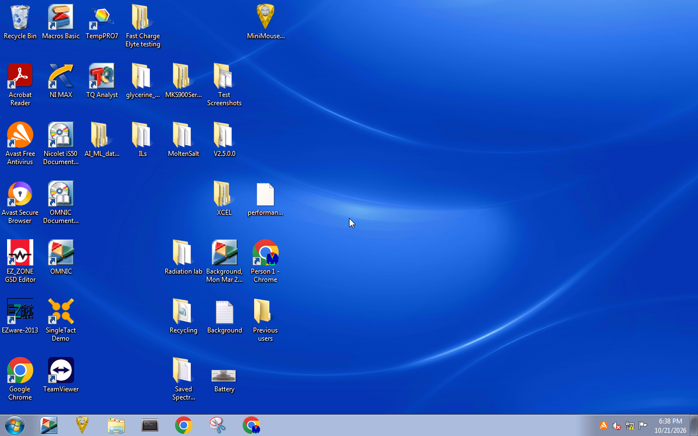

# Remote Desktop to the EZstat Pro PC

Scripts for a Remote Desktop session to the EZstat Pro's Windows 7 PC (`192.168.231.10`),
with screenshots, made from the CubXL Pi, which is cabled to the PC
([#231](https://github.com/vertical-cloud-lab/byu-vcl/issues/231)). Sessions are look-only
unless you send keystrokes with `keys` (see [Sending keystrokes](#sending-keystrokes)).
They need `CUBXL_PI_USERNAME`, `CUBXL_PI_HOSTNAME`, `POTENTIOSTAT_PC_USERNAME` and
`POTENTIOSTAT_PC_PASSWORD`. Only `freerdp3-x11` and `xvfb` are needed on the Pi, and both
are already installed.

```bash
S=scripts/ezstat-pc-rdp
$S/rdp_look.sh start                          # copy the helper to /dev/shm on the Pi, connect
$S/rdp_look.sh peek /tmp/ezrdp/raw/peek1      # current frame + FreeRDP log (redacted)
$S/rdp_look.sh shots /tmp/ezrdp/raw/shots 38 2   # 38 frames, 2 s apart; repeats dropped
$S/rdp_look.sh keys < script.txt              # only if the wheels were there at start
$S/rdp_look.sh stop                           # disconnect, check, clean up
python $S/xwd_to_png.py /tmp/ezrdp/raw/shots/f0.xwd.gz /tmp/ezrdp/raw/shot1.png
python $S/redact_png.py /tmp/ezrdp/raw/shot1.png docs/images/ezstat-pc/<name>.png [x0,y0,x1,y1 ...]
```

Keep raw frames outside the repo. Commit only the output of `redact_png.py`, after looking at it.

## How it keeps to "look only"

This section is about sessions without `keys`.

- **Credentials:** built with bash's `printf` builtin and sent over SSH's stdin to
  `xfreerdp3 /args-from:stdin`, so they never appear in argv or on disk on either machine.
  They're passed on fd 7, because `xvfb-run` uses fd 3 and closes it for its command.
- **No redirection:** `-clipboard` turns the clipboard off, and drives and printers are off
  unless requested. FreeRDP still loads its audio channel, with a silent ("fake") backend.
- **No input from us:** nothing drives the virtual display's keyboard or mouse, and
  `-mouse-motion` would drop pointer motion anyway. FreeRDP itself sends a little input when
  the session starts, as mstsc does: a Tab key *release*, a toggle-key sync (Caps, Num and
  Scroll Lock off), another Tab release, and a pointer move to the virtual pointer at the
  screen centre. It sends these twice, whatever the X focus is (`freerdp_focus_required` →
  `xf_keyboard_focus_in` in FreeRDP 3.15's `xf_client.c`). There are no key presses or
  clicks.
- **Disconnect, never log off:** `stop` sends SIGTERM to `xfreerdp3`. Its exit code 145 is
  `XF_EXIT_CONNECT_CANCELLED`; a log-off would be 2. The Windows session stays signed in,
  in the disconnected state.
- **Safety net:** the session runs under `timeout 360`. If `stop` never comes, that kills
  `xfreerdp3` and Xvfb, and the temp directory is deleted.
- **Screenshots** are copies of Xvfb's `-fbdir` framebuffer file, in XWD format. **The XWD
  header contains the Pi's hostname**, so convert to PNG and never commit an XWD.

**It still takes over the PC's screen.** Windows 7 allows one session. Connecting moves the
signed-in session off the PC's own monitor, so anyone at the PC sees the sign-in screen.
Signing in there brings back the same session, with everything still running.

## Sending keystrokes

[`pi_rdp_keys.py`](pi_rdp_keys.py) types into the session: it injects key events into the
session's Xvfb display with the XTEST extension, and `xfreerdp3` forwards them to the PC as
scancodes. It never sends a mouse event. It uses python-xlib, which is pure Python, from
wheels that `start` copies into the session's temp directory, so nothing is installed on
the Pi and nothing is left once the session ends. `keys` is only available if the wheels
were in `/tmp/ezrdp/whl` when `start` ran:

```bash
mkdir -p /tmp/ezrdp/whl
pip download --no-deps --only-binary=:all: python-xlib==0.33 six==1.16.0 -d /tmp/ezrdp/whl
RDP_SESSION_MAX_S=1500 $S/rdp_look.sh start    # a longer safety net than look-only's 360 s
printf 'key super+r\n' | $S/rdp_look.sh keys    # then peek, and look before going on
```

A script has one action per line: `key super+r` (modifiers, then an X keysym name),
`type <text>` (printable ASCII, typed literally) or `sleep <seconds>`.

- **Type a command, look at it, and only then press Enter**, in separate `keys` calls. A
  line that comes out wrong can be cleared with `key Escape` in Command Prompt.
- That check caught a real fault: Xvfb's keymap also has `(` and `)` on spare keycodes 187
  and 188, which FreeRDP can't translate (its log says `Unknown key with X keycode 0xbb`),
  so they silently went missing. The helper now picks the main-keyboard key (Shift+9 and
  Shift+0). It assumes the PC uses the US keyboard layout, as this one does.
- In Command Prompt, run `prompt $g` first. The default prompt shows the account's
  profile path, and so its username. Even so, screenshots of a Command Prompt usually show
  names, so keep them on the runner.
- Starting Command Prompt from the Run box (Win+R) puts `cmd` at the top of the Run box's
  history.

## Run of 2026-10-21

| | |
|---|---|
| Connected | 23:49:34 UTC. The desktop had drawn 5 s later. There was no sign-in screen and no "another user" dialog |
| Screenshots | [`2026-10-21-rdp-desktop-1.png`](../../docs/images/ezstat-pc/2026-10-21-rdp-desktop-1.png) at 23:50:53.7 and [`-2.png`](../../docs/images/ezstat-pc/2026-10-21-rdp-desktop-2.png) at 23:51:03.8 UTC. The only change between them is the taskbar clock, 5:50 → 5:51 PM ([crop](../../docs/images/ezstat-pc/2026-10-21-rdp-clock-1-vs-2.png)) |
| Redaction | OCR found no instance of the username. 13 desktop labels that are people's names or look like user IDs were blacked out, since this repo is public |
| Disconnected | 23:51:41 UTC, `xfreerdp3` exit 145 |
| Afterwards | `deckcam` active (same PID, no restarts). No `xfreerdp3`, `Xvfb`, `xvfb-run` or temp files left on the Pi |

## Run of 2026-10-22: people's folders moved off the desktop

Asked for in [#231](https://github.com/vertical-cloud-lab/byu-vcl/issues/231): put the 13
desktop items blacked out in the 2026-10-21 screenshots (folders and files named after
people, or after what look like their user IDs) into one new folder on the desktop.

**What changed on the PC:** a new folder, `Previous users`, in the signed-in account's own
Desktop folder (`%USERPROFILE%\Desktop`), now holds those 13 items, 11 folders and 2 files.
Nothing was deleted, renamed or opened. Everything else on the desktop is where it was,
and the shared Public desktop, which holds only program shortcuts, wasn't touched. The
items' names aren't recorded here, since this repo is public; `dir /b "Previous users"` on
the PC lists them.

| | |
|---|---|
| Connected | 00:33:57 UTC. The desktop drew straight away: no sign-in screen, no dialog, no windows open |
| Opened | Command Prompt, from the Run box (Win+R). The Run box was pre-filled with a `cmd /c whoami /groups … > \\tsclient\ez\…` line from someone's earlier session that used a redirected drive, and was replaced by typing `cmd` |
| Found | `dir /b` of the Desktop folder, numbered with `findstr /n`, written to `%TEMP%`. The 13 items were lines 2, 6–8, 12–16, 20–22 and 28, matching the 2026-10-21 black boxes one for one. All were in the account's Desktop folder |
| Moved | `mkdir "Previous users"`, then, by line number, so that no name had to be typed: `for /f "tokens=1* delims=:" %a in ('findstr /n "^" "%TEMP%\ezdesk.txt"') do @for %n in (2 6 7 8 12 13 14 15 16 20 21 22 28) do @if "%a"=="%n" (echo %a & move "%b" "Previous users\")`. Output: `1 dir(s) moved.` 11 times and `1 file(s) moved.` twice, no errors |
| Checked | The Desktop folder went from 31 entries to 19 (31 − 13 + `Previous users`). `Previous users` holds exactly the 13. The temporary listing was deleted, and Command Prompt closed with `exit` |
| Disconnected | 00:38:47 UTC, `xfreerdp3` exit 145. The Windows session is still signed in, with the desktop as shown below |
| Afterwards | `deckcam` active (same PID, no restarts). No `xfreerdp3`, `Xvfb`, X locks or temp files left on the Pi |

The desktop afterwards ([full size](../../docs/images/ezstat-pc/2026-10-22-desktop-after-move.png)).
OCR finds neither the username nor any of the moved items' names in it.



**To undo**, open `Previous users` on the PC's desktop, select everything (Ctrl+A) and drag
it back onto the desktop, then delete the empty folder.
