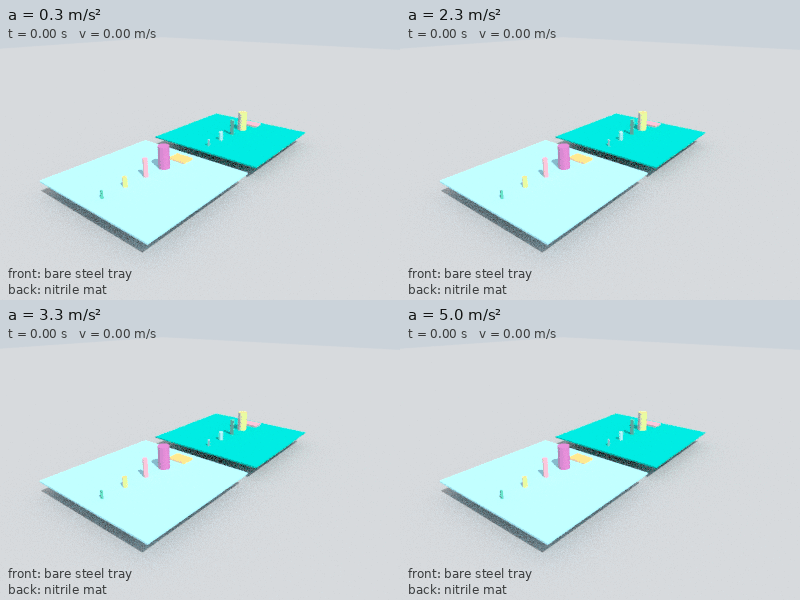
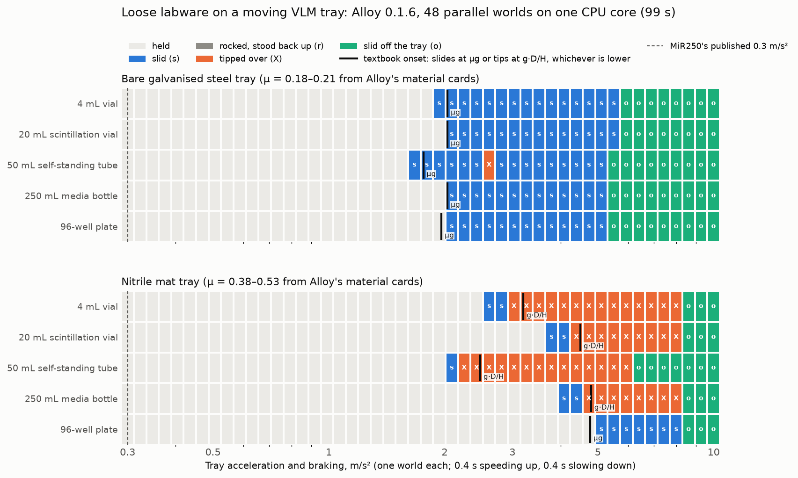
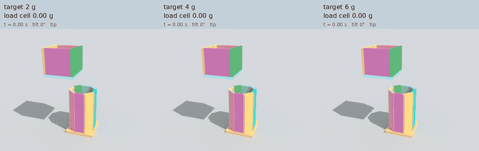
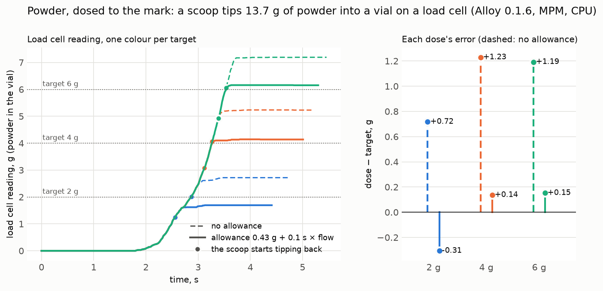
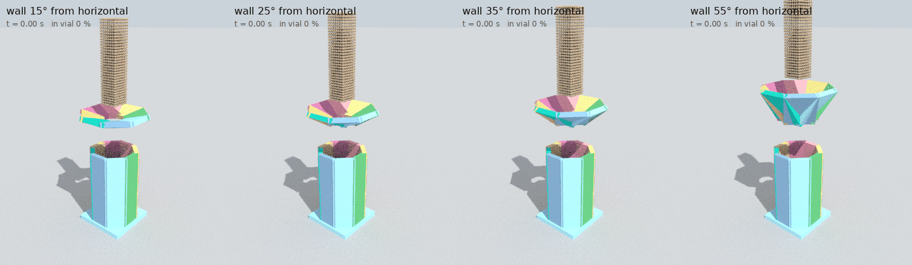
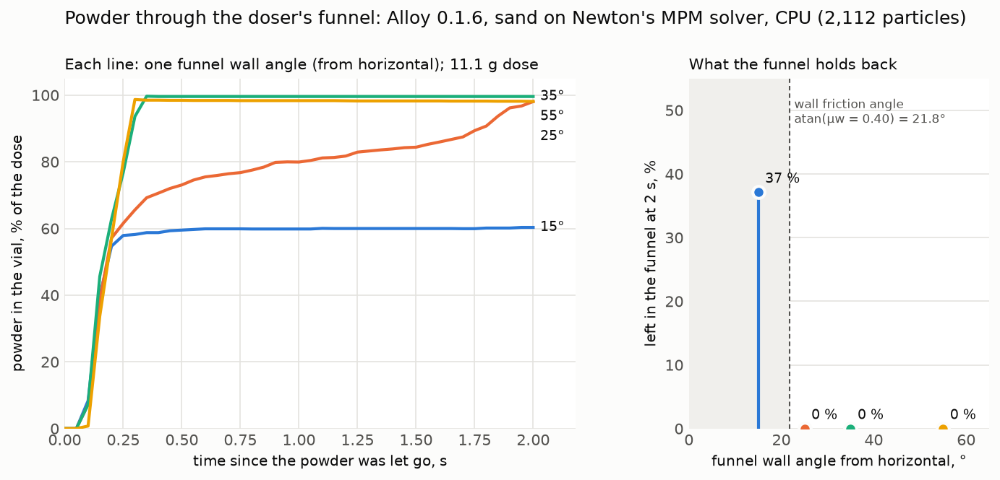

# Alloy physics engine, tried on lab hardware (#351)

[#351](https://github.com/vertical-cloud-lab/byu-vcl/issues/351) asked for a try of
[Alloy](https://alloy.argonrobotics.ai/), and for something like its demos made with lab equipment. Alloy is Argon
Robotics' open-source physics engine for robot learning (`pip install alloy-engine`, 0.1.6, released 2026-11-17,
Apache-2.0). It steps rigid bodies and robots in MuJoCo, cloth in Newton's VBD solver, sand and pastes in Newton's
MPM solver and liquids in its own DFSPH solver, all in one scene and in many parallel worlds.

Its demos are short clips with one-line captions, such as "Water, poured to the line" and "1,024 towers, 1,024
different falls". This folder has one of each kind, made with lab equipment:

1. **The vertical lift module (VLM) ([#303](https://github.com/vertical-cloud-lab/byu-vcl/issues/303), [#53](https://github.com/vertical-cloud-lab/byu-vcl/issues/53)).**
   48 trays, 48 accelerations: loose labware on a tray that speeds up and stops, with one acceleration per world.
2. **The powder doser: "Powder, dosed to the mark".** A scoop tips powder into a vial on a simulated load cell, and a
   controller tips it back at a target mass. This is Alloy's water pour, with powder and closed loop.
3. **The powder doser's funnel.** Powder dropped through a funnel into a vial, at four wall angles.

Everything ran on the CPU of a GitHub Actions runner (4 cores, 16 GB, no GPU), and every number below comes from
these runs.

## 1. VLM tray: how hard can a tray accelerate before loose labware moves?



[`vlm_tray.py`](vlm_tray.py). Each world has two kinematic trays moving side by side:

- **Front:** bare galvanised steel, like a Kardex tray's sheet.
- **Back:** covered by a nitrile mat.

Each tray carries the same five items, standing loose with no rack:

- a 4 mL vial;
- a 20 mL scintillation vial;
- a 50 mL self-standing tube;
- a 250 mL media bottle;
- a 96-well plate.

The trays use the tray's 864 mm depth along the motion. In every world they speed up at +a for 0.4 s, then slow down
at −a for 0.4 s, which is one extraction or one MiR move. Its start and its stop both push on the load. Across the
48 worlds, a runs geometrically from 0.3 to 10 m/s².

The friction for each pair is the one Alloy itself uses. A pair card's μ applies where one ships. Otherwise μ is the
harmonic mean of the two materials' `mu_dynamic` (AGENTS.md §4), read from the cards installed with Alloy:

- glass on galvanised steel: 0.21;
- glass on nitrile: 0.53.

**One CPU core ran all 48 worlds in 99 s**, and every world passed Alloy's health check.



**Alloy's onsets land within 15 % of the textbook ones, and early rather than late.** A rigid block on an
accelerating floor slides when a > μg and tips when a > g·D/H (D its base along the motion, H its height),
whichever comes first. Slides start at −12 % to +7 % of μg, and tips at −15 % to −1 % of g·D/H:

| Tray | Item | μ (Alloy's cards) | Textbook, m/s² | Alloy, m/s² (last world held – first that didn't) |
|---|---|---|---|---|
| bare steel | 4 mL vial | 0.21 | slides at 2.03 | slides at 1.80–1.94 |
| bare steel | 20 mL scintillation vial | 0.21 | slides at 2.03 | slides at 1.94–2.09 |
| bare steel | 50 mL self-standing tube | 0.18 | slides at 1.76 | slides at 1.55–1.67 |
| bare steel | 250 mL media bottle | 0.21 | slides at 2.03 | slides at 1.94–2.09 |
| bare steel | 96-well plate | 0.20 | slides at 1.96 | slides at 1.94–2.09 |
| nitrile mat | 4 mL vial | 0.53 | tips at 3.20 | tips over at 2.81–3.03 |
| nitrile mat | 20 mL scintillation vial | 0.53 | tips at 4.50 | tips over at 4.08–4.40 |
| nitrile mat | 50 mL self-standing tube | 0.38 | tips at 2.47 | tips over at 2.09–2.25 |
| nitrile mat | 250 mL media bottle | 0.53 | tips at 4.80 | tips over at 4.40–4.74 |
| nitrile mat | 96-well plate | 0.49 | slides at 4.78 | slides at 4.74–5.11 |

**What it means for the VLM and the MiR:**

- **Nothing moves at the MiR250's published 0.3 m/s²,** with or without a mat.
- **On bare steel, everything slides from about 1.7–2 m/s².** Glass and plastic on galvanised steel have little
  friction (μ ≈ 0.2).
- **A mat stops the sliding, but then tall items tip over instead:**
  - the 50 mL tube from about 2.2 m/s²;
  - the 4 mL vial from about 3;
  - the 250 mL bottle from about 4.5.

  Tipping comes in 1–15 % under the static g·D/H. A likely reason, not checked here, is that the stop reverses the
  push while an item is still rocking, a dynamic effect that the static rule leaves out.
- **#303's VLM notes give no acceleration for the Shuttle's extractor.** Until Kardex gives one, assume loose vials
  need a rack. A mat alone doesn't hold them.

**Caveats:**

- **Alloy's contacts are soft.** An item that holds lags its tray by 8.1 ms × the tray's speed. That is the same for
  every item, mass and material, and the lag goes away when the tray stops. Slip is therefore counted beyond that
  lag, with τ fitted in the 0.3 m/s² world.
- **On the mat, items creep 3–10 mm just before they tip.** These are the blue cells left of the orange ones.
- **The drive is a staircase.** A kinematic body moves at a constant speed between `sim.drive` calls, so the tray's
  speed steps by a·2.5 ms every 2.5 ms. The slip this alone adds below μg is about a²·T/(2μg) per second, under 1 mm.
- **Where the shapes are approximate:**
  - The tray has no rim. A Kardex tray's 50 mm rim on three sides would stop a sliding item, and might tip a tall one
    that hits it.
  - The items are uniform solids, with the centre of mass at H/2. A half-full bottle is bottom-heavy and tips later.
  - The masses are estimates, but neither threshold depends on mass.
- **One outlier:** at 2.61 m/s², the 50 mL tube tipped over on bare steel while sliding. 2.61 is just above its
  g·D/H of 2.47. The likely reason is that the stop came while the tube still slid backwards, so friction did not
  resist the tip.

## 2. Powder doser: "Powder, dosed to the mark"



[`doser_pour.py`](doser_pour.py). This is Alloy's "Water, poured to the line", made with powder and run as a
closed loop. The setup:

- **Scoop:** a kinematic open box, 30 mm inside, holding 13.7 g of powder. It tips about its front lip over a
  20 mL vial (25 mm bore).
- **Load cell:** a simulated one under the vial, reading the powder that has landed every 10 ms.

The controller works like a gravimetric doser:

1. It tips the scoop at 60°/s to 95°, then at 8°/s while powder runs. Powder starts landing at about 98°, once the
   lip wall slopes down past the powder's friction.
2. It tips back at 120°/s when the reading reaches the target minus an allowance for the powder that will still
   land.
3. It waits 1 s and reads the dose.

**Alloy shows the classic dosing problem, and an allowance learned from earlier doses fixes most of it:**

| Target | No allowance: stopped at, landed | Allowance 0.43 g + 0.10 s × flow: stopped at, landed |
|---|---|---|
| 2 g | 2.04 g, **2.72 g (+0.72)** | 1.28 g, **1.69 g (−0.31)** |
| 4 g | 4.12 g, **5.23 g (+1.23)** | 3.11 g, **4.14 g (+0.14)** |
| 6 g | 6.14 g, **7.19 g (+1.19)** | 4.98 g, **6.15 g (+0.15)** |

- **Without an allowance, every dose overshoots by 0.7–1.2 g.** That powder lands after the controller has already
  decided to stop. Some is in the 5 cm stream, and some is still sliding off the lip while the scoop tips back.
- **The allowance is fitted to those three doses,** like a gravimetric doser's free-fall correction. Their overshoot
  is close to 0.43 g + 0.10 s × the flow at the stop, which was 2.7–7.2 g/s.
- **With the allowance, the 4 g and 6 g doses land within 0.15 g (2–4 %).**
- **The 2 g dose undershoots by 0.31 g.** It stops early in the pour, while the flow is still building, and there the
  straight-line fit over-predicts: it allowed 0.77 g and 0.41 g came. A real controller would refit after every
  dose, or slow the pour near the target.
- **Each difference between runs comes from the controller alone.** On the CPU, Alloy repeats a scene exactly
  (AGENTS.md §6), so all six runs read the same load cell values, to the particle, until the first one tips back.
- **Cost:** each run took 13–19 min for about 5 simulated seconds on one core, with three side by side. That includes
  Alloy's camera every 50 ms.



**Caveats:**

- **The powder is the same continuum stand-in as in section 3.** It is Alloy's dry silica sand on MPM, at a 3 mm
  voxel and 5.28 mg per particle, so the load cell counts in steps of 5 mg.
- **The scoop is not the doser's mechanism.** The doser meters with an auger, and a turning auger at its real size
  (21 mm bore, 0.5 mm flight) is below what this grid resolves. What carries over is the control problem: powder in
  the air at the stop, and an allowance learned from earlier doses.
- **The load cell is ideal.** It weighs the powder inside the vial and nothing else: no impact force, no filtering
  delay, no noise. A real one adds its own delay, which the allowance would also have to learn.

## 3. Powder doser: powder through the funnel



[`doser_funnel.py`](doser_funnel.py). This is like Alloy's sand demos, applied to the doser's last step. Powder
leaves the doser's outlet and drops through a funnel into the vial (powder-doser PR 185's chain carousel v2 has a
D-cut funnel there). The setup:

- **Dose:** an 11.1 g, 7.1 cm³ column of powder, released just above the funnel.
- **Funnel:** octagonal, 40 mm across, with a 12 mm outlet 22 mm above the rim of a 20 mL vial (25 mm bore).
- **Wall angles:** one run per angle, at 15°, 25°, 35° and 55° from horizontal.

**The wall friction angle decides it.** The wall friction μw = 0.40 gives a wall friction angle of 21.8°.

| Funnel wall | Half the dose in the vial | 90 % in the vial | In the vial at 2 s | Left in the funnel at 2 s |
|---|---|---|---|---|
| 15° | 0.2 s | never | 60 % | 37 % |
| 25° | 0.2 s | 1.8 s | 98 % | 0 % |
| 35° | 0.2 s | 0.3 s | 99.6 % | 0 % |
| 55° | 0.2 s | 0.3 s | 98 % | 0 % |

The other 0.4–2.6 % landed outside the vial.

- **Below the wall friction angle (15°),** over a third of the dose stays on the funnel's wall for good.
- **Just above it (25°),** all the powder comes off, but slowly. The last fifth creeps down the wall for about
  another second (80 % at 1.0 s, 98 % at 2.0 s), so a load cell would still be counting long after the doser
  stopped.
- **At 35° and steeper,** the funnel drains as fast as the powder arrives.
- **For the doser:** keep the funnel's walls well above the powder's wall friction angle on the funnel's material.
  Measure that angle with a tilt test of the real powder on a printed coupon before picking the wall angle; a funnel
  near the limit costs settling time on every dose.

Each run took 5–7.5 min for 2 simulated seconds, one core each, with the four running side by side.



**Caveats:**

- **The powder is a continuum, not grains.** Alloy steps sand on Newton's implicit MPM, so the powder cannot arch or
  clog the outlet, which a real fine powder can. Every number here is about wall friction and the slope of the
  wall, not about cohesion.
- **The powder is Alloy's `sand_silica_dry` card:**
  - its grain density (2,650 kg/m³) is within 1 % of AlSi10Mg's 2,670;
  - its friction angle is 33°;
  - Alloy fills grains at a bulk density of 0.59 × 2,650 kg/m³.

  It is not a metal powder's measured flow.
- **The wall friction μw = 0.40 is assumed,** not measured for PETG.
- **The grid is coarse.** Alloy picked a 3 mm MPM voxel (1.5 mm particle spacing, 2,112 particles), so the 12 mm
  outlet is 4 cells across.

## What didn't work, and what it tells us about Alloy on a CPU

- **Alloy picks the MPM grid itself, and thin walls make it fine.** The voxel is min(d_feature / 4, 5 mm), where
  d_feature is the narrowest face the powder can meet. With `add_open_cylinder`'s default 24 wall slabs, a vial
  makes 3.7 mm faces, so anything poured into one gets a 0.93 mm voxel. That cost the first two powder scenes:
  - **The tilting hopper:** a kinematic open box driven by `sim.drive`, as in Alloy's `06_tilt_pour.py`, over a
    vial. Its 28 × 28 × 12 mm block of sand became 90,000 particles. Each 10 ms step took about 70 s after a 55 s
    first compile, 7,000× slower than real time.
  - **The first funnel:** 74,000 particles, about 35× the 2,112 that the 8-slab vial gives.

  Keep every wall the powder meets wide. Rebuilt with 3 mm walls and an eight-slab vial, the same tilting scoop has
  2,592 particles, and alone on a core it ran at 0.85 s per step; that is section 2. A 20 × 20 × 12 mm block of
  flour in an open box with 3 mm walls (1,352 particles, nothing moving) took 0.5 s per step.
- **The first run of each new kind of scene compiles kernels,** about 15–60 s on this runner. The results are cached
  in `~/.cache/warp`.
- **The glass items render opaque.** This is one of Alloy's documented camera gaps.

## Reproduce

```bash
uv venv -p 3.12 --seed /tmp/alloy-env && source /tmp/alloy-env/bin/activate   # Alloy needs Python 3.11 or 3.12
pip install alloy-engine==0.1.6 matplotlib pyyaml
python vlm_tray.py sweep --worlds 48                  # 48 worlds, about 2 min on one core
python vlm_tray.py render --accels 0.3,2.3,3.3,5.0    # the GIF, about 4 min
python plot_vlm.py
for t in 2 4 6; do python doser_pour.py --target $t --render & done; wait     # first pass, 13-19 min each
for t in 2 4 6; do python doser_pour.py --target $t --allow 0.43 --allow-rate 0.10 --render & done; wait
python plot_pour.py
for b in 15 25 35 55; do python doser_funnel.py --beta $b --render & done; wait    # one core each, 5-7.5 min
python plot_funnel.py
```

`out/` has the results:

- the VLM sweep as JSON, with every item, world and threshold;
- the dosing and funnel runs' time series, also as JSON;
- the charts and the GIFs.

The rendered frames (`*.npy`) are left out of git.

## Where this could go next

- **On a GPU, the doser's auger itself.** A kinematic helix turning inside the tube's powder would give the dose per
  turn against tilt, to set beside PR 176's DEM. Alloy's notes put this at tens to hundreds of MPM worlds per GPU,
  so a sweep of tilt and speed would be one batch.
- **The VLM with a robot.** Alloy ships a UR10e with a Robotiq 2F-85 (`emb_e3_ur10e_2f85`), the arm chosen for #303's
  workflow. It could pick a vial off a presented tray, with the tray's rim and the extractor's real profile added once
  Kardex gives it.
- **Alloy as an agent tool.** `alloy mcp` serves the engine as MCP tools (`claude mcp add alloy -- alloy mcp`), so a
  Claude session could build and check these scenes directly.
