# Vertical lift module: the vertical cloud lab in 3-D

Animations of the vertical lift module (VLM) quoted in
[#53](https://github.com/vertical-cloud-lab/byu-vcl/issues/53), a **Kardex Shuttle XP 500**, holding the lab's own
equipment on three electrified trays, with a **UR10e on a MiR250** working at its access opening
([#303](https://github.com/vertical-cloud-lab/byu-vcl/issues/303)). They follow the org page's
[`vertical-lab.gif`](https://github.com/vertical-cloud-lab/.github/blob/main/profile/vertical-lab.gif) and are built
the way the lab's other animations are (rePowder training, sieving, atomizer charge, the doser's assembly): CadQuery
models tessellated into PyVista, rendered off-screen, text drawn with PIL, written as an MP4 and a GIF. The scene
framework, [`scene.py`](scene.py), is `atomizer-training/viz3d/scene.py` from #124's branch.

| Chapter | GIF (800 × 450, 10 fps) | MP4 (1280 × 720, 15 fps) |
|---|---|---|
| **Assembly**: base, frame, columns, extractor, trays, then the cladding goes on, opaque | [`out/vlm_assembly.gif`](out/vlm_assembly.gif) | [`out/mp4/vlm_assembly.mp4`](out/mp4/vlm_assembly.mp4) |
| **Loading**: the closed machine, then see-through; every piece of equipment goes onto its tray through the opening, one at a time; the arm rolls up | [`out/vlm_loading.gif`](out/vlm_loading.gif) | [`out/mp4/vlm_loading.mp4`](out/mp4/vlm_loading.mp4) |
| **Workflow** (round 2; for the alloy work, superseded by [the alloy route](#the-alloy-route-start-to-finish-charge-cups-to-tensile-bar), where the vial is the lab's charge cups): the arm doses a powder with the multi-doser and takes the vial to the CubXL, which adds liquid | [`out/vlm_workflow.gif`](out/vlm_workflow.gif) | [`out/mp4/vlm_workflow.mp4`](out/mp4/vlm_workflow.mp4) |
| **Disassembly**: unloaded one piece at a time, then taken apart. A clip of its own, left out of the joined video ("no need to remove the equipment at the end of the video", PR #318) | [`out/vlm_disassembly.gif`](out/vlm_disassembly.gif) | [`out/mp4/vlm_disassembly.mp4`](out/mp4/vlm_disassembly.mp4) |
| **Assembly, loading and workflow**, one after the other (3 min 4 s), ending with the lab loaded and working. The earlier join of all four ([`ro-pUo0ie_M`](https://www.youtube.com/watch?v=ro-pUo0ie_M)) ended with the disassembly | [on YouTube](https://www.youtube.com/watch?v=xI1d0kkX8VA) (unlisted) | [`out/mp4/vertical_lab_full.mp4`](out/mp4/vertical_lab_full.mp4) |

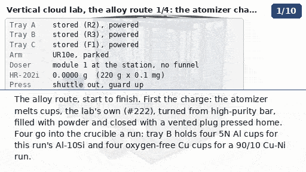

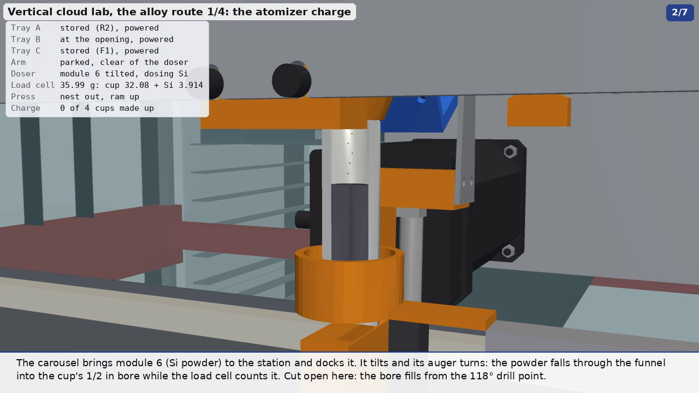

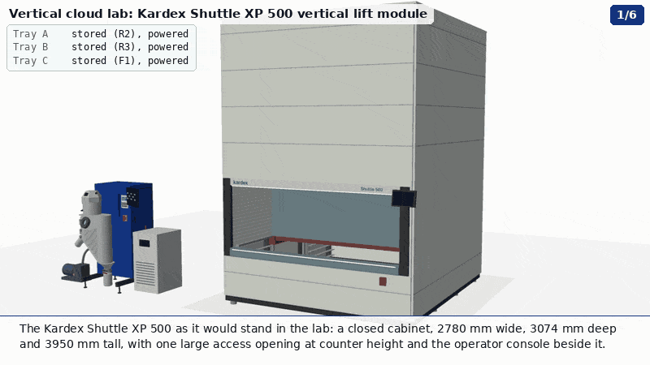

`out/<name>.json` gives the frame range of every sub-step in the MP4, `out/<name>_still.png` is a still of the last
view, and [`out/reach.json`](out/reach.json) is the arm study below.

## The models against real footage

Asked for in [PR #318](https://github.com/vertical-cloud-lab/byu-vcl/pull/318): refine the equipment piece by piece
against the lab's SOP videos and other footage, registering each model to frames taken from different angles.

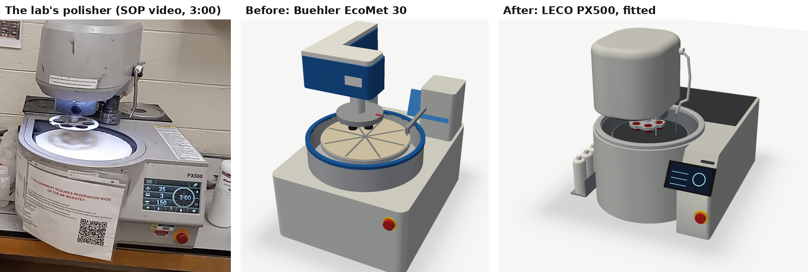

**The method.**
1. [`frames.py`](frames.py) finds the moments that show a machine whole. It fetches storyboard thumbnails, then
   single 720p frames, through a stream-cam Pi, because YouTube refuses the runner.
2. Points and edges are picked on each frame: corners, screen corners, circle edges.
3. [`register.py`](register.py) fits the camera of each frame. Frames from one video share a lens. It fits the
   model's own unpublished proportions too, with the published size, or a part of known size, as the scale.
4. `register.py` then draws the model's outline over each frame
   ([`out/register/<key>/`](out/register/)), so a wrong shape shows up as a gap.
5. A held-out frame checks the result.

Each model publishes its anchors (named points, circles and lines) from the same parameters that build it. So a
fitted number is a model dimension, and the same picks re-test the model after every change.

- **Frames from the lab's own videos are committed** in `refs/<key>/`.
- **Frames from others' videos are not.** They are fetched again from their video id and time, as the vendor CAD is.
- **The overlays are committed.**

| Model | What the footage changed | Fit (RMS) | Notes |
|---|---|---|---|
| **Grinder-polisher** | It is the lab's **LECO PX500**, not the Buehler EcoMet 30 that was modelled. The model is rebuilt from the SOP frames: round bowl drum, screen block, tall rounded head, gooseneck spigot, bottle holder. The clip follows the SOP: SiC papers at the screen's settings, then the white cloth with alumina | 8.6 and 4.5 px on two frames of [SOP part 2](https://www.youtube.com/watch?v=nfnl0aPJPZc); 11.8 px on a held-out frame of [part 3](https://www.youtube.com/watch?v=eLrJxxBAcnE) | [`notes/refine_polisher.md`](notes/refine_polisher.md), [overlays](out/register/polisher/) |
| **Furnace** (Nabertherm NAT 15/65) | A chamber unit on a separate controller unit with a wide, centred touchscreen; a vent strip along the top; the door a panel with a white fibre plug, a bar handle and two right-hand hinges; a 72 mm fan guard. Before: one box, a strip controller, a lever latch | 1.2 and 6.3 px, two shots of [Nabertherm's NAT video](https://www.youtube.com/watch?v=WE6O8EccLyc) | [`notes/refine_furnace.md`](notes/refine_furnace.md), [overlays](out/register/furnace/) |
| **XRF** (Bruker S2 PUMA Series 2) | A full-width white hood with a dark window, hinged at the back, over a white body with the touchscreen in its vertical front and navy side panels. Before: a small dark lid on a sloped body, with the screen on top | 12.7 px, [Bruker's S2 PUMA Overview](https://www.youtube.com/watch?v=ogSg0j6j2Gw) | [`notes/refine_xrf.md`](notes/refine_xrf.md), [overlays](out/register/xrf/) |
| **PIP** (Plastometrex PLX-Benchtop) | The profilometer is a slotted arm on a carriage under the crosshead, not on a column: its pick-up runs in under the lifted indenter. A pancake load cell in the floor; a matte black body with a blue LED U, louvred columns and a fixed crosshead cowl | 6.3 px, [Plastometrex's introduction](https://www.youtube.com/watch?v=w7OZsrru9AI) | [`notes/refine_pip.md`](notes/refine_pip.md), [overlays](out/register/pip/) |
| **XRD** (Rigaku MiniFlex) | It is the 6th-generation MiniFlex the envelope came from, not the MiniFlex 600 its title said. A navy front in three parts (Rigaku band, door, button strip), a flat top, side bulges and the lamp on top centre | 2.1, 1.1 and 1.2 px, [Rigaku's 6G video](https://www.youtube.com/watch?v=8tI9uFKevr0) | [`notes/refine_xrd.md`](notes/refine_xrd.md), [overlays](out/register/xrd/) |
| **SEM** (Hitachi TM4000PlusII) | No overhanging hood: the top's front edge rolls over in an 80 mm radius, with a wedge on top and the cover's seam down each side; a navy front panel (it was bright blue) set into a white frame; a 201 mm door with a bar handle; an X-Y stage whose socket the holder drops into, as in the videos | 4.6, 5.0, 4.0 and 2.1 px, four views ([Hitachi](https://www.youtube.com/watch?v=cg1S2WZVWr8), [CCEM](https://www.youtube.com/watch?v=IqZkvBX-7cU)) | [`notes/refine_sem.md`](notes/refine_sem.md), [overlays](out/register/sem/) |
<!-- refine-table -->

## Characterization instruments, the alloy line and the backup rail (round 3)

Fourteen more models, each its own, from the makers' published figures and photos or, for the OpenFlexure
microscopes, from OpenFlexure's own OpenSCAD:
- [`instruments.py`](instruments.py) holds the models. Doors, drawers, stages, crossheads and samples are separate
  pieces with joints.
- [`openflexure.py`](openflexure.py) loads the two OpenFlexure microscopes.
- [`tour.py`](tour.py) renders each instrument doing what it does.
- [`line.py`](line.py) puts them in the lab.

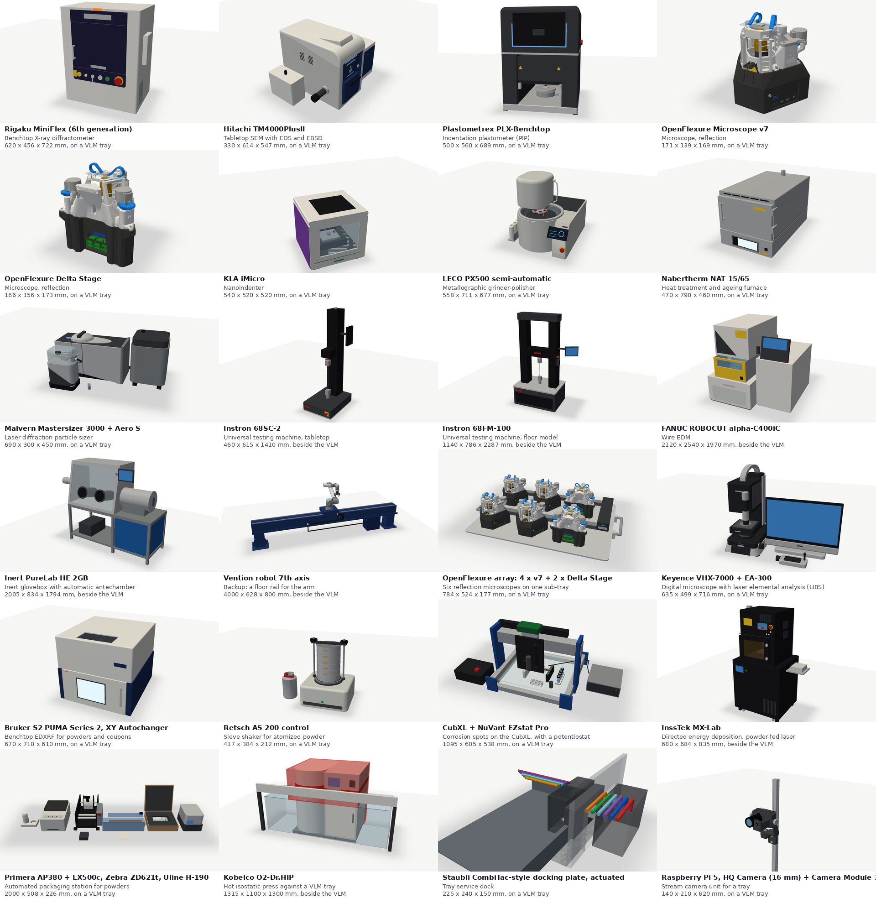

| Instrument | Model | What the animation shows | GIF, MP4 | Size W × D × H (mm), published | Where |
|---|---|---|---|---|---|
| Benchtop XRD | Rigaku MiniFlex, 6th generation (the "MiniFlex 6G"; this was titled MiniFlex 600) | The door swings open on its right-hand hinge; a powder sample goes onto the stage; the door shuts; the scan is drawn see-through, with the sample tilting by θ and the detector sweeping 2θ on its arm; the door opens and the sample comes out | [GIF](out/instruments/xrd.gif), [MP4](out/mp4/instruments/xrd.mp4) | 620 × 456 × 722 | tray D: 5.5 mm under Kardex's limit |
| Tabletop SEM, EDS, EBSD | Hitachi TM4000PlusII | The drawer slides out with the stage; a mounted sample goes on; EVAC | [GIF](out/instruments/sem.gif), [MP4](out/mp4/instruments/sem.mp4) | 330 × 614 × 547 (main unit) | tray D |
| Microscope, reflection | OpenFlexure Microscope v7 | A polished coupon goes under the clips; the stage scans on its four flexure legs, which lean and shear with it (the camera moves in on them), and the optics focus | [GIF](out/instruments/openflexure_v7.gif), [MP4](out/mp4/instruments/openflexure_v7.mp4) | 171 × 139 × 169 | tray D |
| Microscope, reflection | OpenFlexure Delta Stage | The same, with the delta stage moving in x, y and z: each actuator tips a lever, and the leg standing on it pushes the stage | [GIF](out/instruments/openflexure_delta.gif), [MP4](out/mp4/instruments/openflexure_delta.mp4) | 166 × 156 × 173 | tray D |
| Indentation plastometer (PIP) | Plastometrex PLX-Benchtop | The sample goes onto the platen by hand; the indenter goes in and lifts; the profilometer's arm reaches in under it and the stylus traces the indent | [GIF](out/instruments/pip.gif), [MP4](out/mp4/instruments/pip.mp4) | about 500 × 500 × 680, estimated | tray E |
| Nanoindenter | KLA iMicro | The hood lifts; a mount goes onto the XY stage; the stage carries it from the microscope to the indenter | [GIF](out/instruments/nanoindenter.gif), [MP4](out/mp4/instruments/nanoindenter.mp4) | about 540 × 520 × 520, estimated | tray E |
| Laser diffraction | Malvern Mastersizer 3000 + Aero S | The Aero S's dome lifts and powder goes into its hopper; the laser and the dispersed powder are drawn see-through | [GIF](out/instruments/mastersizer.gif), [MP4](out/mp4/instruments/mastersizer.mp4) | 690 × 300 × 450 (bench); Aero S 260 × 180 × 380 | tray E |
| Grinder-polisher | LECO PX500 semi-automatic, the lab's (was the Buehler EcoMet 30; see [above](#the-models-against-real-footage)) | As in the lab's SOP: SiC papers from 320 to 1200 grit with water, then a white cloth with alumina; the head presses six mounts down while platen and holder turn | [GIF](out/instruments/polisher.gif), [MP4](out/mp4/instruments/polisher.mp4) | 558 × 711 × 677 (fitted; plus the bottle holder) | tray F |
| Heat treatment and ageing furnace | Nabertherm NAT 15/65 | The door swings open; a tray of coupons goes in; the circulation fan runs | [GIF](out/instruments/furnace.gif), [MP4](out/mp4/instruments/furnace.mp4) | 470 × 790 × 460 | tray F |
| Tabletop testing machine | Instron 68SC-2 | The arm rides up the column and pulls a sub-size bar | [GIF](out/instruments/instron_small.gif), [MP4](out/mp4/instruments/instron_small.mp4) | 460 × 615 × 1410 | beside the VLM |
| Floor testing machine | Instron 68FM-100 | The crosshead pulls a printed tensile bar | [GIF](out/instruments/instron_floor.gif), [MP4](out/mp4/instruments/instron_floor.mp4) | 1140 × 786 × 2287 | beside the VLM |
| Wire EDM | FANUC ROBOCUT α-C400iC | The yellow tank door drops; a build plate is clamped on its edge, parts facing out; the tank fills; the wire runs along the plate's face and cuts the parts off at their base | [GIF](out/instruments/wire_edm.gif), [MP4](out/mp4/instruments/wire_edm.mp4) | 2120 × 2540 × 1970 | beside the VLM |
| Inert glovebox | Inert PureLab HE 2GB, with an automatic antechamber | The antechamber's outer door opens; a tray with a powder jar and a vial goes in; the PLC cycles it | [GIF](out/instruments/glovebox.gif), [MP4](out/mp4/instruments/glovebox.mp4) | 2005 × 834 × 1794 | beside the VLM |
| Backup rail | Vention robot 7th axis, rack and pinion | The carriage carries a UR10e along the beam | [GIF](out/instruments/rail.gif), [MP4](out/mp4/instruments/rail.mp4) | 3488 × 628 × 1017 (Vention's 3.3 m unit) | along the line |

All fourteen, one after the other: [`out/mp4/instruments_tour.mp4`](out/mp4/instruments_tour.mp4).
[`out/instruments.json`](out/instruments.json) has each model's source, its size as drawn and whether it fits a tray.

### The line

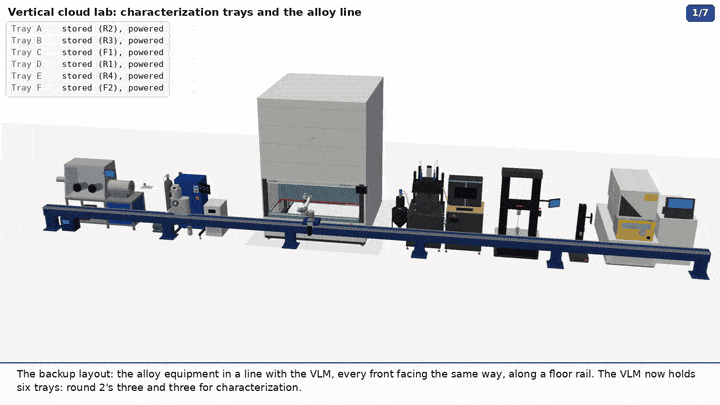

[`line.py`](line.py) puts it together:
- **Three more trays.** Round 2 left three storage slots free, R1, R4 and F2. They now hold trays D (microscopy and
  diffraction), E (mechanical testing and particle size) and F (sample prep and heat treatment).
- **The line.** Everything taller than the opening takes stands in a line with the VLM, fronts in line with its
  front. Left: the glovebox and the rePowder. Right: the Aconity MIDI (#199's model), the two Instrons and the wire EDM.
- **The rail.** A Vention seventh axis runs about 17 m along the fronts. The UR10e rides its carriage at 800 mm, the
  same height as on the MiR250, and parks at the opening.

MP4: [`out/mp4/vlm_line.mp4`](out/mp4/vlm_line.mp4); still: [`out/vlm_line_still.png`](out/vlm_line_still.png).

### Where the round-3 models come from

No maker here publishes CAD without a login or a form. Instron's STEP files come by e-mail after a request form.
Vention's export from MachineBuilder needs an account, which a residential IP doesn't get around, so the Pi wasn't
needed. GrabCAD, TraceParts and CADENAS block the runner and need logins anyway. So each model is built from these:

- **Rigaku MiniFlex, 6th generation:** the outline drawings in Rigaku's MiniFlex brochure (620 × 456 × 722 mm, 80 kg)
  and the MiniFlex 6G sheet. The front is fitted to Rigaku's 6G video: see
  [`notes/refine_xrd.md`](notes/refine_xrd.md).
  - The door hinges on its right edge and has no window.
  - The goniometer is vertical, 150 mm radius, θ-2θ.
  - The MiniFlex600-C, with its built-in chiller, is 526 mm deep.
- **Hitachi TM4000PlusII:** Hitachi's figures, 330 × 614 × 547 mm and 54 kg; the pump is 144 × 270 × 216 mm.
  - The drawer slides straight out; its 17 cm travel is from ac-dev-lab #132.
  - The envelope matches ac-dev-lab's Fusion model of the TM4000II.
  - The EDS detector is built in; Oxford's AZtecOne analyser stands beside it, 290 × 260 × 330 mm.
  - **EBSD:** Hitachi lists no EBSD option for the TM4000 series. The model shows Bruker's e-Flash XS, sold for
    tabletop SEMs, on a side port, with a 70° pre-tilted holder. That is a proposal, not a documented configuration.
    A reseller says the COXEM EM-40 is the only tabletop SEM with integrated EBSD; I could not verify it.
- **Plastometrex PLX-Benchtop:** Plastometrex's render, brochure and FAQ; Illinois MRL's page and a published SOP.
  - There is no door or guard. The sample sits unclamped on the platen; up to 160 mm across.
  - **Plastometrex publishes no dimensions.** The envelope is scaled from photos, ±20 %.
  - PLX-AutoStage is their add-on that automates loading and places indents.
  - **The profilometer is a stylus on the Benchtop** (an interferometer on the PLX-Portable), per Plastometrex's
    "What is PIP?" page. **Where it sits is not published.** The model puts a traverse unit on the left-hand column.
    Its arm stays parked while the indent is made, then reaches in under the lifted indenter and traces the indent.
    Without the AutoStage the sample can't move, so the stylus has to come to it.
- **OpenFlexure Microscope v7 and Delta Stage:** OpenFlexure's own OpenSCAD at pinned tags, exported assembled. See
  [`openflexure/README.md`](openflexure/README.md).
- **KLA iMicro:** KLA's photos.
  - The L-shaped hood is hinged at the top rear and lifts 70-80°.
  - KLA publishes no dimensions; scaled from photos, about 0.5-0.55 m on a side.
- **Malvern Mastersizer 3000 + Aero S:** Malvern's Mastersizer 3000 and 3000+ brochures (bench 690 × 300 × 450 mm,
  30 kg; Aero S 260 × 180 × 380 mm, 10.5 kg) and product photos.
- **LECO PX500 semi-automatic** (until the SOP footage was checked, a Buehler EcoMet 30):
  - **The lab's own SOP videos,** fitted with `register.py`.
  - **LECO's PX400/PX500 brochure** (form 209-254) for the features.
  - **LECO publishes no dimensions.** 533 × 711 × 635 mm is a reseller's figure for the series.
  - See [`notes/refine_polisher.md`](notes/refine_polisher.md).
- **Nabertherm NAT 15/65:** Nabertherm's forced-convection tabletop range (470 × 790 × 460 mm, 60 kg, 15 L, 650 °C,
  ±5 °C).
  - It covers solution treatment (about 530 °C) and ageing (160-200 °C) in one furnace.
  - Why not the L 9/11 muffle furnace: its uniformity is only specified above 800 °C.
- **Instron 68SC-2 and 68FM-100:** Instron's 6800 Series brochure and floor-model sheet.
  - 68SC-2: 1410 × 460 × 615 mm, 62 kg.
  - 68FM-100: 2287 × 1140 × 786 mm, 799 kg; 1494 mm test space, 575 mm between columns.
  - Matte black frames with red Instron accents.
- **FANUC ROBOCUT α-C400iC:** FANUC America's data sheet and floor plan (2120 × 2540 × 1970 mm, about 2200 kg; X/Y
  travel 400 × 300 mm), and FANUC's photo.
- **Inert glovebox:** the envelope is the Inert PureLab HE 2GB drawing in NIST's copy of Inert's manual. The automation
  follows the lab's own glovebox research:
  - DAL PR #185's decision matrix: keep the arm outside and transfer through an automated antechamber.
  - DAL #130: VAC's NexGen PLC; LC Technology's quote included the AC-601 automatic antechamber control.
  - Here, the antechamber's outer door faces along the line, towards the rail.
- **Vention robot 7th axis:** Vention design 337010 (3488 × 628 × 1017 mm, 220 kg) and its part pages.
  - A 247.5 mm square beam in 3330 mm segments, 20 mm profile guides, a steel rack.
  - A 426.5 × 358 × 86 mm carriage plate, driven by a NEMA 34 through a right-angle gearbox, up to 4 m/s.
  - The legs are cut so the arm's base is at 800 mm.
- **Aconity MIDI:** `lab_models.equipment.aconity_midi()` from #199. DAL has documents for it but no model.

### Things the round-3 models show

- **The MiniFlex fits with 5.5 mm to spare.** It is 722 mm tall against Kardex's 727.5 mm. The MiniFlex600-C, with
  the built-in chiller, is 70 mm deeper. The plain 600 needs a separate chiller, which has to go on the tray too.
- **The PIP and the nanoindenter fit only on estimates.** Neither maker publishes a size; both are scaled from photos.
  The nanoindenter's hood adds about 0.3 m when it is up. That is fine at the opening, where there is about 845 mm
  under the header, but not in a slot.
- **No Instron fits a tray.** The shortest single column, the 68SC-05, is 1020 mm tall, so both Instrons stand in the
  line.
- **No benchtop wire EDM is sold.** The smallest lab unit found, MTI's SYJ-7720-S, is 1250 × 1200 × 1380 mm. The
  FANUC stands in the line.
- **Some instruments need services a tray does not have.** Kardex's trays carry power, not plumbing:
  - the polisher needs water, compressed air and a drain, so on a tray it needs a recirculating unit;
  - the Mastersizer's Aero S needs compressed air (0-4 bar) and its vacuum extractor;
  - the SEM needs its pump, which sits beside it on the tray.
- **Heat and vibration in a VLM are open questions.**
  - A 650 °C furnace running inside the machine needs Kardex's say-so, and probably ventilation.
  - The SEM and the nanoindenter are vibration-sensitive. Their trays are still in their slots, but the extractor
    moves other trays past them.
- **The rail closes the front to people.** Its beam runs about 120 mm in front of the machines' fronts, between about
  440 and 690 mm up, so the line becomes a cell for the arm. That is the trade against the MiR250, which leaves the
  floor free.

## Fabrication: compact metal printers, resin printing and PCB assembly

Asked for in [PR #318](https://github.com/vertical-cloud-lab/byu-vcl/pull/318): a couple of desktop LPBF machines on the
VLM, a DED machine if any fits, resin printers, an automatic pick-and-place (an open-source one if possible) and a PCB
stencil printer. Nine models, in `instruments.py`'s framework (pieces, joints and an action script):
- [`fab_metal.py`](fab_metal.py): the SnowX SnowPod, Sharebot MetalONE and One Click Metal MPRINT (LPBF) and the
  Meltio M450 (DED).
- [`fab_resin.py`](fab_resin.py): the Formlabs Form 4, Form Wash and Form Cure.
- [`fab_pcb.py`](fab_pcb.py): the DDM Novastar SPR-45VA stencil printer and the Opulo LumenPnP v4.
- [`fab_tour.py`](fab_tour.py) renders each one doing its job, as `tour.py` does for the instruments.
- [`fab_trays.py`](fab_trays.py) lays out trays G, H and I and stands the other metal printers against the opening's
  height.

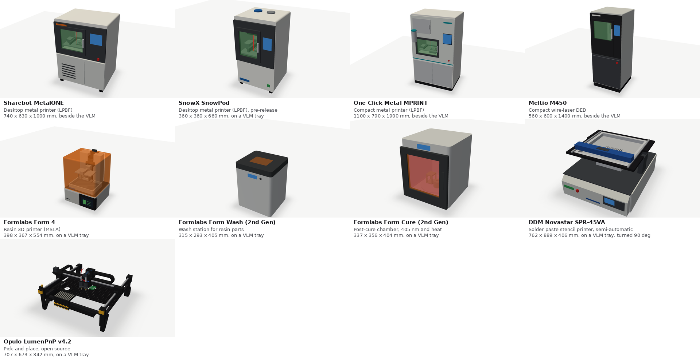

| Machine | Model | What the animation shows | GIF, MP4 | Size W × D × H (mm), published | Where |
|---|---|---|---|---|---|
| Desktop LPBF, pre-release | SnowX SnowPod | A build plate goes in; nitrogen from its NitroPod; see-through, the recoater spreads 316L from a sealed cartridge, the laser melts a layer and the platform drops, three times | [GIF](out/fabrication/snowpod.gif), [MP4](out/mp4/fabrication/snowpod.mp4) | 360 × 360 × 660, 40 kg | tray I, two of them: 67.5 mm under the limit |
| Desktop LPBF | Sharebot MetalONE | A build plate goes in; see-through, the recoater spreads powder, the laser scans a layer and the platform drops, three times | [GIF](out/fabrication/metalone.gif), [MP4](out/mp4/fabrication/metalone.mp4) | 740 × 630 × 1000, 150 kg (launch figures) | the line: 272.5 mm too tall |
| Compact LPBF | One Click Metal MPRINT | The hatch opens on the five-cartridge revolver; a spent cartridge comes out and a full one goes in; a 150 mm plate goes in; recoat, scan, the platform drops; the plate goes out to the MUNPACK station | [GIF](out/fabrication/mprint.gif), [MP4](out/mp4/fabrication/mprint.mp4) | 1100 × 790 × 1900, 440 kg | the line |
| Wire-laser DED | Meltio M450 | A substrate goes in; see-through, the head's six lasers melt the wire and a wall grows layer by layer | [GIF](out/fabrication/meltio_m450.gif), [MP4](out/mp4/fabrication/meltio_m450.mp4) | 560 × 600 × 1400, 250 kg | the line |
| Resin printer (MSLA) | Formlabs Form 4 | The platform rises out of the resin with the parts; the cover lifts; the platform comes off; a fresh one goes on | [GIF](out/fabrication/form4.gif), [MP4](out/mp4/fabrication/form4.mp4) | 398 × 367 × 554, 18.3 kg; 844 tall with the cover open | tray G, two of them |
| Wash | Formlabs Form Wash (2nd Gen) | The lid lifts; the Form 4's platform goes onto the elevator; it lowers the parts into the IPA while the impeller stirs, then lifts them out to dry | [GIF](out/fabrication/form_wash.gif), [MP4](out/mp4/fabrication/form_wash.mp4) | 315 × 293 × 405; 714 tall open | tray G |
| Post-cure | Formlabs Form Cure (2nd Gen) | The door opens; the parts go onto the turntable; it turns under 405 nm light | [GIF](out/fabrication/form_cure.gif), [MP4](out/mp4/fabrication/form_cure.mp4) | 337 × 356 × 404, 12.1 kg | tray G |
| Stencil printer, semi-automatic | DDM Novastar SPR-45VA | A bare board onto the vacuum nest; the frame comes down; the squeegee drives the paste across; the frame lifts off, leaving paste on the pads | [GIF](out/fabrication/stencil.gif), [MP4](out/mp4/fabrication/stencil.mp4) | 762 × 889 × 406, about 73 kg | tray H, turned 90° |
| Pick-and-place, open source | Opulo LumenPnP v4 | The pasted board goes onto the staging plate; three parts, each picked from a feeder, checked over the up-looking camera and placed | [GIF](out/fabrication/lumenpnp.gif), [MP4](out/mp4/fabrication/lumenpnp.mp4) | about 680 × 680 × 450, estimated | tray H |

All nine, one after the other: [`out/mp4/fabrication_tour.mp4`](out/mp4/fabrication_tour.mp4).
[`out/fabrication.json`](out/fabrication.json) has each model's source, its size as drawn, whether it fits a tray, how
far it is over the opening's height and its notes.

### Trays G, H and I, and the metal printers against the opening

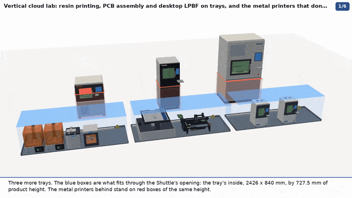

The blue boxes are what goes through the Shuttle's opening: the tray's inside, 2426 × 840 mm, by Kardex's 727.5 mm of
product height. The metal printers stand on red boxes of the same height. MP4:
[`out/mp4/vlm_fab_trays.mp4`](out/mp4/vlm_fab_trays.mp4); still: [`out/vlm_fab_trays_still.png`](out/vlm_fab_trays_still.png).

- **Tray G, resin printing:** two Form 4s, the Form Wash and the Form Cure, left to right in the order a print goes.
- **Tray H, PCB assembly:** the stencil printer, then the LumenPnP. The right end, about 470 mm, is free for a reflow
  oven, which the line still needs.
- **Tray I, desktop LPBF:** two SnowPods, with room beside each for its NitroPod.

### Where the fabrication models come from

None of these makers publishes CAD for download, except Opulo, whose CAD is FreeCAD (`.FCStd`, not read here). So each
model is built from these:
- **SnowX SnowPod:** 3DWithUs's hands-on review (360 × 360 × 660 mm, 40 kg, a 200 W fibre laser) and SnowX's
  announcements, via 3Dnatives (22 October 2026), Makers101 and 3DPrint.com:
  - an 80 × 80 × 100 mm build, a 40 µm spot, 316L at launch;
  - powder in sealed supply and recovery cartridges; a cyclone, two H13 filters and an H14 at the exhaust;
  - nitrogen from the companion NitroPod, which separates it from air (99.9 % at 3 L/min).
  - SnowX gives no outer size of its own, and the NitroPod's size isn't published, so it isn't modelled. The look is
    approximate: no photo was checked.
  - A Kickstarter kit: $5,299 at the launch special, $9,299 MSRP, launch planned for Q4 2026. Not shipping yet.
- **Sharebot MetalONE:** the 2019 launch figures (engineering.com, 3D Printing Industry, Aniwaa: 740 × 630 × 1000 mm,
  150 kg; Fabbaloo: 174 kg); build area 65 × 65 or 100 × 100 mm, 100 mm tall; fibre laser, 200 W at launch.
  - Later dealer listings give 1000 × 600 × 1470 mm and 270-315 kg, probably with its stand or a bigger configuration.
    The launch figures are used.
- **One Click Metal MPRINT:** 1100 × 790 × 1900 mm and 440 kg (filament2print; MPRINT+ 450 kg, MPRINTpro 490 kg);
  build 150 × 150 × 150 mm; 200 W fibre laser; a revolver of five powder cartridges (Autodesk's case study).
  - The published order is "1100 × 1900 × 790"; read here as W × H × D, since the photos show a cabinet taller than it
    is wide.
  - Depowdering is a separate station, MUNPACK, not modelled.
- **Meltio M450:** Meltio's technical specifications (560 × 600 × 1400 mm, 250 kg, print envelope 145 × 168 × 390 mm;
  six 200 W diode lasers, 1200 W, around a wire fed through the head; wire 0.8-1.2 mm). MatterHackers gives 1414 mm
  tall. The next smallest, Meltio's M600, is 1050 × 1050 × 1950 mm.
- **Formlabs Form 4:** Formlabs' tech specs (398 × 367 × 554 mm, 18.3 kg; 407 × 478 × 844 mm minimum access, the cover
  open; build 200 × 125 × 210 mm). The cover's rear hinge is inferred from that open envelope, not from a drawing.
- **Formlabs Form Wash and Form Cure (2nd Gen):** Formlabs' and resellers' figures (Wash 315 × 293 × 405 mm, 714 mm
  open; Cure 337 × 356 × 404 mm, 12.1 kg, a 235 mm turntable, 405 nm light and heat). Which side the Cure's door
  hinges on is assumed.
  - Formlabs' Form Auto, which takes parts off the platform by itself, works only with the Form 3 series. With a Form 3
    it is 610 × 914 × 914 mm, too deep and too tall for a tray.
- **DDM Novastar SPR-45VA:** Pentalogix's listing (762 × 889 × 406 mm; frames up to 584 × 584 mm) and DDM Novastar's
  SPR-45 description at its resellers (about 73 kg, dual squeegees, a power frame lift). The layout inside that outline
  is generic for a benchtop semi-automatic printer.
- **Opulo LumenPnP v4:** Opulo's repository ([`opulo-inc/lumenpnp`](https://github.com/opulo-inc/lumenpnp):
  `DESIGN_DECISIONS.md`, `bom.json`) and its v4 photo:
  - seven 600 mm lengths of 20 × 20 V-slot on four printed legs, an X gantry on two Y gantries;
  - two nozzles on hollow-shaft NEMA 11s, top and bottom cameras with ring lights;
  - 120 × 600 mm staging-plate PCBs, powered feeders, boards up to 225 × 400 mm.
  - Opulo publishes no overall size. 680 × 680 × 450 mm is the extrusions plus the legs, with the height scaled from the
    photo (about ±15 %).

### Things the fabrication models show

- **One LPBF machine fits through the opening, and it isn't shipping yet.** The SnowPod is 660 mm tall, 67.5 mm under
  Kardex's 727.5, and makes its own nitrogen, so its tray needs only power. Every other LPBF machine found is too tall:
  - the Mastrex MX100, 800 mm (one retailer's listing);
  - the Lasefinity Fusion X, 860 mm (TCT Magazine);
  - the Kings 3D DiMetal-100, 1000 mm, on three-phase power (All3DP);
  - the MetalONE as launched, 1000 mm, 272.5 mm over.
- **No DED fits.** The most compact found, the Meltio M450, is 1400 mm tall. So it, the MetalONE and the MPRINT stand
  in the line, next to the Aconity MIDI.
- **The Shuttle is full.** Its six slots hold trays A-F, and its 3950 mm height is set by the ceiling (#53). So trays G,
  H and I need a second Shuttle, as trays D-F already might (see the PR description). G and H are shorter than the
  others, 554 and 450 mm of product, so they would take slots about 650 and 550 mm apart, not 800.
- **The Form 4 and the Form Cure open only at the opening.** The Form 4's cover opens to 844 mm, which is more than a
  slot takes and about the 845 mm under the header. The Cure's door swings out in front. The Form Wash fits even with
  its lid open, 714 mm, with 13.5 mm to spare.
- **Solvent and resin on a moving tray are open questions.** The Wash's bucket holds litres of IPA, a flammable vapour
  inside an enclosed, powered machine, with waste solvent to handle. Resin stands in an open tank on a tray that the
  extractor moves. Both need Kardex and EHS to agree, and the tray moved gently.
- **The stencil printer only fits turned 90°.** It is 889 mm deep against the tray's 840. Turned, its front faces the
  pick-and-place, and the arm meets it from the side, where its frame-lift column is. A shallower printer, or one the
  arm can load from above, would suit a tray better.
- **The PCB line is not complete.** It still needs a reflow oven, the free end of tray H. Solder paste lives in a
  fridge and needs time to warm up, and the paste left on the stencil dries out over a few hours, so the stencil needs
  wiping.
- **The LumenPnP needs no compressed air.** Its vacuum pumps are on board, so on a tray it needs only power.

```bash
xvfb-run -a python3 fab_tour.py                 # every model -> out/fabrication/, out/mp4/fabrication/
python3 fab_tour.py gallery join table          # out/fabrication_gallery.png, out/mp4/fabrication_tour.mp4, out/fabrication.json
xvfb-run -a python3 fab_trays.py                # trays G-I, and the metal printers -> out/vlm_fab_trays.gif
```

## Round 4: tray services and cameras, more instruments, the alloy workflow, the warehouse, the lab from scratch

Asked for in [PR #318](https://github.com/vertical-cloud-lab/byu-vcl/pull/318#issuecomment-6613794646). Each part has
its own notes file, with every source:

| Part | Code | Notes |
|---|---|---|
| Quick disconnects at the back of each tray, UPS, N₂, chilled water and heat; stream cameras; cabling | [`services.py`](services.py) | [`notes/services.md`](notes/services.md) |
| VHX-7000 with the EA-300 laser, desktop XRF, sieve shaker, six OpenFlexures on a sub-tray | [`instruments_char.py`](instruments_char.py) | [`notes/instruments_char.md`](notes/instruments_char.md) |
| The CubXL set up for corrosion, a DED machine, a packaging station, and whether a HIP fits | [`instruments_lab.py`](instruments_lab.py) | [`notes/instruments_lab.md`](notes/instruments_lab.md) |
| From the metal printer to the tensile test | [`alloy_workflow.py`](alloy_workflow.py), [`alloy_models.py`](alloy_models.py) | [`notes/alloy_workflow.md`](notes/alloy_workflow.md) |
| The warehouse version with mobile manipulators, rail or mobile base, the lab set up from scratch | [`warehouse.py`](warehouse.py), [`setup_lab.py`](setup_lab.py) | [`notes/warehouse.md`](notes/warehouse.md) |
| DAL's workflow steps, and where each goes | | [`notes/dal_workflow.md`](notes/dal_workflow.md) |

| Video | GIF | MP4 | YouTube (unlisted) |
|---|---|---|---|
| **The lab set up from scratch**: an empty warehouse bay, the layout, utilities, the VLM, the floor machines, the two MiR250 + UR10e units put together, every tray loaded (A–F, with round 4's instruments), the cameras | [GIF](out/setup_lab.gif) | [MP4](out/mp4/setup_lab.mp4) | [on YouTube](https://www.youtube.com/watch?v=bITROBu1NNE) |
| **The warehouse version**: two MiR250 + UR10e units drive between the VLM and the floor machines along marked aisles | [GIF](out/warehouse.gif) | [MP4](out/mp4/warehouse.mp4) | [on YouTube](https://www.youtube.com/watch?v=KbrkulS07EM) |
| **From the printer to the tensile test**: the build plate out of the Aconity MIDI, the bars cut off in the wire EDM, one pulled to fracture in the 68FM-100 | [GIF](out/alloy_workflow.gif) | [MP4](out/mp4/alloy_workflow.mp4) | [on YouTube](https://www.youtube.com/watch?v=YVdpGTLvxhI) |
| **Tray services**: the docking coupling in the slot and at the opening, the tethered alternative, the cabling | [docking](out/vlm_services.gif), [tether](out/vlm_tether.gif), [cabling](out/vlm_cabling.gif) | [MP4](out/mp4/vlm_services_all.mp4) | [on YouTube](https://www.youtube.com/watch?v=ed2M0u5Rjw0) |
| **The round-4 instruments**, each doing its job | [gallery](out/instruments_gallery.png) | [MP4](out/mp4/instruments_round4_tour.mp4) | [on YouTube](https://www.youtube.com/watch?v=IEbhMjcAUOQ) |

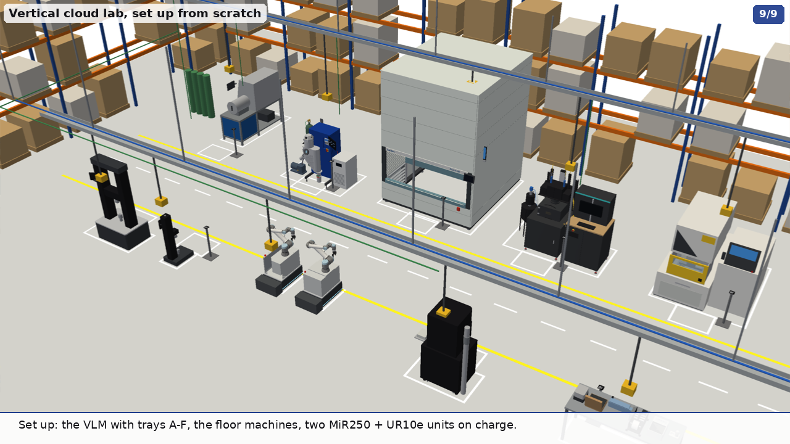

### Quick disconnects, UPS, N₂, chilled water and heat

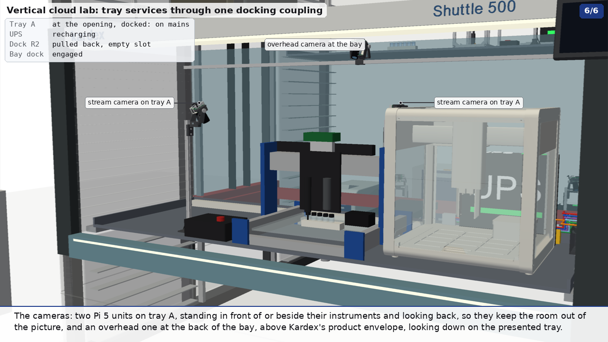

- **A tray has power only in its slot and at the opening, not in transit** (#53, where the dealer offered a
  quick-connect cord). A search of Kardex's published Shuttle options found nothing that brings air, gas, water or data
  to a tray.
- **The coupling can't go on the back edge itself.** In a front-column slot and at the opening, the back edge faces
  the shaft. A dock there would sit in the extractor's path, and the shutter closes 35 mm behind the presented tray.
- **One plate per tray, at its back-right corner, mating sideways, serves every place.** Its docks sit in the right
  side wall of each slot and of the bay, with a 45 mm stroke, clear of the extractor and the shutter. The plate is a
  Stäubli CombiTac carrying:
  - four 39 A power contacts;
  - Cat 6A;
  - air and N₂;
  - chilled water in and out.

  CombiTac align 4's pins take up 4 mm of misalignment. ODU-MAC and Harting make similar docking frames.
- **The couplings must not part under pressure** (Stäubli). So the dock shuts and vents the air, N₂ and water before
  it pulls back, and opens them only once the plate is home. A tray is disconnected only while the extractor carries
  it.
- **A UPS on each tray covers the transit.** An Eaton 5PX1500 bridges the roughly 6 s from R2 to the opening for
  trays A–E. Tray F's furnace draws 2.8 kW, more than the UPS gives, so its heaters pause in transit.
- **Heat is the real limit.**
  - With everything on, the trays put about 7.0 kW into the machine. Unventilated, that is about a 23 K rise; holding
    the rise to 5 K takes about 4200 m³/h of air.
  - The N₂ generator (Parker UHPN2-1100, 889 mm tall) can't go on a tray. It and the recirculating chiller stand
    beside the VLM, piped through the docks, so their heat stays outside.
  - This is the question for Kardex.
- **The tether, the continuous alternative.** An igus e-spool carries power, data and hoses on one chain, and a slot
  near the opening needs only 2.1–2.8 m of payout. While that tray is out, though, its line spans the shaft, so the
  extractor can't fetch any other tray. It suits one tray, kept low.

### Stream cameras

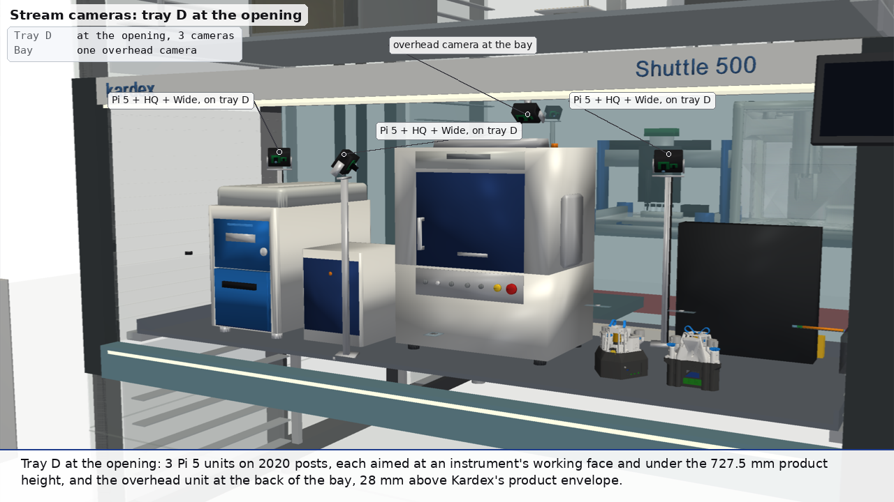

- **The unit is the lab's own**, from DAL PR #189: a Pi 5 with the HQ Camera (16 mm M12 lens) and a Camera Module 3
  Wide, in a PETG box on a 2020 post.
- **On the trays, not the modules.** There are 2–3 per tray, 14 in all, each aimed at an instrument's working face
  and under the 727.5 mm product height. They watch the printers and the CubXL work while the tray is in storage, and
  the dock already brings power and Ethernet.
- **The overhead camera** hangs at the back of the bay, 28 mm above Kardex's product envelope. Its wide camera covers
  about 2.37 m of the 2.45 m tray. It hasn't yet been checked against the arm's poses.

### Cabling

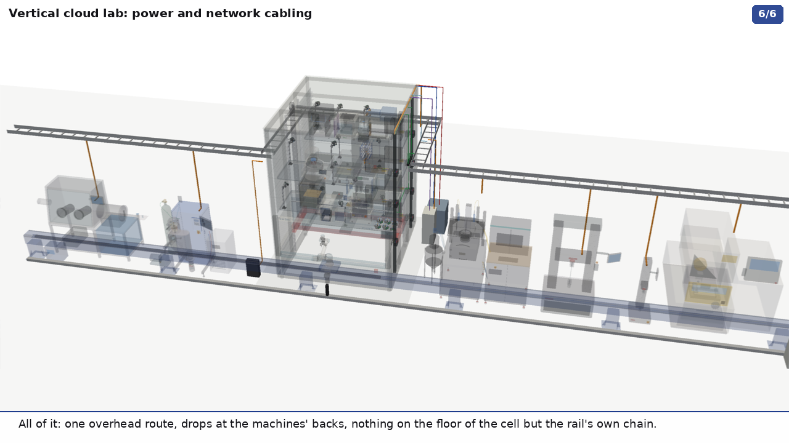

- **One overhead ladder tray** at 2.8 m behind the line and round the back of the VLM, with drops to every machine
  and risers inside the VLM to the docks. [`out/cabling.json`](out/cabling.json) lists the circuits.
- **The FANUC wire EDM is the biggest load**, at 13 kVA, 200 V three-phase. That figure is from a search result;
  the page itself wasn't opened.
- **No ratings found** for the Aconity MIDI or the glovebox. Several other ratings come from search snippets; the
  JSON marks which.

### More instruments


| Instrument | Model | GIF, MP4 | Where |
|---|---|---|---|
| Digital microscope with laser elemental analysis (LIBS) | Keyence VHX-7000 + EA-300 on the VHX-S750E stand | [GIF](out/instruments/vhx.gif), [MP4](out/mp4/instruments/vhx.mp4) | tray C, beside the A1 mini |
| Benchtop EDXRF | Bruker S2 PUMA Series 2, 20-position XY Autochanger | [GIF](out/instruments/xrf.gif), [MP4](out/mp4/instruments/xrf.mp4) | tray F |
| Sieve shaker | Retsch AS 200 control, with DAL's 8 in stack | [GIF](out/instruments/sieve.gif), [MP4](out/mp4/instruments/sieve.mp4) | tray F in the set-up scene; better beside the rePowder (below) |
| Six reflection microscopes on one sub-tray | OpenFlexure, 4 × v7 + 2 × Delta Stage | [GIF](out/instruments/openflexure_array.gif), [MP4](out/mp4/instruments/openflexure_array.mp4) | tray D, in place of the two freestanding ones |
| CubXL set up for corrosion | CubXL + NuVant EZstat Pro, DAL PR #180's deck | [GIF](out/instruments/cubxl_corrosion.gif), [MP4](out/mp4/instruments/cubxl_corrosion.mp4) | tray A, in place of round 2's CubXL |
| Directed energy deposition | InssTek MX-Lab | [GIF](out/instruments/ded.gif), [MP4](out/mp4/instruments/ded.mp4) | the floor |
| Packaging | Primera AP380 + LX500c, Zebra ZD621t, Uline H-190 | [GIF](out/instruments/packaging.gif), [MP4](out/mp4/instruments/packaging.mp4) | a bench on the floor |
| HIP against a tray | Kobelco O2-Dr.HIP | [GIF](out/instruments/hip.gif), [MP4](out/mp4/instruments/hip.mp4) | doesn't fit |
| The docking coupling; the camera unit | | [dock](out/instruments/tray_dock.gif), [camera](out/instruments/stream_cam.gif) | every tray |

- **VHX + EA-300.**
  - The EA-300 is a 355 nm laser with a 10 µm spot, reading elements H to U.
  - Stand and head stand 655 mm against Kardex's 727.5 mm. The stand's outer size isn't published, so its base is an
    estimate.
  - Keyence has replaced the VHX-7000 with the VHX-X1.
- **XRF.**
  - The S2 PUMA is 670 × 710 × 610 mm and 108 kg. It has a reduced-pressure helium mode for loose powder.
  - It is the only candidate with a published robot interface (its Automation version).
  - Bruker doesn't publish the lid's open height; drawn 35° open, it reaches about 905 mm. That is more than the
    roughly 844 mm under the opening's header, so ask Bruker.
- **Sieving.**
  - The stack is the one DAL bought or ordered (DAL PR #175): No. 60, 100, 140, 230, 325 and a pan.
  - LPBF's 20–63 µm is the No. 325 and the pan. DED's 45–105 µm is the No. 230 and the No. 325.
  - No sieve shaker sold for robot loading was found, so the clip shows what an arm would do: pour, lid, knobs.
  - For aluminium powder the dust hazard argues for the shaker beside the rePowder, or in the glovebox, rather than
    in the VLM.
  - The lab's own sieving, by hand, is on the channel: the 630 bronze [1](https://www.youtube.com/watch?v=7pqPt9xbV8E),
    [2](https://www.youtube.com/watch?v=sN0xzUjTDKE), [3](https://www.youtube.com/watch?v=Dni35K9VWck).
- **OpenFlexure array.**
  - Four v7 and two Delta Stages, so the two designs can be compared on the same coupons.
  - They sit on a 1/4 in aluminium tooling plate, 700 × 510 mm and 5.6 kg after pocketing, each microscope in a 2 mm
    pocket cut to its own footprint, with handles.
  - The meshes are rebuilt from OpenFlexure's OpenSCAD. [`notes/instruments_char.md`](notes/instruments_char.md) has
    four steps the pipeline's README lacked.
- **The CubXL for corrosion.**
  - It follows DAL PR #180's plan, which is not built yet:
    - four coupons on pogo pins under FKM O-ring lids, each a 0.071 cm² well of about 150 µL;
    - a magnetic cap with a 2 mm Ag/AgCl reference inside a Pt coil;
    - 0.6, 0.06 and 0.006 M NaCl;
    - per spot, OCP, then LPR, then cyclic polarization.
  - No measured corrosion data exist yet. The curve on screen is labelled illustrative; only its E_corr and i_corr
    come from Wu et al. 2022.
- **DED: the InssTek MX-Lab.**
  - It is the only candidate with a published size and mass: 680 × 684 × 835 mm and 250 kg without its base.
  - It has six hoppers that blend in the melt pool, and an argon option holding O₂ at 50 ppm or less.
  - It is also the first step in DAL PR #117's own plan, at Utah. The "Mines X2" in DAL PR #220 is a FormAlloy X2,
    which publishes no size.
  - The other session's Meltio M450 (wire-laser, [above](#fabrication-compact-metal-printers-resin-printing-and-pcb-assembly))
    is the wire alternative.
- **Packaging.**
  - Primera sells no print-and-apply bundle: the LX500c prints a roll that the AP380 wraps on. Laid out with the
    sealer, the foam shipper and the Zebra, the station is about 1990 × 650 × 229 mm.
  - Whether a powder is dangerous goods depends on a test (UN N.1 / N.5), not the alloy's name. Coated aluminium
    powder is UN 1309 (Class 4.1) and uncoated UN 1396 (4.3), and USPS takes no flammable solid abroad.
  - The QR code in the clip is a placeholder pattern.

### Could a hot isostatic press fit on the VLM? No.

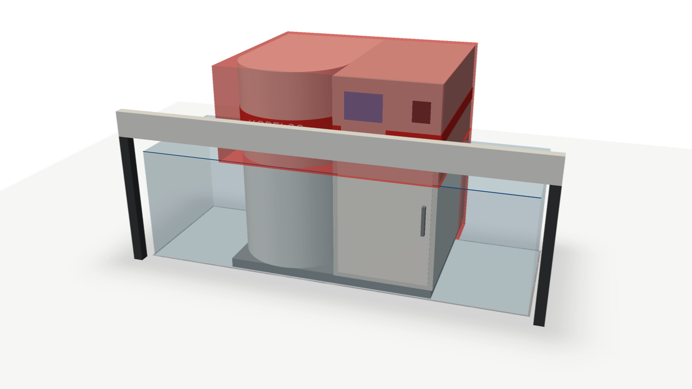

The smallest 200 MPa lab HIP with a published size, Kobelco's O2-Dr.HIP, is 1315 × 1100 × 1300 mm and 1100 kg:
- 572.5 mm over the 727.5 mm product height, and 236 mm deeper than the 864 mm tray;
- 4.8×, 3.1× and 2.2× the light, medium and strong trays' payloads;
- it needs argon, cooling water and air, and its cooling must not stop. A tray has power only, and none in transit.

A HIP stands on the floor or goes out to a service.

### From the metal printer to the tensile test

| The wire cutting the bars off, machine see-through | The bar broken in the 68FM-100 |
|---|---|
| 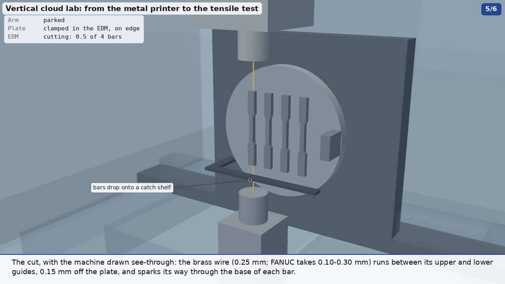 | 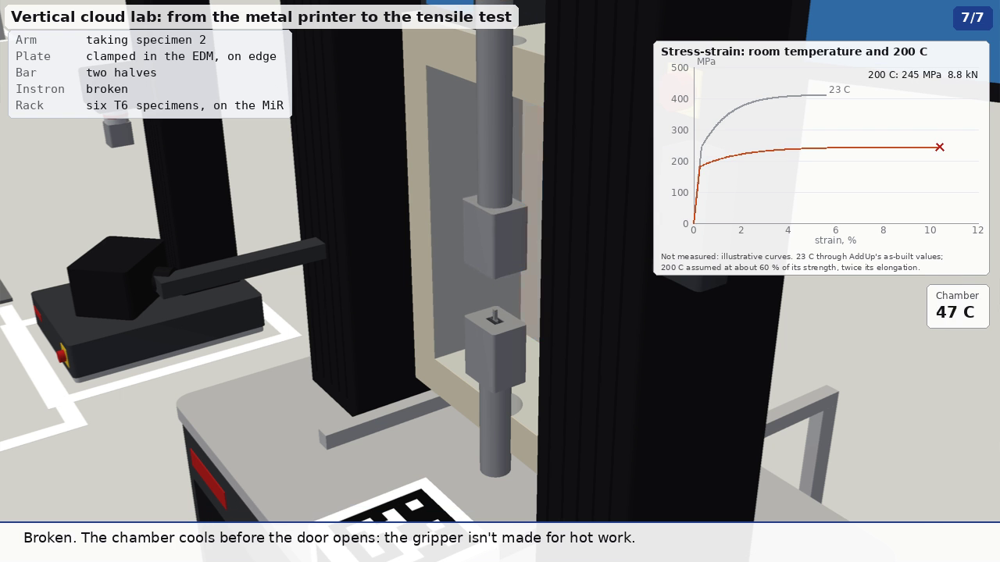 |

The UR10e on the MiR250 does each move with straight-line IK, as in round 2:
1. **The Aconity MIDI.** The chamber opens and the platform rises. A person depowders: no automatic depowdering was
   found for the MIDI. The arm lifts the plate out by a printed lug.
2. **The wire EDM.** The plate goes into a fixture on the table, on edge. The tank fills, and the wire cuts the four
   bars off at their base, drawn see-through.
3. **The 68FM-100.** The arm puts one bar in the wedge grips, and the test runs to fracture. A stress–strain curve
   draws in step.

What the workflow showed:
- **The arm can't point straight down inside the MIDI's chamber**, which is about 280 mm tall inside. Pointed down,
  its wrist would be 38 mm above the roof, so it takes the plate by a lug, at 30° down.
- **At the machines the MiR parks 230 mm off the front, not 30 mm** as at the VLM. Otherwise the plate's 435 mm move
  out of the chamber has no IK solution.
- **The bar needs the 68FM-100.** A 6 × 6 mm section at 412 MPa is a 14.8 kN pull. The 68SC-2's 2 kN is reached at
  56 MPa, below yield.
- **The plate stands on edge in the EDM.** A vertical wire can only cut the bars off at their base that way. The cut
  is 3389 mm², so at least about 11 minutes at the 300 mm²/min GF quotes for its AM cutter. FANUC gives no rate for
  aluminium.

Real data and illustrative data:
- **The SEM inset is real.** It is the lab's stock AlSi10Mg powder on BYU's Apreo, at 500×, taken 2 April 2026 by Gage
  Erickson ([#48](https://github.com/vertical-cloud-lab/byu-vcl/issues/48#issuecomment-4181040112)).
- **The curve is not a measurement**, and the clip says so. It is drawn through AddUp's published as-built values.
  No real tensile data were found in DAL or here.

### The warehouse version, and rail or mobile base

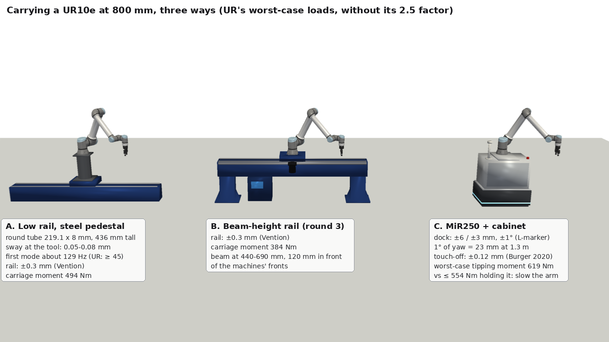

- **The floor.** Aisles are 3.0 m, MiR's figure for two MiR250s passing. Docks sit outside the aisle, and there are
  two MiR chargers.
- **MiR250 docking accuracy.**
  - To an L-marker: ±6 / ±3 mm and ±1°. To a VL-marker: ±3 / ±3 mm. With no marker: ±60 / ±85 mm and ±4°.
  - 1° of yaw is 23 mm at the arm's 1.3 m reach, so every station needs a reference the arm measures before it
    works. A six-touch calibration on a cube reached ±0.12 mm (Burger et al., *Nature* 2020).
- **The pedestal hardly sways; the carriage takes the moment.**
  - A Ø219.1 × 8 mm steel tube lifting the UR10e from a floor-level rail moves the tool 0.05 mm running and 0.08 mm
    in a stop. Its first mode is about 129 Hz, against UR's 45 Hz minimum.
  - That is below Vention's own ±0.3 mm repeatability.
  - What the pedestal costs is 29–48 % more moment on the carriage: 494–568 Nm against 384 Nm. No maker publishes the
    figures to check that against. The numbers are in [`out/rail_vs_amr.json`](out/rail_vs_amr.json).
- **A UR10e on a MiR250 can tip.** UR's worst-case loads give 619 Nm running and 955 Nm stopping, against roughly
  554 Nm of resistance, so the arm runs with lower acceleration limits.
- **The MiR250 can't power the arm.** Its top-module supply is 480 W at 48 V. The UR10e can draw 615 W, and its
  standard control box wants mains.

### Getting a tray out for maintenance, with the rail in front

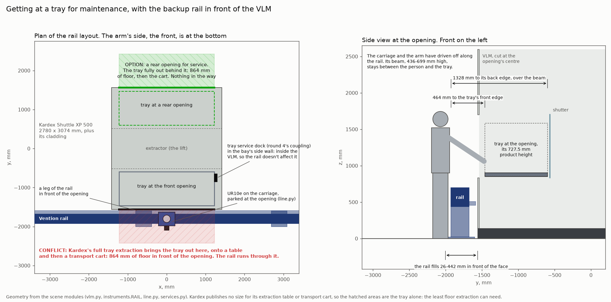

- **The tray service dock is round 4's coupling, not a way out.** Its docks are inside the VLM, so the rail doesn't
  affect it.
- **Kardex's way out is full tray extraction onto a transport cart.** Both are Shuttle XP options. The tray comes out
  in front of the opening, which needs at least its 864 mm of clear floor there.
- **With the rail where `line.py` puts it, that floor is taken.**
  - The rail fills 26–442 mm in front of the cladding. Its beam is 436–699 mm high, and one leg stands under the
    opening.
  - From the beam, the tray's front edge is 464 mm away and its back edge 1328 mm, so a person can't work there either.
- **What would work:**
  - a second opening at the back for service (Kardex offers front or rear). It costs two rear slots at the front
    opening's height, and about 2 m of floor behind the VLM;
  - a floor-flush rail section with covers;
  - a removable rail section, for rare instrument swaps;
  - the mobile base, which leaves nothing fixed in front of the opening.

  [`notes/maintenance.md`](notes/maintenance.md) has the sources and the questions for Kardex.

### The lab set up from scratch

The set-up scene, in order:
1. An empty warehouse bay.
2. The layout in tape on the floor.
3. Utilities: cable trays, power drops, network, argon.
4. The VLM assembled.
5. The floor machines, including the DED machine and the packaging station (on a bench).
6. The first MiR250 + UR10e unit put together on its charger:
   - the cabinet goes on;
   - the UR control box goes inside;
   - the arm is bolted down with UR's four M8 bolts and two dowel pins;
   - the gripper goes on.

   Then the second unit appears.
7. Trays A–F loaded through the opening, by people, since most instruments weigh more than the arm's 12.5 kg.
   Round 4's instruments go where `setup_lab.ROUND4_TRAY` puts them:
   - the corrosion CubXL on A;
   - the VHX on C;
   - the OpenFlexure array on D;
   - the sieve shaker and the XRF on F.

   Each tray then goes back to its slot.
8. The stream cameras, from `services.add_cameras`.
9. A closing orbit.

`python3 setup_lab.py fit` checks every tray item against the product height, the tray's rim and its neighbours.
Trays G–I (fabrication, above) aren't in this scene yet.

### The alloy workflow, step by step, from DAL

[`notes/dal_workflow.md`](notes/dal_workflow.md) maps every step DAL runs by hand to the station it would use here, and
names what is still missing. It links the lab's own footage of each step from the channel. The gaps it finds:
- a station that fills and presses the atomizer's cups;
- powder transfer between atomizer, sieve and jar without air exposure;
- a dry cabinet;
- a stub-prep station for the SEM;
- a mounting press;
- a hardness tester;
- a balance with a density kit, for DAL #144's Archimedes cubes;
- automatic depowdering.

### The real VLM

Sterling's test of a real vertical lift module is on his own channel: [*Vertical Lift Module in operation – from the
sample's perspective*](https://www.youtube.com/watch?v=ck8QJhVqPiY) (59 s, 2025-09-15, recorded while collecting
vibration data). The VLM also appears in two talks:
- [*Towards an Autonomous Vertical Cloud Lab for Additively Manufactured Aerospace
  Alloys*](https://www.youtube.com/watch?v=6uJP2CKMbEM) (Fall MRS 2025; "vertical automation" runs 00:00–14:00);
- Matterhorn Studio's [*Vertical Cloud Lab*](https://www.youtube.com/watch?v=3xRSuz3zBww).

Earlier rounds, on YouTube (unlisted):
- [round 3's instruments](https://www.youtube.com/watch?v=ISyVIHtmvZc);
- [trays D–F and the line](https://www.youtube.com/watch?v=oWM3fCZiwRs);
- [the fabrication tools](https://www.youtube.com/watch?v=HYN9dYyRkrQ);
- [trays G–I](https://www.youtube.com/watch?v=5q5Pv2Mhbn8).

## The alloy route, start to finish: charge cups to tensile bar

Asked for in [PR #318](https://github.com/vertical-cloud-lab/byu-vcl/pull/318): no vial. The atomizer is charged with
the lab's own **charge cups** (#222), in **high-purity Al and Cu**, and putting the plugs into them is part of the
route. Four chapters, each rendered on its own and joined by [`alloy_route.py`](alloy_route.py) into
[`out/mp4/alloy_route.mp4`](out/mp4/alloy_route.mp4), a title card before each:

<!-- alloy-route-table -->
| Chapter | Code | GIF | MP4 | Notes |
|---|---|---|---|---|
| **All four, joined** (7 min 40 s, a title card before each) | [`alloy_route.py`](alloy_route.py) | | [MP4](out/mp4/alloy_route.mp4) | [on YouTube](https://www.youtube.com/watch?v=9qnGCtPwCTM) (unlisted), chapters in [`out/alloy_route.json`](out/alloy_route.json) |
| **1. The charge** (140 s): cups filled by the multi-doser, plugs pressed in, on tray B | [`alloy_charge.py`](alloy_charge.py), [`charge.py`](charge.py) | [GIF](out/alloy_charge.gif) | [MP4](out/mp4/alloy_charge.mp4) | [`notes/alloy_charge.md`](notes/alloy_charge.md) |
| **2. Melt and atomize** (92 s): the Al cups in the rePowder | [`alloy_atomize.py`](alloy_atomize.py) | [GIF](out/alloy_atomize.gif) | [MP4](out/mp4/alloy_atomize.mp4) | [`notes/alloy_atomize.md`](notes/alloy_atomize.md) |
| **3. Sieve and print** (101 s): the AS 200 stack, then the Aconity MIDI | [`alloy_print.py`](alloy_print.py) | [GIF](out/alloy_print.gif) | [MP4](out/mp4/alloy_print.mp4) | [`notes/alloy_print.md`](notes/alloy_print.md) |
| **4. Cut and test** (115 s): the plate to the wire EDM, a bar to the 68FM-100 (round 4, above) | [`alloy_workflow.py`](alloy_workflow.py) | [GIF](out/alloy_workflow.gif) | [MP4](out/mp4/alloy_workflow.mp4) | [`notes/alloy_workflow.md`](notes/alloy_workflow.md) |
<!-- /alloy-route-table -->

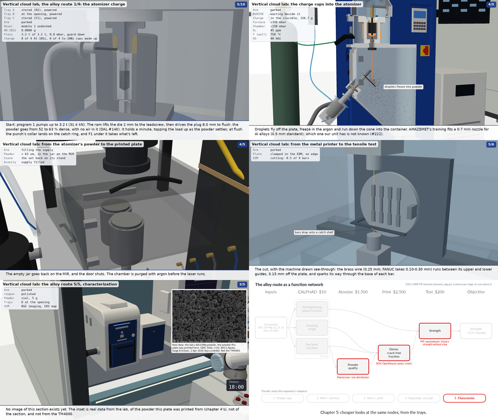

**The charge.** The cup, the vented plug and the steel press sleeve (F1) are #222's own `charge_cad.py` profiles,
dimension for dimension. Tray B carries:
- a charge rack, cups in front and plugs behind;
- a plug press with a shuttle nest and an ejector (assumed);
- the multi-doser.

Two runs are made up, from [`out/alloy_recipe.json`](out/alloy_recipe.json):

| Run | Cups and plugs | Powder in each cup | Charge | Designed |
|---|---|---|---|---|
| this one | 2 × **5N Al** (DAL #152's rod) | Si, 3.92 g | 78.3 g | Al-10Si, the Si of the AlSi10Mg printed in chapter 4 |
| the next one | 2 × **oxygen-free Cu**, C10100 (DAL #162) | Ni, 12.97 g | 259.5 g | 90/10 Cu-Ni, the Navy's seawater alloy |

The Al cups ride the MiR250 to the rePowder. The Cu cups go back on the rack for their own run.

What chapter 1 showed:
- **A Cu cup is over the doser's load cell.** The cup alone is 106 g, 119 g with its Ni, and the rig's TAL221 is rated
  100 g.
- **The doser's 18 mm funnel spout is wider than the cup's 12.7 mm bore.** A cup station needs a narrower spout and a
  deeper holder on the load cell. The cup is also captured between the holder and the funnel, as round 2's vial was.
- **F1 is as long as the cup**, so a pressed cup is entirely inside it. The press needs an ejector to lift the cup out.
  The arm sets the plug from above, so the nest must slide out from under the ram to be loaded.
- **The arm always holds a cup level**, fingers closing sideways, so it never tilts. That is why the rack has its cups
  in front.

What chapters 2 and 3 showed:
- **A robot may not get a 3/4 in cup into the crucible.** It only passes the sealing rod's adapter tipped, and #222
  puts that at −0.09 mm. In the clip the gripper lets go once the cup is past the adapter, and its fingers still brush
  it. A slimmer gripper or a 5/8 in cup would clear it: the 5/8 in cup goes straight in with 1.83 mm to spare.
- **The MiR stands 220 mm further out to work the rePowder.** Closer, the lid's knob and the container's handle fall
  inside the UR10e's unreachable cylinder over its base. Even its hand-off spot is 148 mm out from the line, because
  the rePowder's front sticks out past the other machines'.
- **One run is far too little powder for the MIDI.** 78 g gives tens of grams of 20–63 µm powder, and the 30 mm build
  needs about 1 kg in the bed. That means many runs into the supply, or a smaller build cylinder.
- **A person still does the dustiest step**, taking the sieve stack apart, as well as depowdering the plate
  (chapter 4).
- **Taking the container off under argon is unchecked.** The training vents the chamber first.
- **The two layouts disagree on the sieve shaker.** Chapter 3 puts it on a bench between the rePowder and the VLM;
  `setup_lab.py` puts it on tray F.

Chapter 1 is 140 s, chapter 2 92 s and chapter 3 101 s, so each GIF stays under 4.9 MB at 640 × 360 and 5–6 fps.
The MP4s keep every frame.

## The workflow

An example run, with every move a real one:

1. **Tray B (powder dosing) comes down.** The extractor pulls it off its supports and carries it down. The shutter at
   the back of the bay opens to let it through and closes behind it.
2. **An empty 20 mL vial into the multi-doser.** The UR10e picks it from the rack at the front of the tray, pointing
   down. It slides the vial level into the cup on the rig's 100 g load cell, under the station, then parks clear.
3. **Dose.** The carousel indexes powder module 6 to the station: 8 chain links per module, run the way powder-doser's
   leakage study says. The module is drawn green, as powder-doser's own movie marks one. The Actuonix P16 lifts the
   electronics carriage and docks it with the magnet on. The docked module rides inside the loop, boxed in by the
   other twelve, so those are drawn see-through for the dose. The station tilts the module 30°, cap end up, and turns
   the auger two revolutions while the vial fills and the load cell counts 0.512 g. Then it tilts back, reverses one
   turn at rest and undocks, as in the station's protocol in powder-doser PR #185.
4. **The vial waits on the robot.** The arm stands the vial in a holder on the MiR's cabinet while the VLM swaps
   trays. Tray B goes back to its slot and its power.
5. **Tray A (liquid handling) comes down.** The CubXL's gantry parks at the back. The arm puts the vial in the free
   seat of the CubXL's rack.
6. **Liquid, then storage.** The CubXL brings its pipette over the vial and adds the liquid. Tray A goes back up with
   the vial in it, to a slot that has power, so the CubXL can keep working while it is stored.

Every approach, grasp and retreat is a straight line of the gripper's grasp point, solved with the UR's inverse
kinematics every frame ([`robot.py`](robot.py)). A move that would need a flip of the arm fails before anything
renders. The multi-doser moves through its own `layout.placements(State(...))`, so the chain, the carriages, the
station's linkage, the tilt and the auger turn are its real kinematics.

## The models, one by one

| In the scene | Model | Where it comes from |
|---|---|---|
| Kardex Shuttle XP 500 | [`vlm.py`](vlm.py) | **Built here from Kardex's figures** (below). Kardex publishes no CAD, BIM or Revit file for the Shuttle |
| Multi-doser: chain carousel v2, 13 powder modules, its station, load cell, vial and electronics board (tray B) | [`carousel.py`](carousel.py) over [`multidoser/`](multidoser/) | **The lab's own latest design**, powder-doser [PR #185](https://github.com/vertical-cloud-lab/powder-doser/pull/185) (#128). `multidoser/{params,parts,layout,kinematics}.py` are verbatim copies of `cad/chain-carousel-v2/` at `1c135e0`, its head. Its three reference STEPs (Sam's Oct 13 plate and electronics carriage, the threaded auger, the cap) are fetched at that commit and SHA-256 checked. On the tray its electronics board stands beside the frame, turned 90° |
| Universal Robots UR10e with a Robotiq 2F-85 gripper | [`ur_arm.py`](ur_arm.py) | **Vendor descriptions**: UR's `Universal_Robots_ROS2_Description` at `81f7c9f` (visual meshes and the calibrated kinematics; FK matches UR's DH table to 3e-7 mm) and PickNik's `ros2_robotiq_gripper` at `a74d007` (2F-85 meshes and linkage). Fetched and hash-checked at run time. The UR3e and UR7e are there too, for the comparison |
| MiR250 mobile base, with a cabinet for the UR control box | [`props.py`](props.py) | MiR's published size, 800 × 580 × 300 mm; the cabinet's height is a layout choice (it puts the arm's base at 800 mm, under the 833 mm table) |
| Opentrons OT-2 (tray A) | Opentrons' reference STEP, "Detailed" | **Vendor CAD**, from [github.com/Opentrons/ot2](https://github.com/Opentrons/ot2), fetched and SHA-256 checked by [`lab_models/vendor.py`](lab_models/vendor.py) |
| CubXL (tray A) | `equipment.cubxl()`, in four pieces | The lab's CadQuery model from #199: the Genmitsu PROVerXL 4030 V2 frame from SainSmart's spec, the rest from lab photos. Split here into frame, gantry, carriage and tools so the gantry moves over its 400 × 300 × 110 mm travel |
| Bambu Lab H2D and A1 mini (tray C) | `equipment.h2d()`, `equipment.a1_mini()` | The lab's CadQuery models from #199, from Bambu's spec pages and outline drawing. Bambu publishes no CAD |
| AMAZEMET rePowder atomizer and its utilities, beside the VLM | [`repowder/model.py`](repowder/model.py) | The CadQuery model behind the rePowder training animations (#124) |
| Vials and the vial rack | [`props.py`](props.py) | The multi-doser's own 20 mL vial (28 × 61 mm, from its `params.py`); a printed rack like the CubXL's |

[`lab_models/`](lab_models/) is a verbatim copy of `lab-models/cad/{common,equipment,labware,vendor}.py` from #199's
branch at `7fc56b6`, and [`repowder/model.py`](repowder/model.py) one of `atomizer-training/viz3d/model.py` from #124's
branch at `7757443`, so each model has one source. Vendor CAD is downloaded into `.cache/` (the carousel's references
into `multidoser/reference/`) and never committed.

## The Kardex Shuttle XP 500

The front was rebuilt against Kardex's own Shuttle 500 renders and fact sheet, and against Kardex's order sheet for
this configuration: "Kardex Shuttle POF Version 16", SHUTTLE-01-500-2450x864. That sheet is hosted by the dealer
StoreMoreStore ([VLM option 1 specification sheet](https://products.storemorestore.com/hubfs/StoreMoreStore/Kardex-Vertical-Lift-Module/VLM-Option-1-96x34-Light-Specification-Sheet.pdf)).

| | Value | Source |
|---|---|---|
| Tray | 2450 × 864 mm | #53: 96.46 × 34.00 in |
| Module footprint | 2780 × 3074 mm | Relevator Group's listing of XP 500-2450x864 units; the order sheet gives 2780 × 3073 |
| Height | 3950 mm | #53: "less than 13'"; Shuttle heights step 100 mm from 2550 mm |
| Access table | 833 mm above the floor | Order sheet: front access table height TH1 |
| Presented tray | underside at 854 mm, floor top at 855.5-856.5 mm | Order sheet: TH1 + 21, and TH1 + 22.5 / 23 / 23.5 for light / medium / strong trays |
| Product height through the opening | 727.5 mm, plus 20 mm clearance | Order sheet |
| Opening | 2500 mm between the side posts; header at 1700 mm | Kardex renders and a real 2450 × 864 unit (about tray + 50 mm); the mouth reads 850-870 mm tall |
| Look | RAL 7035 panels in about 490 mm bands; white header with the logo and an LED light under it; anthracite posts; slatted side walls in the bay; a blue (RAL 230 60 15) cover under the tray with the LED-Navigator strip; the OPTIC panel on the right post | Order sheet (colours, options); Kardex renders |
| Safety shutter | at the **back** of the bay, between the presented tray and the shaft; it closes while the extractor moves | Kardex: the operator works on one tray "while the extractor prepares the next tray behind the shutter doors" |
| Tray supports | 25 mm pitch (drawn every 100 mm) | Kardex: 25 mm storage grid |
| Speeds | up to 2.0 m/s vertical, 0.7 m/s in and out | Kardex Shuttle XP brochure; the animation keeps to these |
| Trays | strong 1080 lb, medium 794 lb, light 502 lb; powered in a slot and at the opening, not in transit | #53 |

**"The large bay opening".** For the Shuttle 250/500, Kardex's documents list no opening called "large". The largest
is the full-width front opening above, which is what the model now has: 2500 mm wide, at an 833 mm table, taking 727.5 mm
of product height. Two other options exist. Up to six openings can go on the front and rear. With full tray
extraction, the tray is pulled out in front of the unit onto a table, for crane loading. Full tray extraction would
put the whole tray under an open sky for the arm. Worth asking Kardex about if the arm has to reach the back of every
tray.

Still layout choices, not published: the front/back split of the columns, the slots the trays use, the extractor's
details (a platform on four guide rails, a belt drive on the roof frame), and the console's exact size.

## The arm: why a UR10e

[`reach.py`](reach.py) puts each arm on the MiR250 where the animation parks it: square to the opening, 30 mm off the
cover's lip, with its base at 800 mm. It then asks the arm's own inverse kinematics three things:
- can the arm reach the four seats the workflow uses?
- how much of the presented tray can it reach pointing straight down?
- how close do its elbow, forearm and wrists come to the opening's header (at 1700 mm)?

| | Reach, payload | Workflow seats reached (of 4) | Tray reached, gripper down, 100 mm up | Deepest point | Closest approach to the header |
|---|---|---|---|---|---|
| UR3e | 500 mm, 3 kg | 2 | 3 % | 100 mm | 496 mm |
| UR7e | 850 mm, 7.5 kg | 4 | 31 % | 500 mm | 327 mm |
| **UR10e** | 1300 mm, 12.5 kg | 4 | **83 %** | **800 mm** (the tray is 864 deep) | 118 mm |

No arm ever has to go over the header to reach a point. The header limits none of them, so access decides:
- The UR10e reaches the tray's full depth across most of its width.
- The UR7e reaches only the front half near the middle, so everything it handles has to sit along the front edge.
- The UR3e barely reaches past the lip.

The cost of the UR10e is clearance: its closest approach to the header is 118 mm, against the UR7e's 327 mm.

## Things the model shows

- **The multi-doser is 3.5 mm too tall for the opening.** The chain carousel v2 stands 731 mm on its levelling feet,
  and Kardex's limit is 727.5 mm of product height plus 20 mm clearance. Turning its four levelling feet down by 4 mm,
  or a 3-4 mm shorter post, would make it pass Kardex's height check. The animation draws it as designed.
- **The station's free fall is short.** The station drops the powder about 25 mm from the auger's outlet into the
  D-cut funnel, behind the rig's front plate. So a camera sees the dose as the tilt, the vial filling and the load
  cell's count, not as a falling stream.
- **The vial is captured between its cup and the funnel.** In PR #185 the funnel's spout sits about 5 mm inside the
  vial's mouth, and the vial stands in an 18 mm cup. An arm can't lift it straight out; here it slides the vial
  forward a few millimetres while lifting it, which the real funnel would not allow. A robot-served station needs the
  funnel to clear the mouth, or a cup open at the front.

## Running it

```bash
pip install cadquery pyvista trimesh pycollada pillow numpy scipy   # plus ffmpeg and gifsicle on the PATH
xvfb-run -a python3 animate.py assembly loading workflow disassembly full   # full joins the first three MP4s
PREVIEW=1 xvfb-run -a python3 animate.py workflow        # the last frame of each sub-step, to /tmp
python3 reach.py                                          # the arm study -> out/reach.json
xvfb-run -a python3 tour.py                               # round 3: every instrument -> out/instruments/, out/mp4/instruments/
python3 tour.py gallery join table                        # the gallery, the joined tour MP4, out/instruments.json
xvfb-run -a python3 line.py                               # the trays D-F, the line and the rail -> out/vlm_line.gif
python3 charge.py                                         # the alloy route's charge recipe -> out/alloy_recipe.json
xvfb-run -a python3 alloy_charge.py                       # alloy route 1/4: cups dosed and plugged on tray B
xvfb-run -a python3 alloy_atomize.py                      # 2/4: melted and atomized in the rePowder
xvfb-run -a python3 alloy_print.py                        # 3/4: sieved, printed in the Aconity MIDI
python3 alloy_route.py                                    # the four (4/4 is alloy_workflow.py) -> out/mp4/alloy_route.mp4
```

Fitting the models to footage (see [above](#the-models-against-real-footage)):

```bash
python3 frames.py storyboard VIDEO_ID; python3 frames.py grab VIDEO_ID 180 219   # through the Pi -> .frames/
python3 frames.py grid .frames/VIDEO_ID_0180.0.jpg 50                           # a gridded copy, to read picks off
python3 register.py solve polisher                       # cameras and free dimensions -> refs/polisher/fit.json
xvfb-run -a python3 register.py draw polisher            # the model over each frame -> out/register/polisher/
```

Round 4:

```bash
xvfb-run -a python3 tour.py vhx xrf sieve openflexure_array cubxl_corrosion ded packaging hip tray_dock stream_cam
xvfb-run -a python3 services.py services cabling tether cameras json   # -> out/vlm_services.*, vlm_cabling.*, vlm_tether.*
xvfb-run -a python3 alloy_workflow.py                                   # -> out/alloy_workflow.*
xvfb-run -a python3 warehouse.py; python3 warehouse.py sway compare     # the warehouse; out/rail_vs_amr.{json,png}
python3 setup_lab.py fit; xvfb-run -a python3 setup_lab.py              # check every tray item, then the set-up movie
python3 maintenance.py                                                  # the rail against the opening -> out/maintenance_access.{png,json}
```

Under load, Xvfb sometimes drops the render window ("bad X server connection", "Render window is not current"). Retrying
the same command has worked every time. Render one instrument per process with `PREVIEW=1`.

**Render style** (`scene.py`, after review on PR #318):
- **Hard edges stay hard.** The meshes are welded, so plain smooth shading averaged the normals across every crease:
  flat panels faded from white to grey and discs turned into pillows. Normals are now split at 35°.
- **Specular follows each material's shininess on a curve.** Paint and plastic are close to matte. Metal and glass
  keep a small, tight highlight.
- **The key light comes from the upper left** with a weaker headlight, so a box reads in three tones.
- **The instrument tours put a soft contact shadow under each machine** (`tour.contact_shadow`).
- **Screen-space ambient occlusion was tried and left out.** It was eight times slower per frame on the runner, for
  little visible difference.

`openflexure.py` reads the OpenFlexure meshes from `.cache/openflexure/`; [`openflexure/README.md`](openflexure/README.md)
says how to make them.

The first run downloads the OT-2, UR, Robotiq and carousel files and tessellates everything, which takes a few
minutes. The meshes are cached in `.cache/` until a source file changes. Run the chapters one `xvfb-run` at a time,
or give each one its own display number (`xvfb-run --server-num=N`): four `-a`s started together can race for the
same display. `VIZ3D_SIZE=1920x1080 VIZ3D_FPS=30` gives a 1080p MP4 with every move taking the same time.
