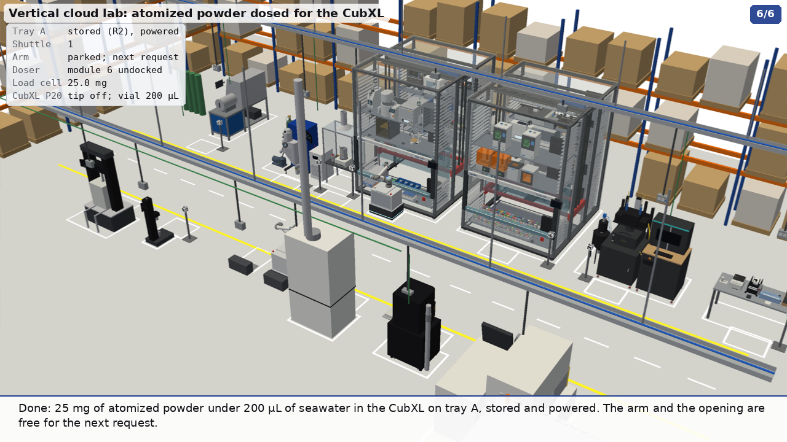
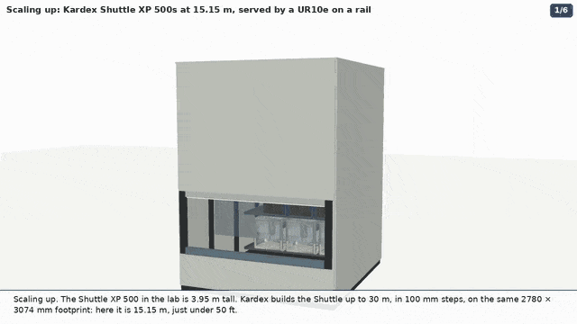
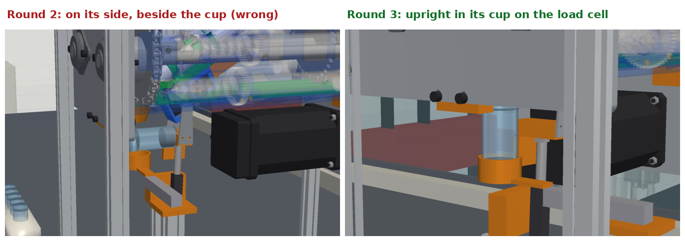

# Vertical lift module: the vertical cloud lab in 3-D

Animations of the vertical lift module (VLM) quoted in
[#53](https://github.com/vertical-cloud-lab/byu-vcl/issues/53), a **Kardex Shuttle XP 500**, holding the lab's own
equipment on six electrified trays, with a **UR10e on a MiR250** working at its access opening and the **rePowder
ultrasonic atomizer** and an **Aconity MIDI** metal printer just off either side, both facing inward
([#303](https://github.com/vertical-cloud-lab/byu-vcl/issues/303)). A last chapter scales it up: eight Shuttles 15.15 m
tall, just under 50 ft, served by one UR10e on a floor rail. They follow the org page's
[`vertical-lab.gif`](https://github.com/vertical-cloud-lab/.github/blob/main/profile/vertical-lab.gif) and are built
the way the lab's other animations are (rePowder training, sieving, atomizer charge, the doser's assembly): CadQuery
models tessellated into PyVista, rendered off-screen, text drawn with PIL, written as an MP4 and a GIF. The scene
framework, [`scene.py`](scene.py), is `atomizer-training/viz3d/scene.py` from #124's branch.

| Chapter | GIF (800 × 450, 10 fps) | MP4 (1280 × 720, 15 fps) |
|---|---|---|
| **Assembly**: base, frame, columns, extractor, six trays, then the cladding goes on, opaque | [`out/vlm_assembly.gif`](out/vlm_assembly.gif) | [`out/mp4/vlm_assembly.mp4`](out/mp4/vlm_assembly.mp4) |
| **Loading**: the closed machine between the atomizer and the Aconity, then see-through; all 16 pieces go onto their trays through the opening, one at a time; the arm rolls up | [`out/vlm_loading.gif`](out/vlm_loading.gif) | [`out/mp4/vlm_loading.mp4`](out/mp4/vlm_loading.mp4) |
| **Workflow**: the arm doses a powder with the multi-doser, the vial upright all the way, and takes it to a CubXL, which adds liquid | [`out/vlm_workflow.gif`](out/vlm_workflow.gif) | [`out/mp4/vlm_workflow.mp4`](out/mp4/vlm_workflow.mp4) |
| **Scale**: the Shuttle grown to 15.15 m, eight of them in two rows, one UR10e on a rail down the aisle | [`out/vlm_scale.gif`](out/vlm_scale.gif) (640 × 360, 6 fps, to stay under 5 MB) | [`out/mp4/vlm_scale.mp4`](out/mp4/vlm_scale.mp4) |
| **Disassembly**: unloaded one piece at a time, then taken apart | [`out/vlm_disassembly.gif`](out/vlm_disassembly.gif) | [`out/mp4/vlm_disassembly.mp4`](out/mp4/vlm_disassembly.mp4) |
| **All five**, one after the other (5 min 53 s) | [on YouTube](https://www.youtube.com/watch?v=9A9XuBT0BYk) (unlisted, BYU Vertical Cloud Lab channel) | [`out/mp4/vertical_lab_full.mp4`](out/mp4/vertical_lab_full.mp4) |






`out/<name>.json` gives the frame range of every sub-step in the MP4, `out/<name>_still.png` is a still of the last
view (for the workflow, the dose), and [`out/reach.json`](out/reach.json) is the arm study below.

## What is on the trays

| Tray (slot) | Load | Tallest item |
|---|---|---|
| A, strong (R1) | three Opentrons OT-2s | 662 mm |
| B, medium (R2) | the multi-doser (chain carousel v2) and a five-vial rack | 731 mm |
| C, light (F1) | three CubXLs, their control boxes on shelves behind the frames | 488 mm |
| D, light (R3) | three Bambu Lab H2Ds | 626 mm |
| E, light (R4) | three Bambu Lab A2Ls | 505 mm |
| F, light (F0, under the opening) | three Bambu Lab A1 minis | 483 mm (its PTFE tube's arc) |

#53 quotes three trays (strong, medium, light); D-F are three more light ones. Each slot is its tray's tallest item
plus about 50 mm on Kardex's 25 mm grid, and every piece stands at its tray's front edge, where it is reached. Three
CubXLs only fit across one tray with their control boxes behind the frames, so here each stands on a shelf there
(in the lab it sits 300 mm to the left of the frame).

## The cell

The rePowder ultrasonic atomizer stands just off the VLM's left side and the Aconity MIDI just off its right, each
turned 90° so its front faces the space in front of the opening where the arm works. Their working ends (the
atomizer's chamber, the Aconity's process chamber) are in front of the VLM's cover; their utilities (the atomizer's
heat exchanger, the Aconity's filter unit) stand beside the VLM's front corners. That leaves a 2.9 m wide space
between their fronts for the MiR250.

## The workflow

An example run, with every move a real one:

1. **Tray B (powder dosing) comes down.** The extractor pulls it off its supports and carries it down. The shutter at
   the back of the bay opens to let it through and closes behind it.
2. **An empty 20 mL vial into the multi-doser, upright.** The station takes the vial only one way: standing in its
   cup on the 100 g load cell, mouth up, with the D-cut funnel's spout 5 mm inside the mouth (PR #185, chain carousel
   v2). So the UR10e grasps the vial from the side at the rack, 46 mm up, its gripper level. It lifts the vial out,
   carries it to the front of the station without turning it, and slides it into the cup. In round 2 it gripped the
   vial from above and then turned level to slide it in, and the vial turned with the gripper and lay on its side.
3. **Dose.** The carousel indexes powder module 6 to the station: 8 chain links per module, run the way powder-doser's
   leakage study says. The module is drawn green, as powder-doser's own movie marks one. The Actuonix P16 lifts the
   electronics carriage and docks it with the magnet on. The docked module rides inside the loop, boxed in by the
   other twelve, so those are drawn see-through for the dose. The station tilts the module 30°, cap end up, and turns
   the auger two revolutions while the vial fills and the load cell counts 0.512 g. Then it tilts back, reverses one
   turn at rest and undocks, as in the station's protocol in powder-doser PR #185.
4. **The arm holds the vial while the VLM swaps trays.** It takes the vial out of the cup, still upright, and holds
   it clear of the opening. Tray B goes back to its slot and its power.
5. **Tray C (three CubXLs) comes down.** The right-hand CubXL's gantry parks at the back. The arm stands the vial on a
   one-vial seat at the front of its deck. The CubXL's own six-vial rack is too tight for fingers between its vials,
   so the seat is a layout choice.
6. **Liquid, then storage.** The CubXL brings its pipette over the vial and adds the liquid. Tray C goes back up with
   the vial in it, to a slot that has power, so the CubXL can keep working while it is stored.

Every approach, grasp and retreat is a straight line of the gripper's grasp point, solved with the UR's inverse
kinematics every frame ([`robot.py`](robot.py)). A move that would need a flip of the arm fails before anything
renders. The rack stands right of the doser and the workflow uses the right-hand CubXL for the same reason. With the
gripper level and pointing into the tray, every move then keeps the wrist at least 245 mm off the arm's base axis.
Nearer the axis, a UR has no solution. The multi-doser moves through its own `layout.placements(State(...))`, so the
chain, the carriages, the station's linkage, the tilt and the auger turn are its real kinematics.

## The models, one by one

| In the scene | Model | Where it comes from |
|---|---|---|
| Kardex Shuttle XP 500 | [`vlm.py`](vlm.py) | **Built here from Kardex's figures** (below). Kardex publishes no CAD, BIM or Revit file for the Shuttle |
| Multi-doser: chain carousel v2, 13 powder modules, its station, load cell, vial and electronics board (tray B) | [`carousel.py`](carousel.py) over [`multidoser/`](multidoser/) | **The lab's own design**, powder-doser [PR #185](https://github.com/vertical-cloud-lab/powder-doser/pull/185) (#128). `multidoser/{params,parts,layout,kinematics}.py` are verbatim copies of `cad/chain-carousel-v2/` at `1c135e0`. Its three reference STEPs (Sam's Oct 13 plate and electronics carriage, the threaded auger, the cap) are fetched at that commit and SHA-256 checked. On the tray its electronics board stands beside the frame, turned 90°. Newer designs in the same PR are not used yet (see below) |
| Universal Robots UR10e with a Robotiq 2F-85 gripper | [`ur_arm.py`](ur_arm.py) | **Vendor descriptions**: UR's `Universal_Robots_ROS2_Description` at `81f7c9f` (visual meshes and the calibrated kinematics; FK matches UR's DH table to 3e-7 mm) and PickNik's `ros2_robotiq_gripper` at `a74d007` (2F-85 meshes and linkage). Fetched and hash-checked at run time. The UR3e and UR7e are there too, for the comparison |
| MiR250 mobile base, with a cabinet for the UR control box | [`props.py`](props.py) | MiR's published size, 800 × 580 × 300 mm; the cabinet's height is a layout choice (it puts the arm's base at 800 mm, under the 833 mm table) |
| Opentrons OT-2 ×3 (tray A) | Opentrons' reference STEP, "Detailed" | **Vendor CAD**, from [github.com/Opentrons/ot2](https://github.com/Opentrons/ot2), fetched and SHA-256 checked by [`lab_models/vendor.py`](lab_models/vendor.py) |
| CubXL ×3 (tray C) | `equipment.cubxl()`, in four pieces | The lab's CadQuery model from #199: the Genmitsu PROVerXL 4030 V2 frame from SainSmart's spec, the rest from lab photos. Split here into frame, gantry, carriage and tools so the gantry moves over its 400 × 300 × 110 mm travel; its control box moved onto a shelf behind the frame |
| Bambu Lab H2D ×3 and A1 mini ×3 (trays D, F) | `equipment.h2d()`, `equipment.a1_mini()` | The lab's CadQuery models from #199, from Bambu's spec pages and outline drawing. Bambu publishes no CAD |
| Bambu Lab A2L ×3 (tray E) | [`a2l.py`](a2l.py) | **Built here** the same way, as Bambu publishes no CAD: the envelope (544 × 529 × 505 mm, 12.8 kg) and build volume (330 × 320 × 325 mm) from Bambu's A2L media kit as quoted by [3D Printing Industry](https://3dprintingindustry.com/news/new-bambu-lab-a2l-3d-printer-technical-specifications-and-pricing-252057/), the layout from reviews ([Tom's Hardware](https://www.tomshardware.com/3d-printing/bambu-lab-a2l-3d-printer-review)): an open-frame bed slinger in the A1's style with a triangular-profile gantry arch |
| AMAZEMET rePowder ultrasonic atomizer and its utilities, just off the left side | [`repowder/model.py`](repowder/model.py) | **DAL's latest model**: `atomizer-training/viz3d/model.py`, identical (same blob) on digital-alloy-lab's PR #216 and PR #189 heads and its `onr-yip-figs-oct27-integrate` branch. It includes the stack measured on the machine (#261: 45° stack, 119.6 × 20.8 mm plate, 19.9 × 56.6 mm upper sonotrode), so DAL PR #173's measured-stack patch is already in it |
| Aconity MIDI metal LPBF printer (candidate), just off the right side | `equipment.aconity_midi()` | The lab's CadQuery model from #199 (`lab-models`, with its 3 October corrections): 2450 × 1500 × 2320 mm envelope and the build space from Aconity's configurator data, the layout from Aconity's configurator layers and front photos; depths inferred. I found no other Aconity model in DAL or elsewhere in the org |
| Vials and the vial rack | [`props.py`](props.py) | The multi-doser's own 20 mL vial (28 × 61 mm, from its `params.py`); a printed rack, one row of five at 70 mm so a gripper's fingers fit between the vials |

[`lab_models/`](lab_models/) is a verbatim copy of `lab-models/cad/{common,equipment,labware,vendor}.py` from #199's
branch at `7fc56b6`, and [`repowder/model.py`](repowder/model.py) one of `atomizer-training/viz3d/model.py` from #124's
branch at `7757443` (the same file DAL carries), so each model has one source. Vendor CAD is downloaded into `.cache/`
(the carousel's references into `multidoser/reference/`) and never committed.

## The Kardex Shuttle XP 500

The front was rebuilt against Kardex's own Shuttle 500 renders and fact sheet, and against Kardex's order sheet for
this configuration: "Kardex Shuttle POF Version 16", SHUTTLE-01-500-2450x864. That sheet is hosted by the dealer
StoreMoreStore ([VLM option 1 specification sheet](https://products.storemorestore.com/hubfs/StoreMoreStore/Kardex-Vertical-Lift-Module/VLM-Option-1-96x34-Light-Specification-Sheet.pdf)).

| | Value | Source |
|---|---|---|
| Tray | 2450 × 864 mm | #53: 96.46 × 34.00 in |
| Module footprint | 2780 × 3074 mm | Relevator Group's listing of XP 500-2450x864 units; the order sheet gives 2780 × 3073 |
| Height | 3950 mm | #53: "less than 13'"; Shuttle heights step 100 mm from 2550 mm |
| Access table | 833 mm above the floor | Order sheet: front access table height TH1 |
| Presented tray | underside at 854 mm, floor top at 855.5-856.5 mm | Order sheet: TH1 + 21, and TH1 + 22.5 / 23 / 23.5 for light / medium / strong trays |
| Product height through the opening | 727.5 mm, plus 20 mm clearance | Order sheet |
| Opening | 2500 mm between the side posts; header at 1700 mm | Kardex renders and a real 2450 × 864 unit (about tray + 50 mm); the mouth reads 850-870 mm tall |
| Look | RAL 7035 panels in about 490 mm bands; white header with the logo and an LED light under it; anthracite posts; slatted side walls in the bay; a blue (RAL 230 60 15) cover under the tray with the LED-Navigator strip; the OPTIC panel on the right post | Order sheet (colours, options); Kardex renders |
| Safety shutter | at the **back** of the bay, between the presented tray and the shaft; it closes while the extractor moves | Kardex: the operator works on one tray "while the extractor prepares the next tray behind the shutter doors" |
| Tray supports | 25 mm pitch (drawn every 100 mm) | Kardex: 25 mm storage grid |
| Speeds | up to 2.0 m/s vertical, 0.7 m/s in and out | Kardex Shuttle XP brochure; the animation keeps to these |
| Trays | strong 1080 lb, medium 794 lb, light 502 lb; powered in a slot and at the opening, not in transit | #53 (three trays; the other three here are more light ones) |
| Height range | up to 30 m, in 100 mm steps | Kardex: [Kardex Shuttle](https://kardex.com/en-au/kardex-shuttle), device heights up to 30 m |

**"The large bay opening".** For the Shuttle 250/500, Kardex's documents list no opening called "large". The largest
is the full-width front opening above, which is what the model now has: 2500 mm wide, at an 833 mm table, taking 727.5 mm
of product height. Two other options exist. Up to six openings can go on the front and rear. With full tray
extraction, the tray is pulled out in front of the unit onto a table, for crane loading. Full tray extraction would
put the whole tray under an open sky for the arm. Worth asking Kardex about if the arm has to reach the back of every
tray.

Still layout choices, not published: the front/back split of the columns, the slots the trays use, the extractor's
details (a platform on four guide rails, a belt drive on the roof frame), and the console's exact size.

## The arm: why a UR10e

[`reach.py`](reach.py) puts each arm on the MiR250 where the animation parks it: square to the opening, 30 mm off the
cover's lip, with its base at 800 mm. It then asks the arm's own inverse kinematics three things:
- can the arm reach the four seats the workflow uses?
- how much of the presented tray can it reach pointing straight down?
- how close do its elbow, forearm and wrists come to the opening's header (at 1700 mm)?

| | Reach, payload | Workflow seats reached (of 4) | Tray reached, gripper down, 100 mm up | Deepest point | Closest approach to the header |
|---|---|---|---|---|---|
| UR3e | 500 mm, 3 kg | 2 | 3 % | 100 mm | 496 mm |
| UR7e | 850 mm, 7.5 kg | 3 (not the CubXL's seat) | 31 % | 500 mm | 327 mm |
| **UR10e** | 1300 mm, 12.5 kg | 4 | **83 %** | **800 mm** (the tray is 864 deep) | 120 mm |

The four seats are round 3's side grasps: the rack, the station's cup, the pose that holds the vial during the tray
swap, and the seat on the right-hand CubXL's deck.

No arm ever has to go over the header to reach a point. The header limits none of them, so access decides:
- The UR10e reaches the tray's full depth across most of its width.
- The UR7e reaches only the front half near the middle, so everything it handles has to sit along the front edge.
- The UR3e barely reaches past the lip.

The cost of the UR10e is clearance: its closest approach to the header is 120 mm, against the UR7e's 327 mm.

## Scaling up

[`scale.py`](scale.py) builds the scale-up chapter. Kardex builds the Shuttle up to 30 m tall in 100 mm steps, so
15 150 mm is the tallest under 50 ft (15 240 mm). The footprint, trays, opening and speeds stay the ones above.
- **Trays.** Each 15.15 m unit holds 44 trays, filled from the bottom of both columns with the five instrument loads
  of trays A and C-F in turn. Each slot is sized as in the lab's unit.
- **The array.** Eight units stand in two rows of four, facing each other across an 1100 mm aisle (between the tray
  covers): 352 trays and 1056 instruments.
- **The arm.** One UR10e on an 800 mm riser, the height it has on the MiR250, rides a floor rail down the middle of
  the aisle and turns to either row. A tray 250 mm in is 650 mm from the rail, well inside its reach.
- **Motion.** The extractors run at Kardex's 2 m/s vertical speed, all eight at once.
- **What's simplified.** The instrument meshes are the main scene's, decimated to at most 1500 triangles per mesh so a
  thousand of them render. The tall unit's cladding, opening and trays are drawn as boxes from `vlm.py`'s figures.
  The tray supports, columns and drive are left out.

Layout choices, not from a source: the two rows, the aisle's width, the rail and the riser.

## Things the model shows



- **The vial goes into the station upright, and only from the side.** In PR #185's chain carousel v2 the vial stands
  mouth up in a closed 18 mm cup (15 mm pocket) on the load cell, with the D-cut funnel's spout 5 mm inside its mouth
  and the funnel's top 1.5 mm under the passing carriage plates. No path in or out is drawn. The animation slides the
  vial in and out level, a few millimetres higher than the cup would allow. A robot-served station needs the funnel to
  clear the mouth, or a cup open at the front.
- **PR #185 has moved on since v2.** On 29-30 October, after Sam's critiques, the PR added chain carousel v3 and v4.
  - **No vial or funnel.** The dose falls straight into a 25 mL low-form beaker (Ø38 × 49 mm) on an A&D HR-100A's pan.
  - **Hand access.** The beaker goes in through a 180 × 230 mm hinged front hatch in an acrylic enclosure, which the
    docs assume a person opens.
  - **The balance doesn't fit yet.** 27 parts of v3 and 15 of v4 are in its way.
  - **No successor named.** The PR leaves the choice between v3 and v4 to Sam.

  So this workflow still uses v2. Once one is picked, a robot-served version needs the hatch to open by itself (or
  no hatch) and a vessel the gripper can take out.
- **The multi-doser is 3.5 mm too tall for the opening.** The chain carousel v2 stands 731 mm on its levelling feet,
  and Kardex's limit is 727.5 mm of product height plus 20 mm clearance. Turning its four levelling feet down by 4 mm,
  or a 3-4 mm shorter post, would make it pass Kardex's height check. The animation draws it as designed.
- **The station's free fall is short.** The station drops the powder about 25 mm from the auger's outlet into the
  D-cut funnel, behind the rig's front plate. So a camera sees the dose as the tilt, the vial filling and the load
  cell's count, not as a falling stream.
- **The A1 minis' tray sits under the opening.** With six trays, the front column's 490 mm gap under the access table
  is used too. Tray F (A1 minis, 483 mm to the top of the PTFE tube's arc) fits it with 8 mm to spare.

## Running it

```bash
pip install cadquery pyvista trimesh pycollada pillow numpy scipy   # plus ffmpeg and gifsicle on the PATH
xvfb-run -a python3 animate.py assembly loading workflow scale disassembly full   # full joins the five MP4s
PREVIEW=1 xvfb-run -a python3 animate.py workflow        # the last frame of each sub-step, to /tmp
python3 reach.py                                          # the arm study -> out/reach.json
```

The first run downloads the OT-2, UR, Robotiq and carousel files and tessellates everything, which takes a few
minutes. Each model is cached in `.cache/` on its own sources, so changing one doesn't re-tessellate the others. Run
the chapters one `xvfb-run` at a time, or give each one its own display number (`xvfb-run --server-num=N`) and start
them a few seconds apart: several started together can race for a display, or find their X server not yet up.
`VIZ3D_SIZE=1920x1080 VIZ3D_FPS=30` gives a 1080p MP4 with every move taking the same time.
