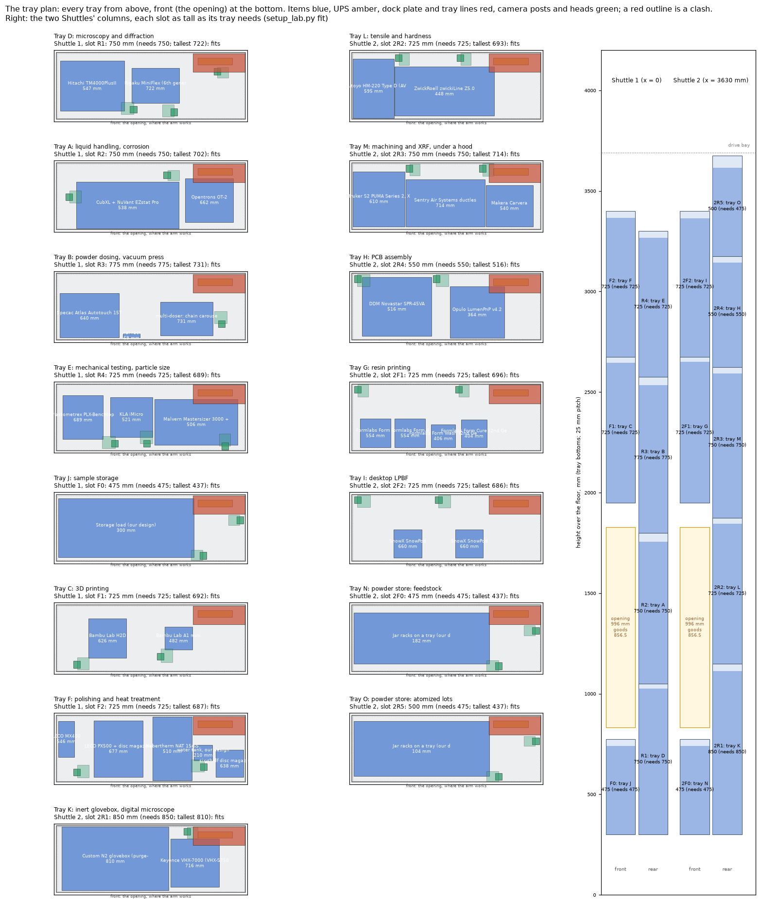
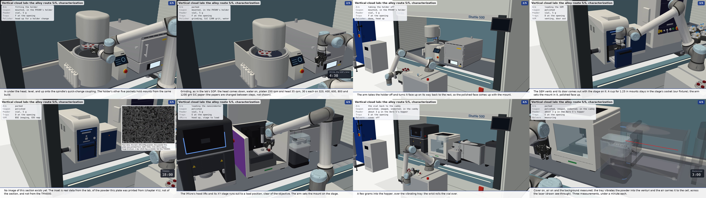
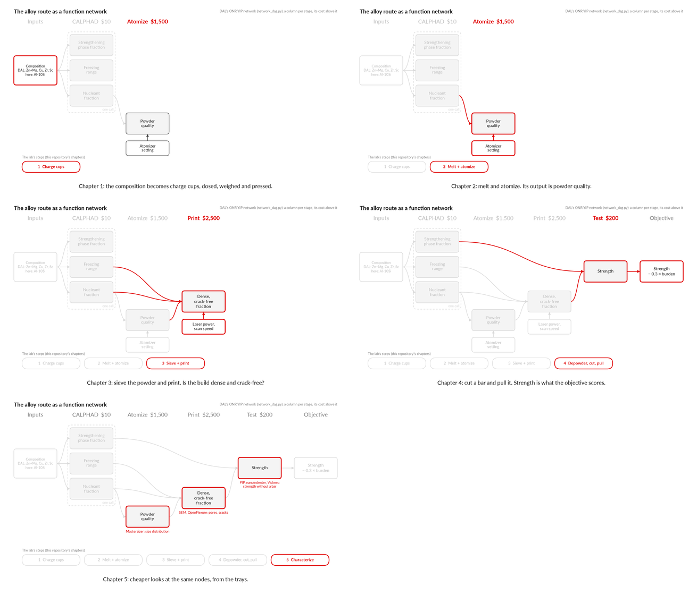
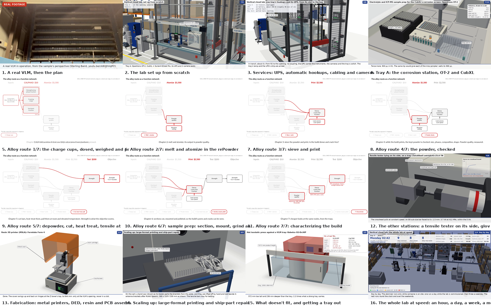
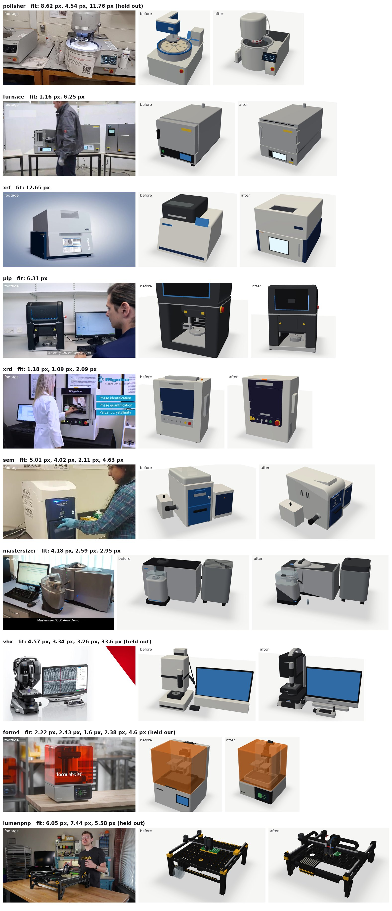
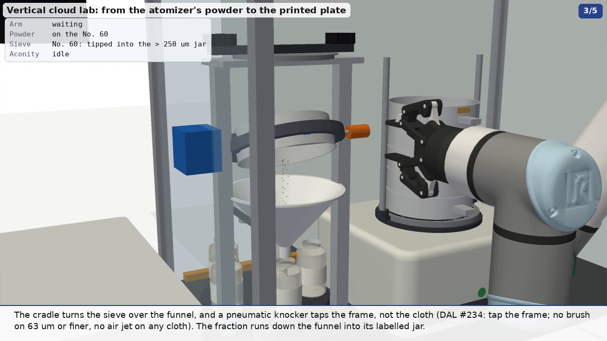
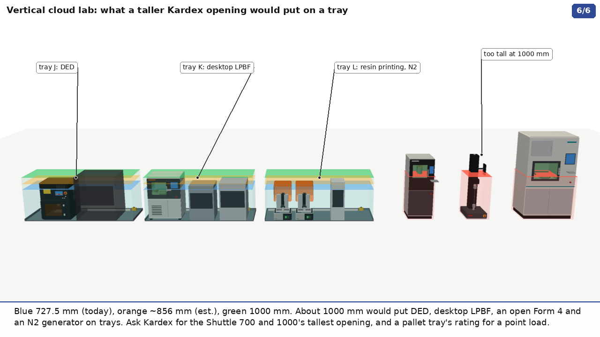
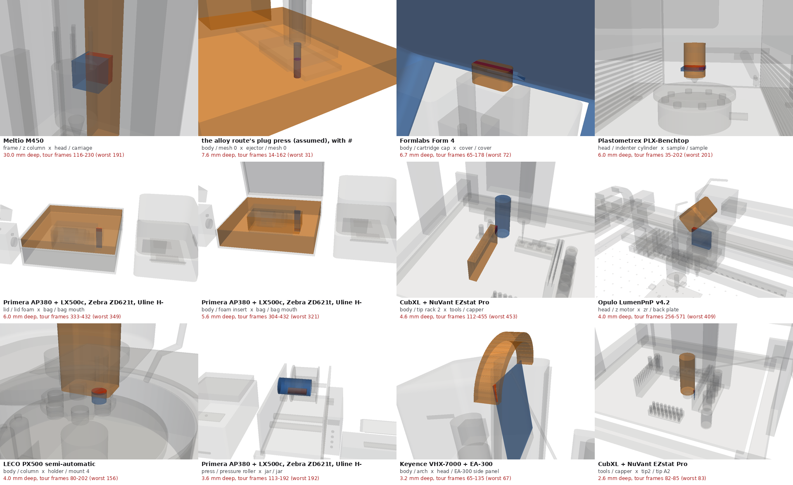
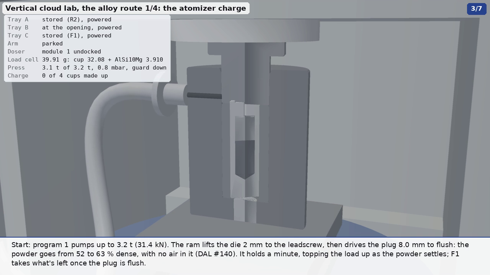

# Vertical lift module: the vertical cloud lab in 3-D

Animations of the vertical lift module (VLM) quoted in
[#53](https://github.com/vertical-cloud-lab/byu-vcl/issues/53), a **Kardex Shuttle XP 500**, holding the lab's own
equipment on three electrified trays, with a **UR10e on a MiR250** working at its access opening
([#303](https://github.com/vertical-cloud-lab/byu-vcl/issues/303)). They follow the org page's
[`vertical-lab.gif`](https://github.com/vertical-cloud-lab/.github/blob/main/profile/vertical-lab.gif) and are built
the way the lab's other animations are (rePowder training, sieving, atomizer charge, the doser's assembly): CadQuery
models tessellated into PyVista, rendered off-screen, text drawn with PIL, written as an MP4 and a GIF. The scene
framework, [`scene.py`](scene.py), is `atomizer-training/viz3d/scene.py` from #124's branch.

## Round 7: a 996 mm opening, two Shuttles, a UPS on every tray, new stations, the trays at work

Asked for on [PR #318](https://github.com/vertical-cloud-lab/byu-vcl/pull/318) (2026-11-04, after watching the
long-form to 14:18). Nine sub-agents worked in parallel, each on its own files. Each part has a notes file.

### The opening, the MiR's storage, the wrist camera and the tag cubes

[`notes/foundation_r7.md`](notes/foundation_r7.md).

- **The opening is now 996 mm tall** over the 833 mm table, as on one used Shuttle XP 500
  ([lagersysteme-paternoster.de, Pos. 89](https://www.lagersysteme-paternoster.de/gebrauchte-lagertechnik/kardex-shuttle-xp500-3050x864-pos-89/)).
  - That gives about **856.5 mm** of product height, an estimate: Kardex publishes 727.5 mm for its standard opening,
    and the header is assumed to stand as far above the goods as on that one (`vlm.MAX_GOODS_H`).
  - `tour.FIT` and the tray checks follow it.
- **The MiR's storage is a low block on its cabinet top, with no post.** It has bored pockets with 1 mm radial
  clearance, a 3 mm lead-in, and 26 mm depth (43 % of a vial, 41 % of a cup), so nothing slides off while the MiR
  drives (`props.pocket_block`). The UR10e reaches every seat on a collision-free IK branch.
- **A wrist camera:** an Intel RealSense D405 on a bracket round the 2F-85's coupling.
  - It doesn't move the TCP, and it is drawn and collision-checked wherever the arm is.
  - The arm parks with wrist 3 at 180°: at 0° the camera stuck out past the MiR and met the opening's post.
- **The camera targets are 120 mm cubes,** with a different AprilTag-36h11-like pattern on the top and all four sides.
  A camera sees one from any heading, not only from above. The bit patterns are drawn, not real tag IDs.

### The tray plan, two Shuttles, and no rail



[`notes/tray_plan.md`](notes/tray_plan.md).

- **Each slot is as tall as its tray needs:** the tray floor, plus the tallest item, UPS or camera head, plus 20 mm,
  on the 25 mm pitch (`vlm.COLUMNS`).
- **Thirteen trays need two Shuttles.** The second stands 800 mm to the right of the first, room for a MiR250 to turn.

  | Shuttle | Slots | Trays |
  |---|---|---|
  | 1 | R1-R4, F0 (under the table), F1, F2 | D, A, B, E; J (storage); C, F |
  | 2 | 2R1-2R4, 2F1, 2F2 | K (glovebox + VHX), L (sideways tensile + hardness), M (XRF + ductless hood + CNC), H; G, I |

- **Every tray carries its UPS, dock plate and camera posts.** `python3 setup_lab.py fit` checks them all from the
  meshes ([`out/tray_plan.json`](out/tray_plan.json)).
- **The floor is planned for the MiR250 alone** ([`out/tray_plan_floor.png`](out/tray_plan_floor.png)).
  - Every dock, its way in and its turning spot are checked.
  - The rePowder's dock sits where the alloy chapters already park.
  - The new ducted fume hood stands across the aisle.
- **No rail anywhere.** With the aisle clear, [`maintenance.py`](maintenance.py) shows a tray coming out at the front by
  Kardex's full tray extraction, after the MiR drives off ([`out/maintenance_access.png`](out/maintenance_access.png)).
- **The set-up movie** loads both Shuttles. Every tray comes in with its UPS and cameras, and the Specac Autotouch
  goes onto tray B. The power and network drops end in grey junction boxes with sockets and a network port; they were
  the yellow boxes. Nothing is removed at the end. [`out/setup_lab_preview.png`](out/setup_lab_preview.png) has the end
  of 32 of its 57 steps.

### New stations

Code: [`instruments_r7.py`](instruments_r7.py). Sources: [`notes/instruments_r7.md`](notes/instruments_r7.md).

| Station | Model | W × D × H (mm) | Where | Clip |
|---|---|---|---|---|
| Glovebox | Our N2 design, purge-only, 150 mm mini antechamber at the front | 1390 × 830 × 810 | tray K | [GIF](out/instruments/glovebox_tray.gif) |
| Tensile, on its side | ZwickRoell zwickiLine Z5.0 TN, 5 kN | 1289 × 638 × 448 | tray L | [GIF](out/instruments/tensile_h.gif) |
| Hardness | Mitutoyo HM-220 Type D (AVPAK) | 533 × 672 × 595 | tray L | [GIF](out/instruments/hardness.gif) |
| CNC | Makera Carvera, plus our lid actuator and pneumatic vise | 610 × 535 × 540 (836 open) | tray M | [GIF](out/instruments/cnc.gif) |
| Fume hood, ducted | Labconco Protector XStream 4 ft | 1219 × 958 × 2581 | floor | [GIF](out/instruments/fumehood.gif) |
| Fume hood, ductless | Sentry Air 24 in, with its blower | 1030 × 610 × 715 | tray M | [GIF](out/instruments/fumehood_tray.gif) |
| Storage | Our design: Al and Cu cups and plugs, vials, tubes, stubs, mounts, bars, jars | 1760 × 760 × 300 | tray J | [GIF](out/instruments/storage.gif) |
| VHX, no monitor | VHX-7000 + EA-300, controller turned sideways, PiKVM V4 Mini | 630 × 625 × 716 | tray K | [GIF](out/instruments/vhx.gif) |

- **No compact glovebox on the market fits a tray**, so ours is built from Vigor's 220 mm ports and its 150 × 300 mm
  mini antechamber.
  - It is purge-only. A purifier needs H2 regeneration and a heater inside the VLM.
  - The dock's 0.5-1.1 L/min of N2 can't do the first purge (2.4 m³), so it needs a bigger supply.
- **The zwickiLine runs horizontally** at 5 kN.
  - It can pull a bar faced to 6 × 1.5 mm (3.7 kN), not the route's 6 × 6 mm bar (14.8 kN). That bar stays on the
    68FM-100.
  - No motorized horizontal machine with a published size reaches 14.8 kN. Tinius Olsen and ADMET only give sizes on
    a quote.
- **The HM-220 was the only automatic tester found whose maker publishes its height:** 595 mm, 43 kg,
  0.05 gf-2 kgf. It is the hardness tester DAL's workflow notes listed as missing.
- **The Carvera is the only tool-changer mill found that fits a tray.** But its lid is lifted by hand, it has no
  automation interface, and 200 W allows only light cuts in aluminium.
- **Keller's reagent (HF) needs the ducted hood.** The ductless one returns its air into the VLM.
- **The VHX-7000's controller is its 27 in monitor** (625 × 460 × 180 mm, 12 kg; LAN, USB, DisplayPort), so a Windows
  SBC can't replace it.
  - The monitor now stands sideways as a controller, and a PiKVM gives remote use from a browser.
  - The old monitor ran 430 mm past tray C's rim, which is the interference you saw. Check the DisplayPort resolution
    with Keyence before relying on the PiKVM.
- **`storage_seats()`** lists every pocket for the arm.

### Tray services: the UPS, the hookups, the docks against the lift, the cameras

| Video | GIF | MP4 |
|---|---|---|
| **Hookups and the UPS:** tray A from its slot to the bay | [GIF](out/vlm_hookups.gif) | [MP4](out/mp4/vlm_hookups.mp4) |
| **The bay camera:** from an operator's eyes, then through its own lenses | [GIF](out/bay_camera.gif) | [MP4](out/mp4/bay_camera.mp4) |
| **Tray services, joined:** the docks, the hookups, the bay camera, the cabling | | [MP4](out/mp4/vlm_services_all.mp4) |

[`notes/services.md`](notes/services.md).

- **Every tray's UPS shows.** "UPS" is on its top and front, with a status strip: green on mains, amber on battery.
- **The hookups, automatic, in storage and in the bay.**
  - Each dock has a vented valve on air, N₂ and both water lines, a mains contactor and an Ethernet link light.
  - To let go, the valves shut and vent, the UPS takes the load, and then the dock pulls back.
  - At the bay the order reverses, pins first.
- **The docks don't get in the lift's way** (`services.dock_clearance()`).
  - The nearest dock is 158 mm from the extractor at any height, empty or carrying any tray, docked or pulled back.
  - A tray passes its own pulled-back dock 22 mm clear.
  - The one tight spot was the plate's inserts against the extractor's carriages, 3.5 mm. The plate face is now sunk
    6 mm and the stroke is 60 mm.

  
- **The retractable line is dropped.** While its tray was out, the line spanned the shaft.
- **Tray cameras look back, away from the opening.** With its tray presented, 11 of 13 units see none of the room.
  A1 (the OT-2) sees 26 % of the room and D2 (the OpenFlexures) 15 %, because those instruments leave no room in
  front, so those two streams want a crop.
- **The bay camera** sits on a clamp on its bar, with no post, to fit under the taller opening.
  - The Camera Module 3 Wide covers 102 × 67° (120° diagonal) and sees 95 % of the tray.
  - The HQ Camera with its 16 mm lens covers 22.2 × 16.8°, from its 6.29 × 4.71 mm sensor.
- **The yellow boxes** were `setup_lab.utilities()`'s drop boxes, where each power and network drop from the overhead
  cable tray ends at a machine. They are now grey junction boxes with the machine's receptacle and an RJ45 jack.

### Tray A, the corrosion station: the CubXL as DAL has it, the OT-2's job, no salt

| Clip | Shows |
|---|---|
| [`cubxl_corrosion.mp4`](out/mp4/instruments/cubxl_corrosion.mp4) | One spot of DAL's copper screen, on DAL's deck |
| [`vlm_workflow.mp4`](out/mp4/vlm_workflow.mp4) | 25 mg of atomized powder dosed for the CubXL's powder test |
| [`ot2_corrosion_prep.mp4`](out/mp4/instruments/ot2_corrosion_prep.mp4) | The OT-2 makes the sulfide stock and dilutes the ICP-MS tubes |

[`notes/cubxl_corrosion.md`](notes/cubxl_corrosion.md), [`notes/ot2_corrosion.md`](notes/ot2_corrosion.md).

- **The CubXL is DAL PR #180's copper deck** at
  [`aeda51a`](https://github.com/vertical-cloud-lab/digital-alloy-lab/tree/aeda51a/alloy-corrosion/copper), with Ben's
  STEP parts (`deck_cu.py`, `protocol.md`, `render_cubxl_cu.py`). The only difference: the EZstat Pro stands beside
  the frame.
  - **The spot runs as DAL's protocol does:** fill, OCP, EIS, LPR, rest, the +50 mV hold, OCP, then collect, acidify
    and image.
  - **EIS** is captioned as needing the requested potentiostat, since the EZstat Pro has none.
  - **Cyclic polarization** runs only on selected spots, last on each.
- **Every volume is a P20 transfer** of 20 µL or less, counted on screen. The 150 µL fill is 7 × 19.3 µL of seawater
  plus 15 µL of sulfide. Levels are drawn to scale.
- **No salt is dosed.** DAL's `cubxl-setup.md` §8 calls dosing salt "possible but pointless here". Instead, the
  multi-doser doses 25 mg of atomized AlSi10Mg for DAL's powder reactivity test from the same section, and the P20 adds
  200 µL of seawater in 10 transfers. The charge cups' precursors are dosed in chapter 1.
- **The OT-2** is the corrosion station's liquid prep (digital-wetlab PR #83, direction 5). With its P300 and P20 it
  makes the CubXL's 0.1 mg/L sulfide stock, dilutes an ICP-MS tube 10×, and makes a 10 µg/L standard.
- **Arm:** 0 of 1191 frames in collision.
- **For DAL:**
  - Ben's capper mount brushes his tip rack 1 by 1.6 mm, 1 mm deep, when drawing from two of the stocks.
  - DAL doesn't say where the 150 µL DI rinse is drawn from.

### Alloy chapter 1: a catch ring in the press

[`notes/vacuum_press.md`](notes/vacuum_press.md); the press's clip: [GIF](out/vacuum_press.gif),
[MP4](out/mp4/vacuum_press.mp4).

- **The catch is the die's mouth, not the pin.** The pin pushes the cup out through F1, a line-to-line fit, so
  nothing riding up with it can hold the cup round its base.
  - The catch is a hardened ring as wide as F1 and 22 mm tall, standing on F1 flush with the die's top. Its bore is
    Ø19.30 with a 30° lead-in.
  - The pin now stops 75.5 mm up, with the cup's bottom 10 mm still in the ring, so the cup stands in a socket with
    1.4° of play.
  - The arm grips 45 mm up the cup, so its fingers pass at least 20 mm over the die.
  - The punch has a Ø19.20 nose that runs in the ring, and a collar that lands on the ring at flush.
- **The press is on tray B from the set-up on.** The set-up movie loads it, and chapter 1's first caption says so.
- **The arm's audit on the round-7 code** (catch ring, low carrier, wrist camera): **0 of 2979 frames** in
  collision, against 8 of 1926 before.
  - At the rack the gripper opens to 23.5 mm, and every approach must have a clear straight line in and out.
  - One move is left: rack cup 7 has no clear straight-line approach, so six of its moves in the sped-up section aren't
    checked. Moving the rack 120 mm left would fix it.
- **Chapter 1 is re-rendered on the round-7 code** at 6 fps (282 s; [GIF](out/alloy_charge.gif),
  [MP4](out/mp4/alloy_charge.mp4)): the catch ring, the low carrier, the wrist camera. `VIZ3D_FPS=10 CHARGE_FXAA=1
  xvfb-run -a python3 alloy_charge.py` gives 10 fps in 35-50 min.

### Alloy chapter 2: the lid's latch, the MiR's margin, a loading tong, the crucible

[`notes/alloy_atomize.md`](notes/alloy_atomize.md),
[`notes/crucible_automation.md`](notes/crucible_automation.md).

- **The lid shuts with one over-centre draw latch**, its keeper on the lid. A pneumatic bolt blocks the lever whenever
  the furnace is off atmosphere.
  - Sources: the lab's training video T4, 5:08-5:23 ([frames](refs/repowder_lid/)), and AMAZEMET at the install call.
  - The arm pulls the lever over centre by a pull tab, which is our addition, and closes it again after loading.
  - The force isn't measured. Kipp publishes 100-200 N of hand force for this kind of latch.
- **Will the MiR tip?** At the chapter's pose, with the pull 1331 mm up and 664 mm out:
  - it tips at 466 N and slides at 505 N, 2.3× and 2.5× a stiff 200 N latch;
  - with a 95 kg ballast plate under the cabinet (drawn), 730 and 785 N
    ([sums](out/alloy_atomize_stability.json)).

  So the mobile base is heavy enough for this, without a rail. The MiR250's wheel positions aren't published, so they
  are estimated.
- **A loading tong, no drop.** The 2F-85 takes a slim tong from a sleeve on the cabinet. The tong carries each cup by
  its top 12 mm and sets it on the floor cone before its jaws open.
  - The jaws stay 3.3 mm from the bore, 7.6 mm from the rod's adapter and 10.2 mm from the rod.
  - The stem stays 2.6 mm from the adapter, and the gripper 136 mm above the rim
    ([clearances](out/alloy_atomize_clearance.json)).
  - The 3/4 in cup's own −0.09 mm squeeze past the adapter (#222) remains; a 5/8 in cup goes straight in.
- **The crucible stack**, with its threaded graphite parts, gets a short stop in the chapter. The notes have the plan:
  a custom tool, threading under force control, and the UR10e's own force sensing against a dedicated wrist F/T
  sensor, with the risks and first trials.
- **Also:**
  - the wrist camera shows in the tong close-up;
  - the melt footage runs at 2× and its badge says so;
  - the container's cradle is a low ring.
- **Collisions: 0 of 1339 frames** (round 5: 10 of 1586).
- **Two faults left in the committed render:** the lid-knob and lever steps are seen from the latch close-up, and the
  camera passes through the machine for a few frames on its way to the tong. Both are fixed in code but not
  re-rendered.

### Alloy chapter 5: the trays at work

[`alloy_characterize.py`](alloy_characterize.py), [notes](notes/alloy_characterize.md), [GIF](out/alloy_characterize.gif),
[MP4](out/mp4/alloy_characterize.mp4).

Samples of chapter 4's AlSi10Mg build go through trays F, D and E. Each tray comes to the opening only when it is
needed, the arm loads and unloads every instrument, and each instrument runs its own joints, sped up, under a clock.
- **Tray F, the LECO PX500.**
  - The arm fits the 6-position holder, with the coupon's mount in it, onto the raised head. It holds it by a tab and a
    quick-change coupling, both ours.
  - The coupon is ground at 320-1200 grit and polished with 1 µm alumina, as in the lab's SOP.
- **Tray D, the TM4000PlusII.** The mount goes face up into a cup on the stage. The inset is real data, the lab's image
  of the powder, and says it isn't of this section.
- **Tray E, the KLA iMicro and the Mastersizer 3000:** a grid of nanoindents, then a roll of the wrist pours the powder
  into the Aero S's hopper.
- **Collisions: 0 of 1266 frames** at 10 fps. The first draft had 132 of 1875.
- **Not used yet:** the PIP, the XRD, the OpenFlexures and the furnace. The PIP's 77 mm bay is too low for the gripper.



### The route as a function network

[`route_dag.py`](route_dag.py) brings in DAL's ONR YIP network one stage at a time before each alloy chapter: the
inputs, then CALPHAD, then atomize, print and test. The source is
[`network_dag.py`](https://github.com/vertical-cloud-lab/digital-alloy-lab/blob/b553306/benchmarks/bofn-prelim/dag/network_dag.py)
at `b553306`, with its nodes, edges and costs.
- The stage each chapter is about is red. Earlier stages fade to grey, and later ones aren't drawn yet.
- Only one caption shows at a time.
- The lab's five steps sit under the graph as chips.
- In chapter 5, each instrument is tied to the node it looks at:
  - the Mastersizer to powder quality;
  - the SEM and OpenFlexure to the dense, crack-free fraction;
  - the PIP, nanoindenter and Vickers tester to strength, without a bar.

FLAIME's DAG (the DOE Genesis proposal) is the same chain with four coarser nodes.




## Everything in one video: the long-form, with chapters

**[The vertical cloud lab, start to finish](https://www.youtube.com/watch?v=myUrMHN7VBA)** (unlisted,
41 min 31 s, 46 YouTube chapters), rebuilt in round 7. It replaces
[`c-xBEmRLq5k`](https://www.youtube.com/watch?v=c-xBEmRLq5k).
- [`longform.py`](longform.py) joins the parts below, with a title card before each chapter.
- [`out/longform.json`](out/longform.json) lists every part, where it came from and where it starts.
- [`out/longform_youtube.txt`](out/longform_youtube.txt) is the video's description, with its chapter timestamps.
- The MP4 (1280 × 720 at 15 fps, 140 MB) is too big for git, so it isn't committed. `python3 longform.py` rebuilds it
  from the committed clips, and its sha256 is in [`out/youtube.json`](out/youtube.json).



| # | Starts | Chapter | Parts |
|---|---|---|---|
| 1 | 0:00 | A real VLM, then the plan | [`vlm_real_ck8QJhVqPiY.mp4`](out/footage/vlm_real_ck8QJhVqPiY.mp4) |
| 2 | 0:23 | The lab set up from scratch | [`setup_lab.mp4`](out/mp4/setup_lab.mp4), [`tray_plan.png`](out/tray_plan.png) |
| 3 | 2:29 | Services: UPS, automatic hookups, cabling and cameras | [`vlm_hookups.mp4`](out/mp4/vlm_hookups.mp4), [`vlm_services.mp4`](out/mp4/vlm_services.mp4), [`dock_lift_clearance.png`](out/dock_lift_clearance.png), [`vlm_cabling.mp4`](out/mp4/vlm_cabling.mp4), [`stream_cam.mp4`](out/mp4/instruments/stream_cam.mp4), [`bay_camera.mp4`](out/mp4/bay_camera.mp4) |
| 4 | 5:21 | Tray A: the corrosion station, OT-2 and CubXL | [`ot2_corrosion_prep.mp4`](out/mp4/instruments/ot2_corrosion_prep.mp4), [`cubxl_corrosion.mp4`](out/mp4/instruments/cubxl_corrosion.mp4), [`vlm_workflow.mp4`](out/mp4/vlm_workflow.mp4) |
| 5 | 9:15 | Alloy route 1/5: the charge cups, dosed, weighed and pressed under vacuum | [`route_dag_ch1.mp4`](out/mp4/dag/route_dag_ch1.mp4), [`dal_workflow_table.png`](out/dal_workflow_table.png), [`alloy_charge.mp4`](out/mp4/alloy_charge.mp4), [`vacuum_press.mp4`](out/mp4/vacuum_press.mp4) |
| 6 | 14:42 | Alloy route 2/5: melt and atomize in the rePowder | [`route_dag_ch2.mp4`](out/mp4/dag/route_dag_ch2.mp4), [`alloy_atomize.mp4`](out/mp4/alloy_atomize.mp4) |
| 7 | 18:11 | Alloy route 3/5: sieve and print | [`route_dag_ch3.mp4`](out/mp4/dag/route_dag_ch3.mp4), [`alloy_print.mp4`](out/mp4/alloy_print.mp4) |
| 8 | 21:42 | Alloy route 4/5: depowder, cut and test | [`route_dag_ch4.mp4`](out/mp4/dag/route_dag_ch4.mp4), [`alloy_workflow.mp4`](out/mp4/alloy_workflow.mp4) |
| 9 | 24:36 | Alloy route 5/5: the trays at work, characterizing the build | [`route_dag_ch5.mp4`](out/mp4/dag/route_dag_ch5.mp4), [`alloy_characterize.mp4`](out/mp4/alloy_characterize.mp4) |
| 10 | 27:11 | Characterization instruments, one by one | [`instruments_gallery.png`](out/instruments_gallery.png), [`xrd.mp4`](out/mp4/instruments/xrd.mp4), [`sem.mp4`](out/mp4/instruments/sem.mp4), [`vhx.mp4`](out/mp4/instruments/vhx.mp4), [`xrf.mp4`](out/mp4/instruments/xrf.mp4), [`openflexure_array.mp4`](out/mp4/instruments/openflexure_array.mp4), [`mastersizer.mp4`](out/mp4/instruments/mastersizer.mp4), [`nanoindenter.mp4`](out/mp4/instruments/nanoindenter.mp4), [`pip.mp4`](out/mp4/instruments/pip.mp4), [`hardness.mp4`](out/mp4/instruments/hardness.mp4) |
| 11 | 29:56 | Sample prep, testing, powder handling, fume hoods and shipping | [`polisher.mp4`](out/mp4/instruments/polisher.mp4), [`furnace.mp4`](out/mp4/instruments/furnace.mp4), [`cnc.mp4`](out/mp4/instruments/cnc.mp4), [`wire_edm.mp4`](out/mp4/instruments/wire_edm.mp4), [`tensile_h.mp4`](out/mp4/instruments/tensile_h.mp4), [`instron_small.mp4`](https://github.com/vertical-cloud-lab/byu-vcl/blob/a34367a/vertical-lab/out/mp4/instruments/instron_small.mp4) (a34367a), [`instron_floor.mp4`](out/mp4/instruments/instron_floor.mp4), [`sieve.mp4`](out/mp4/instruments/sieve.mp4), [`glovebox_tray.mp4`](out/mp4/instruments/glovebox_tray.mp4), [`glovebox.mp4`](out/mp4/instruments/glovebox.mp4), [`fumehood.mp4`](out/mp4/instruments/fumehood.mp4), [`fumehood_tray.mp4`](out/mp4/instruments/fumehood_tray.mp4), [`storage.mp4`](out/mp4/instruments/storage.mp4), [`packaging.mp4`](out/mp4/instruments/packaging.mp4) |
| 12 | 34:11 | Fabrication: metal printers, DED, resin and PCB assembly | [`fabrication_tour.mp4`](out/mp4/fabrication_tour.mp4), [`ded.mp4`](out/mp4/instruments/ded.mp4) |
| 13 | 37:46 | The same machines on a warehouse floor | [`warehouse.mp4`](https://github.com/vertical-cloud-lab/byu-vcl/blob/a34367a/vertical-lab/out/mp4/warehouse.mp4) (a34367a) |
| 14 | 40:08 | What doesn't fit, and getting a tray out | [`hip.mp4`](out/mp4/instruments/hip.mp4), [`maintenance_access.png`](out/maintenance_access.png) |
| 15 | 40:42 | How the models were checked | [`before_after.jpg`](out/register/before_after.jpg), [`interference_sheet.png`](out/interference_sheet.png), [`vlm_workflow_before_after.png`](out/collisions/vlm_workflow_before_after.png) |

**What changed since the 35-minute version:**
- **No rail.** The rail chapter and the line along the rail are gone; it is the mobile base only.
- **Trays in a workflow, not presented and put back.** The trays now appear in the set-up, in the tray plan, and at
  work in alloy chapter 5.
- **Tray A is a corrosion station.** The OT-2 and the CubXL now run DAL's copper screen, in place of PR #320's
  round-2 cutaways.
- **Services:** the UPS and the automatic hookups, the docks against the lift, and the bay camera's own sequence.
  There is no tether.
- **Five alloy chapters**, each introduced by DAL's function network.
- **New stations** are in chapters 10 and 11.

It runs 41 min because nothing asked for in the thread is left out. The chapters are there to skip around.

**Still wrong in it, or open:**
- **Chapter 1 is rendered at 6 fps**, the set-up movie at 6 fps, and the other new chapters at 10 fps (the long-form
  is 15 fps, so their frames repeat).
- **Chapters 3 and 4 still have arm collisions** (97 and 60 frames, round 6's audit) and the old raised holders on the
  MiR.
- **Two floor layouts.** The set-up movie uses the new two-Shuttle floor plan (`setup_lab.FLOOR_PLAN`). The alloy
  chapters and the warehouse still use `warehouse.STATIONS`: one Shuttle, with the Aconity where Shuttle 2 now stands.
- **In the set-up movie, trays A and B show two old camera posts** inside the CubXL frame and the multi-doser. It was
  rendered just before the services fix that moved them.
- **The warehouse clip still carries a vial.**

| Chapter | GIF (800 × 450, 10 fps) | MP4 (1280 × 720, 15 fps) |
|---|---|---|
| **Assembly**: base, frame, columns, extractor, trays, then the cladding goes on, opaque | [`out/vlm_assembly.gif`](out/vlm_assembly.gif) | [`out/mp4/vlm_assembly.mp4`](out/mp4/vlm_assembly.mp4) |
| **Loading**: the closed machine, then see-through; every piece of equipment goes onto its tray through the opening, one at a time; the arm rolls up | [`out/vlm_loading.gif`](out/vlm_loading.gif) | [`out/mp4/vlm_loading.mp4`](out/mp4/vlm_loading.mp4) |
| **Workflow** (round 2; for the alloy work, superseded by [the alloy route](#the-alloy-route-start-to-finish-charge-cups-to-tensile-bar), where the vial is the lab's charge cups): the arm doses a powder with the multi-doser and takes the vial to the CubXL, which adds liquid | [`out/vlm_workflow.gif`](out/vlm_workflow.gif) | [`out/mp4/vlm_workflow.mp4`](out/mp4/vlm_workflow.mp4) |
| **Disassembly**: unloaded one piece at a time, then taken apart. A clip of its own, left out of the joined video ("no need to remove the equipment at the end of the video", PR #318) | [`out/vlm_disassembly.gif`](out/vlm_disassembly.gif) | [`out/mp4/vlm_disassembly.mp4`](out/mp4/vlm_disassembly.mp4) |
| **Assembly, loading and workflow**, one after the other (3 min 4 s), ending with the lab loaded and working. The earlier join of all four ([`ro-pUo0ie_M`](https://www.youtube.com/watch?v=ro-pUo0ie_M)) ended with the disassembly | [on YouTube](https://www.youtube.com/watch?v=FHjg3R7of4g) (unlisted; re-rendered with the arm's moves collision-checked, replacing `xI1d0kkX8VA`) | [`out/mp4/vertical_lab_full.mp4`](out/mp4/vertical_lab_full.mp4) |

Every MP4 under `out/mp4/` is also on the lab's YouTube channel, unlisted: each clip on its own as well as the joined ones. [`out/youtube.md`](out/youtube.md) lists every file and its video. It is written from [`out/youtube.json`](out/youtube.json), which [`youtube_upload.py`](youtube_upload.py) fills in as it uploads.


`out/<name>.json` gives the frame range of every sub-step in the MP4, `out/<name>_still.png` is a still of the last
view, and [`out/reach.json`](out/reach.json) is the arm study below.

## The models against real footage

Asked for in [PR #318](https://github.com/vertical-cloud-lab/byu-vcl/pull/318): refine the equipment piece by piece
against the lab's SOP videos and other footage, registering each model to frames taken from different angles.

Ten models are refitted this way. Each row of the sheet below shows a frame of the real machine, then the model
before this round ([`379df6b`](https://github.com/vertical-cloud-lab/byu-vcl/tree/379df6b/vertical-lab)), then the
model now. `register.py sheet` makes it.



**The method.**
1. [`frames.py`](frames.py) finds the moments that show a machine whole. It fetches storyboard thumbnails, then
   single 720p frames, through a stream-cam Pi, because YouTube refuses the runner.
2. Points and edges are picked on each frame: corners, screen corners, circle edges.
3. [`register.py`](register.py) fits the camera of each frame. Frames from one video share a lens. It fits the
   model's own unpublished proportions too, with the published size, or a part of known size, as the scale.
4. `register.py` then draws the model's outline over each frame
   ([`out/register/<key>/`](out/register/)), so a wrong shape shows up as a gap.
5. A held-out frame checks the result.

Each model publishes its anchors (named points, circles and lines) from the same parameters that build it. So a
fitted number is a model dimension, and the same picks re-test the model after every change.

- **Frames from the lab's own videos are committed** in `refs/<key>/`.
- **Frames from others' videos are not.** They are fetched again from their video id and time, as the vendor CAD is.
- **The overlays are committed.**

| Model | What the footage changed | Fit (RMS) | Notes |
|---|---|---|---|
| **Grinder-polisher** | It is the lab's **LECO PX500**, not the Buehler EcoMet 30 that was modelled. The model is rebuilt from the SOP frames: round bowl drum, screen block, tall rounded head, gooseneck spigot, bottle holder. The clip follows the SOP: SiC papers at the screen's settings, then the white cloth with alumina | 8.6 and 4.5 px on two frames of [SOP part 2](https://www.youtube.com/watch?v=nfnl0aPJPZc); 11.8 px on a held-out frame of [part 3](https://www.youtube.com/watch?v=eLrJxxBAcnE) | [`notes/refine_polisher.md`](notes/refine_polisher.md), [overlays](out/register/polisher/) |
| **Furnace** (Nabertherm NAT 15/65) | A chamber unit on a separate controller unit with a wide, centred touchscreen; a vent strip along the top; the door a panel with a white fibre plug, a bar handle and two right-hand hinges; a 72 mm fan guard. Before: one box, a strip controller, a lever latch | 1.2 and 6.3 px, two shots of [Nabertherm's NAT video](https://www.youtube.com/watch?v=WE6O8EccLyc) | [`notes/refine_furnace.md`](notes/refine_furnace.md), [overlays](out/register/furnace/) |
| **XRF** (Bruker S2 PUMA Series 2) | A full-width white hood with a dark window, hinged at the back, over a white body with the touchscreen in its vertical front and navy side panels. Before: a small dark lid on a sloped body, with the screen on top | 12.7 px, [Bruker's S2 PUMA Overview](https://www.youtube.com/watch?v=ogSg0j6j2Gw) | [`notes/refine_xrf.md`](notes/refine_xrf.md), [overlays](out/register/xrf/) |
| **PIP** (Plastometrex PLX-Benchtop) | The profilometer is a slotted arm on a carriage under the crosshead, not on a column: its pick-up runs in under the lifted indenter. A pancake load cell in the floor; a matte black body with a blue LED U, louvred columns and a fixed crosshead cowl | 6.3 px, [Plastometrex's introduction](https://www.youtube.com/watch?v=w7OZsrru9AI) | [`notes/refine_pip.md`](notes/refine_pip.md), [overlays](out/register/pip/) |
| **XRD** (Rigaku MiniFlex) | It is the 6th-generation MiniFlex the envelope came from, not the MiniFlex 600 its title said. A navy front in three parts (Rigaku band, door, button strip), a flat top, side bulges and the lamp on top centre | 2.1, 1.1 and 1.2 px, [Rigaku's 6G video](https://www.youtube.com/watch?v=8tI9uFKevr0) | [`notes/refine_xrd.md`](notes/refine_xrd.md), [overlays](out/register/xrd/) |
| **SEM** (Hitachi TM4000PlusII) | No overhanging hood: the top's front edge rolls over in an 80 mm radius, with a wedge on top and the cover's seam down each side; a navy front panel (it was bright blue) set into a white frame; a 201 mm door with a bar handle; an X-Y stage whose socket the holder drops into, as in the videos | 4.6, 5.0, 4.0 and 2.1 px, four views ([Hitachi](https://www.youtube.com/watch?v=cg1S2WZVWr8), [CCEM](https://www.youtube.com/watch?v=IqZkvBX-7cU)) | [`notes/refine_sem.md`](notes/refine_sem.md), [overlays](out/register/sem/) |
| **Particle sizer** (Malvern Mastersizer 3000 + Aero S) | A satin silver bench under a charcoal deck, not black. A narrow bay holds the cell's AERO cassette, and the panels' lower edges sweep down over a set-back plinth. The deck has a round lid, an oval tail and an end cap. The Aero S stands in front of the left panel, with its hose to the cassette. Its clear cover lifts off by hand, as in Malvern's demo, rather than hinging | 4.2, 2.6 and 3.0 px, three views ([Malvern's metal-powder demo](https://www.youtube.com/watch?v=6ZuKAAHb_20), [Aero demo](https://www.youtube.com/watch?v=iaHJ8QEwJ-I)) | [`notes/refine_mastersizer.md`](notes/refine_mastersizer.md), [overlays](out/register/mastersizer/) |
| **Resin printer** (Formlabs Form 4) | A silver base, 170 mm to an 18 mm lip, with the touchscreen in a black bezel across the right half of its front. One orange cover over the whole footprint, which pivots on hinges on the Z tower, as Formlabs' hinge-replacement page shows, and ends above the machine; it used to swing out in front. Inside: a black deck, a light grey tank and a two-column Z tower | 2.2, 2.4, 1.6 and 2.4 px; 4.6 px on a held-out frame from another video | [`notes/refine_form4.md`](notes/refine_form4.md), [overlays](out/register/form4/) |
| **Pick-and-place** (Opulo LumenPnP v4.2) | **Rebuilt from Opulo's own CAD**, `src/assembly.FCStd` at `opulo-inc/lumenpnp@64cf68d`, read and cited, not committed: 707 × 673 × 342 mm, against the estimated 680 × 680 × 450. The frame, legs, tension arms, head (diamond Z motor, red and blue nozzle motors, top camera in its diffuser), v4.2 staging plate and drag chains are where the CAD puts them. The motion is the real travel, with counterweighted nozzles. Only the feeders, which aren't in the CAD, are fitted | 6.1 and 7.4 px; 5.6 px held out | [`notes/refine_lumenpnp.md`](notes/refine_lumenpnp.md), [overlays](out/register/lumenpnp/) |
| **Digital microscope** (Keyence VHX-7000 + EA-300) | The beige box stand and plain monitor become Keyence's: a dark, flared pedestal with the VHX badge and focus knob, the XY stage on its own column, a back column whose silver arch runs over the EA-300, the zoom lens down the EA-300's front, and the monitor-controller on a silver "VHX" foot bar with the console and joystick in front. On tray C the monitor now stands 130 mm closer to the stand, so the pair fits beside the A1 mini | 3.3, 3.3 and 4.6 px; **33.6 px on the held-out EA-300 stand view**, which fails: its knob and base land 66 px off while the EA-300's top matches to 1–2 px | [`notes/refine_vhx.md`](notes/refine_vhx.md), [overlays](out/register/vhx/) |
<!-- refine-table -->

## Characterization instruments, the alloy line and the backup rail (round 3)

Fourteen more models, each its own, from the makers' published figures and photos or, for the OpenFlexure
microscopes, from OpenFlexure's own OpenSCAD:
- [`instruments.py`](instruments.py) holds the models. Doors, drawers, stages, crossheads and samples are separate
  pieces with joints.
- [`openflexure.py`](openflexure.py) loads the two OpenFlexure microscopes.
- [`tour.py`](tour.py) renders each instrument doing what it does.
- [`line.py`](line.py) puts them in the lab.


| Instrument | Model | What the animation shows | GIF, MP4 | Size W × D × H (mm), published | Where |
|---|---|---|---|---|---|
| Benchtop XRD | Rigaku MiniFlex, 6th generation (the "MiniFlex 6G"; this was titled MiniFlex 600) | The door swings open on its right-hand hinge; a powder sample goes onto the stage; the door shuts; the scan is drawn see-through, with the sample tilting by θ and the detector sweeping 2θ on its arm; the door opens and the sample comes out | [GIF](out/instruments/xrd.gif), [MP4](out/mp4/instruments/xrd.mp4) | 620 × 456 × 722 | tray D: 5.5 mm under Kardex's limit |
| Tabletop SEM, EDS, EBSD | Hitachi TM4000PlusII | The drawer slides out with the stage; a mounted sample goes on; EVAC | [GIF](out/instruments/sem.gif), [MP4](out/mp4/instruments/sem.mp4) | 330 × 614 × 547 (main unit) | tray D |
| Microscope, reflection | OpenFlexure Microscope v7 | A polished coupon goes under the clips; the stage scans on its four flexure legs, which lean and shear with it (the camera moves in on them), and the optics focus | [GIF](out/instruments/openflexure_v7.gif), [MP4](out/mp4/instruments/openflexure_v7.mp4) | 171 × 139 × 169 | tray D |
| Microscope, reflection | OpenFlexure Delta Stage | The same, with the delta stage moving in x, y and z: each actuator tips a lever, and the leg standing on it pushes the stage | [GIF](out/instruments/openflexure_delta.gif), [MP4](out/mp4/instruments/openflexure_delta.mp4) | 166 × 156 × 173 | tray D |
| Indentation plastometer (PIP) | Plastometrex PLX-Benchtop | The sample goes onto the platen by hand; the indenter goes in and lifts; the profilometer's arm reaches in under it and the stylus traces the indent | [GIF](out/instruments/pip.gif), [MP4](out/mp4/instruments/pip.mp4) | about 500 × 500 × 680, estimated | tray E |
| Nanoindenter | KLA iMicro | The hood lifts; a mount goes onto the XY stage; the stage carries it from the microscope to the indenter | [GIF](out/instruments/nanoindenter.gif), [MP4](out/mp4/instruments/nanoindenter.mp4) | about 540 × 520 × 520, estimated | tray E |
| Laser diffraction | Malvern Mastersizer 3000 + Aero S | The Aero S's dome lifts and powder goes into its hopper; the laser and the dispersed powder are drawn see-through | [GIF](out/instruments/mastersizer.gif), [MP4](out/mp4/instruments/mastersizer.mp4) | 690 × 300 × 450 (bench); Aero S 260 × 180 × 380 | tray E |
| Grinder-polisher | LECO PX500 semi-automatic, the lab's (was the Buehler EcoMet 30; see [above](#the-models-against-real-footage)) | As in the lab's SOP: SiC papers from 320 to 1200 grit with water, then a white cloth with alumina; the head presses six mounts down while platen and holder turn | [GIF](out/instruments/polisher.gif), [MP4](out/mp4/instruments/polisher.mp4) | 558 × 711 × 677 (fitted; plus the bottle holder) | tray F |
| Heat treatment and ageing furnace | Nabertherm NAT 15/65 | The door swings open; a tray of coupons goes in; the circulation fan runs | [GIF](out/instruments/furnace.gif), [MP4](out/mp4/instruments/furnace.mp4) | 470 × 790 × 460 | tray F |
| Tabletop testing machine | Instron 68SC-2 | The arm rides up the column and pulls a sub-size bar | [GIF](out/instruments/instron_small.gif), [MP4](out/mp4/instruments/instron_small.mp4) | 460 × 615 × 1410 | beside the VLM |
| Floor testing machine | Instron 68FM-100 | The crosshead pulls a printed tensile bar | [GIF](out/instruments/instron_floor.gif), [MP4](out/mp4/instruments/instron_floor.mp4) | 1140 × 786 × 2287 | beside the VLM |
| Wire EDM | FANUC ROBOCUT α-C400iC | The yellow tank door drops; a build plate is clamped on its edge, parts facing out; the tank fills; the wire runs along the plate's face and cuts the parts off at their base | [GIF](out/instruments/wire_edm.gif), [MP4](out/mp4/instruments/wire_edm.mp4) | 2120 × 2540 × 1970 | beside the VLM |
| Inert glovebox | Inert PureLab HE 2GB, with an automatic antechamber | The antechamber's outer door opens; a tray with a powder jar and a vial goes in; the PLC cycles it | [GIF](out/instruments/glovebox.gif), [MP4](out/mp4/instruments/glovebox.mp4) | 2005 × 834 × 1794 | beside the VLM |
| Backup rail | Vention robot 7th axis, rack and pinion | The carriage carries a UR10e along the beam; its energy chain rolls with it (round 5) | [GIF](out/instruments/rail.gif), [MP4](out/mp4/instruments/rail.mp4) | 3488 × 628 × 1017 (Vention's 3.3 m unit) | along the line |

All fourteen, one after the other: [`out/mp4/instruments_tour.mp4`](out/mp4/instruments_tour.mp4).
[`out/instruments.json`](out/instruments.json) has each model's source, its size as drawn and whether it fits a tray.

### The line


[`line.py`](line.py) puts it together:
- **Three more trays.** Round 2 left three storage slots free, R1, R4 and F2. They now hold trays D (microscopy and
  diffraction), E (mechanical testing and particle size) and F (sample prep and heat treatment).
- **The line.** Everything taller than the opening takes stands in a line with the VLM, fronts in line with its
  front. Left: the glovebox and the rePowder. Right: the Aconity MIDI (#199's model), the two Instrons and the wire EDM.
- **The rail.** A Vention seventh axis runs about 17 m along the fronts. The UR10e rides its carriage at 800 mm, the
  same height as on the MiR250, and parks at the opening.

MP4: [`out/mp4/vlm_line.mp4`](out/mp4/vlm_line.mp4); still: [`out/vlm_line_still.png`](out/vlm_line_still.png).

### Where the round-3 models come from

No maker here publishes CAD without a login or a form. Instron's STEP files come by e-mail after a request form.
Vention's export from MachineBuilder needs an account, which a residential IP doesn't get around, so the Pi wasn't
needed. GrabCAD, TraceParts and CADENAS block the runner and need logins anyway. So each model is built from these:

- **Rigaku MiniFlex, 6th generation:** the outline drawings in Rigaku's MiniFlex brochure (620 × 456 × 722 mm, 80 kg)
  and the MiniFlex 6G sheet. The front is fitted to Rigaku's 6G video: see
  [`notes/refine_xrd.md`](notes/refine_xrd.md).
  - The door hinges on its right edge and has no window.
  - The goniometer is vertical, 150 mm radius, θ-2θ.
  - The MiniFlex600-C, with its built-in chiller, is 526 mm deep.
- **Hitachi TM4000PlusII:** Hitachi's figures, 330 × 614 × 547 mm and 54 kg; the pump is 144 × 270 × 216 mm.
  - The drawer slides straight out; its 17 cm travel is from ac-dev-lab #132.
  - The envelope matches ac-dev-lab's Fusion model of the TM4000II.
  - The EDS detector is built in; Oxford's AZtecOne analyser stands beside it, 290 × 260 × 330 mm.
  - **EBSD:** Hitachi lists no EBSD option for the TM4000 series. The model shows Bruker's e-Flash XS, sold for
    tabletop SEMs, on a side port, with a 70° pre-tilted holder. That is a proposal, not a documented configuration.
    A reseller says the COXEM EM-40 is the only tabletop SEM with integrated EBSD; I could not verify it.
- **Plastometrex PLX-Benchtop:** Plastometrex's render, brochure and FAQ; Illinois MRL's page and a published SOP.
  - There is no door or guard. The sample sits unclamped on the platen; up to 160 mm across.
  - **Plastometrex publishes no dimensions.** The envelope is scaled from photos, ±20 %.
  - PLX-AutoStage is their add-on that automates loading and places indents.
  - **The profilometer is a stylus on the Benchtop** (an interferometer on the PLX-Portable), per Plastometrex's
    "What is PIP?" page. **Where it sits is not published.** The model puts a traverse unit on the left-hand column.
    Its arm stays parked while the indent is made, then reaches in under the lifted indenter and traces the indent.
    Without the AutoStage the sample can't move, so the stylus has to come to it.
- **OpenFlexure Microscope v7 and Delta Stage:** OpenFlexure's own OpenSCAD at pinned tags, exported assembled. See
  [`openflexure/README.md`](openflexure/README.md).
- **KLA iMicro:** KLA's photos.
  - The L-shaped hood is hinged at the top rear and lifts 70-80°.
  - KLA publishes no dimensions; scaled from photos, about 0.5-0.55 m on a side.
- **Malvern Mastersizer 3000 + Aero S:** Malvern's Mastersizer 3000 and 3000+ brochures (bench 690 × 300 × 450 mm,
  30 kg; Aero S 260 × 180 × 380 mm, 10.5 kg) and product photos.
- **LECO PX500 semi-automatic** (until the SOP footage was checked, a Buehler EcoMet 30):
  - **The lab's own SOP videos,** fitted with `register.py`.
  - **LECO's PX400/PX500 brochure** (form 209-254) for the features.
  - **LECO publishes no dimensions.** 533 × 711 × 635 mm is a reseller's figure for the series.
  - See [`notes/refine_polisher.md`](notes/refine_polisher.md).
- **Nabertherm NAT 15/65:** Nabertherm's forced-convection tabletop range (470 × 790 × 460 mm, 60 kg, 15 L, 650 °C,
  ±5 °C).
  - It covers solution treatment (about 530 °C) and ageing (160-200 °C) in one furnace.
  - Why not the L 9/11 muffle furnace: its uniformity is only specified above 800 °C.
- **Instron 68SC-2 and 68FM-100:** Instron's 6800 Series brochure and floor-model sheet.
  - 68SC-2: 1410 × 460 × 615 mm, 62 kg.
  - 68FM-100: 2287 × 1140 × 786 mm, 799 kg; 1494 mm test space, 575 mm between columns.
  - Matte black frames with red Instron accents.
- **FANUC ROBOCUT α-C400iC:** FANUC America's data sheet and floor plan (2120 × 2540 × 1970 mm, about 2200 kg; X/Y
  travel 400 × 300 mm), and FANUC's photo.
- **Inert glovebox:** the envelope is the Inert PureLab HE 2GB drawing in NIST's copy of Inert's manual. The automation
  follows the lab's own glovebox research:
  - DAL PR #185's decision matrix: keep the arm outside and transfer through an automated antechamber.
  - DAL #130: VAC's NexGen PLC; LC Technology's quote included the AC-601 automatic antechamber control.
  - Here, the antechamber's outer door faces along the line, towards the rail.
- **Vention robot 7th axis:** Vention design 337010 (3488 × 628 × 1017 mm, 220 kg) and its part pages.
  - A 247.5 mm square beam in 3330 mm segments, 20 mm profile guides, a steel rack.
  - A 426.5 × 358 × 86 mm carriage plate, driven by a NEMA 34 through a right-angle gearbox, up to 4 m/s.
  - The legs are cut so the arm's base is at 800 mm.
- **Aconity MIDI:** `lab_models.equipment.aconity_midi()` from #199. DAL has documents for it but no model.

### Things the round-3 models show

- **The MiniFlex fits with 5.5 mm to spare.** It is 722 mm tall against Kardex's 727.5 mm. The MiniFlex600-C, with
  the built-in chiller, is 70 mm deeper. The plain 600 needs a separate chiller, which has to go on the tray too.
- **The PIP and the nanoindenter fit only on estimates.** Neither maker publishes a size; both are scaled from photos.
  The nanoindenter's hood adds about 0.3 m when it is up. That is fine at the opening, where there is about 845 mm
  under the header, but not in a slot.
- **No Instron fits a tray.** The shortest single column, the 68SC-05, is 1020 mm tall, so both Instrons stand in the
  line.
- **No benchtop wire EDM is sold.** The smallest lab unit found, MTI's SYJ-7720-S, is 1250 × 1200 × 1380 mm. The
  FANUC stands in the line.
- **Some instruments need services a tray does not have.** Kardex's trays carry power, not plumbing:
  - the polisher needs water, compressed air and a drain, so on a tray it needs a recirculating unit;
  - the Mastersizer's Aero S needs compressed air (0-4 bar) and its vacuum extractor;
  - the SEM needs its pump, which sits beside it on the tray.
- **Heat and vibration in a VLM are open questions.**
  - A 650 °C furnace running inside the machine needs Kardex's say-so, and probably ventilation.
  - The SEM and the nanoindenter are vibration-sensitive. Their trays are still in their slots, but the extractor
    moves other trays past them.
- **The rail closes the front to people.** Its beam runs about 120 mm in front of the machines' fronts, between about
  440 and 690 mm up, so the line becomes a cell for the arm. That is the trade against the MiR250, which leaves the
  floor free.

## Fabrication: compact metal printers, resin printing and PCB assembly

Asked for in [PR #318](https://github.com/vertical-cloud-lab/byu-vcl/pull/318): a couple of desktop LPBF machines on the
VLM, a DED machine if any fits, resin printers, an automatic pick-and-place (an open-source one if possible) and a PCB
stencil printer. Nine models, in `instruments.py`'s framework (pieces, joints and an action script):
- [`fab_metal.py`](fab_metal.py): the SnowX SnowPod, Sharebot MetalONE and One Click Metal MPRINT (LPBF) and the
  Meltio M450 (DED).
- [`fab_resin.py`](fab_resin.py): the Formlabs Form 4, Form Wash and Form Cure.
- [`fab_pcb.py`](fab_pcb.py): the DDM Novastar SPR-45VA stencil printer and the Opulo LumenPnP v4.
- [`fab_tour.py`](fab_tour.py) renders each one doing its job, as `tour.py` does for the instruments.
- [`fab_trays.py`](fab_trays.py) lays out trays G, H and I and stands the other metal printers against the opening's
  height.


| Machine | Model | What the animation shows | GIF, MP4 | Size W × D × H (mm), published | Where |
|---|---|---|---|---|---|
| Desktop LPBF, pre-release | SnowX SnowPod | A build plate goes in; nitrogen from its NitroPod; see-through, the recoater spreads 316L from a sealed cartridge, the laser melts a layer and the platform drops, three times | [GIF](out/fabrication/snowpod.gif), [MP4](out/mp4/fabrication/snowpod.mp4) | 360 × 360 × 660, 40 kg | tray I, two of them: 67.5 mm under the limit |
| Desktop LPBF | Sharebot MetalONE | A build plate goes in; see-through, the recoater spreads powder, the laser scans a layer and the platform drops, three times | [GIF](out/fabrication/metalone.gif), [MP4](out/mp4/fabrication/metalone.mp4) | 740 × 630 × 1000, 150 kg (launch figures) | the line: 272.5 mm too tall |
| Compact LPBF | One Click Metal MPRINT | The hatch opens on the five-cartridge revolver; a spent cartridge comes out and a full one goes in; a 150 mm plate goes in; recoat, scan, the platform drops; the plate goes out to the MUNPACK station | [GIF](out/fabrication/mprint.gif), [MP4](out/mp4/fabrication/mprint.mp4) | 1100 × 790 × 1900, 440 kg | the line |
| Wire-laser DED | Meltio M450 | A substrate goes in; see-through, the head's six lasers melt the wire and a wall grows layer by layer | [GIF](out/fabrication/meltio_m450.gif), [MP4](out/mp4/fabrication/meltio_m450.mp4) | 560 × 600 × 1400, 250 kg | the line |
| Resin printer (MSLA) | Formlabs Form 4 | The platform rises out of the resin with the parts; the cover lifts; the platform comes off; a fresh one goes on | [GIF](out/fabrication/form4.gif), [MP4](out/mp4/fabrication/form4.mp4) | 398 × 367 × 554, 18.3 kg; 844 tall with the cover open | tray G, two of them |
| Wash | Formlabs Form Wash (2nd Gen) | The lid lifts; the Form 4's platform goes onto the elevator; it lowers the parts into the IPA while the impeller stirs, then lifts them out to dry | [GIF](out/fabrication/form_wash.gif), [MP4](out/mp4/fabrication/form_wash.mp4) | 315 × 293 × 405; 714 tall open | tray G |
| Post-cure | Formlabs Form Cure (2nd Gen) | The door opens; the parts go onto the turntable; it turns under 405 nm light | [GIF](out/fabrication/form_cure.gif), [MP4](out/mp4/fabrication/form_cure.mp4) | 337 × 356 × 404, 12.1 kg | tray G |
| Stencil printer, semi-automatic | DDM Novastar SPR-45VA | A bare board onto the vacuum nest; the frame comes down; the squeegee drives the paste across; the frame lifts off, leaving paste on the pads | [GIF](out/fabrication/stencil.gif), [MP4](out/mp4/fabrication/stencil.mp4) | 762 × 889 × 406, about 73 kg | tray H, turned 90° |
| Pick-and-place, open source | Opulo LumenPnP v4.2 | The top camera finds the board's fiducials; each part is picked from a front or back feeder, turned over the up-looking camera and placed, the two counterweighted nozzles moving opposite ways | [GIF](out/fabrication/lumenpnp.gif), [MP4](out/mp4/fabrication/lumenpnp.mp4) | 707 × 673 × 342, from Opulo's CAD (see [below](#the-models-against-real-footage)) | tray H |

All nine, one after the other: [`out/mp4/fabrication_tour.mp4`](out/mp4/fabrication_tour.mp4).
[`out/fabrication.json`](out/fabrication.json) has each model's source, its size as drawn, whether it fits a tray, how
far it is over the opening's height and its notes.

### Trays G, H and I, and the metal printers against the opening


The blue boxes are what goes through the Shuttle's opening: the tray's inside, 2426 × 840 mm, by Kardex's 727.5 mm of
product height. The metal printers stand on red boxes of the same height. MP4:
[`out/mp4/vlm_fab_trays.mp4`](out/mp4/vlm_fab_trays.mp4); still: [`out/vlm_fab_trays_still.png`](out/vlm_fab_trays_still.png).

- **Tray G, resin printing:** two Form 4s, the Form Wash and the Form Cure, left to right in the order a print goes.
- **Tray H, PCB assembly:** the stencil printer, then the LumenPnP. The right end, about 470 mm, is free for a reflow
  oven, which the line still needs.
- **Tray I, desktop LPBF:** two SnowPods, with room beside each for its NitroPod.

### Where the fabrication models come from

None of these makers publishes CAD for download, except Opulo, whose CAD is FreeCAD (`.FCStd`, not read here). So each
model is built from these:
- **SnowX SnowPod:** 3DWithUs's hands-on review (360 × 360 × 660 mm, 40 kg, a 200 W fibre laser) and SnowX's
  announcements, via 3Dnatives (22 October 2026), Makers101 and 3DPrint.com:
  - an 80 × 80 × 100 mm build, a 40 µm spot, 316L at launch;
  - powder in sealed supply and recovery cartridges; a cyclone, two H13 filters and an H14 at the exhaust;
  - nitrogen from the companion NitroPod, which separates it from air (99.9 % at 3 L/min).
  - SnowX gives no outer size of its own, and the NitroPod's size isn't published, so it isn't modelled. The look is
    approximate: no photo was checked.
  - A Kickstarter kit: $5,299 at the launch special, $9,299 MSRP, launch planned for Q4 2026. Not shipping yet.
- **Sharebot MetalONE:** the 2019 launch figures (engineering.com, 3D Printing Industry, Aniwaa: 740 × 630 × 1000 mm,
  150 kg; Fabbaloo: 174 kg); build area 65 × 65 or 100 × 100 mm, 100 mm tall; fibre laser, 200 W at launch.
  - Later dealer listings give 1000 × 600 × 1470 mm and 270-315 kg, probably with its stand or a bigger configuration.
    The launch figures are used.
- **One Click Metal MPRINT:** 1100 × 790 × 1900 mm and 440 kg (filament2print; MPRINT+ 450 kg, MPRINTpro 490 kg);
  build 150 × 150 × 150 mm; 200 W fibre laser; a revolver of five powder cartridges (Autodesk's case study).
  - The published order is "1100 × 1900 × 790"; read here as W × H × D, since the photos show a cabinet taller than it
    is wide.
  - Depowdering is a separate station, MUNPACK, not modelled.
- **Meltio M450:** Meltio's technical specifications (560 × 600 × 1400 mm, 250 kg, print envelope 145 × 168 × 390 mm;
  six 200 W diode lasers, 1200 W, around a wire fed through the head; wire 0.8-1.2 mm). MatterHackers gives 1414 mm
  tall. The next smallest, Meltio's M600, is 1050 × 1050 × 1950 mm.
- **Formlabs Form 4:** Formlabs' tech specs (398 × 367 × 554 mm, 18.3 kg; 407 × 478 × 844 mm minimum access, the cover
  open; build 200 × 125 × 210 mm). The cover's rear hinge is inferred from that open envelope, not from a drawing.
- **Formlabs Form Wash and Form Cure (2nd Gen):** Formlabs' and resellers' figures (Wash 315 × 293 × 405 mm, 714 mm
  open; Cure 337 × 356 × 404 mm, 12.1 kg, a 235 mm turntable, 405 nm light and heat). Which side the Cure's door
  hinges on is assumed.
  - Formlabs' Form Auto, which takes parts off the platform by itself, works only with the Form 3 series. With a Form 3
    it is 610 × 914 × 914 mm, too deep and too tall for a tray.
- **DDM Novastar SPR-45VA:** Pentalogix's listing (762 × 889 × 406 mm; frames up to 584 × 584 mm) and DDM Novastar's
  SPR-45 description at its resellers (about 73 kg, dual squeegees, a power frame lift). The layout inside that outline
  is generic for a benchtop semi-automatic printer.
- **Opulo LumenPnP v4:** Opulo's repository ([`opulo-inc/lumenpnp`](https://github.com/opulo-inc/lumenpnp):
  `DESIGN_DECISIONS.md`, `bom.json`) and its v4 photo:
  - seven 600 mm lengths of 20 × 20 V-slot on four printed legs, an X gantry on two Y gantries;
  - two nozzles on hollow-shaft NEMA 11s, top and bottom cameras with ring lights;
  - 120 × 600 mm staging-plate PCBs, powered feeders, boards up to 225 × 400 mm.
  - Opulo publishes no overall size, so 680 × 680 × 450 mm was first estimated from the extrusions and a photo.
  - **Opulo's CAD gives every part's position:** `src/assembly.FCStd` at `opulo-inc/lumenpnp@64cf68d`, read, not
    committed. The model is now built from it, at 707 × 673 × 342 mm, about 25 % lower. See
    [`notes/refine_lumenpnp.md`](notes/refine_lumenpnp.md).

### Things the fabrication models show

- **One LPBF machine fits through the opening, and it isn't shipping yet.** The SnowPod is 660 mm tall, 67.5 mm under
  Kardex's 727.5, and makes its own nitrogen, so its tray needs only power. Every other LPBF machine found is too tall:
  - the Mastrex MX100, 800 mm (one retailer's listing);
  - the Lasefinity Fusion X, 860 mm (TCT Magazine);
  - the Kings 3D DiMetal-100, 1000 mm, on three-phase power (All3DP);
  - the MetalONE as launched, 1000 mm, 272.5 mm over.
- **No DED fits.** The most compact found, the Meltio M450, is 1400 mm tall. So it, the MetalONE and the MPRINT stand
  in the line, next to the Aconity MIDI.
- **The Shuttle is full.** Its six slots hold trays A-F, and its 3950 mm height is set by the ceiling (#53). So trays G,
  H and I need a second Shuttle, as trays D-F already might (see the PR description). G and H are shorter than the
  others, 554 and 450 mm of product, so they would take slots about 650 and 550 mm apart, not 800.
- **The Form 4 and the Form Cure open only at the opening.** The Form 4's cover opens to 844 mm, which is more than a
  slot takes and about the 845 mm under the header. The Cure's door swings out in front. The Form Wash fits even with
  its lid open, 714 mm, with 13.5 mm to spare.
- **Solvent and resin on a moving tray are open questions.** The Wash's bucket holds litres of IPA, a flammable vapour
  inside an enclosed, powered machine, with waste solvent to handle. Resin stands in an open tank on a tray that the
  extractor moves. Both need Kardex and EHS to agree, and the tray moved gently.
- **The stencil printer only fits turned 90°.** It is 889 mm deep against the tray's 840. Turned, its front faces the
  pick-and-place, and the arm meets it from the side, where its frame-lift column is. A shallower printer, or one the
  arm can load from above, would suit a tray better.
- **The PCB line is not complete.** It still needs a reflow oven, the free end of tray H. Solder paste lives in a
  fridge and needs time to warm up, and the paste left on the stencil dries out over a few hours, so the stencil needs
  wiping.
- **The LumenPnP needs no compressed air.** Its vacuum pumps are on board, so on a tray it needs only power.

```bash
xvfb-run -a python3 fab_tour.py                 # every model -> out/fabrication/, out/mp4/fabrication/
python3 fab_tour.py gallery join table          # out/fabrication_gallery.png, out/mp4/fabrication_tour.mp4, out/fabrication.json
xvfb-run -a python3 fab_trays.py                # trays G-I, and the metal printers -> out/vlm_fab_trays.gif
```

## Round 4: tray services and cameras, more instruments, the alloy workflow, the warehouse, the lab from scratch

Asked for in [PR #318](https://github.com/vertical-cloud-lab/byu-vcl/pull/318#issuecomment-6613794646). Each part has
its own notes file, with every source:

| Part | Code | Notes |
|---|---|---|
| Quick disconnects at the back of each tray, UPS, N₂, chilled water and heat; stream cameras; cabling | [`services.py`](services.py) | [`notes/services.md`](notes/services.md) |
| VHX-7000 with the EA-300 laser, desktop XRF, sieve shaker, six OpenFlexures on a sub-tray | [`instruments_char.py`](instruments_char.py) | [`notes/instruments_char.md`](notes/instruments_char.md) |
| The CubXL set up for corrosion, a DED machine, a packaging station, and whether a HIP fits | [`instruments_lab.py`](instruments_lab.py) | [`notes/instruments_lab.md`](notes/instruments_lab.md) |
| From the metal printer to the tensile test | [`alloy_workflow.py`](alloy_workflow.py), [`alloy_models.py`](alloy_models.py) | [`notes/alloy_workflow.md`](notes/alloy_workflow.md) |
| The warehouse version with mobile manipulators, rail or mobile base, the lab set up from scratch | [`warehouse.py`](warehouse.py), [`setup_lab.py`](setup_lab.py) | [`notes/warehouse.md`](notes/warehouse.md) |
| DAL's workflow steps, and where each goes | | [`notes/dal_workflow.md`](notes/dal_workflow.md) |

| Video | GIF | MP4 | YouTube (unlisted) |
|---|---|---|---|
| **The lab set up from scratch**: an empty warehouse bay, the layout, utilities, the VLM, the floor machines, the two MiR250 + UR10e units put together, every tray loaded (A–F, with round 4's instruments), the cameras | [GIF](out/setup_lab.gif) | [MP4](out/mp4/setup_lab.mp4) | [on YouTube](https://www.youtube.com/watch?v=oMvGIGQOKA4) (re-rendered; was `bITROBu1NNE`) |
| **The warehouse version**: two MiR250 + UR10e units drive between the VLM and the floor machines along marked aisles | [GIF](out/warehouse.gif) | [MP4](out/mp4/warehouse.mp4) | [on YouTube](https://www.youtube.com/watch?v=3IrSB9-meN8) (collision-checked; was `KbrkulS07EM`) |
| **From the printer to the tensile test**: the build plate out of the Aconity MIDI, the bars cut off in the wire EDM, one pulled to fracture in the 68FM-100 | [GIF](out/alloy_workflow.gif) | [MP4](out/mp4/alloy_workflow.mp4) | [on YouTube](https://www.youtube.com/watch?v=T16hQ4M-IkU) (round 5's chapter 4; round 4's was `YVdpGTLvxhI`) |
| **Tray services**: the docking coupling in the slot and at the opening, the cabling (the tethered alternative was dropped in round 7) | [docking](out/vlm_services.gif), [cabling](out/vlm_cabling.gif) | [MP4](out/mp4/vlm_services_all.mp4) | [on YouTube](https://www.youtube.com/watch?v=TryzW_phOcw) (re-rendered; was `ed2M0u5Rjw0`) |
| **The round-4 instruments**, each doing its job | [gallery](out/instruments_gallery.png) | [MP4](out/mp4/instruments_round4_tour.mp4) | [on YouTube](https://www.youtube.com/watch?v=WG_DAtSHg50) (re-rendered and rejoined; was `IEbhMjcAUOQ`) |


### Quick disconnects, UPS, N₂, chilled water and heat


- **A tray has power only in its slot and at the opening, not in transit** (#53, where the dealer offered a
  quick-connect cord). A search of Kardex's published Shuttle options found nothing that brings air, gas, water or data
  to a tray.
- **The coupling can't go on the back edge itself.** In a front-column slot and at the opening, the back edge faces
  the shaft. A dock there would sit in the extractor's path, and the shutter closes 35 mm behind the presented tray.
- **One plate per tray, at its back-right corner, mating sideways, serves every place.** Its docks sit in the right
  side wall of each slot and of the bay, with a 45 mm stroke, clear of the extractor and the shutter. The plate is a
  Stäubli CombiTac carrying:
  - four 39 A power contacts;
  - Cat 6A;
  - air and N₂;
  - chilled water in and out.

  CombiTac align 4's pins take up 4 mm of misalignment. ODU-MAC and Harting make similar docking frames.
- **The couplings must not part under pressure** (Stäubli). So the dock shuts and vents the air, N₂ and water before
  it pulls back, and opens them only once the plate is home. A tray is disconnected only while the extractor carries
  it.
- **A UPS on each tray covers the transit.** An Eaton 5PX1500 bridges the roughly 6 s from R2 to the opening for
  trays A–E. Tray F's furnace draws 2.8 kW, more than the UPS gives, so its heaters pause in transit.
- **Heat is the real limit.**
  - With everything on, the trays put about 7.0 kW into the machine. Unventilated, that is about a 23 K rise; holding
    the rise to 5 K takes about 4200 m³/h of air.
  - The N₂ generator (Parker UHPN2-1100, 889 mm tall) can't go on a tray. It and the recirculating chiller stand
    beside the VLM, piped through the docks, so their heat stays outside.
  - This is the question for Kardex.
- **(Dropped in round 7: "Let's remove the retractable line option for now.") The tether, the continuous alternative.** An igus e-spool carries power, data and hoses on one chain, and a slot
  near the opening needs only 2.1–2.8 m of payout. While that tray is out, though, its line spans the shaft, so the
  extractor can't fetch any other tray. It suits one tray, kept low.

### Stream cameras

Round 5 rebuilt the unit from the real parts, with height, pan and tilt joints:
[Stream cameras, built from the real parts](#stream-cameras-built-from-the-real-parts). Round 4's version was:

- **The unit is the lab's own**, from DAL PR #189: a Pi 5 with the HQ Camera (16 mm M12 lens) and a Camera Module 3
  Wide, in a PETG box on a 2020 post.
- **On the trays, not the modules.** There are 2–3 per tray, 14 in all, each aimed at an instrument's working face
  and under the 727.5 mm product height. They watch the printers and the CubXL work while the tray is in storage, and
  the dock already brings power and Ethernet.
- **The overhead camera** hangs at the back of the bay, 28 mm above Kardex's product envelope. Its wide camera covers
  about 2.37 m of the 2.45 m tray. It hasn't yet been checked against the arm's poses.

### Cabling


- **One overhead ladder tray** at 2.8 m behind the line and round the back of the VLM, with drops to every machine
  and risers inside the VLM to the docks. [`out/cabling.json`](out/cabling.json) lists the circuits.
- **The FANUC wire EDM is the biggest load**, at 13 kVA, 200 V three-phase. That figure is from a search result;
  the page itself wasn't opened.
- **No ratings found** for the Aconity MIDI or the glovebox. Several other ratings come from search snippets; the
  JSON marks which.

### More instruments


| Instrument | Model | GIF, MP4 | Where |
|---|---|---|---|
| Digital microscope with laser elemental analysis (LIBS) | Keyence VHX-7000 + EA-300 on the VHX-S750E stand | [GIF](out/instruments/vhx.gif), [MP4](out/mp4/instruments/vhx.mp4) | tray C, beside the A1 mini |
| Benchtop EDXRF | Bruker S2 PUMA Series 2, 20-position XY Autochanger | [GIF](out/instruments/xrf.gif), [MP4](out/mp4/instruments/xrf.mp4) | tray F |
| Sieve shaker | Retsch AS 200 control, with DAL's 8 in stack | [GIF](out/instruments/sieve.gif), [MP4](out/mp4/instruments/sieve.mp4) | tray F in the set-up scene; better beside the rePowder (below) |
| Six reflection microscopes on one sub-tray | OpenFlexure, 4 × v7 + 2 × Delta Stage | [GIF](out/instruments/openflexure_array.gif), [MP4](out/mp4/instruments/openflexure_array.mp4) | tray D, in place of the two freestanding ones |
| CubXL set up for corrosion | CubXL + NuVant EZstat Pro, DAL PR #180's deck | [GIF](out/instruments/cubxl_corrosion.gif), [MP4](out/mp4/instruments/cubxl_corrosion.mp4) | tray A, in place of round 2's CubXL |
| Directed energy deposition | InssTek MX-Lab | [GIF](out/instruments/ded.gif), [MP4](out/mp4/instruments/ded.mp4) | the floor |
| Packaging | Primera AP380 + LX500c, Zebra ZD621t, Uline H-190 | [GIF](out/instruments/packaging.gif), [MP4](out/mp4/instruments/packaging.mp4) | a bench on the floor |
| HIP against a tray | Kobelco O2-Dr.HIP | [GIF](out/instruments/hip.gif), [MP4](out/mp4/instruments/hip.mp4) | doesn't fit |
| The docking coupling; the camera unit | | [dock](out/instruments/tray_dock.gif), [camera](out/instruments/stream_cam.gif) | every tray |

- **VHX + EA-300.**
  - The EA-300 is a 355 nm laser with a 10 µm spot, reading elements H to U.
  - Stand and head stand 655 mm against Kardex's 727.5 mm. The stand's outer size isn't published, so its base is an
    estimate.
  - Keyence has replaced the VHX-7000 with the VHX-X1.
- **XRF.**
  - The S2 PUMA is 670 × 710 × 610 mm and 108 kg. It has a reduced-pressure helium mode for loose powder.
  - It is the only candidate with a published robot interface (its Automation version).
  - Bruker doesn't publish the lid's open height; drawn 35° open, it reaches about 905 mm. That is more than the
    roughly 844 mm under the opening's header, so ask Bruker.
- **Sieving.**
  - The stack is the one DAL bought or ordered (DAL PR #175): No. 60, 100, 140, 230, 325 and a pan.
  - LPBF's 20–63 µm is the No. 325 and the pan. DED's 45–105 µm is the No. 230 and the No. 325.
  - No sieve shaker sold for robot loading was found, so the clip shows what an arm would do: pour, lid, knobs.
  - For aluminium powder the dust hazard argues for the shaker beside the rePowder, or in the glovebox, rather than
    in the VLM.
  - The lab's own sieving, by hand, is on the channel: the 630 bronze [1](https://www.youtube.com/watch?v=7pqPt9xbV8E),
    [2](https://www.youtube.com/watch?v=sN0xzUjTDKE), [3](https://www.youtube.com/watch?v=Dni35K9VWck).
- **OpenFlexure array.**
  - Four v7 and two Delta Stages, so the two designs can be compared on the same coupons.
  - They sit on a 1/4 in aluminium tooling plate, 700 × 510 mm and 5.6 kg after pocketing, each microscope in a 2 mm
    pocket cut to its own footprint, with handles.
  - The meshes are rebuilt from OpenFlexure's OpenSCAD. [`notes/instruments_char.md`](notes/instruments_char.md) has
    four steps the pipeline's README lacked.
- **The CubXL for corrosion.**
  - It follows DAL PR #180's plan, which is not built yet:
    - four coupons on pogo pins under FKM O-ring lids, each a 0.071 cm² well of about 150 µL;
    - a magnetic cap with a 2 mm Ag/AgCl reference inside a Pt coil;
    - 0.6, 0.06 and 0.006 M NaCl;
    - per spot, OCP, then LPR, then cyclic polarization.
  - No measured corrosion data exist yet. The curve on screen is labelled illustrative; only its E_corr and i_corr
    come from Wu et al. 2022.
- **DED: the InssTek MX-Lab.**
  - It is the only candidate with a published size and mass: 680 × 684 × 835 mm and 250 kg without its base.
  - It has six hoppers that blend in the melt pool, and an argon option holding O₂ at 50 ppm or less.
  - It is also the first step in DAL PR #117's own plan, at Utah. The "Mines X2" in DAL PR #220 is a FormAlloy X2,
    which publishes no size.
  - The other session's Meltio M450 (wire-laser, [above](#fabrication-compact-metal-printers-resin-printing-and-pcb-assembly))
    is the wire alternative.
- **Packaging.**
  - Primera sells no print-and-apply bundle: the LX500c prints a roll that the AP380 wraps on. Laid out with the
    sealer, the foam shipper and the Zebra, the station is about 1990 × 650 × 229 mm.
  - Whether a powder is dangerous goods depends on a test (UN N.1 / N.5), not the alloy's name. Coated aluminium
    powder is UN 1309 (Class 4.1) and uncoated UN 1396 (4.3), and USPS takes no flammable solid abroad.
  - The QR code in the clip is a placeholder pattern.

### Could a hot isostatic press fit on the VLM? No.


The smallest 200 MPa lab HIP with a published size, Kobelco's O2-Dr.HIP, is 1315 × 1100 × 1300 mm and 1100 kg:
- 572.5 mm over the 727.5 mm product height, and 236 mm deeper than the 864 mm tray;
- 4.8×, 3.1× and 2.2× the light, medium and strong trays' payloads;
- it needs argon, cooling water and air, and its cooling must not stop. A tray has power only, and none in transit.

A HIP stands on the floor or goes out to a service.

### From the metal printer to the tensile test

| The wire cutting the bars off, machine see-through | The bar broken in the 68FM-100 |
|---|---|
|  |  |

The UR10e on the MiR250 does each move with straight-line IK, as in round 2:
1. **The Aconity MIDI.** The chamber opens and the platform rises. A person depowders: no automatic depowdering was
   found for the MIDI. The arm lifts the plate out by a printed lug.
2. **The wire EDM.** The plate goes into a fixture on the table, on edge. The tank fills, and the wire cuts the four
   bars off at their base, drawn see-through.
3. **The 68FM-100.** The arm puts one bar in the wedge grips, and the test runs to fracture. A stress–strain curve
   draws in step.

What the workflow showed:
- **The arm can't point straight down inside the MIDI's chamber**, which is about 280 mm tall inside. Pointed down,
  its wrist would be 38 mm above the roof, so it takes the plate by a lug, at 30° down.
- **At the machines the MiR parks 230 mm off the front, not 30 mm** as at the VLM. Otherwise the plate's 435 mm move
  out of the chamber has no IK solution.
- **The bar needs the 68FM-100.** A 6 × 6 mm section at 412 MPa is a 14.8 kN pull. The 68SC-2's 2 kN is reached at
  56 MPa, below yield.
- **The plate stands on edge in the EDM.** A vertical wire can only cut the bars off at their base that way. The cut
  is 3389 mm², so at least about 11 minutes at the 300 mm²/min GF quotes for its AM cutter. FANUC gives no rate for
  aluminium.

Real data and illustrative data:
- **The SEM inset is real.** It is the lab's stock AlSi10Mg powder on BYU's Apreo, at 500×, taken 2 April 2026 by Gage
  Erickson ([#48](https://github.com/vertical-cloud-lab/byu-vcl/issues/48#issuecomment-4181040112)).
- **The curve is not a measurement**, and the clip says so. It is drawn through AddUp's published as-built values.
  No real tensile data were found in DAL or here.

### The warehouse version, and rail or mobile base


- **The floor.** Aisles are 3.0 m, MiR's figure for two MiR250s passing. Docks sit outside the aisle, and there are
  two MiR chargers.
- **MiR250 docking accuracy.**
  - To an L-marker: ±6 / ±3 mm and ±1°. To a VL-marker: ±3 / ±3 mm. With no marker: ±60 / ±85 mm and ±4°.
  - 1° of yaw is 23 mm at the arm's 1.3 m reach, so every station needs a reference the arm measures before it
    works. A six-touch calibration on a cube reached ±0.12 mm (Burger et al., *Nature* 2020).
- **The pedestal hardly sways; the carriage takes the moment.**
  - A Ø219.1 × 8 mm steel tube lifting the UR10e from a floor-level rail moves the tool 0.05 mm running and 0.08 mm
    in a stop. Its first mode is about 129 Hz, against UR's 45 Hz minimum.
  - That is below Vention's own ±0.3 mm repeatability.
  - What the pedestal costs is 29–48 % more moment on the carriage: 494–568 Nm against 384 Nm. No maker publishes the
    figures to check that against. The numbers are in [`out/rail_vs_amr.json`](out/rail_vs_amr.json).
- **A UR10e on a MiR250 can tip.** UR's worst-case loads give 619 Nm running and 955 Nm stopping, against roughly
  554 Nm of resistance, so the arm runs with lower acceleration limits.
- **The MiR250 can't power the arm.** Its top-module supply is 480 W at 48 V. The UR10e can draw 615 W, and its
  standard control box wants mains.

### Getting a tray out for maintenance, with the rail in front


- **The tray service dock is round 4's coupling, not a way out.** Its docks are inside the VLM, so the rail doesn't
  affect it.
- **Kardex's way out is full tray extraction onto a transport cart.** Both are Shuttle XP options. The tray comes out
  in front of the opening, which needs at least its 864 mm of clear floor there.
- **With the rail where `line.py` puts it, that floor is taken.**
  - The rail fills 26–442 mm in front of the cladding. Its beam is 436–699 mm high, and one leg stands under the
    opening.
  - From the beam, the tray's front edge is 464 mm away and its back edge 1328 mm, so a person can't work there either.
- **What would work:**
  - a second opening at the back for service (Kardex offers front or rear). It costs two rear slots at the front
    opening's height, and about 2 m of floor behind the VLM;
  - a floor-flush rail section with covers;
  - a removable rail section, for rare instrument swaps;
  - the mobile base, which leaves nothing fixed in front of the opening.

  [`notes/maintenance.md`](notes/maintenance.md) has the sources and the questions for Kardex.

### The lab set up from scratch

The set-up scene, in order:
1. An empty warehouse bay.
2. The layout in tape on the floor.
3. Utilities: cable trays, power drops, network, argon.
4. The VLM assembled.
5. The floor machines, including the DED machine and the packaging station (on a bench).
6. The first MiR250 + UR10e unit put together on its charger:
   - the cabinet goes on;
   - the UR control box goes inside;
   - the arm is bolted down with UR's four M8 bolts and two dowel pins;
   - the gripper goes on.

   Then the second unit appears.
7. Trays A–F loaded through the opening, by people, since most instruments weigh more than the arm's 12.5 kg.
   Round 4's instruments go where `setup_lab.ROUND4_TRAY` puts them:
   - the corrosion CubXL on A;
   - the VHX on C;
   - the OpenFlexure array on D;
   - the sieve shaker and the XRF on F.

   Each tray then goes back to its slot.
8. The stream cameras, from `services.add_cameras`.
9. A closing orbit.

`python3 setup_lab.py fit` checks every tray item against the product height, the tray's rim and its neighbours.
Trays G–I (fabrication, above) aren't in this scene yet.

### The alloy workflow, step by step, from DAL

[`notes/dal_workflow.md`](notes/dal_workflow.md) maps every step DAL runs by hand to the station it would use here, and
names what is still missing. It links the lab's own footage of each step from the channel. The gaps it finds:
- a station that fills and presses the atomizer's cups;
- powder transfer between atomizer, sieve and jar without air exposure;
- a dry cabinet;
- a stub-prep station for the SEM;
- a mounting press;
- a hardness tester;
- a balance with a density kit, for DAL #144's Archimedes cubes;
- automatic depowdering.

### The real VLM

Sterling's test of a real vertical lift module is on his own channel: [*Vertical Lift Module in operation – from the
sample's perspective*](https://www.youtube.com/watch?v=ck8QJhVqPiY) (59 s, 2025-09-15, recorded while collecting
vibration data). The VLM also appears in two talks:
- [*Towards an Autonomous Vertical Cloud Lab for Additively Manufactured Aerospace
  Alloys*](https://www.youtube.com/watch?v=6uJP2CKMbEM) (Fall MRS 2025; "vertical automation" runs 00:00–14:00);
- Matterhorn Studio's [*Vertical Cloud Lab*](https://www.youtube.com/watch?v=3xRSuz3zBww).

Earlier rounds, on YouTube (unlisted), as re-rendered:
- [every instrument, one after another](https://www.youtube.com/watch?v=J7EJQsmyAtk) (round 3's 14 on their own
  were `ISyVIHtmvZc`);
- [trays D–F and the line](https://www.youtube.com/watch?v=4M2j2etqiB0) (was `oWM3fCZiwRs`);
- [the fabrication tools](https://www.youtube.com/watch?v=45-L9BnfBMw) (was `HYN9dYyRkrQ`);
- [trays G–I](https://www.youtube.com/watch?v=7ISk_ULnVbQ) (was `5q5Pv2Mhbn8`).

## The alloy route, start to finish: charge cups to tensile bar

Asked for in [PR #318](https://github.com/vertical-cloud-lab/byu-vcl/pull/318): no vial. The atomizer is charged with
the lab's own **charge cups** (#222), in **high-purity Al and Cu**, and putting the plugs into them is part of the
route. Four chapters, each rendered on its own and joined by [`alloy_route.py`](alloy_route.py) into
[`out/mp4/alloy_route.mp4`](out/mp4/alloy_route.mp4), a title card before each:

<!-- alloy-route-table -->
| Chapter | Code | GIF | MP4 | Notes |
|---|---|---|---|---|
| **All four, joined** (11 min 9 s, a title card before each) | [`alloy_route.py`](alloy_route.py) | | [MP4](out/mp4/alloy_route.mp4) | [on YouTube](https://www.youtube.com/watch?v=GE33p9N0x7c) (unlisted), chapters in [`out/alloy_route.json`](out/alloy_route.json). The 7 min 40 s round-4 version is [`9qnGCtPwCTM`](https://www.youtube.com/watch?v=9qnGCtPwCTM) |
| **1. The charge** (245 s, 10 fps): four 5N Al and four OFE Cu cups, each dosed through its powder's own funnel, weighed on an A&D HR-202i, topped up to the plug line, then plugged and pressed home at 3.2 t under vacuum (shuttle out, onto the ejector pin, shuttle in, pumped down, pressed, vented, ejected), on tray B. One chapter now: round 5's doser version and the vacuum-press version merged | [`alloy_charge.py`](alloy_charge.py), [`alloy_press.py`](alloy_press.py), [`charge.py`](charge.py) | [GIF](out/alloy_charge.gif) | [MP4](out/mp4/alloy_charge.mp4) | [`notes/alloy_charge.md`](notes/alloy_charge.md). Earlier renders on YouTube: the doser version [`1Hnt4v2J_mI`](https://www.youtube.com/watch?v=1Hnt4v2J_mI), the vacuum-press version [`UjGb47I3fy0`](https://www.youtube.com/watch?v=UjGb47I3fy0) |
| **2. Melt and atomize** (170 s, 10 fps): the four Al cups in the rePowder, cut with the lab's own footage of its bronze and Al runs; the arm swings the sealing-rod lever up first, and lets each cup go with its foot in the bore | [`alloy_atomize.py`](alloy_atomize.py) | [GIF](out/alloy_atomize.gif) (round 5's) | [MP4](out/mp4/alloy_atomize.mp4), round 5's [on YouTube](https://www.youtube.com/watch?v=znw55hE_dGs) | [`notes/alloy_atomize.md`](notes/alloy_atomize.md) |
| **3. Sieve and print** (198 s, 10 fps): the arm runs a sieving cell, then the Aconity MIDI prints | [`alloy_print.py`](alloy_print.py), [`sieve_station.py`](sieve_station.py) | [GIF](out/alloy_print.gif) | [MP4](out/mp4/alloy_print.mp4), round 5's [on YouTube](https://www.youtube.com/watch?v=rm_XR5-2F5g) | [`notes/alloy_print.md`](notes/alloy_print.md) |
| **4. Cut and test** (161 s, 10 fps): a suction lance and a depowdering box, the wire EDM, a rinse, the 68FM-100 | [`alloy_workflow.py`](alloy_workflow.py) | [GIF](out/alloy_workflow.gif) | [MP4](out/mp4/alloy_workflow.mp4), round 5's [on YouTube](https://www.youtube.com/watch?v=T16hQ4M-IkU) | [`notes/alloy_workflow.md`](notes/alloy_workflow.md) |
<!-- /alloy-route-table -->


No person is left in the route after the cups are loaded on tray B. Chapters 3 and 4 were rendered at 10 fps to fit
the session (`VIZ3D_FPS=10`); the joined MP4 is 15 fps.

**The charge.** The cup, the vented plug and the steel press sleeve (F1) are #222's own `charge_cad.py` profiles,
dimension for dimension. **Four cups a run**, as the lab loads the crucible ([`out/alloy_recipe.json`](out/alloy_recipe.json)):

| Run | Cups and plugs | Powder in each cup | Charge | Designed |
|---|---|---|---|---|
| this one | 4 × **5N Al** (DAL #152's rod) | Si, 3.92 g | 156.7 g | Al-10Si, the Si of the AlSi10Mg printed in chapter 4 |
| the next one | 4 × **oxygen-free Cu**, C10100 (DAL #162) | Ni, 12.97 g | 518.9 g | 90/10 Cu-Ni, the Navy's seawater alloy |

The lab's own Al runs melted 169–180 g (DAL #159), and the Oct 27 bronze run went in as four rod pieces, 1,080 g
(DAL #219). The Al cups ride the MiR250 to the rePowder. The Cu cups go back on the rack for their own run.

What the round-5 chapters show:
- **The doser's balance is an A&D HR-202i,** 220 g × 0.1 mg with a 51 g × 0.01 mg fine range. It is the larger sibling of
  the lab's HR-100A, named in powder-doser's design notes. A Cu cup with its plug and Ni is 129.7 g, so it no longer
  overloads anything. **But the balance can't stand under the outlet as the rig is built:** the chain carousel's
  docking actuator is 6 mm behind the auger's outlet. So the cup is dosed in a cradle, by auger turns, and weighed on
  the HR-202i beside the doser; a short cup goes back for a top-up. Dosing straight onto a balance needs the station
  redesigned (powder-doser).
- **One funnel per powder, none shared.** Each powder has its own labelled funnel on a stand. At the doser it sits in
  a fork with its stem 4 mm over the cup's rim, so it never touches a cup. The Si funnel serves the Al cups, then the
  Ni funnel takes its place for the Cu cups. Single-use paper funnels, as the lab used by hand, would also work with a
  dispenser.
- **Four cups fit round the rod,** at #222's four places, 75° apart, clear of the sealing-rod lever, 2.2 mm from each
  other.
- **The 2F-85 can't load them as it is.** At release its fingertips are 14.7 mm under the rim, and their outer corners
  run 4–5 mm into the crucible wall ([`out/alloy_atomize_clearance.json`](out/alloy_atomize_clearance.json)); round 4's
  clip did the same. With #222's −0.09 mm past the adapter, loading needs thin fingers, a 5/8 in cup, or an adapter
  fitted after loading.
- **The MiR stands 220 mm further out to work the rePowder.** Closer, the lid's knob and the container's handle fall
  inside the UR10e's unreachable cylinder over its base.
- **Taking the container off under argon is unchecked.** The training vents the chamber first.
- **The sieving cell stands beside the rePowder,** while `setup_lab.py` still puts the AS 200 on tray F.

**How much powder a run makes.** The yields are the Oct 27 bronze run's (k7m2q9, DAL #219): 91 % usable (under 250
µm), and 17 % of the charge under 63 µm, the MIDI's cut ([`out/alloy_atomize_powder.json`](out/alloy_atomize_powder.json)):

| Charge | Al in | Usable, < 250 µm | 20–63 µm | Runs for a 440 g MIDI print | Runs with the 55 mm kit (~30 g) |
|---|---|---|---|---|---|
| 4 cups, this route | 157 g | 143 g | 26 g | 17 | about 1 |
| the 225 cm³ crucible filled as on Oct 27 (142.5 cm³ of metal) | 385 g | 351 g | 65 g | 7 | 1 |
| the 400 cm³ crucible, the same fill (assumed) | 684 g | 624 g | 116 g | 4 | 1 |

- **The 440 g** is the Ø170 mm cylinder filled to three times a 5 mm build (powder-doser#31, DAL #138 and #152). The
  MIDI's 55 mm build-reduction kit prints coupons from about 30 g (DAL #138). Chapter 3's 30 mm build in the full
  cylinder takes about 1 kg.
- **The cups, not the crucible, limit a cup charge.** Four 2.5 in cups hold 59 cm³ of metal, a quarter of the
  crucible. Cups as long as the Oct 27 rod pieces, about 125 mm, would roughly double the charge.
- **Al atomizes coarser than bronze** at the same 40 kHz, so the Al fines are an upper estimate. The 63–250 µm powder
  and the flakes can go back into a later run.
- **DED takes the coarse cut.** About 70 % of the k7m2q9 powder by volume fell in 50–200 µm (DAL #219).

## Round 5: the lab's own footage, the robot sieving and depowdering, a taller opening, MuJoCo, real cameras

Asked for on [PR #318](https://github.com/vertical-cloud-lab/byu-vcl/pull/318) (2026-11-04). The four-cup charge, the
HR-202i, the funnels and the powder sums are in [the alloy route](#the-alloy-route-start-to-finish-charge-cups-to-tensile-bar)
above. Round 1's joined video now ends with the lab loaded and working, not taken apart.

### The lab's own footage, cut into the atomize chapter

Chapter 2 cuts to the lab's own clips and photos where the animation reaches the same moment. Each is badged
REAL FOOTAGE or REAL PHOTO, with the alloy, the date and the source. None of it is Al-10Si, and each caption says what
it is. The excerpts are in [`out/footage/`](out/footage/), with a [manifest](out/footage/manifest.json) of credits.

| Beat | What it shows | Source |
|---|---|---|
| Four cups in | the Oct 27 charge: four 630 bronze rod pieces, 1,079.886 g on the balance | Gage Erickson, DAL #219 |
| The melt | the bronze pieces round the sealing rod glowing, sinking into their own melt, then molten, through the furnace port | [`2brsz-90seg`](https://youtu.be/2brsz-90seg) at about 1:02, 4:36 and 5:28 (k7m2q9, Oct 27) |
| The pour | the bronze jet on the tip of the W-coated CF plate, atomizing | [`2brsz-90seg`](https://youtu.be/2brsz-90seg) at about 8:17 |
| The pour | an Al 6063 stream on a CF plate, which dripped rather than atomized that day | [`dTyuZmqYxHA`](https://youtu.be/dTyuZmqYxHA) at about 1:40 (Oct 8, DAL #159) |
| The powder | a jar of the k7m2q9 bronze powder; the Oct 22 Al 4047 run c3k0n5 | DAL #219; Ronnie Guymon, DAL #159 |
| Sieved | the bronze sieved: under 63 µm, 63–250 µm, and flakes over 250 µm | Gage Erickson, DAL #219 |

The clips came through a lab Pi, because YouTube refuses the runner. The footage shows one thing the model doesn't:
the Oct 27 rod pieces stand up past the crucible's rim, where the four cups sit 19 mm under it.

### Sieving and depowdering without a person (chapters 3 and 4)

| | Stills |
|---|---|
| 3. Sieve and print | [the cell](out/alloy_print_cell.png), [the tipper](out/alloy_print_tipper.png) |
| 4. Cut and test | [the lance](out/alloy_workflow_lance.png), [the depowdering box](out/alloy_workflow_depowder.png) |



**The sieving cell** ([`sieve_station.py`](sieve_station.py), [notes](notes/alloy_print.md)) stands beside the rePowder in
a downdraft enclosure, with a ground bar and straps. There is still one arm.
- **A 12 mm handling tab on each sieve and on the pan.** The arm grips it as it grips the build plate's lug, so it can
  lift one sieve off a nested stack.
- **The Al set's own stand.** The set waits nested in reverse, with the No. 60 at the bottom and the pan on top.
  - Taken off top first, the pieces build the shaker's stack pan first.
  - Put back top first after the run, they end in storage order, ready for the next run.

  So no rack and no second arm are needed.
- **A tipper.** A C-shaped cradle on a horizontal shaft clamps a sieve by its frame and turns it over a funnel, and a
  knocker taps the frame. A turntable puts the right one of five labelled jars under the funnel. The No. 325 and the
  pan share the LPBF jar.

It does what the lab does by hand in Gage Erickson's videos of 29 Oct 2026
([`7pqPt9xbV8E`](https://youtu.be/7pqPt9xbV8E), [`sN0xzUjTDKE`](https://youtu.be/sN0xzUjTDKE),
[`Dni35K9VWck`](https://youtu.be/Dni35K9VWck)): each sieve tipped over a white funnel into a glass jar, labelled.

DAL #234 sets the cleaning rules:
- one sieve set per alloy family;
- tap the frame, not the cloth;
- no brush on 63 µm or finer;
- an ultrasonic bath before a set changes alloy.

**Depowdering, in two stages** ([notes](notes/alloy_workflow.md)):
- **In the MIDI's chamber,** the arm takes a suction lance from a post and vacuums the build while the platform rises.
- **Then a depowdering box** between the MIDI and the 68FM-100. The plate's zero-point stud goes into a chuck on a
  shaft, which turns it over and back while a vibrator shakes it, under argon. It works like Solukon's SFM-AT200
  (plates to 300 × 300 × 230 mm). Solukon publishes no outer size, so the real unit may need about a metre more of
  line.
- **The wet bar** from the EDM is dipped in isopropanol and pulled out through an air knife.

The tab, stand, tipper, enclosure, lance, box and rinse cup are our designs, at assumed sizes.

### Could Kardex make the opening taller? Probably, but it isn't published

[`kardex_tall.py`](kardex_tall.py) checks every machine that failed on height against a taller opening. Results are in
[`out/tall_opening.json`](out/tall_opening.json), sources and caveats in [`notes/kardex_opening.md`](notes/kardex_opening.md).
Media: [still](out/vlm_tall_opening_still.png), [GIF](out/vlm_tall_opening.gif), [MP4](out/mp4/vlm_tall_opening.mp4).



- **Kardex publishes 727.5 mm.** Its order sheets for the XP 500 give 727.5 mm (2450 × 864) and 727 mm (3050 × 864),
  plus 20 mm clear. No brochure, factsheet or product page gives a taller opening.
- **ac-dev-lab has no opening height either.** #372 only notes that the 32.8 in floor-to-tray height can be changed
  before ordering. #216 does hold the VLM vibration data asked about in round 4: Johnstone's `VBA01001.XLS`,
  `organized_data.csv`, and the Johnstone and CMTS runs.
- **A taller opening is plausible, from indirect evidence:**
  - the Shuttle 1000 stores Euro pallets and mesh boxes on special trays, and a mesh box is 970 mm tall;
  - Kardex says "other sizes possible on request";
  - one used XP 500 is listed with a 996 mm opening, which probably takes about 856 mm of goods (an estimate).
- **About 1000 mm would let these on:**
  - the InssTek MX-Lab (835 mm);
  - desktop LPBF: Mastrex MX100 (800 mm), Lasefinity Fusion X (860), and the Sharebot MetalONE and Kings DiMetal-100
    (1000 each, so no margin);
  - the N₂ generator (889);
  - a Form 4 with its cover open (844).
- **Still too tall at 1000 mm:**
  - Meltio M450, 1400 mm;
  - Instron 68SC-2, 1410 mm (the shortest single column is 1020);
  - MPRINT, 1900 mm;
  - the HIP, 1300 mm and 1100 kg, which is also over every Shuttle tray's rating.
- **The MX-Lab isn't too heavy, but it is too concentrated.**
  - Its 250 kg is half a strong XP 500 tray's 500 kg.
  - On 0.47 m² it is 537 kg/m², 2.3 times that tray's rating per area. It would need a spreader plate, or a Shuttle
    1000 pallet tray.
  - Its base cabinet, argon and exhaust come with it.
- **Wider trays carry less.** The strong XP 500 tray is rated 265 kg at 3050 mm wide, against 500 kg at 2450.
- **Ask Kardex:**
  - the tallest opening on the Shuttle 700 and 1000;
  - the goods height of the pallet trays, and their point-load rating;
  - whether a tall opening changes the 833 mm delivery height.

### Stream cameras, built from the real parts


- **The unit is now robot-arms' CAD of the real parts** (robot-arms PR #10, from Raspberry Pi's drawings):
  - a Pi 5 with its Active Cooler;
  - an HQ Camera with the 16 mm C-mount lens (Ø39 × 50 mm, 22.2 × 16.7°);
  - a Camera Module 3 Wide (102 × 67°).

  The Wide sits on a nose level with the front of the lens. Beside the 39 mm lens, it would have the lens in its view.
- **Height, pan and tilt are joints.** The mount is printed, after robot-arms PR #40's 2020 fixtures:
  - a block slides up the post on M5 T-nuts;
  - a yoke pans on an M6 bolt, up to 75° each way;
  - the head tilts on two thumb knobs, from 15° up to 65° down.
- **Fourteen tray units, all checked.**
  - `rig_pose()` stands each post square to its tray and aims the head at its instrument.
  - Every unit is clear of its tray's instruments and inside the rim (`tray_unit_gaps()`, in `out/services.json`).
  - The highest top is 688 mm, under the 727.5 mm product height.
- **The bay unit stands on a bar at 1650 mm, tilted 64° down.**
  - It is 31.5 mm over Kardex's product envelope and 43 mm under tray F1.
  - The Wide sees 92 % of the presented tray.
  - It stays 197 mm clear of the UR10e over 320 of `reach.py`'s poses. The moves between those poses aren't checked.

  

  [Details](notes/services.md#the-stream-cameras). The docking, cabling and tether chapters and `setup_lab` still
  show round 4's box camera until they are re-rendered.
- **The rail's energy chain follows the carriage** ([GIF](out/instruments/rail.gif)). Its fixed end is halfway along
  the travel, and the bend moves at half the carriage's speed. `vlm_line`'s 17 m beam keeps a fixed chain.

### Could MuJoCo find the collisions? Yes: `interference.py`

[`interference.py`](interference.py) loads every animated model into MuJoCo and plays its tour through it, every
frame. Details are in [`notes/interference.md`](notes/interference.md), every finding in
[`out/interference.json`](out/interference.json), and the worst ones in
[`out/interference_sheet.png`](out/interference_sheet.png).



- **MuJoCo collides convex shapes only.** A cabinet or a chamber would look solid as its convex hull. So a part
  under 97 % of its hull's volume is split into convex pieces with CoACD first.
- **MuJoCo then proposes the hits, and the exact meshes confirm them.** MuJoCo's pipeline gives the candidates, FCL
  confirms each on the parts' own triangles, and manifold3d measures the overlap's volume and thickness. Contacts the
  model means to have are listed with a reason: a specimen in its grips, the EDM wire through the bars it cuts.
- **It finds what the last review found by eye.** With the round-3 furnace door hinged the wrong way again, it finds
  the door 83.6 mm into the housing from two frames into the swing.
- **31 models in about 2.5 min** once the convex pieces are cached. MuJoCo's own part takes 0.1–0.5 ms a frame. The
  OpenFlexure models need their OpenSCAD meshes, which this run didn't build.
- **Eight faults fixed:**
  - the wire EDM's door dropping through a solid base;
  - the XRF's cup clipping the lid;
  - the MPRINT, MetalONE, SnowPod and Meltio plates clipping their door frames;
  - the LumenPnP's board leaving under the head;
  - two CubXL tips dropped on the same spot;
  - the packaging jar through the next jar.

  Their tours are re-rendered.
- **Left, 28 moving overlaps of 2 mm or more in 10 models.** They are listed in the notes with a reading of each:
  - the Meltio's carriage into its Z column (30 mm; a kinematics choice);
  - the plug press's ejector pin through its base (7.6 mm);
  - the refitted Form 4's cover, PIP indenter, LumenPnP Z motor, PX500 holder, VHX head and Mastersizer vial,
    2–6.7 mm each;
  - the packaging bag in its foam pocket;
  - the CubXL capper at CubOS's own travel height through the tip racks (4.6 mm). That one is worth checking on the
    real machine.
- **Kinematic, not physics.** The same MuJoCo model can later carry physics: the 2F-85 gripping a cup, the cut bars
  dropping into the tank, the plug's press force. Granular powder is a job for a DEM code (LIGGGHTS, Yade), not
  MuJoCo.
- **`collide.py` is a different check.** Another session wrote it to test the UR arm's own moves against the lab, with
  FCL and RRT-Connect planning.

## The workflow

An example run, with every move a real one:

1. **Tray B (powder dosing) comes down.** The extractor pulls it off its supports and carries it down. The shutter at
   the back of the bay opens to let it through and closes behind it.
2. **An empty 20 mL vial into the multi-doser.** The UR10e picks it from the rack at the front of the tray, pointing
   down. It slides the vial level into the cup on the rig's 100 g load cell, under the station, then parks clear.
3. **Dose.** The carousel indexes powder module 6 to the station: 8 chain links per module, run the way powder-doser's
   leakage study says. The module is drawn green, as powder-doser's own movie marks one. The Actuonix P16 lifts the
   electronics carriage and docks it with the magnet on. The docked module rides inside the loop, boxed in by the
   other twelve, so those are drawn see-through for the dose. The station tilts the module 30°, cap end up, and turns
   the auger two revolutions while the vial fills and the load cell counts 0.512 g. Then it tilts back, reverses one
   turn at rest and undocks, as in the station's protocol in powder-doser PR #185.
4. **The vial waits on the robot.** The arm stands the vial in a holder on the MiR's cabinet while the VLM swaps
   trays. Tray B goes back to its slot and its power.
5. **Tray A (liquid handling) comes down.** The CubXL's gantry parks at the back. The arm puts the vial in the free
   seat of the CubXL's rack.
6. **Liquid, then storage.** The CubXL brings its pipette over the vial and adds the liquid. Tray A goes back up with
   the vial in it, to a slot that has power, so the CubXL can keep working while it is stored.

Every approach, grasp and retreat is a straight line of the gripper's grasp point, solved with the UR's inverse
kinematics every frame ([`robot.py`](robot.py)). A move that would need a flip of the arm fails before anything
renders. The multi-doser moves through its own `layout.placements(State(...))`, so the chain, the carriages, the
station's linkage, the tilt and the auger turn are its real kinematics.

## The models, one by one

| In the scene | Model | Where it comes from |
|---|---|---|
| Kardex Shuttle XP 500 | [`vlm.py`](vlm.py) | **Built here from Kardex's figures** (below). Kardex publishes no CAD, BIM or Revit file for the Shuttle |
| Multi-doser: chain carousel v2, 13 powder modules, its station, load cell, vial and electronics board (tray B) | [`carousel.py`](carousel.py) over [`multidoser/`](multidoser/) | **The lab's own latest design**, powder-doser [PR #185](https://github.com/vertical-cloud-lab/powder-doser/pull/185) (#128). `multidoser/{params,parts,layout,kinematics}.py` are verbatim copies of `cad/chain-carousel-v2/` at `1c135e0`, its head. Its three reference STEPs (Sam's Oct 13 plate and electronics carriage, the threaded auger, the cap) are fetched at that commit and SHA-256 checked. On the tray its electronics board stands beside the frame, turned 90° |
| Universal Robots UR10e with a Robotiq 2F-85 gripper | [`ur_arm.py`](ur_arm.py) | **Vendor descriptions**: UR's `Universal_Robots_ROS2_Description` at `81f7c9f` (visual meshes and the calibrated kinematics; FK matches UR's DH table to 3e-7 mm) and PickNik's `ros2_robotiq_gripper` at `a74d007` (2F-85 meshes and linkage). Fetched and hash-checked at run time. The UR3e and UR7e are there too, for the comparison |
| MiR250 mobile base, with a cabinet for the UR control box | [`props.py`](props.py) | MiR's published size, 800 × 580 × 300 mm; the cabinet's height is a layout choice (it puts the arm's base at 800 mm, under the 833 mm table) |
| Opentrons OT-2 (tray A) | Opentrons' reference STEP, "Detailed" | **Vendor CAD**, from [github.com/Opentrons/ot2](https://github.com/Opentrons/ot2), fetched and SHA-256 checked by [`lab_models/vendor.py`](lab_models/vendor.py) |
| CubXL (tray A) | `equipment.cubxl()`, in four pieces | The lab's CadQuery model from #199: the Genmitsu PROVerXL 4030 V2 frame from SainSmart's spec, the rest from lab photos. Split here into frame, gantry, carriage and tools so the gantry moves over its 400 × 300 × 110 mm travel |
| Bambu Lab H2D and A1 mini (tray C) | `equipment.h2d()`, `equipment.a1_mini()` | The lab's CadQuery models from #199, from Bambu's spec pages and outline drawing. Bambu publishes no CAD |
| AMAZEMET rePowder atomizer and its utilities, beside the VLM | [`repowder/model.py`](repowder/model.py) | The CadQuery model behind the rePowder training animations (#124) |
| Vials and the vial rack | [`props.py`](props.py) | The multi-doser's own 20 mL vial (28 × 61 mm, from its `params.py`); a printed rack like the CubXL's |

[`lab_models/`](lab_models/) is a verbatim copy of `lab-models/cad/{common,equipment,labware,vendor}.py` from #199's
branch at `7fc56b6`, and [`repowder/model.py`](repowder/model.py) one of `atomizer-training/viz3d/model.py` from #124's
branch at `7757443`, so each model has one source. Vendor CAD is downloaded into `.cache/` (the carousel's references
into `multidoser/reference/`) and never committed.

## The Kardex Shuttle XP 500

The front was rebuilt against Kardex's own Shuttle 500 renders and fact sheet, and against Kardex's order sheet for
this configuration: "Kardex Shuttle POF Version 16", SHUTTLE-01-500-2450x864. That sheet is hosted by the dealer
StoreMoreStore ([VLM option 1 specification sheet](https://products.storemorestore.com/hubfs/StoreMoreStore/Kardex-Vertical-Lift-Module/VLM-Option-1-96x34-Light-Specification-Sheet.pdf)).

| | Value | Source |
|---|---|---|
| Tray | 2450 × 864 mm | #53: 96.46 × 34.00 in |
| Module footprint | 2780 × 3074 mm | Relevator Group's listing of XP 500-2450x864 units; the order sheet gives 2780 × 3073 |
| Height | 3950 mm | #53: "less than 13'"; Shuttle heights step 100 mm from 2550 mm |
| Access table | 833 mm above the floor | Order sheet: front access table height TH1 |
| Presented tray | underside at 854 mm, floor top at 855.5-856.5 mm | Order sheet: TH1 + 21, and TH1 + 22.5 / 23 / 23.5 for light / medium / strong trays |
| Product height through the opening | 727.5 mm, plus 20 mm clearance | Order sheet |
| Opening | 2500 mm between the side posts; header at 1700 mm | Kardex renders and a real 2450 × 864 unit (about tray + 50 mm); the mouth reads 850-870 mm tall |
| Look | RAL 7035 panels in about 490 mm bands; white header with the logo and an LED light under it; anthracite posts; slatted side walls in the bay; a blue (RAL 230 60 15) cover under the tray with the LED-Navigator strip; the OPTIC panel on the right post | Order sheet (colours, options); Kardex renders |
| Safety shutter | at the **back** of the bay, between the presented tray and the shaft; it closes while the extractor moves | Kardex: the operator works on one tray "while the extractor prepares the next tray behind the shutter doors" |
| Tray supports | 25 mm pitch (drawn every 100 mm) | Kardex: 25 mm storage grid |
| Speeds | up to 2.0 m/s vertical, 0.7 m/s in and out | Kardex Shuttle XP brochure; the animation keeps to these |
| Trays | strong 1080 lb, medium 794 lb, light 502 lb; powered in a slot and at the opening, not in transit | #53 |

**"The large bay opening".** For the Shuttle 250/500, Kardex's documents list no opening called "large". The largest
is the full-width front opening above, which is what the model now has: 2500 mm wide, at an 833 mm table, taking 727.5 mm
of product height. Two other options exist. Up to six openings can go on the front and rear. With full tray
extraction, the tray is pulled out in front of the unit onto a table, for crane loading. Full tray extraction would
put the whole tray under an open sky for the arm. Worth asking Kardex about if the arm has to reach the back of every
tray.

Still layout choices, not published: the front/back split of the columns, the slots the trays use, the extractor's
details (a platform on four guide rails, a belt drive on the roof frame), and the console's exact size.

## The arm: why a UR10e

[`reach.py`](reach.py) puts each arm on the MiR250 where the animation parks it: square to the opening, 30 mm off the
cover's lip, with its base at 800 mm. It then asks the arm's own inverse kinematics three things:
- can the arm reach the four seats the workflow uses?
- how much of the presented tray can it reach pointing straight down?
- how close do its elbow, forearm and wrists come to the opening's header (at 1700 mm)?

| | Reach, payload | Workflow seats reached (of 4) | Tray reached, gripper down, 100 mm up | Deepest point | Closest approach to the header |
|---|---|---|---|---|---|
| UR3e | 500 mm, 3 kg | 2 | 3 % | 100 mm | 496 mm |
| UR7e | 850 mm, 7.5 kg | 4 | 31 % | 500 mm | 327 mm |
| **UR10e** | 1300 mm, 12.5 kg | 4 | **83 %** | **800 mm** (the tray is 864 deep) | 118 mm |

No arm ever has to go over the header to reach a point. The header limits none of them, so access decides:
- The UR10e reaches the tray's full depth across most of its width.
- The UR7e reaches only the front half near the middle, so everything it handles has to sit along the front edge.
- The UR3e barely reaches past the lip.

The cost of the UR10e is clearance: its closest approach to the header is 118 mm, against the UR7e's 327 mm.

## The arm's collisions: checked, and planned round

Sterling, on PR #318: "the robot arm didn't respect collisions with itself, at all. Passed through the MiR250 and
collided with the vial holder." It did. [`robot.py`](robot.py)'s joint moves interpolated straight from one joint
pose to the next, and nothing checked them against anything. The IK also took the nearest of the UR's eight
solutions every time. For the reach into the multi-doser, that put the elbow down through the MiR's cabinet and the
VLM's front panel. Over the holder on the MiR, it put the upper arm through the holder.

[`collide.py`](collide.py) checks the arm with FCL, the collision library MoveIt uses, on the meshes as drawn:
- the arm against itself, every pair of links that isn't adjacent, with the gripper as one body;
- the arm, gripper and what it holds against everything visible: the MiR it rides on, holders, racks, trays, machines,
  the VLM, the other arm.

A joint move now takes the nearest IK solution that is clear. If the straight joint line hits something, it is
planned round it with RRT-Connect, then shortcut, and a detour may not lift the arm more than 150 mm over the move's
higher end. `ARM_AUDIT=1` runs a clip without rendering and checks every frame, line moves too, writing
`out/collisions/<clip>.json`. The details are in [`notes/arm_collisions.md`](notes/arm_collisions.md).

| Clip | Frames in collision, as it was | With the planner | |
| --- | --- | --- | --- |
| Round 2 workflow (`animate.py workflow`) | 130 of 1140 | **0** | re-rendered; [on YouTube](https://www.youtube.com/watch?v=255o9IVEOEs) |
| Warehouse (`warehouse.py`) | 216 of 1138 | **0** of 1120, the MiR bodies checked too | re-rendered: one target post moved, three routes changed ([notes](notes/warehouse.md)); [on YouTube](https://www.youtube.com/watch?v=3IrSB9-meN8) |
| Lab set up from scratch (`setup_lab.py`) | | 0 of 1376 | not re-rendered: its two joint moves were already clear |
| Alloy route 1, vacuum-press version (`alloy_charge.py`) | | **0** of 2752 | rendered, [below](#the-plug-pressed-home-under-vacuum); [on YouTube](https://www.youtube.com/watch?v=UjGb47I3fy0) |
| Alloy route 1, the charge, merged (`alloy_charge.py`, the doser and the vacuum press in one) | round 5's doser version: 59 of 1875 | **8** of 1926 | re-rendered (the long-form round, below). Left: four 2-frame brushes of the open left fingertip on the second Al cup as the first is taken from the rack |
| Alloy route 2, atomize (`alloy_atomize.py`) | 257 of 1421 | **10** of 1586 | re-rendered. Left: two joint moves the planner can't route take the upper arm through the container's cradle on the MiR (9 frames), and one fingertip frame on the lever |
| Alloy route 3, sieve and print (`alloy_print.py`) | 543 of 2372 | **97** of 2426 | re-rendered; the sieving cell is clear. Left: all in 4/5, the jar carried in through the Aconity's 280 mm door: no path found, so the forearm and wrist pass through the base cabinet's top and the chamber wall |
| Alloy route 4, cut and test (`alloy_workflow.py`) | 539 of 2068 | **60** of 2101 | re-rendered. Left: 57 frames taking the bar off the wire EDM's catch shelf, which no pose can do as modelled (an ejector pin to lift the bar is the fix, in the notes), and 3 single-frame brushes |

The four round-5 chapters were rendered by another session while the check was being written. What the planner
leaves in them are poses the scripts ask for, where every IK solution touches something, and line moves through
machines. They need new poses, as `alloy_charge.py`'s needed (aiming the level grasps, the plug set at the rack);
`ARM_AUDIT=1` shows which. If a line move would flip the arm in the IK branch a clear joint move chose, `robot.py`
now goes there by a planned joint move instead of stopping the render, which `alloy_print.py` needed.

## The plug pressed home, under vacuum

**Rendered on its own** as `out/alloy_charge_vacuum.*` (219 s, two Al and two Cu cups): [GIF](out/alloy_charge_vacuum.gif),
[MP4](out/mp4/alloy_charge_vacuum.mp4), [on YouTube](https://www.youtube.com/watch?v=UjGb47I3fy0) (unlisted).
This was the first version of the vacuum press in `alloy_charge.py`. Since the long-form round it is merged with round 5's
doser version (the HR-202i, one funnel per powder, four cups a run) into the one chapter 1 that the alloy route
uses: [`out/mp4/alloy_charge.mp4`](out/mp4/alloy_charge.mp4).



Also from Sterling: the plug "is supposed to be pushed in all the way such that the powder gets compressed to a
certain tonnage. Also, it would be better if it were a vacuum press." Neither was true before. The doses stood 18 mm
(Si) and 25 mm (Ni) below where the plug is set, so pressing it flush compacted nothing. The press was an assumed
electric one, open to the air.

- **The press** ([`vacuum_press.py`](vacuum_press.py), [notes](notes/vacuum_press.md)) is a **Specac Atlas Autotouch
  15T**: an automatic hydraulic press, 425 × 405 × 640 mm, 95 kg, which runs programs of up to ten steps from one
  Start ("pump up to", "maintain", "release"). It is drawn from Specac's published figures and its own videos
  ([`BH___JpLYeE`](https://www.youtube.com/watch?v=BH___JpLYeE), [`b2jWgsfSmMQ`](https://www.youtube.com/watch?v=b2jWgsfSmMQ),
  and [`ehN10mMm-T8`](https://www.youtube.com/watch?v=ehN10mMm-T8) for the evacuable-die procedure). The evacuable
  die round F1, its punch with an O-ring, the ejector pin and the shuttle are ours. So are the pump, the two valves
  and the gauge, as drawn. The press's own clip: [GIF](out/vacuum_press.gif),
  [MP4](out/mp4/vacuum_press.mp4), [on YouTube](https://www.youtube.com/watch?v=UGTGpEfyUeQ).
- **The fill** ([`alloy_press.py`](alloy_press.py), [`out/alloy_recipe_pressed.json`](out/alloy_recipe_pressed.json)).
  The bore is tapped full to the set plug, 46.1 mm up. The alloying powder goes in first, then a top-up of the cup's
  own metal, each run keeping its 10 wt %:

  | Run | Alloying powder | Top-up | Tapped → pressed | Charged cup |
  | --- | --- | --- | --- | --- |
  | Al-10Si (5N Al cups) | 3.92 g Si (unchanged) | 3.91 g AlSi10Mg, itself 10 % Si | 52 → 63 % dense | 43.1 g |
  | Cu-10Ni (OFE Cu cups) | 14.62 g Ni (was 12.97) | 14.81 g Cu | 55 → 66 % dense | 146.2 g |

- **The cycle:**
  1. The die is pumped below 1 mbar through its port, so no air is sealed into the compact (DAL #140: compacted
     powder with air in it can throw molten metal out of the cup).
  2. The press drives the plug 8.0 mm to flush on a **3.2 t (31.4 kN)** program. That is 1.05 t on the powder plus
     #222's 2 t reserve for the plug's press fit. F1 stops the plug at flush, so the dose, not the force, sets the
     final density.
  3. The die is vented with dry Ar.
- **The arm.** The plug goes into the cup at the rack, not at the press. A gripper pointing down at the press's
  working height, about 450 mm above the tray, puts the wrist into the VLM's opening, and the gripper can't follow
  the plug into the die's 31.8 mm bore anyway. The cup, its plug riding in the mouth, goes onto the raised ejector
  pin, which lowers it into F1. The punch is handled level by its flange, from a rest beside the press. Level
  grasps are aimed along whichever direction the checker finds clear, nearest the line from the arm's base.
- **Open:**
  - the Heckel line behind the set point is #222's E4 estimate for AlSi10Mg, and Si and Ni aren't calibrated;
  - a Si layer is harder to compact, so check the plug reaches flush on the first cups;
  - whether the Autotouch takes a remote start;
  - the force to push a pressed cup out of F1.

## Things the model shows

- **The multi-doser is 3.5 mm too tall for the opening.** The chain carousel v2 stands 731 mm on its levelling feet,
  and Kardex's limit is 727.5 mm of product height plus 20 mm clearance. Turning its four levelling feet down by 4 mm,
  or a 3-4 mm shorter post, would make it pass Kardex's height check. The animation draws it as designed.
- **The station's free fall is short.** The station drops the powder about 25 mm from the auger's outlet into the
  D-cut funnel, behind the rig's front plate. So a camera sees the dose as the tilt, the vial filling and the load
  cell's count, not as a falling stream.
- **The vial is captured between its cup and the funnel.** In PR #185 the funnel's spout sits about 5 mm inside the
  vial's mouth, and the vial stands in an 18 mm cup. An arm can't lift it straight out; here it slides the vial
  forward a few millimetres while lifting it, which the real funnel would not allow. A robot-served station needs the
  funnel to clear the mouth, or a cup open at the front.

## Running it

```bash
pip install cadquery pyvista trimesh pycollada pillow numpy scipy python-fcl   # plus ffmpeg and gifsicle
xvfb-run -a python3 animate.py assembly loading workflow disassembly full   # full joins the first three MP4s
PREVIEW=1 xvfb-run -a python3 animate.py workflow        # the last frame of each sub-step, to /tmp
python3 reach.py                                          # the arm study -> out/reach.json
xvfb-run -a python3 tour.py                               # round 3: every instrument -> out/instruments/, out/mp4/instruments/
python3 tour.py gallery join table                        # the gallery, the joined tour MP4, out/instruments.json
xvfb-run -a python3 line.py                               # the trays D-F, the line and the rail -> out/vlm_line.gif
python3 charge.py                                         # the alloy route's charge recipe -> out/alloy_recipe.json
xvfb-run -a python3 alloy_charge.py                       # chapter 1 with the vacuum press -> out/alloy_charge_vacuum.*
python3 alloy_press.py                                    # the pressed fill per run -> out/alloy_recipe_pressed.json
xvfb-run -a python3 vacuum_press.py                       # the vacuum press's own clip -> out/vacuum_press.gif, mp4
ARM_AUDIT=1 xvfb-run -a python3 alloy_charge.py           # no render: every frame collision-checked -> out/collisions/
ARM_AUDIT=1 ARM_NO_PLAN=1 ARM_AUDIT_TAG=before xvfb-run -a python3 animate.py workflow   # the old straight joint moves
ARM_AUDIT=1 ARM_AUDIT_SNAP=540,930 xvfb-run -a python3 animate.py workflow   # those frames drawn, collisions in red
xvfb-run -a python3 alloy_atomize.py                      # 2/4: melted and atomized in the rePowder
xvfb-run -a python3 alloy_print.py                        # 3/4: sieved, printed in the Aconity MIDI
python3 alloy_route.py                                    # the four (4/4 is alloy_workflow.py) -> out/mp4/alloy_route.mp4
```

Fitting the models to footage (see [above](#the-models-against-real-footage)):

```bash
python3 frames.py storyboard VIDEO_ID; python3 frames.py grab VIDEO_ID 180 219   # through the Pi -> .frames/
python3 frames.py grid .frames/VIDEO_ID_0180.0.jpg 50                           # a gridded copy, to read picks off
python3 register.py solve polisher                       # cameras and free dimensions -> refs/polisher/fit.json
xvfb-run -a python3 register.py draw polisher            # the model over each frame -> out/register/polisher/
```

Round 4:

```bash
xvfb-run -a python3 tour.py vhx xrf sieve openflexure_array cubxl_corrosion ded packaging hip tray_dock stream_cam
xvfb-run -a python3 services.py services hookups baycam cabling   # -> out/vlm_services.*, vlm_hookups.*, bay_camera.*, vlm_cabling.*
python3 services.py clearance json join                          # the docks against the lift; services.json; vlm_services_all.mp4
xvfb-run -a python3 alloy_workflow.py                                   # -> out/alloy_workflow.*
xvfb-run -a python3 warehouse.py; python3 warehouse.py sway compare     # the warehouse; out/rail_vs_amr.{json,png}
python3 setup_lab.py fit; xvfb-run -a python3 setup_lab.py              # check every tray item, then the set-up movie
python3 maintenance.py                                                  # the rail against the opening -> out/maintenance_access.{png,json}
```

Round 5:

```bash
xvfb-run -a python3 alloy_charge.py                # chapter 1: the HR-202i, a funnel per powder, the vacuum press (CHARGE_FXAA=1 VIZ3D_FPS=10 as rendered)
xvfb-run -a python3 alloy_atomize.py               # chapter 2: renders the 3-D to out/clean/, then cuts the footage in
python3 alloy_atomize.py splice                    # re-cut the footage without re-rendering; 'powder' prints the sums
xvfb-run -a python3 alloy_print.py; xvfb-run -a python3 alloy_workflow.py   # chapters 3 and 4
python3 alloy_route.py                             # join the four -> out/mp4/alloy_route.mp4
python3 longform.py plan; python3 longform.py       # everything in one video, with chapters -> out/mp4/vertical_lab_longform.mp4
python3 longform.py upload                         # unlisted on YouTube, the chapter timestamps in its description
python3 kardex_tall.py json; xvfb-run -a python3 kardex_tall.py   # out/tall_opening.json; the taller-opening scene
python3 interference.py                            # every model's tour through MuJoCo -> out/interference.json
xvfb-run -a python3 interference.py sheet          # out/interference_sheet.png
xvfb-run -a python3 tour.py stream_cam rail        # the camera unit and the rail
```

Round 7:

```bash
python3 route_dag.py                                   # DAL's function network, a stage per alloy chapter -> out/dag/, out/mp4/dag/
python3 setup_lab.py fit                               # every tray (UPS, dock plate, cameras) and every MiR dock checked
VIZ3D_FPS=6 xvfb-run -a python3 setup_lab.py           # the set-up movie, two Shuttles (as rendered: 6 fps)
xvfb-run -a python3 tour.py glovebox_tray tensile_h hardness cnc fumehood fumehood_tray storage vhx
xvfb-run -a python3 alloy_characterize.py              # chapter 5, the trays at work (VIZ3D_FPS=10 as rendered)
xvfb-run -a python3 ot2_corrosion.py                   # the OT-2 as the CubXL's liquid station
python3 alloy_route.py; python3 longform.py; python3 longform.py upload
```

Putting them on YouTube (needs `YOUTUBE_UPLOAD_TOKEN_PICKLE_B64`; see [`youtube/README.md`](../youtube/README.md)):

```bash
python3 youtube_upload.py plan      # every MP4 whose current bytes aren't on the channel, with its title
python3 youtube_upload.py upload    # upload them unlisted, recording each in out/youtube.json as it lands
python3 youtube_upload.py table     # out/youtube.md: every MP4 and its video
```

Under load, Xvfb sometimes drops the render window ("bad X server connection", "Render window is not current"). Retrying
the same command has worked every time. Render one instrument per process with `PREVIEW=1`.

**Render style** (`scene.py`, after review on PR #318):
- **Hard edges stay hard.** The meshes are welded, so plain smooth shading averaged the normals across every crease:
  flat panels faded from white to grey and discs turned into pillows. Normals are now split at 35°.
- **Specular follows each material's shininess on a curve.** Paint and plastic are close to matte. Metal and glass
  keep a small, tight highlight.
- **The key light comes from the upper left** with a weaker headlight, so a box reads in three tones.
- **The instrument tours put a soft contact shadow under each machine** (`tour.contact_shadow`).
- **Screen-space ambient occlusion was tried and left out.** It was eight times slower per frame on the runner, for
  little visible difference.

`openflexure.py` reads the OpenFlexure meshes from `.cache/openflexure/`; [`openflexure/README.md`](openflexure/README.md)
says how to make them.

The first run downloads the OT-2, UR, Robotiq and carousel files and tessellates everything, which takes a few
minutes. The meshes are cached in `.cache/` until a source file changes. Run the chapters one `xvfb-run` at a time,
or give each one its own display number (`xvfb-run --server-num=N`): four `-a`s started together can race for the
same display. `VIZ3D_SIZE=1920x1080 VIZ3D_FPS=30` gives a 1080p MP4 with every move taking the same time.
