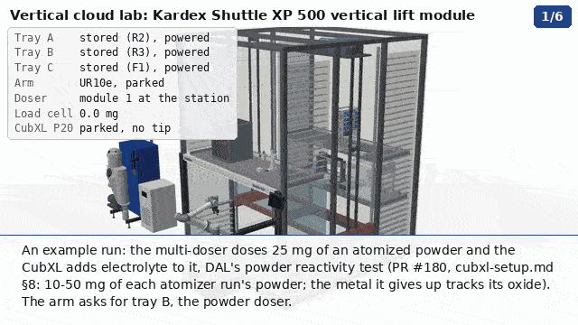
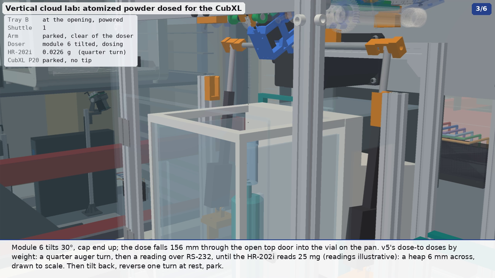

# Vertical lift module: the vertical cloud lab in 3-D

Animations of the vertical lift module (VLM) quoted in
[#53](https://github.com/vertical-cloud-lab/byu-vcl/issues/53), a **Kardex Shuttle XP 500**, holding the lab's own
equipment on three electrified trays, with a **UR10e on a MiR250** working at its access opening
([#303](https://github.com/vertical-cloud-lab/byu-vcl/issues/303)). They follow the org page's
[`vertical-lab.gif`](https://github.com/vertical-cloud-lab/.github/blob/main/profile/vertical-lab.gif) and are built
the way the lab's other animations are (rePowder training, sieving, atomizer charge, the doser's assembly): CadQuery
models tessellated into PyVista, rendered off-screen, text drawn with PIL, written as an MP4 and a GIF. The scene
framework, [`scene.py`](scene.py), is `atomizer-training/viz3d/scene.py` from #124's branch.

| Chapter | GIF (800 × 450, 10 fps) | MP4 (1280 × 720, 15 fps) |
|---|---|---|
| **Assembly**: base, frame, columns, extractor, trays, then the cladding goes on, opaque | [`out/vlm_assembly.gif`](out/vlm_assembly.gif) | [`out/mp4/vlm_assembly.mp4`](out/mp4/vlm_assembly.mp4) |
| **Loading**: the closed machine, then see-through; every piece of equipment goes onto its tray through the opening, one at a time; the arm rolls up | [`out/vlm_loading.gif`](out/vlm_loading.gif) | [`out/mp4/vlm_loading.mp4`](out/mp4/vlm_loading.mp4) |
| **Workflow**: the arm doses a powder with the multi-doser and takes the vial to the CubXL, which adds liquid | [`out/vlm_workflow.gif`](out/vlm_workflow.gif) | [`out/mp4/vlm_workflow.mp4`](out/mp4/vlm_workflow.mp4) |
| **Disassembly**: unloaded one piece at a time, then taken apart | [`out/vlm_disassembly.gif`](out/vlm_disassembly.gif) | [`out/mp4/vlm_disassembly.mp4`](out/mp4/vlm_disassembly.mp4) |
| **All four**, one after the other (4 min 5 s) | [on YouTube](https://www.youtube.com/watch?v=ro-pUo0ie_M) (unlisted, BYU Vertical Cloud Lab channel) | [`out/mp4/vertical_lab_full.mp4`](out/mp4/vertical_lab_full.mp4) |






`out/<name>.json` gives the frame range of every sub-step in the MP4, `out/<name>_still.png` is a still of the last
view, and [`out/reach.json`](out/reach.json) is the arm study below.

## Characterization instruments, the alloy line and the backup rail (round 3)

Fourteen more models, each its own, from the makers' published figures and photos or, for the OpenFlexure
microscopes, from OpenFlexure's own OpenSCAD:
- [`instruments.py`](instruments.py) holds the models. Doors, drawers, stages, crossheads and samples are separate
  pieces with joints.
- [`openflexure.py`](openflexure.py) loads the two OpenFlexure microscopes.
- [`tour.py`](tour.py) renders each instrument doing what it does.
- [`line.py`](line.py) puts them in the lab.


| Instrument | Model | What the animation shows | GIF, MP4 | Size W × D × H (mm), published | Where |
|---|---|---|---|---|---|
| Benchtop XRD | Rigaku MiniFlex 600 | The door swings open on its right-hand hinge; a powder sample goes onto the stage; the door shuts; the scan is drawn see-through, with the sample tilting by θ and the detector sweeping 2θ | [GIF](out/instruments/xrd.gif), [MP4](out/mp4/instruments/xrd.mp4) | 620 × 456 × 722 | tray D: 5.5 mm under Kardex's limit |
| Tabletop SEM, EDS, EBSD | Hitachi TM4000PlusII | The drawer slides out with the stage; a mounted sample goes on; EVAC | [GIF](out/instruments/sem.gif), [MP4](out/mp4/instruments/sem.mp4) | 330 × 614 × 547 (main unit) | tray D |
| Microscope, reflection | OpenFlexure Microscope v7 | A polished coupon goes under the clips; the stage scans and the optics focus | [GIF](out/instruments/openflexure_v7.gif), [MP4](out/mp4/instruments/openflexure_v7.mp4) | 171 × 139 × 169 | tray D |
| Microscope, reflection | OpenFlexure Delta Stage | The same, with the delta stage moving in x, y and z | [GIF](out/instruments/openflexure_delta.gif), [MP4](out/mp4/instruments/openflexure_delta.mp4) | 166 × 156 × 173 | tray D |
| Indentation plastometer (PIP) | Plastometrex PLX-Benchtop | The sample goes onto the platen by hand; the indenter goes in; the profilometer stylus sweeps the indent | [GIF](out/instruments/pip.gif), [MP4](out/mp4/instruments/pip.mp4) | about 500 × 500 × 680, estimated | tray E |
| Nanoindenter | KLA iMicro | The hood lifts; a mount goes onto the XY stage; the stage carries it from the microscope to the indenter | [GIF](out/instruments/nanoindenter.gif), [MP4](out/mp4/instruments/nanoindenter.mp4) | about 540 × 520 × 520, estimated | tray E |
| Laser diffraction | Malvern Mastersizer 3000 + Aero S | Powder goes into the Aero S's hopper; the laser and the dispersed powder are drawn see-through | [GIF](out/instruments/mastersizer.gif), [MP4](out/mp4/instruments/mastersizer.mp4) | 690 × 300 × 450 (bench); Aero S 260 × 180 × 380 | tray E |
| Grinder-polisher | Buehler EcoMet 30 semi-automatic | The power head presses six mounts onto the 12 in platen; platen and holder turn | [GIF](out/instruments/polisher.gif), [MP4](out/mp4/instruments/polisher.mp4) | 488 × 638 × 650 | tray F |
| Heat treatment and ageing furnace | Nabertherm NAT 15/65 | The door swings open; a tray of coupons goes in; the circulation fan runs | [GIF](out/instruments/furnace.gif), [MP4](out/mp4/instruments/furnace.mp4) | 470 × 790 × 460 | tray F |
| Tabletop testing machine | Instron 68SC-2 | The arm rides up the column and pulls a sub-size bar | [GIF](out/instruments/instron_small.gif), [MP4](out/mp4/instruments/instron_small.mp4) | 460 × 615 × 1410 | beside the VLM |
| Floor testing machine | Instron 68FM-100 | The crosshead pulls a printed tensile bar | [GIF](out/instruments/instron_floor.gif), [MP4](out/mp4/instruments/instron_floor.mp4) | 1140 × 786 × 2287 | beside the VLM |
| Wire EDM | FANUC ROBOCUT α-C400iC | The yellow tank door drops; a build plate goes in; the tank fills; the wire cuts the parts off | [GIF](out/instruments/wire_edm.gif), [MP4](out/mp4/instruments/wire_edm.mp4) | 2120 × 2540 × 1970 | beside the VLM |
| Inert glovebox | Inert PureLab HE 2GB, with an automatic antechamber | The antechamber's outer door opens; a tray with a powder jar and a vial goes in; the PLC cycles it | [GIF](out/instruments/glovebox.gif), [MP4](out/mp4/instruments/glovebox.mp4) | 2005 × 834 × 1794 | beside the VLM |
| Backup rail | Vention robot 7th axis, rack and pinion | The carriage carries a UR10e along the beam | [GIF](out/instruments/rail.gif), [MP4](out/mp4/instruments/rail.mp4) | 3488 × 628 × 1017 (Vention's 3.3 m unit) | along the line |

All fourteen, one after the other: [`out/mp4/instruments_tour.mp4`](out/mp4/instruments_tour.mp4).
[`out/instruments.json`](out/instruments.json) has each model's source, its size as drawn and whether it fits a tray.

### The line


[`line.py`](line.py) puts it together:
- **Three more trays.** Round 2 left three storage slots free, R1, R4 and F2. They now hold trays D (microscopy and
  diffraction), E (mechanical testing and particle size) and F (sample prep and heat treatment).
- **The line.** Everything taller than the opening takes stands in a line with the VLM, fronts in line with its
  front. Left: the glovebox and the rePowder. Right: the Aconity MIDI (#199's model), the two Instrons and the wire EDM.
- **The rail.** A Vention seventh axis runs about 17 m along the fronts. The UR10e rides its carriage at 800 mm, the
  same height as on the MiR250, and parks at the opening.

MP4: [`out/mp4/vlm_line.mp4`](out/mp4/vlm_line.mp4); still: [`out/vlm_line_still.png`](out/vlm_line_still.png).

### Where the round-3 models come from

No maker here publishes CAD without a login or a form. Instron's STEP files come by e-mail after a request form.
Vention's export from MachineBuilder needs an account, which a residential IP doesn't get around, so the Pi wasn't
needed. GrabCAD, TraceParts and CADENAS block the runner and need logins anyway. So each model is built from these:

- **Rigaku MiniFlex 600:** the outline drawings in Rigaku's MiniFlex brochure (620 × 456 × 722 mm, 80 kg) and the
  MiniFlex 6G sheet.
  - The door hinges on its right edge and has no window.
  - The goniometer is vertical, 150 mm radius, θ-2θ.
  - The MiniFlex600-C, with its built-in chiller, is 526 mm deep.
- **Hitachi TM4000PlusII:** Hitachi's figures, 330 × 614 × 547 mm and 54 kg; the pump is 144 × 270 × 216 mm.
  - The drawer slides straight out; its 17 cm travel is from ac-dev-lab #132.
  - The envelope matches ac-dev-lab's Fusion model of the TM4000II.
  - The EDS detector is built in; Oxford's AZtecOne analyser stands beside it, 290 × 260 × 330 mm.
  - **EBSD:** Hitachi lists no EBSD option for the TM4000 series. The model shows Bruker's e-Flash XS, sold for
    tabletop SEMs, on a side port, with a 70° pre-tilted holder. That is a proposal, not a documented configuration.
    A reseller says the COXEM EM-40 is the only tabletop SEM with integrated EBSD; I could not verify it.
- **Plastometrex PLX-Benchtop:** Plastometrex's render, brochure and FAQ; Illinois MRL's page and a published SOP.
  - There is no door or guard. The sample sits unclamped on the platen; up to 160 mm across.
  - **Plastometrex publishes no dimensions.** The envelope is scaled from photos, ±20 %.
  - PLX-AutoStage is their add-on that automates loading.
- **OpenFlexure Microscope v7 and Delta Stage:** OpenFlexure's own OpenSCAD at pinned tags, exported assembled. See
  [`openflexure/README.md`](openflexure/README.md).
- **KLA iMicro:** KLA's photos.
  - The L-shaped hood is hinged at the top rear and lifts 70-80°.
  - KLA publishes no dimensions; scaled from photos, about 0.5-0.55 m on a side.
- **Malvern Mastersizer 3000 + Aero S:** Malvern's Mastersizer 3000 and 3000+ brochures (bench 690 × 300 × 450 mm,
  30 kg; Aero S 260 × 180 × 380 mm, 10.5 kg) and product photos.
- **Buehler EcoMet 30 semi-automatic:** Buehler's instruction manual (drawing 488 × 638 × 650 mm, 75 kg; 12 in
  platen; 25-200 N head force).
- **Nabertherm NAT 15/65:** Nabertherm's forced-convection tabletop range (470 × 790 × 460 mm, 60 kg, 15 L, 650 °C,
  ±5 °C).
  - It covers solution treatment (about 530 °C) and ageing (160-200 °C) in one furnace.
  - Why not the L 9/11 muffle furnace: its uniformity is only specified above 800 °C.
- **Instron 68SC-2 and 68FM-100:** Instron's 6800 Series brochure and floor-model sheet.
  - 68SC-2: 1410 × 460 × 615 mm, 62 kg.
  - 68FM-100: 2287 × 1140 × 786 mm, 799 kg; 1494 mm test space, 575 mm between columns.
  - Matte black frames with red Instron accents.
- **FANUC ROBOCUT α-C400iC:** FANUC America's data sheet and floor plan (2120 × 2540 × 1970 mm, about 2200 kg; X/Y
  travel 400 × 300 mm), and FANUC's photo.
- **Inert glovebox:** the envelope is the Inert PureLab HE 2GB drawing in NIST's copy of Inert's manual. The automation
  follows the lab's own glovebox research:
  - DAL PR #185's decision matrix: keep the arm outside and transfer through an automated antechamber.
  - DAL #130: VAC's NexGen PLC; LC Technology's quote included the AC-601 automatic antechamber control.
  - Here, the antechamber's outer door faces along the line, towards the rail.
- **Vention robot 7th axis:** Vention design 337010 (3488 × 628 × 1017 mm, 220 kg) and its part pages.
  - A 247.5 mm square beam in 3330 mm segments, 20 mm profile guides, a steel rack.
  - A 426.5 × 358 × 86 mm carriage plate, driven by a NEMA 34 through a right-angle gearbox, up to 4 m/s.
  - The legs are cut so the arm's base is at 800 mm.
- **Aconity MIDI:** `lab_models.equipment.aconity_midi()` from #199. DAL has documents for it but no model.

### Things the round-3 models show

- **The MiniFlex fits with 5.5 mm to spare.** It is 722 mm tall against Kardex's 727.5 mm. The MiniFlex600-C, with
  the built-in chiller, is 70 mm deeper. The plain 600 needs a separate chiller, which has to go on the tray too.
- **The PIP and the nanoindenter fit only on estimates.** Neither maker publishes a size; both are scaled from photos.
  The nanoindenter's hood adds about 0.3 m when it is up. That is fine at the opening, where there is about 845 mm
  under the header, but not in a slot.
- **No Instron fits a tray.** The shortest single column, the 68SC-05, is 1020 mm tall, so both Instrons stand in the
  line.
- **No benchtop wire EDM is sold.** The smallest lab unit found, MTI's SYJ-7720-S, is 1250 × 1200 × 1380 mm. The
  FANUC stands in the line.
- **Some instruments need services a tray does not have.** Kardex's trays carry power, not plumbing:
  - the polisher needs water, compressed air and a drain, so on a tray it needs a recirculating unit;
  - the Mastersizer's Aero S needs compressed air (0-4 bar) and its vacuum extractor;
  - the SEM needs its pump, which sits beside it on the tray.
- **Heat and vibration in a VLM are open questions.**
  - A 650 °C furnace running inside the machine needs Kardex's say-so, and probably ventilation.
  - The SEM and the nanoindenter are vibration-sensitive. Their trays are still in their slots, but the extractor
    moves other trays past them.
- **The rail closes the front to people.** Its beam runs about 120 mm in front of the machines' fronts at knee
  height, so the line becomes a cell for the arm. That is the trade against the MiR250, which leaves the floor free.

## The workflow

An example run, with every move a real one:

1. **Tray B (powder dosing) comes down.** The extractor pulls it off its supports and carries it down. The shutter at
   the back of the bay opens to let it through and closes behind it.
2. **An empty 20 mL vial into the multi-doser.** The UR10e picks it from the rack at the front of the tray, pointing
   down. It slides the vial level into the cup on the rig's 100 g load cell, under the station, then parks clear.
3. **Dose.** The carousel indexes powder module 6 to the station: 8 chain links per module, run the way powder-doser's
   leakage study says. The module is drawn green, as powder-doser's own movie marks one. The Actuonix P16 lifts the
   electronics carriage and docks it with the magnet on. The docked module rides inside the loop, boxed in by the
   other twelve, so those are drawn see-through for the dose. The station tilts the module 30°, cap end up, and turns
   the auger two revolutions while the vial fills and the load cell counts 0.512 g. Then it tilts back, reverses one
   turn at rest and undocks, as in the station's protocol in powder-doser PR #185.
4. **The vial waits on the robot.** The arm stands the vial in a holder on the MiR's cabinet while the VLM swaps
   trays. Tray B goes back to its slot and its power.
5. **Tray A (liquid handling) comes down.** The CubXL's gantry parks at the back. The arm puts the vial in the free
   seat of the CubXL's rack.
6. **Liquid, then storage.** The CubXL brings its pipette over the vial and adds the liquid. Tray A goes back up with
   the vial in it, to a slot that has power, so the CubXL can keep working while it is stored.

Every approach, grasp and retreat is a straight line of the gripper's grasp point, solved with the UR's inverse
kinematics every frame ([`robot.py`](robot.py)). A move that would need a flip of the arm fails before anything
renders. The multi-doser moves through its own `layout.placements(State(...))`, so the chain, the carriages, the
station's linkage, the tilt and the auger turn are its real kinematics.

## The models, one by one

| In the scene | Model | Where it comes from |
|---|---|---|
| Kardex Shuttle XP 500 | [`vlm.py`](vlm.py) | **Built here from Kardex's figures** (below). Kardex publishes no CAD, BIM or Revit file for the Shuttle |
| Multi-doser: chain carousel v2, 13 powder modules, its station, load cell, vial and electronics board (tray B) | [`carousel.py`](carousel.py) over [`multidoser/`](multidoser/) | **The lab's own latest design**, powder-doser [PR #185](https://github.com/vertical-cloud-lab/powder-doser/pull/185) (#128). `multidoser/{params,parts,layout,kinematics}.py` are verbatim copies of `cad/chain-carousel-v2/` at `1c135e0`, its head. Its three reference STEPs (Sam's Oct 13 plate and electronics carriage, the threaded auger, the cap) are fetched at that commit and SHA-256 checked. On the tray its electronics board stands beside the frame, turned 90° |
| Universal Robots UR10e with a Robotiq 2F-85 gripper | [`ur_arm.py`](ur_arm.py) | **Vendor descriptions**: UR's `Universal_Robots_ROS2_Description` at `81f7c9f` (visual meshes and the calibrated kinematics; FK matches UR's DH table to 3e-7 mm) and PickNik's `ros2_robotiq_gripper` at `a74d007` (2F-85 meshes and linkage). Fetched and hash-checked at run time. The UR3e and UR7e are there too, for the comparison |
| MiR250 mobile base, with a cabinet for the UR control box | [`props.py`](props.py) | MiR's published size, 800 × 580 × 300 mm; the cabinet's height is a layout choice (it puts the arm's base at 800 mm, under the 833 mm table) |
| Opentrons OT-2 (tray A) | Opentrons' reference STEP, "Detailed" | **Vendor CAD**, from [github.com/Opentrons/ot2](https://github.com/Opentrons/ot2), fetched and SHA-256 checked by [`lab_models/vendor.py`](lab_models/vendor.py) |
| CubXL (tray A) | `equipment.cubxl()`, in four pieces | The lab's CadQuery model from #199: the Genmitsu PROVerXL 4030 V2 frame from SainSmart's spec, the rest from lab photos. Split here into frame, gantry, carriage and tools so the gantry moves over its 400 × 300 × 110 mm travel |
| Bambu Lab H2D and A1 mini (tray C) | `equipment.h2d()`, `equipment.a1_mini()` | The lab's CadQuery models from #199, from Bambu's spec pages and outline drawing. Bambu publishes no CAD |
| AMAZEMET rePowder atomizer and its utilities, beside the VLM | [`repowder/model.py`](repowder/model.py) | The CadQuery model behind the rePowder training animations (#124) |
| Vials and the vial rack | [`props.py`](props.py) | The multi-doser's own 20 mL vial (28 × 61 mm, from its `params.py`); a printed rack like the CubXL's |

[`lab_models/`](lab_models/) is a verbatim copy of `lab-models/cad/{common,equipment,labware,vendor}.py` from #199's
branch at `7fc56b6`, and [`repowder/model.py`](repowder/model.py) one of `atomizer-training/viz3d/model.py` from #124's
branch at `7757443`, so each model has one source. Vendor CAD is downloaded into `.cache/` (the carousel's references
into `multidoser/reference/`) and never committed.

## The Kardex Shuttle XP 500

The front was rebuilt against Kardex's own Shuttle 500 renders and fact sheet, and against Kardex's order sheet for
this configuration: "Kardex Shuttle POF Version 16", SHUTTLE-01-500-2450x864. That sheet is hosted by the dealer
StoreMoreStore ([VLM option 1 specification sheet](https://products.storemorestore.com/hubfs/StoreMoreStore/Kardex-Vertical-Lift-Module/VLM-Option-1-96x34-Light-Specification-Sheet.pdf)).

| | Value | Source |
|---|---|---|
| Tray | 2450 × 864 mm | #53: 96.46 × 34.00 in |
| Module footprint | 2780 × 3074 mm | Relevator Group's listing of XP 500-2450x864 units; the order sheet gives 2780 × 3073 |
| Height | 3950 mm | #53: "less than 13'"; Shuttle heights step 100 mm from 2550 mm |
| Access table | 833 mm above the floor | Order sheet: front access table height TH1 |
| Presented tray | underside at 854 mm, floor top at 855.5-856.5 mm | Order sheet: TH1 + 21, and TH1 + 22.5 / 23 / 23.5 for light / medium / strong trays |
| Product height through the opening | 727.5 mm, plus 20 mm clearance | Order sheet |
| Opening | 2500 mm between the side posts; header at 1700 mm | Kardex renders and a real 2450 × 864 unit (about tray + 50 mm); the mouth reads 850-870 mm tall |
| Look | RAL 7035 panels in about 490 mm bands; white header with the logo and an LED light under it; anthracite posts; slatted side walls in the bay; a blue (RAL 230 60 15) cover under the tray with the LED-Navigator strip; the OPTIC panel on the right post | Order sheet (colours, options); Kardex renders |
| Safety shutter | at the **back** of the bay, between the presented tray and the shaft; it closes while the extractor moves | Kardex: the operator works on one tray "while the extractor prepares the next tray behind the shutter doors" |
| Tray supports | 25 mm pitch (drawn every 100 mm) | Kardex: 25 mm storage grid |
| Speeds | up to 2.0 m/s vertical, 0.7 m/s in and out | Kardex Shuttle XP brochure; the animation keeps to these |
| Trays | strong 1080 lb, medium 794 lb, light 502 lb; powered in a slot and at the opening, not in transit | #53 |

**"The large bay opening".** For the Shuttle 250/500, Kardex's documents list no opening called "large". The largest
is the full-width front opening above, which is what the model now has: 2500 mm wide, at an 833 mm table, taking 727.5 mm
of product height. Two other options exist. Up to six openings can go on the front and rear. With full tray
extraction, the tray is pulled out in front of the unit onto a table, for crane loading. Full tray extraction would
put the whole tray under an open sky for the arm. Worth asking Kardex about if the arm has to reach the back of every
tray.

Still layout choices, not published: the front/back split of the columns, the slots the trays use, the extractor's
details (a platform on four guide rails, a belt drive on the roof frame), and the console's exact size.

## The arm: why a UR10e

[`reach.py`](reach.py) puts each arm on the MiR250 where the animation parks it: square to the opening, 30 mm off the
cover's lip, with its base at 800 mm. It then asks the arm's own inverse kinematics three things:
- can the arm reach the four seats the workflow uses?
- how much of the presented tray can it reach pointing straight down?
- how close do its elbow, forearm and wrists come to the opening's header (at 1700 mm)?

| | Reach, payload | Workflow seats reached (of 4) | Tray reached, gripper down, 100 mm up | Deepest point | Closest approach to the header |
|---|---|---|---|---|---|
| UR3e | 500 mm, 3 kg | 2 | 3 % | 100 mm | 496 mm |
| UR7e | 850 mm, 7.5 kg | 4 | 31 % | 500 mm | 327 mm |
| **UR10e** | 1300 mm, 12.5 kg | 4 | **83 %** | **800 mm** (the tray is 864 deep) | 118 mm |

No arm ever has to go over the header to reach a point. The header limits none of them, so access decides:
- The UR10e reaches the tray's full depth across most of its width.
- The UR7e reaches only the front half near the middle, so everything it handles has to sit along the front edge.
- The UR3e barely reaches past the lip.

The cost of the UR10e is clearance: its closest approach to the header is 118 mm, against the UR7e's 327 mm.

## Things the model shows

- **The multi-doser is 3.5 mm too tall for the opening.** The chain carousel v2 stands 731 mm on its levelling feet,
  and Kardex's limit is 727.5 mm of product height plus 20 mm clearance. Turning its four levelling feet down by 4 mm,
  or a 3-4 mm shorter post, would make it pass Kardex's height check. The animation draws it as designed.
- **The station's free fall is short.** The station drops the powder about 25 mm from the auger's outlet into the
  D-cut funnel, behind the rig's front plate. So a camera sees the dose as the tilt, the vial filling and the load
  cell's count, not as a falling stream.
- **The vial is captured between its cup and the funnel.** In PR #185 the funnel's spout sits about 5 mm inside the
  vial's mouth, and the vial stands in an 18 mm cup. An arm can't lift it straight out; here it slides the vial
  forward a few millimetres while lifting it, which the real funnel would not allow. A robot-served station needs the
  funnel to clear the mouth, or a cup open at the front.

## Running it

```bash
pip install cadquery pyvista trimesh pycollada pillow numpy scipy   # plus ffmpeg and gifsicle on the PATH
xvfb-run -a python3 animate.py assembly loading workflow disassembly full   # full joins the four MP4s
PREVIEW=1 xvfb-run -a python3 animate.py workflow        # the last frame of each sub-step, to /tmp
python3 reach.py                                          # the arm study -> out/reach.json
xvfb-run -a python3 tour.py                               # round 3: every instrument -> out/instruments/, out/mp4/instruments/
python3 tour.py gallery join table                        # the gallery, the joined tour MP4, out/instruments.json
xvfb-run -a python3 line.py                               # the trays D-F, the line and the rail -> out/vlm_line.gif
```

`openflexure.py` reads the OpenFlexure meshes from `.cache/openflexure/`; [`openflexure/README.md`](openflexure/README.md)
says how to make them.

The first run downloads the OT-2, UR, Robotiq and carousel files and tessellates everything, which takes a few
minutes. The meshes are cached in `.cache/` until a source file changes. Run the chapters one `xvfb-run` at a time,
or give each one its own display number (`xvfb-run --server-num=N`): four `-a`s started together can race for the
same display. `VIZ3D_SIZE=1920x1080 VIZ3D_FPS=30` gives a 1080p MP4 with every move taking the same time.
