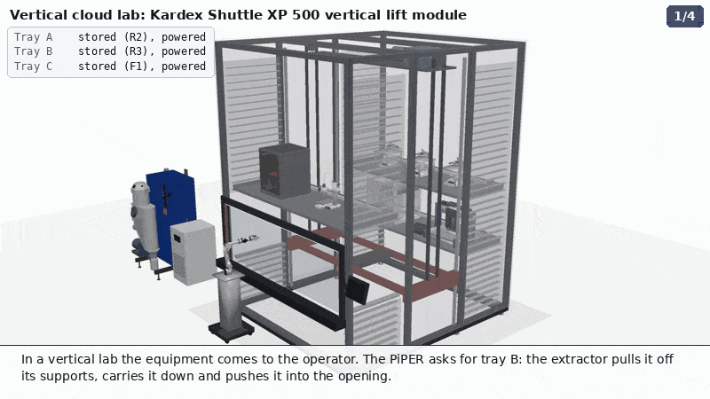
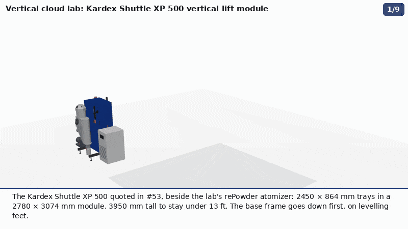
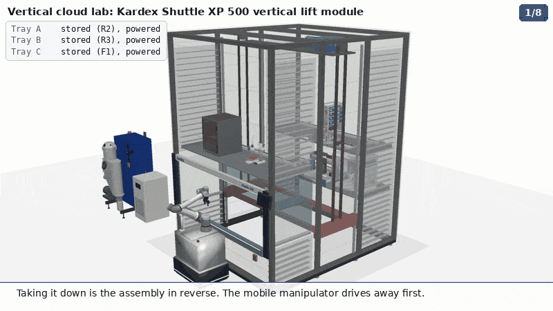

# Vertical lift module: the vertical cloud lab in 3-D

Animations of the vertical lift module (VLM) quoted in
[#53](https://github.com/vertical-cloud-lab/byu-vcl/issues/53), a **Kardex Shuttle XP 500**, holding the lab's own
equipment on three electrified trays and bringing it to the operator
([#303](https://github.com/vertical-cloud-lab/byu-vcl/issues/303)). They follow the org page's
[`vertical-lab.gif`](https://github.com/vertical-cloud-lab/.github/blob/main/profile/vertical-lab.gif): front storage,
the extractor and rear storage, with the equipment coming down to an opening. They are built the way the other
animations across the lab's repos are (rePowder training, sieving, atomizer charge, the doser's assembly): CadQuery
models tessellated into PyVista, rendered off-screen, text drawn with PIL, written as an MP4 and a GIF. The scene
framework, [`scene.py`](scene.py), is `atomizer-training/viz3d/scene.py` from #124's branch with the atomizer's own
loaders taken out.

| | GIF (800 × 450, 10 fps) | MP4 (1280 × 720, 15 fps) |
|---|---|---|
| **Assembly**: base, frame, columns, extractor, trays, cladding; then each tray is loaded through the opening | [`out/vlm_assembly.gif`](out/vlm_assembly.gif) | [`out/mp4/vlm_assembly.mp4`](out/mp4/vlm_assembly.mp4) |
| **Operation**: trays brought to the operator and put back | [`out/vlm_operation.gif`](out/vlm_operation.gif) | [`out/mp4/vlm_operation.mp4`](out/mp4/vlm_operation.mp4) |
| **Disassembly**: the same in reverse | [`out/vlm_disassembly.gif`](out/vlm_disassembly.gif) | [`out/mp4/vlm_disassembly.mp4`](out/mp4/vlm_disassembly.mp4) |
| **All three**, one after the other | | [`out/mp4/vertical_lab_full.mp4`](out/mp4/vertical_lab_full.mp4) |







`out/<name>.json` gives the frame range of every sub-step in the MP4, and `out/<name>_still.png` is a still of the
last view.

## The models, one by one

Every piece is its own model. Where the maker publishes CAD it is used as-is; where the lab has drawn the part, the
lab's model is used; the VLM is built here because Kardex publishes none.

| In the scene | Model | Where it comes from |
|---|---|---|
| Kardex Shuttle XP 500 | [`vlm.py`](vlm.py) | **Built here from published figures** (below). Kardex publishes no CAD, BIM or Revit file for the Shuttle XP, and none of the dealer listings carry one |
| Opentrons OT-2 (tray A) | Opentrons' reference STEP, "Detailed" | **Vendor CAD**, from [github.com/Opentrons/ot2](https://github.com/Opentrons/ot2), fetched and SHA-256 checked at run time by [`lab_models/vendor.py`](lab_models/vendor.py) |
| AgileX PiPER with gripper (the operator) | AgileX's arm-plus-gripper STEP | **Vendor CAD**, from AgileX's store CDN, fetched and checked the same way; shown in the pose it ships in |
| Powder doser (tray B, ×3) | `cad/full-assembly/assembly/full_assembly.glb` | **The lab's own assembly** from powder-doser [PR #170](https://github.com/vertical-cloud-lab/powder-doser/pull/170) (#165): the Fusion 360 parts plus datasheet models of the servos, stepper and solenoid. Fetched at commit `a3bb2a9` and hash-checked by [`lab.py`](lab.py) |
| A&D HR-100A with the FXi-10 breeze break and AutoTrickler V4 panel (tray B, ×3) | `labware.balance()` | The lab's CadQuery model from #199 (`lab-models/`), from A&D's drawings and the lab's measurements |
| Bambu Lab H2D and A1 mini (tray C) | `equipment.h2d()`, `equipment.a1_mini()` | The lab's CadQuery models from #199, from Bambu's spec pages and outline drawing. Bambu publishes no CAD |
| CubXL (tray A) | `equipment.cubxl()` | The lab's CadQuery model from #199: the Genmitsu PROVerXL 4030 V2 frame from SainSmart's spec, the rest from lab photos |

[`lab_models/`](lab_models/) is a verbatim copy of `lab-models/cad/{common,equipment,labware,vendor}.py` from #199's
branch at `7fc56b6` (`claude/issue-199-20260915-0846`, not merged yet), so these models have one source; their
README there gives the source of every dimension. Vendor CAD is downloaded into `.cache/` and never committed.

Two things in the scene are stand-ins, not models of real parts: **the bridge** that holds each doser over its
balance (four legs and a plate; the real bridge's ~265 mm leg span is a one-photo estimate in #199), and **the
PiPER's mobile stand** (a pedestal on castors, height set so the arm's base is level with the opening's counter).

## The Kardex Shuttle XP 500

| | Value | Source |
|---|---|---|
| Tray | 2450 × 864 mm | #53: 96.46 × 34.00 in. Kardex sells it as the XP 500-2450x864 |
| Module footprint | 2780 × 3074 mm | Relevator Group's listing of three XP 500-2450x864 units: "Module width 2 780 mm / 2 450 mm", "Module depth 3 074 mm / 864 mm" |
| Height | 3950 mm | #53: "less than 13'" (3962 mm). Kardex's Shuttle XP brochure ([on SlideShare](https://www.slideshare.net/slideshow/shuttle-xp-vertical-lift-system/123084721)): unit heights "2,550 to 30,050 mm" in "100 mm steps", so 3950 mm is the tallest under 13 ft |
| Tray supports | 25 mm pitch | The same brochure: "Storage space pitch 25 mm" for the XP 250/500/700. Drawn every 100 mm, so the picture stays readable |
| Extractor speed | up to 2.0 m/s vertical, 0.7 m/s in and out | The same brochure: "Vertical speed adjustable up to 2.0 m/s", "Storage/retrieval speed adjustable up to 0.7 m/s". The operation animation keeps to these peak speeds; the loading in the other two runs at about 1.25 times them |
| Trays | strong 1080 lb, medium 794 lb, light 502 lb | #53 |
| Electrified trays | power in a slot and at the opening, none in transit | #53. Modula: power "when stored, or again when they arrive at the delivery bay, but not while in motion". Kardex said it had no way to power a tray but offered a quick-connect cord to the device stored on it |
| Safety shutter | powered | #53 |
| Power | 208 V, three-phase | #53 |

**Layout choices, not published figures.** Kardex's planning drawings aren't public, so these were chosen to fit the
lab's equipment and are marked in `vlm.py`:

- The front-to-back split: front column, shaft and rear column each 864 mm deep, with tray centres 1030 mm apart.
- The opening: tray floor at 900 mm, 795 mm clear above it so the 662 mm OT-2 goes through, and the tray presented
  in the front column, 75 mm behind the front panel. A real XP's opening can stand proud of the front.
- The storage heights: the six slots used are on the 25 mm pitch. The trays use three of them: tray A in R2, tray B
  in R3, tray C in F1.
- The extractor's details: a platform on four guide rails, a drive on the roof frame with a cross shaft and two
  belts, a pull unit along the middle. The XP's real drive and pull mechanism differ in detail.
- The shutter slides up behind the front panel; the LED bar, light curtains and console are placed as on Kardex's
  photos, not measured.

## What the animations show

- **Assembly.** Base frame, posts and roof rails, the two storage columns, the extractor (rails, drive, platform and
  belts), the three trays, then the cladding with the opening, console and shutter. Then each tray is loaded the way
  it would be: the extractor brings it to the opening and its equipment goes in through the opening, which is 2570 ×
  840 mm. The PiPER rolls up last.
- **Operation.** The PiPER asks for tray B. The extractor pulls it off its supports, carries it down and pushes it
  into the opening, the shutter opens, and the arm turns to the dosers. Tray B goes back up and tray C comes down.
  The tray table at the top left shows where each tray is and whether it has power: in a slot or at the opening it
  does, and while it moves it doesn't.
- **Disassembly.** The PiPER rolls away, each tray is unloaded through the opening, and the machine comes apart in
  the reverse order.

**One thing the model shows: the PiPER reaches only the front of a tray.** Its reach is 626 mm, and from a stand
against the counter its base is about 450 mm from the front edge of the presented tray. So it reaches about the front
175 mm of the tray. Anything the arm has to handle (vials, plates, the doser outlets) should go along the tray's front
edge, or the arm needs a rail, or the tray a pull-out at the opening.

## Running it

```bash
pip install cadquery pyvista trimesh pillow numpy        # plus ffmpeg and gifsicle on the PATH
xvfb-run -a python3 animate.py assembly operation disassembly
PREVIEW=1 xvfb-run -a python3 animate.py operation       # the last frame of each sub-step, to /tmp
```

The first run downloads the OT-2, PiPER and doser files and tessellates everything (about a minute); the meshes are
cached in `.cache/` until a source file changes. The three chapters render in about five minutes each on a 4-core
runner. `VIZ3D_SIZE=1920x1080 VIZ3D_FPS=30` gives a 1080p MP4 with every move taking the same time.
