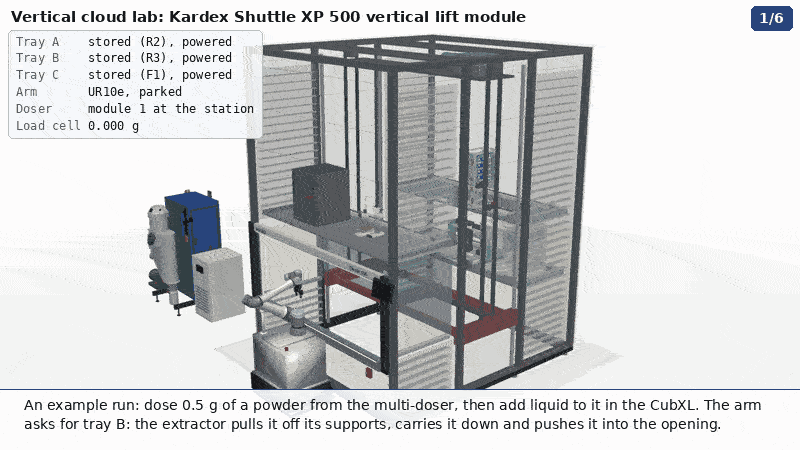
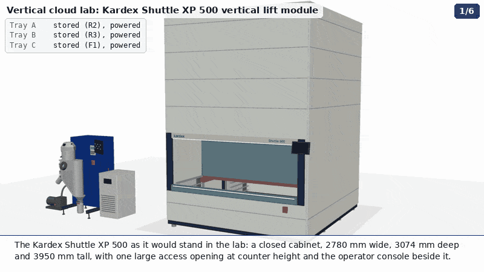

# Vertical lift module: the vertical cloud lab in 3-D

Animations of the vertical lift module (VLM) quoted in
[#53](https://github.com/vertical-cloud-lab/byu-vcl/issues/53), a **Kardex Shuttle XP 500**, holding the lab's own
equipment on three electrified trays, with a **UR10e on a MiR250** working at its access opening
([#303](https://github.com/vertical-cloud-lab/byu-vcl/issues/303)). They follow the org page's
[`vertical-lab.gif`](https://github.com/vertical-cloud-lab/.github/blob/main/profile/vertical-lab.gif) and are built
the way the lab's other animations are (rePowder training, sieving, atomizer charge, the doser's assembly): CadQuery
models tessellated into PyVista, rendered off-screen, text drawn with PIL, written as an MP4 and a GIF. The scene
framework, [`scene.py`](scene.py), is `atomizer-training/viz3d/scene.py` from #124's branch.

| Chapter | GIF (800 × 450, 10 fps) | MP4 (1280 × 720, 15 fps) |
|---|---|---|
| **Assembly**: base, frame, columns, extractor, trays, then the cladding goes on, opaque | [`out/vlm_assembly.gif`](out/vlm_assembly.gif) | [`out/mp4/vlm_assembly.mp4`](out/mp4/vlm_assembly.mp4) |
| **Loading**: the closed machine, then see-through; every piece of equipment goes onto its tray through the opening, one at a time; the arm rolls up | [`out/vlm_loading.gif`](out/vlm_loading.gif) | [`out/mp4/vlm_loading.mp4`](out/mp4/vlm_loading.mp4) |
| **Workflow**: the arm doses a powder with the multi-doser and takes the vial to the CubXL, which adds liquid | [`out/vlm_workflow.gif`](out/vlm_workflow.gif) | [`out/mp4/vlm_workflow.mp4`](out/mp4/vlm_workflow.mp4) |
| **Disassembly**: unloaded one piece at a time, then taken apart | [`out/vlm_disassembly.gif`](out/vlm_disassembly.gif) | [`out/mp4/vlm_disassembly.mp4`](out/mp4/vlm_disassembly.mp4) |
| **All four**, one after the other | | [`out/mp4/vertical_lab_full.mp4`](out/mp4/vertical_lab_full.mp4) |





`out/<name>.json` gives the frame range of every sub-step in the MP4, `out/<name>_still.png` is a still of the last
view, and [`out/reach.json`](out/reach.json) is the arm study below.

## The workflow

An example run, with every move a real one:

1. **Tray B (powder dosing) comes down.** The extractor pulls it off its supports and carries it down. The shutter at
   the back of the bay opens to let it through and closes behind it.
2. **An empty 20 mL vial into the multi-doser.** The UR10e picks it from the rack at the front of the tray, pointing
   down. It slides the vial level into the cup on the rig's 100 g load cell, under the station, then parks clear.
3. **Dose.** The carousel indexes powder module 6 to the station (8 chain links per module, run the way powder-doser's
   leakage study says). The Actuonix P16 lifts the electronics carriage and docks it with the magnet on. The station
   tilts 30° and turns the auger two revolutions, while the vial fills and the load cell counts 0.512 g. Then it tilts
   back, reverses one turn at rest and undocks. This is the station's protocol from powder-doser PR #185.
4. **The vial waits on the robot.** The arm stands the vial in a holder on the MiR's cabinet while the VLM swaps
   trays. Tray B goes back to its slot and its power.
5. **Tray A (liquid handling) comes down.** The CubXL's gantry parks at the back. The arm puts the vial in the free
   seat of the CubXL's rack.
6. **Liquid, then storage.** The CubXL brings its pipette over the vial and adds the liquid. Tray A goes back up with
   the vial in it, to a slot that has power, so the CubXL can keep working while it is stored.

Every approach, grasp and retreat is a straight line of the gripper's grasp point, solved with the UR's inverse
kinematics every frame ([`robot.py`](robot.py)). A move that would need a flip of the arm fails before anything
renders. The multi-doser moves through its own `layout.placements(State(...))`, so the chain, the carriages, the
station's linkage, the tilt and the auger turn are its real kinematics.

## The models, one by one

| In the scene | Model | Where it comes from |
|---|---|---|
| Kardex Shuttle XP 500 | [`vlm.py`](vlm.py) | **Built here from Kardex's figures** (below). Kardex publishes no CAD, BIM or Revit file for the Shuttle |
| Multi-doser: chain carousel v2, 13 powder modules, its station, load cell, vial and electronics board (tray B) | [`carousel.py`](carousel.py) over [`multidoser/`](multidoser/) | **The lab's own latest design**, powder-doser [PR #185](https://github.com/vertical-cloud-lab/powder-doser/pull/185) (#128). `multidoser/{params,parts,layout,kinematics}.py` are verbatim copies of `cad/chain-carousel-v2/` at `1c135e0`, its head. Its three reference STEPs (Sam's Oct 13 plate and electronics carriage, the threaded auger, the cap) are fetched at that commit and SHA-256 checked. On the tray its electronics board stands beside the frame, turned 90° |
| Universal Robots UR10e with a Robotiq 2F-85 gripper | [`ur_arm.py`](ur_arm.py) | **Vendor descriptions**: UR's `Universal_Robots_ROS2_Description` at `81f7c9f` (visual meshes and the calibrated kinematics; FK matches UR's DH table to 3e-7 mm) and PickNik's `ros2_robotiq_gripper` at `a74d007` (2F-85 meshes and linkage). Fetched and hash-checked at run time. The UR3e and UR7e are there too, for the comparison |
| MiR250 mobile base, with a cabinet for the UR control box | [`props.py`](props.py) | MiR's published size, 800 × 580 × 300 mm; the cabinet's height is a layout choice (it puts the arm's base at 800 mm, under the 833 mm table) |
| Opentrons OT-2 (tray A) | Opentrons' reference STEP, "Detailed" | **Vendor CAD**, from [github.com/Opentrons/ot2](https://github.com/Opentrons/ot2), fetched and SHA-256 checked by [`lab_models/vendor.py`](lab_models/vendor.py) |
| CubXL (tray A) | `equipment.cubxl()`, in four pieces | The lab's CadQuery model from #199: the Genmitsu PROVerXL 4030 V2 frame from SainSmart's spec, the rest from lab photos. Split here into frame, gantry, carriage and tools so the gantry moves over its 400 × 300 × 110 mm travel |
| Bambu Lab H2D and A1 mini (tray C) | `equipment.h2d()`, `equipment.a1_mini()` | The lab's CadQuery models from #199, from Bambu's spec pages and outline drawing. Bambu publishes no CAD |
| AMAZEMET rePowder atomizer and its utilities, beside the VLM | [`repowder/model.py`](repowder/model.py) | The CadQuery model behind the rePowder training animations (#124) |
| Vials and the vial rack | [`props.py`](props.py) | The multi-doser's own 20 mL vial (28 × 61 mm, from its `params.py`); a printed rack like the CubXL's |

[`lab_models/`](lab_models/) is a verbatim copy of `lab-models/cad/{common,equipment,labware,vendor}.py` from #199's
branch at `7fc56b6`, and [`repowder/model.py`](repowder/model.py) one of `atomizer-training/viz3d/model.py` from #124's
branch at `7757443`, so each model has one source. Vendor CAD is downloaded into `.cache/` (the carousel's references
into `multidoser/reference/`) and never committed.

## The Kardex Shuttle XP 500

The front was rebuilt against Kardex's own Shuttle 500 renders and fact sheet, and against Kardex's order sheet for
this configuration: "Kardex Shuttle POF Version 16", SHUTTLE-01-500-2450x864. That sheet is hosted by the dealer
StoreMoreStore ([VLM option 1 specification sheet](https://products.storemorestore.com/hubfs/StoreMoreStore/Kardex-Vertical-Lift-Module/VLM-Option-1-96x34-Light-Specification-Sheet.pdf)).

| | Value | Source |
|---|---|---|
| Tray | 2450 × 864 mm | #53: 96.46 × 34.00 in |
| Module footprint | 2780 × 3074 mm | Relevator Group's listing of XP 500-2450x864 units; the order sheet gives 2780 × 3073 |
| Height | 3950 mm | #53: "less than 13'"; Shuttle heights step 100 mm from 2550 mm |
| Access table | 833 mm above the floor | Order sheet: front access table height TH1 |
| Presented tray | underside at 854 mm, floor top at 855.5-856.5 mm | Order sheet: TH1 + 21, and TH1 + 22.5 / 23 / 23.5 for light / medium / strong trays |
| Product height through the opening | 727.5 mm, plus 20 mm clearance | Order sheet |
| Opening | 2500 mm between the side posts; header at 1700 mm | Kardex renders and a real 2450 × 864 unit (about tray + 50 mm); the mouth reads 850-870 mm tall |
| Look | RAL 7035 panels in about 490 mm bands; white header with the logo and an LED light under it; anthracite posts; slatted side walls in the bay; a blue (RAL 230 60 15) cover under the tray with the LED-Navigator strip; the OPTIC panel on the right post | Order sheet (colours, options); Kardex renders |
| Safety shutter | at the **back** of the bay, between the presented tray and the shaft; it closes while the extractor moves | Kardex: the operator works on one tray "while the extractor prepares the next tray behind the shutter doors" |
| Tray supports | 25 mm pitch (drawn every 100 mm) | Kardex: 25 mm storage grid |
| Speeds | up to 2.0 m/s vertical, 0.7 m/s in and out | Kardex Shuttle XP brochure; the animation keeps to these |
| Trays | strong 1080 lb, medium 794 lb, light 502 lb; powered in a slot and at the opening, not in transit | #53 |

**"The large bay opening".** For the Shuttle 250/500, Kardex's documents list no opening called "large". The largest
is the full-width front opening above, which is what the model now has: 2500 mm wide, at an 833 mm table, taking 727.5 mm
of product height. Two other options exist. Up to six openings can go on the front and rear. With full tray
extraction, the tray is pulled out in front of the unit onto a table, for crane loading. Full tray extraction would
put the whole tray under an open sky for the arm. Worth asking Kardex about if the arm has to reach the back of every
tray.

Still layout choices, not published: the front/back split of the columns, the slots the trays use, the extractor's
details (a platform on four guide rails, a belt drive on the roof frame), and the console's exact size.

## The arm: why a UR10e

[`reach.py`](reach.py) puts each arm on the MiR250 where the animation parks it: square to the opening, 30 mm off the
cover's lip, with its base at 800 mm. It then asks the arm's own inverse kinematics three things:
- can the arm reach the four seats the workflow uses?
- how much of the presented tray can it reach pointing straight down?
- how close do its elbow, forearm and wrists come to the opening's header (at 1700 mm)?

| | Reach, payload | Workflow seats reached (of 4) | Tray reached, gripper down, 100 mm up | Deepest point | Closest approach to the header |
|---|---|---|---|---|---|
| UR3e | 500 mm, 3 kg | 2 | 3 % | 100 mm | 496 mm |
| UR7e | 850 mm, 7.5 kg | 4 | 31 % | 500 mm | 327 mm |
| **UR10e** | 1300 mm, 12.5 kg | 4 | **83 %** | **800 mm** (the tray is 864 deep) | 118 mm |

No arm ever has to go over the header to reach a point. The header limits none of them, so access decides:
- The UR10e reaches the tray's full depth across most of its width.
- The UR7e reaches only the front half near the middle, so everything it handles has to sit along the front edge.
- The UR3e barely reaches past the lip.

The cost of the UR10e is clearance: its closest approach to the header is 118 mm, against the UR7e's 327 mm.

## Things the model shows

- **The multi-doser is 3.5 mm too tall for the opening.** The chain carousel v2 stands 731 mm on its levelling feet,
  and Kardex's limit is 727.5 mm of product height plus 20 mm clearance. Turning its four levelling feet down by 4 mm,
  or a 3-4 mm shorter post, would make it pass Kardex's height check. The animation draws it as designed.
- **The station's free fall is short.** The station drops the powder about 25 mm from the auger's outlet into the
  D-cut funnel, behind the rig's front plate. So a camera sees the dose as the tilt, the vial filling and the load
  cell's count, not as a falling stream.
- **The vial is captured between its cup and the funnel.** In PR #185 the funnel's spout sits about 5 mm inside the
  vial's mouth, and the vial stands in an 18 mm cup. An arm can't lift it straight out; here it slides the vial
  forward a few millimetres while lifting it, which the real funnel would not allow. A robot-served station needs the
  funnel to clear the mouth, or a cup open at the front.

## Running it

```bash
pip install cadquery pyvista trimesh pycollada pillow numpy scipy   # plus ffmpeg and gifsicle on the PATH
xvfb-run -a python3 animate.py assembly loading workflow disassembly full   # full joins the four MP4s
PREVIEW=1 xvfb-run -a python3 animate.py workflow        # the last frame of each sub-step, to /tmp
python3 reach.py                                          # the arm study -> out/reach.json
```

The first run downloads the OT-2, UR, Robotiq and carousel files and tessellates everything, which takes a few
minutes. The meshes are cached in `.cache/` until a source file changes. Run the chapters one `xvfb-run` at a time,
or give each one its own display number (`xvfb-run --server-num=N`): four `-a`s started together can race for the
same display. `VIZ3D_SIZE=1920x1080 VIZ3D_FPS=30` gives a 1080p MP4 with every move taking the same time.
