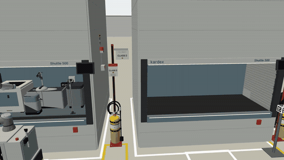
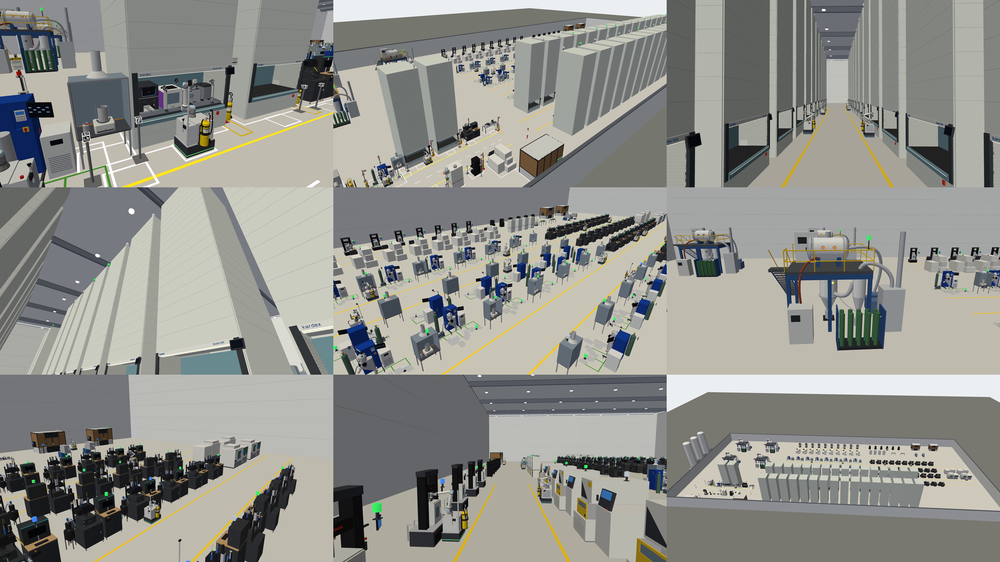
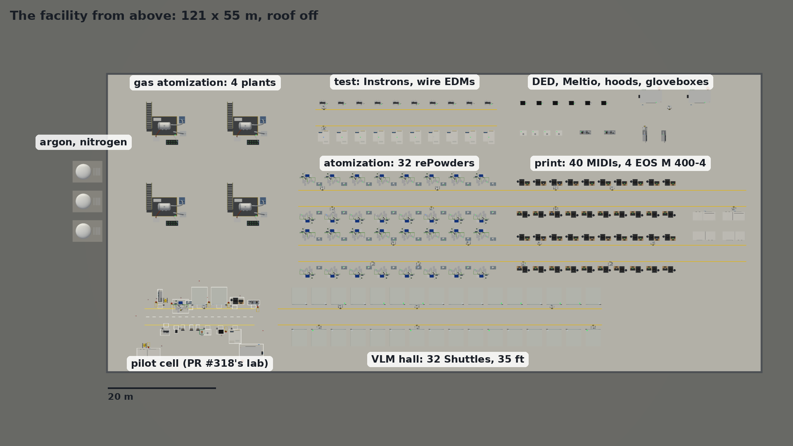

# The vertical lab, scaled to a $200M facility

A 2-minute render: PR #318's vertical lab, then a $200M facility. The facility has 34 Kardex Shuttles, all 35 ft
tall, 33 ultrasonic atomizers, 4 gas atomizers, 41 Aconity MIDIs, 5 EOS M 400-4s and 28 MiR250 + UR12e mobile
manipulators. Every station runs on its own clock. The render is cut and lit so it can be refined in
[Higgsfield](#for-higgsfield) afterwards.

Sterling, PR #318, 2026-11-24: *"create a render that shows the above vertical lab, then scaled to a $200M facility,
with many vertical lift modules (each the same height (35' or so?)), many ultrasonic atomizers, several gas atomizers,
all operating and conducting experiments independently and asynchronously. This video would probably get passed to
Higgsfield later for refinement, so look into that and keep it in mind. Probably max 2 minutes for the video."*
And, on the cancelled run: *"carry that all out in a new PR"*.

**Where this lives.** Sterling asked for its own PR, but the run that made it was started on #318. The action's
push wrapper (since 2026-11-23) lets a session push only to the branch it started on. So this folder rode on #318's
branch while it was made, and was taken off it again in the next commit, leaving #318's diff unchanged.

To open its PR, start a run on an issue, where a run gets a branch of its own. It should check out
`vertical-lab/facility/` from the commit this README is linked at, onto a branch from #318's head, and open a PR
stacked on #318. Nothing outside this folder changed.

**Watch:** VIDEO_LINK. The files are in `out/`:

| File | What it is |
|---|---|
| `out/facility.mp4` | The captioned cut, 2:00, ending on the budget card (37.8 MB) |
| `out/facility_clean.mp4` | The same shots with no text. Not committed: it is the clips' frames without their handles, and `join` writes it from the renders |
| `out/higgsfield/` | Each shot as clips of at most 10 s, with handles. Each clip has its first and last frames as PNGs. `shotlist.md` gives a prompt for each clip. |
| `out/facility_plan.png` | The plan, seen from above |
| `out/facility_sheet.png` | One frame from each shot |
| `out/budget.md`, `out/budget.json` | What the $200M buys |





## The film

Every shot is one continuous camera move. The cut is 1920 × 1080 at a constant 24 fps.

| # | Shot | s | What it shows |
|---|---|---|---|
| 1 | The pilot cell | 12 | PR #318's lab along its aisle: the rePowder, the sieving cell, the two Shuttles, and a unit working at a Shuttle's opening |
| 2 | Scaled up | 16 | The camera pulls back and up from the pilot cell to the whole facility. The roof is cut away here. |
| 3 | The VLM hall | 12 | Down the aisle between two rows of 16 Shuttles. Trays come out as units dock. |
| 4 | 35 ft | 10 | Looking up the face of the Shuttles from the aisle floor |
| 5 | Ultrasonic atomization | 12 | Over the two aisles of rePowders and their sieving cells |
| 6 | Gas atomization | 12 | Round one of the four gas atomizers, whose view-ports glow while it melts and sprays |
| 7 | The print hall | 12 | Over the 40 MIDIs, with the EOS M 400-4s at the end |
| 8 | Testing | 10 | Down the test aisle (Instrons, wire EDMs), then past the DED machines, Meltio cells and fume hoods |
| 9 | All at once | 16 | An aerial orbit at 8× speed, the roof cut away |
| | Card | 8 | The budget (captioned cut only) |

## The facility (`layout.py`)

The pilot cell is the lab exactly as `setup_lab.build` lays it out. Everything else follows the same rule: stations
stand in rows along aisles, each with its front to the aisle, and a MiR250 docks alongside on the row's dock line.
The dimensions come from `warehouse.py`:

- the aisle is 3.0 m wide, room for two MiR250s to pass;
- the fronts stand 2,338 mm off the aisle's centre line;
- the dock lines run 370 mm in front of them.

The halls, their sizes and where they sit are ours.

| Hall | Contents |
|---|---|
| Pilot cell | PR #318's lab. Its two Shuttles are drawn 35 ft tall, like every other one. |
| VLM hall | The pilot cell's aisle carried on east: 16 Shuttles a side, 3,630 mm apart as the pilot cell's two are |
| Atomization | Two aisles of rePowders, each with a sieving cell beside it as in the pilot cell |
| Print | The same two aisles: 40 Aconity MIDIs, then 4 EOS M 400-4s |
| Test and fabrication | 10 Instron 68FM-100s with furnaces facing 10 wire EDMs, then 6 DED machines (InssTek MX-Lab), 2 Meltio cells, 4 fume hoods, 2 packaging stations and 2 gloveboxes |
| Gas atomization | Four gas atomizers (below), with bulk argon and nitrogen tanks outside the west wall |

| | Count, pilot cell included |
|---|---|
| Kardex Shuttle XP 500, 10.7 m (35 ft) | 34 |
| AMAZEMET rePowder, with a sieving cell each | 33 |
| Gas atomizers | 4 |
| Aconity MIDI | 41 |
| EOS M 400-4 | 5 |
| Instron 68FM-100 (and the pilot cell's 68SC-2) | 11 |
| Wire EDM | 11 |
| DED / Meltio cells | 7 / 3 |
| MiR250 + UR12e units | 28 |

The building is 121 × 55 m (6,655 m², 71,600 ft²). Inside, the roof's underside is at 15 m: 10.7 m of Shuttle, plus
room for sprinklers, lights and ducts. The two shots from above cut the walls at 4.5 m and leave the roof off.



### The 35 ft Shuttles

The Shuttles are built from `vlm.py`'s own housing, opening, logo and tray parts, with `vlm.UNIT_H` set to 10,700 mm
(35 ft is 10,668 mm, and Kardex builds heights on a 100 mm grid). Kardex publishes 2,550-30,050 mm for the Shuttle
250/500 (#318's `notes/kardex_height.md`). Nothing at working height changes, so the opening and the trays are
exactly #318's. Only the outside is drawn: the cladding is solid, so the columns and extractor would never show.
PR #318's own lab has 9.15 m units; the pilot cell here uses the facility's 10.7 m ones.

### The gas atomizers (`gas_atomizer.py`)

They are sized after the one lab/pilot close-coupled atomizer we found with a published data sheet and dimensioned
drawing: Phoenix Scientific Industries' **HERMIGA 100/10 VI**
([data sheet](https://www.psiltd.co.uk/wp-content/uploads/2024/07/C1-HERMIGA-100-10-VI-Rev-2.pdf)). Its published
figures:

- 6.0 × 5.1 × 5.7 m, 5 t;
- a 1.5 L crucible, about 10 kg of steel, atomized at 2-4 kg/min (the series is sold for 10-25 kg of powder a run);
- 100 kVA, argon up to 6 kg/min at 20 bar or more, about 70 L/min of cooling water.

Read off its drawing (±10 %): the deck at about 3.5 m, a horizontal melt chamber about 1.35 m across, a tower about
1.1 m wide with a 1.75 m cylindrical section, a cyclone beside it, the powder in cans on the floor, and a control
cabinet about 1.45 m wide on the deck. The stair, rails, pumps, induction supply, argon bundle rack and filter are
drawn to the class.

[`costs_and_sizes.md`](costs_and_sizes.md) compares it with the HERMIGA 75/5 and 120/50 and with Blue Power's and
ALD's VIGAs.

## The budget (`plan.py`, [`out/budget.md`](out/budget.md))

| | $M |
|---|---|
| 34 Kardex Shuttles at 35 ft, with docks and UPSs on every powered tray | 11.4 |
| Tray instruments for 17 of them (the other 17 store jars, cups and samples) | 21.2 |
| 33 rePowders | 12.0 |
| 33 sieving and wash cells | 2.0 |
| 4 gas atomizers (HERMIGA 100/10 class) | 6.0 |
| 41 Aconity MIDIs | 28.7 |
| 5 EOS M 400-4s | 11.8 |
| 11 Instron 68FM-100s with furnaces, 11 wire EDMs | 5.2 |
| 7 DED, 3 Meltio cells, hoods, gloveboxes, packaging | 5.5 |
| 28 MiR250 + UR12e units | 3.9 |
| Building, 71,600 ft² of high bay | 53.7 |
| Gases, power, chillers, dust and explosion protection, IT | 11.0 |
| Design, permits, commissioning, contingency (what is left) | 27.6 (13.8 %) |
| **Total** | **200** |

**It is a plan, not a quote.** Each unit cost is the midpoint of a range, and [`costs_and_sizes.md`](costs_and_sizes.md)
gives the sources. Most come from public procurement records: US federal awards (USAspending) and EU and UK award
notices (TED). For example:

- **rePowder:** NASA $286,720 (2023), NIST $321,595 (2024), Hochschule Aalen €407,700 (2025).
- **Aconity MIDI:** €350-456k (2019-22) and €675k (2026).
- **EOS M 400-4:** $2.36M with installation (US Navy, 2023).
- **Wire EDMs:** $200-302k. **Instron 68FM-100s:** $146-208k.
- **Kardex:** its own guide says $6-8k per vertical foot.
- **Building:** $600-900/ft² for US high-bay manufacturing and R&D buildings (Virginia's and Texas's public cost
  standards; Purdue's, LSU's and ASU's projects).

These are estimates of ours:

- the gas atomizers' installed price (a Blue Power VIGA was €534k, Swerim's R&D unit about €2M);
- our tray docks and UPSs;
- a Shuttle's worth of instruments;
- the site services.

The remainder of $27.6M (13.8 %) sits in the usual range for soft costs and contingency.

**How much it would make is not modelled here.** The pilot cell is about one alloy a day. #332's bottleneck model put
ten a day at 3 rePowders and 4 MIDIs, with the crucible changed round the clock. The halls hold about ten times that.
At #332's ratios that is on the order of 100 alloys a day, but only if the crucible is staffed or automated round the
clock, and the twin on #318's branch (`vertical-lab/twin/`) is the place to check it.

## Every station on its own clock (`facility.py`, `Clocks`)

The clocks are seeded random draws (`SEED`), not a schedule of real experiments.

- **Units:** each of the 26 hall units keeps to its own stretch of one dock line, so no two meet. It docks at a
  station of its kinds for 14-26 s, then drives to another at the MiR250's 0.3 m/s² to 1 m/s.
  - While docked, the arm goes from park to ready, then to three targets, then back. At a Shuttle the targets are
    over the presented tray's front, gripper down. At a machine they are just in front of its face, gripper level.
  - The targets are solved once with `ur_arm.ik`.
  - The pilot cell's two units go round their own docks.
- **Shuttles:** a tray comes out to a Shuttle's opening from 5 s before its unit docks until 2 s after it leaves. It
  also comes out now and then on its own for the bay cameras' inventory pass.
  - Each move is 0.5 s of shutter up, 1.8 s of tray out and 0.5 s of shutter down.
  - The tray loads are the pilot cell's own trays C-F and K-M, baked.
- **Machines:** a stack light on each machine's top is blue while a unit is docked. It is green for 70 % of the gap
  to the next visit (running) and grey for the rest.
- **Gas atomizers:** each runs a 180 s cycle: load, melt (the chamber's view-ports glowing), atomize (the tower's
  view-port too), then cool.

The film's lab time runs on through the cuts. The last shot runs at 8×.

## For Higgsfield

[`higgsfield.md`](higgsfield.md) is the research, with 32 dated sources. In short:

- **Higgsfield keeps a render's geometry only when the render is the *source* of an edit or restyle.** That means
  Kling 4.0 Edit (3-30 s) or Kling 3.0 Omni / O1 Edit (3-10 s), Genjutsu Restyle (4-30 s), or FLUX 3 Video Edit.
  - Its reference modes, camera presets and keyframe image-to-video all regenerate the scene.
  - Keyframe image-to-video is faithful only at the keyframes themselves.
- **Delivery:** silent 1080p clips at a constant 24 fps, of 5-10 s each, each a single camera move, with 12-frame
  handles. Add first and last frames as PNGs, a shot list with prompts, and the captioned cut for reference only.

What this render does for that:

- **Clean plates:** `facility_clean.mp4` and `out/higgsfield/` have no text, labels or overlays. The captions and the
  card go back on in the edit.
- **Nothing see-through:** no ghosted cladding and no cutaway machines. The bake makes every glass part opaque and
  tinted.
- **The building is closed inside:** walls run up to a roof with girders and lights, so no shot looks out into empty
  sky. The two shots from above are an architect's cutaway (walls cut at 4.5 m, roof off) and say so in their prompts.
- **No pop-ins:** each thing's level of detail is fixed for a whole shot, from the nearest the camera comes to it.
  Every machine is in place from the first frame.
- **No sub-pixel flicker at a distance:** thin rails and panel seams are left out of the far meshes.
- **Lighting:** one light kit and one white balance in every shot. Camera moves are slow dollies, cranes and orbits,
  eased in and out.
- **Clip lengths:** each shot is cut into clips of at most 9 s plus 0.5 s of handle at each end, so every clip is at
  most 10 s and every edit model will take it.

**Prompts** (`out/higgsfield/shotlist.md`): each one names what the objects become in generic terms ("tall
light-grey automated vertical storage towers", "small mobile robots with robot arms"), since brand names invite fake
logos. Each ends with the same lock: keep every machine's position, size and count, and the camera path; no people,
no text, no new objects.

**Order to try, per the research:**

1. Kling 4.0 Edit (or Kling 3.0 Omni Edit for clips of 10 s or less).
2. Genjutsu Restyle.
3. FLUX 3 Video Edit (720p cap).

Test a 5 s clip at 720p first, then fix single moments in Editing Room and upscale last. Check each restyled clip by
laying it over the plate at 50 %: the counts of Shuttles, atomizers and robots should not change.

**Cost** (Higgsfield's published examples, about $0.049 a credit):

- one 1080p pass over the two minutes is about 2,400 credits with Genjutsu, or 450-900 with Kling 4.0;
- allow 3-4 takes a shot, which means the Ultra tier or top-ups.

**Shot 9 runs at 8×,** so its arms and MiR250s move fast, which the research flags as a failure mode. Restyle it last,
or at 1× from a re-render (set its `speed` to 1 in `SHOTS`).

## Running it

```bash
pip install cadquery pyvista trimesh pycollada pillow numpy scipy python-fcl   # plus ffmpeg and xvfb
cd vertical-lab
VLAB_ONLY_TRAYS=DEFKLM xvfb-run -a python3 facility/bake.py     # the pilot cell -> facility/.cache/baked.pkl (2 min)
python3 facility/plan.py                                        # the budget -> facility/out/budget.{json,md}
VIZ3D_SIZE=1920x1080 xvfb-run -a python3 facility/facility.py stills            # 3 frames a shot -> out/stills/
VIZ3D_HD=1 VIZ3D_SIZE=1920x1080 xvfb-run -a python3 facility/facility.py render a   # shots 1-4
VIZ3D_HD=1 VIZ3D_SIZE=1920x1080 xvfb-run -a python3 facility/facility.py render b   # shots 5-9 (alongside)
python3 facility/facility.py join                               # the cuts, clips, keyframes, shot list, sheet, GIF
VIZ3D_SIZE=1920x1080 xvfb-run -a python3 facility/facility.py planview          # out/facility_plan.png
```

Test stills take 0.3-1.1 s a frame at 1080p. The film itself is supersampled (`VIZ3D_AA=ssaa`, as the Higgsfield
research advises against aliasing shimmer). On the 4-core runner its two parts ran side by side at about 1.5-2.5 s a
frame each, in about 40 minutes, at about 3 GB of memory each.

## What is ours, and what is open

- **Ours:**
  - the halls, their layout and the building;
  - the gas atomizers' details beyond the HERMIGA drawing;
  - the stack lights;
  - the clocks;
  - the arms' moves at a dock, which gesture at the station rather than handle anything.
- **Not checked for collisions.** The units keep to their own lines, and the arms reach only to points in front of the
  machines' faces or over the presented tray. Unlike #318's chapters, no frame-by-frame FCL audit was run.
- **Not modelled:** the people the crucible still needs, interior columns, the throughput (see above), and the
  facility's offices and labs.
- **Out of scope:** the HIP and ICP-MS that #318 discusses are not in the facility.
