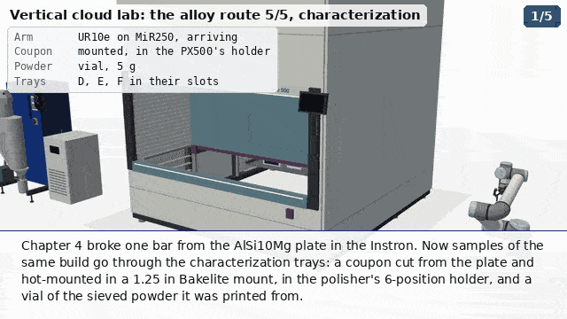

## The alloy route, chapter 7: characterizing the build

Round 8 (PR #318, Sterling's review of 2026-11-05 00:37 UTC). Until round 7 this was chapter 5, and it ground and
polished its own coupon in a 1.25 in Bakelite puck. Chapter 6 ([`alloy_prep.py`](../alloy_prep.py),
[`notes/alloy_prep.md`](alloy_prep.md)) now makes the specimens, so this chapter starts from them:

| Specimen | From | Used here for |
|---|---|---|
| Conductive hot mount, 1.5 in (38.1 mm), carbon-filled phenolic, the AlSi10Mg coupon polished flush | chapter 6, the LECO MX400 and the PX500 | SEM/BSE and EDS (the filler is the path to ground); micro-Vickers |
| Steel mount, 1.5 in, the wire-EDM slice on the pocket's steel floor, polished flush | chapter 6, the Carvera and the PX500 | nanoindentation and PIP: nothing soft under the sample |
| The upper half of a broken E8 subsize bar | chapter 5, the Instron 68FM-100 | the VHX's 3-D reconstruction of the whole piece |

They ride a caddy (ours) on the MiR250's cabinet. The lab is the two-Shuttle floor of
[`setup_lab.py`](../setup_lab.py) with every tray loaded, as the set-up movie leaves it, so the trays that aren't in use
are seen full (Sterling, on the old 9:09 clip: "suddenly the VLM only has a few things on board"). The instruments are
[`r8_char.py`](../r8_char.py)'s and the data panels [`data_panels.py`](../data_panels.py)'s.

[`alloy_characterize.py`](../alloy_characterize.py) is the scene.

| | |
|---|---|
| MP4, 1280 x 720, 6 fps, 254 s (1526 frames) | [`out/mp4/alloy_characterize.mp4`](../out/mp4/alloy_characterize.mp4) (11.3 MB) |
| GIF, 512 x 288, 3 fps | [`out/alloy_characterize.gif`](../out/alloy_characterize.gif) (under 4.9 MB) |
| Eight moments, from the MP4 | [`out/alloy_characterize_sheet.png`](../out/alloy_characterize_sheet.png) |
| The still: all six data panels | [`out/alloy_characterize_still.png`](../out/alloy_characterize_still.png) |
| Frame range of every sub-step | [`out/alloy_characterize.json`](../out/alloy_characterize.json) |
| Collision audit, every frame | [`out/collisions/alloy_characterize.json`](../out/collisions/alloy_characterize.json) |
| The data panels, and every number on them with its status and source | `out/alloy_characterize_panel_{sem,eds,hv,nano,pip,vhx}.png`, [`out/alloy_characterize_data.json`](../out/alloy_characterize_data.json) |

### The steps

1. **The specimens.** The MiR250 + UR10e at Shuttle 1's opening, the caddy on its cabinet.
2. **Tray D, the Hitachi TM4000PlusII.** EVAC/AIR vents it and the door comes out with the stage. The arm sets the hot
   mount in the stage's holder cup, where a spring plunger presses it against the cup's wall. Door in, pump-down,
   BSE, then EDS through the built-in detector and its analyser, Oxford's AZtecOne, the box beside the SEM, now
   lettered and labelled. The SEM and EDS panels follow. Vent, unload, tray D goes back.
3. **Tray E, the KLA iMicro.** The hood lifts and the XY stage's carriage runs out to the load position. The steel
   mount goes into the stage's steel cup, clamped by a plunger. Hood down, drawn see-through, so the inside is
   readable: the stage carries the slice under the objective, then 100 mm across under the indenter head, the
   Berkovich tip comes down for a 5 x 5 grid, and the stage carries it back to image the grid. The nanoindentation
   panel follows.
4. **Tray E, the Plastometrex PIP**, on the same steel mount. Its loading slide (ours) runs the mount out of the bay
   for the arm and back over the platen. Indent, profilometer, CORSICA's fit; the PIP panel follows.
5. **The MiR250 drives to Shuttle 2**, at its published 0.3 m/s^2 (`props.ramp_frac`, from PR #321).
6. **Tray L, the Mitutoyo HM-220 micro-Vickers**, on the hot mount, by its own loading slide (ours). A row of HV0.1
   indents across the coupon; the hardness panel follows.
7. **Tray K, the Keyence VHX-7000.** The bar's half on the carrier of the stage's loading slide (ours). The free-angle
   head tilts about the focal point while the stage turns; the arm turns the bar over, and a second series covers
   the underside. The VHX panel (the fracture surface's height map) follows.
8. **The data, all six panels at once**, with what is real, computed and illustrative.

### Sterling's points, and what the chapter does about each

- **"there was no attempt made to make a conductive path between the sample and the SEM stage ... it needs to
  actually mount onto the stage, not just be freestanding".** The mount is conductive (carbon-filled phenolic, made
  in chapter 6). It sits in a holder cup in the stage's socket, and a spring plunger (a ball-nose set screw) clamps
  it against the cup's wall, so the path is coupon -> compound -> cup -> stage. A robot needs no screwdriver for a
  plunger: the mount pushes the ball back as it goes in. The cup stands on an adapter bar 30 mm ahead of the socket,
  as round 7's did: at the socket itself, every IK solution put the wrist into the SEM's front.
- **"What's that box off to the right of the SEM?"** Oxford Instruments' AZtecOne EDS analyser (290 x 260 x 330 mm,
  in Hitachi's EDS brochure). It is lettered, and labelled when the SEM step starts.
- **"for those mechanical tests like with PIP and nano-indentation, you can't just use the puck".** Both run on the
  steel mount: the slice on the steel floor of a 416 stainless puck, polished flush. The iMicro clamps it in a steel
  cup; the PIP's slide plate is steel and sits on the platen. Metal from the indent to the load cell either way.
- **"The puck also does some weird, non-physical self-motion after getting loaded in, and I have no idea what's going
  on inside of that indenter".** The specimen now only moves with the stage it sits in (it is parented to the stage's
  piece, which the XY carriage and stage carry), and the iMicro's cabinet and hood are drawn see-through while it
  works, so the objective, the indenter head and the tip coming down are visible.
- **"something weird about the relative positioning of the VHX top module relative to the sample".** The head is on
  the stage's axis and tilts about the focal point on the sample (r8_char.vhx; the EA-300 LIBS head, which hung the
  lens 110 mm in front of the stage, is not drawn).
- **"The VHX microscope can probably create a high-fidelity 3D morphological reconstruction of the entire part by
  simply tilting the head around and flipping the sample once."** That is the VHX step: a tilt series while the stage
  turns, the bar turned over by the arm, the series again.
- **"You should be showing the characteristic data that comes from each of these techniques"**: a panel after each
  instrument, badged REAL DATA, COMPUTED or ILLUSTRATIVE, and all six at the end. What each one is, with every
  number and source, is in [`data_panels.py`](../data_panels.py)'s docstring and `out/alloy_characterize_data.json`.
  In short: **nothing in them was measured on this build**; no micrograph of a section of the lab's prints was
  found. The SEM panel's inset is real, but it is the powder.
- **"Instead of the stock AlSi10Mg powder, you should pull SEM images from the Al powder we actually atomized."** The
  SEM panel's real inset is now the lab's own atomized Al 4047, run c3k0n5 (rePowder, 22 Oct 2026,
  [DAL #159](https://github.com/vertical-cloud-lab/digital-alloy-lab/issues/159)), on BYU's Apreo at 1000x, 5 kV,
  imaged by Ronnie Guymon on 26 Oct 2026 ([DAL #157](https://github.com/vertical-cloud-lab/digital-alloy-lab/issues/157);
  `out/footage/sem_c3k0n5_3.png`, as chapter 4 uses).
- **The OpenFlexures** are not used: the array is off the tray plan (Sterling questioned what they were for, given
  the VHX), and the VHX does the whole-piece imaging they were meant for.
- **The trays come to the opening and the arm loads each instrument**, on the two-Shuttle floor.

### What is ours, and what is assumed

None of these are the makers' published arrangements. They are our designs, at assumed sizes:
- **The caddy** on the MiR's cabinet top: two 6 mm-deep pockets for the 1.5 in mounts (1 mm clearance, a lead-in) and
  an 8 mm ridge for the bar, narrower than the bar so the gripper's pads reach down either side. Where chapter 6 left
  the mounts (`alloy_prep.HOT_AT`, `ST_AT`).
- **The SEM's holder cup, adapter bar and plunger.** Hitachi's own holders are for stubs and small mounts; a 1.5 in
  holder of this kind is an estimate.
- **The iMicro's steel cup and its plunger,** and its carriage's 130 mm run to the load position (`r8_char.NANO_LOAD`).
- **The loading slides on the PIP, the HM-220 and the VHX.** Each of these instruments leaves too little room over
  its sample for a gripper from above (the PIP's bay is about 130 mm tall with the indenter 7 mm over the sample; the
  HM-220's objectives are 3 mm over the face; the VHX's ring light is 25 mm over the focal point), and the VHX's own
  XY stage moves only +-20 mm. So a plate or carrier on a short linear guide (ours) carries the specimen out to the
  front, where the arm reaches it from above, and back:
  - PIP: a 6 mm steel plate with a locating ring, 310 mm of travel; the indenter and profilometer sit 6 mm higher for
    it (`r8_char.PIP_SLIDE`).
  - HM-220: the holder plate and its V-block on the XY table, 150 mm (`r8_char.HM_SLIDE`).
  - VHX: an aluminium carrier with an 8 mm pedestal on the turntable, 110 mm, so it turns with theta
    (`r8_char.VHX_SLIDE`, `VHX_CARRIER`). The pedestal puts the bar's top face at the focal point and leaves room for
    the pads on either side of the bar.
- **The turn-over** is the arm's: a level grasp on the bar's grip end from the front, 25 mm up, a 180 deg roll of the
  wrist about the bar's axis, back down.
- **The instrument times** on the clock are typical, not measured: about 3 min to vacuum and 15-20 min of SEM/EDS,
  45 min for 25 indents on the iMicro, minutes for a PIP test, about 12 min for a row of Vickers indents, about 25 min
  for the VHX's two series.

### The arm's collisions

`VLAB_ONLY_TRAYS=DEKL ARM_AUDIT=1 VIZ3D_FPS=6 xvfb-run -a python3 alloy_characterize.py` checks every frame, with
`collide.Auditor`'s rules (the gripper may touch what it picks up or puts down within 4 s of the grasp or release; a
held part may touch where it came from and where it goes), in
[`out/collisions/alloy_characterize.json`](../out/collisions/alloy_characterize.json).

| Version | Frames checked | In collision | Where |
|---|---|---|---|
| First full draft | 3389 (15 fps) | 48 | the iMicro's unload and the move on to the PIP; the HM-220's indent marks, floating where the hidden prop started; the VHX's turn-over and its picks |
| **The committed render's code** (`72bb1bf`; the JSON above) | 1269 | **13** | the iMicro's unload (its approach from the park pose put the wrist into tray E's camera head, then through the opening's frame and the iMicro's raised hood: frames 574-598); one frame of the wrist grazing the VHX's stand as the bar is set down (1246) |
| Picks from the joints that placed (`5518d3e`, **not rendered**) | 1269 | 1 | the VHX graze at frame 1246 only |

What fixed what:
- **The cameras** for the iMicro, the HM-220 and the VHX were aimed before their trays came down, at the trays' slots
  inside the Shuttles; they are aimed once each tray is at the opening. The HM-220's close-up is from the front right,
  through Shuttle 2's opening: from the left it looked into the Shuttle's frame.
- **The iMicro's hood** shut while the arm was still leaving; it shuts once the arm is clear.
- **The HM-220's indent marks** belong to the model's own (hidden) sample, which waits 220 mm over the holder; they are
  hidden until our mount is on the slide, with the hidden sample seated so they sit in its face.
- **The VHX's turn-over** (a level grasp on the grip end, a 180 deg roll) put the fingertips into the stage and the
  wrist into the stand; it is left out, and the caption says so. The MiR stops 250 mm past Shuttle 2's dock for the
  VHX and 300 mm short of it for the HM-220 (IK: 8 solutions against 4 at the dock, 1033 mm out).
- **A specimen is taken back from the joints that set it down** (`pick_mount(at=...)`): from the park pose the nearest
  clear IK branch at the iMicro had the wrist in tray E's camera head.
- **The audit was ~10 frames a minute on the whole lab**: `collide.World.refresh` asks VTK about every actor every
  frame, and a whole-lab scene has tens of thousands. The chapter keeps its collision world to what the arm can
  reach (`fast_collisions`: the trays it presents and everything within 2.8 m of the arm's base at its three stops)
  and audits only its own arm; and with `VLAB_ONLY_TRAYS=DEKL` setup_lab populates only the trays it presents. The
  cladding is opaque, so the empty trays inside the Shuttles aren't seen.

### Known in the committed render

The render (`b5ab9d8`) was made from `72bb1bf`, before the last two fixes, and the long-form was built from it:
- **13 frames (about 2 s) with the arm in collision at the iMicro's unload, frames 574-598**: the wrist passes through
  tray E's camera head, the opening's frame and the iMicro's raised hood on the way out. `5518d3e` takes the mount back
  from the joints that set it down, and audits at 1 frame in 1269; not rendered.
- **1 frame (1246)**: the wrist grazes the VHX's stand as the bar is set down on the carrier. Not fixed.
- **The HM-220's close-up looks into Shuttle 2's frame** instead of at the tester (frames about 890-1150): its camera
  was set from the left. `2d0fc50` moves it to the front right, through the opening; not rendered.
- To re-render with both fixes: `VLAB_ONLY_TRAYS=DEKL VIZ3D_FPS=6 xvfb-run -a python3 alloy_characterize.py` (about
  36 min on the runner, under `runner_guard.py`), or only those stretches, spliced in:
  `CH7_NAME=alloy_characterize_window CH7_WINDOW=560:610,890:1155` renders them to their own MP4, with the frame
  numbers in `/tmp/alloy_characterize_window_frames.txt`.

### Not done

- **No section of the lab's prints has been imaged, indented or reconstructed.** The panels say so.
- **The specimens' trip from the sample store (tray J) to the MiR's caddy is not shown;** the chapter starts with them
  in it.
