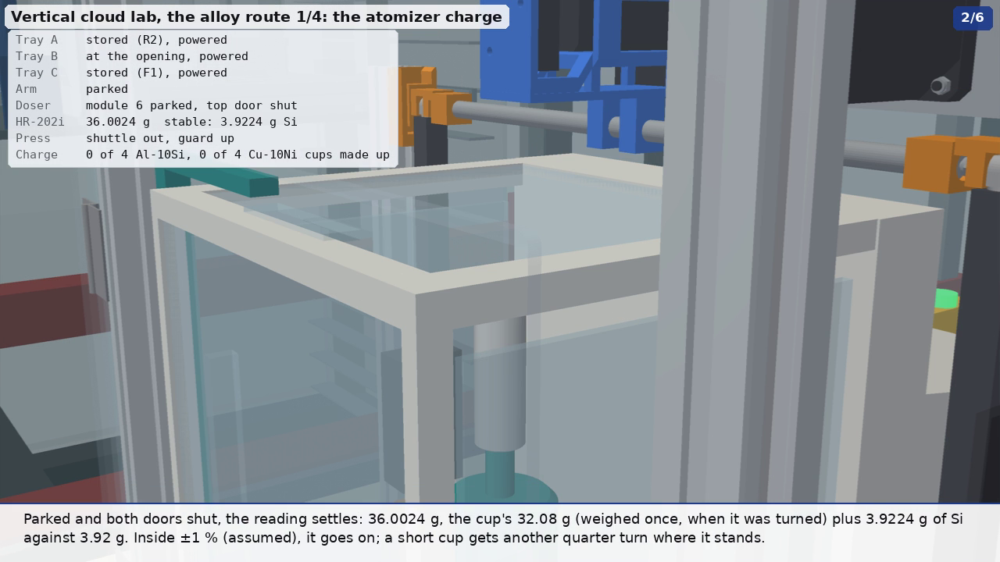
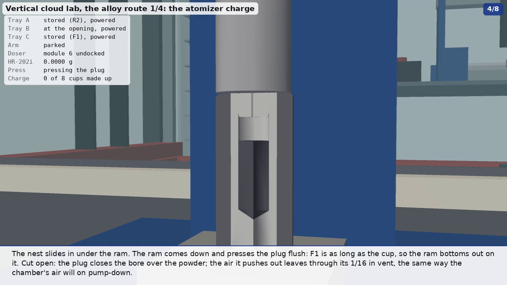

# The alloy route, chapter 1: the atomizer charge, made up in the VLM

[`alloy_charge.py`](../alloy_charge.py) over [`charge.py`](../charge.py) and [`alloy_press.py`](../alloy_press.py),
byu-vcl #303. It replaces round 2's vial (`animate.py workflow`: a 20 mL vial dosed, then liquid added in the CubXL).
It also fills a gap in [`dal_workflow.md`](dal_workflow.md): a station that fills and presses the atomizer's cups.

Two versions were written for [PR #318's review](https://github.com/vertical-cloud-lab/byu-vcl/pull/318) at the same
time, and this chapter is the two merged:
- **dosing and weighing** (round 5's `alloy_charge_doser.py`): four cups a run, an A&D HR-202i in place of the
  multi-doser's 100 g load cell, one funnel per powder in place of the doser's shared catch funnel;
- **the plug pressed home under vacuum** (the vacuum-press rewrite, rendered on its own as
  `out/alloy_charge_vacuum.*`, [on YouTube](https://www.youtube.com/watch?v=UjGb47I3fy0)): the bore filled to where
  the plug is set, then the plug driven to flush on a set load in a Specac Atlas Autotouch 15T, under vacuum.

## Round 11: the stricter collision audit (0 of 1145 frames, from 40)

Sterling, after the round-10 long-form: "There are probably other collisions and interferences that I didn't catch".
Under round 11's audit ([`arm_collisions.md`](arm_collisions.md#round-11-the-stricter-audit-the-default-for-arm_audit1):
what the gripper or a held part may touch only up to 1.5 mm deep, and everything that moves checked) this chapter
had **40 of 1145 frames** in collision, where round 10's rules found 0
([before](../out/collisions/alloy_charge_r11.json), [after](../out/collisions/alloy_charge_r11fix.json)):

| What the audit found | Why | Fixed |
| --- | --- | --- |
| Each cup 12-25 mm into the charge rack, picked or put back (8 runs) | `charge.rack()` was a solid block with the pockets drawn only as rims on top: a cup in the rack stood 22 mm inside plastic. Round 10's rules let a held part touch its fixtures "however deep" | The pockets are cut (`charge._pocketed`, manifold3d), 0.6 mm round a cup and 0.5 mm round a plug, as printed holders are made |
| The fingertips 3 mm into the rack, taking a plug from above (2 runs) | The pads reach to 2 mm over a plug's base, and the plug stood 5 mm deep in its pocket | The plug pocket is a 3 mm counterbore and the plug is taken 2 mm higher (`PLUG_GRASP` 23.5): the pads stop 1 mm over the rack and hold 5.5 mm of the plug |
| The punch 25 mm into its rest (2 runs) | The rest's post was solid too, the punch's nose drawn 22 mm inside it | The post is bored for the nose, 0.5 mm round it (this chapter only: `alloy_press.py`, which other scenes draw, is unchanged) |
| Each cup 3 mm into the press's punch at the end of the press (8 single frames) | The arm let each cup go 1 mm over its seat, in the rack and on the pin; a cup let go 1 mm high in the rack was then gripped 1 mm low, so it went into the die 2 mm high and the punch's face, at flush, ended 2 mm in its rim. The same offset set the plug 1 mm deeper than intended | Every cup is set on its seat (as it would settle when let go) |
| The punch 3 mm into the die, set into the catch ring (2 runs) | Its O-ring: a 2.4 mm section reaching 20.4 mm across, in the ring's 19.30 mm bore, squeezed 0.55 mm a side (23 %), which is how a seal is meant to sit, drawn uncompressed | The O-ring is marked soft (`sc.soft`), which the checks leave out as they do liquids |
| A plug in its cup's mouth, the punch's nose in the ring (several) | Zero-clearance fits, drawn line to line | Not changed: `collide.depth` now reads such fits as touching |

Assumed: a printed rack's pocket clearances (0.6 and 0.5 mm) and a 3 mm counterbore for the plugs; that a cup let go
over its seat settles onto it. Re-rendered at `VIZ3D_FPS=6`, the render checking itself (`ARM_AUDIT_RENDER=1`).

## Round 10: the cup can't go closer to the outlet; a funnel per powder is designed, not yet in this chapter

Sterling (PR #318, 2026-11-07): "Note the comment about raising the cup on a platform of sorts so that the nozzle is
closer, but we might end up needing to use a funnel anyway". The details and the measurements are in
[`multidoser.md`](multidoser.md#round-10-raising-the-vessel-toward-the-outlet-measured-the-funnel-pr-318-2026-11-07).
For this chapter:

- **The cup's rim stays 153.4 mm under the auger's exit.** It already rides as high as the balance's side door lets it
  pass (2.5 mm under the opening's top, carried on the fork). A granite block under the HR-202i would lift its top into
  v5's parked electronics carriage, which is 12.6 mm above it.
- **A 12.7 mm bore under an 8 mm stream leaves 2.35 mm a side.** Grains that miss land on the rim or our pedestal, which
  are on the pan, so they are weighed as dose without being in the bore. So the cups should be dosed through **a funnel
  per powder** (Sterling's earlier "funnels allowed, but one per material").
- `carousel.Carousel(funnel=...)` draws one: the powder's own funnel on an upper tine of our shuttle, its stem 4 mm over
  the bore, the cup on a shorter pedestal (top 174.5 mm). The stream falls 157.9 mm onto a 40 mm cone, and FCL finds no
  contact along the travel or at the dose.
- **Not in the chapter yet.** That needs:
  - the arm swapping funnels at the hand-over when the powder changes (Si, AlSi10Mg, Ni, Cu: three swaps);
  - the shuttle staying in while the cup doses;
  - the level hand-over under the funnel.
  This round didn't write them, so the chapter was not re-rendered. The clip in `out/` is round 9's (no funnel).

## Round 9: the multi-doser is v5, with the balance underneath (PR #318, 2026-11-05 22:56)

Sterling: "we have an updated version of the multi-doser ... (both vial dosing and charge cup dosing) ... you'll be
putting the balance underneath." The doser is now powder-doser's chain carousel v5 ([`multidoser.md`](multidoser.md)):
the A&D HR-202i stands under its dose point and the dose falls straight into the cup on the pan, weighed as it doses.
So this chapter changed:

- **No funnels, no fork, no stand, no second balance on a granite block.** Nothing is shared between powders: the
  dose's path is the module's own auger, 153 mm of air and the cup. Round 8's funnel steps (2, 4, 6, 8) are gone.
- **Each cup goes onto the balance in the doser.** The arm can't reach v5's pan itself (its frame posts leave 117 mm
  for the 2F-85's 127-138 mm knuckles), so it sets the cup level on the fork of our **vessel shuttle**, outside a port
  in the doser's -y panel. Our pusher slides the balance's -y side door back; the shuttle carries the cup in and sets
  it on our **pedestal** on the pan (an 11 mm neck on v5's riser tube), the cup's rim at 282.5 mm, its 12.7 mm bore
  centred under the 8 mm stream, 153 mm under the exit; the fork backs out and the door shuts.
- **Dosed by weight in place**: our second pusher slides the top door back, the module indexes, the P16s lift the EC
  to dock, it tilts 30°, and v5's `dose-to` turns the auger a quarter turn at a time, reading the balance after each
  (the HR-202i's gauge counts up in steps). Then tilt back, park, top door shut, and the reading settles: the cup is
  weighed where it was dosed, both times (after its alloying powder and after its top-up).
- **Out again by the shuttle**, then the arm takes it from the fork to the rack (or on to the plug and the press).
- The cup cradle the brief asked for is the pedestal: a cradle round the cup on v5's riser would put the cup's rim at
  296.5 mm, over the side door opening's 291 mm top, so the cup could not go in or out through it.

| Step | What happens | Shown |
| --- | --- | --- |
| 1 | Tray B comes down to the opening: the vacuum press, the eight-cup charge rack, the multi-doser v5 with the HR-202i in its base, our shuttle | wide, then labelled; the doser close |
| 2 | The first 5N Al cup goes from the rack onto the shuttle's fork; the shuttle sets it on the pedestal; the Si module is indexed, docked, tilted and doses 3.92 g by weight; the reading settles; the shuttle brings it out and the arm puts it back in the rack. Then the other three, faster | cup in half section; the balance's gauge |
| 3 | The first Al cup again: topped up with 3.91 g of AlSi10Mg to the plug line on the pan, weighed there, its plug set in the mouth at the rack, into the die's catch ring on the raised ejector pin, the punch on; shuttle in, pumped below 1 mbar, pressed flush at 3.2 t, vented with Ar; onto the MiR250's carrier. Then the other three, faster | half sections of the cup, the die and the press stroke |
| 4 | The first OFE Cu cup in full, briefer: 14.62 g of Ni, weighed on the pan. Then the other three | |
| 5 | The first Cu cup topped up with Cu, worked out from its weighed Ni so it stays 10 wt % Ni, weighed, plugged, pressed, back on the rack. Then the other three | |
| 6 | Tray B goes back into storage. Four Al-10Si cups are on the MiR for the rePowder, where chapter 2 picks them up | the carrier |

**Rendered** 2026-11-06 07:07 UTC (`VIZ3D_FPS=6 ARM_AUDIT_RENDER=1`, SSAA, 1280 × 720): 254.3 s, 1526 frames,
[MP4](../out/mp4/alloy_charge.mp4) (13.3 MB), [GIF](../out/alloy_charge.gif) (4.59 MB, 1018 frames), stills
`out/alloy_charge_{dose,weigh,press,still}.png`. **Arm audit in the same pass: 0 of 1145 checked frames in
collision** ([`out/collisions/alloy_charge.json`](../out/collisions/alloy_charge.json)). The round-8 funnel still
(`alloy_charge_funnels.png`) is gone with the funnels. The dose close-up (`_dose.png`) is cluttered by the balance's
frame and the doser's posts: a camera through the front hatch would show the bore filling better (not re-rendered).

The sections below on the round-8 station ("Weighing: an A&D HR-202i, not a load cell" from "The balance can't go
under the doser's outlet" on, and "One funnel per powder") describe what round 9 replaced; they stay as the record of
why the funnels were there.

**Not yet re-rendered for round 7** (the catch ring, the low carrier, the wrist camera, the rack approaches below).
The round-7 render (`VIZ3D_FPS=10 CHARGE_FXAA=1 ARM_AUDIT_RENDER=1`, 0.8-1.5 s a frame on a shared runner) was
stopped by the session's 30-minute limit on a background job at about frame 1300 of 2420, so the clip, GIF and stills
in `out/` are still the long-form round's, which show the cup on the bare pin and the carrier on its post. Re-render
with the same command, run in the foreground or with a longer limit; `scene.GIF_SIZE` is now 512 × 288, to bring the
GIF under 4.9 MB. The audit of the round-7 code is below.

**Rendered** 2026-11-04 at `VIZ3D_FPS=10 CHARGE_FXAA=1 ARM_AUDIT_RENDER=1` (four other renders shared the runner, and
at 1280 × 720 with SSAA a frame took 1.6-2.2 s): 245 s, 2451 frames, [MP4](../out/mp4/alloy_charge.mp4),
[GIF](../out/alloy_charge.gif) (5.3 MB, over the 4.9 MB aim). A plain `xvfb-run -a python3 alloy_charge.py` renders
it at 15 fps with SSAA. Besides the end still `out/alloy_charge_still.png`, the script cuts four from the MP4
(`STILLS`): the Si dose, the first reading, the press stroke (`alloy_route.py`'s sheet uses it) and the Si funnel in
the fork:

## The charge

**The geometry is #222's own.** The cup, plug and sleeve profiles are copied dimension for dimension from
`atomizer-charge/cad/charge_cad.py` (branch `claude/issue-222-20260925-0343`, commit `2a608d6`), the parametric CAD
behind the lab's STEP files, shop drawing and process sheets:
- **cup (P2):** 3/4 × 2.5 in, with a 1/2 in bore 1.875 in deep and a 118° drill point;
- **plug (P3):** 1/2 × 3/8 in, with a 15° lead-in and a 1/16 in vent;
- **F1:** 1018 steel, 1.25 in round, bored to the cup's OD + .0005 in, as long as the cup.

From the profiles (Pappus):
- cup 11.887 cm³;
- plug 1.173 cm³;
- cavity under a flush plug 4.903 cm³, including the drill point.

**Four cups a run.** The lab loads four charges into the crucible (Sterling, PR #318). The Oct 27 630 bronze run went
in as four rod pieces, 1,080 g (DAL #219, #230). #222 already has four places round the sealing rod.

**The bore is filled to the set plug, in two layers** ([`out/alloy_recipe_pressed.json`](../out/alloy_recipe_pressed.json)):
the alloying powder first, then a top-up of the cup's own metal, each run keeping its 10 wt %. `charge.RUNS`' doses
alone ([`out/alloy_recipe.json`](../out/alloy_recipe.json)) stood 18 mm (Si) and 25 mm (Ni) below where the plug is
set, so pressing the plug flush on them compacted nothing.

| Run | Cups | Alloying powder | Top-up | Tapped → pressed | Charged cup | Run |
| --- | --- | --- | --- | --- | --- | --- |
| this one, Al-10Si | 4 × 5N Al (2.699 g/cm³): cup 32.08 g, plug 3.17 g | Si 3.92 g, tapped 1.10 g/cm³ (#222) | 3.91 g AlSi10Mg, itself 10 % Si | 52 → 63 % dense | 43.1 g | 172.3 g |
| next, Cu-10Ni | 4 × OFE Cu, C10100 (8.94 g/cm³): cup 106.27 g, plug 10.48 g | Ni 14.62 g (was 12.97), tapped 4.9 g/cm³ (assumed) | 14.81 g Cu | 55 → 66 % dense | 146.2 g | 584.7 g |

- **Al-10Si** has the Si of the AlSi10Mg that the line prints (chapter 4). The 5N cups bring no Mg; the AlSi10Mg
  top-up brings a trace (its 0.2–0.45 % Mg, 8–18 mg a cup).
- **172 g of Al cups is a normal Al run.** The lab's Al runs so far melted 169–180 g (DAL #159: 180 g of 6063 on
  Oct 6, 169 g of 4047 on Oct 21 and 22). Chapter 2 works out what it makes.
- **Cu-10Ni** is the 90/10 cupronickel of the Navy's seawater piping. C70600 adds 1–1.8 % Fe. This is DAL's Cu
  work: #162 (high-purity Cu rod "similar to the aluminum rods") and #219 (the NAB run).
- **"Designed"** means every gram dissolves, as #222 uses the word. ICP/EDS on the powder measures recovery.
- **Weigh, don't trust volumes** (#222). The tapped densities set only the fill heights drawn; the balance sets the
  masses.

**The 5N rod is Ø20 mm** (DAL #152), not 3/4 in. The cups here keep #222's 3/4 in profile, so they are the same
part in another metal. A 5N cup turned from Ø20 bar would be 0.95 mm larger across.

## Weighing: an A&D HR-202i, not a load cell

**The multi-doser's 100 g load cell is gone.** The chain carousel in powder-doser PR #185 dosed onto a TAL221 bar load
cell. The lab's own doser doses onto an analytical balance, the A&D HR-100A (102 g × 0.1 mg), read over RS-232
(powder-doser #99; PR #97 replaced the HX711 load cell with the HR-100A in the doser's paper and BOM). A Cu cup with its
Ni and Cu is 135.7 g, over the HR-100A's 102 g. So the station here weighs on its larger sibling, the **A&D HR-202i**:
- **220 g × 0.1 mg**, with a 51 g × 0.01 mg fine range. It is one of the balances powder-doser's
  `design/brainstorming.md` weighs (FZ-523, HR-202i, HR-300i, HR-100A);
- an Al cup reads 36.0 g after its Si and 39.9 g after its top-up, a Cu cup 120.9 g and 135.7 g: all inside one range.

**The model** ([`lab_models/labware.py`](../lab_models/labware.py), `balance_hr202i`, `hr202i_parts`) is drawn from
A&D's HR-i manual, section 15.1 "External Dimensions" (p. 60):
- 217 × 442 × 316 mm overall; the body 200 wide, 428 deep, 310 tall;
- pan Ø90, its centre 163 mm behind the front;
- weighing chamber 183 × 164.5 mm inside and 250 mm over the pan, the pan 86.5 mm behind the chamber's front glass;
- side doors 148.5 × 251 mm, top door 164 × 148.5 mm, all sliding back;
- the pan's height (50 mm) and the display's slope are read off the drawing, not dimensioned.

**The balance can't go under the doser's outlet as the rig is built.** The chain carousel's docking actuator (the
P16 and its clevis on the station's cross rail) stands 6 mm behind the auger's outlet, from the rig's base up to the
carriage. The old vial (28 mm across) fitted in front of it; a 90 mm pan, let alone a 183 mm weighing chamber, does
not. So, in this chapter:
- the rig's load cell, vial cup, vial post and catch funnel come out;
- a new 2020 post on the same base rail carries a cradle for the cup (a C open to the front, so the arm slides the cup
  in level) and, above it, a fork for the powder's funnel;
- the doser doses by auger turns, from its own calibration;
- the arm takes the cup to the HR-202i, which reads it. Inside the tolerance (±1 % of the dose, assumed), the cup goes
  on; a short cup would go back to the doser for more, as the trickler does on the HR-100A.

**Each cup is weighed twice**, after its alloying powder and after its top-up, so both masses are measured. The
top-up is set from the first reading: for Cu-10Ni the Cu that keeps the cup at 10 wt % Ni (9 × the Ni read, less the
cup and plug); for Al-10Si the run's AlSi10Mg, since a top-up that is itself 10 % Si can't move the Si share.

**The balance stands on a 120 mm granite block.** The rack is in front of it, and its pan is 50 mm up. A level
gripper reaching the pan from the front at that height would pass through the rack's cups (their tops are 72 mm up).
On the block, the door's sill is 175 mm up and the arm reaches in over the rack. A weighing stone is usual under an
analytical balance anyway. Its pan is 660 mm in front of the arm's base: nearer, the level approach through the side
door puts the UR10e's wrist inside the cylinder over its base that it can't reach.

Dosing straight onto the balance, in closed loop, needs the station redesigned so that the outlet sits over the
balance's top door: the actuator moved behind or above, and the rig raised or the balance lowered. That is
powder-doser's call. The arm can't slide the HR-202i's doors: here they open on their own, which assumes a door drive
or a balance with automatic doors.

## One funnel per powder

**The doser has no funnel of its own.** When the lab charged cups by hand, it used paper funnels, and a funnel only
ever saw one powder, to avoid cross-contamination (Sterling, PR #318). Here:
- **each powder has its own funnel**, labelled by a coloured band: Si yellow, AlSi10Mg blue, Ni green, Cu orange. It
  is only used for that powder. Printed PP is drawn; it could as well be stainless steel, or a paper funnel thrown
  away after each run;
- **they live on a stand** on tray B, right of the doser, by their flanges, in forks open to the front, so the arm
  takes one level;
- **at the doser it sits in a fork over the cup.** Its stem, 9 mm across, points into the 12.7 mm bore and stops 4 mm
  over the rim. It never touches a cup, so it carries nothing from one cup to the next, and the cup slides in and out
  under it;
- **the cups are dosed one powder at a time.** All four cups of a run get their alloying powder, then the top-up
  funnel takes the fork and they are topped up in turn. So a funnel is swapped only when the powder changes, four
  swaps for eight cups and four powders, and each cup visits the doser twice;
- **the dose's path** is the auger, the powder's funnel and the cup, nothing shared. Each module's auger already
  carries only its own powder.

Keeping funnels apart, in practice:
- dedicated and labelled, one per powder, cleaned between runs (the sieve-cleaning question in DAL #234 applies);
- or paper, used once and thrown away, as the lab did by hand. A robot would need a dispenser for those.

Funnel geometry (`charge.FUNNEL`, our design): cone 40 mm across and 22 mm tall over a 2 mm flange 28 mm across,
a stem 9 mm across (6 mm bore) and 12 mm long, and a 42 mm band to grip by. The stream from the auger lands on the cone
15 mm off its axis, about 66 mm below the outlet.

## The plug pressed home, in a vacuum press

Sterling: "the plug is supposed to be pushed in all the way such that the powder gets compressed to a certain
tonnage. Also, it would be better if it were a vacuum press" ([`alloy_press.py`](../alloy_press.py),
[`vacuum_press.md`](vacuum_press.md)).

- **The press is a Specac Atlas Autotouch 15T** with our evacuable die round F1, the punch with an O-ring, the ejector
  pin and the shuttle that carries the die out of the press to the arm. It replaces the assumed electric press with its
  shuttle nest:
  - the die is pumped below 1 mbar through its port, so no air is sealed into the compact (DAL #140: compacted powder
    with air in it can throw molten metal out of the cup);
  - the plug goes 8.0 mm to flush on a 3.2 t (31.4 kN) program: 1.05 t on the powder plus #222's 2 t reserve for the
    plug's press fit. F1 stops the plug at flush, so the dose, not the force, sets the final density;
  - the powder goes from 52 to 63 % dense (Al) or 55 to 66 % (Cu);
  - the die is vented with dry Ar.
- **The plug goes in at the rack.** A gripper pointing down at the press's working height, about 450 mm above the
  tray, puts the wrist into the VLM's opening, and it couldn't follow the plug into the die's 31.8 mm bore anyway. The
  cup rides to the press with its plug in the mouth, on its 15° lead-in, 8.0 mm proud.
- **The press opens above the die.** The shuttle carries the die out of the press to the arm, and the ejector pin
  raises the cup out of F1 when it is pressed. The punch is handled level by its flange, from a rest beside the press.
- **The cup stands in a catch ring, not on the bare pin** (Sterling: on the raised pin it "looks very unstable. There
  should probably be a custom underneath catch that holds it in place somewhat"). Nothing riding up on the pin can
  hold the cup round its base, because the cup leaves F1 through a line-to-line bore. So the catch is the die's mouth:
  a hardened ring on F1, bored Ø19.30 over the 19.05 mm cup with a 30° lead-in, and the pin stops 75.5 mm up (was
  90.5), with the cup's bottom 10 mm still in the ring. The arm sets the cup into it and lifts it out level, 45 mm up
  the cup, so the fingers pass at least 20 mm over the die. The punch got a Ø19.20 nose to run in the ring and a collar
  that lands on it at flush, so F1 still takes the load past flush ([`vacuum_press.md`](vacuum_press.md#the-catch-the-cup-stands-in-the-dies-mouth-not-on-the-bare-pin)).
- **The press has been on tray B since the lab was set up** (`setup_lab.py`). Its first label in the chapter says so.

## What the chapter showed

- **The weighing station and the dosing station are two places.** The rig as built has no room under its outlet for
  a balance (above). Each cup makes two extra trips, doser to balance.
- **A cup is always held level.** It is picked, placed and carried with the fingers closing sideways, so its axis
  never tilts. That is why the rack has the cups in its front row, the cradle is open to the front, and the balance's
  cup holder is open to its door. The balance is turned so that a side door faces the arm.
- **The plugs are taken from above.** The 2F-85's pads are 38 mm long and a plug is 9.5 mm tall. The fingertips meet
  the plug's top 7.5 mm, 2 mm above the cup's rim.
- **Level grasps are aimed, not square to the tray.** At the rack, the press, the punch's rest and the carrier, the
  gripper is aimed along whichever direction the checker finds clear, nearest the line from the arm's base (`aim()`):
  square to the tray, the rack cups nearest the base, the carrier's second pocket and the press off to the side all
  folded the arm into itself. The cradle, the funnel stand and the balance's door only open to the front, so those are
  approached square.
- **At the rack the open fingers may touch only the cup they take** (since round 7). The cups stand 40 mm apart, and
  an angled approach sweeps the open fingertips, and further back the fingers, through the cups beside it. The audit
  had only caught this where the next cup ended up elsewhere (the Al cups, on the MiR), so the Cu cups' brushes were
  never counted. Now each rack approach is checked open on the way in and closed on the way out, at 5° steps, with
  nothing but its own cup and the rack to touch; the gripper opens to 23.5 mm there (2.2 mm a side on the cup, not
  6.3); and for the three cups nearest the arm's base, 400-425 mm from it, where a square approach from 150 mm back
  folds the arm into the MiR or out of reach, the approach starts 110 or 80 mm back instead.
- **Tray B is full.** The press and its pump take the left 780 mm, the rack and the balance the middle, the doser
  680 mm, and the funnel stand the right end. The funnels' pockets are 1.1 m out from the arm's base.

## Collisions

The audit (`ARM_AUDIT=1 xvfb-run -a python3 alloy_charge.py`, [`out/collisions/alloy_charge.json`](../out/collisions/alloy_charge.json))
checks every frame: the arm against itself, and the arm, gripper and what it holds against everything visible.

- **Before the merge**, the doser version's moves had never been checked: audited with the planner, round 5's
  `alloy_charge_doser.py` had 59 of 1875 frames in collision (the arm in the press and in the rack's back cups).
- **The first audit of the merged chapter** stopped in its third step: a line move into the balance crossed a wrist
  flip in the IK branch the planner had picked for the pose before it, and every branch of the fallback joint move's
  end pose was in self-collision. The HR-202i's door, slid back 140 mm, also still covered 8 mm of its opening.
- **What changed:**
  - every approach now starts from the IK branch, nearest first, from which the straight line on to the grasp or
    place is clear and doesn't flip (`pre()`); the planner alone picks a clear branch for the pose, not for the line
    after it;
  - the door slides 150 mm, clear of its opening;
  - the balance stands on a granite block (above), so the wrist passes over the rack's cups.
- **The audit after that** (2026-11-04, stopped in 9/10 at the deadline, 2215 frames checked): 32 frames in 10 runs.
  - **20 frames in 5/10: the first plug.** With eight cups the rack's first plug stands beside the punch's rest, and
    every IK branch for taking it from above put the gripper's right knuckle and finger in the rest's post or the
    punch. Fixed after the audit: the rest stands 40 mm further left (press frame x = 110; `alloy_press.REST_LOCAL`
    has 150), and the pick then has three clear IK branches with clear lines, checked at the pose.
  - **12 frames in four runs of 3 (3/10, 5/10): the next cup.** The open left fingertip brushes the second Al cup
    while the first is taken from the rack at an angle (`aim()`). The rules let the gripper touch what stands in the
    fixture it works at, but the audit reads the parenting at the end of the clip, when the second cup is on the
    MiR's carrier. Square to the rack, or a slightly wider rack pitch, would clear it.
  - **One joint move in 5/10's time-lapse** started from a pose with the upper arm against the gripper (the
    planner's warning); no checked frame shows it.
- **The long-form round's render checked itself** (`ARM_AUDIT_RENDER=1`, every drawn frame): **8 of 1926 frames**,
  four runs of 2, all the next-cup brush above (3/10, 5/10). The first plug's run is gone.
- **Not checked then:** in the time-lapse, sub-steps shorter than 0.1 s (approaches, grips, retreats) happen between
  two frames, so no frame shows them and the audit doesn't see them. The planner's warning in 5/10 (a joint move that
  starts with the upper arm against the gripper) most likely came from one of these, in the time-lapse's Al cups.

### Round 7: the catch ring, the low carrier, the wrist camera

Round 7 changed what the arm works among: the press's catch ring (the cup's bottom 10 mm in the die's mouth, the pin
15 mm lower), the MiR's low pocketed carrier (`charge.carrier`, its pockets 26 mm deep and 85 mm apart, no post), the
D405 wrist camera on the gripper, checked as part of it (`ur_arm.camera_meshes`), and the 996 mm opening.

- **Before** (as rendered in the long-form round): 8 of 1926 frames, the open fingertip on the next Al cup.
- **The rack rule was too kind.** The audit lets the gripper touch what stands in the fixture it works at, but reads
  that fixture at the end of the clip. The Cu cups end up back in the rack, so the fingertips brushing them (cups 6
  to 8, the cups nearest the arm's base) were never counted; only the Al cup that ends up on the MiR was. With the
  approaches checked properly (above), cups 6 to 8 had no clear approach at all once the camera rode on the gripper:
  square, from 150 mm back, folds the arm into the MiR's cabinet or puts the flange inside the base's unreachable
  cylinder (they are 396-425 mm from the base); at an angle, the fingers sweep through the cups beside them.
- **What changed:** the gripper opens to 23.5 mm at the rack (2.2 mm a side), the approach may start 110 or 80 mm
  back, each rack direction needs a clear straight line in one IK branch in and out (`line_clear`), and the
  carrier's placement is checked with the gripper open as well as closed.
- **The audit after that** (`ARM_AUDIT=1`, 15 fps, before the line checks): **0 of 2979 frames**, the planner's 5/10
  warning gone. Two approach lines in the time-lapse had no clear IK branch (cup 7's in, cup 8's back in, holding
  it); they happen between frames, so no frame showed them. The line checks fix cup 8's.
- **Left: rack cup 7** (slot 6, 409 mm from the base) has no approach whose line in is clear in any IK branch, at
  40-150 mm back and 30-90 mm up: in the one branch that reaches it, the upper arm passes within touching distance of
  wrist 2 partway along the line. Its poses are clear, it touches only its own cup, and the line is in the
  time-lapse, between frames. A rack 120 mm further left (the punch's rest moved to make room) would put every cup at
  least 444 mm from the arm's base, where cups 1-5 are all reached square or within 10° of it.

## Assumed

- **The rack, the station's post, cradle and fork, the funnels and their stand, the balance's cup holder and block,
  the die, its catch ring, its shuttle and the punch's rest, and the MiR's carrier** are this model's designs. The
  carrier is round 7's low pocketed block on the MiR's cabinet top (`charge.carrier`, `props.pocket_block`): four
  bored pockets 1 mm over the cup, 26 mm deep, with a 45° lead-in, 85 mm apart, where round 2's one-vial holder stood.
- **The balance's doors open on their own** (a door drive; the HR-i's are manual).
- **Dosing by auger turns** lands within ±1 % of the dose (the readings shown are made up to be inside it).
- **Tapped densities of Ni, Fe and Cu powder**: 55 % of the solid. The Si and Al values are #222's.
- **The four powder modules**, Si in module 6, Ni in module 3, AlSi10Mg in module 1 and Cu in module 9, are a choice.
  The multi-doser has 13.
- **The press's set point** comes from a Heckel line through #222's E4 estimate for AlSi10Mg; Si and Ni are not
  calibrated.

## Open questions

- Should the doser dose straight onto the balance? Then the chain carousel's station needs a new layout (above).
- A Si layer is harder to compact: check the plug reaches flush on the first cups.
- Does the Autotouch take a remote start? What force pushes a pressed cup out of F1?
- Does the plug press-fit need F1 at all with 5N Al? 5N is much softer than 6063-T52, which also makes the cup's wall
  easier to bulge.
- How tight is the plug in a Cu cup? A Cu plug in a Cu bore needs the same interference as Al, or a new one.
- Should each cup be weighed again after pressing, as #222 asks ("weigh it")? The HR-202i is on the tray, so it would
  cost one more trip per cup.
- How are the funnels cleaned between runs, or are they paper and single-use? DAL #234 asks the same of the sieves.

## Before the merge

- **Round 4** dosed two cups a run onto the rig's 100 g load cell through its catch funnel, and pressed the plug flush
  in an assumed electric press. A Cu cup was over the load cell (106 g alone), and the funnel's 18 mm spout was wider
  than the cup's 12.7 mm bore.
- **Round 5's `alloy_charge_doser.py`** (rendered as `out/alloy_charge.*` on 2026-11-04, 147 s) brought the HR-202i,
  one funnel per powder and four cups a run, with the old press, before the collision check existed. Audited
  afterwards with the planner: 59 of 1875 frames in collision, the arm in the press and in the rack's back cups.
- **The vacuum-press rewrite** (rendered as `out/alloy_charge_vacuum.*`, 219 s, two Al and two Cu cups) brought the
  two-layer fill, the Autotouch and its die, and the collision-checked moves (0 of 2752 frames). It still dosed onto
  the load cell, through the shared funnel.
