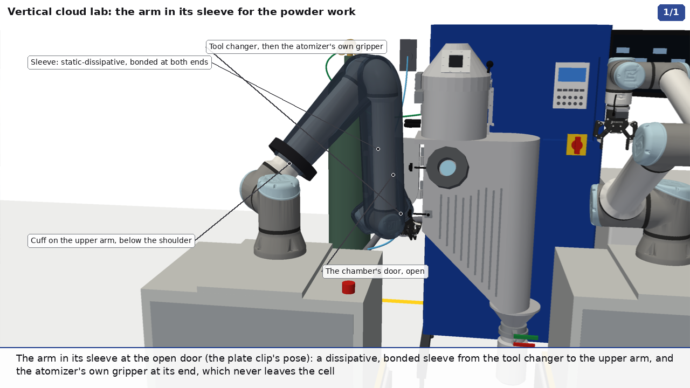

# Keeping the powder at the atomizer: a sleeve for the arm's dirty work (#353)

Sterling on #353 (2026-11-19): "what about the arm getting powder on it, especially considering it's meant to do
other workflows across the plant. Should the cleaning tools have a whole sleeve that the arm fits into, sort of like a
shoulder length glove?"

*A sketch of the idea, drawn on the plate clip's frame where arm 2's gripper comes closest to the door's hole (93 mm).
The sleeve is drawn as each covered link's convex hull grown 15 mm; the tool the arm holds there isn't drawn
(`atom_sleeve.py concept`).*

## The short answer

Yes, cover the arms for the powder work, but don't give each cleaning tool its own sleeve. Give each arm one sleeve
for the whole powder phase of a turnaround, and put the atomizer's own gripper at the end of it. Then the arm goes into
the glove and the glove has its own hand. The hand is the part that really gets dirty, and it never leaves the
atomizer.

- **The clips already keep the arm out of the chamber.** Long tools do the reaching: the 420 mm brush, the EXP wand,
  and the nut key, which keeps arm 2 0.4-0.6 m outside the door. What gets dusty is the gripper, the wrists and the
  lower forearm. They work for 30 to 100 s per clip within 0.3 m of the open door's hole, and the gripper for up to
  44 s within 0.1 m. The upper arm only passes by, except while arm 1 brushes, when its whole arm is within 0.3 m for
  about 11 s.
- **So the length Sterling suggested is right.** A sleeve from the gripper's coupling to below the shoulder covers
  everything that comes near the opening, and its lower half does most of the work.
- **The gripper is the weak point.** The UR10e is IP54. The 2F-85 is IP40, and its manual asks for an environment
  "free from dust, soot or fluids". It is also the part that holds the tools' dusty handles. A sleeve on the arm,
  with the same gripper driving off to the next workflow, would miss the main carrier.
- **Metal powder is conductive dirt, and the UR10e is built for pollution degree 2**, "only non-conductive pollution"
  (UR10e manual). UR itself says that where "fine powders and particles are present… additional measures should be
  taken, such as utilizing a protective robot cover".
- **The fabric has to be static-dissipative and bonded.** A thin insulating layer over a grounded metal arm is the set-up
  for a propagating brush discharge, which is far stronger than the ordinary kind. A metal part on the sleeve that
  isn't bonded is an isolated conductor. These two are what ignite dust clouds (below).
- **It costs no turnaround time.** Sleeves go on while the machine cools to 400 °C (minutes 0-14 of
  `out/atom/turnaround.json`, when the arms are free) and come off in the gap from minute 53 to 60, while the furnace
  cools until it can be touched. Neither is on the critical path.
- **One set per alloy family**, like the vacuums: Al and Cu residues are kept apart because Al with copper oxide is a
  thermite pair ([`atomizer_automation.md`](atomizer_automation.md), [`atom_vacuum.md`](atom_vacuum.md)).

## How far up the arm the powder reaches, measured

`atom_sleeve.py` re-walks every clip's planned joint paths, the same ones the renders and the audits used, with nothing
drawn. For each link, it measures how long the link spends inside the chamber, and within 100 and 300 mm of the open
door's 212 × 340 mm hole.

- **What is measured.** The arm's own meshes (collide.py's links, and the 2F-85 with its D405), on their vertices plus
  6000 points spread over each link's surface.
- **Only the openings count.** Being near the chamber's closed walls doesn't. The furnace rows use its open top
  instead, since its sides are closed.
- **Reach.** Each frame also gives the distance back along the arm, from the grasp point to the farthest point that
  is in the zone. On that scale the flange is at 155 mm, wrist 1 at 391, the elbow at 989 and the shoulder at 1601.

| Clip, arm | Inside the chamber | Within 100 mm of the open door | Within 300 mm | Reach, ≥ 2 s (deepest pass) |
| --- | --- | --- | --- | --- |
| Brushing the powder down (`atom_container`), arm 1 | gripper 2 s (fingertips, 74 mm) | gripper 6 s, wrist 3 3 s | gripper 10 s, wrists 8-9 s, forearm 5 s, upper arm 11 s | 158 mm at 100; 1601 mm at 300 |
| Vacuuming (`atom_vacuum`), arm 2 | never | gripper 13 s | gripper 40 s, wrists 29-35 s, forearm 29 s | 112 mm at 100; 506 mm at 300 (537) |
| The plate (`atom_plate`), arm 2 | never | gripper 44 s, wrist 3 2 s | gripper 100 s, wrists 60-72 s, forearm 57 s, upper arm 2 s | 155 mm at 100 (989); 792 mm at 300 (1177) |
| Crucible out and in, arm 2 (the nut key) | never | never | never | 0: the key holds the arm 385-570 mm outside the door |
| Crucible out, arm 1 | never | | gripper 18 s, upper arm 4 s | 1201 mm at 300; at the open furnace's top: gripper 22 s and upper arm 6 s within 100 mm, 1065 mm |
| Crucible in, arm 1 | never | | gripper 30 s, upper arm 3 s | 1210 mm at 300; at the furnace: gripper 34 s, upper arm 4 s, 1050 mm |

Three clips are not counted:

- **`atom_bn`** is in the hood, nowhere near the machine.
- **`atom_cameras`** is shot with the door shut.
- **`atom_latch`** is too, and it has arm 1 inside the chamber and the furnace for about 8 s. Those are its known
  collision frames, where the forearm goes through the machine while it swings the loop. They are not work.

`out/atom/sleeve/exposure.json` has every number, per link, and `out/atom/sleeve/<clip>.json` the recorded states.

What this says:

1. **The long tools already do most of a glove's job.** No arm goes past the door's plane except arm 1's fingertips
   for 2 s while brushing. This was designed in: the brush's 420 mm handle is there "so the arm stays outside the door
   while the bristles reach the outlet" (`out/atom/bom.md`).
2. **The gripper, the wrists and the lower forearm are where the powder is.** They spend tens of seconds per clip
   within 0.3 m of the hole. What reaches them is the dust that drifts out of the open door and settles, and the
   handles they hold.
3. **The upper arm gets the dust that drifts.** That is brief in these clips. But the fines that brushing and
   vacuuming stir up settle all over the booth, which is what the SOP's 60 s settle and its respirator rule are about.
4. **The furnace is a different dirt:** graphite, BN and the skull, not powder. Arm 1's work there is also where the
   cell needs its finest force readings (0.30 N·m on the nut, [`atom_crucible.md`](atom_crucible.md)). So the sleeves
   come off before the crucible work.

## What else carries powder out of the cell

The arm isn't the only carrier, and a sleeve only deals with the arm:

- **The gripper, its pads and the D405's window.** These are the dirtiest parts. The design below keeps one gripper at
  the atomizer.
- **The tools.** They already live at the atomizer, in the vacuum station's rack and on MiR 1's rests. They should stay
  there and never ride to another station.
- **The MiR250's wheels.** The SOP sweeps the floor only outside the yellow lines, so there may be powder inside them,
  where the units park to work. A pharma-side review of mobile robots names wheels as a way contamination spreads (ISPE
  2026). The options are a tacky mat at the tape line, or a brush-and-suction strip like a boot cleaner, wired to the
  vacuum. A wheel can be checked with a white wipe.
- **The MiR's top: the cabinet, the cup carrier and the container's cradle.** Settled dust lands on them. Before a unit
  leaves, the other arm runs the 118EXP's dust brush over the top, the same tool as in `atom_vacuum`. An alternative
  is a hinged lid over the cradle.
- **The MiR itself, as a conductor.** NFPA 484 (2015, 8.5.2) wants mobile metal equipment bonded or grounded before
  use. A MiR250 on its tyres is an isolated conductor unless the station grounds it, so the bonding lead
  `atomizer_automation.md` proposes is required, not optional.

## The design: the atomizer's own hand, in its own sleeve

**The hand.** An automatic tool changer between the FT 300-S and the gripper on both arms. Each arm's travelling
2F-85 (with its D405) is parked at the cell while the arm works. The atomizer's own gripper, one per arm, does the
powder steps and never leaves the cell.

- **Which gripper.** The Robotiq Hand-E is IP67 and worth pricing for this, as long as its 50 mm stroke takes the
  cell's handles. Most of them are 18 to 40 mm (the brush's grip 18, the wand's fin 30, the container fork's block
  30 × 40), but each has to be checked.
- **The FT 300-S** is IP65, so it can sit outside the sleeve's seal if that's where the changer wants it.
- **Two things to check with the changer's vendor.** The D405 is a USB 3 device: it needs a changer module that
  carries it, or the dirty gripper gets its own camera with its own cable to the cabinet. And the changer's coupling
  faces must never meet powder, so the dirty gripper's holster needs a cover over the face that waits there.

**The sleeve.** A tube from the dirty gripper's coupling to the upper arm's tube just below the shoulder: about
1.45 m of the arm's 1.6 m chain.

- **Shape.** About 250 mm across, so it clears the elbow's and wrists' housings. It needs slack at the elbow and the
  wrists for their swing, but as few folds as that allows, since folds trap what lands on them. The food-hygiene
  robot standard (3-A 103-00) bars jackets near product partly because their folds and elastic collect liquid. NFPA
  484 wants people's outer garments "with no exposed pockets or cuffs and a smooth outer surface".
- **Fabric.** Static-dissipative: EN 1149-5's ≤ 2.5 × 10⁹ Ω surface resistance is the garment benchmark, and
  carbon-grid fabrics are sold at 10⁵-10⁶ Ω. The fabric also has to be bonded, because EN 1149-5 assumes a "total
  earthed system" (under 10⁸ Ω): a conductive cuff on the upper arm, and the changer's ground contact at the hand. The
  bond goes on through the arm and the MiR to the floor point. Every metal part on it (zips, rings, rivets) is bonded
  too, or it's an isolated conductor.
- **Its own fixtures, not the arm's.** Nothing is bolted to or drilled into the UR10e. The cuff is elastic, and the
  hand end fixes to the dirty gripper's side of the changer.
- **The FT readings.** The sleeve's drag loads the FT 300-S, so the sensor is re-zeroed (biased) before each guarded
  move. The steps that wear the sleeve only need contact detection, at ~10 N, not fine torque. The 50 N·m plate joint
  reacts inside the stack wrench ([`atom_plate.md`](atom_plate.md)).
- **A known failure.** Intuitive's drape pouch can be pinched between the sterile adapter and the instrument carriage,
  and the same could happen at our changer. The changer's ring needs a guard.

**The glove stand.** One per arm, at the tape line, with two hooks (Al, Cu). It holds the sleeve's open end on a hoop
of three fingers, with the dirty gripper in its holster at the far end. IEC TS 60079-32-1 advises against unfastening
or removing clothing in dust zones 20 and 21, so the sleeve goes on and comes off at the line, after the settle, never
at the door.

*Putting it on* (minutes 0-14):

1. The MiR parks at the stand's marker.
2. The arm straightens and runs its flange in through the hoop, along the sleeve's axis, to the gripper. This is a
   linear move. If the arm's own reach runs short, the MiR drives the last part, since its straight drive is the
   simplest way to slide a straight arm into a tube.
3. The changer locks.
4. The hoop's fingers let the cuff close on the upper arm.
5. The arm lifts the gripper out of the holster.

*Taking it off* (minutes 53-60, before the crucible work):

1. The arm puts the dirty gripper into its holster, and the holster latches it.
2. The changer releases.
3. The hoop's fingers open the cuff, and the arm (or the MiR) backs out.
4. The sleeve stays hanging on the stand, dirty side out.
5. The arm picks up its travelling gripper again.

Nothing on the arm touches the outside of the sleeve, the same rule people follow taking off a gown.

**A simpler way off, from painting robots.** Dürr's patent US 12,350,822 stacks spare sheaths on a painting robot's
wrist. The worn one is pulled off toward the tool and the next one pulled down. Here, a thin disposable outer layer
over the sleeve could be peeled off toward the dirty gripper into a bin, inside out, at the stand. Only the base
sleeve would then need the full routine above, and less often.

**This is new.** No commercial station changes a robot's whole-arm cover by itself. The prior art is people draping
surgical arms (Intuitive's Xi drape takes two people), the robot-side helps for them (Intuitive US 11,020,191, an arm
that moves to make draping easier), an abandoned Sony application (US 2021/0268646, a robot swapping a cover on part
of its body with magnets in its hand), and Dürr's sheaths. So the stand is a prototype to build and test, with
spare-fabric trials, before it is a plan.

**Between turnarounds.** The sleeves hang on their stand inside the tape. Each one is:

- brushed down with the 118EXP's dust brush;
- checked for tears and continuity (a spring pad on each cuff, read by the vacuum station's 4-wire meter);
- replaced on a schedule or when it fails.

A worn sleeve leaves as the vacuum's liners do: sealed, and to the grounded pail. It is not laundered, since that would
mean carrying combustible dust to a washer.

## Why not one sleeve per tool

That would be the literal reading of the question, and it has three problems:

- **Time.** There are about a dozen tool changes per turnaround. Each would need the sleeve put on and taken off, at a
  minute or two each (an estimate), instead of two changes in slack time.
- **It covers the wrong thing.** The tools already keep the arm out of the chamber. The gripper that holds them is what
  gets dusty, so the gripper should own the sleeve.
- **The gripper still leaves.** The 2F-85 would go to the next workflow with powder in its linkage.

## Alternatives, and why they come second

- **Clean the arm afterwards instead.** The other arm vacuums it down with the dust brush. That is slow, and it can't
  clean the gripper's linkage or the joints' seams. Compressed air is out: the lab's SOP says "never compressed air
  once powder has been in the machine", and NFPA 484 (7.6) allows a blow-down only where vacuuming can't be done. It
  is worth doing anyway for the MiR's top, as above.
- **A fitted jacket, left on.** These are sold for the UR10e: Robo-Gear's anti-static sock (polyester with 1 % carbon,
  axis 1 to 6), Botprotek's anti-static and ATEX-zone covers (EN 1149), Roboworld's custom Robosuits. A person changes
  it on a schedule. It keeps powder out of the joints, but it carries the dust to every workflow, which is the problem
  in the question. One of these, cut short and fitted with our cuff and hand end, is the obvious starting fabric for
  the sleeve.
- **A dedicated unit for the atomizer.** This is the cleanest separation, at the cost of a third MiR250 + UR10e. The
  door-side work (arm 2: the vacuum, the plate, the nut) could also be a fixed arm on a pedestal by the door. Worth it
  if the atomizer runs most days; the sleeve is the answer while the units are shared.
- **A boot over the travelling 2F-85**, fingers out, instead of a dirty gripper. It is cheaper, but none is sold (only
  Robotiq's pinch-point finger protectors). The pads would still hold dusty handles and leave with the gripper.

## How much the static matters here

The ignition sources in a dust cloud are sparks from isolated conductors and propagating brush discharges (over 1 J).
Ordinary brush discharges, up to about 3.6 mJ, have never been reported to ignite a dust cloud on their own:
IEC TS 60079-32-1 as summarised by Smallwood (IChemE, 2015), and Glor and Thurnherr (2015). Propagating brush
discharges are avoided with a dissipative fabric, or with an insulating layer whose breakdown voltage is under 4 kV
(6 kV for woven fabrics). The dusts:

- **Fine aluminium is sensitive.** GESTIS-DUST-EX lists aluminium powder at 3/5 mJ (no ignition at 3 mJ, ignition
  at 5). Melt-atomised aluminium is 5-25 mJ for the finest powders and under 5 mJ for filter fines (Gakhar et al.,
  2020).
- **Copper and bronze are far less so.** GESTIS lists a 25 µm copper powder as not explosible, and bronze powder above
  1000 mJ.
- **NFPA 484 wants static-dissipative PPE for people where the dust's MIE is under 100 mJ** (2015, 5.3.3.7 and
  5.3.4.4). NFPA 484 is now part of NFPA 660 (effective 6 December 2024), so the section numbers may have moved.

So the aluminium family is the one where the sleeve's fabric and bonding matter most.

## What this changes, and what isn't done

- **Not in the clips yet.** The clips draw bare arms. A sleeve adds about 10-30 mm of radius where the clearances are
  already tight: the plate clip has a fingertip 3 mm into the chamber's face, and the door's hole is 212 mm wide.
  Every powder-phase clip would need its audit re-run with the sleeve's envelope. The changer also adds its own stack
  height to the tool's length: a few centimetres, to check against the vendor's drawing.
- **Turnaround:** no change, if the sleeve changes fit in minutes 0-14 and 53-60 as above. That is an estimate until
  it's tried.
- **BoM rows to add**, all needing quotes:
  - two automatic tool changers (one per arm), with tool plates for four grippers;
  - the dirty grippers: one per arm, and a second set if Cu gets its own;
  - four sleeves per family (two worn, two spare);
  - two glove stands with holsters;
  - a tacky mat or a wheel strip at the tape line.

  For scale, the UR10e covers on sale run from about €194 (SafetyCover's cheapest UR10e option) to $1,825 (a
  1000-denier nylon Robosuit). Robo-Gear's anti-static sock is listed at $2,485, sold by the case of 36.
- **Questions for EHS:**
  - the sleeve's fabric and bonding;
  - whether a UR10e and a MiR250 may work inside the tape while dust is settling (neither is rated for hazardous
    locations, and a sleeve doesn't make them so);
  - the zone the area around the open door counts as;
  - the MiR's bonding lead.

## Sources

- **UR10e.** [Datasheet](https://www.universal-robots.com/manuals/latest/en/datasheets/ur10e/): IP54.
  [Manual, PolyScope 5.26](https://www.universal-robots.com/manuals/EN/PDF/SW5_26/user-manual-UR10e-PDF_online/711-039-00_UR10e_User_Manual_en_Global.pdf):
  pollution degree 2 (p. 15); not to be used beyond its IP rating (p. 47). UR's support article on
  [protective covers for fine powders](https://www.universal-robots.com/articles/ur/robot-care-maintenance/removal-of-blue-lids-in-uncontrolled-environment/).
- **Robotiq.**
  - [2F-85 product sheet](https://blog.robotiq.com/hubfs/Product-sheets/Adaptive%20Grippers/Product-sheet-Adaptive-Grippers-EN.pdf)
    (IP40) and [manual](https://blog.robotiq.com/hubfs/support-files/2F-85_2F-140_General_PDF_20210623.pdf), table 3-2;
  - [Hand-E](https://robotiq.com/hubfs/Hand-E_Adaptive_Gripper_ProductSheet_EN_2024-11_WEB.pdf) (IP67);
  - [FT 300-S](https://blog.robotiq.com/hubfs/Product-sheets/FT%20300/ur/Product_sheet-FT300S_FC_EN.pdf) (IP65);
  - [the 2F-85's finger protector kit](https://automationdistribution.com/robotiq-agc-pro-kit-v4-2f85-gripper-collaborative-protector-kit).
- **Covers.**
  - Robo-Gear's [anti-static UR10/10e/12e sock](https://automationdistribution.com/robo-gear-surface-resistive-anti-static-universal-robots-ur10-10e-12e-arm-cover/)
    and [disposable sleeves](https://www.universal-robots.com/marketplace/products/01tP40000071NYlIAM);
  - Roboworld's [Robosuit for UR](https://www.universal-robots.com/marketplace/products/01tP40000071NgUIAU) and its
    [pressurized suit for explosive dust](https://www.automate.org/products/roboworld-llc/pressurized-robot-suit-explosive-dust),
    with a [nylon Robosuit listing](https://automationdistribution.com/universal-robots-protective-cover-robosuit-12oz-1000-denier-nylon);
  - [Botprotek (Gekatex)](https://gekatex.com/brands/botprotek-robot-and-industrial-equipment-covers/);
  - [ASP ATEX covers](https://www.industry-plaza.com/atex-equipment-for-explosive-atmospheres-p414403244.html);
  - [SafetyCover UR10e](https://unchainedrobotics.de/en/products/cobot-accessories/safetycover-ur10e);
  - [carbon-grid cover fabric, 10⁵-10⁶ Ω](https://www.environmental-expert.com/products/robot-cover-fabrics-1090621).
- **Static and standards.**
  - EN 1149-5:2018 ([scope](https://normy.normoff.gov.sk/norma/128294/nahlad);
    [criteria](https://www.lakeland.com/en-1149-anti-static-standard/));
  - IEC TS 60079-32-1 via [Smallwood, IChemE Hazards XXV paper 44](https://www.icheme.org/media/8515/xxv-paper-44.pdf);
  - [Glor and Thurnherr 2015](https://www.thuba.com/legacydocuments/elektrostatik_e_feb_2015.pdf);
  - [NFPA 484 (2015) preview](https://www.avadocuments.com/preview/nfpa-484-2015.pdf), 5.3, 7.4-7.6 and 8.5.2;
  - [NFPA 660](https://www.nilfisk.com/en-us/professional/news-and-articles/nfpa-660-standard-for-combustible-dusts-and-particulate-solids-what-you-need-to-know/).
- **Ignition energies.** GESTIS-DUST-EX entries for
  [aluminium](https://staubex.ifa.dguv.de/explokomp.aspx?nr=2649&lang=e),
  [copper](https://staubex.ifa.dguv.de/explokomp.aspx?nr=717&lang=e) and
  [bronze](https://staubex.ifa.dguv.de/explokomp.aspx?nr=2794&lang=e);
  [Gakhar et al., Hazards 30 paper 47](https://www.icheme.org/media/25710/hazards-30-paper-47-gakhar.pdf).
- **Drapes and covers that change.**
  - Intuitive [US 7,666,191](https://patents.google.com/patent/US7666191) (the drape's sterile adaptor) and
    [US 11,020,191](https://patents.google.com/patent/US11020191B2/en) (an arm that moves to help people drape it);
  - the [Xi drape recall](https://www.accessdata.fda.gov/scripts/cdrh/cfdocs/cfRES/res.cfm?id=189521) (draped by two
    people);
  - [Intuitive's 2015 field safety notice](https://fsca.swissmedic.ch/mep/api/publications/Vk_20150713_01/documents/2)
    (the pinched pouch);
  - Sony [US 2021/0268646](https://patents.google.com/patent/US20210268646A1/en);
  - Dürr [US 12,350,822](https://patents.google.com/patent/US12350822B2/en).
- **Moving between dirty and clean.**
  - 3-A 103-00 via [Sirris's guide to hygienic robot design](https://www.sirris.be/system/files/documents/2024-01/GUIDE%20TO%20HYGIENIC%20DESIGN%20OF%20ROBOT-BASED%20AUTOMATION%20SYSTEMS.pdf);
  - [ISPE 2026 on mobile robots across cleanroom grades](https://ispe.org/pharmaceutical-engineering/ispeak/automated-cross-grade-material-transfer-perspective-part-ii).
