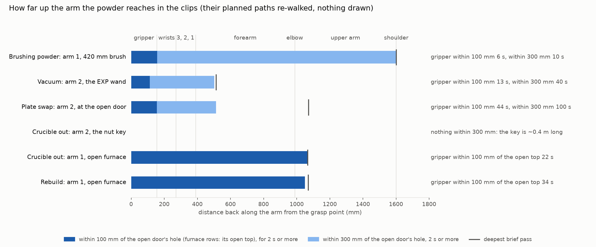

# Keeping the powder at the atomizer: a sleeve for the arm's dirty work (#353)

Sterling on #353 (2026-11-19): "what about the arm getting powder on it, especially considering it's meant to do
other workflows across the plant. Should the cleaning tools have a whole sleeve that the arm fits into, sort of like a
shoulder length glove?"

## The short answer

Yes, cover the arms for the powder work, but don't give each cleaning tool its own sleeve. Give each arm one sleeve
for the whole powder phase of a turnaround, and put the atomizer's own gripper at the end of it. Then the arm goes into
the glove and the glove has its own hand. The hand is the part that really gets dirty, and it never leaves the
atomizer.

- **What the clips show.** The clips already keep the arm out of the chamber with long tools: the 420 mm brush, the
  EXP wand, and a nut key that keeps arm 2 about 0.4 m outside the door. What gets dusty is the gripper and the three
  wrists. They work for 30 to 100 s per clip within 0.3 m of the open door's hole, and the gripper for up to 44 s
  within 0.1 m. The forearm and upper arm only pass by, except while arm 1 brushes, when its whole arm is within
  0.3 m for about 10 s. A sleeve from the gripper's coupling to below the shoulder covers all of that. It is the
  shoulder-length glove, and the measurements say the bottom half of it does most of the work.
- **The gripper is the weak point.** The UR10e's joints are IP54. The 2F-85 is a lower ingress rating with an open
  linkage, so fine powder goes into it, and it is the part that grips the tools' dusty handles. Covering the arm while
  the same gripper drives off to the next workflow would miss the main carrier.
- **The fabric has to be static-dissipative and bonded.** A plain plastic sleeve rubbing on the door's edge next to
  fine aluminium is a charge generator. The MiR250 stands on polyurethane wheels, so nothing grounds it unless the
  station does. The cell's rule already is that everything near the powder is bonded or out of the zone
  ([`atomizer_automation.md`](atomizer_automation.md), "Safety, in the cell"); the sleeve has to follow it.
- **It costs no turnaround time.** Sleeves go on while the machine cools to 400 °C (minutes 0-14 of
  `out/atom/turnaround.json`, when the arms are free) and come off in the gap from minute 53 to 60, while the furnace
  cools until it can be touched. Neither is on the critical path.
- **One set per alloy family**, like the vacuums: Al and Cu residues are kept apart because Al with copper oxide is a
  thermite pair ([`atom_vacuum.md`](atom_vacuum.md)).

## How far up the arm the powder reaches, measured

`atom_sleeve.py` re-walks every clip's planned joint paths, the same ones the renders and the audits used, with nothing
drawn. It measures, vertex by vertex on the arm's own meshes (collide.py's links and the 2F-85 with its D405), how
long each link spends inside the chamber, and within 100 and 300 mm of the open door's 212 × 340 mm hole. Only the
openings count: being near the chamber's closed walls doesn't. The furnace rows use its open top instead, since its
sides are closed. Each frame also gives the distance back along the arm from the grasp point to the farthest point of
the arm in the zone, so a reach of 391 mm means the gripper and all three wrists. The flange is at 155 mm, wrist 1 at
391, the elbow at 989 and the shoulder at 1601.

| Clip, arm | Inside the chamber | Within 100 mm of the open door | Within 300 mm | Reach, ≥ 2 s (deepest pass) |
| --- | --- | --- | --- | --- |
| Brushing the powder down (`atom_container`), arm 1 | gripper 2 s (fingertips, 74 mm) | gripper 6 s, wrist 3 3 s | gripper 10 s, wrists 8-9 s, forearm 5 s, upper arm 10 s | 158 mm at 100; 1601 mm at 300 |
| Vacuuming (`atom_vacuum`), arm 2 | never | gripper 13 s | gripper 40 s, wrists 29-35 s, forearm 29 s | 112 mm at 100; 503 mm at 300 (512) |
| The plate (`atom_plate`), arm 2 | never | gripper 44 s, wrist 3 2 s | gripper 100 s, wrists 60-72 s, forearm 57 s, upper arm 2 s | 155 mm at 100 (989); 512 mm at 300 (1071) |
| Crucible out and in, arm 2 (the nut key) | never | never | never | 0: the key holds the arm 385-570 mm outside the door |
| Crucible out, arm 1, at the open furnace | | gripper 22 s within 100 mm of the open top, upper arm 6 s | | 1065 mm |
| Crucible in, arm 1, at the open furnace | | gripper 34 s, upper arm 4 s | | 1050 mm |

Not counted: `atom_bn` (in the hood, nowhere near the machine), `atom_cameras` and `atom_latch` (the door is shut).
The latch clip has arm 1 inside the chamber and the furnace for about 8 s, but those are its known collision frames:
the forearm through the machine while it swings the loop. They are not work.
`out/atom/sleeve/exposure.json` has every number, per link.

What this says:

1. **The long tools already do most of a glove's job.** No arm goes past the door's plane except arm 1's fingertips
   for 2 s while brushing. This was designed in: the brush's 420 mm handle is there "so the arm stays outside the door
   while the bristles reach the outlet" (`out/atom/bom.md`).
2. **The gripper and the wrists are where the powder is.** Their exposure, within 0.3 m of the hole for tens of
   seconds per clip, comes from what drifts out of the open door and settles, and from the handles they hold.
3. **The forearm and the upper arm get the dust that drifts.** That is brief in these clips, but the fines that
   brushing and vacuuming stir up settle everywhere in the booth. That is what the SOP's 60 s settle and the
   respirator rule are about.
4. **The furnace is a different dirt:** graphite, BN and the skull, not powder. Arm 1's work there is also where the
   cell needs its finest force readings (0.30 N·m on the nut, [`atom_crucible.md`](atom_crucible.md)). So the
   sleeves come off before the crucible work; see "Putting it on and taking it off" below.

## What else carries powder out of the cell

The arm isn't the only carrier, and a sleeve only deals with the arm:

- **The gripper, its pads and the D405's window.** These are the dirtiest parts. The design below keeps one gripper at
  the atomizer.
- **The tools.** They already live at the atomizer, in the vacuum station's rack and on MiR 1's rests. They should stay
  there and never ride to another station.
- **The MiR250's wheels.** The SOP sweeps the floor only outside the yellow lines, so there may be powder inside them.
  The units park inside the tape while they work. The options are a tacky mat at the tape line, or a brush-and-suction
  strip like a boot cleaner, wired to the vacuum. A wheel is easy to check with a white wipe.
- **The MiR's top: the cabinet, the cup carrier and the container's cradle.** Settled dust lands on them. Before a unit
  leaves, the other arm runs the 118EXP's dust brush over the top (the same tool as in `atom_vacuum`). An alternative
  is a hinged lid over the cradle.

## The design: the atomizer's own hand, in its own sleeve

**The hand.** An automatic tool changer between the FT 300-S and the gripper on both arms. Each arm's travelling
2F-85 (with its D405) is parked at the cell while the arm works. The atomizer's own gripper, one per arm, does the
powder steps and never leaves the cell. A gripper with a high ingress rating is worth pricing for that job, as long
as its stroke takes the cell's handles. Most of them are 18 to 40 mm (the brush's grip 18, the wand's fin 30, the
container fork's block 30 × 40), but each has to be checked. Two things need checking with the changer's vendor:

- The D405 is a USB 3 device. It needs a changer module that carries it, or its own camera on the dirty gripper with
  its own cable to the cabinet.
- The changer's coupling faces must never meet powder. The dirty gripper's holster needs a cover over the face that
  waits there.

**The sleeve.** A tube from the dirty gripper's coupling to the upper arm's tube just below the shoulder: about 1.45 m
of the arm's 1.6 m chain.

- **Size.** About 250 mm across, so it clears the elbow's and wrists' housings, with pleated slack at the elbow and the
  wrists for their swing, as commercial robot jackets have.
- **Fabric.** Static-dissipative, bonded at both ends: a conductive cuff on the upper arm, and the changer's ground
  contact at the hand. The bond goes on through the arm and the MiR to the floor point at each station, as
  `atomizer_automation.md` already proposes.
- **Its own fixtures, not the arm's.** Nothing is bolted or drilled into the UR10e. The cuff is elastic, and the hand
  end fixes to the dirty gripper's side of the changer. The sleeve's drag therefore loads the FT 300-S, so re-zero
  (bias) the sensor before each guarded move. The steps that wear the sleeve only need contact detection, at ~10 N,
  not fine torque. The 50 N·m plate joint reacts inside the stack wrench ([`atom_plate.md`](atom_plate.md)).

**The glove stand.** At the tape line, one per arm (two hooks: Al, Cu), a stand holds the sleeve's open end on a hoop
of three fingers, with the dirty gripper in its holster at the far end.

*Putting it on* (minutes 0-14):

1. The MiR parks at the stand's marker.
2. The arm straightens and runs its flange in through the hoop along the sleeve's axis to the gripper. This is a
   linear move. If the arm's own reach runs short, the MiR drives the last part, since the MiR's straight drive is the
   simplest way to slide a straight arm into a tube.
3. The changer locks.
4. The hoop's fingers let the cuff close on the upper arm.
5. The arm lifts the gripper out of the holster.

*Taking it off* (minutes 53-60, before the crucible work):

1. The arm puts the dirty gripper into its holster, and the holster latches it.
2. The changer releases.
3. The hoop's fingers open the cuff, and the arm (or the MiR) backs out.
4. The sleeve stays hanging on the stand, dirty side out.
5. The arm picks up its travelling gripper again.

Nothing on the arm touches the outside of the sleeve. The same holds for people taking off a gown: the outside never
touches what's underneath.

**Between turnarounds.** The sleeves hang on their stand inside the tape. Each one is brushed down with the 118EXP's
dust brush, checked for tears and continuity (the vacuum station's 4-wire meter can take a spring pad on each cuff),
and replaced on a schedule or when it fails. A worn sleeve leaves as the vacuum's liners do: sealed and to the
grounded pail. It is not laundered, because laundering means carrying combustible dust to a washer.

## Why not one sleeve per tool

That would be the literal reading of the question, and it has three problems:

- **Time.** About a dozen tool changes per turnaround, each needing a sleeve put on and taken off, would add a minute
  or two every time (an estimate), instead of two changes in slack time.
- **It covers the wrong thing.** The tools already keep the arm out of the chamber. The gripper that holds them is
  what's dusty, so the gripper should own the sleeve.
- **It still lets the gripper leave.** The 2F-85 would leave the cell with powder in its linkage.

## Alternatives, and why they come second

- **Clean the arm afterwards instead.** The other arm vacuums it down with the dust brush. That is slow, and it can't
  clean the gripper's linkage or the joints' seams. Compressed air is out (the SOP's "never compressed air once powder
  has been in the machine"), and IPA wipes on the arm are wet cleaning near powder. Worth doing anyway for the MiR's
  top, as above.
- **A fitted jacket, left on.** A person changes it on a schedule. It keeps powder out of the joints, but it carries
  the dust to every workflow, which is the problem in the question.
- **A dedicated unit for the atomizer.** This is the cleanest separation, at the cost of a third MiR250 + UR10e. The
  door-side work (arm 2: the vacuum, the plate, the nut) could also be a fixed arm on a pedestal by the door. Worth it
  if the atomizer runs most days; the sleeve is the answer while the units are shared.
- **A boot over the travelling 2F-85**, fingers out, instead of a dirty gripper. It is cheaper, but the pads still
  hold dusty handles and leave with the gripper. If it's used at all, the pads need wiping at the stand.

## What this changes, and what isn't done

- **Not modelled or rendered.** The clips draw bare arms. A sleeve adds about 10-30 mm of radius where the clearances
  are already tight. The plate clip has a fingertip 3 mm into the chamber's face, and the door's hole is 212 mm wide.
  So every powder-phase clip would need its audit re-run with the sleeve's envelope, and the changer adds about 40-60 mm
  to the tool's length (to check against the vendor's drawing).
- **Turnaround:** no change if the sleeve changes fit in minutes 0-14 and 53-60, as above. That is an estimate until
  it's tried.
- **BoM rows to add, unpriced:** two automatic tool changers (one per arm), with tool plates for four grippers; the
  dirty grippers (one per arm, a second set if Cu gets its own); four sleeves per family (two worn, two spare); two
  glove stands with holsters; a tacky mat or a wheel strip at the tape line.
- **Questions for EHS:**
  - the sleeve's fabric and its bonding;
  - whether a UR10e and a MiR250 may work inside the tape at all while dust is settling (they are not rated for
    hazardous locations, and a sleeve doesn't make them so);
  - the MiR's bonding lead.
