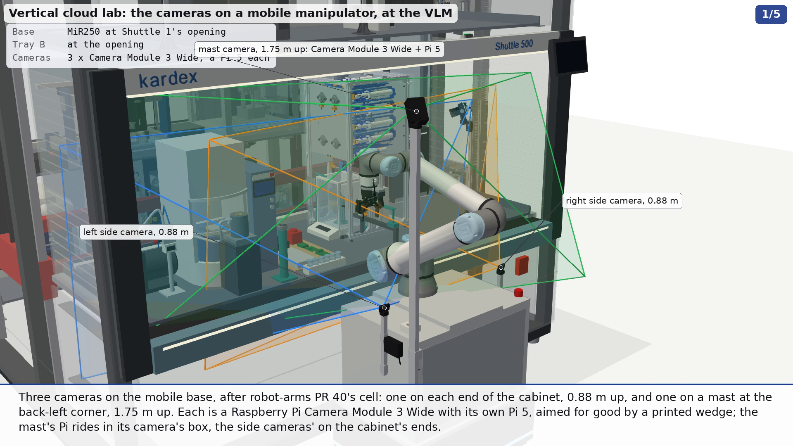
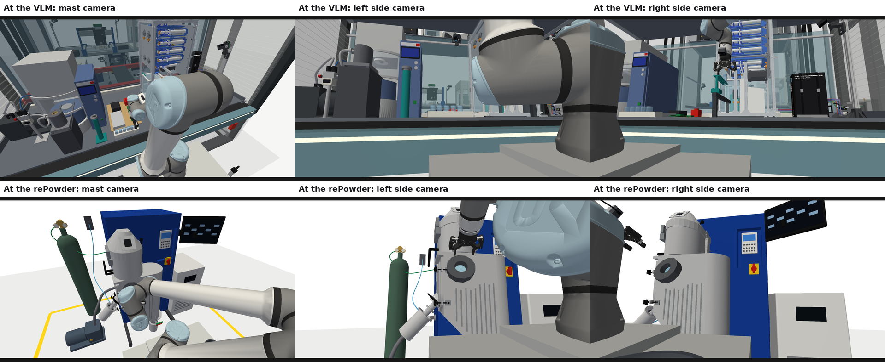
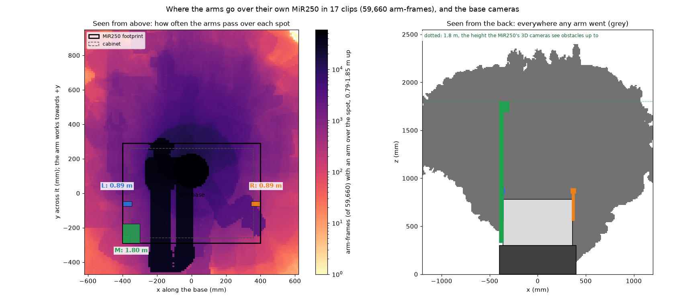

# Cameras on the mobile manipulators: two on the ends, one on a mast (#364)

Sterling, on PR #318 (2026-11-20):

> Keeping in mind also that there would be a gripper camera too. And we should probably add two or three cameras to
> the mobile manipulator (one on either side, on that's situated higher up, maybe on some kind of rod or extrusion,
> mimicking the three cameras described in https://github.com/vertical-cloud-lab/robot-arms/pull/40). Open another PR
> related to that, adding cameras to the mobile base

Each MiR250 + UR10e now carries three cameras. `props.mir250()` draws them (`props.base_camera_parts`), so every clip
with a MiR250 has them from now on. Chapters 2 and 4 are the exception: their moves still go where the mast stands,
so they leave the cameras out until they are re-planned (below). `VLAB_BASE_CAMS=0` or `1` forces the cameras off or
on for any clip. [`base_cameras.py`](../base_cameras.py) shows them and looks through each one, at
the VLM and at the rePowder: `out/mp4/base_cameras.mp4`, 46 s at 1920 × 1080. [`base_cams_sweep.py`](../base_cams_sweep.py)
is the check that placed them, and [`base_cams_audit.py`](../base_cams_audit.py) tallies the clips' collision audits
with them in place.

## What was chosen

All three cameras are the same: a **Raspberry Pi Camera Module 3 Wide** (12 MP Sony IMX708, 102° × 67°, 120°
diagonal), each with **its own Raspberry Pi 5**. That is what robot-arms PR 40 chose, for the same reasons:

- **A Pi per camera.** PR 40's fixture run put each camera's Pi on its own post, so a 200-300 mm cable reaches.
- **Cameras that never move.** PR 40's literature check found new camera positions were the hardest change for a
  learned policy to cope with. Here a printed wedge sets each camera's aim for good.

| | Where | Lens | Aim | What it sees |
|---|---|---|---|---|
| **M**, the mast | a 2040 extrusion, 1.36 m, clamped to the cabinet's left end at the base's back-left corner; a printed box on top (68 wide, 96 tall, 46 deep) holds the camera and its Pi 5 | 1.75 m up (top 1.80 m), at (−336, −201) | forward, 36° down, at (80, 850, 950) | over the arm's shoulder: the whole arm, the station in front of it, and what the gripper holds |
| **L**, left end | a 285 mm 2020 post clamped to the cabinet's left end, 60 mm behind its middle; on its top, PR 40's camera case (49 × 29.5 × 8.6 mm) on a wedge. Its Pi 5 is on the cabinet's end, 30 mm under the top, on a 300 mm cable | 0.88 m up, at (−370, −54) | forward, 8° in and 8° up, at (−250, 800, 1000) | the station's face and the arm's work from low on the left, and the aisle on that side |
| **R**, right end | the same on the right end | 0.88 m up, at (370, −54) | forward, 8° in and 8° up, at (250, 800, 1000) | the same from the right |

MiR frame, mm: origin on the floor at the middle of the base, x along it (800 mm), y across it (580 mm). +y is the side
the arm faces and works on. The arm's base is at (0, 130), on the cabinet's top plate at 800 mm.

- **Everything stays inside the MiR250's footprint** (800 × 580 mm), within 1 mm. Nothing changes in its safety
  fields, or in the docks, aisles and turning circles the lab was laid out with (`setup_lab.py fit`).
- **1.8 m is the top.** The MiR250's two RealSense D435 cameras see obstacles up to 1800 mm high, 1.2 m in front of the
  base (MiR's spec sheet). Nothing on the base should be taller than what the base can see in its path. The folded
  arm stands 1.49 m. A standard 2.03 m (6 ft 8 in) door clears it.
- **The side pair** is 0.74 m apart. It sees the work in front of the arm from 50-60° apart: 52° at 0.75 m in front of
  the base, 59° at 0.65 m. PR 40's pair is 70° apart. Its twin found the error grows about as 1/sin of the angle, so
  this pair should measure 10-20 % worse at the same range. Spots further forward would widen the angle, but they are
  where the arms pass far more often (below).
- **On the left end there is no gap wide enough for a camera at this height.** Two of the clips' fixtures are there:
  - chapter 2's loading tong, which hangs in a sleeve on the cabinet's left end at y = 0 (`alloy_atomize.TONG_AT`);
  - the vial holder at (−300, −150) on the cabinet top (`animate.BUFFER_LOCAL`), which chapters 1-3 and others use.

  Taking them, the open 2F-85 reaches over the end to y = −70 and to y = −80, between 0.83 and 0.9 m up. That leaves
  a 10 mm band, and the camera needs 28 mm. A second pass of audits with the left camera moved back to y = −95 put
  83 of chapter 3's frames in it. At y = −60 only chapter 2's tong grasp touches it (below). That fixture is chapter
  2's alone, and moving its sleeve 30 mm forward would clear it.
- **The side cameras' Pis sit under the cabinet top**, on its ends. A first version had the Pi in a box with each side
  camera, as the mast has. The audits with it in place found the arms' held parts passing through those boxes. One was
  the graphite nut, carried over the crucible's cradle at the cabinet's right end. The bare camera case, about a
  tenth of the volume, is what stands above the top now.

## What each is for that the wrist and bay cameras can't do

The arm already has an Intel RealSense D405 on the wrist (7-50 cm, depth and colour; `ur_arm.CAMERA`). The VLM has a
camera over its bay (`services.add_bay_camera`; a separate PR is moving it to the bay's roof and adding a second one).

| Need | Wrist D405 | Bay camera | Base cameras |
|---|---|---|---|
| **Docking check** before the arm moves | Only by moving the arm to point it at the station's target, which costs a few seconds each time and needs room to move | Only at the VLM | **L and R together see AprilTags on the station's face in front of the arm the moment the base stops**, in 3-D, with the arm still folded. They catch a wrong station, a tray not presented, or something in the way before the arm unfolds. The wrist camera's close look at the target can then refine the pose to the arm's ±0.5 mm |
| **Watching the arm from outside** | Never sees the arm itself, only 7-50 cm in front of the gripper | Sees the arm only at the VLM, from inside the bay | **M sees the whole arm and the station**, elbow included, at every station. L and R see the gripper from low on each side |
| **Safety** (supplementary, not rated) | Blind to the arm's surroundings | Inside the bay only | **L and R watch the aisle at each end of the parked base**, at the height of a person's hands, where the MiR250's scanners (about 0.2 m up) don't look. Detecting a person could pause or slow the arm's program through an ordinary input. None of the three is a safety device: the MiR250's SICK nanoScan3 scanners and the UR10e's own limits remain the safety functions |
| **Recording** | Sees only the work up close | One station | **Every move at every station, from three views that are the same relative to the arm**, whatever station it is at. That is what a learned policy or a calibration needs: PR 40 cites Xie et al., where moving the cameras cut a policy's success from 91.7 % to 45.8 % |

They run on the MiR250's **isolated 24 V output, which stays on through an emergency or protective stop** (MiR250
electrical interface), so they keep recording through the moments that most need a record.

## Where the arms go, and why the cameras are where they are

Nothing on an 800 × 580 mm base is out of a UR10e's 1300 mm reach. So the question was where the arms go in the work
the clips show, not where they could go.

**The sweep.** [`base_cams_sweep.py`](../base_cams_sweep.py) `record` runs a clip as `ARM_AUDIT=1` does (nothing drawn,
every frame's update run). It logs each arm's joints and its base's pose relative to the MiR it rides on, frame by
frame. It ran on the code before the cameras, in a separate worktree, so the cameras could not change the motions it
measured. It covered 17 clips with a MiR250 and an arm, 10 of them with two arms:

- all seven chapters (`alloy_charge`, `alloy_atomize`, `alloy_powder`, `alloy_prep`, `alloy_print`,
  `alloy_characterize`, `alloy_workflow`);
- the 8:00 workflow clip (`animate.py workflow`);
- the bay-camera clip;
- the upkeep clip;
- the seven atomizer clips (`atom_bn`, `atom_container`, `atom_crucible` in and out, `atom_latch`, `atom_plate`,
  `atom_vacuum`).

That makes 59,660 arm-frames. The set-up movie (`setup_lab.py`) was left out: it is the heaviest scene in the lab, and
its arms only unfold at the chargers. The arm's drawn surfaces (links, 2F-85 and D405) were then put through those
frames in the MiR's frame. `out/base_cams/sweep/` has the recordings (`.npz`, one row per frame, and their `.json`).

**What it found:**

- **The arms pass over every part of the cabinet's rim, from about 1.0 m up to 2.0 m.**
  - The folded arm's elbow sticks out 170 mm past the base's back edge at 1.29 m, and its joint swings round a 0.53 m
    radius when the base joint turns.
  - Reaching sideways, the forearm passes over the ends.
  - The atomizer clips reach the cabinet top's corners for the plate tools, the crucible's cradle and the cup carrier.
- **No spot for a tall mast is clear of every clip's arm.** The scan tried 16 mast spots: both back corners, three
  spots along each end and the front corners, each 1.6 m and 1.8 m tall. The arms came within about 20 mm least at
  the back-left corner at 1.8 m: 539 of the 59,660 arm-frames. The back-right corner, the first guess, had 2,349,
  almost all in the two crucible clips, whose cradle is on that side.
- **Low on the ends, just behind the middle, is the quietest place for the side cameras.** The scan tried 42 spots
  and heights. At y = −60 with the camera under about 0.9 m, the arms came within about 20 mm in 5 frames on the right
  and 74 on the left. Further forward, the arm's upper arm comes close: at the shoulder it sweeps a 0.28 m radius round
  the base, 0.9-1.07 m up. Higher up, the forearm passes over the ends.

**With the cameras in place.** `base_cams_sweep.py conflicts` counts exactly (4 mm voxels, every arm-frame) the frames
in which a point of an arm's surface came within 0 mm (touching) or 25 mm of each camera part, with the motions as
they were before the cameras. `out/base_cams/conflicts.json` has them:

| Clip | arm-frames | mast | mast's box | L post | L case | R post | R case |
|---|---|---|---|---|---|---|---|
| `alloy_atomize` | 4,606 | 39 / 50 |  | 8 / 19 | 17 / 32 |  |  |
| `alloy_characterize` | 3,198 | 51 / 81 | 10 / 14 |  |  |  | 0 / 6 |
| `alloy_charge` | 2,699 | 15 / 32 |  | 10 / 23 | 15 / 24 |  |  |
| `alloy_powder` | 2,625 | 29 / 131 |  | 0 / 66 | 0 / 100 |  |  |
| `alloy_prep` | 7,078 | 65 / 102 |  |  | 0 / 1 |  |  |
| `alloy_print` | 3,410 | 16 / 24 | 2 / 3 |  |  |  |  |
| `alloy_workflow` | 10,498 | 179 / 549 | 0 / 3 |  |  |  |  |
| `atom_bn` | 2,250 | 3 / 4 |  |  |  |  | 0 / 10 |
| `atom_container` | 1,152 | 3 / 10 |  |  |  |  |  |
| `atom_crucible_in` | 4,008 | 6 / 8 |  |  |  |  |  |
| `atom_crucible_out` | 3,040 | 8 / 17 | 3 / 10 |  |  |  |  |
| `atom_latch` | 2,520 | 5 / 18 |  |  |  |  |  |
| `atom_plate` | 4,292 | 0 / 1 |  |  |  |  |  |
| `atom_vacuum` | 3,564 | 1 / 7 |  |  |  |  |  |
| **all 17** | **59,660** | **420 / 1034** | **15 / 30** | **18 / 108** | **32 / 157** | **0 / 0** | **0 / 16** |

Each cell gives the frames touching, then the frames within 25 mm. The motions are as recorded before the
cameras, so a joint move that now goes round a camera still counts here. The lenses and cables are left out:
the cable runs in the extrusion's slot, and the lens touches only where its case does. No other clip's arm
comes within 25 mm of a camera (3 clips).

**What happens to them.** Joint moves in the clips are planned round whatever is drawn (`robot.py`, `collide.py`), so a
move that would swing the elbow through the mast now goes round it. The planner now tries once more before it
falls back to the straight joint line: three times as long, from another seed. In the first pass of audits, a
2,500-iteration search missed the way round the mast in chapter 3. Straight-line moves are not re-planned, and the
sweep doesn't include what the gripper holds. So the real check is the clips' own collision audit with the cameras in
place. Each clip ran as `ARM_AUDIT=1 ARM_AUDIT_TAG=basecams` (nothing rendered, round 11's strict rules, at the clip's
own frame rate, 15 fps here), writing `out/collisions/<clip>_basecams.json`. `base_cams_audit.py` reads them, and
`out/collisions/basecams_summary.json` has the result:

| Clip | frames (15 fps) | touching a camera part | in collision with the cameras: arm (all) | the same without them (`VLAB_BASE_CAMS=0`): arm (all) | the committed audit: arm (all) |
|---|---|---|---|---|---|
| `alloy_charge` | 2,699 | **0** | 1 (1) | 0 (0) | 0 (0) at 12 fps |
| `alloy_atomize` | 2,303 | **45** | 184 (375) | 139 (330) | 0 (0) at 6 fps |
| `alloy_powder` | 2,625 | **0** | 0 (0) | not run | 0 (0) at 15 fps |
| `alloy_prep` | 3,539 | **52** | 361 (489) | 4 (143) | 3 (96) at 10 fps |
| `alloy_print` | 3,410 | **0** | 0 (0) | not run | 1 (1) at 15 fps |
| `alloy_characterize` | 3,198 | **0** | 0 (0) | not run | 0 (0) at 15 fps |
| `alloy_workflow` | 5,249 | **0** | 3 (4) | 2 (3) | 1 (1) at 12 fps |
| `vlm_workflow` | 1,446 | **0** | 13 (13) | 13 (13) | older format |
| `bay_camera` | 337 | **0** | 3 (3) | not run | 21 (21) at 6 fps |
| `upkeep_clip` | 1,491 | **0** | 0 (0) | not run | 0 (0) at 15 fps |
| `atom_bn` | 2,250 | **0** | 0 (0) | not run | 0 (0) at 10 fps |
| `atom_container` | 576 | **0** | 0 (0) | not run | 0 (0) at 15 fps |
| `atom_crucible_in` | 2,004 | **0** | 0 (0) | not run | 0 (0) at 15 fps |
| `atom_crucible_out` | 1,520 | **0** | 0 (0) | not run | 0 (0) at 10 fps |
| `atom_latch` | 1,260 | **0** | 0 (0) | not run | 0 (0) at 15 fps |
| `atom_plate` | 2,146 | **0** | 0 (0) | not run | 0 (0) at 15 fps |
| `atom_vacuum` | 1,782 | **0** | 1 (1) | not run | 1 (1) at 15 fps |

How to read the table:

- **The planner went round the mast.** In 420 frames across 14 clips, the motions recorded before the cameras passed
  through the mast. With the mast drawn, every such joint move was re-planned round it, except in chapters 2 and 4.
- **15 of the 17 clips are untouched.** No arm, gripper or held part touches a camera part in any of their frames.
  Their collisions with the cameras in place are the ones they had without them, plus two that come from paths
  re-planned round the cameras:
  - chapter 1: wrist 2 grazes the VLM's access table for 1 frame;
  - chapter 7: one extra frame at the depowdering box.

  The others are already in the committed audits: the 8:00 clip's vial into the CubXL (13 frames), the bay camera
  clip's vial in its rack (3), the vacuum clip's tool rack (1).
- **Chapters 2 and 4 hit the cameras**, and they now leave the cameras out unless `VLAB_BASE_CAMS=1`
  (`props.BASE_CAMS_OPT_OUT`).
  - **Chapter 2** (`alloy_atomize.py`) comes to 45 frames. In 16 of them the open gripper takes or returns the loading
    tong at its sleeve on the cabinet's left end, 60 mm from the left camera. In the other 29 a finger brushes the mast
    as the gripper carries the tong over the base's back-left corner (to x = −400, y = −280, at 1.13-1.28 m).
    Chapter 2's other 139 frames are its own: they are there without the cameras too. Round 13 found them when #353
    turned the rePowder's lid, and chapter 2 needs re-planning for that anyway.
  - **Chapter 4** (`alloy_prep.py`) goes from 4 frames to 361. Polishing at tray F, the arm flips its elbow and swings
    the tool from the polisher, on the right, round the base's back-left corner to x = −861 mm. The forearm passes
    where the mast stands. With the mast there, the chapter's own search for an IK branch with clear lines finds none,
    and the moves after it fall back to straight lines through the furnace, the polisher and the cabinet.

  Both are fixable in those chapters: swing the arm round the front of the base, not its back-left corner; carry the
  tong over the cabinet's middle; hang its sleeve 30 mm further forward. Once a chapter's audit with
  `VLAB_BASE_CAMS=1` is clean, take it off the list. Their audits without the cameras are what they render now:
  139 frames and 4, as before.

## The checks the hand-off asked for

- **The arm's workspace:** above, clip by clip.
- **The VLM's 996 mm opening** (833 mm to 1829 mm over the floor, the header to 1924 mm):
  - The base parks 80 mm off the VLM's face. The mast's lens is 0.57 m back from the face, at 1.75 m, under the
    header's underside at 1.83 m.
  - Its view reaches the back of a presented tray under the header: the line from the lens to the tray's back edge
    crosses the face 0.42 m below the header.
  - The side lenses, at 0.88 m, are 47 mm over the access table (833 mm). They see the tray's contents from the side,
    almost edge-on, and the arm reaching through the opening.
  - No camera part comes near the opening: the nearest, the side cameras' cases, are 0.42 m back from the face.
- **The bays:**
  - **The VLM's picking bay:** its camera looks down at the presented tray from inside the bay. The base cameras look
    in from outside, 0.4-0.6 m in front of the face, and never enter it.
  - **The docks and chargers on the floor:** the base's footprint is unchanged, and so are its docks, aisles and
    pivots. At 1.80 m it passes under the cable trays at 2.8 m.
- **The rePowder:**
  - At the front dock (`atom_base.PARK["front"]`), the base stands 350 mm off the machine's front face. The mast is
    at its back-left corner, 0.8-0.9 m from the face, out of reach of the lid, the latch and the door.
  - At the clips' other spots the mast is behind the base, away from the machine.
  - The second arm in the two-arm clips can reach the first base's cameras. The two-arm audits above include that
    pairing.
- **The clip:** [`base_cameras.py`](../base_cameras.py) at the VLM (the bay-camera clip's vial, from the rack to the
  doser's shuttle) and at the rePowder (the wrist camera brought to the viewport). Its own audit (`ARM_AUDIT=1`, 15
  fps) found 0 of 289 and 0 of 240 frames in collision (`out/collisions/base_cameras_*_15fps.json`). The 1080p render's
  inline audit, at 10 fps, found the same.

## Compute, power and network

| | Choice | Why |
|---|---|---|
| Compute | a Pi 5 (4 GB) for each camera: in the mast camera's box; on the cabinet's ends, under the top, for the side cameras (300 mm cables) | as PR 40's fixture run. One Pi for both side cameras would need two ~0.8 m cables round the cabinet. Raspberry Pi sells 500 mm at most, and PR 40 found no published build on even 500 mm (Edison q4); a Raspberry Pi engineer calls ribbon length "a known source of intermittent problems" (picamera2#905) |
| Not the MiR's own PC | | it runs MiR's software. A top module talks to it over the REST API and Modbus on the top-module Ethernet (10/100 Mbit/s); it doesn't host user programs. The same goes for the UR control box |
| Power | the MiR250's **isolated 24 V** (22.8-25.2 V, 2 A, stays on in an emergency or protective stop) into a **4-port 802.3at PoE switch with a 12-54 V DC input** in the cabinet (Planet ISW-504PT class: it boosts 24 V to PoE, 90 W budget at 24 V), and a **PoE HAT** on each Pi (Waveshare PoE HAT (H) for the Pi 5: 802.3af/at, 5 V 5 A) | one cable to each Pi carries power and data. The 48 V outputs (10 A combined) are left for the arm, whose 615 W peak they can't carry anyway (`notes/warehouse.md`) |
| Budget | 3 × 5-8 W (a Pi 5 encoding its own stream, the camera, the HAT's losses), plus about 4 W for the switch: **19-28 W**, or 0.8-1.2 A of the 2 A | about 1.5 % of the MiR250's 1.63 kWh battery an hour, 13 % over an 8 h shift |
| Network | the switch's fourth port to the UR control box and the MiR's top-module port; the streams to the lab over the base's own Wi-Fi client | three streams of 720p at 15 fps come to 6-12 Mbit/s. Full-resolution recordings stay on each Pi and are uploaded at the charger |
| Clock | NTP from the lab's server on all three Pis and the UR control box; PTP if a moving arm must be triangulated | PR 40: on one Pi, software sync aligns frames to tens of µs. Across Pi 5s, PTP on a gigabit switch gave 5-25 µs (mocap-toolkit), and NTP over wired Ethernet held −0.16 to +0.77 ms (Edison q4) |

As PR 40 found: **lock the focus**, since the Camera Module 3 refocuses by moving its lens, which changes its
calibration. **Set exposure and white balance by hand**.

## Costs (per base, US$, November 2026)

| Item | Qty | Each | Total | Source |
|---|---|---|---|---|
| Raspberry Pi Camera Module 3 Wide (SC0874) | 3 | 38.50 | 115.50 | Adafruit (5658); $35 at launch (Tom's Hardware) |
| Raspberry Pi 5, 4 GB | 3 | 85 | 255 | Raspberry Pi's price since February 2026 (Tom's Hardware, TechSpot) |
| Raspberry Pi Active Cooler | 3 | 5 | 15 | Raspberry Pi's list price |
| Waveshare PoE HAT (H) for Pi 5 | 3 | 21.99 | 66 | waveshare.com |
| microSD, 128 GB, A2 | 3 | 15 | 45 | estimate |
| Pi 5 camera cable, 200 mm (mast) and 300 mm (sides) | 3 | 2 | 6 | estimate |
| 4-port PoE+ switch, 12-54 V DC in (Planet ISW-504PT or similar) | 1 | 150 | 150 | a comparable 4-port, 12-48 V DC listing at $149.99 (Newegg); Planet's own price not found |
| Cable from the MiR's power connector (M23, Phoenix Contact 1619775), 2 A fuse | 1 | 40 | 40 | estimate |
| Cat 6 leads, 0.5-2 m | 4 | 5 | 20 | estimate |
| 2040 extrusion, 1.4 m; 2020, 2 × 0.3 m | | | 45 | 2040 V-slot $26/m (3D Printing Canada); 2020 about half |
| T-nuts, screws, printed box, cases, wedges and clamps (PETG, about 0.3 kg) | | | 40 | estimate |
| **Per base** | | | **about $800** | |

Two bases: about $1,600, plus a spare camera and Pi.

## Open questions

1. **Re-plan chapters 2 and 4 with the cameras in the scene**, then take them off `props.BASE_CAMS_OPT_OUT`.
   - Chapter 4: swing round the front of the base, not the back-left corner.
   - Chapter 2: carry the tong over the cabinet's middle, and hang its sleeve 30 mm further forward.

   Chapter 2 needs re-planning anyway for #353's turned lid. In the scan, chapter 4's arm passed the back-right
   corner far less (12 frames against 78), chapter 2's as often (43 and 43). But the crucible clips' arms pass
   there in about 2,100 frames, so moving the mast would only trade them for chapter 4.
2. **Does MiR's router pass top-module Ethernet traffic to the facility Wi-Fi?** If not, the base needs its own Wi-Fi
   client for the streams. MiR's documentation says only that the top-module port carries the REST API and Modbus.
3. **The mast's sway.** The mast is a 1.36 m 2040 cantilever with a 0.2 kg box on top, on a base that brakes at
   0.3 m/s² (more in a protective stop). Measure the sway on the real base. A brace to the cabinet's top would stiffen
   it, but the brace would stand where the arm reaches for the cup carrier.
4. **Global shutter for the side pair?** The Camera Module 3 has a rolling shutter. Triangulating a moving gripper may
   want Raspberry Pi's Global Shutter Camera (IMX296, 1.6 MP, C/CS lens) instead. That trades resolution for
   undistorted motion.
5. **A rated safety camera** would be needed for camera-based protective fields round the arm (a 3-D safety camera
   such as SICK's safeVisionary2). That only matters if UR's force limits and the MiR's scanners aren't enough for how
   close people work. None of these three can be one.
6. **The security-camera PR**, also from Sterling's comment, may suggest PoE IP cameras with built-in T/RH sensing
   for the mast. The Pi cameras stay here, as PR 40 has them.
7. **AprilTags on the station faces** for the side pair's docking check aren't drawn anywhere yet. The lab's targets
   (`warehouse.tag`, on posts beyond each dock's end, at 0.9 m) are for the wrist camera and are outside L's and R's
   pictures.
8. **The set-up movie** wasn't swept or audited with the cameras: its arms unfold only at the chargers.

## Sources

- Sterling's request: [PR #318, 2026-11-20](https://github.com/vertical-cloud-lab/byu-vcl/pull/318#issuecomment-7046840630);
  hand-off: #364.
- Robot-arms PR 40: [the PR](https://github.com/vertical-cloud-lab/robot-arms/pull/40). Its
  `docs/issue-24/camera-fixtures/README.md` and `docs/issue-24/camera-literature/README.md` are on the branch
  `claude/issue-24-20261021-2053`. The literature it cites, its Edison answers, and Xie et al.
  ([arXiv:2307.03659](https://arxiv.org/abs/2307.03659)) are quoted from there.
- MiR250 electrical interface (power pins, the isolated 24 V through stops, the top-module Ethernet):
  [MiR250 user guide, electrical interfaces](https://mirsupport.netlify.app/manuals/mir250/manual/product_presentation/electrical_interfaces_mir250),
  a copy of MiR's [MiR250 HW 2.0 documentation](https://mobile-industrial-robots.com/product-documents/mir250-hw-20-sw-2-v1).
- MiR250 sensors (two SICK nanoScan3; two RealSense D435 seeing up to 1800 mm at 1200 mm):
  [MiR250 spec sheet, Hartfiel's copy](https://www.hartfiel.com/wp-content/uploads/2024/04/MiR250-Specs.pdf). The
  footprint (800 × 580 × 300 mm) and battery are as `props.MIR` and `upkeep.MIR_KWH` have them.
- Camera Module 3 Wide: [Raspberry Pi](https://www.raspberrypi.com/products/camera-module-3/) (120° diagonal, 12 MP,
  4608 × 2592). The 102° × 67° is from Raspberry Pi's camera documentation, as `services.py` cites it.
  [Adafruit 5658](https://www.adafruit.com/product/5658) ($38.50);
  [Tom's Hardware's review](https://www.tomshardware.com/reviews/raspberry-pi-camera-module-v3) ($35 Wide at launch).
- Raspberry Pi 5 price:
  [Tom's Hardware](https://www.tomshardware.com/raspberry-pi/raspberry-pi-5-price-increases-drastically-as-ai-shortage-bites-16gb-version-now-usd205-second-price-increase-in-three-months-over-70-percent-more-expensive-than-original-msrp)
  and [TechSpot](https://www.techspot.com/news/111165-raspberry-pi-prices-soar-amid-ai-memory-shortage.html) (4 GB: $85
  from February 2026).
- PoE: [Waveshare PoE HAT (H)](https://www.waveshare.com/poe-hat-h.htm) ($21.99, 802.3af/at, 5 V 5 A);
  [Planet ISW-504PT](https://planet.com.tw/en/product/isw-504pt-v4) (12-54 V DC in, 4 × 802.3at, 90 W at 24 V);
  [a 4-port, 12-48 V DC PoE+ listing](https://www.newegg.com/p/0XP-06T7-007Y7) ($149.99).
- 2040 V-slot: [3D Printing Canada](https://3dprintingcanada.com/products/2040-4020-v-slot-extrusion-20mm-x-40mm-x-2-5m)
  ($65.95 for 2.5 m).
- UR10e: 1300 mm reach and 615 W peak ([UR's data sheet](https://www.universal-robots.com/manuals/latest/en/datasheets/ur10e/),
  as `notes/warehouse.md` cites it).
