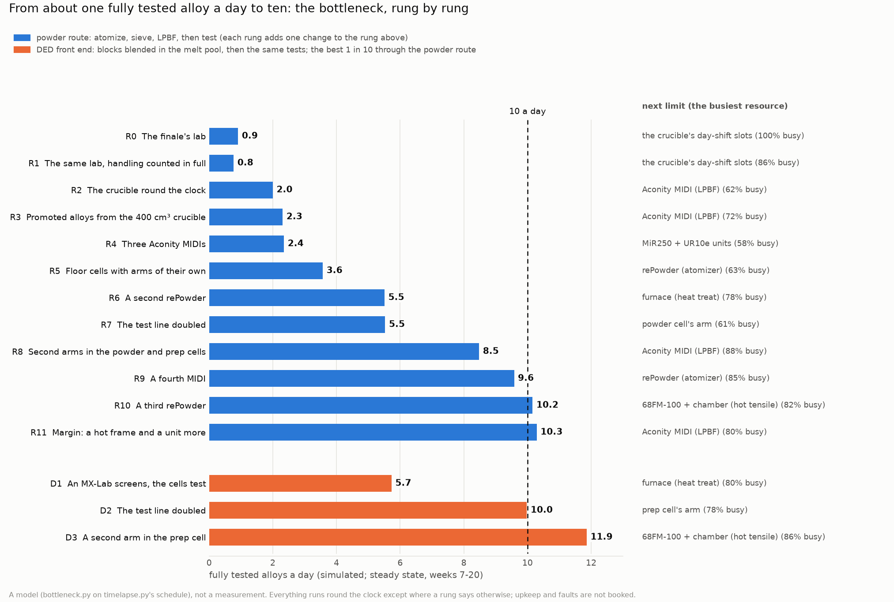
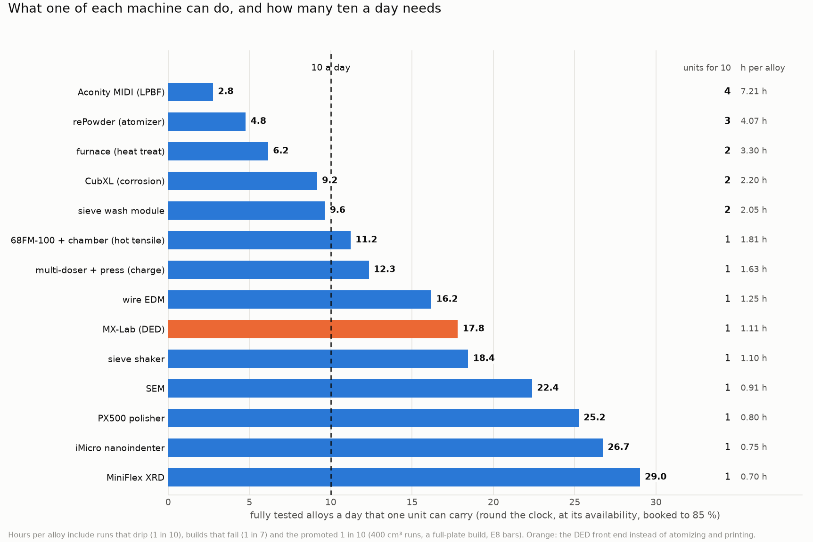
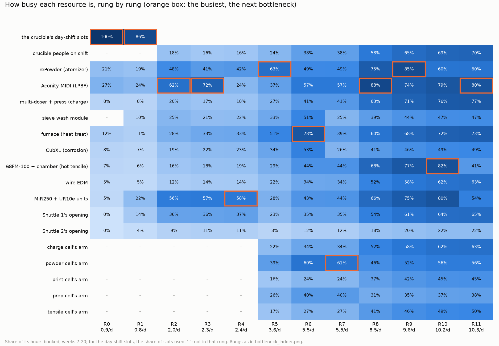

# Bottlenecks: from about one fully tested alloy a day to ten (`bottleneck.py`)

Sterling, on PR #318 (2026-11-08): "Approx. one full alloy tested per day was the estimation. How can we get that up
to 10/day? What would be required? For example, each atomizer run could probably be completed within 2-4 hours, which
lends itself to 6-12 unique compositions per day, assuming only one unit is available. Similarly for the other
machines (e.g., LPBF, DED)."

```bash
python3 bottleneck.py          # everything: out/bottleneck.json, out/bottleneck_ladder.png,
                               #   out/bottleneck_capacity.png, out/bottleneck_utilization.png (about 10 s)
python3 bottleneck.py ladder   # print the ladder only
```

Everything here is a model built on the finale's schedule (`timelapse.py`, [notes/timelapse.md](timelapse.md)), not a
measurement. The step times are the finale's, each with its source or marked as assumed. What this file adds is
listed under [Assumed](#assumed).

## The short answer

**Why "about one a day".** It is the finale's schedule: 324 alloys fully tested a year with no upkeep, 304 with it.
At steady state that is 0.91 a day.
- **No machine sets that figure; the crucible's staffing does.** A run starts only when a person is on shift to
  change the crucible: three slots a weekday, none on Friday afternoon, 14 runs a week. The rePowder itself is busy
  21 % of the time.
- **DAL's FLAIME proposal plans the same way:** "up to 3 compositions/day M–F and 1 on Saturday (≤16/week)"
  (`genesis-mission-proposal/flaime-genesis-proposal.tex`, the throughput derivation).
- **Each fully tested alloy costs 2.2 atomizer runs, not one:**
  - 1 in 10 runs drips and is repeated;
  - 1 in 7 screening builds fails;
  - 1 in 10 tested alloys is promoted to a full plate, and its 440 g of fines takes 8 more 300 g runs. Those 8 runs
    are 40 % of all the atomizer's runs.

**Ten a day by the powder route (rung R11)** needs all of these together. The schedule then gives **10.3 a day**, with
a median of 28 h from the atomizer to fully tested.
- **The crucible round the clock:** a crucible-trained person on every shift, 7 days a week. That is 168 h a week of
  cover (4.2 FTE), and they spend 70 % of it at the crucible. The alternative is automating the crucible
  ([notes/crucible_automation.md](crucible_automation.md)).
- **3 rePowders** at the finale's 2.5 h a run, about 16.8 runs a day between them.
- **4 Aconity MIDIs**, each with the 55 mm kit.
- **Promoted alloys from 684 g charges** (the 400 cm³ crucible), so 3 more runs instead of 8. Buying that powder would
  be the other way.
- **Five floor cells, each with its own fixed arm (7 cobots in all):** charge; atomize, sieve and wash; print;
  sample prep; tensile. The Shuttles keep only the measuring instruments, and **3 MiR250 + UR10e** units carry between
  cells and Shuttles.
- **Doubled where the test line needs it:**
  - 2 furnaces, or 2 alloys a load;
  - 2 CubXLs;
  - 2 sieve-wash modules;
  - 2 frames with a hot chamber (the second is for margin).
- **People:** about 208 h a week, 5.2 FTE before leave, sickness and training ([People](#people)). At one a day it is
  31 h a week.

**Or a DED front end (rung D3): 11.9 a day for much less hardware.**
- **One InssTek MX-Lab** prints small blocks, one composition each, blended from its feeders. That replaces the
  atomizer and the printer for screening.
- **The best 1 in 10 still goes through the powder route,** on the lab's single rePowder and MIDI as they are now, on
  a day shift.
- **The catch:** DED solidifies at roughly 10²–10⁴ K/s against LPBF's ~10⁶ K/s. For Al alloys designed around
  LPBF's supersaturation, a DED block can rank them wrongly ([The DED front end](#the-ded-front-end)).

**Past ten a day there is no single bottleneck left.** At R11, four resources are 70–80 % busy:
- the MIDIs (80 %);
- the charge station (77 %);
- the furnaces (73 %);
- the crucible person (70 %).

Shuttle 1's opening is next at 65 %. A fifth MIDI on top of R11 gives 10.9 a day; going further needs several
additions at once.



## Per machine: what one unit can do

[`out/bottleneck_capacity.png`](../out/bottleneck_capacity.png). **"Per unit, a day"** below means:
- fully tested alloys a day;
- one unit running round the clock, at its availability (from `out/upkeep_model.json`);
- booked to 85 % of its hours (`u_max`, assumed: past that, queues in a schedule this varied grow without bound).

Hours per alloy include the runs that drip, the builds that fail and the promoted alloys' share.



### The atomizer: Sterling's 2-4 h

**Runs a day, one rePowder round the clock:**

| Cycle | Ceiling (24 h ÷ cycle) | At 95 % up and 85 % booked |
|---|---|---|
| 2.0 h | 12 | 9.7 |
| 2.5 h (the finale's: 1 h crucible, 1 h run, 0.5 h cooling) | 9.6 | 7.8 |
| 3.0 h | 8 | 6.5 |
| 4.0 h | 6 | 4.9 |

So Sterling's "6–12 compositions per day" is the ceiling. Two things then cut it:
- **Losses:** each run yields 0.9 × 6/7 = 0.77 fully tested alloys, since runs drip and builds fail.
- **Promoted alloys** take their share of the runs.

**Fully tested alloys a day per rePowder** (`sensitivity()`), by how a promoted alloy gets its 440 g of fines. The
number after the slash is the rePowders ten a day needs.

| Cycle | 300 g runs, 8 more (the finale's policy) | 684 g runs, 3 more (400 cm³) | Bought powder |
|---|---|---|---|
| 2.0 h | 4.4 / 3 | 6.0 / 2 | 7.5 / 2 |
| 2.5 h | 3.6 / 3 | 4.8 / 3 | 6.0 / 2 |
| 3.0 h | 3.0 / 4 | 4.0 / 3 | 5.0 / 3 |
| 4.0 h | 2.2 / 5 | 3.0 / 4 | 3.75 / 3 |

**AMAZEMET's own figure argues for the slow end.** The [rePowder FAQ](https://www.amazemet.com/repowder) gives
"2–4 hours for full material change, including purging and cleaning". AMAZEMET also says "several atomization
processes … for different alloys on different ultrasonic systems in the course of one day". It publishes no runs a
day.
- If 2–4 h is the change alone, a run with a new composition every time is nearer 3–5 h than 2–2.5 h. That means 3–4
  rePowders for ten a day, not 2.
- Measuring the real cycle on the lab's own machine, from one composition to the next, is the most valuable single
  number here.

### LPBF: the Aconity MIDI

| Option | Hours per alloy | Per unit, a day | MIDIs for 10 |
|---|---|---|---|
| As modelled: 5.0 h a screening build (inerting 0.5, build 3, cooling 0.5, unloading and powder change 1) | 7.2 | 2.8 | 4 |
| A second process chamber: 3.75 h on the machine (assumed) | 5.75 | 3.5 | 3 |
| That, plus a shorter screening build (2 mm specimens, 1.5 h of scanning): 2.25 h | 4.0 | 5.0 | 3 (2.01) |

- Hours per alloy include 7/6 of a build, since 1 in 7 fails, plus the promoted alloys' 8 h full plates.
- **The second chamber exists.** Aconity sells "a fully interchangeable processing chamber" for the MIDI, so the next
  build is set up while one runs
  ([3Dnatives](https://www.3dnatives.com/3d-materials/en/3d-printers/aconity-midi-plus/),
  [CMU](https://engineering.cmu.edu/mfi/facilities/equipment-details/aconity-midi.html); AMAZEMET's
  [MIDI page](https://www.amazemet.com/aconity-midi-lpbf-system-in-amazemets-rd-facility) says "exchangeable process
  chamber").
  - Whether a swapped chamber goes in already inerted, and how long a swap takes, are questions for Aconity.
  - Purge time isn't published.
- **Several compositions in one build** would need multi-material recoating. Aerosint's selective powder deposition
  ran on Aconity machines (up to 3 powders a layer). But Desktop Metal bought Aerosint in 2021, and Schaeffler bought
  the technology in 2023 for its own machines, so whether it can still be had for a MIDI is unconfirmed. Not
  modelled.

### DED: the InssTek MX-Lab

| Option | Hours per alloy | Per unit, a day | MX-Labs for 10 |
|---|---|---|---|
| 8 blocks of about 1 cm³ a plate, 8 h a plate (the datasheet's 1.5 cm³/h) | 1.1 | 17.8 | 1 |
| 16 blocks a plate, 14 h | 0.97 | 20.4 | 1 |
| 25 bulk 1 cm³ samples in 5 h, as Islam, Nelaturu & Thoma did on a LENS with 4 hoppers | 0.27 | 74 | 1 |

- **Sources:**
  - **MX-Lab datasheet (Rev. 3, 2020):** 300 W, 150 × 150 × 150 mm, 1.5 ± 0.2 cm³/h, up to 6 feeders
    ([PDF](https://dipaul.ru/upload/iblock/c19/74xw2oocyxtfsb060f664hnz00l0ya8i.pdf)).
    [3Dnatives (2024)](https://www.3dnatives.com/en/insstek-alloy-research-mx-lab-ded-3d-printer-051120244/) gives
    500 W at most.
  - **Islam, Nelaturu & Thoma,** [APL 119, 231901 (2021)](https://par.nsf.gov/servlets/purl/10313091).
  - **Single beads go far faster:** Thoma et al. made about 1,000 compositions a day as single beads
    ([Metals 13, 1317, 2023](https://doi.org/10.3390/met13071317)). Beads can't be tensile tested.
  - **HT-READ:** 16 pre-mixed compositions per build from a 16-vial feeder, one vial at a time
    ([Acta Mater. 221, 117352](https://arxiv.org/pdf/2102.06180)).
- **One MX-Lab is enough for ten a day,** so the limit moves to the test line (D1-D3).
- **The datasheet's 1.5 cm³/h is for Ti-6Al-4V.** Al reflects far more and conducts heat away faster, so whether
  300-500 W deposits dense Al blocks is the first question for InssTek, ideally answered with a demo build.

### The test line and the measuring instruments

At R5's settings, one unit of each:

| Machine | Hours per alloy | Per unit, a day | Units for 10 |
|---|---|---|---|
| Furnace: a 3 h heat treatment per alloy (0.3 h per alloy for the promoted alloys' full plates) | 3.3 | 6.2 | 2 |
| CubXL: 2 spots at 67 min each | 2.2 | 9.2 | 2 |
| Sieve-wash module: 1.4 h after each sieving (notes/alloy_print.md) | 2.05 | 9.6 | 2 |
| 68FM-100 with the 3119-608 chamber: hot test, plus the promoted alloys' E8 bars | 1.81 | 11.2 | 1 (82 % busy at 10 a day) |
| Charge station (doser, HR-202i, vacuum press) | 1.63 | 12.3 | 1 (77 % busy) |
| Wire EDM | 1.25 | 16.2 | 1 |
| Sieve shaker | 1.10 | 18.4 | 1 |
| SEM, powder and section | 0.91 | 22.4 | 1 |
| PX500 | 0.80 | 25.2 | 1 |
| iMicro | 0.75 | 26.7 | 1 |
| MiniFlex | 0.70 | 29.0 | 1 |
| MX400, zwickiLine, S2 PUMA, VHX, HM-220, Carvera, Mastersizer, PIP | 0.25-0.60 | 34-82 | 1 each |

- **The characterization instruments are not the problem.** At ten a day, one of each is under half busy.
- **Heat treatment is the cheapest double.** A furnace that takes two alloys' bars at once does it, if they share a
  schedule, which a screening heat treatment within an alloy family does.

### The hands: the arms and the Shuttles' openings

**If the MiR250 + UR10e units do every carry and every attended step at the trays,** as the chapters show:
- **13.3 unit-hours per fully tested alloy.** Ten a day needs **7 units**.
- **Shuttle 1's opening is held 4.3 h per alloy,** about three openings' worth. The charge station on tray B holds it
  0.8 h a run while the arm doses and presses.
- **The finale counted 6 min of a unit per step,** so it never saw this ([R1](#the-ladder)).

**With the cells (R5 onwards):**
- the mobile units carry for **3.8 h** per alloy, so 2-3 units are enough;
- Shuttle 1's opening is held **1.5 h** per alloy, so one opening is enough;
- the fixed arms work 1.1-2.6 h per alloy each. The powder cell needs two, and the prep cell needs a second near ten
  a day.

**Kardex itself is quick enough.** Its configured spec sheet gives:
- 20 s to retrieve a tray, 38 s for a full store-and-retrieve cycle, 45 s at worst;
- 94 trays an hour;
- note that the units ship set to 70 % speed
  ([StoreMoreStore](https://products.storemorestore.com/hubfs/StoreMoreStore/Kardex-Vertical-Lift-Module/VLM-Option-1-96x34-Light-Specification-Sheet.pdf)).

What holds an opening is the arm working at the presented tray, not the lift.

## The ladder

Each rung is the one above it plus one change. Each is simulated for 20 weeks and measured over weeks 7-20
(`LADDER`, `run_ladder()`).
- **"Capacity"** is `capacity()`'s analytic ceiling with that rung's machines.
- **"Next limit"** is the busiest resource in the simulation.

From R8 up the two agree within 7 %. Below R8 the simulation is 10-29 % lower: the arms, the openings and the
crucible's slots have to be free at the same moment, and a step waits whenever one isn't.

| Rung | Change | Fully tested a day | Capacity | Next limit (busy) | What it takes |
|---|---|---|---|---|---|
| R0 | The finale's lab, as it models it | **0.91** | 0.92 | the crucible's day-shift slots (100 %) | nothing |
| R1 | The same, with the arms' and openings' time counted in full, the sieves washed, promoted runs side by side | **0.77** | 0.92 | the slots (86 % used) | nothing new: an honest baseline |
| R2 | The crucible round the clock | **2.00** | 2.76 | MIDI (62 %) | a crucible person on every shift (4.2 FTE of cover), or a crucible robot; both give the same throughput |
| R3 | Promoted alloys from 684 g runs | **2.31** | 2.76 | MIDI (72 %) | the 400 cm³ crucible ("coming soon" on AMAZEMET's configurator) |
| R4 | Three MIDIs | **2.35** | 3.29 | the MiR250 units (58 %) | 2 more MIDIs |
| R5 | Floor cells with fixed arms; the Shuttles for measuring | **3.57** | 4.77 | rePowder (63 %) | 5 cobots; the charge station, furnace, MX400, PX500, Carvera and zwickiLine off their trays |
| R6 | A second rePowder | **5.51** | 6.15 | furnace (78 %) | 1 rePowder (the one crucible person a shift serves both) |
| R7 | The test line doubled | **5.53** | 7.54 | the powder cell's arm (61 %) | furnace capacity ×2, a CubXL, a wash module |
| R8 | Second arms in the powder and prep cells | **8.48** | 8.27 | MIDI (88 %) | 2 cobots |
| R9 | A fourth MIDI | **9.58** | 9.54 | rePowder (85 %) | 1 MIDI |
| R10 | A third rePowder | **10.16** | 10.32 | hot frame (82 %) | 1 rePowder |
| R11 | Margin: a second hot frame and a third MiR250 + UR10e | **10.29** | 11.02 | MIDI (80 %) | 1 frame + chamber, 1 MiR250 + UR10e |

**What the rungs show:**
- **R1 lowers the baseline.** With handling counted, the arm or Shuttle 1's opening is sometimes busy when a
  crucible slot comes up. A slot then waits at most 30 min (assumed) before it is lost, and 14 % are lost.
- **Three MIDIs alone barely help (R4).** The mobile arms and Shuttle 1's opening are the real limit. In particular,
  the charge station on tray B needs the arm and the opening for most of each run.
- **Moving the busy, attended work into floor cells is worth +52 % (R5).** It is the biggest single step after the
  crucible. Its rule of thumb: long unattended measurements belong in the VLM, and processes a robot tends belong on
  the floor.
- **R6-R8 show two constraints binding together.** With a second rePowder, the furnace (78 % busy) and the powder
  cell's arm (61 %, but booked in long blocks) both hold the line back. Doubling the test line alone (R7) gains nothing until the powder cell gets its second arm
  (R8).
- **From R8 the analytic capacity and the simulation agree within 7 %** (within 2.5 % for R8-R10). The machines, not
  the scheduling, are what limit it.
- **The prep cell's second arm is for R10-R11, not R8.** Without it, R8 still gives 8.5 a day, but R11 drops to 9.5
  (the prep arm 70 % busy).



[`out/bottleneck_utilization.png`](../out/bottleneck_utilization.png) shows how busy each resource is at every rung.
The orange box marks the busiest.

## The DED front end

`DED_LADDER` starts from R5's floor cells:
- One MX-Lab prints plates of 8 blocks, 8 h a plate. 1 plate in 10 fails (assumed).
- Each block's composition is checked by XRF.
- Each block then goes down the same test line as a printed alloy: wire EDM, heat treatment, tensile at room and
  elevated temperature, sectioning and so on.
- **The best 1 in 10 goes through the powder route:** atomized, sieved, powder checked, printed in the 55 mm kit, and
  tested in full. That uses the lab's single rePowder on day-shift slots and its single MIDI.

| Rung | Change | Fully tested a day | Next limit (busy) |
|---|---|---|---|
| D1 | One MX-Lab; the cells; rePowder and MIDI as now | **5.73** | furnace (80 %) |
| D2 | Two furnace loads at once, a second CubXL | **9.98** | the prep cell's arm (78 %) |
| D3 | A second arm in the prep cell | **11.86** | the hot frame (86 %) |

At D3, 1.1 alloys a day are promoted through the powder route: 1.4 runs a day, well inside the day shift's 2.

**What it changes, beyond the hardware:**
- **Solidification.** LPBF reaches about 10⁶ K/s; DED of Al about 10²–10⁴ K/s, up to 2.3 × 10⁵ K/s for high-speed
  DED (Zhao et al., [Materials 15, 8951, 2022](https://doi.org/10.3390/ma15248951), on AlMgScZr). FLAIME's Al-Zr and
  Al-Mn-Cr-Zr alloys rely on rapid solidification to trap Zr and Mn, so a DED block may screen them under the wrong
  conditions.
  - **The usual fix is a laser remelt** of each block's surface at LPBF-like settings. Laser-scanned Al-Ni-Zr-Er
    matched LPBF's microstructure at SEM and TEM scale, but was about 20 % softer
    ([arXiv 2407.06138](https://arxiv.org/abs/2407.06138)). That would be a step to add to D1, and its specimens are
    a surface layer, not a tensile bar.
- **Composition control.** Blending in the melt pool from several feeders varies by up to about 1.7 % (DAL's
  `edison-trajectories/powder_production.md`), so every block's composition has to be measured. XRF is booked for that.
- **Al on 300-500 W.** See above: a demo build settles it.
- **Specimens.** About 1 cm³ blocks give miniature tensile specimens and a metallographic section, not E8 bars. That
  is the same caveat as the screening build in the 55 mm kit.

## People

Hours a week, scaled from upkeep.py's year at about one a day (`staffing()`):
- the crucible scales by runs;
- consumables and repairs scale by alloys;
- planned maintenance, IT, control charts, vendors and safety scale by pieces of equipment: 22 at R0, 41 at R11, 32 at
  D3.

| | Crucible | Planned maintenance | Consumables | Repairs | IT, charts, vendors, safety | Total | FTE at 40 h |
|---|---|---|---|---|---|---|---|
| R0, the finale's lab | 14 | 7.2 | 4.8 | 1.3 | 4.1 | 31 | 0.8 |
| R11, people at the crucible | 117 | 13.5 | 54.6 | 14.9 | 7.8 | 208 | 5.2 |
| R11, crucible robots | 0 | 13.5 | 54.6 | 14.9 | 7.8 | 91 | 2.3 |
| D3, DED front end | 10 | 10.5 | 62.9 | 17.2 | 6.1 | 107 | 2.7 |

- **R11 with people needs a crucible-trained person on site on every shift: 168 h a week, 4.2 FTE of cover.** They
  have about 51 h a week left over for upkeep. Day-shift staff cover the other ~40 h of upkeep, vendors and anything
  that can't be done at night.
- **So about 5-6 FTE, before leave, sickness and training.** With crucible robots it is about 2.5-3 FTE on days, plus
  someone on call.
- **This is a rough scaling, not upkeep.py re-run at ten a day.** Failure-driven downtime also grows with use, so the
  availabilities taken from the one-a-day year are optimistic here.

## What else ten a day goes through

Per day at R11 (`consumables()`):

| | R0 | R11 | D3 |
|---|---|---|---|
| Atomizer runs | 2.0 | 16.8 | 1.4 |
| Charge cups machined, 4 a run, 5N Al or OFE Cu (#222) | 8 | **67** | 6 |
| Sieved jars, 5 cuts a good run | 9 | **76** | 6 |
| The 581-jar store (trays N, O) is full after | 65 days | **8 days** | 90 days |
| Screening build plates (55 mm kit) to resurface | 1.1 | 12 | 1.3 |
| Mounts | 2 | 21 | 24 |
| Tensile specimens | 4 | 41 | 47 |
| Instrument data, GB | 6 | 67 | 77 |

**What this table implies:**
- **Charge cups become a production line.** Sixty-seven machined cups a day, about 24,000 a year, calls for a
  bar-fed CNC lathe or an outside shop on contract. The cup and plug drawings are #222's.
- **Powder needs a retention policy before it needs more jars.** For example: keep about 50 g of each composition's
  sieved cuts; give the coarse cut to DED or remelting; archive off the trays.
- **Not modelled:**
  - **argon:** bulk or microbulk rather than cylinders for three atomizers, four MIDIs and the furnaces;
  - **floor space and power** for 3 rePowders, 4 MIDIs and the cells, which `setup_lab.FLOOR_PLAN` doesn't have room
    for yet;
  - **graphite:** crucible wear about 8× faster;
  - **the composition planner:** it has to propose about 13 compositions a day in batches with experiments pending.
    DAL's KPI review puts a BOFN iteration at 0.3-11 min, so this is not a bottleneck.

**Ten a day against the field.** It is about 4-5 times FLAIME's own ceiling of 16 a week. The KPI review in DAL
(`edison-trajectories/edison-kpi4-throughput-review.md`) found no demonstrated pipeline that includes both powder
production and tensile testing at anything like it. BIRDSHOT's 13 alloys a week was by arc melting, without E8
tensile.

## What to do first

Cheapest and most informative first:
1. **Measure the rePowder's real cycle on a change of composition,** start to start, including cleaning. It decides
   whether ten a day needs 2, 3 or 4 atomizers. Ask AMAZEMET:
   - what is in their "2–4 hours for full material change";
   - when the 400 cm³ crucible is available;
   - whether a keyed crucible or captive nut is possible ([crucible_automation.md](crucible_automation.md)).
2. **Decide how promoted alloys get their 440 g.** In the finale's policy it is 40 % of all runs. The 400 cm³
   crucible makes it 3 more runs, and bought powder makes it none.
3. **Try a second shift on the crucible** before buying a second rePowder. R2 shows round-the-clock crucible work alone
   takes the lab from 0.8 to 2 a day.
4. **Measure the MIDI's screening cycle** (inerting, build, cooling, unloading and powder change), and ask Aconity
   about the interchangeable process chamber and multi-material options.
5. **Keep attended processes off the trays in the design.** The charge station on tray B alone would hold Shuttle 1's
   opening most of the day at ten a day.
6. **Ask InssTek for a demo build of Al blocks on an MX-Lab,** and decide whether a DED screen with a laser remelt
   fits FLAIME's science before committing to the powder route's 3 + 4 machines.

## How the model works

`simulate()` is `timelapse.simulate`'s greedy schedule, generalised:
- each alloy in turn;
- each step on the earliest line of its station that is free;
- with whatever else it needs free at the same time.

**With the finale's settings it reproduces timelapse.simulate exactly:** 378 alloys atomized and 324 fully tested in
the year (`check()`, in `out/bottleneck.json`).

What it adds:
- **Several units of a station.** Each unit is a line of its own, and depowdering stays on the MIDI that printed.
- **The crucible.**
  - `slots`: the finale's three a weekday, waiting up to 30 min beyond the finale.
  - `shifts`: a person on shift, as a resource; patterns 1×5, 2×5, 2×7 and 3×7.
  - `robot`: one per atomizer.
- **Handling.**
  - `finale`: a unit for 6 min at each step's start.
  - `full`: a carry in, the arm's attended time (`ATTEND`), a carry out, and the tray at its Shuttle's opening for
    the load, the attended time and the unload.
  - `cells`: the steps of a cell (`CELLS`) are tended and unloaded by the cell's fixed arm; a mobile unit only brings
    work in from elsewhere, to a buffer.
- **A sieve-wash module** after each sieving.
- **Promoted runs side by side,** not one after another.
- **CONWIP:** at most 16 alloys in process. Without it, a front end faster than the test line piles up queues for
  ever.
- **A DED front end.**

`capacity()` is the analytic side: each station's hours per alloy against its hours in a day, booked to 85 %.

## Assumed

| What | Value | Note |
|---|---|---|
| The arm's attended share of each step | `ATTEND`, e.g. charge 0.8, sieve 0.7, XRD 0.5, tensile at room temperature 0.5, polish 0.3; absolute for the atomizer (0.3 h), print (0.2 h), heat (0.05 h), hot tensile (0.15 h), corrosion (0.05 h) | from what the arm does in each chapter; not timed |
| A presentation holds the opening | 3 min beyond the attended time | Kardex's 20-38 s plus the arm's pick or place |
| Booking ceiling `u_max` | 85 % | |
| Sieve wash | 1.4 h a sieving | notes/alloy_print.md's estimate |
| CONWIP | 16 alloys | about 1.5 days at ten a day |
| A missed crucible slot waits | 30 min | |
| The cells | `CELLS`; one arm each unless a rung adds one | our proposal; not in the chapters |
| DED | 8 blocks a plate, 8 h, 1 plate in 10 fails | from the datasheet's 1.5 cm³/h; Ti-6Al-4V, not Al |
| A MIDI with a second chamber | 3.75 h a build on the machine | |
| Availability | `out/upkeep_model.json` at one a day | optimistic at ten |
| The finale's own assumptions | every step time not cited in notes/timelapse.md; the failure rates (1 in 10 runs, 1 in 7 builds); the promotion rate (1 in 10) | |

## Caveats

- **A model of the lab running as designed.** Upkeep and machine faults are not booked here, only the runs that drip
  and the builds that fail. The finale's year shows faults cost about 6 % at one a day (324 → 304), and more at ten.
- **The greedy schedule is pessimistic about long attended blocks.** The charge needs its arm for 0.8 h at a stretch,
  which in reality would be broken up by other jobs. That is part of why the low rungs sit below their analytic
  capacity.
- **"A day" is a calendar day,** seven days a week, round the clock for everything automated.
- **Nothing is rendered.** The cells, the second and third rePowders and the extra MIDIs aren't in the 3-D lab.
- **"Fully tested" is the finale's definition,** with the screening build's miniature specimens (notes/timelapse.md).
  The DED rungs keep the same tests, on blocks.
