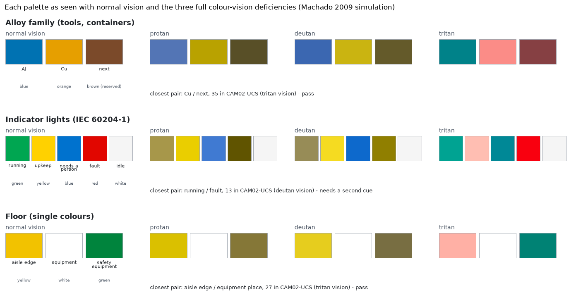
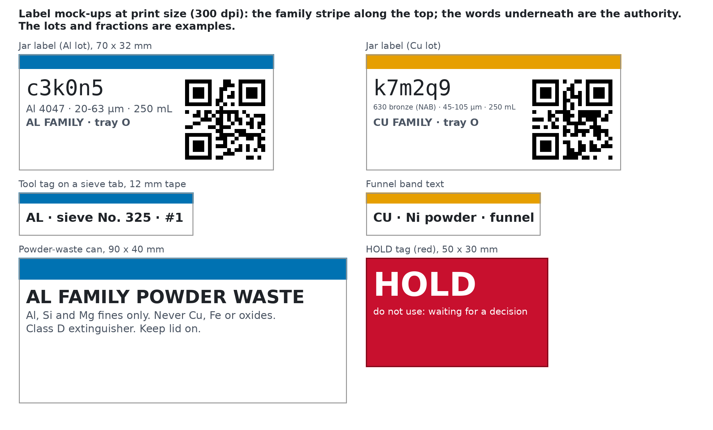

# Colour coding for organization and cleanliness

Sterling, PR #318, 2026-11-20: "open another PR focused on how we can best leverage color coding (send edison search
related to this in addition to your own searches) for organization and cleanliness of the lab".

[`colour_coding.py`](../colour_coding.py) holds the scheme as data and checks every palette for colour-blind readers;
[`colour_vignette.py`](../colour_vignette.py) renders it. Outputs are in [`out/colour/`](../out/colour/). The standards
behind each choice are digested, with links, in [`colour_sources.md`](colour_sources.md). The literature answers are in
[`out/edison/`](../out/edison/).

## The short version

- **Colour only where a person makes a decision, one meaning per colour in each place it appears, and always with a
  word or shape beside it.** Everything else stays white, grey, black, steel and clear glass. That is Sterling's own
  rule from the renders ("technicolor jars", "candy-coloured" powder), and the literature agrees:
  - the reviewed AM sources recommend colour *and* a label;
  - no standard prescribes a colour scheme for powder equipment (Edison, below);
  - the FAA's human-factors standard says colour "shall not be introduced solely for aesthetic, stylistic, or
    decorative purposes".
- **The code that matters most is the alloy family,** on every tool and container that touches powder: **blue for
  Al, orange for Cu.** Two colours cover the lab today. They stay far apart for every kind of colour vision (at least
  53 in CAM02-UCS, where 1 is a just-noticeable difference).
- **A third family gets brown, and there is no fourth hue.** With blue and orange in use, a search over 18 product
  colours found only brown, black and white still clearly distinct for all three colour-vision deficiencies. Green and
  purple, the obvious picks, fail for tritan vision. Black and white are what tools come in anyway.
- **The safety colours keep their meanings and are never borrowed.** ANSI Z535.2 gives red danger, orange warning,
  yellow caution, blue notice and green safety equipment; OSHA 1910.144 gives red fire equipment and danger and yellow
  caution; 10 CFR 20.1901 gives the magenta-on-yellow radiation trefoil on the XRD and XRF. Everything else follows an
  existing convention:
  - floor marking: OSHA, the visual-workplace convention, and ISO 3691-4 with MiR's own guide for the robots' docks;
  - stack lights: IEC 60204-1;
  - pipe markers: ASME A13.1;
  - wiring: NEC and IEC 60445;
  - cable labels: TIA-606.
- **The model already has a colour code that would fail.** Chapter 1's funnels carry one hue per powder
  (`charge.FUNNEL_LABEL`): the Ni and Cu funnels, used one after the other for the same Cu-Ni charge, are 6.8 apart
  for protan vision. Under this scheme they carry their family's band and the powder's name.

## Where colour goes: the channels

A colour's meaning depends on where it sits. Each place below is a channel with its own small palette. A colour may
mean different things in two channels (there are only about a dozen colours people name reliably), but never two
things within one.

| Channel | Colours and meanings | From |
|---|---|---|
| **Tools and containers that touch powder** | blue Al family, orange Cu family, brown reserved for a third; grey or black: touches no powder | this scheme |
| **Floor** | yellow lane edge; white where a robot docks or a cart goes; black/yellow operating hazard zone; red/white keep clear; green safety equipment | OSHA 1910.176 (marked aisles, any colour), the visual-workplace convention, ISO 3691-4 and MiR's user guide |
| **Stack lights and beacons** | green running, yellow abnormal or in upkeep, blue waiting for a person, red fault, white idle; fixed order, red at the top | IEC 60204-1 |
| **Safety signs and equipment** | reserved: red danger and fire equipment, orange warning, yellow caution, green safety equipment, blue notice or mandatory, magenta-on-yellow radiation (the XRD's and XRF's trefoils) | ANSI Z535.2 (Z535.1 defines only the colours), OSHA 1910.144, ISO 3864, 10 CFR 20.1901 |
| **Pipes and the lines to the docks** | ASME A13.1's colour pairs by contents, with the name and flow arrow | ASME A13.1 (2026) |
| **Wiring** | as the code says, in each of the lab's two electrical worlds; never trusted, always labelled | NEC 200.6, 250.119; IEC 60445 |
| **Network** | one jacket colour, and a label at both ends with the names from the naming PR | TIA-606 |

## 1. The alloy family (the cleanliness code)

**Why it matters here.** The lab makes Al and Cu alloys on shared stations, and Cu in Al is the worst case:

- Horn et al. (2019) mixed CuCr1Zr into AlSi10Mg. Even **0.5 wt.%** lowered tensile strength and embrittled the alloy
  through Al2Cu.
- Two incidents show carry-over that sieving and bulk chemistry missed:
  - Brandão et al. (2017): tungsten left in a machine ended up in Ti-6Al-4V parts. The inclusions were only
    0.03-0.04 vol.%, and bulk ICP-OES read under 0.005 wt.% W, but elongation fell from over 10 % to about 4 %.
  - Balart, Hao and Davis (2022): an alloy atomized before 316L left particles **embedded inside** the next run's
    powder. They traced it to the melt vessel or nozzle, not the collector.

  Both are from the Edison answer (`out/edison/metal_powder_segregation/answer.md`).

**What the literature recommends, and this scheme does:**

1. **Segregate first.** Give each family its own powder-contact kit rather than relying on a final clean: sieves, pan
   and lid; scoops, funnels and brushes; the vacuum's nozzle, hose, filter and collection vessel; the press's punch
   and catch ring; jars and liners.
2. **Colour-code the kit and label it.** Each item carries its family in words and its own ID. "This is a recommended
   visual-management design, not a specified ISO/ASTM colour scheme" (Edison's answer).
3. **For atomization, control the melt-contact path too.** Crucibles, the sealing rod and the plate go per family, as
   well as the collection container.
4. **Prove clean before release.** Wipe the hard-to-clean spots and look for the previous family. For a first run
   after a change, the arm can take a witness sample to the SEM/EDS on tray D.

**The two colours, and the reserve:**

| Family | Colour | Target sRGB | Why |
|---|---|---|---|
| Al | blue | `#0072B2` | the lab's main family; the most distinct colour from the orange for every kind of colour vision |
| Cu | orange | `#E69F00` | copper-coloured, so it is remembered |
| a third (Ni-base, Fe-base or Ti, whichever comes first) | brown | `#7B4A2A` | the only hue left that stays clear of both |
| (none) | black, or bare steel | `#111111` | touches no powder, or is cleaned to a validated limit between every use. Not grey: a mid-grey is 19.7 from the brown for protan vision and 18.8 from the blue for tritan vision |

| Pair | Normal | Protan | Deutan | Tritan |
|---|---|---|---|---|
| Al blue / Cu orange | 64.7 | 56.9 | 64.4 | 53.5 |
| Al blue / brown | 46.2 | 40.8 | 42.2 | 43.8 |
| Cu orange / brown | 38.7 | 37.6 | 38.5 | 35.4 |
| brown / black (the neutral) | 35.6 | 30.1 | 35.0 | 37.2 |
| *rejected:* Al blue / green | 34.6 | 36.7 | 35.0 | **11.7** |
| *rejected:* Cu orange / purple | 39.7 | 44.9 | 39.2 | **11.0** |

Differences are CAM02-UCS distances between the simulated colours (Machado et al. 2009, full dichromacy, through
colorspacious). The check passes at 20 or more, accepts 12-20 only with a second cue, and fails below 12
(`out/colour/cvd_check.json`).

A second, independent check agrees: a palette validator built for chart colours (OKLab, its own colour-vision
simulation) passes the three family colours on colour-vision separation (worst pair brown and blue, 20.1 for deutan
vision, against its target of 8). It also flags the brown as low in chroma. That is one more reason the brown always
comes with the family's name, never on its own.

**Where the band goes, kept small:**

| Item | Where the colour goes | Also |
|---|---|---|
| Sieves, pan and lid | a 12 mm band on the handling tab | the family's own stand |
| Funnels (one per powder, already) | the band, with the powder's name on it | replaces `charge.FUNNEL_LABEL`'s five hues |
| Brushes, scoops, spatulas | a band by the collar or on the handle | the atomizer's disposable heads: the magazine is per family |
| Vacuum (`exvac`) | a band on the nozzle, hose cuff and collection vessel | filter and vessel per family |
| Press punch and catch ring | a band on the punch's flange | run B's fallback, a set per family |
| Crucibles and the sealing rod | none: nothing survives 1100 °C. An engraved ID, and the band on its stand's pocket | per family |
| Jars | a 4 mm stripe along the top of the white label; caps stay black, glass stays clear | the lot ID is the text |
| Racks, carrier pockets | a band on the rack's front edge | |
| Powder-waste cans | a 25 mm band | one per family, never mixed (Al fines with iron oxide is a thermite) |

**State is a place, not a colour.** A clean tool is in its family's outlined place on the shadow board; one to be
cleaned is in the family's "to clean" tub; anything uncertain goes in the HOLD bin with a red tag that says HOLD. The
database already knows a tool's state; the place tells the person.

**Two conflicts in the model, to fix if the scheme is adopted:**

- **Chapter 1's funnels** carry one hue per powder (`charge.FUNNEL_LABEL`: Si yellow, Ni green, Fe red, Cu orange,
  Al blue). Five hues, one of them the safety red. Through the same check (`out/colour/funnel_code_check.json`):

  | Pair | Normal | Protan | Deutan | Tritan |
  |---|---|---|---|---|
  | Ni / Cu | 42.0 | **6.8** | **11.0** | 55.3 |
  | Ni / Fe | 52.8 | 21.2 | **7.2** | 63.4 |
  | Fe / Cu | 16.4 | 16.1 | **10.8** | 13.4 |

  The first pair is used one after the other for the same Cu-Ni charge.
- **"Ours" is drawn blue or teal in the renders.** Our machined and printed parts are blue in `atom_brush`,
  `atom_ground` and `atom_nilfisk`, and PETG teal in `carousel`. If blue means Al, a blue grip block reads as Al-only.
  - **In the lab:** print fixtures in black, grey or natural.
  - **In the renders:** use a neutral for "ours" and keep blue and orange for family-dedicated parts.

  Not changed here: it touches many shared files.

## 2. The floor

- **Five meanings,** each with its own colour or pattern; the rest is bare floor.
- **OSHA prescribes no colours.** It asks for marked aisles (1910.176), and its letters say the lines "may be any color
  so long as they clearly define the area". The colours here are the visual-workplace convention (yellow lanes, white
  equipment places, red/white keep-clear, black/yellow hazards).
- **Operating hazard zones round the docks.** A MiR250 docks within 0.5 m of a station with its personnel detection
  muted, which ISO 3691-4 calls an operating hazard zone. MiR's user guide (v1.2, section 10.7) puts two rules on it:
  - it has to be marked with signal tape "at least one meter away from the potentially hazardous area in all
    directions";
  - "It is not allowed to have work stations in operating hazard zones."

  So the tape runs 1 m outside each docked robot, and zones that overlap are taped as one. Nothing a person works at,
  such as the HOLD bin or a spill kit, goes inside one.
- **No red floor area.** A red "hold" area would sit next to the green safety-equipment squares, and red and green are
  6.9 apart for deutan vision. Holds go in the HOLD bin instead.
- **The keep-clear and safety-equipment spots are illustrative** until the safety-assets PR places the extinguishers.

## 3. Stack lights and the finale's beacons

- **Colours follow IEC 60204-1:** green running, yellow abnormal (warming up, in upkeep), blue waiting for a person
  (mandatory action), red fault, white idle. IEC 60073 adds that "the use of only a single means of coding is often
  insufficient".
- **Position is the second cue.** Red and green are 12.6 apart for deutan vision, and blue and green 13.1 for tritan,
  so every tower keeps the same order, red at the top.
- **The finale's beacons already match:** amber for upkeep, red for a fault waiting. A person-needed beacon would be
  blue.
- **The MiR250 has fixed colours of its own** (user guide v1.2): blue for off, blinking blue for "waiting for a user
  action", green for normal, red for a stop, yellow while its personnel detection is muted. They mostly agree with IEC
  60204-1, except that a steady blue MiR is off.

## 4. Pipes and the lines to the docks

- **ASME A13.1** (current edition 2026; its colour table is paywalled, so the 2020 pairs from a marker maker's summary
  are used here) marks a pipe with its contents in words, a flow arrow, and a colour pair by class:
  - fire-quenching: white on red;
  - toxic or corrosive: black on orange;
  - flammable or oxidizing: black on yellow;
  - combustible: white on brown;
  - water: white on green;
  - compressed air: white on blue;
  - four pairs defined by the user.
- **For this lab:**
  - **Air, nitrogen and argon in compressed-air colours, white on blue,** as is usual for inert gases, each named in
    the legend.
  - **Chilled water in and out: white on green.**
  - **Vacuum: one of the user-defined pairs, black on white,** named "VACUUM".
  - **Where:** markers by every valve, branch and wall penetration, and on the overhead runs. A label sits beside each
    of the CombiTac's fluid modules at the docks.
- **The coupling can't be cross-connected anyway.** Each medium has its own module in a fixed place in the frame, so the
  labels are for the person who works on the lines.

## 5. Gas cylinders: read the label

- **CGA C-7:** "The handler or user of compressed gas containers shall not rely on the color of the container to
  identify the product."
- **US suppliers:** Airgas doesn't colour-code its industrial cylinders.
- **The lab's own gases conflict between conventions.** Its argon (the rePowder, the ICP-MS dewar) would have a dark
  green shoulder under Europe's EN 1089-3; green is oxygen on a US medical cylinder.
- **So:** no cylinder colour means anything here. The contents label does, and the pipe marker downstream.

## 6. Wiring: two electrical worlds in one room

- **The two conventions:**
  - **US 208Y/120 (the trays, most floor machines):** phases conventionally black, red and blue; neutral white or grey
    (NEC 200.6); ground green or green-yellow (NEC 250.119). The phase colours are not mandated.
  - **IEC 60445 (the 400 V European machines: the rePowder, the Aconity):** L1 brown, L2 black, L3 grey, neutral blue,
    earth green-yellow.
- **The clash:** blue is a phase in the US and the neutral under IEC; grey is a US neutral and an IEC phase.
- **NEC 210.5(C)(1)** already requires, where more than one voltage system feeds branch circuits, each ungrounded
  conductor identified by system and phase at every termination, and the scheme posted at each panel.
- **Recommendation:** do exactly that. Add a label inside each European machine's supply enclosure: "IEC colours:
  blue = neutral".
- **Receptacles:**
  - Orange already means isolated ground (NEC 406.3), so no orange outlets for anything else.
  - The trays' UPS-backed outlets get a "UPS" label, not a colour. Hospitals mark their critical-branch receptacles
    with "a distinctive color or marking" (NEC 517.31(E)); a label is enough here.

## 7. Network

- **TIA-606 colour-codes termination labels** ("recommended but not required"). No standard sets jacket colours.
- **Recommendation:** one jacket colour throughout, as bought, and a printed label at both ends of every cable. The
  label names the switch port and the device in the naming PR's names (#376: `tray-d-sw/3`, `lonsdale-pc`). A colour
  per network would add a channel for no decision a person makes.

## 8. Metallography consumables: don't trust the makers' colours

- **Makers' grit colours disagree:**
  - Buehler colours its diamond discs by grit: red is 75 µm, green 240 µm.
  - Kemet's red is grit 80 (251 µm), and its green grit 220 (76 µm).
  - Struers names no colours.
- **So:** a disc's grit is read from its label and its slot in the PX500's magazine, which the arm already tracks.

## 9. Why so few colours: the human-factors limits

- **MIL-STD-1472H** (5.4.5.6.3): on labels, "the number of different colors shall not exceed five". This scheme uses
  two on tools, five on the floor and five in the lights.
- **FAA-HF-STD-010A:** colour must be redundant with "at least one other coding dimension that is independent of the
  operator's color vision". It also says colour "shall not be introduced solely for aesthetic, stylistic, or
  decorative purposes", which is Sterling's point about the renders. NASA-STD-3001 asks for "an additional cue" too.
- **Prevalence:** about 1 in 12 men of Northern European ancestry has red-green colour-vision deficiency (MedlinePlus;
  Birch 2012: about 8 % of men, 0.4 % of women). Brightness is no backup: "protans may not recognize brightness
  differences that are apparent to others" (FAA).
- **Even blood tubes, the best-known lab colour code, are not harmonised.** ISO 6710:2017 leaves the cap colours to an
  informative annex because no consensus could be reached, and one maker's EU-coded EDTA tube has the red cap that US
  practice uses for serum. Every tube carries its additive in words. The words are the authority here too.

## 10. Powder safety: segregation is also a fire rule

- **The standard has moved.** NFPA 484 (combustible metals) has been folded into NFPA 660, effective 6 December 2024.
- **Dedicated equipment for Al.** NFPA 484 restricts which dusts may be collected together. The Aluminum Association
  asks that aluminium dust collection be "dedicated for that use only", and that ordinary industrial vacuums not be
  used.
- **Al and Cu are a thermite pair.** Aluminium powder mixed with copper oxides "caused a strong explosion" on heating
  (NOAA CAMEO).
- **So** the Al and Cu families' vacuums, collectors and waste cans stay separate for safety as well as purity. The
  colour band makes that visible. The safety-assets PR covers the extinguishers.

## The Edison queries

- **Answered:**
  - `metal_powder_segregation`, on keeping alloy powders apart: summarized above.
  - `colour_cross_contamination`, on colour-coded cleaning and tools in food, healthcare and pharma
    ([answer](../out/edison/colour_cross_contamination/answer.md)). Its bottom line: separating tools by zone or
    material is a well-supported control, but the evidence that colour itself, rather than the separation, cleaning,
    training and checking that come with it, prevents contamination is limited. The details that shaped this scheme:
    - **Nobody prescribes the colours.** Codex's food-hygiene principles (CXC 1-1969, 2023) ask for separate,
      designated cleaning tools per zone, and PIC/S GMP (PE 009-14) for equipment labelled with its contents and
      cleanliness status. Neither prescribes colours.
    - **Coded tools get misused.** In a 50-restaurant study, 18 % of premises misused colour-coded boards
      (Faour-Klingbeil et al. 2016). That compliance failure is the most measured weakness of a colour code.
    - **Schemes conflict between places.** The NHS uses yellow for isolation (with red bathrooms, blue general and green
      kitchens, 2008), while a restaurant scheme uses yellow for raw poultry. So a lab needs its own legend.
    - **More colours are not safer.** Use the fewest categories that keep the barriers you need; names or numbers stay
      the authority.
    - **About 8 % of men have a colour-vision deficiency.** Use palettes they can tell apart, plus written labels,
      patterns or other non-colour cues (Thomas et al. 2019).
    - **Prove clean by measurement.** A swab or residue method, not a look, shows a tool is clean.

    **What that means here.** The failure the literature measures most is people using the wrong coded tool. A robot
    can't make that mistake: the scheduler assigns each family's kit, and every use is logged against the tool's ID
    (its name from the naming PR, #376). The colour is for the person who sweeps up a spill, swaps a sieve or tidies the
    bench. The arm's wrist camera can also read a tool's band before it uses the tool, as a second check against the
    database, but never as the first.
- **Not sent:** `colour_code_human_factors`, `visual_management_labs` and `colour_machine_vision_labware`. Edison
  refused them with 402 "Insufficient ACU Balance" (1.00 ACU needed, 0.20 available) after the first two were accepted.
  Their text is in `out/edison/_unsent_colour_queries.json`, ready for a follow-up once the balance is topped up. My own
  searches cover the standards side of all three (`colour_sources.md`).

## Open

- **Settled:** blue for Al and orange for Cu. Sterling, 2026-11-22: "blue and orange as mentioned are fine for now".
- **Still Sterling's call:** whether to dedicate sieve sets and crucibles per family now.
- **What to buy:** the bill of materials and shopping list are in [`colour_bom.md`](colour_bom.md). Every line was
  priced through the CubXL Pi, with part numbers, sellers and lead times. It also gives the RAL and Pantone codes to
  order the colours by.
- **Not drawn in the chapters:** the bands and stripes are in two stills here, not in the alloy chapters. The funnel
  code and the blue "ours" parts are noted above, not changed.
- **Physical colours:** the sRGB targets are for buying by eye under the lab's own lights, and for the check. Real tape
  and handle colours differ by maker. Check the bought ones under the lab's LED lighting, with a colour-vision
  simulator on a phone.

## Sources

- [`colour_sources.md`](colour_sources.md): the standards digest gathered for this PR (13 topics, every fact linked,
  weaker support marked).
- [`out/edison/metal_powder_segregation/answer.md`](../out/edison/metal_powder_segregation/answer.md) and
  [`out/edison/colour_cross_contamination/answer.md`](../out/edison/colour_cross_contamination/answer.md): the two Edison
  literature answers, with their full trajectories beside them.
- The colour-vision simulation: Machado, Oliveira and Fernandes (2009), through colorspacious.
