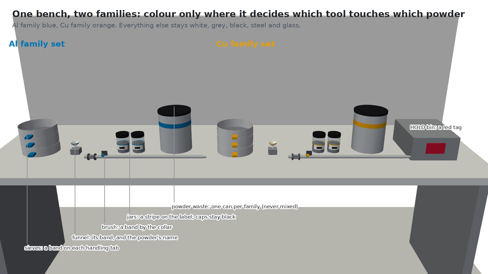
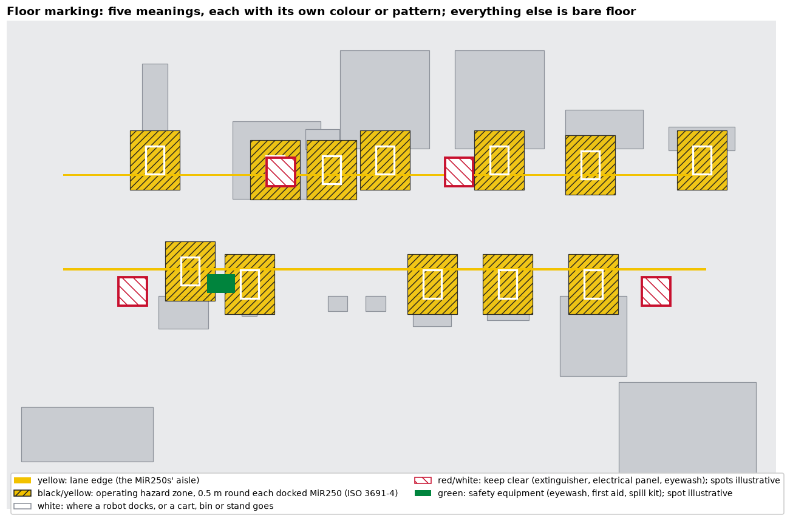
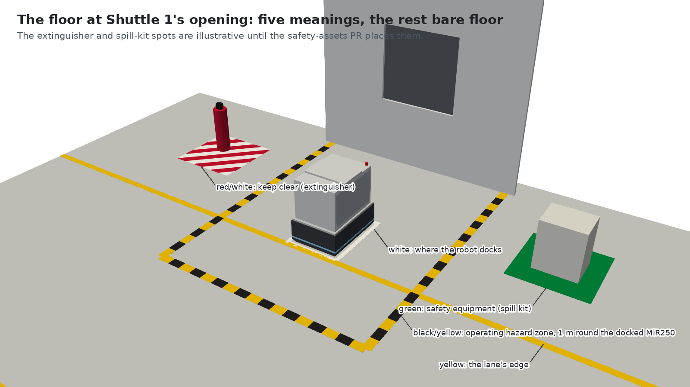

# Colour coding for organization and cleanliness

Sterling, PR #318, 2026-11-20: "open another PR focused on how we can best leverage color coding (send edison search
related to this in addition to your own searches) for organization and cleanliness of the lab".

[`colour_coding.py`](../colour_coding.py) holds the scheme as data and checks every palette for colour-blind readers;
[`colour_vignette.py`](../colour_vignette.py) renders it. Outputs are in [`out/colour/`](../out/colour/). The standards
behind each choice are digested, with links, in [`colour_sources.md`](colour_sources.md). The literature answers are in
[`out/edison/`](../out/edison/).

## The short version

- **Colour only where a person makes a decision, one meaning per colour in each place it appears, and always with a
  word or shape beside it.** Everything else stays white, grey, black, steel and clear glass. That is Sterling's own
  rule from the renders ("technicolor jars", "candy-coloured" powder), and the literature agrees: the reviewed AM
  sources recommend colour *and* a label, and no standard prescribes a colour scheme for powder equipment (Edison,
  below).
- **The code that matters most is the alloy family,** on every tool and container that touches powder: **blue for
  Al, orange for Cu.** Two colours cover the lab today. They stay far apart for every kind of colour vision (at least
  53 in CAM02-UCS, where 1 is a just-noticeable difference).
- **A third family gets brown, and there is no fourth hue.** With blue and orange in use, a search over 18 product
  colours found only brown, black and white still clearly distinct for all three colour-vision deficiencies. Green and
  purple, the obvious picks, fail for tritan vision. Black and white are what tools come in anyway.
- **The safety colours stay reserved** (red, orange-on-machines, yellow, green, blue, the radiation trefoil), and
  everything else takes its convention from a standard: floor marking (OSHA, and ISO 3691-4 for the robots' docks),
  stack lights (IEC 60204-1), pipe markers (ASME A13.1), wiring (NEC and IEC 60445), cable labels (TIA-606).
- **The model already has a colour code that would fail.** Chapter 1's funnels carry one hue per powder
  (`charge.FUNNEL_LABEL`): the Ni and Cu funnels, used one after the other for the same Cu-Ni charge, are 6.8 apart
  for protan vision. Under this scheme they carry their family's band and the powder's name.

## Where colour goes: the channels

A colour's meaning depends on where it sits. Each place below is a channel with its own small palette. A colour may
mean different things in two channels (there are only about a dozen colours people name reliably), but never two
things within one.

| Channel | Colours and meanings | From |
|---|---|---|
| **Tools and containers that touch powder** | blue Al family, orange Cu family, brown reserved for a third; grey or black: touches no powder | this scheme |
| **Floor** | yellow lane edge; white where a robot docks or a cart goes; black/yellow operating hazard zone; red/white keep clear; green safety equipment | OSHA 1910.144, visual-workplace practice, ISO 3691-4 |
| **Stack lights and beacons** | green running, yellow abnormal or in upkeep, blue waiting for a person, red fault, white idle; fixed order, red at the top | IEC 60204-1 |
| **Safety signs and equipment** | reserved: red fire and danger, orange dangerous machine parts, yellow caution, green safety equipment, blue mandatory, magenta-on-yellow radiation (the XRD's and XRF's trefoils) | ANSI Z535, ISO 3864, OSHA 1910.144 |
| **Pipes and the lines to the docks** | ASME A13.1's colour pairs by contents, with the name and flow arrow | ASME A13.1 |
| **Wiring** | as the code says, in each of the lab's two electrical worlds; never trusted, always labelled | NEC 200.6, 250.119; IEC 60445 |
| **Network** | one jacket colour, and a label at both ends with the names from the naming PR | TIA-606 |

## 1. The alloy family (the cleanliness code)

**Why it matters here.** The lab makes Al and Cu alloys on shared stations, and Cu in Al is the worst case:

- Horn et al. (2019) mixed CuCr1Zr into AlSi10Mg. Even **0.5 wt.%** lowered tensile strength and embrittled the alloy
  through Al2Cu.
- Two incidents show carry-over that sieving and bulk chemistry missed:
  - Brandão et al. (2017): tungsten left in a machine ended up in Ti-6Al-4V parts. The inclusions were only
    0.03-0.04 vol.%, and bulk ICP-OES read under 0.005 wt.% W, but elongation fell from over 10 % to about 4 %.
  - Balart, Hao and Davis (2022): an alloy atomized before 316L left particles **embedded inside** the next run's
    powder. They traced it to the melt vessel or nozzle, not the collector.

  Both are from the Edison answer (`out/edison/metal_powder_segregation/answer.md`).

**What the literature recommends, and this scheme does:**

1. **Segregate first.** Give each family its own powder-contact kit rather than relying on a final clean: sieves, pan
   and lid; scoops, funnels and brushes; the vacuum's nozzle, hose, filter and collection vessel; the press's punch
   and catch ring; jars and liners.
2. **Colour-code the kit and label it.** Each item carries its family in words and its own ID. "This is a recommended
   visual-management design, not a specified ISO/ASTM colour scheme" (Edison's answer).
3. **For atomization, control the melt-contact path too.** Crucibles, the sealing rod and the plate go per family, as
   well as the collection container.
4. **Prove clean before release.** Wipe the hard-to-clean spots and look for the previous family. For a first run
   after a change, the arm can take a witness sample to the SEM/EDS on tray D.

**The two colours, and the reserve:**

| Family | Colour | Target sRGB | Why |
|---|---|---|---|
| Al | blue | `#0072B2` | the lab's main family; the most distinct colour from the orange for every kind of colour vision |
| Cu | orange | `#E69F00` | copper-coloured, so it is remembered |
| a third (Ni-base, Fe-base or Ti, whichever comes first) | brown | `#7B4A2A` | the only hue left that stays clear of both |
| (none) | grey or black | | touches no powder, or is cleaned to a validated limit between every use |

| Pair | Normal | Protan | Deutan | Tritan |
|---|---|---|---|---|
| Al blue / Cu orange | 64.7 | 56.9 | 64.4 | 53.5 |
| Al blue / brown | 46.2 | 40.8 | 42.2 | 43.8 |
| Cu orange / brown | 38.7 | 37.6 | 38.5 | 35.4 |
| *rejected:* Al blue / green | 34.6 | 36.7 | 35.0 | **11.7** |
| *rejected:* Cu orange / purple | 39.7 | 44.9 | 39.2 | **11.0** |

Differences are CAM02-UCS distances between the simulated colours (Machado et al. 2009, full dichromacy, through
colorspacious). The check passes at 20 or more, accepts 12-20 only with a second cue, and fails below 12
(`out/colour/cvd_check.json`).

**Where the band goes, kept small:**

| Item | Where the colour goes | Also |
|---|---|---|
| Sieves, pan and lid | a 12 mm band on the handling tab | the family's own stand |
| Funnels (one per powder, already) | the band, with the powder's name on it | replaces `charge.FUNNEL_LABEL`'s five hues |
| Brushes, scoops, spatulas | a band by the collar or on the handle | the atomizer's disposable heads: the magazine is per family |
| Vacuum (`exvac`) | a band on the nozzle, hose cuff and collection vessel | filter and vessel per family |
| Press punch and catch ring | a band on the punch's flange | run B's fallback, a set per family |
| Crucibles and the sealing rod | none: nothing survives 1100 °C. An engraved ID, and the band on its stand's pocket | per family |
| Jars | a 4 mm stripe along the top of the white label; caps stay black, glass stays clear | the lot ID is the text |
| Racks, carrier pockets | a band on the rack's front edge | |
| Powder-waste cans | a 25 mm band | one per family, never mixed (Al fines with iron oxide is a thermite) |

**State is a place, not a colour.** A clean tool is in its family's outlined place on the shadow board; one to be
cleaned is in the family's "to clean" tub; anything uncertain goes in the HOLD bin with a red tag that says HOLD. The
database already knows a tool's state; the place tells the person.

**Two conflicts in the model, to fix if the scheme is adopted:**

- **Chapter 1's funnels** carry one hue per powder (`charge.FUNNEL_LABEL`: Si yellow, Ni green, Fe red, Cu orange,
  Al blue). Five hues, one of them the safety red. Through the same check (`out/colour/funnel_code_check.json`):

  | Pair | Normal | Protan | Deutan | Tritan |
  |---|---|---|---|---|
  | Ni / Cu | 42.0 | **6.8** | **11.0** | 55.3 |
  | Ni / Fe | 52.8 | 21.2 | **7.2** | 63.4 |
  | Fe / Cu | 16.4 | 16.1 | **10.8** | 13.4 |

  The first pair is used one after the other for the same Cu-Ni charge.
- **"Ours" is drawn blue or teal in the renders.** Our machined and printed parts are blue in `atom_brush`,
  `atom_ground` and `atom_nilfisk`, and PETG teal in `carousel`. If blue means Al, a blue grip block reads as Al-only.
  - **In the lab:** print fixtures in black, grey or natural.
  - **In the renders:** use a neutral for "ours" and keep blue and orange for family-dedicated parts.

  Not changed here: it touches many shared files.

## 2. The floor

- **Five meanings,** each with its own colour or pattern; the rest is bare floor.
- **ISO 3691-4 operating hazard zones:** where a docked robot comes within 0.5 m of something fixed, which is every
  dock, the zone is marked in black/yellow.
- **No red floor area.** A red "hold" area would sit next to the green safety-equipment squares, and red and green are
  6.9 apart for deutan vision. Holds go in the HOLD bin instead.
- **The keep-clear and safety-equipment spots are illustrative** until the safety-assets PR places the extinguishers.

## 3. Stack lights and the finale's beacons

- **Colours follow IEC 60204-1:** green running, yellow abnormal (warming up, in upkeep), blue waiting for a person
  (mandatory action), red fault, white idle.
- **Position is the second cue.** Red and green are 12.6 apart for deutan vision, and blue and green 13.1 for tritan,
  so every tower keeps the same order, red at the top.
- **The finale's beacons already match:** amber for upkeep, red for a fault waiting. A person-needed beacon would be
  blue.

## 4-7. Pipes, wiring, network and gas

(being written in this run from the standards digest, `colour_sources.md`.)

## The Edison queries

- **Answered:**
  - `metal_powder_segregation`, on keeping alloy powders apart: summarized above.
  - `colour_cross_contamination`, on colour-coded cleaning and tools in food, healthcare and pharma
    ([answer](../out/edison/colour_cross_contamination/answer.md)). Its bottom line: separating tools by zone or
    material is a well-supported control, but the evidence that colour itself, rather than the separation, cleaning,
    training and checking that come with it, prevents contamination is limited. The details that shaped this scheme:
    - **Nobody prescribes the colours.** Codex's food-hygiene principles (CXC 1-1969, 2023) ask for separate,
      designated cleaning tools per zone, and PIC/S GMP (PE 009-14) for equipment labelled with its contents and
      cleanliness status. Neither prescribes colours.
    - **Coded tools get misused.** In a 50-restaurant study, 18 % of premises misused colour-coded boards
      (Faour-Klingbeil et al. 2016). That compliance failure is the most measured weakness of a colour code.
    - **Schemes conflict between places.** The NHS uses yellow for isolation (with red bathrooms, blue general and green
      kitchens, 2008), while a restaurant scheme uses yellow for raw poultry. So a lab needs its own legend.
    - **More colours are not safer.** Use the fewest categories that keep the barriers you need; names or numbers stay
      the authority.
    - **About 8 % of men have a colour-vision deficiency.** Use palettes they can tell apart, plus written labels,
      patterns or other non-colour cues (Thomas et al. 2019).
    - **Prove clean by measurement.** A swab or residue method, not a look, shows a tool is clean.

    **What that means here.** The failure the literature measures most is people using the wrong coded tool. A robot
    can't make that mistake: the scheduler assigns each family's kit, and every use is logged against the tool's ID
    (its name from the naming PR, #376). The colour is for the person who sweeps up a spill, swaps a sieve or tidies the
    bench. The arm's wrist camera can also read a tool's band before it uses the tool, as a second check against the
    database, but never as the first.
- **Not sent:** `colour_code_human_factors`, `visual_management_labs` and `colour_machine_vision_labware`. Edison
  refused them with 402 "Insufficient ACU Balance" (1.00 ACU needed, 0.20 available) after the first two were accepted.
  Their text is in `out/edison/_unsent_colour_queries.json`, ready for a follow-up once the balance is topped up. My own
  searches cover the standards side of all three (`colour_sources.md`).

## Open

- **Sterling's call:** blue for Al and orange for Cu, or the other way round; and whether to dedicate sieve sets and
  crucibles per family now.
- **Not drawn in the chapters:** the bands and stripes are in two stills here, not in the alloy chapters. The funnel
  code and the blue "ours" parts are noted above, not changed.
- **Physical colours:** the sRGB targets are for buying by eye under the lab's own lights, and for the check. Real tape
  and handle colours differ by maker. Check the bought ones under the lab's LED lighting, with a colour-vision
  simulator on a phone.
