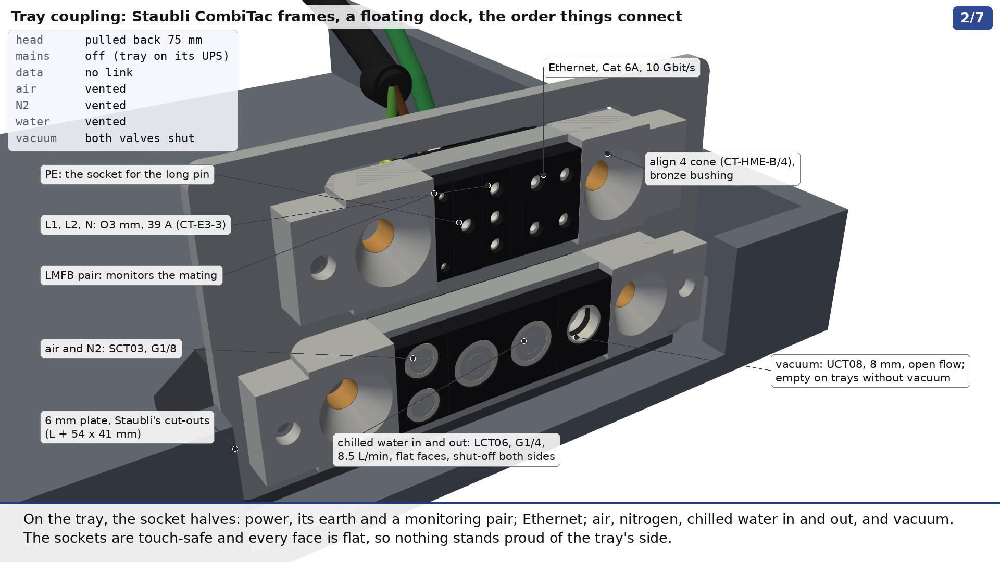

## The tray coupling, part by part (2026-11-18)

Sterling, PR #318, 2026-11-18: "I think we need something more real and high-fidelity for the liquid, gas, and power
transfer modules (quick disconnect, etc.) for the VLM".

Round 4's coupling (`services.py`) had real catalogue figures behind it, but it drew none of the parts. It was a
200 × 90 mm block with six discs and bars for the inserts, two pins and a box for the dock.
[`coupling.py`](../coupling.py) now draws the parts themselves, from two Stäubli documents (fetched 2026-11-18):
- the CombiTac uniq main catalogue, CT-Main-11014009-en, 08.2026, 152 pages;
- the CombiTac align flyer, 11014023-en.

It puts them in a dock that fits the room the Shuttle leaves beside a tray. `services.py` takes every tray plate and
every dock in the VLM scenes from it.

| | |
|---|---|
| The close-up: docking and letting go, in the order things connect | [`out/mp4/vlm_coupling.mp4`](../out/mp4/vlm_coupling.mp4), [`out/vlm_coupling.gif`](../out/vlm_coupling.gif) |
| The numbers: parts, forces, stroke, clearances | [`out/coupling.json`](../out/coupling.json) |
| The docks against the lift, re-run | [`out/dock_lift_clearance.json`](../out/dock_lift_clearance.json), [`.png`](../out/dock_lift_clearance.png) |

```bash
xvfb-run -a python3 coupling.py movie json      # the close-up and the numbers
python3 services.py clearance                    # the docks against the lift and the trays
python3 interference.py tray_dock                # the dock's own motion in MuJoCo
xvfb-run -a python3 tour.py tray_dock            # the dock as a tour model: head, crank, rod and chain jointed
```



### What is on the tray, and what is on the dock

**Two frames, not one.** Stäubli's safety notes (p. 137): "On permanently fixed installations, electrical contacts
have to be placed above liquid couplings". So the electrical frame sits above the fluid frame. Each frame is a row of
carriers on two supporting rails, between two end pieces.

| Frame | Module (Stäubli type) | Width | What it carries |
|---|---|---|---|
| Electrical, top | CT-LMFB | 6 mm | the Last Mate First Break pair: monitors the mating |
| | CT-E3-2+PE | 10 mm | PE on a Ø3 mm contact (the long pin, which mates first); two spare poles, blind-plugged |
| | CT-E3-3 | 10 mm | L1, L2, N on Ø3 mm contacts, 39 A each |
| | CT-DIP4 | 4 mm | a spacer |
| | CT-10GBIT-RJ45 | 22 mm | Ethernet, Cat 6A, 10 Gbit/s; an RJ45 jack at the back of each half |
| Fluid, bottom | CT-E8-2 + 2 × SCT03 | 18 mm | compressed air and N₂: G1/8, SW12, nominal bore 3 mm |
| | CT-E-UCT08-2 + 2 × LCT06 | 42 mm | chilled water in and out: G1/4, SW17, nominal bore 6 mm, 8.48 L/min at 5 m/s |
| | CT-E-UCT08-1 + UCT08/10 | 22 mm | vacuum (2026-11-20, [below](#vacuum-2026-11-20)): nominal bore 8 mm, open flow, push-in for 10 mm tube; the socket only on trays B, K and M, the carrier empty on the rest |

- **The ends: CombiTac align 4** (p. 80–81, flyer p. 12–13). On the tray, CT-HME-B/4: a die-cast zinc cone with a
  bronze bushing. On the dock, CT-HME-S/4: a Ø9.8 mm pin standing 50.2 mm proud of an 18 mm body, with an insulating
  cap so it can't touch a live socket. Each end piece is 43 × 34.7 mm. They take up 4 mm radial and ±2° of
  misalignment, for 100,000 mating cycles.
- **Sizes that follow.** Each frame is its modules' widths plus 86 mm of end pieces: 138 mm (electrical) and 146 mm
  (fluid). Each sits in Stäubli's cut-out, L + 54 × 41 mm with R5 corners, with Ø4.2 mm holes at L + 70 (p. 84). The
  carriers are 24 mm deep and the mated plates 25 mm apart (p. 86), so each face sits 12.5 mm in front of its plate.
- **Which half goes where.** The sockets, which are touch-safe (IP2X) when unmated, and the cones go on the tray. The
  pins and the plug couplings go on the dock. Nothing on a tray then stands proud of its side: the faces are 6 mm
  inside it, as before. Every fluid coupling closes behind a flat face, so a tray in transit carries no open line.
- **Behind each half:**
  - crimp barrels and coloured wires into a cable gland (L1 brown, L2 black, N blue, PE green);
  - the RJ45 plug and the Cat 6A cable;
  - push-in fittings with their tubes: blue air, black N₂, blue and red water, and, where there is vacuum, the
    UCT08's own push-in clamp with a dark grey 10 mm tube;
  - on the tray, the LMFB pair bridged by a short loop;
  - on the dock, wired to the relay.

### The order things connect

Stäubli gives the order, not the lengths: "Longer type of pin mates first" (p. 27), and the LMFB contacts "show
whether a CombiTac is fully connected or not" (p. 40). The drawn lengths keep that order:

| s, mm to go | What makes |
|---|---|
| 7.5 | PE (the long pin) |
| 7 | the 10 Gbit contacts |
| 5 | L1, L2, N; the water couplings open |
| 4.5 | air and N₂ open |
| 3.5 | the vacuum pair seals (its nose 6 mm into the socket's O-ring; nothing opens) |
| 2 | the LMFB pair, last |
| 0 | the hard-stop screws (CT-SHR-HS, p. 82) touch, so the end force doesn't go through the contacts |

The pin lengths behind this are drawn: PE 12.5 mm proud, power 10, the 10 Gbit pins 12 (that one is Stäubli's), the
LMFB pins 7. The couplings count as open after 6 mm of nose travel.

**Power never makes or breaks under load.** Stäubli: "Connecting and disconnecting when live is permitted.
Connecting and disconnecting under load is not permitted" (p. 137, p. 139).
- **The sequence.** The dock's relay closes the contactor only once the LMFB loop is closed. To let go, the contactor
  opens first (the tray's UPS takes over).
- **The safeguard.** If the head is ever pulled back with the contactor closed, the LMFB pair breaks first and drops
  it before any power pin parts.

**No coupling mates or parts under pressure.** Stäubli prohibits it (p. 73, p. 75, footnote 1).
- **The valves.** Each line on the dock has a solenoid valve (3/2 for air and N₂, venting the coupling's side; 2/2
  for water) and a pressure sensor on the coupling's side.
- **The order.** The valves open only after mating. Before the head pulls back, they shut and vent, and the sensors
  must read 0 bar.

**Inside the couplings** (drawn, not published). Both SCT03 and LCT06 are "leakproof, shut-off on both sides". The
close-up draws the usual flat-face, double shut-off design:
- the socket has a fixed central piston, with a spring-loaded sleeve round it, flush with its face;
- the plug has a spring-loaded poppet, flush with its nose.

As they meet, the nose pushes the sleeve back and the piston pushes the poppet back. The flow opens only once both
seals are inside each other.

### The dock (ours)

The space is the constraint. From the tray's side to the cladding the model has:
- 45 mm to the column side wall;
- the 12 mm wall itself;
- a 108 mm cavity behind it.

That is 165 mm in all, as Kardex's unit width for this tray gives. Pulled back, the align pins' tips must clear the
tray's side, so the stroke is 75 mm. That leaves no room for a cylinder behind the head, so:
- **Carriage:** a plate on two HIWIN MGN12H miniature guides, under the dock's top plate. This is the "stable guide
  system" Stäubli asks for in a permanent installation (p. 81).
- **Floating plate:** the dock's half is on a 6 mm plate held to the carriage by four shoulder screws with springs. The
  springs centre it, and the align pins pull it onto the tray as they enter the cones. The close-up's tray stopped
  2.5 mm off in y and 1.5 mm low (2.9 mm), inside align 4's 4 mm. (Since 2026-11-20 the screws are fixed in the
  plate's back and slide in the carriage plate, their heads behind it: see [Vacuum](#vacuum-2026-11-20).)
- **Drive:** a slider-crank beside the frames: a 37.5 mm crank and a 50 mm rod, turned 180° by a 24 V worm
  gearmotor under the crank (the rod passes over the crank's axis when mated, so nothing can stand above it).
  - Both ends of the stroke are dead centres. Mated, the couplings' springs (175 N) can't push the head back,
    powered or not, and the worm locks itself as well.
  - The head slows into the end of the stroke on its own, as Staubli's 600 mm/min test speed (p. 135) asks.
- **Energy chain:** an igus E2 micro-size chain, bend radius 22 mm, under the dock. It rolls at half the head's speed,
  down to the valve bank.
- **Valve bank:** under the dock. A DIN rail with the mains contactor, the LMFB relay and an RJ45 coupler, four
  solenoid valves with indicator LEDs, and a pressure sensor per fluid line. Short supply lines run from it to the
  column's service riser. In the bay, and in the slots of trays B, K and M, it also carries the vacuum block: an
  isolation valve, an N₂ vent valve and a gauge.
- **End sensors:** two inductive sensors (M8) on the top plate report the end positions.

**Forces** (`coupling.plugging()`):
- **Sliding force: 74 N.**
  - 4 Ø3 mm contacts at 8 N (p. 27);
  - 2 LMFB contacts at 14 N (p. 41);
  - the 10 Gbit module at 14 N (p. 49).
- **Couplings' springs: 175 N.** That is 2 × 43 N (SCT03) and 2 × 44.5 N (LCT06), all without pressure.
- **The vacuum pair: 16 N**, Stäubli's maximum sliding force for the UCT08 at 0 bar (p. 67). It has no spring.
- **Plugging: 302 N** with the vacuum pair (286 N without), taking Stäubli's plugging force as 1.5 × the sliding
  force (p. 135), plus the springs and the vacuum pair.
- **Gearmotor: about 14.7 N·m at the crank** (14 without vacuum) at the worst point of the last 15 mm. That assumes the
  whole 302 N acts over those 15 mm, so it is a ceiling.

**Clearances** (re-run, `services.py clearance`, every part as its bounding box, so each gap is a lower bound):

| Case | Smallest gap | Before |
|---|---|---|
| The extractor past the front-column and bay docks, any height, empty or loaded | 96 mm | 158 mm |
| The extractor past the rear-column docks | 683 mm | 643 mm |
| A tray past its own dock, pulled back | 18.6 mm (the pins' insulating caps) | 22 mm |
| The bay's dock to the shutter | 20.6 mm | 81 mm |
| The tray's coupling to the extractor's carriages, the tray on the extractor | 11.0 mm | 9.5 mm |

The bay's dock is the tight one. Its drive end is 20.6 mm in front of the shutter's plane. The first layout had 3 mm,
until the crank moved 11 mm and the frame was shortened to suit.

Re-run on 2026-11-20 with the vacuum module ([below](#vacuum-2026-11-20)): every figure is unchanged. The wider fluid
frame stays inside the plate, and the vacuum block sits inside the valve bank's footprint, so nothing moved outward.
At the rear-column docks the nearest part is now the vacuum supply under the valve bank, at the same 683 mm.

### Checked in MuJoCo

`interference.py tray_dock` plays the dock's tour (dock out, tray out and back, dock in) through MuJoCo, every frame,
with FCL confirming each hit on the meshes. The tour model has a joint for each moving part: the head, the crank, the
rod and each of the chain's ten links, all driven together.

The first run found four real faults in our dock, all now fixed:
- the rod's eye ran 2 mm into the back plate at full stroke, so the carriage moved 4 mm forward;
- the crank's hub stood in the rod's path, because the rod passes over the crank's axis when mated. The gearmotor
  went under the crank;
- the chain's hanger stood where the head's tubes drop, so it now hangs below the chain from the valve bank;
- the mains cable grazed the edge of the bottom plate's slot, which is now 6 mm wider.

What is left is listed as intended in `interference.INTENDED`:
- the chain's links overlap where they pivot;
- the lines enter the chain's first link;
- the drive pin turns in the rod's eye;
- the two halves mate.

The rest only touch (0 mm). A bug found on the way: `tour.py` and `interference.py` cached the dock on `services.py`
alone, so a change in `coupling.py` didn't rebuild it. Both now key it on `coupling.py` and `ups.py` too.

### What is ours, what is drawn, what to ask

- **Ours:**
  - the plates and the tray's bracket;
  - the floating plate, the carriage, the slider-crank and its gearmotor;
  - the chain's size, the valve bank, the sensors' placement.

  The sizes are chosen to fit, not sourced. The gearmotor isn't a selected part.
- **Drawn, not dimensioned:**
  - the carriers' height between the rails (30 mm, from the 10 Gbit module's 28–32 mm drawing);
  - every pin length except the 10 Gbit module's;
  - the couplings' insides;
  - the shape of the die-cast end pieces beyond their published envelope.
- **Ask Stäubli:**
  - Do the align 4 end pieces float in the L + 54 × 41 mm cut-out, or must the panel float? (Our dock floats its
    plate, so either works.)
  - What are the pin lengths, and how many mm apart do PE, power and LMFB make?
  - For water at 3 bar and 8 L/min, is an LCT06 pair right, or is a larger bore in a second frame better?
  - Would one CombiTac align 4 frame with both rows be allowed, if the fluid row is below?
- **Ask Kardex:** Can a dock be built into the side wall of a slot and of the bay? This one needs a window about
  290 × 165 mm and about 140 mm of depth behind the tray's side; the cladding stays where it is.
- **Not done:**
  - The hookups clip shows this dock only once it is re-rendered. The UPS run planned to re-render it with its new
    UPSs.
  - The set-up movie and the long-form still show the old plate.

## Vacuum (2026-11-20)

Sterling, PR #318, 2026-11-20: "the CombiTac should probably have a port for vacuum, ideally a decent level of vacuum
(not sure if turbo would make sense, but maybe the option to use roughing with optional switch to turbo, kind of like
the T85 turbo pumping station ...), also that we'd probably want to use a scroll pump to reduce noise post-startup.
Note that this port would be optional on a per-tray basis, but included in the picking bay for trays that require it."

| | |
|---|---|
| The coupling with its vacuum line, in the close-up (a new step 5: the line from the tray's valve to the dock's), 1920 × 1080, 76.5 s | [`out/mp4/vlm_coupling.mp4`](../out/mp4/vlm_coupling.mp4), [`out/vlm_coupling.gif`](../out/vlm_coupling.gif), [audit](../out/collisions/vlm_coupling.json) |
| The numbers: module, trays, sequence, the line's sizing for 6, 10 and 15 m | [`out/coupling.json`](../out/coupling.json), key `vacuum` |

### The module: an open-flow UCT08 pair, which Stäubli rates to 14 mbar

All page numbers are from the CombiTac uniq catalogue CT-Main-11014009-en (08.2026),
[staubli.com](https://www.staubli.com/content/dam/spot/CT-Main-11014009-en.pdf).

**What Stäubli makes.** No CombiTac coupling is rated for more than a rough vacuum.
- Every pneumatic and fluid coupling has "Min. working pressure (mbar) 14" (p. 62, 65, 66, 73), and the pressures
  are absolute (p. 60, 70).
- The LCT06 says it outright: "Min. vacuum absolute pressure (mbar) 14" (p. 75).
- The table for the small open-flow couplings adds "Vacuum compatibility only when mated" (p. 62).
- Stäubli's product page says "15 bar pressure resp. 10 torr vacuum". That is 13.3 mbar, about the same figure. (Seen
  only in a search snippet; the page refused automated access.)
- The largest bore in the range is 8 mm. There is no LCT08 or UCT10, and nothing with a KF flange.

**Chosen:** CT-B-UCT08/10 (33.0194, socket, on the tray) and CT-S-UCT08/10 (33.0594, plug, on the dock), in a
CT-E-UCT08-1 carrier (33.4032), 22 mm wide (p. 66–67, 69, 83).
- It is the largest bore in the range, 8 mm.
- It is open flow: no poppet in the gas path to throttle the conductance. A normally closed valve behind each half
  closes the line instead.
- It has no spring. Its maximum sliding force is 16 N at 0 bar (134 N at 15 bar).
- It takes a 10 mm OD calibrated PA or PU tube in a push-in clamp: no thread, no hex. The socket stands 11 mm behind
  its carrier; the plug's nose is 9.5 mm proud, with 9.5 mm behind.
- Its carrier is the one-pole version of the LCT06's CT-E-UCT08-2.

**Not chosen:**
- The LCT06 pair in the same carrier (p. 74–75). It shuts off on both sides, but through two poppets and a 6 mm bore,
  with 44.5 N of springs.
- A UCT04 in a CT-E8-4 carrier (p. 62–63). It would add only 12 mm to the frame, but its 4 mm bore is too small for
  vacuum.

**Where it goes.** At the fluid frame's +y end. Gas lines aren't liquids, so p. 137's rule (electrics above liquid
couplings) doesn't move it.
- The frame grows from 60 to 82 mm of carriers, 168 mm with its end pieces. That is still inside the 180 mm plate.
- Its cut-out is L + 54 = 136 × 41 mm, and its rails are 136 mm (Stäubli makes them 18–180 mm, p. 82).
- The plate, the tray's bracket and the dock keep their sizes.

**The rating is the open question.** 14 mbar is enough for the glovebox's antechamber: three pump-and-N₂ cycles to
14 mbar leave 21 % × (14/1013)³ ≈ 0.6 ppm of oxygen. It is not enough for the press, whose procedure holds the die
under 1 mbar.
- The pair's seals are NBR O-rings, which are routinely used far below 14 mbar. But Stäubli doesn't promise it.
- So before relying on anything under 14 mbar, ask Stäubli for the pair's leak rate, or helium-leak-test one.
- Until then the design below is sized for roughing to about 0.05 mbar. The 14 mbar line in the numbers marks where
  the catalogue stops.

### Which trays carry it

`coupling.VAC_TRAYS`:

| Tray | What uses it | Instead of |
|---|---|---|
| B | the vacuum press: its evacuable die, pumped below 1 mbar for 2 min before pressing (`vacuum_press.py`) | the rotary-vane pump drawn beside the press |
| K | the glovebox: three pump-and-N₂ cycles of the 150 × 300 mm mini antechamber (about 5.3 L) for each transfer (`instruments_r7.py`) | the pump in the glovebox's right-hand bay |
| M | the S2 PUMA XRF: Bruker lists air, vacuum, He or N₂, and a "Helium mode with reduced pressure" for loose powder (`instruments_char.py`). Vacuum needs a pump, and so, presumably, does the reduced-pressure mode; Bruker's pressures for them weren't found | Bruker's own pump |

**Not given it:**
- **D** (SEM). The TM4000PlusII's diaphragm pump is part of Hitachi's own EVAC cycle.
- **E** (Mastersizer). The Aero S draws its powder off with an extraction unit: high flow at a low vacuum, a different
  job from this line. (Malvern's figures for it were not checked.)
- **I** (SnowPod). It runs on nitrogen, not vacuum.

**On every powered tray, the same frame.** Each one carries the CT-E-UCT08-1 carrier. On a tray without vacuum it is
empty: its bore takes the dock's 9.5 mm nose, and a blind plug closes it at the back. So every tray's frames, plate
and cut-outs are identical, and any tray can stand in the bay.

**On the docks.**
- The bay's dock always carries the plug and the vacuum block.
- A slot's dock carries them only if its tray is in `VAC_TRAYS`: R3 (B), 2R1 (K) and 2R3 (M).
- On the other docks, the carrier is empty.

**In the code:**
- `coupling.py`: `tray_half(vacuum=...)`, `head_parts(vacuum=...)`, `dock_fixed(vacuum=...)` and `has_vacuum(tray)`.
  `None` means the general case, with vacuum.
- `services.py`: `plate_parts(tray)`, `line_paths(tray)`, `tray_lines(tray=...)` and `dock_parts(head, tray)`.
  `MEDIA` has a seventh medium, `vac`, in a dark grey `svc_vac`.

### On each side of the coupling (ours: drawn, not selected parts)

- **On the tray:**
  - a 10 × 8 mm PA tube from the socket's push-in clamp;
  - a normally closed 2/2 vacuum valve;
  - a tee with a Pirani-piezo gauge pointing to the tray's back. (Pointing away from the plate, it ran into the
    UPS's input cord, which leaves the UPS's back and turns at x 1112, `ups.cord_parts`.)

  The tray's line rises out of the tee and runs along the back rim with the others, as a thicker tube.
- **On the dock:** the plug, and the same tube down through the energy chain to the valve bank's vacuum block. The
  block holds:
  - a normally closed KF16 isolation valve, which keeps the riser under vacuum whenever the coupling isn't mated;
  - a 2/2 valve that lets dry N₂ into the stretch between it and the tray's valve;
  - a Pirani-piezo gauge on that stretch. Piezo, because it must read atmospheric pressure accurately before the head
    lets go.

  A DN16 line runs under the valve bank from the isolation valve to the riser.

### Mating and parting

Stäubli: "Vacuum compatibility only when mated" (p. 62) and "Connecting and disconnecting under pressure is
prohibited" (p. 63, 67). So the open-flow pair only ever mates and parts with atmospheric pressure on both sides of its
seal (`coupling.VAC_SEQUENCE`).

1. **Mating.** Both valves are shut, and the stretch between them is at atmosphere (left full of N₂ when it last
   parted). The O-ring seals with 3.5 mm to go: after air and N₂ open, before the LMFB pair.
2. **Mated.** Once the LMFB loop is closed, the isolation valve opens, slowly at first, and pumps the stretch up to the
   tray's valve. The tray's valve opens when the instrument asks for vacuum, and the tray's line and the instrument
   are pumped through it.
3. **Letting go.**
   - The instrument vents itself with dry gas (the press's V2, the antechamber's refill).
   - The tray's valve shuts, then the isolation valve. The riser stays under vacuum.
   - The vent valve lets N₂ into the few cm³ between the two valves until the gauge reads atmospheric.
   - Only then does the head pull back.

   Venting only that stretch, and with N₂, means no room air reaches the line, and the pump never has to pull the
   riser down again.

**The forces.** The vacuum pair adds 16 N to the plugging force: 302 N, and 14.7 N·m at the crank. Mated and
evacuated, the atmosphere pushes the halves together with about 11 N over the O-ring's 12 mm. That only helps the dead
centre hold.

### The pump: a scroll on the floor, one per Shuttle

**Pfeiffer HiScroll 12** (PD S20 000):
- 12.1 m³/h (14 boosted), ultimate 6 × 10⁻³ mbar, 47 dB(A);
- 24 kg, 419 × 265 × 322 mm, DN 25 KF inlet;
- standby at 50 % of nominal speed, settable 40–100 %, and an automatic standby driven by a gauge
  ([datasheet p. 4](https://assets.testequity.com/te1/Documents/pdf/pfeiffer-vacuum/Pfeiffer_Vacuum_Hiscroll_12_PD-S20-000-B_Datasheet-1024.pdf),
  [operating instructions p. 41–42](https://lesker.com/NewWeb/vacuum_pumps/pdf/manuals/HiScroll%2012_18%20Operating%20Instructions%20(PU0081BEN_A).pdf));
- about USD 8,300–9,000 (Across International, TestEquity, seen 2026-11-20). About 100 W in standby, from a
  distributor's listing, not checked.

**Where:** one beside each Shuttle, at the foot of its right-hand riser.
- Shuttle 1 needs vacuum at R3 (tray B, rear column) and at its bay. Shuttle 2 needs it at 2R1 and 2R3 (K and M, rear
  column) and at its bay.
- So each pump feeds a small manifold: a gauge, an isolation valve and a vent, with two DN25 branches, one up the
  rear-column riser and one to the bay's dock.
- One pump between the two Shuttles would also work, with longer lines (the line's length hardly matters, below).
  But two keep each Shuttle's vacuum independent.

**Why a scroll, and why it is quiet.**
- A scroll pump is oil-free: no oil mist inside a VLM, unlike the rotary-vane pump drawn by the press.
- But its quiet figure is a figure at base pressure. Edwards states its 52 dB(A) "for low fan speed, typical at
  ultimate". Its nXDS10i draws about 280 W near ultimate and about 500 W at 1000 mbar
  ([nXDS brochure p. 6, 8](https://assets.testequity.com/te1/Documents/pdf/Edwards/Edwards_nXDS_Brochure_0425.pdf)).
  So a pump that roughs a chamber down from atmosphere is louder for that time.
- **The design keeps the pump at base pressure.** The riser and the branches are never vented: the docks' isolation
  valves close them off whenever a coupling isn't mated. Each tray only brings its own few litres when its valve
  opens.
- So the pump spends almost all its time in standby at base pressure. That is its quiet state. A pump-down from
  atmosphere happens only after maintenance.

**Alternatives looked at:**

| Pump | Speed | Ultimate | Noise | Notes |
|---|---|---|---|---|
| Edwards nXDS10i | 11.4 m³/h | 7 × 10⁻³ mbar | 52 dB(A) | 25.8 kg, standby 67–100 % of speed; about USD 6,900 |
| Agilent IDP-10 | 10.2 m³/h | 2 × 10⁻² mbar | 53 dB(A) | 24.7 kg; no user standby described |
| Anest Iwata ISP-250C | 15.0 m³/h | 1.6 × 10⁻² mbar | 58 dB(A) | 25 kg |

Edwards' T-Station 85, the one Sterling named, backs its nEXT85H with a 3 m³/h mXDS3s scroll (0.1 mbar), an
oil-sealed E2M1.5 or an XDD1 diaphragm pump, not an nXDS
([datasheet](https://cdn.shopify.com/s/files/1/0117/2714/2969/files/T-Station-85-Datasheet.pdf)). Its scroll version
weighs 19 kg. On a tray it would be self-contained, but it would bring its backing pump and its noise onto the tray.
Keeping the pumps off the trays is the point of the floor scroll.

### Sizing the line (`coupling.vacuum_line()`)

**Method.**
- Each element is a round tube. Its conductance is the laminar term plus the molecular term, for air at 20 °C
  ([Leybold, Fundamentals of Vacuum Technology, p. 16–17](https://vacuumpumpsupply.com/content/FVT_Fundamentals_of_Vacuum_Technology_EN58774555441f3.pdf)):
  - laminar: C = 135 d⁴/l × p̄ (eq. 1.28a);
  - molecular: C = 12.1 d³/l (eq. 1.28b);
  - in l/s, with d and l in cm and p̄ in mbar. Adding the two terms is a common approximation of the Knudsen equation
    (eq. 1.26) in between.
- The pressure is marched from the pump's inlet to the tray for each throughput.
- The pump's speed is taken as S₀(1 − p_ult/p).
- Pump-down times integrate V dp / (Q(p) − Q₀).
- Valves, fittings and bends aren't counted, so the real line is a little slower.

**The line, tray to pump:**

| Element | Bore | Length | Conductance at 1 mbar | Molecular |
|---|---|---|---|---|
| the tray's own line to the instrument | 8 mm | 1.5 m | 0.41 l/s | 0.041 l/s |
| the UCT08 pair | 8 mm | 78 mm | 7.9 | 0.79 |
| the dock's tube through the chain | 8 mm | 0.6 m | 1.0 | 0.10 |
| DN16 branch to the riser | 16 mm | 1 m | 9.3 | 0.50 |
| DN25 riser and run to the pump | 25 mm | 10 m | 5.5 | 0.19 |

**Results** (6, 10 and 15 m of DN25; the HiScroll 12 is 3.36 l/s):

| | 6 m | 10 m | 15 m |
|---|---|---|---|
| speed at the tray at 100 mbar | 2.92 l/s | 2.92 | 2.91 |
| at 14 mbar | 1.40 | 1.38 | 1.36 |
| at 1 mbar | 0.14 | 0.14 | 0.14 |
| at 0.1 mbar | 0.035 | 0.033 | 0.032 |
| base pressure at the tray, with 10⁻³ mbar·l/s of gas load (an assumption: unbaked, elastomer seals, PA tube) | 0.039 mbar | 0.041 | 0.042 |
| B, the die and its line, about 0.1 L (estimate): to 1 mbar | 0.9 s | 0.9 s | 0.9 s |
| K, the antechamber, 5.3 L: to 14 mbar, to 1 mbar | 8.7 s, 47 s | 8.7 s, 48 s | 8.7 s, 49 s |
| M, the XRF's chamber, 2 L assumed (not published): to 14 mbar, to 1 mbar | 3.3 s, 18 s | 3.3 s, 18 s | 3.3 s, 18 s |

What the numbers say:
- **Roughing works through the coupling and a long line.** Down to about 1 mbar the gas is viscous, the conductance
  grows with the pressure, and the tray sees most of the pump. A three-cycle antechamber transfer takes about half a
  minute of pumping to 14 mbar.
- **The riser's length hardly matters.** The narrow parts do: the tray's 1.5 m of 8 mm tube and the dock's 0.6 m.
  - A DN16 line on the tray after its valve would double the speed at 1 mbar (0.34 l/s) and halve K's pump-down to
    1 mbar (24 s).
  - A wider riser would change almost nothing.
- **Turbo-level vacuum can't come through the line.** At 10⁻⁵ mbar the gas is molecular, and the whole line conducts
  only 0.022–0.025 l/s, whatever pump is on the floor. Even a clean chamber's 10⁻⁵ mbar·l/s would sit at about
  4 × 10⁻⁴ mbar.

### The turbo option: at the tray, backed through the line

For a tray that one day needs high vacuum (none of B, K and M does), put a small turbo on the instrument's port, on the
tray. Its exhaust goes into the tray's vacuum line, on the instrument's side of the tray's valve. The line then
becomes its foreline.

**Candidates** (maximum foreline pressure for N₂ in brackets):
- Pfeiffer HiPace 30: 22 l/s N₂ (24 mbar), < 10⁻⁷ hPa, 80 W, 2 kg, DN 40 KF;
- HiPace 10: 10 l/s (25 mbar), 1.8 kg;
- HiPace 80 Neo: 35 l/s (22 mbar), 1.7 kg;
- Edwards nEXT85: 47 l/s with NW40 (18 mbar at 20 °C, forced air), 80 W.

(Pfeiffer's HiPace datasheets p. 3, Edwards' nEXT85 datasheet p. 2.)

**Why it works through the line.** At a gas load of 10⁻⁴ mbar·l/s the line holds the turbo's foreline at about
0.01 mbar, three orders of magnitude under its maximum. The turbo runs from the tray's own supply.

**It is also the option least sensitive to the 14 mbar rating.** If the UCT08 pair leaks a little below 14 mbar,
the leak goes straight into a roughed chamber. Behind a turbo it only adds to the foreline's gas load. The turbo's
compression for N₂ (3 × 10⁶ for the HiPace 10) keeps it off the chamber, and the foreline could even be held above
14 mbar, inside the rating, under the turbos' 18–25 mbar.

**In transit.** A tray with a turbo stops it before it leaves the dock. Or the turbo runs on the foreline volume it
keeps behind the closed tray valve: the tray's own 1.5 m of 8 mm line holds about 0.08 L. At 10⁻⁴ mbar·l/s, 0.1 L
takes about 3 h to reach 10 mbar, and a trip takes minutes.

**Where the turbo's ultimate pressure is set.** At the tray: by the turbo's own speed and the chamber's gas load. A
turbo on the floor would still be throttled to a few hundredths of a litre per second by the line.

### What is Stäubli's, what is ours

- **Stäubli's** (catalogue pages above):
  - the UCT08/10 pair and its carrier, the 8 mm bore and the 22 mm width;
  - the 11, 9.5 and 9.5 mm lengths and the 10 mm tube;
  - the 16 N, the 14 mbar and the two mating rules.
- **Ours:**
  - which trays get it;
  - the empty carrier and its blind plug;
  - the valves and gauges on both sides and where they sit;
  - the N₂ vent and the sequence;
  - the tube sizes and runs, the volumes, the gas load, the pump count and the manifold.
- **Drawn, not published:** the pair's diameters (nose 12, body 14, push-in end 16 mm) and the O-ring 4.6–7 mm inside
  the socket's mouth.
- **Ask Stäubli:**
  - the UCT08 pair's leak rate under 14 mbar, or permission to helium-leak-test it;
  - whether "vacuum compatibility only when mated" also allows mating and parting with N₂ at atmospheric pressure on
    both sides, as planned here.

### Other changes the vacuum module brought

- **The dock's float screws are turned round.** The wider fluid frame's end pieces now reach y = ±84 mm at z 22.7–57.3,
  over the old lower screws' heads (y ±80, z 22).
  - The four shoulder screws are now fixed in the panel's back (`coupling.FLOAT_YZ`: y ±80 at z 28 and 108).
  - They slide in Ø16 bores in the carriage plate, ±4 mm, align 4's float.
  - Their heads and washers sit behind the plate, so nothing is on the panel's face.
  - The carriage plate now reaches down to z 16.
- **Two cables re-routed.** Behind the panel, the mains cable now crosses to −y at z 124 and the Cat 6A cable at z 92.
  - The old routes ran through the upper −y screw and its spring.
  - The interference check never saw it: screws, springs and cables are all one piece, the head.
- **Checked again in MuJoCo** (`interference.py tray_dock`, 196 frames).
  - The first run found one minor fault, ours: the dock's vacuum tube ran 1.2 mm into the side wall under its window,
    at rest. It now drops 1.5 mm further in, at x 1287.5.
  - The re-run: 0 faults, 0 minor. The LCT06 tubes touch the wall (0 mm), as before.
- **A static check of the new parts** (FCL, every pair, mated and at both ends of the stroke): they only touch their
  neighbours. The exceptions are where tubes and lines bundle, up to 0.34 mm, as the existing lines already do, and
  the socket's O-ring, squeezed 0.2 mm by the plug's nose.
- **Clearances:** unchanged ([above](#the-dock-ours)).
- **The close-up, re-rendered at 1920 × 1080** (15 fps, 1147 frames, 76.5 s), with its own frame-by-frame audit
  (`VIZ3D_AUDIT=1`).
  - What changed in the clip: the vacuum socket and plug in the face views, the vacuum pair in the fluid frame's last
    15 mm (sealed with 3.5 mm to go), its valve opening last, and a new step on the line from the tray's valve to the
    dock's vacuum block. The fluid frame's camera is 24 % further out, to fit the longer frame.
  - The first render's audit found the plug's nose 6 mm "into" the socket's O-ring in 26 frames, because the O-ring
    was drawn squeezed. It is now drawn at the nose's diameter, and the squeeze isn't drawn.
  - The final audit: 728 frames checked, 0 with collisions, and 0 of 728 with a new contact between moving parts
    (336 frames with something moving).
  - The GIF is 4.5 MB at 560 px and 4 fps. `coupling.py movie` now falls back to that whenever `services._gif`'s
    settings leave it over 4.9 MB.

### Not done: the other scenes

`services.py`'s scenes don't yet pass a tray:
- `add_tray_services()` and `tray_boxes()` call `plate_parts()` and `tray_lines()` without one, so every tray shows the
  vacuum half. They should pass the tray, with a cache key per variant.
- `add_docks()` builds one dock for every slot, with vacuum. It should pass each slot's tray: `dock_parts(head, tray)`.
- The hookups clip's release and engage states leave `vac` alone.
- `Flow` runs its markers from the riser to the tray, which is the wrong way for vacuum.
- Not from this change, but found by it: the tray's air, N₂ and chilled-water-in lines (`line_paths`) pass through
  the UPS's input cord (`ups.cord_parts`), which round 12 added after the lines were routed. The vacuum line and its
  parts clear it.
