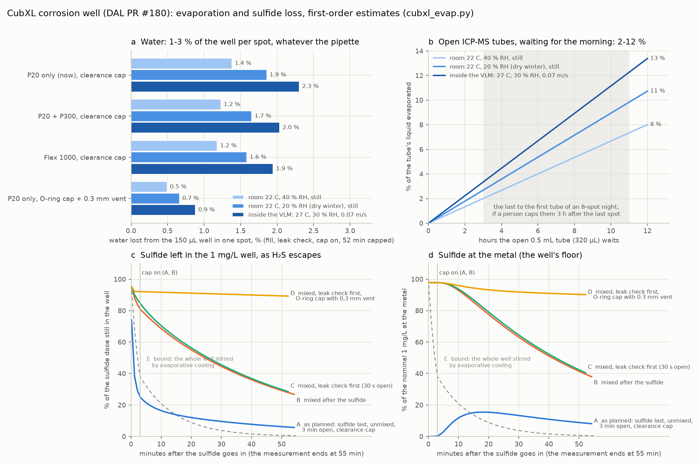

# The CubXL's pipettes, water and sulfide lost from the well, and a sturdier reference electrode

Asked for on [PR #318](https://github.com/vertical-cloud-lab/byu-vcl/pull/318#issuecomment-7046840630) (Sterling,
2026-11-20), handed off as [#365](https://github.com/vertical-cloud-lab/byu-vcl/issues/365):

> "For the CubXL, would it make sense to put both a P20 and a P300 onboard? It seems like there are a lot of small
> transfers to fill things up, and I worry a bit about evaporation (you could run some basic calculations related to
> that?). Maybe it's fine though. Or maybe an Opentrons Flex pipette (5-1000 uL)."
>
> "We should also probably use something more robust than the Ag/AgCl reference electrode (and there are probably
> some that require far less maintenance)"

The CubXL on tray A runs DAL's copper corrosion screen
([digital-alloy-lab PR #180](https://github.com/vertical-cloud-lab/digital-alloy-lab/pull/180), its branch at
[`633995b`](https://github.com/vertical-cloud-lab/digital-alloy-lab/tree/633995b/alloy-corrosion)), drawn in
[`cubxl_corrosion.md`](cubxl_corrosion.md). Code for this note: [`cubxl_evap.py`](../cubxl_evap.py) →
[`out/cubxl_evap.json`](../out/cubxl_evap.json), [`out/cubxl_evap.png`](../out/cubxl_evap.png).

## In short

- **Pipettes: add a P300 beside the P20; don't switch to a Flex.** One OT-2 GEN2 P300 single ($2,950) moves the 135 µL
  of seawater, the 150 µL collection and the rinse in single transfers: **6 transfers a spot instead of 33, and about 9
  min of head time instead of 22.5** (the CubXL's own measured step times). It is the pipette the PANDA firmware was
  written for, so CubOS drives it the way it drives the P20. Accuracy is a wash (±1-2 % at these volumes either way).
  What it really buys is mixing the well after the sulfide. A Flex 1-Channel 1000 µL ($3,600) would need a CAN FD and
  36 V integration that nobody has published, and it is less accurate at 15 µL than the P20 it would replace.
- **Evaporation is small. Sulfide loss is not.** A spot loses **1-3 %** of the well's water, so chloride rises 1-3 %;
  two thirds of that happens under the cap during the measurement, and the many small P20 transfers add only 0.2-0.4
  µL. The open ICP-MS tubes lose **2-12 %** waiting for the morning: use the morning weight, not 320 µL. But H₂S leaves
  the well far faster than water: under DAL's clearance cap the metal sees **between a tenth and two thirds** of the
  nominal sulfide over the measurement, depending on mixing that nobody controls. Seal the well for sulfide spots
  (DAL's O-ring cap keeps 89 %), mix after the sulfide, and do the leak check before it.
- **Reference: a leak-free Ag/AgCl element in a sleeve of the screen's own seawater.** No 2-3 mm reference has sulfide
  data, so keep the silver out of the sulfide: an LF-1.6 in a 3 mm sleeve of sulfide-free ASW, parked in ASW. No
  junction potential, no KCl into the well, about 50 µL to refill a week. Qualify the bare LF-2 in sulfide first: if
  it holds, it needs no sleeve at all.
- **The clip** [`cubxl_corrosion`](../out/mp4/instruments/cubxl_corrosion.mp4) now has the P300 on the head (§4).

## 1. The pipettes: add a P300 beside the P20; not a Flex, not yet

### What the P20 moves now

DAL's plan ([`protocol.md` §3-4](https://github.com/vertical-cloud-lab/digital-alloy-lab/blob/633995b/alloy-corrosion/copper/protocol.md)),
for a main spot at 1 mg/L S, with the CubXL's P20 single GEN2 (1-20 µL) only:

| Per spot | Volume | P20 transfers |
|---|---|---|
| ASW into the well, dispensed from above the meniscus | 135 µL | 7 × 19.3 µL |
| The 10 mg/L sulfide stock, last, same tip | 15 µL | 1 |
| The well's liquid to its 0.5 mL tube (a new tip) | 150 µL | 8 × 18.75 µL |
| DI water into the emptied well, for the rinse (a third tip: the collection tip has touched well liquid, so DAL's tip rule keeps it out of the DI vial) | 150 µL | 8 × 18.75 µL |
| The rinse to the tube | 150 µL | 8 × 18.75 µL |
| 1 M HNO₃ into the tube (the night's one acid tip) | 20 µL | 1 |
| **Total** | | **33** |

DAL counts 25 (8 + 16 + 1); how the rinse water gets into the well isn't written down (noted in
[`cubxl_corrosion.md`](cubxl_corrosion.md)), and drawing it with a clean tip adds 8.

### The three options

Accuracy is Opentrons' published systematic error (± %) and CV at each volume, interpolated on log volume between
its points ([GEN2 white paper](https://insights.opentrons.com/hubfs/Products/Pipettes/GEN2%20Pipette%20White%20Paper.pdf),
Table 1; Flex: [Pipette Accuracy data sheet](https://insights.opentrons.com/hubfs/Products/Pipettes/Tech%20Data%20Sheet_Pipette%20Accuracy.pdf),
May 2026). A series of n equal transfers keeps the systematic % and divides the CV by √n. Head time is
[`cubxl_evap.py`](../cubxl_evap.py)'s plan of moves, timed with the CubXL's own measured steps (§2, "How it is
computed").

| | **P20 only (now)** | **P20 + P300** (two OT-2 GEN2 singles) | **One Flex 1-Channel 1000 µL** |
|---|---|---|---|
| Range | 1-20 µL | 1-20 and 20-300 µL | 5-1000 µL, on 50, 200 or 1000 µL tips |
| 135 µL of ASW | 7 × 19.3: ±1.5 %, CV 0.3 % | P300, 1 × 135: ±1.2 %, CV 0.5 % | 200 µL tip: not specified below 200 µL (±0.5 %, 0.15 % at 200); 50 µL tip, 3 × 45: ±0.7 %, 0.2 % |
| 15 µL of sulfide stock | ±1.7 %, CV 0.9 % | the P20: the same | 50 µL tip: ±2.9 %, CV 1.5 % |
| 150 µL to the tube | 8 × 18.75: ±1.6 %, CV 0.3 % | P300: ±1.0 %, CV 0.4 % | not specified (200 µL tip) |
| 20 µL of acid | ±1.5 %, CV 0.8 % | the P20: the same (the P300 at its 20 µL floor: ±4 %, 2.5 %) | 50 µL tip: ±2.3 %, CV 1.2 % |
| Transfers a spot | 33 | 6 | 6 |
| Head time a spot | **22.5 min**: fill 6.0, collect and rinse 15.2, acid 1.3 | **8.9 min**: fill and mix 4.4, 3.2, 1.3 | 7.3 min: 2.9, 3.2, 1.3 |
| The well open before the cap goes on | 9 min | 7.4 min | 5.9 min |
| Mixes the 150 µL well after the sulfide? | barely: 20 µL strokes stir the top | yes, with the P300 | yes |
| New tips a spot | 3 | 4, the ASW tip serving the night as DAL's acid tip does (2 if the mixing tip waits in its slot to collect the same well, and a night tip adds the DI) | 3 |
| Size | 44.5 × 32.3 mm, 330.5 mm long | a second body the same size, 311.5 mm long | 64 × 50 mm, 374.5 mm long, 2.5 kg (Opentrons' sheet; may include packing) |
| On the head | as now, on Ben's PAW-V2 mount at (+55, +11) from the capper | a second bracket **34 mm in front of the P20** (an OT-2's two mounts are 34 mm apart) and **about 20 mm higher**: a 300 µL tip hangs 51.1 mm below its nozzle against 31 mm for a 20 µL tip (59.3 and 39.2 mm long, 8.2 and 8.25 mm on the nozzle), so both tip ends sit at one height on the CubXL's one Z axis (the model, which hangs the P20's tip 35 mm as DAL does, raises it 16) | an adapter plate for its two captive 2.5 mm screws and the contact pins on its back (the connector isn't published); 200 µL tips hang 48.6 mm |
| Driven by CubOS? | yes: the PANDA Arduino and a TMC2209 drive the pipette's bare stepper and limit switch over its 10-pin ribbon ([`opentrons-pipette-wiring.md`](../../cubos/docs/opentrons-pipette-wiring.md)) | **yes, the same way.** The PANDA firmware's stock constants *are* a P300 GEN2's (300 µL, `UL_TO_MM` 0.1098, the one constant upstream calibrated: [`cubos/firmware/README.md`](../../cubos/firmware/README.md)), and CubOS already has a `p300_single_gen2` model. Simplest: a second Uno + TMC2209 on its own `/dev/serial/by-id` port with Opentrons' P300 planes (bottom −14.5, blowout −19, drop-tip −37 mm; 9.18 µL/mm; 1.25 A to drop a tip) | **no, not without a project.** It is a smart device: STM32 with its own driver, pressure, capacitive and tip-presence sensors, on CAN FD at 500 kbit/s and 36 V. Opentrons' firmware and host code are open (Apache-2.0, `ot3-firmware`, `opentrons-hardware`), but no one has published running a Flex pipette off a Flex |
| Cost | owned | **$2,950** (999-00003) + about $40 (Uno, driver board) | $3,600 (999-00187) + a CAN FD adapter and a 36 V supply + the development |
| Tips | $8.50 a rack of 96 (20 µL) | 300 µL tips $8.50 a rack, in a rack of their own on the deck | $16 a rack (Flex tips) |

Prices from opentrons.com, read 2026-11-20. The $1,250 in [`docs/pipette-selection-cubxl.md`](../../docs/pipette-selection-cubxl.md)
is the 2023 price; the 2024 list had $2,250.

### What the P300 buys, and what it doesn't

- **Head time, 22.5 → 8.9 min a spot.** DAL's night is set by the measurement (52 min a spot), and the head already
  collects spot k−1 while spot k is measured, so most of the saving is slack. What comes off the night is the fill
  (6.0 → 4.4 min a spot with the P300's mixing, about 13 min over 8 spots). It also takes 27 transfers a spot, about 200 a night, off the
  P20's plunger and the gantry.
- **Accuracy: a wash.** Every option is within ±1-3 % at these volumes. The P20 is the right tool for the 15 µL of
  sulfide and the 20 µL of acid; the P300's single 135 µL is a little better than seven P20 draws in systematic
  error and a little worse in scatter.
- **Evaporation: not a reason** (§2: 0.2-0.4 µL a spot, against 1.3-2.2 µL lost under the cap during the measurement).
- **Mixing: the reason that matters.** §2 shows the sulfide added last needs mixing, and a P20 can't mix 150 µL.
- **One caution for every option: dispensing from above the meniscus.** Opentrons' figures are for dispensing into a
  vessel. A drop leaves a tip only when it outweighs the surface tension holding it (Tate's law): about 12 µL on a 20
  µL tip's 0.9 mm end, so a 19.3 µL dispense from above can leave part of a drop on the tip, and the blow-out may or
  may not shake it off. Touching off on the bore's wall above the meniscus settles it; a gravimetric check of the
  CubXL's own dispense move (into a weighed well) should come first, with any pipette.

**Recommendation: keep the P20 and add an OT-2 GEN2 P300 single beside it.** The P300 takes the ASW, the collection,
the rinse and the mixing; the P20 keeps the sulfide and the acid. It is the same pipette family, tips, wiring and
firmware the CubXL already runs, so the risk is mechanical: the bracket, and checking every move for the second
tool's shadow, as DAL's deck check does for the capper.

**Not the Flex 1-Channel 1000, for now.** It costs only $650 more than a P300 and its pressure and tip-presence
sensing would be welcome on an unattended night, but nobody has driven one off a Flex, it is 2.5 kg and 374.5 mm
long on a head built for a P20, and at 15 µL it is less accurate than the P20 it would replace. Revisit it if the
CubXL ever needs millilitre transfers, or once someone publishes a Flex pipette on a third-party gantry.

## 2. Evaporation, and what really moves the sulfide

### How it is computed

[`cubxl_evap.py`](../cubxl_evap.py) extends DAL's own cap check
([`copper/cad/cad_check.py`](https://github.com/vertical-cloud-lab/digital-alloy-lab/blob/633995b/alloy-corrosion/copper/cad/cad_check.py),
which gives the 1.6 µL/h under the cap and 6.1 µL/h with no cap that the protocol quotes). The model and its inputs:

- **Water vapour diffuses** from the liquid surface up the still air in the well's bore, then out: through the open
  mouth (an end correction of 0.8 r into still air), through the clearance cap's 0.12 mm skirt gap over its 3.2 mm
  land, or through the O-ring cap's 0.3 mm vent (DAL's fallback `electrode_cap_oring`; the vent's length, 6 mm, is
  assumed). Geometry from DAL's `cad_parts.json`: an 8 mm bore to 10 mm above the metal, 150 µL standing 4.4 mm.
- **Seawater's** vapour pressure is 1.9 % below pure water's (water activity 0.981). Saturated vapour 19.4 g/m³ at 22 °C,
  D = 0.25 cm²/s (Massman 1998), as DAL uses.
- **The VLM's airflow.** [`services.md`](services.md) sizes the VLM's ventilation at 1100-2200 m³/h for a 5-10 K rise;
  over the enclosure's 2.83 × 3.12 m plan that is **0.035-0.069 m/s** on average. Moving air thins the boundary layer
  over a mouth (laminar flat plate, 0.664 Re^½ Sc^⅓, blended with still-air diffusion). 0.3 m/s stands for a spot near
  an inlet. The air in the bore below the mouth is taken as still; the bound with the bore swept clean is in the JSON
  (`open_well_bore_flushed_bound`) and is 2.8-6 times higher.
- **Conditions.** The room at 22 °C and 40 % RH (DAL's), a dry Provo winter at 20 % RH, 60 % RH, and the inside of
  the ventilated VLM: 5 K over the room (its design rise), so room air at 40 % RH is 30 % in there.
- **The fill's timing** comes from the head-time model of §1: step times measured on the CubXL itself
  ([`pipette_test_20261007`](../../cubos/results/pipette_test_20261007/SUMMARY.md): aspirate 12.8 s, dispense 7.2 s,
  a 33 mm move 5.0 s at F3000, decap 7.3 s, cap 7.0 s, tip pickup 8.4 s, drop 12.8 s).

### The well: 1-3 % of its water per spot

| Water lost from the 150 µL well in one spot | 22 °C, 40 % RH, still | 22 °C, 20 % RH | VLM: 27 °C, 30 % RH, 0.07 m/s |
|---|---|---|---|
| Fill, P20 (8 transfers, 6.0 min) | 0.44 µL | 0.59 µL | 0.78 µL |
| Fill, P20 + P300 (2 transfers and a P300 mix, 4.4 min) | 0.21 µL | 0.28 µL | 0.37 µL |
| Leak check and cap going on (3 min open) | 0.29 µL | 0.39 µL | 0.53 µL |
| 52 min of electrochemistry under the clearance cap | 1.34 µL | 1.81 µL | 2.15 µL |
| **Whole spot, P20 only** | **2.07 µL (1.4 %)** | **2.79 µL (1.9 %)** | **3.46 µL (2.3 %)** |
| Whole spot, P20 + P300 | 1.84 µL (1.2 %) | 2.48 µL (1.7 %) | 3.05 µL (2.0 %) |
| Whole spot, P20 only, O-ring cap with its 0.3 mm vent | 0.74 µL (0.5 %) | 0.99 µL (0.7 %) | 1.32 µL (0.9 %) |

- **Chloride rises by the same fraction:** 0.55 M becomes 0.557-0.563 M by the end of a spot. That is within the
  batch-to-batch spread of a made-up ASW and small against what the protocol varies.
- **The many small transfers cost 0.2-0.4 µL** (0.15-0.3 % of the well) against the P300's fill: the well is open
  for a few minutes either way, and 65 % of the loss happens under the cap during the measurement. **Evaporation is
  not a reason to change the pipette.**
- **Under the cap the airflow hardly matters** (1.55 → 2.48 µL/h in the VLM case, mostly from the 5 K warmer air):
  the 0.12 mm gap is the bottleneck. With no cap at all the VLM's air would matter more: 5.8 → 10.5 µL/h at 0.07 m/s
  and 27 °C, and up to 39 µL/h if the moving air swept the bore (an upper bound).
- **The tip** carries 19.3 µL for about 8 s with a 0.6 mm opening: a few nanolitres. Its known effect is inside the
  tip: at low RH the first aspiration of a fresh tip under-delivers until the air cushion is saturated, which ISO
  8655 handles by pre-wetting. Seven transfers with one tip pre-wet themselves after the first.

### The open ICP-MS tubes: the biggest water loss on the deck

Each spot's 320 µL waits in an open 0.5 mL polypropylene tube until a person caps the rack in the morning (DAL,
`cubxl-setup.md` §5). The meniscus is 13 mm below the rim (`instruments_lab.tube_level`): **2.1 µL/h** at 22 °C and
40 % RH, **3.6 µL/h** inside the VLM. Over an 8-spot night, with the tubes capped 3 h after the last spot, the tubes
lose **2-7 %** of their liquid at 40 % RH and **3-12 %** inside the VLM (figure, panel b). Every element in a tube
reads high by that much if its concentration is multiplied by the nominal 320 µL.

DAL already weighs each tube in the morning (`protocol.md` §4, step 11: "recovered mass within *choose* % of what was
dispensed"). **Use the morning mass, not 320 µL, to turn ICP-MS concentrations into micrograms, and expect that check
to read low by the evaporation, not by a pipetting loss.** Cheaper still: a loose printed lid over the tube rack, as
the electrode cap does for the well, cuts it about fourfold.

### Stock vials and cups

| | 22 °C, 40 % RH | VLM case |
|---|---|---|
| A 20 mL stock vial with its cap off | 10 µL/h | 19 µL/h |
| ASW, open about 5 min a spot (P20), 8 spots | 7 µL a night, 0.04 % of 18 mL | 13 µL, 0.07 % |
| A capped stock, PDMS cap sealing (water through 2 mm of PDMS, assumed 36,000 Barrer) | 2.9 µL/day: 0.3 % in 3 weeks | 4.6 µL/day: 0.5 % |
| A capped stock, if the cap leaves a 50 µm gap round the rim | 28 µL/day: **3.3 % in 3 weeks** | 45 µL/day: **5.3 %** |
| A 4 mL rinse cup, open all night | 6.9 µL/h: 0.08 mL a night | 12.5 µL/h |

- **Opening a stock for transfers costs nothing that matters.** What matters is whether the capper's printed caps
  seal when they sit on the vial. Ben's caps are press-fit PLA filled with PDMS (`modules/electromagnetic-capper`);
  DAL's cap check describes them as "resting almost free". A stock is meant to last weeks (`cubxl-setup.md` §5), so a
  leaky cap would walk the ASW's chloride up by 3-5 % over its life. **Weigh each stock vial when it is filled and
  each week**; refill at a 1 % loss.
- **The sulfide stocks lose sulfide, not water, each time they open.** The headspace's H₂S goes and the surface loses
  more while the cap is off: **0.47 % of the stock's sulfide per single draw**, 1.5 % for the eight P20 draws of a
  well made of stock alone (the 0.1 and 10 mg/L targets) against 0.46 % for one P300 draw. Over a night of sulfide
  spots that is a few percent, consistent with DAL's plan to make the sulfide stocks fresh each night and to measure
  them at the start and end.

### Sulfide in the well: H₂S escapes far faster than water

This is the number that matters, and it does not depend on the pipette. At pH 8.2 in seawater only 2.3 % of the
dissolved sulfide is H₂S (pK₁* 6.57 at 22 °C, Millero, Plese & Fernandez 1988), but H₂S is volatile (air/water
partition 0.38, Sander 2015). The same paths that let water vapour out let H₂S out, with the sulfide in the well
diffusing up to the surface to replace it (D = 1.6 × 10⁻⁹ m²/s; the well is 3.0 mm deep, 93 min of diffusion time).
[`cubxl_evap.py`](../cubxl_evap.py) solves that in one dimension for the 1 mg/L well (135 µL of ASW, then 15 µL of the
10 mg/L stock), from the moment the sulfide lands to the end of the measurement:

| 1 mg/L well, 22 °C, 40 % RH | Left in the well when the cap goes on | Left at the end (55 min) | At the metal, mean over the measurement |
|---|---|---|---|
| A. As planned: sulfide last, not mixed (a 0.3 mm layer on top), leak check and cap-on open (3 min), clearance cap | 25 % | 6 % | **11 %** of nominal |
| B. As A, mixed at once after the sulfide | 81 % | 26 % | **66 %** |
| C. Mixed, and the leak check done before the sulfide (30 s open), clearance cap | 92 % | 28 % | **70 %** |
| D. As C, with the O-ring cap (sealed but for its 0.3 mm vent) | 92 % | 89 % | **93 %** |
| E. Bound: the whole well stirred (below), 3 min open, clearance cap | 38 % | 0.4 % | 8 % |

- **The clearance cap holds water but not H₂S.** It cuts the gas path's conductance about fourfold, which takes water
  loss from 6 to 1.6 µL/h. For sulfide that only takes the escape velocity at the surface from 16 to 4.3 µm/s, and
  both are far above what diffusion in the liquid can deliver (D/depth ≈ 0.5 µm/s). So the loss is set by diffusion
  in the well either way: the sulfide halves in about 30 min, cap or no cap. Only a cap that seals (D: 0.03 µm/s)
  keeps it.
- **Mixing matters as much as the cap.** Dispensed from above onto 135 µL of ASW and left, the sulfide spends its
  first minutes in a thin layer at the surface, where it escapes, and needs an hour and a half to diffuse down to the
  metal (A). The drop's own impact mixes some of it, so the truth for the plan as written is between A and B. A few
  aspirate-dispense cycles in the well with the sulfide tip, which goes to the waste anyway so DAL's tip rules allow
  it, move it to B.
- **E, the other bound.** Evaporation cools the surface: 79 W/m² open, 21 W/m² under the clearance cap, so the surface
  sits 0.4 K and 0.1 K below the metal, which gives a Marangoni number of 1300 and 340 against an onset near 80 for
  a layer cooled from above. A clean ASW surface may well turn over, and then the loss runs at the gas side's rate: τ =
  depth / 4.3 µm/s = 12 min under the clearance cap. With the O-ring cap evaporation stops, so does the stirring
  (Marangoni number 3), and D stands.
- **The copper takes sulfide too.** Over 63 min at DAL's fresh-surface 1-11 µA/cm² on the 0.10-0.13 cm² wetted, the
  metal releases 4-54 nmol of Cu(I), enough to bind 2-27 nmol of sulfide as Cu₂S, against 4.7 nmol in a 1 mg/L well.
  That sink is the experiment's own and is not modelled; it comes on top of the H₂S.
- **The wells made of stock alone** (0.1 and 10 mg/L: 150 µL of a stock) lose sulfide during the fill, and here the
  pipette does matter: 8 P20 transfers over 6 min leave **42 %** of the sulfide in the well when the cap goes on and 14
  % at the end; one big transfer leaves 83 % and 27 %.

**So DAL's sulfide axis is not what the stocks say** with the clearance cap: the metal sees somewhere between a tenth
and two thirds of the nominal dose, averaged over the measurement, depending on mixing that nobody controls. That is a
larger and less certain error than anything in the pipetting. DAL already flagged the still well's oxygen limit as
compressing the sulfide response (`protocol.md` §3); this is a second, independent compression.

### Fixes, ranked by what they buy

1. **Seal the well for sulfide spots**: DAL's own fallback O-ring cap (`electrode_cap_oring`, with its 0.3 mm vent),
   or a clearance cap with a much longer, narrower gap. It keeps 89 % of the sulfide (D) and stops 98 % of the
   water loss under the cap. Its catch is DAL's: 2.3-85 N to pull it off against the electromagnet's ~23 N. Sulfide
   spots are the place to solve that (a lever, or a cap the gantry pushes off sideways), since only they need it.
2. **Mix after the sulfide**, with the tip that added it (3-5 aspirate-dispense cycles, about 45 s on the CubXL). A
   P300 mixes a 150 µL well properly; a P20's 20 µL strokes stir the top of it.
3. **Do the leak check before the sulfide**, on the ASW alone, then add the sulfide, mix and cap within 30 s (C).
4. **Measure it.** A witness well on S4 (the PTFE blank) filled at the same dose, collected after the same 63 min into
   a zinc-acetate trap and read by methylene blue, tells the real dose. The tubes are acidified at once, which drives
   off H₂S, so the main tubes can't tell it.
5. **Make the 0.1 and 10 mg/L wells in one transfer** (a P300), or from a premixed vial, not 8 P20 draws of stock.
6. **For water**: weigh the tubes and the stocks, as above; a lid over the tube rack. Lowering the room's dryness or
   humidifying the VLM is not needed for the well: 1-3 % per spot is fine.

## 3. A reference electrode that survives the screen

### Why Ag/AgCl is the weak point here

- **Sulfide turns silver chloride into silver sulfide.** A sulfided Ag surface reads the sulfide activity (about 29 mV
  a decade) instead of the chloride, and sits roughly half a volt negative of Ag/AgCl in seawater at these doses
  (standard thermodynamic data; the exact figure hangs on H₂S's poorly known second dissociation constant). That is a
  dead reference, not a drift.
- **A porous junction blackens.** In a conventional reference the filling is AgCl-saturated KCl, so silver ions meet
  incoming sulfide inside the frit and Ag₂S clogs it. That is why pH-electrode makers offer silver-ion traps and long
  diffusion paths for sulfide samples (Mettler Toledo's ARGENTHAL, Hamilton's Everef).
- **A porous junction also feeds the well,** and so does storage: DAL's sequence goes from the park cup straight onto
  the next well (`decap park_cup`, `cap S_k`), so a film of whatever the reference is stored in, say 3 M KCl, rides
  into 150 µL each time. Store it in the screen's own seawater and the carry-over is harmless.
- **How much sulfide it sees** depends on §2's fixes: with the clearance cap the well's sulfide halves in about half an
  hour; with the sealed cap that §2 recommends for sulfide spots, the reference sits in up to 10 mg/L for an hour.

### The options

| | Sulfide | Upkeep | Into the well | Size | Impedance | Cost |
|---|---|---|---|---|---|---|
| **Leak-free Ag/AgCl** (Innovative Instruments LF-1, LF-1.6, LF-2; eDAQ's ET072-1 is the same 2 × 65 mm format) | no data. The junction is "highly conductive but not porous", so nothing flows through it. Walker & Dick show such junctions work as bipolar electrodes ([*Anal. Chem.* 93, 10065, 2021](https://doi.org/10.1021/acs.analchem.1c00675); [*Analyst* 148, 2149, 2023](https://doi.org/10.1039/D3AN00107E)), so sulfide reacting at its outer face could move the reading: untested | "completely sealed, never needs refilling ... can be used for months, if not years"; no KCl storage; recovers after drying out ([data sheet](https://www.2in.com/products/reference/LFinfo.pdf)) | "does not introduce potassium, chloride or other ions" | 1.0, 1.6 or 2.0 mm | under 10 kΩ (a reseller's figure) | quote; DAL budgets ~$250 |
| WPI Dri-Ref, DRIREF-2 / SUPER-Dri-Ref SDR2 | no data | stored in KCl; "long life" | ~5.7 × 10⁻⁸ mL/h (DRIREF-2); "does not leak electrolyte at all" (SDR2); the KCl it is stored in rides in unless rinsed | 2 mm × 13 / 9 cm | ~2.7 kΩ / under 5 kΩ | $158 / $219 ([WPI](https://wpiinc.com/blog/post/compare-dri-ref-reference-electrodes)) |
| Double-junction Ag/AgCl, outer fill replaceable | slows sulfide down; the outer fill is changed, not the element | refill the outer chamber | the outer fill, slowly | **none at 2-3 mm found**: Pine 9.5 mm, BASi 6 mm, Gamry 4 mm | higher than single | $150-300 |
| Ag/AgCl with a replaceable frit (refillable single junction, e.g. Microelectrodes Inc. MI-402, 2 mm × 9.5 cm, 3 M KCl) | the frit blackens and clogs | refill after "many weeks", swap frits | 3 M KCl, through a porous junction | 2 mm | low | $167 ([maker](https://www.microelectrodes.com/product-page/mi-402-flexible-micro-reference-electrode)) |
| Gel or polymer references with a silver trap (Mettler ARGENTHAL/Xerolyt, Hamilton Everef) | made for sulfide samples | none until spent | slow | only as 3 mm and larger combination pH electrodes, no mini reference alone | — | — |
| Hg/Hg₂SO₄ (chloride-free) | mercury forms HgS just as silver forms Ag₂S | refill | saturated K₂SO₄ | 4 mm at the junction at the smallest | — | mercury on a robot deck |
| Silver-free iodine/iodide (Thermo ROSS) | no precipitate; Thermo recommends it for sulfide samples | refill | KCl | 16 mm alone; 3 mm only as a pH combination electrode | — | — |
| A pseudo-reference in the well: bare Ag/AgCl wire (the cathodic-protection "Ag/AgCl/seawater"), zinc, Pt | Ag/AgCl wire: poisoned outright, and it takes sulfide out of the well; zinc forms ZnS and puts Zn²⁺ into the ICP-MS sample; Pt answers O₂ and sulfide | none | the electrode itself | any | low | ~$0 |
| Ionic-liquid salt bridge (HORIBA PUREIL) | probably fine | low | the ionic liquid | full size only | 100 kΩ to MΩ: poor at 100 kHz | — |
| Solid-state composite with suspended AgCl ([Macedo et al., *Analyst* 149, 5225, 2024](https://doi.org/10.1039/d4an01076k)) | built for it: "sulphide species are precipitated as Ag₂S, inhibiting their diffusion through the polymer composite" | none | none | made, not bought | higher than liquid-filled | a research electrode |

No 2-3 mm reference electrode has published sulfide data. The approach with a track record keeps the silver out of
the sulfide: voltammetry in sulfidic sediments puts the Ag/AgCl reference in the overlying water, not the sulfide zone
(e.g. [Luther et al., *J. Environ. Monit.* 3, 61, 2001](https://doi.org/10.1039/b006499h)).

### Recommendation: a leak-free element in a sleeve of the screen's own seawater

1. **A leak-free Ag/AgCl element (LF-1.6) inside a 3 mm sleeve filled with sulfide-free D1141, with a porous ceramic
   or Vycor tip, parked in that same seawater.** It is a double junction whose outer fill is the well's own background
   electrolyte:
   - the silver never meets sulfide: what crosses the tip in an hour (about 0.2 nmol at 10 mg/L through a 1 mm
     ceramic pin, a few µM in the sleeve) diffuses back out into the park cup's clean seawater before the next spot;
   - seawater against seawater gives no junction potential to speak of, and nothing but seawater reaches the well;
   - upkeep is refilling the sleeve (about 50 µL) weekly, or whenever DAL's nightly check against the master
     reference moves past its limit; the sealed element lasts months to years;
   - it fits: a 3 mm sleeve in the cap's centre, the Pt coil (2.6 mm radius) around it, the tip still 3 mm above the
     metal; the cap's capillary hole goes from 2 to 3 mm;
   - the sleeve adds a few kΩ; for the 100 kHz end of DAL's EIS, couple a short Pt wire to the reference through
     0.1-1 µF (the usual dual-reference fix in Gamry's and Metrohm's EIS notes).
2. **Qualify the bare LF-2 first.** If a week in 10 mg/L S seawater moves it less than 2 mV against the master
   (through a salt bridge), it is the lowest-upkeep option of all and needs no sleeve.
3. **Either way, store the reference in the screen's seawater, not KCl** (§ above), run the sulfide spots last in the
   night, and keep DAL's nightly master check: it is what tells a poisoned reference from a real result.
4. **Not** a bare silver wire, zinc or platinum in the well, a mercury electrode, or a refillable fritted Ag/AgCl.
   Watch the sulfide-resistant solid-state composite: it is the right idea, but not yet a part to buy.

The model keeps its 2 mm leak-free reference in the cap: the choice waits on the bare LF-2's sulfide test (2), and the
sleeve would only make it 3 mm.

## 4. The model and the clip

The P20 + P300 choice is clear enough to draw, so [`r9_cubxl.py`](../r9_cubxl.py) (the CubXL every scene loads,
through `tour.load` and [`cubxl_rig.py`](../cubxl_rig.py)) now has it. DAL's protocol is not changed: the clip is this
note's proposal, and says so.

- **The P300 sits 34 mm in front of the P20** (CubOS offset (+55, −23) from the capper; an OT-2's two mounts are 34 mm
  apart), its nozzle 16 mm higher, so a seated 300 µL tip ends 35 mm below the carriage as a P20 tip does. Beside the
  P20 in x, at (+89, +11), the capper would come down on the cup block whenever the P300 worked at S1. Only one tip is
  on the head at a time: on one Z axis, a tip on the idle pipette would hang into whatever is under it.
- **Its tips: a printed 2 × 4 rack at the deck's front left** (x 55-82, y 10-19). With three tools on one carriage,
  every pickup puts the capper, the camera and the bare P20 somewhere else on the deck; the middle of the deck, the
  obvious place, puts the capper over Ben's rack 1 when either pipette draws from the holder, or the camera over rack
  2. The front left is clear of all of them, but holds 12 tips at most (3 × 4). A night of 8 spots needs about 10 if
  each spot's mixing tip is set back in its slot and reused for that well's collection and rinse, as DAL already does
  with the acid tip, and the ASW and DI tips (which only touch their own stock) serve the night; the clip draws the
  simpler 3 new tips a spot.
- **The spot:** the P300 fills S1 with 135 µL of ASW in one transfer and returns that tip to its rack; the P20 adds the
  15 µL of sulfide; the P300 mixes S1 (3 strokes of 80 µL, a fresh tip); after the measurement the P300 moves the
  150 µL to tube 1, then a fresh tip adds 150 µL of DI water (the capper now opens the DI vial, which round 9 left
  shut), rinses S1 with two strokes and carries it to the tube; the P20 adds the acid as before. The panel shows what
  each tip holds. The cap-parking vial of round 9 is still on the deck but this order doesn't need it: no two stocks
  are open at once.
- **Head time** in the clip's captions is [`cubxl_evap.py`](../cubxl_evap.py)'s, from the measured step times.
- Scenes that load the CubXL through `cubxl_rig` (the workflow and the long-form's tray A) will show the P300 at
  their next render; `cubxl_rig.pose` now also sets the P300's tip liquid. None of them is re-rendered here.

**Audit and render:** in progress (this session); see the PR description for the result.

## 5. Open

- **Bench checks before anything is bought.** (a) Weigh what the P20 and a P300 actually deliver with DAL's
  dispense-from-above move (Tate's law says a 20 µL tip can hold a 12 µL drop). (b) A dye test: 15 µL of dyed ASW onto
  135 µL in a printed well, filmed from the head camera, settles whether the drop mixes itself (between A and B of §2).
  (c) Sulfide in a witness well after 63 min under each cap, by methylene blue, to check §2's model. (d) The bare LF-2
  for a week in 10 mg/L S seawater against the master (§3).
- **DAL's calls, not this note's:** an O-ring cap for sulfide spots, and how the electromagnet gets it off; the mixing
  step; the leak check before the sulfide; using the morning tube mass.
- **Hardware for the P300:** a bracket on Ben's PAW-V2 mount; a second Uno and TMC2209 on their own
  `/dev/serial/by-id` port (never `ttyACM*`: see CLAUDE.md on the Pico and the Arduino); Opentrons' P300 plunger
  planes in the firmware, checked gravimetrically as the P20's still have to be; 1.25 A to drop a tip. Whether a
  CubOS protocol can name which of two `pipette` instruments a step uses is untested.
- **The deck:** the front-left rack holds 12 P300 tips at most within the head's shadows; anything more means moving
  Ben's labware, which is DAL's conclusion for any third tool on the head too (`cubxl-setup.md` §3).
- **Not modelled:** the copper's own uptake of sulfide (§2 gives its size), sulfide oxidation by air, and the reference
  sleeve (§3).

Reproduce: `python3 cubxl_evap.py` (a few seconds) → `out/cubxl_evap.json`, `out/cubxl_evap.png`;
`VIZ3D_FPS=12 xvfb-run -a python3 tour.py cubxl_corrosion` → the clip; `python3 interference.py cubxl_corrosion` →
its audit in `out/interference.json`.
