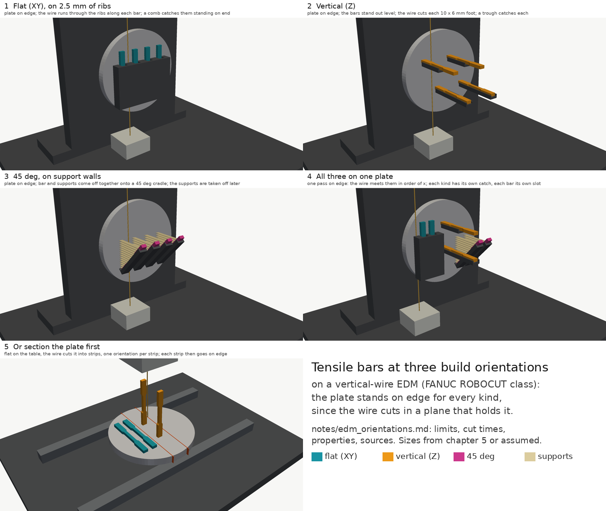

# Tensile bars at different build orientations, through the automated wire EDM (#303)

Sterling, on PR #318 (2026-11-05 22:56 UTC): "Noting that sometimes we're going to be doing tensile bars at different
orientations. How is that going to work with the automated EDM process? Do this, and also open a new PR focused on
that." This branch is that PR: [`edm_orientations.py`](../edm_orientations.py) draws each set-up on the EDM, and this
note says why it is drawn that way. Chapter 5 on PR #318 (`alloy_workflow.py`) now prints two orientations on its plate
(four flat bars and two vertical ones) and cuts them in one set-up; this study adds the 45 deg bars and the options.

| | |
|---|---|
| Five panels, one image | [`out/edm_orientations.png`](../out/edm_orientations.png) |
| Each panel at 1280 x 720 | [`1`](../out/edm_orientations_1.png) flat, [`2`](../out/edm_orientations_2.png) vertical, [`3`](../out/edm_orientations_3.png) 45 deg, [`4`](../out/edm_orientations_4.png) all three on one plate, [`5`](../out/edm_orientations_5.png) sectioning the plate first |

## Why the lab wants all three

LPBF builds a part in layers, so a bar's properties depend on how its axis lies against them. Pulled along the layers
(a flat bar, XY), a crack has to cross every melt track; pulled across them (a vertical bar, Z), it can run along a
layer's boundary and the lack-of-fusion pores that lie in it, and the columnar grains that grow along the build
direction are loaded end on. So vertical bars are usually the least ductile, and a powder or a process is qualified with
bars in each orientation (ISO/ASTM 52921 names them by the order of the bar's longest, middle and shortest axes: a flat
bar is XYZ, one on its edge XZY, a vertical one ZXY; ISO 17295:2023 reportedly replaces 52921).

For AlSi10Mg, the alloy the route prints:

- Renishaw's RenAM 500 data sheet, ASTM E8 bars, 30 um layers, as built: yield 283 +- 4 MPa flat against 263 +- 8
  vertical, UTS 424 +- 4 against 442 +- 9, elongation **10 +- 1 % against 6 +- 1 %**; stress relieved, 19 +- 1 % against
  16 +- 2 %. Its 60 um, multi-laser parameter set gives 8 +- 1 % both ways, so how much the orientation matters depends
  on the parameters, which is what the lab is for.
  ([Renishaw, AlSi10Mg data sheet](https://renishaw.com/media/pdf/en/7c2c31958ccf46e8bb3e40c9d287ca9b.pdf); a vendor's
  figures, not peer reviewed.)
- Hitzler et al. tested six orientations as built: UTS 314-399 MPa, elongation 3.2-6.5 %
  ([J. Mater. Process. Technol. 243 (2017) 48-61](https://doi.org/10.1016/j.jmatprotec.2016.11.029); abstract only
  read here, so the value for each orientation is not quoted).
- Tang and Pistorius found vertical bars yield earlier, from micro-residual stress between the aluminium cells and the
  silicon network ([JOM 69 (2017) 516-522](https://doi.org/10.1007/s11837-016-2230-5); abstract only).
- The trend is not universal: Mfusi et al. found their flat bars the weakest and least ductile and their 45 deg bars
  the most ductile ([IOP Conf. Ser. 430 (2018) 012028](https://doi.org/10.1088/1757-899X/430/1/012028); abstract only).
  Another reason to measure all three rather than assume.

## How the wire EDM takes each one off

A wire EDM cuts in a plane that contains the wire. On an ordinary machine the wire is vertical (or tilted by the taper,
below), so the only way to cut a part off along the plate's face is to **stand the plate on edge**, its face parallel
to the wire: "the WEDM cutting is performed by placing the platform vertically so that the wire can cut the part at
the desired distance from the build platform" ([Calignano and Mercurio 2024](https://iris.polito.it/retrieve/handle/11583/2984505/718036),
Int. J. Interact. Des. Manuf., [doi:10.1007/s12008-023-01644-7](https://doi.org/10.1007/s12008-023-01644-7));
Modern Machine Shop describes plates "held essentially on-end" with C-clamps, and parts that "wiggle and touch the
wire" or fall onto one another, held with magnets or glued rubber bands
([MMS, 2020](https://mmsonline.com/articles/cutting-am-parts-from-build-plate-turns-wire-edm-upside-down)); a patent has
the plate fixed "so the plurality of additive manufactured parts extend out horizontally"
([US11760031B1](https://patents.google.com/patent/US11760031)). GF's CUT AM 500 does the same with a horizontal wire
instead: the plate is clamped right side up, then turned upside down, and the parts fall into the tank or a basket
(same MMS article; [MoldMaking Technology](https://www.moldmakingtechnology.com/products/edm-speeds-up-additive-part-separation-preserves-part-integrity)).

So the orientation does **not** change the fixturing: one zero-point receiver on an angle plate takes the plate on edge
for all three (chapter 5's fixture). What it changes is what the wire cuts, how the bar falls, and what catches it:

| Printed | On edge, the bar... | The wire cuts | Area per bar | Catch (our design) |
|---|---|---|---|---|
| Flat (XY), on 2.5 mm ribs (or flat on the plate, as DAL's Utah build) | lies on the face, its axis vertical | along its length, through the ribs, 1.2 mm off the face | about 850 mm^2 of bar (the E8 subsize outline), or the ribs' share of it | a comb: a slot for each bar, its floor 0.5 mm under the bar's foot; an ejector pin lifts it 65 mm for the gripper (chapter 5) |
| Vertical (Z) | stands out of the face, level | across its foot, 10 x 6 mm | 60 mm^2 | a U trough under each, 0.5 mm under it; the gripper takes the free end from the front and draws it out (chapter 5) |
| 45 deg, on support walls | stands out forward and up, hung from its supports | its oblique foot (60 / sin 45 = 85 mm^2) and the supports' roots | about 85 mm^2 plus the supports | a channel at 45 deg under it, with a stop near the plate; the bar comes off with its supports, which are removed later |

Panel 4 is the lab's case, all three on one plate: the wire meets them in order of x, and each kind keeps its own
catch. The plate's layout has to leave each catch room: in chapter 5 the vertical bars sit at the plate's right, so
on edge their troughs hang off a post beside the flat bars' comb, and the upper trough stops 60 mm out so the lower
bar's free end is open to the gripper once the upper bar is gone.

**Flat on the table** only cuts through the plate, never along it, so a plate flat on the table is for sectioning:
cutting it into strips, one orientation per strip, which then go on edge one at a time (panel 5). That is worth it when
the plate is too big to stand on edge under the wire (below), or to send the strips of one orientation to a different
heat treatment. A 15 mm Al 6061 plate, 170 mm across, is about 2,550 mm^2 per cut.

### The machine's limits

| | FANUC ROBOCUT alpha-C400iC | alpha-C600iC |
|---|---|---|
| Largest workpiece | 730 x 630 x 250 mm, 500 kg | 1,050 x 820 x 300 mm, 1,000 kg |
| Travel X, Y, Z | 400, 300, 255 mm | 600, 400, 310 mm (410 option) |
| Taper | +-30 deg over 80 mm (+-45 deg over 40 mm with the 45 deg die guide) | +-30 deg over 70 mm (+-45 deg option) |
| Wire | 0.10-0.30 mm (0.05 with the thin-wire option) | |

([FANUC alpha-C400iC](https://www.fanuc.eu/eu-en/product/robocut/robocut-a-c400ic),
[alpha-C600iC](https://www.fanuc.eu/eu-en/product/robocut/robocut-a-c600ic).)

- **Height.** On edge, the plate's diameter is the workpiece's height: 170 mm, under the C400iC's 250 mm with room for
  the receiver. A plate over about 220 mm across would not stand under it, and has to be sectioned first or go on the
  C600iC.
- **What stands out.** Vertical bars stand 100 mm out of the face, level, so the table needs 100 mm in front of the
  plate's face, which the 630 mm workpiece depth gives.
- **Taper.** Not needed: every cut is parallel to the plate's face. A 45 deg bar's foot comes off oblique and is faced
  off when the bar is machined; the taper (30 deg standard) could not cut it square to the bar anyway.
- **Cut times.** FANUC publishes no cutting rate for these machines. GF quotes up to 300 mm^2/min for the CUT AM 500
  (printed as "mm2/m"); at that rate the chapter's plate (four flat bars, about 3,390 mm^2, and two vertical ones,
  120 mm^2: 3,509 mm^2) takes at least 12 minutes; a vertical bar alone, 12 s, a 45 deg one with its supports well under a minute.
  These are estimates from GF's figure, not FANUC's.
- **Supports.** Renishaw supports overhangs of 45 deg or less from the horizontal, and printed its angled bars "using
  minimal supports" (data sheet above). Supports with gaps break the wire: a Penn State study of 316L found wire breaks
  cutting through gaps in the supports, stopped by a lower voltage, and thicker supports cut more steadily
  ([abstract](https://pure.psu.edu/en/publications/optimal-design-of-am-support-structures-for-edm-removal-from-buil/)).
  So the ribs and walls here are solid where the wire crosses them. Yue et al. found 45 deg bars built on a solid
  body stronger than on supports, and both stronger than unsupported ones
  ([Mater. Sci. Eng. A, 2023, doi:10.1016/j.msea.2023.145375](https://doi.org/10.1016/j.msea.2023.145375); abstract).

## How each bar is tracked and picked

- **By position, from the build file.** The plate's ID is printed on its lug (or laser-marked on the plate). The
  build file lists every bar's orientation and its place on the plate; on edge each place maps to one slot of the comb,
  one trough or one cradle, and from there to one slot of the specimen rack (chapter 5: flat bars to slots 1-4,
  vertical ones to the end slots 0 and 5). The robot never has to identify a loose bar.
- **Checked by the wrist camera.** A number printed into each bar's grip end (raised, 0.3 mm) can be read by the
  D405 on the UR10e's wrist when the bar is picked, so a dropped or swapped bar is caught before the test.
- **Picked by its free end, every time.** A flat bar is lifted by its ejector pin and taken by its upper end, level; a
  vertical bar is taken by its free end, level, drawn out of its trough, then turned to hang from the gripper; a 45 deg
  bar is taken by its upper (free) end and lifted off its cradle along its own axis. Each ends up held by one grip
  end with the bar hanging below, which is how the rinse, the rack and the Instron's grips take it.

## What is assumed

The ribs, the walls under the 45 deg bars, the comb, the troughs and the 45 deg cradle are our designs, sized for the
E8 subsize bar (100 mm, 10 mm grip ends, 6 mm thick); none is a product. The catches stand clear of the wire's plane
(at least 1.4 mm in front of the face). Flushing may still move a bar as it comes free (MMS); the 0.5 mm settle and
the walls round each bar are there for that, but whether 0.5 mm is enough is untested.
