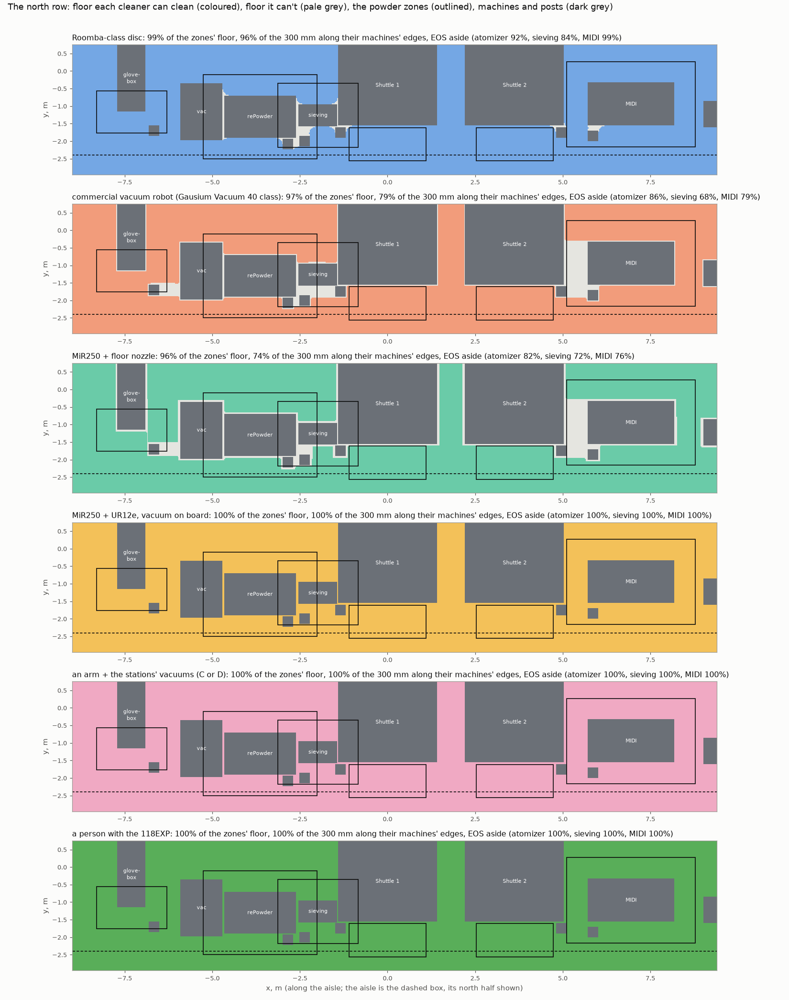
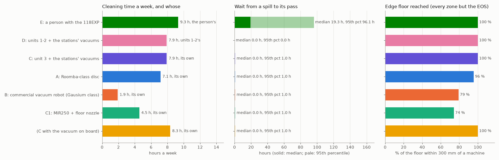
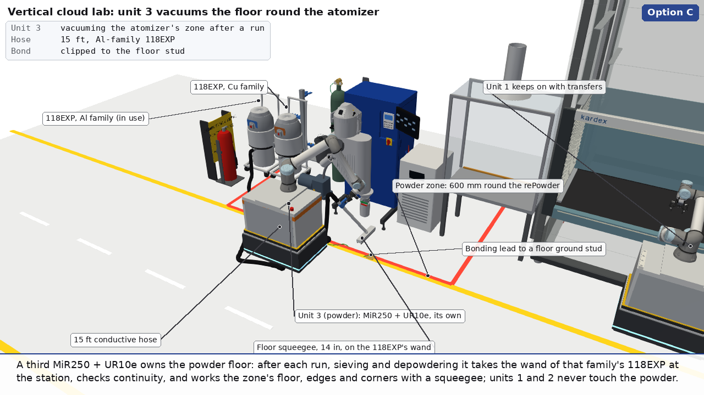
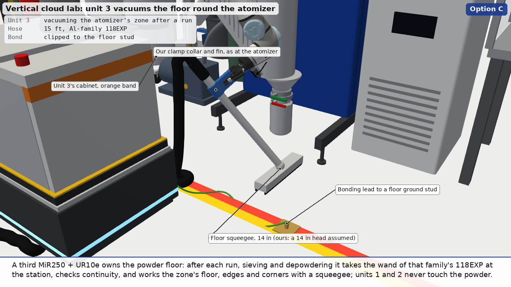
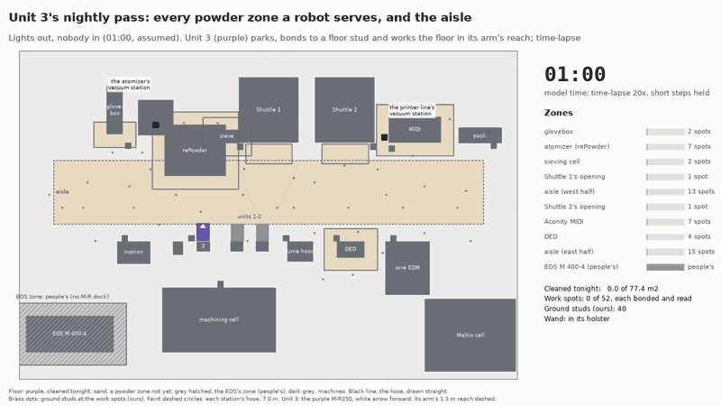
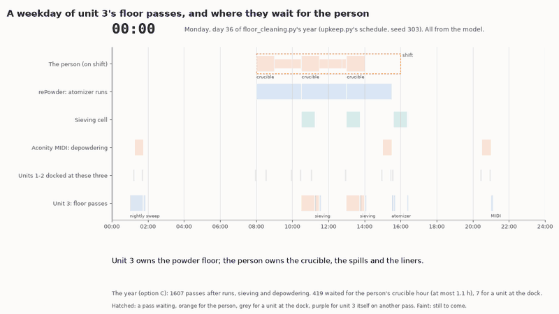
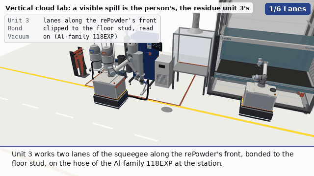

# Floor cleaning: who vacuums the powder off the floor (#366, #303)

Sterling, on PR #318 (2026-11-20): "Throughout the various workflows, we also need to be thinking about automatic floor
cleaning (e.g., a roomba-like device adapted to use an explosion proof vacuum) which could maybe be it's own (3rd)
MiR250 that has an explosion-proof vacuum and works in tandem with one of the mobile manipulators as needed. At that
point, could be worth just putting a UR12e on it anyway.. Idk.. open a new PR for me to explore that idea further."

In the same comment: "I wonder about trying to have a mobile ground bar of sorts (overhead), or maybe better, just making
sure ground is available within close reach pretty much anywhere nearby machines or where the mobile manipulator would
be." A floor-cleaning robot needs exactly that ([below](#grounding)).

This explores the idea. It doesn't decide it: the dust hazard analysis (DHA) and EHS decide what may clean this floor.

| File | What |
| --- | --- |
| [`floor_cleaning.py`](../floor_cleaning.py) | The model: what each kind of cleaner reaches on the lab's floor plan, how long its passes take, and its year booked into `upkeep.py`'s schedule |
| [`out/floor_cleaning.json`](../out/floor_cleaning.json) | Every number below, with its assumptions |
| [`out/floor_cleaning_reach.png`](../out/floor_cleaning_reach.png), [`out/floor_cleaning_year.png`](../out/floor_cleaning_year.png) | The reach maps, and the year compared |
| [`floor_clean_still.py`](../floor_clean_still.py) | The option to try first, in the lab: two stills and a short clip |
| [`out/floor_cleaning_still.png`](../out/floor_cleaning_still.png), [`out/floor_cleaning_still_close.png`](../out/floor_cleaning_still_close.png) | The stills |
| [`out/mp4/floor_cleaning_clip.mp4`](../out/mp4/floor_cleaning_clip.mp4), [`out/floor_cleaning_clip.gif`](../out/floor_cleaning_clip.gif) | The clip: two squeegee lanes along the rePowder's front |
| [`out/collisions/floor_cleaning_still.json`](../out/collisions/floor_cleaning_still.json), [`out/collisions/floor_cleaning_clip.json`](../out/collisions/floor_cleaning_clip.json) | Their collision checks: 0 hits |
| [`floor_pass.py`](../floor_pass.py) | [The whole nightly pass](#the-whole-pass-and-the-persons-part-animated), top-down: unit 3 through every zone and the aisle, on the model's floor, reach and pass rates |
| [`out/mp4/floor_pass.mp4`](../out/mp4/floor_pass.mp4), [`out/floor_pass.gif`](../out/floor_pass.gif), [`out/floor_pass_still.png`](../out/floor_pass_still.png), [`out/floor_pass.json`](../out/floor_pass.json) | It, its last frame, and its route, work spots, studs and minutes step by step |
| [`floor_clean_people.py`](../floor_clean_people.py) | [The person's part](#the-whole-pass-and-the-persons-part-animated), in the lab: a visible spill, swept up by the person, the residue left to unit 3 |
| [`out/mp4/floor_clean_people.mp4`](../out/mp4/floor_clean_people.mp4), [`out/floor_clean_people.gif`](../out/floor_clean_people.gif), [`out/collisions/floor_clean_people.json`](../out/collisions/floor_clean_people.json), [`out/collisions/floor_clean_people_person.json`](../out/collisions/floor_clean_people_person.json) | It, the arm's audit, and the person's clearance |

```bash
python3 floor_cleaning.py              # the model -> out/floor_cleaning.{json,_reach.png,_year.png} (about 15 s)
python3 runner_guard.py slot --label fcstill --mem 4500 -- xvfb-run -a python3 floor_clean_still.py       # the stills
python3 runner_guard.py slot --label fcclip --mem 4500 -- env VIZ3D_FPS=10 xvfb-run -a python3 floor_clean_still.py clip
ARM_AUDIT=1 VIZ3D_FPS=10 xvfb-run -a python3 floor_clean_still.py clip                                    # audit only
python3 floor_pass.py                  # the whole nightly pass -> out/floor_pass.{gif,json,_still.png} (about 3 min)
python3 runner_guard.py slot --label fcppl --mem 5000 -- env VIZ3D_FPS=10 xvfb-run -a python3 floor_clean_people.py
```

## The short answer

1. **No floor-cleaning robot on the market is rated for this powder.**
   - No autonomous floor cleaner has any ATEX, IECEx or Class II rating. The makers who address it forbid it:
     - Kärcher (KIRA B 50, B 200): "Never ... vacuum ... explosive dusts";
     - Tennant (T7AMR): "Flammable materials or reactive metals can cause an explosion or fire. Do not pick up.";
     - KEMARO (K900, a metalworking sweeper): "forbidden from working in ATEX zones".
   - MiR sells no vacuum top module.
   - No product standard covers a battery-powered or self-driving explosion-rated cleaner. EN 17348 excludes battery
     equipment, IEC 62784 excludes traction drives, and IEC 60335-2-72 excludes explosive dusts.
   - So "a Roomba adapted to an explosion-proof vacuum" means a one-off build that someone would have to certify
     against no standard.
2. **The robot must never be the thing that collects the powder.** Three rules from NFPA 484 (2022), which NFPA 660 now
   carries, decide the design:
   - The vacuum must be identified for Class II, Group E: metal dust (13.4.2, retroactive).
   - The bulk of a spill comes up with conductive non-sparking scoops and natural-bristle brushes first, and the
     vacuum takes only the residue (11.5).
   - Ground is re-verified every time the equipment moves (11.6.3.1, and NFPA 660 8.4.2.2.1.7 for dusts under 30 mJ:
     fine aluminium is 3-5 mJ).

   A listed vacuum that stays on wall power at a station passes all three, with a robot that carries only the
   conductive hose and tools. A vacuum riding on a MiR250 does not: the MiR's top-module supply is 480 W against the
   118EXP's 1,200 W, and the extra pack and inverter it would need are unlisted.
3. **The model** (`floor_cleaning.py`, on `setup_lab.py`'s floor plan and `upkeep.py`'s year):
   - **The one person can't take it on.** Passes by hand add 9.3 h a week and take their mean week from 31 to 39 h,
     with 15 weeks over 40. Powder would wait a median 19 h for its pass, and 4 days at the 95th percentile, over
     nights and weekends.
   - **Units 1 and 2 have the time.** Their transfers fill 8 % and 3.5 % of the year. They could do the 1,607 passes
     and nightly sweeps a year (7.9 h a week) with no alloys lost in the model, but they would carry powder on their
     wheels and grippers to every tray.
   - **Reach.** Of the floor within 300 mm of a machine's edge, where powder collects, an arm with a wand reaches
     100 %, on a station's hose or with the vacuum on board. A MiR250 with a nozzle reaches 74 %, a commercial vacuum
     robot 79 % and a Roomba-sized disc 96 %. These leave out the EOS, whose powder people handle.
4. **The option to try first is C: unit 3.** It is a third MiR250 + UR12e that owns the powder floor, and maybe the
   atomizer's powder steps too, which `atom_sleeve.md` already calls "the cleanest separation". A pass works like this:
   - It parks at a zone, clips its bonding lead onto a floor ground stud, and checks continuity on the station's
     fixture.
   - It scoops and brushes up anything loose, then works the floor with a squeegee and crevice tool on the wand of that
     family's 118EXP, which stays on wall power at its station.
   - It checks the floor's colour with its camera, against NFPA 484's own criterion: dust may not "obscure the color"
     of the floor (11.4.1).

   Get there in two steps:
   - **Now:** the stations, ground studs, tools and software, with units 1 and 2 doing the passes (option D).
   - **Later:** unit 3, when the atomizer runs most days or wipe checks find powder on units 1 and 2.
5. **Not recommended:**
   - a Roomba-class or commercial cleaner in the powder zones (A, B);
   - a third MiR250 carrying the vacuum with no arm (C1), including Sterling's tandem form, where it brings the vacuum
     and a unit holds the wand. It can't power the vacuum, can't scoop, misses a quarter of the edges, and has to stay
     grounded while it drives.

**Visible spills stay a person's job:** "For any visible layer on the floor: restrict access, ventilate, and call EHS"
(the lab's vacuum SOP, section 8). The robot's part is to see the spill, keep away and call the person.

## Where the powder lands

The zones are ours. DAL tapes a containment area round the atomizer, and `atom_base.py` draws it 600 mm round the
machine, so each source here is its footprint grown by 600 mm. The two exceptions:
- The Shuttles' openings: the 996 mm opening grown by 600 mm a side, from the lip out 950 mm (the docked MiR, and 300 mm).
- The aisle: the whole 3.0 m x 20.4 m of it, because the units carry jars, cups and plates along it.

| Zone | Free floor | What puts powder there | Passes a year (the model) |
| --- | --- | --- | --- |
| atomizer | 3.9 m² | the container off, the chamber vacuumed, liners sealed, the crucible hour; Al and Cu families on different days | 668, one after each run |
| sieving | 1.9 m² | jars, sieves and the tipper on the downdraft bench (`notes/alloy_print.md`) | 600, one after each sieving |
| MIDI | 5.8 m² | the 55 mm kit's powder change, unloading, the depowdering lance and box (`notes/alloy_workflow.md`) | 339, one after each depowdering |
| opening 1 | 2.1 m² | powder trays B (the multi-doser), D (XRD and SEM prep) and E (the Mastersizer) presented | nightly |
| opening 2 | 2.1 m² | tray M (the XRF's loose powder) presented | nightly |
| glovebox | 1.9 m² | powder in and out through the antechamber | nightly |
| DED | 3.9 m² | the powder-fed DED (`notes/instruments_lab.md`: InssTek MX-Lab class) | nightly |
| EOS | 7.6 m² | the EOS M 400-4's 100 kg powder containers, handled by people (no MiR dock, `notes/scaleup.md`) | nightly |
| aisle | 61.2 m² | drips and dust from what the units carry | nightly |

In all, 88 m² of the lab's 305 m² of open floor. The Meltio cell is not a zone: it feeds wire, not powder.

The floor is `setup_lab.py fit`'s plan (`out/tray_plan.json`). Two things are added, both ours:
- **The atomizer's vacuum station.** PR #353's clip (`atom_vacuum.py`) stands its pail, extinguisher and sign at the
  lab's y -2460 to -3260, which on the lab's plan is the aisle (y -2400 to -5400). Here the two 118EXPs (Al family
  west, Cu family east) stand west of the machine and behind the dock line, with the post, the pails, the extinguisher
  and the sign (`floor_cleaning.VAC_STATION`, 1.19 x 1.64 m, as `floor_clean_still.py` draws it). The lab's floor plan
  should take this or another place for it.
- **A charger for a cleaner of its own:** a third MiR Charge 48V in the south row, 1.6 m west of unit 1's (centre to
  centre), outside every powder zone (`floor_cleaning.BAY`). Charging belongs in an area set aside for it (OSHA
  1910.178(g)(1)), and Kärcher's manuals and Zone 22 conversions keep it out of any hazardous area.

## What's on the market

A survey on 2026-11-20 of maker pages, manuals and datasheets. Prices are dealers' unless marked; "quote" means
nobody publishes one.

**Autonomous floor cleaners: none is rated, and the makers who say anything forbid it.**

| Maker, model | Kind | Size, weight | What its papers say about combustible dust | Price |
| --- | --- | --- | --- | --- |
| Kärcher KIRA CV 60/1 | vacuum robot (BrainOS) | 50 x 30 x 52 in, 850 lb; 24 in path | nothing on its page | $53,040 |
| Kärcher KIRA CV 50 | small vacuum robot | 578 x 578 x 300 mm, 15.4 kg; 350 mm | nothing stated | quote |
| Kärcher KIRA B 50 / B 200 | scrubber-dryer robots | 1100 x 750 mm, 228 kg / 1944 mm, 630 kg | "not suitable for use in potentially explosive environments"; "Never ... vacuum ... explosive dusts" | quote |
| Tennant T7AMR (T16AMR, T380AMR) | scrubber robots | 1650 x 850 mm, 492 kg | "Do not operate machine ... In areas where ... combustible dusts are present"; "reactive metals ... Do not pick up" | quote |
| KEMARO K900 Gen II | industrial sweeper robot, sold for metal chips and grinding dust | 32 x 28.5 x 14 in, 70 lb | "The robot is forbidden from working in ATEX zones"; "forbidden from sweeping flammable or explosive substances" | quote |
| Gausium Vacuum 40 (and Phantas, Omnie) | vacuum robot | 800 x 690 x 890 mm, 91 kg; 720 mm with side brushes | nothing stated | $42,000 |
| Nilfisk Liberty SC50 / SC60, VP25 | scrubber robots, vacuum robot | VP25: 67 x 65 cm, 91 kg | nothing stated (an SC50 manual line saying "not ... explosion-proof" was seen only in a search snippet) | quote |
| Avidbots Neo 2.0 | scrubber robot | 1516 x 760 mm; needs a 3.05 m aisle to turn | nothing stated | quote |
| SoftBank Whiz, Pudu CC1 | small vacuum and 4-in-1 robots | 455 x 474 mm, 30 kg; 629 x 552 mm, 75 kg | nothing stated | $25,000; from $22,000 |
| Makita DRC300 | cordless robot vacuum | 500 mm across, 8.8 kg | nothing stated | about $3,100-3,600 (unconfirmed) |

The only rated floor machines found are walk-behind or ride-on ones converted by hand:
- Kärcher converts manual machines for Zone 22 and has a third party certify them;
- Excen's ride-on scrubber is marked II 3D IIIC (catalogue snippet, unconfirmed).

**AMR vacuum modules and robots that vacuum powder: none.**
- MiR's partner catalogue (MiR Go) has lifts, conveyors, shelves, hooks, carts and arm modules. Its only cleaning
  module is a UVC air disinfector.
- Robotic depowdering exists only as fixed cells (Solukon), a patent (Desktop Metal, US 10,500,789: a robot moves a
  vacuum over the build box) and research (CMU).
- The nearest mobile manipulator product is FANUC's IMR250, a MiR250 with a CRX-10iA/L. It has no vacuum and is listed
  "from $159,615" (search snippet, unconfirmed).

**The MiR250 itself** (its 2023 spec sheet):
- "For indoor use only", IP 21;
- "Floor conditions: No water, no oil, no dirt";
- 1.63 kWh battery;
- "Power for top modules 48 V ... 10 A combined", about 480 W.

It has no hazardous-location rating, and MiR makes no ATEX version. The Ex-rated mobile robots on the market (ExR-2,
ANYmal X, Taurob, MHI EX ROVR) are all gas Zone 1/2 inspection platforms, and ANYbotics excludes "explosive dust
atmospheres".

**Arms.** Universal Robots sells no Ex arm. AEP Zimmer converts cobots to Ex II 3D IIIB for €15,380, but IIIB is
non-conductive dust only, so it doesn't cover metal. The one cobot found with a conductive-dust (IIIC) marking is FANUC's
purged CRX-10iA/L Paint ("Ex ib pxb IIIC T135°C Db").

**Vacuums for aluminium and other metal fines.** Four things to know:
- **Nilfisk's own footnotes.** Its ATEX brochure says its products "are not designed to be used in the presence of ST3
  explosion class dust or dust ... with an ignition energy of under 1 mJ". Its 2026 additive-manufacturing brochure
  names aluminium among "the most commonly used ST3 metal powders" and recommends collecting it into an oil or water
  bath (an immersion separator; mineral oil for aluminium, since water makes hydrogen).
- **The "Groups E\*" footnote.** Its EXP line is listed for "Class II, Groups E\*, F & G", with "\*Additional
  equipment may be necessary to meet Group E requirements".
- **The 118EXP's CSA certificate:** "Class I, GP D; Class II, GP E, F, G ... 120VAC, 1200W". The lab's notes say
  1,000 W.
- **Ask Nilfisk** whether the lab's 118EXP, as delivered, meets Group E for Al-Si fines, or needs the 400 mm immersion
  separator (7.5 kg). Nilfisk lists that separator for the VHS110EXP, not the 118EXP.

| Vacuum | Kind | Rating (as the source gives it) | Weight, power | Price |
| --- | --- | --- | --- | --- |
| Nilfisk CFM 118EXP (the lab's) | dry, corded | CSA Class I Group D, Class II Groups E, F, G | 57 lb, 120 V, 1,200 W | quote |
| Nilfisk VHS110EXP + 400 mm immersion separator | dry + oil bath, corded | Class II Groups E\*, F, G; the separator "compl[ies] with NFPA 484" | 110 lb + 7.5 kg, 1.2 kW | quote |
| Dynabrade 61495 | electric immersion | Class II Division I Groups E, F, G (CSA); ATEX IIIC Db | 120 V, 1,000 W; 1 gal bath, 3 lb of dust | $13,081 |
| Dynabrade 61496 | air-driven immersion | Class II Division I Groups E, F, G; ATEX II 2 GD | 60 lb; 90 psi | $7,122 |
| Kärcher IVM 42/13-1 HEPA EXP Div 1 | dry, corded | CSA, Class II Groups E, F, G | 135 lb, 120 V | $19,406 (unconfirmed) |
| Ruwac NA35 / MX362EX | electric wet separator | Class II Div 1 and 2, Groups E, F, G (unconfirmed) | 1.5 hp | quote |
| Guardair PowerQUAD 30 gal ATEX | air-driven, dry | ATEX II 2GD IIIC; "no US standards exist to certify pneumatic vacuums" | 80 lb; 20-60 cfm of air | $3,495 |
| Delfin 452 AIREX INERT | air-driven, inerting bath | II 1/2D IIIC (Zone 21) | 50 kg; 1,458 NL/min at 6 bar | quote |
| Nilfisk VHB120 ACD | **battery**, 36 V | ACD only: non-rated areas, "Combustible non-metal" | 72 kg, 1.8 kW, 60-120 min | $8,119 |

No battery vacuum is rated for metal dust, and air-driven ones need 20-94 cfm at 80-100 psi through a hose. So a vacuum
on a robot trails a cord or an air line, or carries an unlisted pack. That is why the options below leave the vacuum at
its station.

## The rules: NFPA 660 (484, 652), the NEC, and the lab's SOP

NFPA 660 (2025, in force since 6 December 2024) consolidates NFPA 61, 484, 652, 654, 655 and 664. Its metals chapter
(Chapter 22) was carried over from NFPA 484 (2022), so the 484 clause numbers are given here. The published Chapter 22
wasn't readable; its numbers are inferred from the committee drafts.

| Rule | What it says | What it means for a floor robot |
| --- | --- | --- |
| The vacuum | Portable vacuums for metal powder must be "identified for use in a Class II, Group E atmosphere" (484-2022 13.4.2, retroactive). They are only for residue, emptied each shift, never a primary collector (11.6.2). Hoses conductive or dissipative, nozzles conductive and non-sparking (11.6.4). NFPA 660 8.4.2.2.1.2 sends metal-dust vacuuming to its metals chapter. | Whatever moves, the thing that collects must be a listed Group E vacuum, and the robot can't be the collector |
| Spills | "Preliminary cleanup of the bulk of the spilled powder shall be accomplished by using conductive, nonsparking scoops and soft brooms as well as brushes that have natural fiber bristles"; vacuums "only for residual amounts" (11.5.1-11.5.2). The Aluminum Association: "only with squeegees or soft natural bristle brushes"; "Standard commercial industrial vacuum cleaners must not be used" (TR-2). | A vacuum-only robot needs the DHA and the fire marshal to accept it. An arm with a scoop, a brush, a squeegee and a residue vacuum matches the code |
| Grounding | "If the system is moved, grounding and bonding shall be verified" (11.6.3.1). For MIE under 30 mJ the path to ground is verified "after each movement" (NFPA 660 8.4.2.2.1.7). Mobile metal equipment bonded before use (9.4.7.1.2), under 10⁶ Ω (9.4.7.3.3). | Park, bond, check, then clean. A robot that vacuums while driving needs a continuously monitored ground, which an epoxy floor can't give (the lab's SOP: "the epoxy/vinyl floor") |
| One metal per collector | A collector may not collect "any metal other than the metal the system was designed to collect" (13.2.3.5.1.1), wet portable units included (13.2.4.5.13.1). The reason is thermite: Al fines with Cu, Ni or Fe oxides. | Separate, labelled vacuums per family at least. The SOP pairs Al with Si; NFPA's strict reading is one metal each, which is for the DHA to settle. One robot bin can't serve both |
| Wet separators | Hydrogen vented always; sludge out daily into covered, vented metal containers; under 20 lb, under 5 % of the liquid; emptied or parked safely if idle 24 h (13.2.4.5.9-.13); oil Class IIIB or non-combustible. | A daily chore for a person if the vacuums become immersion units |
| The floor's limit | For metals, dust "shall not be allowed to accumulate to a level that obscures the color of the surface beneath it" (11.4.1), much stricter than the 1/32 in rule for ordinary dusts (NFPA 654 7.2.3). A documented programme with a stated time to clean spills (NFPA 660 8.4.6.3). | A camera can check the floor's colour after each pass: an automatic housekeeping record |
| Classified areas | Group E dust "in quantities sufficient to be hazardous in normal or abnormal operating conditions" makes Class II **Division 1** (NEC 500.5(C)(1)(3)); "Group E dusts in hazardous quantities are always Division 1" (OSHA Technical Manual). Portable equipment there must be identified for it (484 12.5). | An unrated MiR250 or UR12e can't work in a classified area. The robot's floor has to be kept **unclassified** by containment and housekeeping, and the DHA has to say so. The NFPA 660 annex: the classified area's extent "is controlled by the rate of dust release and the frequency of clean-up". A visible spill is the exception, and a person's job |
| Industrial trucks | OSHA 1910.178(c)(2)(ii) bars powered industrial trucks from "hazardous concentrations of metal dust", with special enclosures where aluminium bronze dust may be present (our NAB). NFPA 505 has no robot types; NFPA 660 9.6.8.2 allows a documented risk assessment where no listed truck exists. | Ask EHS whether an AMR counts as a powered industrial truck. MiR states ANSI B56.5, the driverless-truck standard |
| Batteries | No NFPA clause on Li-ion; charge in a designated area (1910.178(g)(1)); EN 1755:2024 (trucks in Ex areas) excludes Li-ion. | The charger stays outside the zones (`floor_cleaning.BAY`) |
| The DHA | Required before start-up, covering every process, and a portable vacuum or a robot in it (NFPA 660 7.1.1.2, 8.4.2.2.1.3); adding one later is a management of change (8.11). No lab exemption: the metals rules apply above 2 lb of non-alkali combustible metal (484 1.1.9). | Unit 3 goes into the DHA before it is bought |

**The lab's own vacuum SOP** (byu-vcl PR 80, `vacuum-operating-sop.md`) already sets most of the procedure:
- continuity at most 0.1 Ω per joint before every use;
- "NEVER sweep";
- "Scoop visible piles with a non-sparking (plastic or brass) scoop into a conductive bag";
- "For any visible layer on the floor: restrict access, ventilate, and call EHS";
- the liner at most 25 % full;
- the Al-family set dedicated and labelled;
- iron-, copper- or nickel-oxide-bearing powder "Incompatible — thermite precursors".

NFPA allows natural-bristle brushes where the SOP says never sweep. The two agree on scoop first, then vacuum, which is
what the arm does.

## The options

| | Option | How it would work |
| --- | --- | --- |
| A | A Roomba-class robot "adapted to an explosion-proof vacuum" | A small disc base (about 350 mm). Its own fan, bin and filter can't touch Al fines, so either a conductive hose to a station vacuum trails behind it (a tethered nozzle), or it is a one-off certified build. No product exists |
| B | A commercial vacuum robot (Gausium Vacuum 40, KIRA class) | Bought, it does the lanes itself. Its makers forbid combustible and reactive-metal dust, so it could only clean outside the powder zones, which isn't the question |
| C1 | A third MiR250 carrying the vacuum, no arm | A 118EXP-class vacuum on its deck and a squeegee nozzle across its back. Sterling's tandem form: it brings the vacuum, and unit 1 or 2 holds the wand for the edges. Needs its own pack and inverter for the vacuum (the top module gives 480 W), a monitored ground while driving, and one robot or one bin per family |
| **C** | **A third MiR250 + UR12e ("unit 3: powder")** | It parks at a zone, clips its bonding lead to a floor stud, and takes the wand of that family's 118EXP from the station's holster. It checks continuity on the station's fixture (as `atom_vacuum` does), scoops and brushes anything loose, squeegees and vacuums, checks the floor's colour, and puts the wand back. The vacuums stay on wall power. It could also own the atomizer's powder steps (`atom_sleeve.md`) and clean units 1 and 2's wheels at the tape lines |
| D | Units 1 and 2, with the same stations | As C, but done by the units that carry trays, in their free time |
| E | A person with the 118EXP | Today's practice, scaled to the whole floor |

## How much floor each one reaches



[`out/floor_cleaning_reach.png`](../out/floor_cleaning_reach.png). The north row, where the atomizer, the sieving
cell, the openings, the MIDI and the glovebox are. Coloured: floor the cleaner reaches. Pale grey: floor it can't.

**How it is computed** (`floor_cleaning.reach`), on a 25 mm grid:
- A robot centre is reachable if the robot's footprint, grown by its clearance, touches nothing at a heading of 0 or
  90°, and it can get there from the aisle. It may only turn on the spot where its corners' circle is clear.
- What it cleans is where its nozzle passes:
  - a disc robot: its own disc;
  - the commercial robot: its 690 mm width at either end;
  - a MiR250: a 560 mm nozzle across its back, its lanes driven both ways;
  - an arm: the floor within the wand's 1.3 m of anywhere the robot can stand.
- C as recommended, and D: the same arm reach, but only within a 25 ft hose's 7.0 m of one of the two stations (the
  atomizer's, and the printer line's beside the MIDI). That covers every zone but the EOS, which has no MiR dock and
  whose powder people handle (`notes/scaleup.md`). So the shares below leave the EOS out, with its own row.

| Share of the floor it can clean | A: disc | B: Gausium Vacuum 40 class | C1: MiR250 + nozzle | **C and D: an arm + the stations' vacuums** | (C with the vacuum on board) | E: a person |
| --- | --- | --- | --- | --- | --- | --- |
| the zones a robot serves (81 m², all but the EOS) | 99 % | 97 % | 96 % | **100 %** | 100 % | 100 % |
| **within 300 mm of a machine's edge** there (10.4 m²) | 96 % | 79 % | 74 % | **100 %** | 100 % | 100 % |
| the atomizer's zone | 92 % | 86 % | 82 % | 100 % | 100 % | 100 % |
| the sieving cell's zone | 84 % | 68 % | 72 % | 100 % | 100 % | 100 % |
| the MIDI's zone | 99 % | 79 % | 76 % | 100 % | 100 % | 100 % |
| the glovebox's zone | 100 % | 94 % | 89 % | 100 % | 100 % | 100 % |
| the EOS's zone (people's) | 94 % | 90 % | 86 % | 0: no station in reach | 100 % | 99 % |

**The edge band is the row that matters.** Powder that is kicked, drifts or falls off a cup ends up against a machine's
base, round a post's foot and in the gaps between machines. A MiR250-sized rectangle leaves a quarter of it:
- the 85 mm gap between the rePowder and the sieving bench;
- the corners where the sieving bench meets Shuttle 1;
- round the target posts;
- along the MIDI's sides.

A 350 mm disc gets into most of it. An arm with a crevice tool or a squeegee gets into all of it.

**What this doesn't model:**
- the arm reaching under overhangs (a cabinet's toe kick), or round a machine to the floor behind it (no occlusion);
- clutter: cables, the hose itself, a cart left out;
- the MiR's safety fields. At travel speed MiR asks for a 1450 mm corridor (`warehouse.MIR250`). Getting within 50 mm
  of a machine assumes the reduced fields it uses when docking, at low speed.

## How it fits the lab's schedule



[`out/floor_cleaning_year.png`](../out/floor_cleaning_year.png). Each option's passes are booked into the year
`upkeep.py` runs (`timelapse.simulate`, seed 303, upkeep and failures).

**When a pass is due:**
- after every atomizer run (668), sieving (600) and depowdering (339), at that station's zone: 1,607 a year;
- every night at 01:00, every zone and the aisle once (assumed: lights out, nobody in).

**How long a pass takes** (`floor_cleaning.pass_minutes`): the reached area at an effective width and speed, times a
factor for turns and edges, plus a fixed time. All of these are assumed, and listed in `ROBOTS`:
- the arm: a 14 in tool stroked at 0.15 m/s, with 4 min for the continuity check, run-on and settle (vacuum SOP 1,
  4.1-4.3);
- the person: 10 min of set-up and checks.

| Minutes a pass | A | B | C1 | C and D | (C, vacuum on board) | E |
| --- | --- | --- | --- | --- | --- | --- |
| the atomizer's zone | 2.9 | 1.3 | 3.7 | 5.8 | 5.8 | 10.9 |
| the sieving cell's | 1.9 | 1.1 | 3.3 | 4.9 | 4.9 | 10.5 |
| the MIDI's | 4.1 | 1.4 | 3.9 | 6.7 | 6.7 | 11.4 |
| the nightly sweep (every zone and the aisle) | 49 | 11 | 23 | 43 (the EOS left to people) | 46 | 33 (at 08:00) |

**Who does it, and what it costs:**

| Option | Booked on | Its time | Wait from spill to pass | Alloys fully tested |
| --- | --- | --- | --- | --- |
| E: a person with the 118EXP | the one person's shift; passes fit round the crucible hours, the nightly sweep becomes 08:00 on weekdays | **9.3 h a week**; their week goes from 31.0 h to **39.0 h** (busiest 43.3), 15 weeks over 40 h, 76 h of upkeep slid past the year's end | median **19 h**, 95th percentile **96 h** (nights and weekends) | 309 (no change) |
| D: units 1 and 2 | whichever unit is free first; the nightly sweep on unit 1 | 7.9 h a week of unit time | median 0, at most 0.4 h | 309; seeds 1-8: no change |
| C: unit 3 (and A, B, C1: a cleaner of its own) | its own line; it waits for a unit's transfer at the same dock, and at the atomizer for the person's crucible hour | **C: 7.9 h a week** (1.1 h a day); A 7.1, B 1.9, C1 4.6 | median 0, 95th percentile 1.0 h (the crucible hour) | 309 |

**Four findings:**
1. **The one person can't take it on.** The floor passes would fill the slack the model found in their week
   (`notes/upkeep.md`: 31 h of 40). Their upkeep would slide. Powder from a Friday-night depowdering would sit until
   Monday, with robots driving through it.
2. **The two units have the time.** Their transfers take 711 h and 307 h a year (8 % and 3.5 % of it), so 7.9 h a
   week of floor passes costs no alloys in the model, with any of seeds 1-8.
   - The model books a unit only for its 6 min transfers. Steps where the arm works the whole time would add more: the
     sieving, the depowdering lance, the chamber's vacuum session. Counting all of them, the two units are busy about
     1,700 h a year, 10 % of it, so there is still room.
   - The case against D is contamination, not time.
3. **A cleaner of its own is busy under an hour and a half a day**: 0.3 h for a commercial robot, 1.1 h for unit 3.
   Its passes wait only on two things:
   - a unit's transfer at the same dock (7 passes a year);
   - the person's crucible hour at the atomizer (419 a year, never more than 1.1 h).
4. **The battery.** C leaves the vacuums on wall power, so unit 3's 1.63 kWh pack does only the driving and the arm:
   about 0.45 kWh a day, 18 min on the charger at MiR's 52 min from 10 to 90 % (400 W while working, assumed). Were
   the 118EXP to ride on the MiR (C1, or C with the vacuum on board), it would be 1.1 or 2.1 kWh a day: 45 or 82 min.
   That is easy for the pack. But it is 1.2 kW against a 480 W top-module supply, through electrics that nothing lists
   for Group E.

## Docking, emptying, and keeping the families apart

<a id="grounding"></a>**Grounding.** NFPA 660 wants the path to ground verified after every movement for dusts under
30 mJ, and the lab's SOP hunts down every isolated conductor. A MiR250 on its tyres is one (`atom_sleeve.md`, citing
NFPA 484 (2015) 8.5.2). The answer is Sterling's "ground ... within close reach":
- **A ground stud at every work spot.** A brass stud on a plate, bonded to the building ground, in each zone and at
  each dock (`floor_clean_still.py` draws one). Unit 3 parks, and the arm clips the lead (or a sprung contact under
  the chassis lands on a floor plate).
- **The bond is read before suction starts.** It is read again each time the unit moves, with the continuity fixture
  for the wand's joints. A lost bond stops the vacuum through the station's switched outlet, as in `atom_vacuum.md`.
- **This is ours, and is for EHS.** A conductive floor in the zones would let a driving robot stay grounded through
  conductive tyres, but the lab's floor is epoxy or vinyl.

**Emptying.** The vacuums stay at their stations, so nothing is emptied on the robot.
- **Floor passes should collect grams, not kilograms** (an estimate: nothing measures it yet). A 118EXP liner at the
  SOP's 25 % limit holds about 1.65 gal, which is kilograms of Al-Si powder, so a liner used only on the floor would
  last weeks.
- **NFPA wants the vacuum emptied each shift** (484 11.6.2(2)). The lab's SOP lets a liner under 25 % stay between
  sessions of the same family. That is a conflict for the DHA to settle; the cautious reading is a person emptying it
  at the end of each day shift.
- **The person's part stays as the SOP has it:** sealing the liner (gooseneck twist, ESD tape), lifting it into the
  grounded steel pail, a fresh liner, the log, and the pail to BYU Waste Management. Waste routes are #303's waste and
  disposal PR.
- **If immersion units replace the 118EXPs**, the sludge comes out daily into a covered, vented metal can, and the bath
  is drained if idle 24 h (484 13.2.4.5.9-.13). That is a daily person's task, and the strongest reason to ask Nilfisk
  about the 118EXP before buying immersion units.

**Families.** The atomizer runs Al and Cu families on different days (Cu on Oct 27, Oct 28 and Nov 5 between Al runs,
`atom_vacuum.md`), so its floor sees both. The rules, ours:
- every zone pass uses the vacuum of the family that ran there last;
- the floor is cleaned before the family changes, as the SOP's alloy switch does for the vacuum;
- the nightly aisle sweep uses the day's family, and on a day with both it waits for a person's decision.

The scheduler knows each run's alloy, so this is a lookup. Unit 3's own tools (its scoop, brush and squeegee) are
per family too, each in that station's rack, so nothing carries Cu residue into an Al bin. Copper is the less
sensitive half: GESTIS lists a 25 µm copper powder as not explosible and bronze above 1,000 mJ (`atom_sleeve.md`).

**Where unit 3 lives.**
- **Its charger** is in the south row (`floor_cleaning.BAY`), outside the zones.
- **Its wheels.** They pass through the zones and the aisle, which are swept nightly. A brush-and-suction strip at its
  charger cleans them, and units 1 and 2 cross a tacky mat or strip at each tape line (`atom_sleeve.md`).
- **Its cameras** watch for visible spills. On one it stops, keeps away, and calls the person.

## The options compared

| | A: Roomba-class | B: commercial robot | C1: MiR250 + vacuum, no arm | **C: MiR250 + UR12e** | D: units 1-2 | E: a person |
| --- | --- | --- | --- | --- | --- | --- |
| Rated collection path | no (its own fan, bin and filter) | no (forbidden by its maker) | the vacuum yes, its power supply no | **yes: a listed vacuum on wall power** | yes, as C | yes |
| Scoop and brush first (484 11.5) | no | no | no | **yes** | yes | yes |
| Ground checked after each move | needs a conductive floor and a monitored contact | as A | as A | **park, bond, check** | as C | the SOP |
| One metal per collector | one bin, so one robot per family | as A | a vacuum swap or two robots | **the stations' family vacuums** | as C | as C |
| Edge floor reached (all but the EOS) | 96 % | 79 % | 74 % | **100 %** | 100 % | 100 % |
| Its time | 7.1 h a week | 1.9 h | 4.6 h | 7.9 h of its own | 7.9 h of units 1-2 | **9.3 h of the person: weeks of 39-43 h** |
| Powder waits | 1 h at most | 1 h | 1 h | 1 h | 0.4 h | median 19 h, 95th pct 96 h |
| Alloys a year | 309 | 309 | 309 | 309 | 309 | 309 |
| Powder carried to the trays | no | no | no | **no** | **yes: units 1-2's wheels, grippers, wands** | no |
| Buy | about $3,100-3,600 (Makita DRC300 kit, unconfirmed) | $42,000-53,040 | MiR250 (quote) + vacuum ($7,122-13,081 for a Dynabrade, or a 118EXP) + a pack and inverter | MiR250 (quote) + UR12e $44,636 + 2F-85 $4,999-9,271 + the stations | the stations | none |
| Development | a one-off certification, with no standard to certify against | as A | custom power, a nozzle, certification of the electrics | tools, studs, software, as in `atom_vacuum` | as C | none |
| Verdict | no | no, for the powder zones | no | **try first, via D** | the first step | the fallback for visible spills |

## The option to try first, in the lab



[`out/floor_cleaning_still.png`](../out/floor_cleaning_still.png). Unit 3 works the floor along the rePowder's front
after a run, with the Al-family 118EXP's wand and a floor squeegee. Behind it:
- the atomizer's vacuum station (the Al and Cu 118EXPs, our post, the pails, the Class D extinguisher and the sign);
- the sieving cell;
- Shuttle 1, with unit 1 at its opening carrying on with transfers.



[`out/floor_cleaning_still_close.png`](../out/floor_cleaning_still_close.png). The 2F-85 holds the wand by our clamp
collar's fin, as at the atomizer. The squeegee's head lies on the floor 13 mm off the machine's base. The bonding lead
runs from the MiR to the floor stud.

**The clip** ([`out/mp4/floor_cleaning_clip.mp4`](../out/mp4/floor_cleaning_clip.mp4), 19 s at 10 fps, 1.1 MB;
[GIF](../out/floor_cleaning_clip.gif)) opens on the area, then looks along the strip from its east end at two lanes
along the machine's base:
- 480 mm west at 0.15 m/s;
- up, 110 mm out, down, and back east (the 356 mm head overlaps the first lane by 246 mm);
- lift clear.

**Models.** All are the lab's own: the rePowder, a MiR250 + cabinet + UR10e + 2F-85 as units 1 and 2 are (the UR12e
is the same arm renamed, `procurement/infrastructure.md` on #331), the 118EXP, the wand, our collar, the hose's
position-based dynamics, the station, the sieving enclosure and Shuttle 1. New and ours:
- **the floor squeegee:** a 14 in head. The 118EXP's floor squeegee, 01768800, publishes no size; the Ruwac kit's
  floor tool is 14 in;
- **the 15 ft hose:** enough for this zone. The far zones need 25 ft;
- **the bonding lead and stud, and unit 3's orange band;**
- **the station's place on the floor.**

**The checks.**
- **The still's pose:** `collide.Checker` on unit 3's arm, gripper and the held wand with its squeegee, against
  everything else: 0 hits ([`out/collisions/floor_cleaning_still.json`](../out/collisions/floor_cleaning_still.json)).
- **The arm's pose was chosen against the whole path.** Of 104 closed-form IK solutions for the grasp, the one kept is
  clear in the still's pose and along every stroke of the clip, with no wrist flip (worst joint step 12°).
- **Two earlier choices failed it, and were fixed.**
  - The first branch couldn't stroke west without a 180° wrist flip.
  - The wand's hose end went 50 mm into unit 3's own cabinet on the second lane. The wand now leans the other way, and
    the second lane is 110 mm out, not 170.
- **The clip:** audited as it rendered, round 11's strict rules: 0 frames with collisions
  ([`out/collisions/floor_cleaning_clip.json`](../out/collisions/floor_cleaning_clip.json)).
- **Not checked:** the hose against what it lies on. It is a soft part, relaxed each frame round boxes for the unit,
  the vacuums, the machine and the squeegee, and capsules for the arm's links. It has no self-collision, so where its
  slack curls on the floor it can pass through itself.

## The whole pass and the person's part, animated

Sterling, on PR #369 (2026-11-22): "show animated visualizations of the processes here, including the human-in-the-loop
interactions mentioned at the end. Also, I want to see an animated visualization of a full pass across the facility".

### The whole nightly pass



[`out/mp4/floor_pass.mp4`](../out/mp4/floor_pass.mp4) (90 s; [GIF](../out/floor_pass.gif)), from
[`floor_pass.py`](../floor_pass.py). Unit 3 leaves its charger at 01:00 and works every zone a robot serves, then the
aisle, and goes back to charge.

**What comes from the model** (`floor_cleaning.py`'s `units_pou`):
- where the robot's centre can be, and the floor it cleans: within the arm's 1.3 m and the hose's 7.0 m;
- the zones, and which station serves which;
- the stroke rate: 0.30 m at 0.15 m/s, times 1.25 for turns and edges;
- the 4 min of continuity check, run-on and settle;
- driving at 0.5 m/s.

**The route, ours:**
1. The atomizer's station: the Al-family wand out of its holster, and continuity on the station's fixture.
2. Its zones: the glovebox, the atomizer, the sieving cell, Shuttle 1's opening, and the west half of the aisle.
3. The wand back: 20 s of run-on, off, 60 s to settle, the holster.
4. The printer line's station, the same way: Shuttle 2's opening, the MIDI, the DED, the east half of the aisle.
5. The charger, with the wheels over its brush strip.

**At each work spot:** park, clip the bonding lead to the spot's stud and read the bond, look over the floor in
reach, work the lanes, check the floor's colour, unclip. The spots are a greedy cover of each zone by the arm's reach,
from where the robot can stand, in a nearest-neighbour order.

| | |
| --- | --- |
| Work spots | **53**: 31 in the aisle, 7 at the MIDI, 5 at the atomizer, 4 at the DED, 2 each at the glovebox and the sieving cell, 1 at each opening |
| Ground studs (ours: spots under 800 mm apart share one) | **45** |
| Floor cleaned | 78.3 of the 80.7 m² a robot serves (97 %). The rest is the 2.3 m² left round a visible spill |
| Driving | 178 m |
| Time | **89 min**, against the model's 43 |

**Where the extra 46 minutes come from** (all ours, assumed):
- 53 spots × 40 s: 20 s to clip, read and unclip the bond, and 10 s each for the look and the colour check. That is
  35 min;
- the second station's pick-up and return: 4 min;
- driving between 53 spots, the scoop at the sieving cell and the wheel strip: the rest.

The model books one 4 min fixed time a pass and no bonding. **So bonding at every spot roughly doubles the nightly
sweep.** It still ends at about 02:29, so it fits the night with hours to spare. Two things follow:
- **The aisle is most of it:** 61 of the 81 m² and 31 of the 53 spots. If the DHA treats the aisle more lightly than
  the zones, the night shortens most there.
- **A sprung chassis contact on a floor plate** would make each bond a second or two, not 20 s. That needs a plate at
  every spot.

**The route uses the corridor behind the machines.** The model's floor runs to the north racking, so there is about
1.2 m behind the Shuttles and more behind the rePowder. The zones' floor behind the rePowder and the sieving cell is
reached from there. Whether that corridor is clear in the lab is for the floor plan.

**Two events, as illustrations** (the model has no spill rate):
- **Loose powder by the sieving cell's door:** unit 3 scoops and brushes it into the conductive bag before the lanes
  (NFPA 484 11.5).
- **A visible layer in front of Shuttle 1's opening:** its camera sees it from the atomizer's zone, 3 m off. It is a
  person's job (vacuum SOP 8). Unit 3 keeps 1 m away, leaves that floor, messages the person and EHS, and carries on.
  At 08:00 the person deals with it.

**The person's tasks after the night,** in the last frame:
- the spill: restrict access, scoop it into a conductive bag, and the residue with the 118EXP;
- the liners, checked and emptied at the end of the day shift (NFPA 484 11.6.2(2));
- the EOS's floor, which is theirs.

### A weekday of passes, and where they wait for the person



[`out/mp4/floor_day.mp4`](../out/mp4/floor_day.mp4) ([GIF](../out/floor_day.gif)), from
[`floor_day.py`](../floor_day.py): Monday, day 36 of the model's year (seed 303), all from the model.
- **01:00:** the nightly sweep, nobody in.
- **08:00:** the person's shift starts with run 1's crucible hour at the atomizer.
- **10:30, and again at 13:00:** a run ends and its floor pass is due, but the next run's crucible hour starts at once,
  with the person at the machine. Unit 3 waits the hour outside the zone and cleans as the person leaves. This is the
  model's one routine wait for a person: 419 of the year's 1,607 passes, never more than 1.1 h.
- **The sieving's and the depowdering's passes** go straight away. The model has 7 a year that wait for unit 1 or 2 at
  the same dock; on this day, one waits 6 min for unit 3 itself, busy with the atomizer's.
- **16:00:** the shift ends. No pass waits for a person after that, but a visible spill would wait for the morning.

### The person's part: a visible spill



[`out/mp4/floor_clean_people.mp4`](../out/mp4/floor_clean_people.mp4) ([GIF](../out/floor_clean_people.gif)), from
[`floor_clean_people.py`](../floor_clean_people.py), in the lab of the stills:
1. **Lanes.** Unit 3 finishes its two lanes along the rePowder's front.
2. **Colour check.** It lifts clear, and its camera checks the strip's colour (11.4.1).
3. **A visible spill.** Its camera finds a visible layer in the aisle by the sieving cell (a dropped cup; ours). Unit 3
   stops its vacuum, keeps 1 m away, and messages the person and EHS.
4. **The person** comes with a natural-bristle push broom and a conductive lobby dustpan.
5. **The bulk, by hand.** Three strokes into the pan. NFPA 484 11.5.1: "conductive, nonsparking scoops and soft brooms
   as well as brushes that have natural fiber bristles".
6. **The residue is unit 3's.** The pan goes into a conductive bag, sealed, to the grounded pail (SOP 4.4), and is
   logged. Unit 3 then parks there, bonds, squeegees and checks the colour (11.5.2: vacuums "only for residual
   amounts").

**Models.** The broom (a 12 in head on a 1.2 m handle), the dustpan (300 mm, on a 0.8 m handle) and the spill
(320 x 240 mm, 12 mm deep) are ours. The person is `people.Person`.

**The checks.**
- **The arm,** audited as it rendered under round 11's strict rules: 0 of the 260 audited frames with a collision, and 0 with a new contact among the things that move ([`out/collisions/floor_clean_people.json`](../out/collisions/floor_clean_people.json)). The arm's IK branch is the still's, chosen against the same strokes.
- **The person,** checked on the same 260 frames, since the arm audit doesn't see a body that bends in place: their posed body comes no nearer than 379 mm, in plan, to the floor plan's machines and posts (the nearest is the sieving cell's dock post), and no nearer than that to unit 1's or unit 3's parts ([`out/collisions/floor_clean_people_person.json`](../out/collisions/floor_clean_people_person.json)).
- **Not checked:** the broom and the dustpan against the person's body and each other, and the hose (a soft part, as in the clip).

## Cost

| Item | For | Price | Source |
| --- | --- | --- | --- |
| MiR250 | C, C1 | quote: MiR publishes none (aggregators say $30,000 or $50,000-80,000, unconfirmed) | MiR; the robotomated.com and originofbots listings |
| UR12e, with control box and teach pendant | C | $44,636 | Vention, PR-UR-012-0000, 2026-11-20 |
| Robotiq 2F-85 | C | $4,999-9,271 | distributors, #331's `procurement/infrastructure.md` |
| MiR Charge 48V | C, C1 | quote | MiR |
| 118EXP, per family per station: 4 for the atomizer's and the printer line's stations (the lab has 1; `atom_vacuum.md` plans 3) | C, D | quote; about $5,200 of accessories for vacuums 2 and 3 already counted in `atom_vacuum.md` | Nilfisk; `out/atom/vacuum_bom.json` |
| A 25 ft explosion-proof accessory kit per vacuum (hose, wand, crevice tool, brush, 14 in floor tool) | C, D | $1,167 (Ruwac EXP151525CB; cuffs to confirm on the 118EXP's 1.5 in inlet) | PR 80's accessories doc |
| Floor squeegee 01768800 | C, D | quote | Nilfisk accessory sheet (PR 80) |
| Conductive scoop and natural-bristle brush, per family | C, D | tens of dollars (a StaticTec STS1345 ESD brush and dustpan is already ordered) | PR 80 |
| Ground studs at each zone and dock, bonded by an electrician; a holster, rack and fixture per station (ours, as in `atom_vacuum`) | C, D | ours | |
| Immersion separators, if Nilfisk or EHS says the 118EXP isn't enough for Al-Si | C, D | quote (Nilfisk 400 mm); or a Dynabrade 61495, $13,081 | Nilfisk, Burns Tools |

**Unit 3 itself** is about $50,000-54,000 for the arm and gripper, plus the MiR250 and its charger (quotes), the
cabinet and the integration. The stations are the same for C and D, and D needs nothing else.

## Not done, assumed, and open

**Assumed** (each in `floor_cleaning.py` and `out/floor_cleaning.json`):
- the zones (600 mm round each source);
- the pass rates (widths, speeds, the turn factor, the fixed times);
- one pass after each run, sieving and depowdering, and a nightly sweep;
- the arm's 1.3 m reach to the floor with the wand;
- the hose's 7.0 m reach in a straight line (a real hose routes round things);
- the MiR's 50 mm clearance at cleaning speed;
- the station's and the charger's places;
- the 14 in squeegee.

The model has no clutter, no occlusion and no hose management.

**Not done:**
- in 3-D, the clips show the lanes, the colour check and the person's part, but not the arm clipping the bonding lead,
  its own scoop and brush, or the continuity check (`atom_vacuum` shows that one). The whole pass shows each of those
  as a step, from above;
- a person emptying a vacuum's liner (sealing it, into the grounded pail, a fresh liner, the log) is not animated:
  `atom_vacuum`'s clip has it as a caption;
- the floor-colour check by camera is an idea, not built;
- the AirGradient monitors Sterling asked for on every tray and station read PM2.5 and PM10. A rise near a station after
  a run could call an extra pass. Not modelled.

**Questions:**

| For | Question |
| --- | --- |
| EHS and the DHA | Are the zones unclassified with this housekeeping, and what is the stated time to clean a spill? May an unrated MiR250 + UR12e work there, and does it count as a powered industrial truck (OSHA 1910.178)? Is a vacuum-only pass acceptable, or is scoop and brush first required? Is it one metal per collector (NFPA 484 13.2.3.5.1.1) or the SOP's families? Emptying each shift (NFPA) or under 25 % (the SOP)? Are floor ground studs acceptable, and a sprung chassis contact? |
| Nilfisk | Does the 118EXP as delivered meet Group E for Al-Si fines (the "E\*" footnote, the ST3 footnote), or does it need the 400 mm immersion separator? Can it pull through a 25 ft hose? The floor squeegee 01768800's width. Its written clearance for the clamp collar (`atom_vacuum.md`) |
| MiR | Driving on a floor with traces of metal powder ("No water, no oil, no dirt"); conductive dust in an IP21 chassis; a bonding contact on the chassis; quotes for a MiR250 and a third charger |
| Universal Robots | Sleeves or jackets for powder (`atom_sleeve.md`); a UR12e quote |
| The lab | Where PR #353's station goes on the floor plan; who empties the vacuums and when; whether unit 3 should also own the atomizer's powder steps (`atom_sleeve.md`); where the ground studs go |

## Sources

All checked on 2026-11-20 unless marked.

**Makers and dealers**
- Kärcher KIRA CV 60/1: [product page](https://www.kaercher.com/us/en/commercial/products/kira-cv-60-1-p10121060); [$53,040 at Freedom Shop Equipment](https://freedomshopequipment.com/products/kira-cv-60-1-autonomous-vacuum-with-lithium-battery).
- Kärcher KIRA CV 50: [product page](https://www.kaercher.com/int/professional/cleaning-robots/kira-cv-50-14545000.html).
- Kärcher KIRA B 50 / B 200 operating instructions: [B 50](https://s1.kaercher-media.com/documents/manuals/html/BTA-5939031-000-01/EN.html), [B 200](https://s1.kaercher-media.com/documents/manuals/html/BTA-5928142-000-03/EN.html).
- Kärcher [ATEX conversions](https://www.kaercher.com/at/de/atex).
- Tennant [T7AMR operator manual 9018134](https://d2z4qs2e3spnc1.cloudfront.net/product_file/file/2864/tennant-t7amr-rider-floor-scrubber-operator-manual.pdf).
- KEMARO: [FAQ](https://www.kemaro.ch/resources/faq); [K900 factsheet](https://knowledgehub.kemaro.ch/hubfs/K900%20Factsheet%20US%20_%202025%201.pdf).
- Gausium Vacuum 40: [spec](https://gausium.com/specs/vacuum-40); [RobotLAB, $42,000](https://www.robotlab.com/store/gausium-vacuum-40).
- Nilfisk: [Liberty SC50](https://www.nilfisk.com/en-ca/professional/products/floor-cleaning/robotic-floor-cleaning/liberty-sc50+56104508/); [VP25 brochure](https://www.nilfisk.com/media/kztj4rhc/gr-blk-2025-vp25-brochure.pdf).
- Avidbots [Neo 2.0 specs](https://www.thesweeper.com/images/uploaded/files/Neo_2.0_Cylindrical_Cleaning_Head_Specs.pdf).
- RobotLAB: [Whiz](https://www.robotlab.com/store/whiz/), [Pudu CC1](https://robotlab.com/cleaning-robots/store/cleaning-robot-cc1).
- Makita [DRC300Z](https://www.makita.co.nz/products/model/DRC300Z).
- MiR250: [specifications, 2023-06-28](https://www.hartfiel.com/wp-content/uploads/2024/04/MiR250-Specs.pdf); [product page](https://mobile-industrial-robots.com/products/robots/mir250); [MiR Go, noll air disinfection](https://mobile-industrial-robots.com/products/mir-go/noll-mobile-air-disinfection-top-module).
- FANUC [IMR250](https://crx.fanucamerica.com/cobot-devices/imr250); [CRX-10iA/L Paint](https://www.fanuc.eu/eu-en/news/fanuc-unveils-markets-first-explosion-proof-collaborative-paint-robot).
- [Manufacturing Chemist, "Robots in the hazardous zone"](https://manufacturingchemist.com/robots-in-the-hazardous-zone).
- Ex inspection robots: [ANYmal X](https://www.anybotics.com/robotics/anymal-x/); [ExR-2.5 and UL 6260 (The Robot Report)](https://www.therobotreport.com/exrobotics-launches-ul-certified-inspection-robot-for-hazardous-environments/).
- [UR10e datasheet](https://www.universal-robots.com/manuals/latest/en/datasheets/ur10e/); [UR12e at Vention, $44,636](https://vention.com/parts/universal-robots-ur12e-collaborative-robot-arm-3443).
- [AEP Zimmer cobot ATEX conversion](https://unchainedrobotics.de/en/products/service/aep-room-atex-certification-ex3d-zone-22).
- Desktop Metal [US 10,500,789](https://patents.google.com/patent/US10500789); CMU [robotic depowdering](https://cerlab.cmu.edu/projects/robotic-depowdering).
- Nilfisk vacuum brochures: ["ATEX and safety"](https://www.nilfisk.com/media/x0rfh4ue/atex-and-safety-pdf.pdf) (the 118EXP's certificate excerpt; the ST3 footnote); [combustible dust solutions, Canada 2026](https://www.nilfisk.com/media/h4tbbfoa/ca-2026-brochure-letter-bss-combustible-dust.pdf) (Groups E\*; immersion separators); [additive manufacturing, UK 2026](https://www.nilfisk.com/media/volautrj/ivac-additive-manufacturing-2026-uk.pdf) (aluminium as ST3); [ACD vs Class II Div 2](https://www.nilfisk.com/media/3biaqtwk/us-2025-dust-safety-comparison-in-case-of-dust.pdf); [VHB120](https://www.nilfisk.com/en-us/professional/campaigns/vhb120/) and [Sylvane, $8,119](https://www.sylvane.com/products/nilfisk-vhb120n-lc-acd-battery-operated-combustible-dust-rated-industrial-vacuum).
- Dynabrade: [61495 at Burns Tools](https://www.burnstools.com/61495-electric-water-immersion-vacuum); [61496 at NextInd](https://www.nextind.com/itemdetail/11777-61496).
- Kärcher [IVM 42/13-1 HEPA EXP Div 1](https://www.karcher.com/us/en/commercial/vacuum-cleaners/industrial-vacuums/ivm-42-13-1-hepa-exp-div-1-10437000.html).
- Ruwac: [wet separator brochure](https://cdn.asp.events/CLIENT_Nineteen_F7A1E73F_5056_B725_6BE81DEAAC036B43/sites/MEWeek_2024/media/libraries/exhibitor-products/95826-brochure_na7-11_na35_na250_ruwac_en_14-105.pdf); [MX362EX spec sheet](https://www.ruwac.com/wp-content/uploads/2020/04/MX362EX_SPEC-SHEET-2024.pdf) (404 on the day; seen in the index).
- Guardair: [ATEX certification](https://www.guardair.com/pages/atex-certification); [PowerQUAD at Penn Tool, $3,495](https://penntoolco.com/guardair-powerquad-30-gallon-atex-vacuum-kit-with-2-inlet-pq30c200atex).
- Delfin [452 AIREX INERT datasheet](https://www.delfinvacuums.com/system/files/product_data_sheets/Datasheet-452AIREX14VINERT-001-EN.pdf).

**Standards and guidance** (read in the publishers' free previews; NFPA 660's Chapter 22 numbers inferred from its
committee drafts)
- NFPA previews: [NFPA 660 (2025)](https://avadocuments2026.com/preview/nfpa-660-2025.pdf), [NFPA 484 (2022)](https://avadocuments2026.com/preview/nfpa-484-2022.pdf), [NFPA 484 (2019)](https://avadocuments2026.com/preview/nfpa-484-2019.pdf), [NFPA 652 (2019)](https://avadocuments2026.com/preview/nfpa-652-2019.pdf).
- [NFPA 660 committee second-draft report (metals)](https://docinfofiles.nfpa.org/files/AboutTheCodes/660/660_F2024_CMD_CMM_SD_SRReport.pdf).
- [OSHA Combustible Dust NEP, CPL 03-00-008](https://www.osha.gov/sites/default/files/enforcement/directives/CPL_03-00-008.pdf).
- Aluminum Association: [TR-2, storage and handling of aluminum powders](https://www.aluminum.org/sites/default/files/2021-11/Safe_Storage.pdf); [F-1, handling aluminum fines](https://www.aluminum.org/sites/default/files/2021-11/Safe_Handling-Aluminum_Fine_Particles.pdf).
- Second-hand or abstract-only: IEC 60335-2-72:2021, IEC 60335-2-69:2021, IEC 62784:2017, EN 17348:2022, EN 1755:2024, UL 3100, ISO 3691-4:2023.

**The lab's own**
- byu-vcl PR 80: `vacuum-operating-sop.md` and `vacuum-accessories-options.md`.
- [`notes/atom_vacuum.md`](atom_vacuum.md), [`notes/atom_sleeve.md`](atom_sleeve.md), [`notes/atomizer_automation.md`](atomizer_automation.md), [`notes/upkeep.md`](upkeep.md).
- #331's `procurement/infrastructure.md`.
