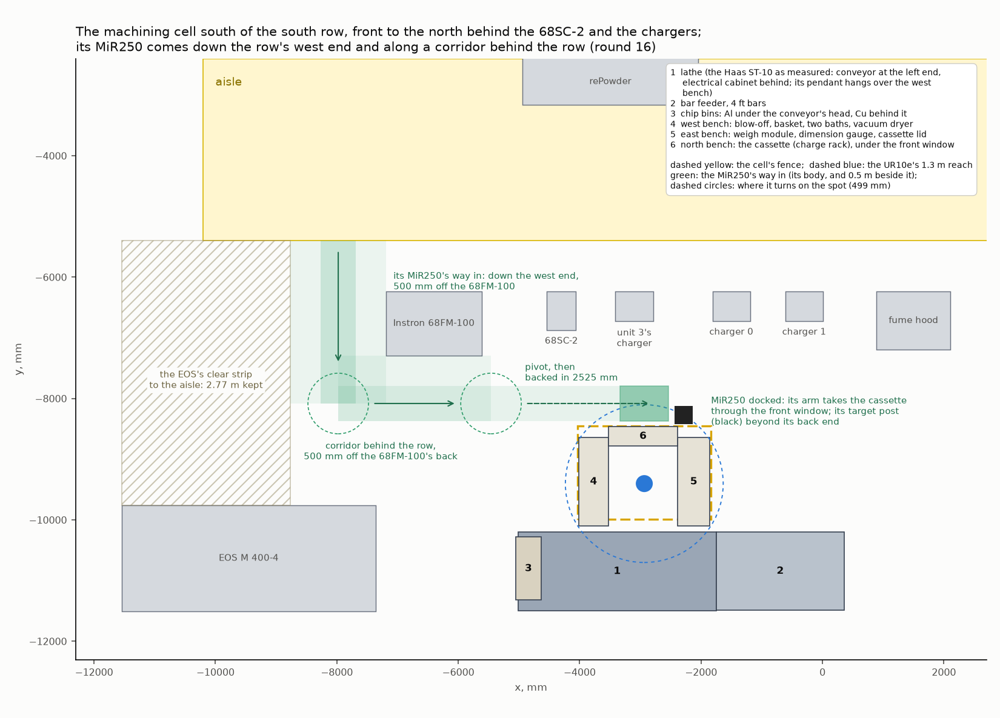

# Round 16: the machining cell on the floor (#303, PR #318)

Sterling (2026-11-26, PR #318) asked for [PR #371's check](https://github.com/vertical-cloud-lab/byu-vcl/pull/371#issuecomment-7184403979)
to be addressed in full. One of its items: "Give the machining cell a place on the floor that doesn't take unit 3's
charger." Round 15 had left PR #373's cup-and-plug cell off the shared floor ([lab_r15.md](lab_r15.md)). Its spot was
floor-cleaning unit 3's charger bay, and its dock's post landed on the 68SC-2's.

## Where it went

**South of the south row, front to the north**, behind the 68SC-2, unit 3's charger and charger 0. It keeps PR #373's
layout, not turned, and the x it had. It moved 2,213 mm south.

| | Where (setup_lab's floor frame, mm) |
| --- | --- |
| The cell's origin (the arm's pedestal) | (-2,935, -9,401), turn 0 (`machining.FLOOR`) |
| Its front (the fence) | y -8,451. The light curtain's posts stand 25 mm proud, at y -8,426 |
| Its plan rectangle (fit) | x -5,055..357, y -11,492..-8,426. The lathe, bar feeder and chip bins are along the back, y -11,492..-10,201 |
| Its MiR250 dock | (-2,935, -8,081), heading 180 (west). The arm's side (the MiR's left) faces the cell, 80 mm off the fence and 55 mm off the curtain posts. Relative to the cell this is where PR #373 drew it, so the arm still takes the cassette through the front window |
| Its target post | (-2,285, -8,276), 650 mm east of the docked unit's centre, which is 250 mm past its back end. It stands 150 mm off the curtain posts' face, so its foot plate meets that face rather than sliding 25 mm under the fence's bottom rail. Tag pattern 12; no other post's pattern changes |

**Its way in from the aisle.** This is the cell's own strip, which the check suggested. The MiR250's centre line runs:

1. **Down the row's west end on x -7,977**, from the aisle's south edge (y -5,400) to y -8,081, a 2.7 m run.
   - Its body (x -8,267..-7,687) is 500 mm from the Instron 68FM-100's west side, 699 mm from its post's foot and
     1,099 mm from its docked MiR.
   - West of the lane, the EOS M 400-4 keeps a clear strip, x -11,540..-8,767, in front of it up to the aisle. That is
     2.77 m, or 3.07 m to rack W's face, against the 2.4 m that `r8_scale.py` asks for. Nothing fixed stands in it, and
     the lane's 0.5 m band stops at its edge.
2. **A turn at the corner**, (-7,977, -8,081). Turning on the spot with its Class D unit sweeps 499 mm. That circle is
   618 mm from the 68FM-100 and 875 mm from the EOS at its larger 5,140 x 2,490 mm outline.
3. **East along a corridor behind the row** on y -8,081, to the dock's pivot spot at x -5,460. The body
   (y -8,371..-7,791) is 500 mm off the 68FM-100's back. Further east, where it backs in, it passes 918 mm behind the
   68SC-2 and 1,066 mm behind the chargers.
4. **Pivot, then back in**, 2,525 mm east, along the cell's front, 55 mm from the curtain posts. Every dock's approach
   is like this, 80 mm off the machines' fronts. BACK_IN puts the post beyond the docked unit's back end, out of the
   way in.

The numbers come from `out/tray_plan.json` and ISO 3691-4's 0.5 m beside a driverless vehicle's path:

| Line | Value | From |
| --- | --- | --- |
| Corridor | y -8,081 | the 68FM-100's back (y -7,291) - 500 - 290 (half a MiR250's width) |
| Fence | y -8,451 | the corridor - 290 - 80 |
| Lane | x -7,977 | the 68FM-100's west side (x -7,187) - 500 - 290 |

## Why there

- **No row gap is wide enough for the cell's front any more.** It needs 2.2 m, and the old gap between the 68SC-2 and
  charger 0 is unit 3's bay.
- **No lane fits through the row.** The south row's gaps, west to east, are 1,073, 649, 978, 578, 879, 1,128 and
  979 mm. Every one is under the MiR250's own 1,450 mm operating corridor (`warehouse.MIR250["corridor_mm"]`, the
  default footprint and SICK safety configuration).
- **The east end leads nowhere.** The Meltio cell's strip is 4.17 m wide. Where it overlaps the wire EDM in x, the
  Meltio's front (y -8,985) is 203 mm from the EDM's back (y -8,782), so nothing gets from that strip to the floor
  behind the row.
- **That leaves the row's west end**, 4,646 mm between rack W's face and the 68FM-100. It splits as 293 mm beside the
  rack, the EOS's 2,773 mm strip, and the lane's 1,580 mm (580 mm of MiR plus 500 mm each side).
- **The cell can't stand further west.**
  - Its chip bins reach y -11,321, level with the EOS, whose larger outline is x -12,020..-6,880, y -11,945..-9,455.
  - At x -2,935 its west end (x -5,055) also leaves the EOS more than the 7.5 m-wide installation area EOS asks for
    (to x -5,700 if centred on the machine).
  - It keeps its old x, and the dock is where PR #373 put it relative to the cell.
- **The chapters' aisle cameras, looking north at the north row, don't see it.** Views from the south do: setup_lab's
  `CAM_FLOOR`, `CAM_SCALE` and `ORBIT`, and the finale. A camera in the aisle looking south at the Instrons may see the
  fence (1.4 m tall, 1.2 m behind the 68FM-100's back) and the lathe (1.84 m, 2.9 m behind it).

## What was checked

- **`setup_lab.py fit`** (07:30 UTC, through runner_guard). It checks the docked MiR, the pivot spot and the approach
  from it, with the cell as one plan rectangle.
  - `dock machining`: ok. Pivot (-5,460, -8,081), approach 2,525 mm, no hits.
  - Every other dock is as before. The rePowder and sieving-cell docks keep round 14's `['repowder']` hit, and the
    rePowder is still the one machine in the aisle.
  - All 19 trays are ok.
  - The rePowder dock's pivot moved from x -5,362 to -5,487, because the rePowder's plan rectangle grew 110 mm west
    (x -4,835 to -4,945) with this round's powder point. The cell, 6 m south of that dock, plays no part in it.
  - Figure: [`out/tray_plan_floor.png`](../out/tray_plan_floor.png), where the cell is labelled.
- **The way in that the fit doesn't model**: the lane, the corner turn and the corridor up to the pivot spot.
  `machining.way_in()` (in `out/machining.json`) checks them against every plan rectangle, target post foot and docked
  MiR250 in the plan.

  | Part of the way in | Least gap | To |
  | --- | --- | --- |
  | Lane | 500 mm | the 68FM-100 |
  | Corner turn | 618 mm | the 68FM-100 |
  | Corridor | 500 mm | the 68FM-100 |

  The corridor also shows 405 mm to the cell's own rectangle. That is along x, to the chip bins' end, 1.9 m south of
  it; along y it is the same 55 mm the docking approach has.
- **The fixed safety items, at their real outlines** from `safety.py`'s and `safety_other.py`'s models:
  - The EOS's O2 monitor post (x -7,102..-6,898, y -9,402..-9,188) is 817 mm south of the corridor, 912 mm from the
    corner turn and 1,843 mm from the cell.
  - The EOS's B570, with its keep-clear area (x -9,765..-9,196), and its 680R stand 429 mm or more west of the lane's
    0.5 m band.
  - The fume hood's shower (y -7,414..-6,233) is 1,012 mm north of the cell.
- **ISO 3691-4's 0.5 m beside the path.**
  - The lane has it on both sides.
  - The corridor has it on its north side, and on its south side up to the pivot spot, which is open floor.
  - Only the 2.5 m reverse along the cell's front comes closer, at 55 mm, the same as every other dock in the lab. It
    sits inside the cell's own front zone, behind its light curtain.
- **Overhead.**
  - The south cable tray (z 3,200, y -6,988..-6,688) and the DED's argon line (z 3,050, y -7,038, which crosses over
    the lane) are north of the cell and far above a MiR250 with its arm.
  - The cell's tallest part, the slot hood's duct, is 2.7 m.
- **In the scene.** `machining_cell.lab_parts()` draws the cell from its own parts at rest, merged by colour into 47
  meshes and 64,393 triangles. The UR10e's links are decimated to a sixth, which reads the same at a whole-lab view.
  - Stills: [`out/machining_lab_floor.png`](../out/machining_lab_floor.png) (`CAM_FLOOR`, the set-up movie's step-5
    view) and [`out/machining_lab_close.png`](../out/machining_lab_close.png), both from `setup_lab.build`.
  - [`out/machining_lab.png`](../out/machining_lab.png) is `machining_cell.py`'s own `MCELL_STILL=lab` view, with the
    neighbours as boxes and the way in drawn on the floor.

## Not checked

- **No clip drives the route or docks there**, so there is no `ARM_AUDIT` of a MiR250 + UR12e reversing in or taking
  the cassette at this dock. The cell-to-dock geometry is PR #373's, unchanged.
- **The walk from the cell to the nearest extinguisher** (`safety.py`'s map) wasn't recomputed. The cell's IPA review
  is still machining.md's open item 8.
- **Floor cleaning** (`floor_cleaning.py` reads `out/tray_plan.json`) wasn't re-run. The cell and its corridor are new
  floor for its plans.

## Assumed (ours)

- MiR250s may drive behind the south row. The route, corridor and dock line are ours.
- **The lane shares the row's west end with the EOS's strip.**
  - `r8_scale.py` and the round-15 notes ask for 2.4 m in front of the EOS. scaleup.md's "4.17 m or wider" was the
    width of the gaps at the time. 2.77 m are left.
  - A forklift bringing EOS powder and a MiR250 on its way to the cell use neighbouring lanes, not one.
- **A 2.5 m reverse into the dock.** That is the fit's pivot spot with the cell as one rectangle. With the cell's real
  outline the pivot could be at x -4,460, a 1.5 m reverse. The lab's longest approach so far is the rePowder's,
  2.0 m forwards.
- **No tape for the route in 3-D.** The cell gets what every machine gets: its dock tape, its post and its footprint
  tape. The route is in the floor figure.
- **No utility drop to the cell is drawn**: 3-phase power for the ST-10, air for the blow-off, the network. The south
  cable tray runs 1.6 m north of the cell's front, so a drop or a spur over the corridor is the obvious way.

## What it means for unit 3 and the chargers

**Nothing on the floor moved.** These are all where round 15 drew them:
- unit 3's charger (x -3,411..-2,789), and chargers 0 and 1;
- every dock and post, their tag patterns included;
- the Class D units;
- the EOS M 400-4 and the Meltio cell, with their strips;
- the aisle.

Units 1 to 3 park on the aisle side of the row (y -6,218..-5,418). The cell's MiR passes 1,066 mm behind the chargers'
backs and never crosses a charging bay. Round 15's conflict, the cell in unit 3's bay, is gone.

## In the code

- **`machining.FLOOR`**: where the cell stands, its dock, its target post, the lane and the corner, with the derivation.
  - `machining.way_in()`: the check above.
  - `machining.plot_floor()`: [`out/machining_floor.png`](../out/machining_floor.png).
  - `python3 machining.py` writes `out/machining.json` and the four charts. Only the floor's chart and the floor's part
    of the JSON changed.
- **`setup_lab.py`**:
  - At import, unless `VLAB_MCELL=0`: `FLOOR_PLAN["machining"]` (south row, so the dock heads west),
    `DOCK_Y["machining"]` (the corridor), `"machining"` in `BACK_IN`, and `TARGET_AT["machining"]`.
  - In `Floor._stations`: a `VLAB_MCELL` block that adds `machining_cell.lab_parts()` in group `wh_machining:body`,
    placed by `machining.FLOOR`.
  - `warehouse.Floor._tape` draws its dock tape and post, `machine_rects` and `check_floor` take it like any floor
    machine, and `footprints` tapes it.
- **`machining_cell.py`**:
  - `lab_parts()`.
  - `lab_context()` and `still_lab()` follow `machining.FLOOR`: the way in, the post, unit 3's charger, and a new
    caption.
- **The set-up movie** hides the cell at the start with the other floor machines, because its key is in `FLOOR_PLAN`.
  - Its dock, post and footprint tape come in with the layout at step 2.
  - The cell itself comes in at step 5 only once `"machining"` is in step 5's `order` list, after `"wire_edm"`. The
    default root `wh_machining:body` is right, so nothing else changes. That is a change inside `movie()`, so the lead
    makes it.
- **`VLAB_MCELL=0`** leaves the cell, its dock and its post out, and the rest of the floor is as in round 15.
