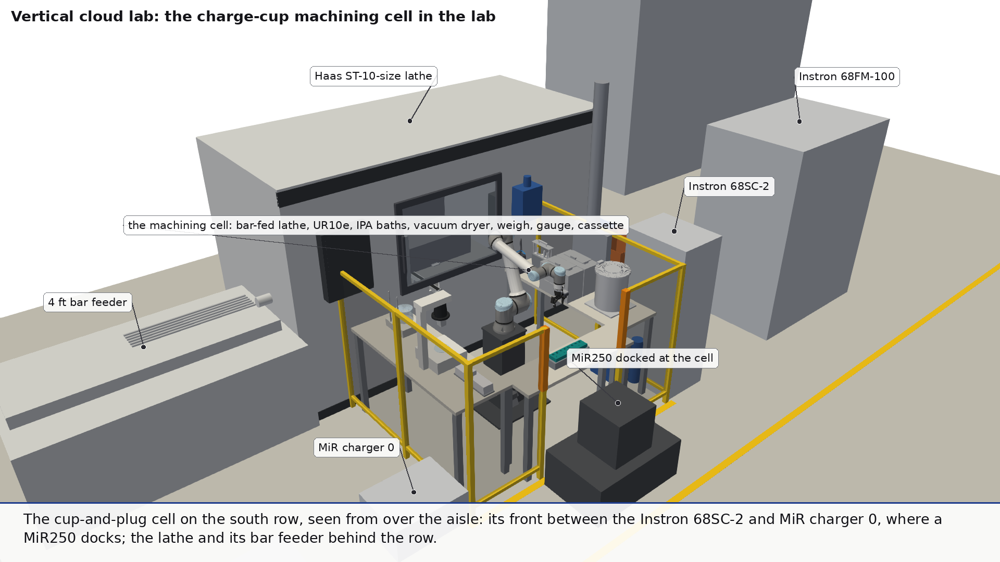
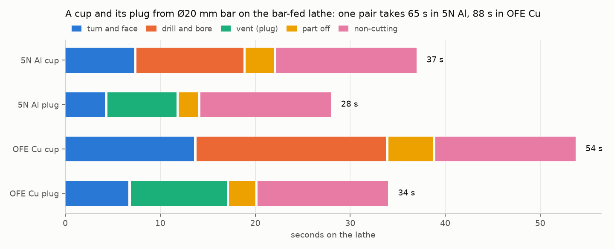
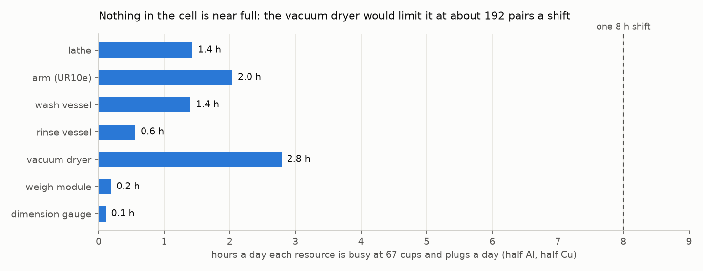
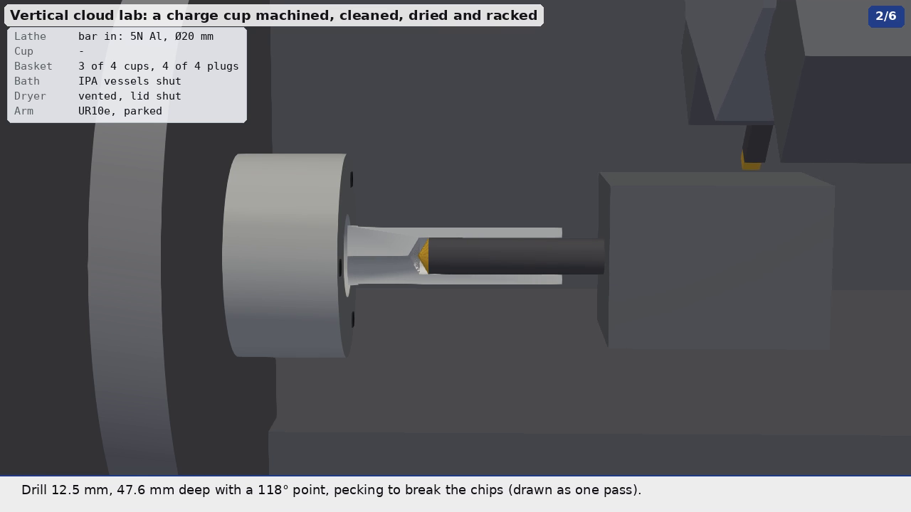
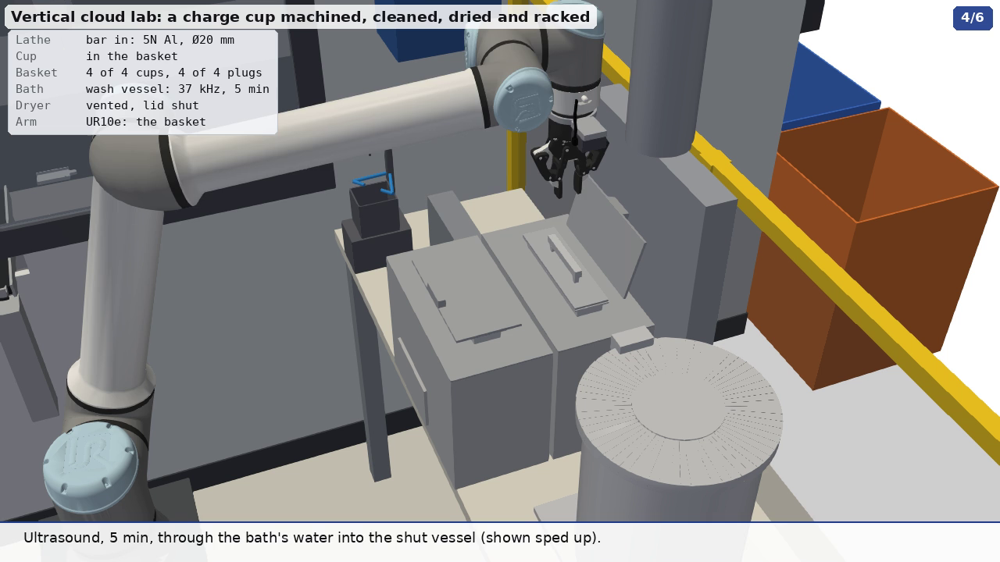
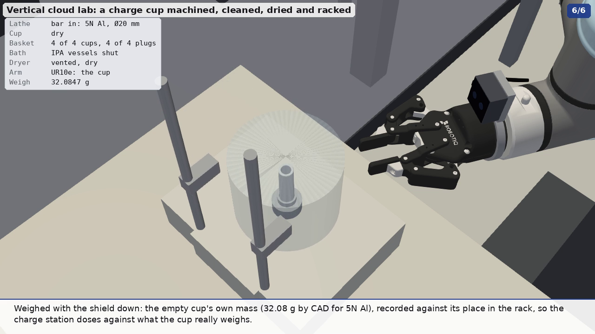
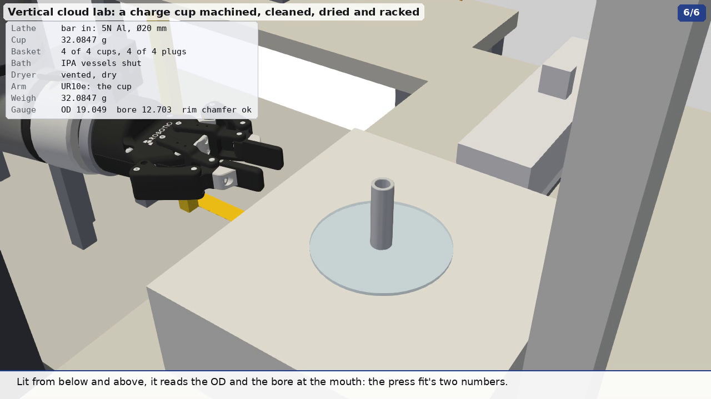
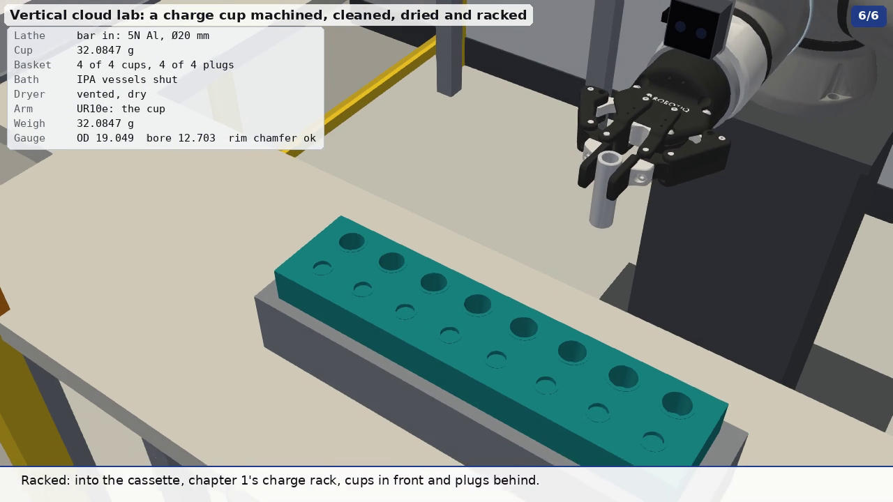
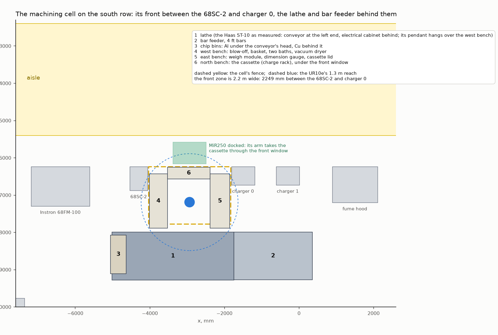

# Automated machining of the charge cups and plugs, with IPA cleaning and vacuum drying

Sterling, on [PR #318](https://github.com/vertical-cloud-lab/byu-vcl/pull/318) (2026-11-20): "We should probably
automate machining of the high-purity cups and plugs. Do we have automated machine shop-type stations already? Open a
new PR focused on the automated machining aspect. This would also need to include a cleaning and drying step (IPA for
example)." Handed off as [#367](https://github.com/vertical-cloud-lab/byu-vcl/issues/367).

**Do we have one already? No.** The only CNC in the model is the Makera Carvera on a tray (`instruments_r7.py`): a
200 W spindle and a 360 x 240 x 140 mm work area. It mills and drills light cuts and doesn't turn, so it can't make
a cup's turned OD and its 47.6 mm deep, 12.7 mm bore. Chapter 1 takes the cups as given, and `upkeep.py` restocks tray J's
cups, plugs and other consumables every 7 days.

Files:
- [`machining.py`](../machining.py): cycle times, capacity, cost and the floor plan →
  [`out/machining.json`](../out/machining.json) and the three charts below.
- [`machining_cell.py`](../machining_cell.py): the cell's 3-D model and the clip →
  [`out/mp4/machining_cell.mp4`](../out/mp4/machining_cell.mp4), [`out/machining_cell.gif`](../out/machining_cell.gif),
  [`out/machining_lab.png`](../out/machining_lab.png).

## In short

- **Turn, don't mill.** Both parts are bodies of revolution, cut from Ø20 mm bar: face, turn the OD, drill and bore,
  part off. A cup and its plug come from the same bar, so they share a heat and lot.
- **The recommended cell stands on the floor**, at the south row's front between the Instron 68SC-2 and MiR charger 0.
  It has:
  - a bar-fed CNC turning centre, drawn at the **Haas ST-10**'s published size, with Haas's 4 ft Bar Feeder V2;
  - a **UR10e** (sold as the UR12e since May 2025) on a pedestal: the same arm as on the MiRs;
  - **two small ultrasonic baths, each holding one closed vessel of about 0.7 L of IPA**: wash, then rinse;
  - a **vacuum dryer**, a **weigh module** and a **dimension gauge**;
  - output into **chapter 1's charge rack, lidded, as the cassette** the MiR250 takes to tray J.
- **The lathe is not the constraint.** On the lathe a cup and plug take **66 s in 5N Al and 88 s in OFE Cu**, so 67 a
  day is about **1.4 h** of machining. The cell's own limit is the vacuum dryer, at 10 min per basket of four:
  about **190 pairs in one 8 h shift**, nearly three times the need. So it can run while people are in the building.
- **Contamination is handled by practice, not by the machine**:
  - alcohol as the only lubricant (DESY, CERN and Thermo Fisher do this for high-purity Al and Cu);
  - PCD or sharp uncoated carbide, with one tool set per metal on the 12-station turret;
  - a collet and a chip bin per metal;
  - Al and Cu run on separate days, with a clean-down between.
- **It doesn't belong on a tray.** One robot-ready lathe does fit a tray, the EMCO Concept TURN 60. It takes only
  15 mm bar, though, and it would hold a VLM opening for hours a day. The bar-fed production machines weigh 2-6 t.
- **Capital is about $230k-320k.** Running cost is about **$3.50 a pair** before material. Material dominates: 5N Al
  costs **$11-94 a pair**, depending on how it's bought, and OFE Cu about **$11**.
- **The clip:** one cup is made, cleaned, dried, weighed, measured and racked, in **0 frames in collision**: 0 of
  1727 under `ARM_AUDIT=1` at 12 fps, and 0 of 2169 in the 15 fps render's own audit (arm and movers both).

## What has to be made

| | Cup (#222's P2) | Plug (#222's P3) |
|---|---|---|
| Size | Ø19.05 x 63.5 mm (3/4 x 2.5 in) | Ø12.7 x 9.5 mm (1/2 x 3/8 in) |
| Features | blind bore Ø12.70 x 47.6 mm with a 118° drill point; 0.5 mm edge breaks; 0.38 mm rim chamfer | press fit in the bore; 15° lead-in; Ø1.59 mm (1/16 in) vent through its axis |
| Mass, 5N Al / OFE Cu | 32.08 / 106.27 g | 3.17 / 10.48 g |

- **Demand: 67 of each a day.** That is ten alloys a day, 16.8 atomizer runs at four cups each (PR #332's
  [`notes/bottleneck.md`](https://github.com/vertical-cloud-lab/byu-vcl/blob/claude/bottlenecks-10-a-day-20261108/vertical-lab/notes/bottleneck.md)).
  It comes to about 24,500 pairs a year.
- **The split between Al and Cu runs isn't set anywhere.** Here it is taken as half and half; `capacity(0.0)` and
  `capacity(1.0)` give the all-Cu and all-Al ends.
- **Both metals are bought as Ø20 mm bar and turned to 19.05 mm.**
  - 5N Al comes as Ø20 mm rod (DAL #152).
  - 3/4 in C10100 bar is held to ±0.004 in (±0.1 mm; McMaster), too loose for #222's press sleeve F1, which is bored
    to the cup's OD + 0.0005 in.
- **The plug's OD is taken as 12.73 mm**, 0.03 mm over the bore (assumed; #222's tests should set it).

## The process, from bar

A cup, then its plug, from the same bar, on one machine. Times are from `machining.cycle()`. Cutting times use the
published data in the next section at the ST-10's 6,000 rpm. Non-cutting times (bar feed, indexing, rapids,
catching) are estimates.

| Operation | 5N Al | OFE Cu |
|---|---|---|
| **Cup:** bar feed and collet | 5.0 s | 5.0 s |
| face | 0.8 | 1.2 |
| turn the OD from 20 to 19.05 mm over 68 mm | 5.7 | 11.7 |
| drill 12.5 mm, 47.6 mm deep plus the 118° point, pecking | 5.0 | 7.1 |
| finish-bore to 12.70 mm, the press fit's size | 6.5 | 13.2 |
| rim and OD chamfers | 1.0 | 1.0 |
| part off, the blade chamfering the base on the way in | 3.2 | 5.0 |
| 4 indexes, 5 rapids; catch, onto the belt | 10.0 | 10.0 |
| **cup** | **37 s** | **54 s** |
| **Plug:** bar feed, face | 5.8 | 6.2 |
| rough the OD (2 passes) and finish 12.73 with the 15° lead-in | 3.6 | 5.7 |
| drill the Ø1.59 vent through, pecking | 7.5 | 10.4 |
| part off, chamfering the top | 2.3 | 3.0 |
| indexes, rapids, catch | 9.0 | 9.0 |
| **plug** | **28 s** | **34 s** |
| **a pair** | **66 s** | **88 s** |

- **The bore is drilled 0.2 mm under size, then bored.** A drill alone leaves the hole oversize and out of round,
  which a press fit can't take. The bore's size and finish come from one boring pass.
- **The base is finished by the parting blade.** It chamfers the edge on the way in and leaves a small pip at the
  centre. Nothing bears on the base:
  - it stands in racks and on the press nest;
  - the ram bottoms on F1, not on the cup.

  So a pip under about 0.1 mm is harmless. If not, the ST-10's finishing sub-spindle option (A2-5, 33 mm
  non-through bore) faces the base in the same cycle, and the ST-10Y (US$102,995) adds a Y axis.
- **A bar gives 13 pairs.** A pair uses 81 mm of bar: cup, plug, two 3 mm parting grooves and two facings. A 4 ft
  bar (1219 mm), less about 150 mm the feeder can't use (est.), gives 13 pairs, about **94 mm of bar a pair**. That is
  79.5 g of Al or 263 g of Cu, for 35.2 g or 116.8 g of parts: **44 % yield**. The rest is chips.
- **About five bars a day.** At 67 a day, half and half, that is about 5 bars and about **6.4 kg of chips** a day:
  1.5 kg of Al and 4.9 kg of Cu, about 7 L loose. That is around three weeks to fill a 150 L bin per metal (est.).

### Mill or lathe?

- **Every feature is round and on the axis**, so turning makes the part in one chucking. A mill would need a rotary
  axis or two set-ups, and would still drill and bore the 47.6 mm hole along the axis.
- **The Carvera can't do it** (see the top of this note).

## Machines

From a search of 31 machines (sizes and prices as published, links below; † is a figure from a search snippet, the
page itself blocked):

| Machine | W x D x H mm, kg | Bar | Spindle, tools | Automation | Price | Verdict |
|---|---|---|---|---|---|---|
| [Haas ST-10](https://haascnc.com/content/dam/haascnc/pdp_feed/mld/st-10_st-15_mld_12_2024.pdf) | 3437 x 1596 x 2167 with chip conveyor; 3,585 | 44 mm | 15 hp, 6,000 rpm; 12-station turret | Bar Feeder V2 (bars to 4 ft, 10-76 mm, 2104 x 1283 mm); auto door; [robot](https://www.haascnc.com/content/dam/haascnc/pdp_feed/mld/ROBOT%20PKG-1.pdf) and [cobot](https://www.haascnc.com/content/dam/haascnc/pdp_feed/mld/COBOT%20PKG-10KG.pdf) packages | US$64,995 list ([Machine Tool Index](https://machinetoolindex.com/machines/haas-st-10), verified 2026-10-02) | **Recommended** (drawn) |
| [EMCO MAXXTURN 25](https://www.emco-world.com/cz/products/turning/maxxturn/maxxturn-25.html) | 2180 x 1425 x 1870; 2,100 | 25.4 mm | 6.5 kW, 8,000 rpm main and counter spindle; 12 VDI16, 6 driven; Y | short-bar loaders (EMCO SL 1200 for bars to 1.2 m†) | not found | The compact way to finish both ends: **quote it alongside** |
| Haas ST-10Y + finishing sub-spindle ([drawing](https://www.HAASCNC.COM/content/dam/haascnc/pdp_feed/mld/st-10y_15y_mld_11_2023.pdf)) | 3395 x 1612 x 2167; 3,584 | 44 | as ST-10, live tools, ±51 mm Y | as ST-10 | $102,995 + sub-spindle | If the base must be faced |
| [Tormach 15LX](https://tormach.com/machines/lathes/15lx-lathe.html) | 1390 x 968 x 1733; 740-800 | 38.9 mm bore | 6 hp, 3,500 rpm; gang or 8-station turret | collet closer, bar puller; no bar feeder | from $26,949 | A person loads a bar every 13 pairs |
| [Okuma GENOS L2000-e](https://d30jruhmdicmo0.cloudfront.net/documents/GENOS_L2000_L3000-e-OAC-E_2b_200_Feb2022.pdf) | 1702 x 1843 x 1620; 3,000 | ø62 bore | 15 kW, 5,000; V12 | Okuma's ARMROID isn't offered on it | not found | Possible, no price |
| [DN Solutions Lynx 2100LSYA](https://www.millscnc.co.uk/product/lynx-2100lsya/) | 2880 x 1711 x 1921; 4,150 | 51 | 15 kW, 6,000 + sub-spindle; 12 | - | not found | Bigger than needed |
| [Nakamura-Tome AS-200](https://shop.phillipscorp.com/cdn/shop/files/AS_200_200L.pdf) | 1655 x 1665; 4,500 | 65 | 15 kW, 4,500 + sub φ42; 12-24 | ROBOJOB Turn-Assist | not found | Bigger than needed |
| [Citizen L20](https://www.citizen.de/fileadmin/pim/_default_upload_bucket/Citizen%20Cincom%20L20%20Brosch%C3%BCre.pdf) (Swiss) | 2222 x 1265 x 1835; 2,630 | Ø20 | 10,000 rpm; sub-spindle | 12 ft bar feeders | not found | **No**: see below |
| [Star SR-20JII](https://star-m.jp/eng/products/lathe/swiss_type/sr-20j_ii.html) (Swiss) | 2250 x 1200 x 1700; 2,750 | ø20 | 10,000; sub-spindle | as L20 | used 2020 unit $139,900† | **No** |
| [EMCO Concept TURN 60](https://www.emco-world.com/fileadmin/user_upload/CNC_Turning_center_training_purposes_Concept_TURN_60.pdf) | 895 x 745 x 550; 150 | **15 mm** | 1.1 kW, 4,200; 8-station | pneumatic door and chuck, robot interface, MQL | used €11,900-15,900† | The one that fits a tray: see below |
| [Tormach 8L](https://tormach.com/machines/lathes/8l-lathe.html) | 1.2 x 0.7 m, 1.3 m tall on its stand; 380 | 25.4 mm (5C) | 1.1 kW, 5,000 | automatic collet closer (option†); no auto door found | from $12,395 | Not robot-ready |
| [Boxford 160TCLi](https://www.boxford.co.uk/wp-content/uploads/2026/01/CNC-Lathes-Jan-2026.pdf) | 800 x 600 x 1025; 130 | Ø20 through | 750 W, 3,200; 8-station | pneumatic chuck and guard, robot port | £23,120 | Too tall for a tray, light duty |

**Why not a Swiss-type lathe**, the usual machine for small bar-fed parts:
- **Their main spindles can't drill the bore.** The Citizen L20's main-spindle drilling stops at Ø10 mm and the Star
  SR-20JII's at ø12, against the cup's Ø12.7 bore.
- **Run without a guide bushing, they take only 50 mm per chucking**, less than the 63.5 mm cup. Tornos advises
  against parts longer than 3 x D in that mode
  ([Tornos](https://www.tornos.com/sites/tornos.com/files/data/Tips_and_tricks/EN/1_en_trucs_et_astuces_temps_de_cycle_ok.pdf)).
  The cup is 3.3 x D.
- **They are built around straight cutting oil**, which lubricates the guide bushing
  ([Keller-Heartt](https://info.kellerheartt.com/blogs/water-soluble-cutting-coolant)). That is the residue this part
  can't have.

**Why the ST-10:**
- its size, price and layout drawings are published;
- the 12-station turret holds a full tool set for each metal (four tools each), so no tool is moved between metals;
- the bar feeder runs it unattended between bar loads;
- Haas sells robot and cobot packages for it, with layout drawings.

The EMCO MAXXTURN 25 is the one to quote alongside it: a little over half the footprint, main and counter spindle (so
the base is faced in the same cycle), 8,000 rpm for the Al. The bar feeder, the auto door and the alcohol MQL kit need
quotes for either machine.

### Tray or floor?

A tray takes 2426 x 840 mm inside its rim, 856.5 mm product height and at most 490 kg (`instruments_r7.py`).

- **Of the lathes that fit, only the EMCO Concept TURN 60 is built to be robot-tended.** (A Tormach 8L off its stand,
  a Sherline or a BenchTurn 7000 fit too, with no automation.) It is a training lathe with a pneumatic door and
  chuck, a robot interface and MQL. But it passes only 15 mm bar, so the Ø20 stock would go in as cut slugs, two set-ups a cup with the arm
  turning each one over.
- **It would hold the VLM.** At 1.1 kW and 4,200 rpm, 67 cups would hold one VLM opening for several hours a day.
  PR #332 counts the Shuttles' openings among what ten alloys a day must share.
- **It would bring the machining into the VLM**: chips and alcohol mist into a store that also holds powders and
  finished samples, and cutting forces on a cantilevered tray.
- **The bars couldn't reach it.** A bar feeder can't feed through a VLM.
- **The bar-fed production lathes weigh 2.1-6 t** (the Tormach 15LX, 0.8 t, has no bar feeder). So the lathe stands
  on the floor.

## Tools, wear and chips

**5N Al is soft and gummy.** Pure Al is ASM machinability group E: it "needs optimum tool design and machine settings
to control chip and finish" ([via aluminium-guide](https://aluminium-guide.com/machinability-aluminium/)).
- Sandvik: "positive basic shape and sharp edges should always be used"; "Uncoated and PCD grades are the first
  choices" ([Sandvik](https://www.sandvik.coromant.com/en-gb/knowledge/general-turning/how-to-do-turning-in-different-materials)).
- Built-up edge is "most common when machining sticky materials… aluminum", and "Low cutting speed increases the
  formation of built-up edge"
  ([Sandvik](https://www.sandvik.coromant.com/en-us/knowledge/materials/wear-on-cutting-edges)).
- Haas starts wrought aluminium at 490 m/min with its HTSU10 insert
  ([Haas](https://www.haascnc.com/content/dam/haascnc/ecommerce-assets/linedrawings/lathe_tooling/turning_inserts/speeds-n-feeds/Turning%20Inserts%2C%20Speeds%20and%20Feeds.pdf)).
  Here 400 m/min, capped by 6,000 rpm at Ø20.

**OFE Cu is worse.** The German Copper Institute rates Cu-OFE C10100 at **20** (free-cutting brass is 100), with a chip
breaker recommended
([DKI i.18](https://kupfer.de/wp-content/uploads/2021/08/Recommended-machining-parameters-for-copper-and-copper-alloys.pdf)).
- DKI: "Tool wear is very high and chip formation very poor… long tubular chips… risk of built-up edge… decreases
  with increasing cutting speed and greater feed rates."
- DKI's carbide turning speeds are 220 / 160 / 120 m/min at 0.1 / 0.32 / 0.8 mm chip thickness. Its solid-carbide
  drilling is 160 m/min at 0.24-0.29 mm/rev for Ø12-16 mm. Here: 220 to finish, and drilling at 120 m/min and
  0.20 mm/rev under MQL, pecking each diameter.
- CERN finish-turns OFE Cu with "uncoated tungsten carbide inserts, with high rake angle of 18° and sharp cutting
  edge, with an edge radius rβ of 9 μm"
  ([Camelin et al. 2022](https://mme-machining-maintenance.web.cern.ch/wp-content/uploads/2025/11/Experimental-analysis-of-subsurface-integrity-during-fine-turning-of-OFE.pdf)).
  It reports carbide at 245 m/min and monocrystalline diamond at 650 m/min
  ([ESAFORM 2024](https://mme-machining-maintenance.web.cern.ch/wp-content/uploads/2025/11/Impact-of-machining-strategy-on-OFE-copper-for-SRF-application.pdf)).

**The 3.75 x D bore is outside the tool makers' comfort zone without coolant.**
- Sandvik: "Dry drilling is generally not recommended". Compressed air, mist or MQL "can be successful under
  favourable conditions, especially for… aluminium", and internal coolant is "always preferred" for long-chipping
  materials and holes deeper than 3 x D
  ([Sandvik](https://www.sandvik.coromant.com/en-us/knowledge/drilling/drilling-tips)).
- So: a drill with internal channels, the alcohol MQL through it, and pecking.
- The plug's Ø1.59 vent (6 x D) is the other hard hole.
- **Both need a trial before the machine is bought** (see open questions).

**Tool life.**
- DKI's speeds are set for 30-60 min of carbide life. At 10-20 s of cutting per edge per cup, that is roughly
  100-300 Cu cups an edge (est.).
- Vendors claim PCD runs far longer than carbide in aluminium (Sumitomo: over 50 x in one valve-bore job†). No
  figure for pure Al was found.
- The ST-10's tool probe corrects wear offsets. Plan on Cu inserts weekly and Al inserts monthly (est.).

**Chips.**
- About 6.4 kg a day at 67 pairs, half and half: 1.5 kg Al and 4.9 kg Cu (above).
- The chip conveyor drops them into the bin of the metal being cut. The other metal's bin waits beside it, so
  Al and Cu chips never share a bin.
- Kept separate and dry, they are clean 5N and OFE scrap, worth returning to the supplier.

## Contamination

What the sources say:

| Source | Practice |
|---|---|
| DESY, UHV parts ([guidelines](https://photon-science.desy.de/facilities/petra_iii/beamlines/p04_xuv_beamline/e265554/e265562/Vacuum_005_DESY_UHV_guidelines_1-5_final_stamp.pdf)) | "Only isopropanol might be used as cooling fluid. New cutting tools must be used. Standard cooling lubricants and cutting oils are not allowed." |
| Thermo Fisher, GD-MS of 5N/6N Al ([app note](https://assets.thermofisher.com/TFS-Assets/CMD/Application-Notes/an-30142-gd-ms-high-purity-aluminum-an30142-en.pdf)) | "Any lubricant other than alcohol (e.g. isopropanole) must be avoided, since otherwise severe sub-surface contaminations of the samples can occur" |
| CERN, OFE Cu ([Camelin et al. 2022](https://mme-machining-maintenance.web.cern.ch/wp-content/uploads/2025/11/Experimental-analysis-of-subsurface-integrity-during-fine-turning-of-OFE.pdf)) | "a mix of ethyl alcohol C2H5OH with 3% of acetone. The alcohol machining is a standard technique when it comes to copper finishing operation… as it prevents creation of corrosion or chemical contamination of the surface" |
| JX Nippon Mining, sputtering targets ([US6153315A](https://patents.google.com/patent/US6153315A/en)) | "When a conventional carbide tool is employed, contamination of heavy metals is necessarily apt to occur… when a diamond turning tool is employed, such contamination does not occur" |
| AFI Parts, semiconductor UHP Al ([page](https://www.afiparts.com/?p=44571)) | diamond tools "specifically dedicated to UHP Aluminum"; "Tools previously used on steel or stainless steel are strictly prohibited"; "Standard cutting oils are forbidden" |
| Majorana Demonstrator, ultra-clean Cu ([arXiv 1711.10361](https://arxiv.org/abs/1711.10361)) | a shop "Restricted to Cu, plastics, and approved stainless steel"; more handling with "more variety of tools" gave "Elevated surface contamination", fixed by a deeper etch |
| DKI | sulphur oils "react with copper": sulphur-free oil or rinse at once |

So the cell's rules:
1. **Alcohol is the only lubricant.** Ethanol with 3 % acetone (CERN) or IPA (DESY), as an MQL mist through the drill,
   with the work zone extracted. Never a soluble coolant or a sulphurised oil.
   - The lathe's enclosure stays far below the alcohol's lower explosive limit. At about 30 mL/h of mist and a few
     hundred m³/h of extraction it is well under 1 % of it (est.). The fire review should confirm the extractor's
     rating.
2. **Diamond-edged (PCD) or sharp uncoated carbide tools; no coated inserts.**
   - Coated inserts (TiAlN and the like) would bring Ti and Al into Cu, and Al into the Al budget.
   - New tools are broken in on a scrap length of the same metal (DESY: "New cutting tools must be used").
3. **One of everything per metal**:
   - a tool set on the turret (four stations each);
   - a collet;
   - a chip bin;
   - a basket and a pair of IPA vessels.
4. **Campaigns.** Al days and Cu days, with a clean-down between: vacuum the work zone, wipe the turret and chip
   guard, swap the collet and the chip bin, change the IPA. About an hour (est.). The cell's spare capacity (below)
   makes campaigns cheap: a week of either metal takes about a shift.
5. **A machine per metal, if ICP shows it's needed.** If ICP-MS of the first powders shows Cu in Al runs (or the
   reverse) above spec, the fix is a second lathe, not more cleaning. DAL #234's Edison answer reached the same
   conclusion for sieves.

**The surface is the risk, and it can be measured.** EXO-200 etched about 30 µm (est.) off its samples to remove
"surface contamination that may have occurred during the cutting/shaping"
([arXiv 1703.10799](https://arxiv.org/pdf/1703.10799)).
- **Before committing, measure.** Run GD-MS or ICP-MS on a machined and cleaned cup's surface against the bar's bulk.
- **If tool or collet elements (W, Co, Fe) show, add a light etch before the IPA**: dilute NaOH and a nitric desmut
  for Al, Citranox for Cu. The cell as drawn has none.

**How clean is clean enough.**
- A cup has about 63 cm² of surface. NASA's level A (1 mg per 0.1 m², JSC PRC-5001) and CERN's "precision cleaning
  <1 µg/cm²" both allow about 63 µg on a cup: **2 ppm of a 32 g Al cup**, and mostly carbon, hydrogen and oxygen that
  leave in the melt.
- The native oxide adds about 1 ppm O on an Al cup (4 nm of Al₂O₃) and about 0.2 ppm on a Cu cup (5 nm of Cu₂O) (est.).

## Cleaning and drying

**The rule** (DAL #234, as [`alloy_print.md`](alloy_print.md) applies it): no IPA in an ordinary ultrasonic bath.
Sonicate indirectly, IPA in a closed vessel standing in the bath's water, a few hundred mL, under extraction,
grounded. The makers say the same:
- Elma: "Never use flammable liquids or solvents directly in an ultrasonic cleaning tank". The exception: "limited
  volumes of flammable liquids (max. 1 litre)" in "a suitable separate vessel… put into the stainless steel tank
  which is filled with non-flammable liquid"
  ([Elmasonic P manual](https://cdn.shopify.com/s/files/1/1705/3127/files/Elmasonic_P_Manual.pdf), §8.1). The reason:
  ultrasound "creates a very fine mist that can catch fire".
- Branson: "Do not ever use alcohol, gasoline or flammable solutions"
  ([manual, NIST copy](https://www.nist.gov/document/branson-3800-manual)).
- VWR: at least an inch between the tank bottom and the beaker
  ([manual, NIST copy](https://www.nist.gov/document/ultrasoniccleanervwrpdf)).

**So, two small baths, one vessel each:**
- **The baths:** two Elmasonic P 60 H-size baths (5.75 L, 365 x 186 x 271 mm, 37/80 kHz; US$2,000-3,400 each), side
  by side on the west bench, water in the tanks.
- **The vessels:** each holds one closed stainless vessel (ours: 46 x 220 mm inside, 125 mm deep, 76 mm of IPA,
  **about 0.7 L**), hung from the bath's cover plate. That keeps under Elma's 1 L per bath.
- **The basket** (ours) holds one run's four cups and four plugs in a row, the plugs between the cups. While it is in
  a vessel its own cap shuts the vessel. When it isn't, the vessel's lid does. A slot hood behind both baths draws
  off the vapour.
- **Wash, then rinse.** The basket gets 5 min in the wash vessel, then 2 min in clean IPA in the rinse vessel. DESY's
  UHV practice is "3 to 6 times for 5 min. interrupted by short rinsing periods". Cutting Tool Engineering gives "a
  couple of minutes to 10 minutes for new parts"†.
- **Counterflow.** Each day the rinse becomes the next day's wash and a fresh rinse goes in: about 0.7 L of fresh IPA
  a day plus what the bores carry over (est.).
- **Explosion-proof baths were rejected.** SOL XP units cost about US$35,000-37,000, release vapour in normal
  operation, and need a Class I Div 1 room or hood, 650 CFM and nitrogen.

**Blind bores.**
- **Mouth up for the wash.** A bore facing up fills and cleans. Facing down it traps air
  ([iUltrasonic](https://iultrasonic.com/blog/specifying-and-using-an-ultrasonic-parts-cleaner/)), though a
  Massachusetts TURI trial found "blind holes facing down" removed fines better
  ([trial](https://cleanersolutions.org/Browse-Client-Types/(client)/10/(project)/1/(trial)/0)). So the cups stand
  mouth up.
- **The fines go first.** At the blow-off station, two air nozzles at the cup's foot and a lance into the bore clear
  the chips before the cup reaches the basket.
- **The vacuum dryer empties the bore.** A cup out of the rinse holds 6 mL of IPA in its bore, 4.7 g.

**IPA alone, or a detergent first?** DESY and CERN use an aqueous detergent step where a lubricant was used:
- DESY: "1% Tickopur R33 at 50°C" for Cu, "2-5% P3 Almeco 18 at 65°C" for Al;
- CERN: at 50-60 °C, then a demineralised-water rinse.

With alcohol as the only lubricant there is nothing to emulsify, so IPA alone is defensible. The test is
non-volatile residue (NVR):
- Use NASA's method: 100 mL of rinse per 0.1 m² of surface, which is about 16 cups
  ([PRC-5001 Rev H](https://nasa.gov/wp-content/uploads/2026/07/prc-5001-rev-h.pdf)).
- Test on the first lots, then weekly.
- If NVR fails, add an aqueous detergent bath in front: the same bath model, water only, no fire rules.

**Drying under vacuum, not in an oven.**
- **IPA is easy to ignite.** It flashes at 12 °C and its lower explosive limit is 2 %
  ([NIOSH](https://www.cdc.gov/niosh/npg/npgd0359.html)). A 23 L chamber reaches 2 % with about 1.5 mL, a quarter of
  one bore's IPA.
- **So no ordinary oven.** "Due to the risk of explosion, do not dry glassware containing organic compounds in an
  unvented oven" ([UW EHS](https://ehs.washington.edu/system/files/resources/heating-devices-focus-sheet.pdf)). Solvent
  ovens need Class A interlocks.
- **The dryer drawn (ours)** is a stainless pot heated to 45 °C with a hinged lid, pumped down by a chemistry
  diaphragm pump through a condenser, then back-filled with dry N2.
  - Under vacuum the IPA in the bores boils off without being blown about, and no air is there to burn.
  - The condenser recovers the IPA as waste.
  - About 10 min a basket (est.).
- **Off the shelf:** the BINDER VDL 23, rated for flammable solvents inside ("EX II 2/3/- G IIB T3"; 0.8 cu ft,
  US$16,927-19,000; [datasheet](https://cdn.shopify.com/s/files/1/2490/0968/files/Data_Sheet_Model_VDL_023_us.pdf)).
  It has a front door, which would need an actuator for the arm.

**Weighing and inspection.**
- **The weigh module:** an A&D AD-4212C-301 (51 g at 0.1 mg, 320 g at 1 mg, RS-232C; US$6,736.50;
  [datasheet](https://aandd.jp/products/weighing/pdf/ad4212c.pdf)), under a glass shield that lifts for the arm (ours).
  An Al cup reads to 0.1 mg, a Cu cup to 1 mg.
  - **It gives chapter 1 real masses.** Each empty cup and plug is weighed and recorded against its place in the
    rack. So the charge station doses against the metal actually there, not CAD x density. (Sterling asked on #318
    for the cups to be weighed again after the press fit; this is the "before".)
  - **It also catches bad parts:** a short part, a broken drill in the bore, a bore still wet (+4.7 g of IPA).
  - **It can't show cleanliness.** Level A is 0.063 mg a cup, under the balance's resolution.
  - Static: below about 40-45 % RH charge stops dissipating (Mettler), so an ionizer sits at the pan.
- **The dimension gauge** checks the press fit's two numbers on every part: the cup's OD and bore at the mouth, and
  the plug's OD.
  - Drawn: an image-dimension gauge of the Keyence IM-8000 class (±2 µm; about US$45,000, an unverified aggregator
    figure; Keyence quotes only).
  - The cheaper route: a Mitutoyo LSM-9506 laser scan micrometer for ODs (US$12,924) plus a blind-bore air plug for
    the bore (Mahr, quote only). Silhouette gauges can't see a blind bore's ID.

**Racked, not bagged.** The hand-off asked for bagging and storage in tray J. Bagging works:
- An Autobag PS 125 OneStep takes a part dropped in by a robot, heat-seals and labels it: 22 x 19 in, 15-25 bags a
  minute, used units US$10,000-14,000 ([Sealed Air](https://sealedair.com/products/protective-packaging/tabletop-bagging-system)).

But a bag has to be opened again before the charge station, and neither the arm nor the station can do that. So the
cell fills **chapter 1's charge rack** (`charge.rack()`):
- four cups in front and four plugs behind per run, two runs a rack;
- a printed lid on it (ours), with a silica-gel sachet;
- the MiR250's arm takes the rack through the fence's front window to tray J, or straight to tray B, where the
  charge station takes it as it already does.

Storage conditions:
- 35-55 % RH (Canadian Conservation Institute).
- Aluminium foil is "best, but should not be used for copper parts in presence of humidity", and a PE bag is "a good
  barrier against macroscopic contamination only" (CERN).
- Keep a bagger for archive and shipping, not for the charge's own path.

## Cycle times and throughput

At 67 pairs a day, half Al and half Cu (`capacity()`):

| Resource | Busy, h a day | Note |
|---|---|---|
| Lathe | 1.4 | 66 s a pair in Al, 88 s in Cu (1.2 h all-Al, 1.6 h all-Cu) |
| Arm (UR10e) | 2.0 | about 110 s a pair: each part from the upender to the blow-off to the basket, then to the weigh module, the gauge and the rack; the basket's six moves; the lid (est., from the clip's moves) |
| Wash vessel | 1.4 | 5 min a basket of four pairs, 17 baskets |
| Rinse vessel | 0.6 | 2 min a basket |
| Vacuum dryer | 2.8 | 10 min a basket (est.): **the cell's limit** |
| Weigh module | 0.2 | 5 s a part |
| Dimension gauge | 0.1 | 3 s a part |

- **About 190 pairs in an 8 h shift, about 580 in 24 h.** The dryer sets that ceiling, nearly three times the need in
  one shift. The arm alone would allow about 260 a shift.
- **Run it on the day shift.** It doesn't need to run lights-out, so an IPA process need never be unattended.
- **A second dryer or a shorter dry** is the first step if demand grows. A second lathe is not.

### What the machine does, what the arm does

| Who | Does |
|---|---|
| Lathe and bar feeder | feeds bar; faces, turns, drills, bores, chamfers, parts off; probes tool wear; lifts chips into the metal's bin; its catcher takes each part and a belt carries it out under the door; an upender (ours) stands the cup up |
| Arm (UR10e on a pedestal) | takes each part off the upender; blow-off; into the basket; the basket into the wash vessel, the rinse vessel and the dryer and back; each part to the weigh module, the gauge and the rack; the rack's lid |
| MiR250 with its arm | the lidded rack from the cell's front window to tray J or tray B |
| People | bars into the feeder's magazine (about 5 bars a day; the magazine's capacity for Ø20 was not found); chip bins; the IPA vessels daily; inserts weekly to monthly; campaign changeovers; NVR checks; about 0.15 FTE (est.) |

The door stays shut and the arm never reaches into the machine. A MiR can't carry a 4 ft bar, so bar loading stays
with people.

## Cost

**Capital: about US$230,000-320,000** (`costs()`):

| Item | US$ | Source |
|---|---|---|
| Haas ST-10 | 64,995 | list, verified 2026-10-02 |
| Bar Feeder V2 | 12,000-20,000 | est. |
| auto door, parts catcher, belt and upender, tool probe | 10,000-15,000 | est. |
| alcohol MQL unit and mist collector | 6,000-10,000 | est. |
| UR10e / UR12e | 50,818-52,674 | distributor listings |
| Robotiq 2F-85 and wrist camera | 5,000-7,000 | est. |
| pedestal, benches, fence, light curtain | 10,000-18,000 | est. |
| two Elmasonic P 60 H | 4,000-6,700 | $1,999-3,361 each |
| IPA vessels, lids, actuators, slot hood, duct | 4,000-8,000 | est. |
| vacuum dryer (ours) | 8,000-14,000 | est.; BINDER VDL 23 $16,927-19,000 |
| A&D AD-4212C-301 and its shield | 7,700-9,700 | $6,736.50 + est. |
| dimension gauge | 18,000-45,000 | LSM-9506 + air plug, or IM-8000 class |
| integration, programming, risk assessment | 30,000-50,000 | est. |

**Running cost: about US$3.50 a pair before material**:

| Per pair | US$ |
|---|---|
| capital over 7 years | 1.61 |
| maintenance, 3 % a year | 0.34 |
| tools, a set per metal | 0.55 (est.) |
| labour, 0.15 FTE | 0.49 |
| IPA, about 1.1 L a day | 0.37 |
| spent IPA and fines as hazardous waste | 0.08 |
| power, about 17 kWh a day | 0.03 |

**Material is the real cost.**

| Metal | Price | Per pair | Per year at half the pairs |
|---|---|---|---|
| 5N Al | $144/kg (as a Ø150 mm billet) to $1,180/kg (Ø25 x 305 mm rod), [High Purity Aluminum](https://highpurityaluminum.com/products/rod); $3,500/kg as Ø20 rod from [Advent](https://www.advent-rm.com/en-GB/products/pure-metals/aluminium/form/rod/line/al5049) | $11-94 | $140,000-1,150,000 |
| OFE Cu | C10100 at about $42/kg ([Southern Copper](https://shop.southerncopper.com/products/c10100-oxygen-free-copper-round-bar)) | $11 | about $135,000 |

- **The metal in the parts isn't overhead.** It is the alloy's base metal and is melted.
- **The chips are the waste**: 56 % of the bar. So:
  1. buy 5N Al by the 100 kg as drawn Ø20 rod, from a 5N producer, not by the rod from a catalogue;
  2. return the chips, kept clean and separate;
  3. if the 5N bill still dominates, look at making the cups near net shape. Pure Al is the easiest metal there is to
     backward impact-extrude, which leaves no chips. That needs a press and dies; not studied here.
- **Outsourcing wasn't quoted.** A job shop would need to keep alcohol-only lubrication and dedicated tooling, which
  is the hard part to buy.

## The model and the clip

`machining_cell.py` builds the cell in its own frame (x east, y north, origin at the arm's pedestal). `machining.FLOOR`
puts it on the floor plan. **Drawn at published size:**
- the lathe body (Haas ST-10, 3437 x 1596 x 2167 mm with its chip conveyor) and its Bar Feeder V2 (2104 x 1283 mm);
- the UR10e and 2F-85 (`ur_arm.py`);
- the baths (Elmasonic P 60 H);
- the charge rack (`charge.py`).

**Ours:** everything inside the lathe (the turret, tools, collet, catcher and belt), the upender, the basket, the IPA
vessels, the dryer, the weigh module's and gauge's shapes, the benches and the fence.

The clip, one cup in six chapters:
1. The cell, labelled.
2. In the lathe, bar and cup in half section, the door see-through:
   - the bar fed out;
   - faced and turned;
   - the drill;
   - the boring bar;
   - the catcher in under the cup;
   - parted off.
3. The catcher turns the cup to lie along the belt, which carries it out under the door. The upender stands it up.
   The arm takes it to the blow-off station: two nozzles at its foot and a lance over the bore.
4. Into the basket with the run's other three cups and four plugs. The basket goes into the wash vessel (its lid
   opens; the basket's cap shuts it), ultrasound, out; the vessel's lid shuts behind it. The same in the rinse vessel.
5. Into the vacuum dryer: lid shut, pumped down at 45 °C, back-filled with N2. Back on its stand.
6. The cup to the weigh module (the shield lifts and lowers), to the gauge's stage, and into the cassette, coming
   down into its pocket from above. The other parts follow (not shown). The lid goes on.

**Collision audit: 0 of 1727 frames** (`ARM_AUDIT=1`, 12 fps, round 11's strict rules: the arm, the gripper and what
it holds, and every moving part; [`out/collisions/machining_cell.json`](../out/collisions/machining_cell.json)). It
took six passes from 69 arm and 212 mover frames:
- **The tool frame was mirrored.** `_frame` built x as n x u, which is -x, so every insert pointed into the work.
- **The slant bed** stood in the turret's sweep.
- **The catcher's tray** had end walls that cut the bar.
- **The basket's hanger posts** stood outside the vessel's walls.
- **A cup over the blow-off station's lance.** The cup came down over the lance, so now it comes in level under it.
- **Cups dragged in sideways.** A cup was slid level into the rack's 22 mm pockets; now it comes in over the rack and
  goes down.
- **A lid swept a held basket.** The basket now backs off first.
- **The dryer's lid swung into the narrowed fence.** It is now hinged on its north edge.

**Render.** 2026-11-20, 1280 x 720 at 15 fps (scene.py's FXAA default), in one `runner_guard.py` slot:
- 2334 frames, 155.6 s, MP4 7.7 MB, about 5 min of rendering;
- the render's own audit (`VIZ3D_AUDIT=1`): **0 of 2169 frames**
  ([`out/collisions/machining_cell_render15.json`](../out/collisions/machining_cell_render15.json));
- the GIF is cut from the MP4 (`MCELL_GIF=1`: 4 fps, 520 px, 48 colours, `gifsicle --lossy=130`): 4.5 MB.

**Not drawn:**
- the plug's own trip, which is the cup's;
- the other three cups' moves;
- the MiR taking the rack;
- people loading bars.

## Open questions

1. **Trial cuts before buying.** Drill the 3.75 x D bore and the 6 x D vent in 5N Al and OFE Cu with alcohol MQL
   only. Measure tool life and bore finish. Sandvik's guidance doesn't cover it.
2. **Surface analysis.** GD-MS or ICP-MS of a machined, cleaned cup against its bar decides three things: the etch,
   PCD against uncoated carbide, and one machine or two.
3. **NVR of the cleaning** on the first lots (ASTM F331-type extraction, NASA's 100 mL per 0.1 m²).
4. **The press fit's numbers**: the plug's OD (12.73 assumed) and the bore's tolerance, from #222's tests.
5. **Quotes**:
   - the ST-10 with the Bar Feeder V2, auto door, parts catcher and probe; the feeder's magazine capacity for Ø20 bar;
   - the EMCO MAXXTURN 25 with a short-bar loader;
   - 5N Al as drawn Ø20 rod by the 100 kg, with chips taken back.
6. **The Al/Cu split of runs.** It is assumed half and half here; it moves the material bill most.
7. **Floor and service access.** The cell's front fits the 2249 mm between the 68SC-2 and charger 0 with 24 mm a side,
   and the ST-10 weighs 3.6 t. Moving charger 0 0.5 m east would give service room. Check the floor loading and the
   forklift route.
8. **A fire and safety review**:
   - IPA in the cell: two vessels of about 0.7 L, plus the day's fresh stock;
   - the slot hood and the dryer pump's exhaust, and grounding;
   - the alcohol MQL mist inside the lathe;
   - the arm's risk assessment with the light curtain at the front window.

