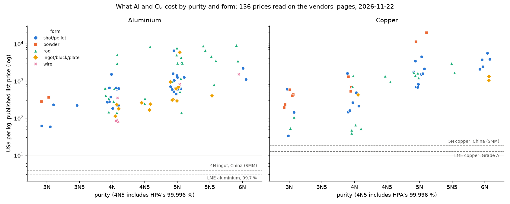

# The cups' metal: which purity, from where, and what it costs (#367, PR #373)

Sterling, on [PR #373](https://github.com/vertical-cloud-lab/byu-vcl/pull/373) (2026-11-22): "Look into comparisons of
the cost of 4N and 4N5 aluminum and copper, and the effect of different forms on the cost. For example, shot versus
powder versus rod for the various purities. Also use Edison and your raspberry Pi and whatever other resources you
have available to determine what kind of purities would be relevant? Commercially, for example, in the production of
AlSi10Mg, where is the aluminum sourced from and in what purity or composition? ... have a look at patents too, and
not just for that particular aluminum alloy."

**Edison could not be used.** Every task was refused with HTTP 402: "Insufficient balance: required 1.00 ACUs,
available 0.20 ACUs" (`LITERATURE_HIGH` needs 10). The research below is from the open web and Google Patents
instead. Where a page refused the runner, it was opened again in headed Chrome whose traffic left through the CubXL
Pi's network (BYU's), which worked for OnlineMetals and McMaster-Carr but not for Sigma-Aldrich, Fisher or Zoro.

- Data: [`../out/machining_prices.json`](../out/machining_prices.json): 145 prices with their pages, purity, form, size
  and quantity, accessed 2026-11-22. 137 were read on the page or in the vendor's own store data; 8 come from a search
  snippet only. It also has 14 commodity references and the 19 pages that refused both routes.
- Code: `machining.GRADES`, `machining.material_by_grade()` and `machining.plot_prices()`, giving
  [`../out/machining_prices.png`](../out/machining_prices.png).

## In short

- **The cup is the charge.** A cup and its plug are about 75 % of each 43 g melt (`notes/alloy_charge.md`), so the
  cups' purity sets the base of the alloy, and their cost is mostly metal.
- **Commercial AlSi10Mg is smelter aluminium, not refined metal.** It is P1020A-type remelt metal (99.7 %), with
  metallurgical-grade silicon and magnesium ingot added, or recycled metal: EOS has made its AlSi10Mg powder from
  100 % recycled feedstock since February 2025.
- **What purity the aluminium cups need depends on the run.**
  - **To match commercial AlSi10Mg, 99.7 % is enough.** 1070A/1080A bar gives an iron budget of about 0.28 % at
    worst, inside the 0.40 % ingot and 0.55 % casting limits.
  - **For a clean research baseline, 4N.** At 4N the cup brings only about 14 ppm Fe. The silicon and the AlSi10Mg
    top-up bring hundreds of ppm.
  - **5N cups only pay off if the Si and Mg are made purer too.** That means semiconductor-grade Si, ≥ 99.95 % Mg and
    no commercial AlSi10Mg powder.
- **Copper: OFE (C10100) is right.** It is LME Grade A cathode cast without oxygen. 5N-6N copper is only for sub-ppm
  S, Bi or P work, or for RRR conductivity.
- **Above 4N, the form and the lot size set the price more than the purity does.**
  - HPA sells 4N and 5N aluminium billet at the same $141-146/kg, and 4N and 4N6 Ø50 mm rod at the same $550 a piece.
  - Thin rod is priced by the piece: 5N Al rod costs $3,221/kg at Ø12 mm and $141/kg as Ø150 mm billet.
  - In China, 4N aluminium ingot is $3.95/kg, 1.33 times A00 (99.7 %). 5N copper is $17.89/kg, 1.33 times cathode.
- **The cell needs about 1.0 t of Al and 3.2 t of Cu bar a year,** at half and half. No catalogue lists 25-100 kg of
  4N-5N Ø20 bar, so the bulk price is a quote: billet or ingot, drawn or extruded to Ø20 by a mill.
- **The PR's "$3,500/kg 5N Ø20 Al rod" (Advent AL5049) is 5N5, not 5N.** Advent's 99.999 % rod comes only at Ø33 and
  Ø50 mm.

## What the cups need

### Aluminium

| The run | Al for the cups | Why |
|---|---|---|
| Copy a commercial alloy (AlSi10Mg, A356, ...) | **99.7 %: 1070A or 1080A bar** (not 1100, not 1050A) | the Fe budget below; commercial practice is no cleaner (smelter or recycled metal; the one AlSi10Mg powder patent that names its Al accepts ≥ 99.10 %) |
| A clean baseline, where trace impurities must not confound | **4N, 99.99 %** | the cup's share drops to ~14 ppm Fe; what university Al studies use (Beeri 2010; Qi & Dunand 2024) |
| ppm-level P, Na, Ca, Sr or Bi work | 5N or 5N5 | only with semiconductor-grade Si and ≥ 99.95 % Mg, and without the commercial AlSi10Mg top-up |

**Iron budget, worst case.** These are spec maxima for a 43 g Al-10Si charge of 75 % cup, 8.3 % Si powder and 16.7 %
AlSi10Mg powder (arithmetic):

| Source | Fe max in it | Fe it adds to the charge |
|---|---|---|
| cups of P1020A-grade metal (99.7 %) | 0.20 % | ≤ 0.15 % |
| silicon, grade 553 | 0.50 % | ≤ 0.04 % |
| AlSi10Mg powder (EN AC-43000) | 0.55 % | ≤ 0.09 % |
| **total** | | **≤ 0.28 %**: inside C360.2 ingot (0.40) and C360.0 / EN AC-43000 casting (0.55) |
| with 4N cups (typically 18 ppm Fe) | | the cups' share falls to ~14 ppm; the Si (≤ 420 ppm) and powder (≤ 900 ppm) dominate |

- **Watch the bar designation.**
  - 1100 (Cu 0.05-0.20 %) would put 0.04-0.15 % Cu into the melt, against Cu ≤ 0.05 % (casting) or ≤ 0.03 % (ingot).
  - 1050A (Fe ≤ 0.40 %) leaves the worst case at about 0.43 % Fe, over the ingot limit.
- **Grade 553 silicon can carry up to 0.30 % Ca:** about 250 ppm of the charge. That is inside the range at which Ca
  is added on purpose as a eutectic modifier (Pink Sheets, footnote 14). For a clean baseline, 2202 or purer silicon
  matters more than going from 4N to 5N cups.
- **Mg:** the Al-10Si charge gets only a trace of Mg, from the AlSi10Mg top-up (`notes/alloy_charge.md` says so).
  Copying AlSi10Mg itself would need Mg added.

### Copper

- **Grade A cathode, and OFE cast from it, are far purer than NAB and Cu-Ni need.**
  - Cathode allows Pb ≤ 5 ppm and ≤ 65 ppm of impurities in all.
  - C95800 NAB allows Pb ≤ 300 ppm and Si ≤ 1,000 ppm; C70600 allows Pb ≤ 500 ppm (200 ppm if welded).
- **OFE (C10100: O 5, Bi 1, Pb 5, S 15 ppm; ≥ 101 % IACS) is cathode cast without oxygen.** KGHM and Aurubis say so of
  their own OFE rod. It is the natural clean baseline.
- **OF (C10200, O ≤ 10 ppm) is the minimum where oxygen matters.** C11000 ETP's oxygen "may vary depending on the
  process". On paper, C11000 and C10200 bound neither Pb nor Bi, so ask for a certificate.
- **The additions can bring more impurity than the copper.** With the cups at 75 % of the charge, 99.9 % Ni at 10 % of
  the charge adds up to 100 ppm, against ≤ 49 ppm from Grade A cathode (arithmetic). In GRCop-84, the iron that cost
  conductivity came with the chromium (NASA TM-2005-213566).

## Where the metal in commercial alloys comes from

- **Smelter grades are named by their Si and Fe limits.**
  - The Aluminum Association's [Gold Sheets](https://www.aluminum.org/sites/default/files/2025-10/Gold%20Sheets%202025.pdf)
    cover "unalloyed aluminum not made by a refining process". PXXYY means Si ≤ 0.XX % and Fe ≤ 0.YY %:
    - P1020A (the LME contract): Si 0.10, Fe 0.20;
    - P0610A: 0.06 / 0.10; P0406A: 0.04 / 0.06; P0303A: 0.03 / 0.03; P0202A: 0.02 / 0.02.
  - Even P0202A is selected from the cells, not refined. Some cells, run on primary alumina, make purer metal
    ([US8992661B2](https://patents.google.com/patent/US8992661B2/en)).
- **Each step of the supply chain sets its own impurities.**
  - In the smelter, "virtually all the impurities contained in alumina will end up in aluminum". Anode coke brings
    "most of the metallic impurities especially iron, silicon, nickel, vanadium" (US8992661B2).
  - Smelter metal's main impurities are Fe, Si, Zn and Ga ([Curtolo 2021](https://mdpi-res.com/d_attachment/metals/metals-11-01407/article_deploy/metals-11-01407.pdf)).
  - Metallurgical silicon comes from carbothermic reduction of quartz. Ladle refining removes Al and Ca but not Fe or
    Ti, so Fe is set by the quartz and the reductant ([Elkem WO1998011018A1](https://patents.google.com/patent/WO1998011018A1/en); the Fe point is from a snippet).
    - Grade 553: Fe / Al / Ca ≤ 0.50 / 0.50 / 0.30 %;
    - 441: 0.40 / 0.40 / 0.10;
    - 3303: 0.30 / 0.30 / 0.03;
    - 2202: 0.20 / 0.20 / 0.02 ([PCC BakkiSilicon](https://www.products.pcc.eu/wp-content/uploads/import/product/broszura/505dc509-d9fc-4322-bab1-766b45609d72/pcc-bakkisilicon_broszura_en.pdf)).
- **Foundry AlSi10Mg is smelter metal plus additions.**
  - Rio Tinto's primary foundry ingot "is produced from high purity (low iron) primary metal" with "carefully selected
    alloying elements" ([brochure](https://riotinto.com/can/-/media/content/documents/products/aluminium/rt-aluminium-foundry.pdf)).
  - Secondary (recycled) ingot carries 0.25-0.8 % Fe, against 0.02-0.15 % for primary
    ([Kuchariková 2021](https://www.ebi.ac.uk/europepmc/webservices/rest/PMC8069112/fullTextXML)). Hence A360.0 and
    360.0 at 1.3 and 2.0 % Fe.
- **Powder makers say almost nothing about their feedstock.**
  - EOS says its AlSi10Mg is "now produced with 100% recycled feedstock" and "maintains the same properties"
    ([EOS, 2025](https://www.eos.info/press-media/press-center/press-releases/2025/eos-achieves-new-sustainability-standard-aluminium)).
  - No feedstock statement was found from ECKART, Toyal, Valimet, AP&C, Höganäs, IMR, SLM/Nikon, Avimetal or the
    Chinese makers, on their sites or in their patents. It is treated here as not public.
  - The one AlSi10Mg powder patent that names its feedstock ([CN107716918B](https://patents.google.com/patent/CN107716918B/en))
    specifies:
    - Al ingot "≥ 99.10 %", "≥ 99.99 %" preferred;
    - Mg ingot ≥ 99.10 %;
    - Si as an Al-10-13Si master alloy, not silicon metal.
- **AlSi10Mg in the standards.**
  - It was registered in 2017 as **C360.0** castings (Fe 0.55, Cu 0.05) and **C360.2** ingot (Fe 0.40, Cu 0.03)
    ([Pink Sheets 2025](https://www.aluminum.org/sites/default/files/2025-10/Pink%20Sheets%202025.pdf)). So the familiar
    "0.40 or 0.55" is ingot against casting.
  - The powder specification is AMS 7018. The current EN 1706 table is behind a paywall.

### Fe and Si across aluminium alloys, wt % max

From the Teal, Pink and Gold Sheets.

| Material | Si | Fe | Note |
|---|---|---|---|
| P1020A / P0610A / P0303A | 0.10 / 0.06 / 0.03 | 0.20 / 0.10 / 0.03 | smelter metal, not refined |
| 1100 / 1050A / 1070 | Si + Fe 0.95 / 0.25 / 0.20 | (incl.) / 0.40 / 0.25 | 1100 has Cu 0.05-0.20 |
| 1090 / 1199 | 0.07 / 0.006 | 0.07 / 0.006 | 99.90 / 99.99 % |
| 2024 → 2124 | 0.50 → 0.20 | 0.50 → 0.30 | 2124: "higher-purity base" for toughness |
| 7075 → 7475 | 0.40 → 0.10 | 0.50 → 0.12 | same reason |
| A356.0 → A356.2 → C356.2 | 6.5-7.5 | 0.20 → 0.12 → 0.04 | the ".2" ingot leaves room for Fe the foundry adds |
| **C360.0 / C360.2 (AlSi10Mg)** | 9.0-11.0 | **0.55 / 0.40** | Cu 0.05 / 0.03 |
| A360.0 / 360.0 (die casting) | 9.0-10.0 | 1.3 / 2.0 | recycled metal |
| 205.0 (A20X matrix) | 0.10 | 0.08 | |
| Scalmalloy ([US11433489B2](https://patents.google.com/patent/US11433489B2/en)) | 0.25 | 0.25 | impurities ≤ 0.5 total |
| 727.0 (Al-Ce-Mg-Zn-Ni) | — | 0.25-0.50 | Fe added on purpose |

### Copper alloys

| Material | O | S | Pb | Bi | Note |
|---|---|---|---|---|---|
| Cu-CATH-1, BS EN 1978 (LME Grade A) | — | 15 ppm | 5 ppm | 2 ppm | total ≤ 65 ppm |
| C11000 ETP | not limited | — | — | — | Cu + Ag ≥ 99.90 % |
| C10200 OF | 10 ppm | — | — | — | Cu + Ag ≥ 99.95 % |
| C10100 OFE | 5 ppm | 15 ppm | 5 ppm | 1 ppm | Cu ≥ 99.99 % excl. Ag; ≥ 101 % IACS |
| C70600 / C71500 (Cu-Ni) | — | — | 0.05 % | — | Fe 1.0-1.8 / 0.40-1.0 % on purpose |
| C95800 NAB | — | — | 0.03 % | — | Al 8.5-9.5, Fe 3.5-4.5, Ni 4.0-5.0, Si ≤ 0.10 % |
| GRCop-84 (NASA) | — | — | — | — | Fe < 50 ppm required, < 20 desired |

From [CDA datasheets](https://datasheets.copper.org/wrought-coppers.pdf), the [LME](https://www.lme.com/-/media/Files/Physical-services/Brands/Chemical-composition/Chemical-composition-Copper.pdf),
[Concast](https://www.concast.com/c95800.php) and [NASA TM-2005-213566](https://ntrs.nasa.gov/api/citations/20050123582/downloads/20050123582.pdf).

## How high-purity Al and Cu are made, and by whom

- **Aluminium takes two refining routes.** Three-layer (Hoopes) electrolysis and fractional crystallization
  (segregation) each reach 4N8. 5N and above needs both, or repeated crystallization (Curtolo 2021).
  - The Hoopes cell removes Mn, Cr, Ti, V, Zr and Ga, but is "less effective" on Si, Fe and Cu, which crystallization
    then removes.
  - Alcoa's worked example went 99.993 % → 99.999 % (Si 3, Fe 1 ppm) ([US4222830A](https://patents.google.com/patent/US4222830A/en)).
- **Who makes it:**
  - Hydro, Grevenbroich, Germany: 4N8-5N5 by electrolysis plus segregation;
  - Nippon Light Metal, Kambara: 99.98-99.9999 % by segregation;
  - Resonac (ex-Showa Denko), Sakai: capacitor foil from refining through rolling;
  - Xinjiang Joinworld: 42,000 t a year;
  - Sumitomo Chemical: 5N and sputtering targets.

  Most 4N metal goes to capacitor foil, and most 5N+ to semiconductor targets and bond wire. Production data are
  "quite often regarded as a trade secret" (Curtolo).
- **Copper:**
  - OFE is cathode melted without oxygen. KGHM charges Cu-CATH-1 with O ≤ 5 ppm; Luvata's OFE-OK is 99.995 %.
  - 6N needs a second electrolysis in nitric acid ([JX US9476134B2](https://patents.google.com/patent/US9476134B2/en)).
    JX makes 6N at Isohara for sputtering targets.

## What it costs

- **Form, at the same purity.** Powder is the dearest form at every purity with a published price:
  - Cu 3N powder is 1.6-4 times Thermo's shot;
  - Cu 5N powder is 5.4 times;
  - Al 3N powder is 5-6 times;
  - nobody publishes a price for 4N-or-better Al powder.

  Shot against rod depends on the metal. 5N Cu rod ($1,202-1,629/kg) is cheaper than 5N Cu shot ($2,106/kg), but 5N
  Al rod is 2.4 times 5N Al shot.
- **Purity, from the same seller in the same form:**
  - Thermo Al shot: 3N $61, 4N $182, 5N $1,244/kg.
  - Thermo Cu shot: 3N $144, 4N $147-210, 5N $2,106/kg.
  - HPA Al rod, 4N to 5N: Ø25 × 305 mm $250 → $475; Ø38 $600 → $650.
  - Lesker pellets: Al 4N $295 and 5N $300 a pound.
- **Quantity:** Thermo 3N Al granules are $227/kg at 250 g and $59/kg at 5 kg. HPA 4N Al wire is $350/kg at 1 kg and
  $85/kg at 10 kg.

**A pair's bar by grade** (`machining.material_by_grade()`: 79.5 g of Al or 263 g of Cu, as 94 mm of Ø20 bar; half
the 24,500 pairs a year in each metal):

| Metal, grade | US$/kg as published | Per pair | Per year | Where |
|---|---|---|---|---|
| Al 99.7 % (1070A/1080A bar) | 8-15 (est.) | $0.64-1.19 | $7,800-14,600 | no list price found; P1020 delivered in the US is $5.3-5.5/kg |
| **Al 4N** | 141-406 | $11-32 | $137,000-395,000 | HPA billet (to be drawn) to Ø22 rod; China 4N ingot $3.95/kg |
| Al 4N6 (99.996 %) | 248-340 | $20-27 | $241,000-331,000 | HPA Ø50 rod, no thinner stock |
| Al 5N | 141-1,175 | $11-93 | $137,000-1,142,000 | HPA Ø150 billet to Ø25 rod |
| **Cu C10100 OFE** | 39-65 | $10-17 | $126,000-209,000 | 1st Choice Ø20 (UK) $39; McMaster $52 and OnlineMetals $65 (3/4 in, read through the Pi) |
| Cu 4N5 | 940-1,141 | $247-300 | | lab catalogues only |
| Cu 5N | 1,202-1,629 | $316-428 | | Thermo rod; China 5N $17.89/kg in bulk |

- **The catalogue prices above are not what 1 t a year should cost.** The commodity floor is $3.10/kg (LME Al) to
  $3.95/kg (China 4N ingot) for aluminium, and $12.5-17.9/kg for copper.
- **So ask for quotes on:**
  1. 4N Al Ø20 rod drawn from ingot or billet by the 100 kg (HPA's billet; a Chinese 4N producer's drawn rod);
  2. C10100 Ø20 bar by the 100 kg;
  3. return of the 56 % of each bar that becomes chips, kept clean and separate.

## Patents that state purity

| Number | What | Assignee, year | What it says about purity |
|---|---|---|---|
| [CN107716918B](https://patents.google.com/patent/CN107716918B/en) | AlSi10Mg powder | Beijing Hang Hang, 2019 | Al ingot ≥ 99.10 % (≥ 99.99 % preferred); powder Fe ≤ 0.10, Cu ≤ 0.05 %; O ≤ 400 ppm |
| [US11433489B2](https://patents.google.com/patent/US11433489B2/en) | Scalmalloy | Airbus, 2022 | Si ≤ 0.25, Fe ≤ 0.25; impurities ≤ 0.5 % total; no base-metal purity |
| [US11286543B2](https://patents.google.com/patent/US11286543B2/en) | nano-functionalized 7075 | HRL, 2022 | feedstock Fe 0.005-0.4 %; powder bought from Valimet |
| [US12377463B2](https://patents.google.com/patent/US12377463B2/en) | Al-Zr-Fe AM powder | Constellium, 2025 | impurities < 0.05 % each, < 0.15 % total |
| [EP2837702A1](https://patents.google.com/patent/EP2837702A1/en) | A20X family | Aeromet, 2015 | Fe 0-0.15, Si 0-0.15 % |
| [US9963770B2](https://patents.google.com/patent/US9963770B2/en) | Ce-modified cast Al | UT-Battelle et al., 2018 | Fe up to 0.15, 0.6 or 1 % by claim |
| [US11773468B2](https://patents.google.com/patent/US11773468B2/en) | Al-Mg-Si for AM | QuesTek, 2023 | Fe ≤ 0.2 %; impurities ≤ 0.15 % total |
| [EP0687742B1](https://patents.google.com/patent/EP0687742B1/en) | AlSi10MnMg die casting | Rheinfelden, 1997 | Fe ≤ 0.15, Cu ≤ 0.03 %: "any contamination of the melt ... must be avoided" |
| [US4222830A](https://patents.google.com/patent/US4222830A/en) | extreme-purity Al | Alcoa, 1980 | three-layer cell 99.993 %, then crystallization 99.999 % |
| [US6398845B1](https://patents.google.com/patent/US6398845B1/en) | Al purification by segregation | Sumitomo Chemical, 2002 | from 98-99.99 %; Si / Fe 210 / 270 → 9 / 4 ppm |
| [EP1329529A1](https://patents.google.com/patent/EP1329529A1/en) | capacitor-foil Al | Showa Denko, 2003 | ≥ 99.9 %, Si and Fe 2-50 ppm each |
| [US11859272B1](https://patents.google.com/patent/US11859272B1/en) | GRCop by in-situ SLM | NASA, 2024 | elemental powders ≥ 99 %; O < 0.1 % |
| [CN111992727A](https://patents.google.com/patent/CN111992727A/en) | CuCrZr powder | Jiangsu Vilory, 2020 | electrolytic Cu 99.98 % plus Cu-Cr and Cu-Zr master alloys |
| [US9476134B2](https://patents.google.com/patent/US9476134B2/en) | 6N copper | JX, 2016 | anode ≤ 5N → ≥ 6N; P, S, O, C ≤ 1 ppm each |

- **The Al AM patents cap the impurities but never name the base metal.** The caps are Fe 0.15-0.25 %, others
  ≤ 0.05 % each and ≤ 0.15 % in all.
- **The refining patents all start from smelter metal.** They go from 99.6-99.9 % to about 4N, then to 5N.
- **The Cu AM patents start from 99.98-99.99 % copper.**

## Not found, still open

- **Not found:**
  - feedstock statements from the powder makers;
  - the current EN 1706:2020 + A1 table, and the ASTM B92 and AMS 7018 limits (paywalled);
  - the premium of OFE over cathode;
  - a published bulk price for 4N-5N Ø20 bar;
  - an openable study of Fe at 0.1 against 0.5 % in printed AlSi10Mg (one, behind a paywall, reports that 0.55 % Fe
    coarsened the intermetallics against 0.15 %).
- **Which purity, per run type, is the lab's call.** This note sets out the trade. The cell itself is the same for
  any grade.
