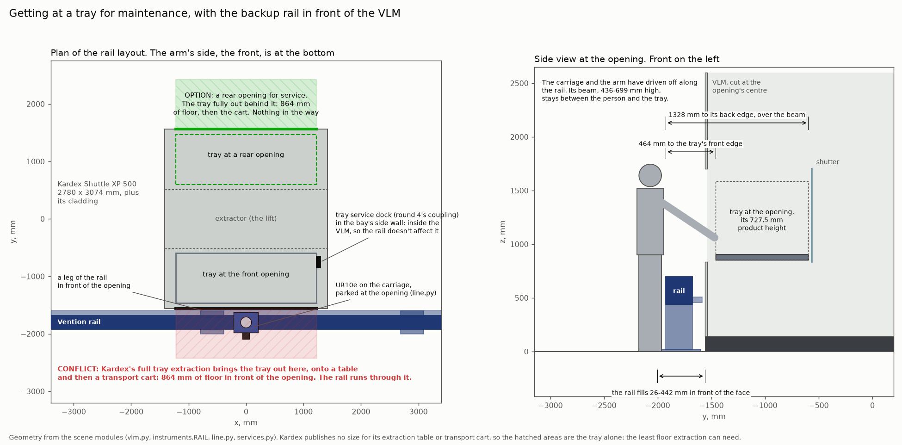

## Getting a tray out for maintenance, with the rail in front

Asked on PR #318: how do trays come off for maintenance, and can the tray service dock work with the rail there?

[`maintenance.py`](../maintenance.py) draws this to scale. It reads the geometry from the scene modules' own
constants: `vlm.py`, `instruments.RAIL`, `line.py`, `services.py` and `warehouse.py`. The numbers are in
[`out/maintenance_access.json`](../out/maintenance_access.json).

### The tray service dock is not a way out

It is round 4's coupling ([`services.py`](../services.py), [services notes](services.md)). A Stäubli plate on the
tray's back-right corner carries mains, Ethernet, air, N₂ and chilled water. It mates with a dock in the side wall of
each slot and of the bay. Every dock is inside the VLM, so the rail doesn't affect the coupling. It also doesn't move
a tray anywhere.

### Kardex's way out: full tray extraction onto a cart

From the Kardex Remstar Shuttle XP brochure ([dealer PDF](https://www.supplycore.com/wp-content/uploads/2022/01/Shuttle-XP-Vertical-Lift-Module-1108-1.pdf)):
- **p. 6:** "With the full tray extraction device, a tray is placed in front of the access opening for loading and
  unloading purposes. This can be loaded onto the optional transport cart for safe and easy handling."
- **p. 5, the options list:**
  - automatic and manual tray extraction;
  - a transit trolley;
  - a factory-fitted crane;
  - tray extraction for forklift operation;
  - up to six access openings per unit.
- **p. 7:** "Automatic or manual tray extraction also make the use of hoists and cranes trouble-free."
- **p. 6, and Kardex's 2021 Shuttle brochure, p. 5:** openings go "on the front or rear side of the unit"
  ([PDF](https://info.southwestsolutions.com/hubfs/Brochures/SSG-Brochures/KAR-198/Shuttle.pdf)).

Kardex publishes no size for the extraction table or the cart. So the drawing shows only the tray, pulled clear of the
opening. That is the least floor extraction can need: the tray's 864 mm in front of the cladding, after 964 mm of
travel.

### With the rail where `line.py` puts it, the front opening can't do this

- **The rail fills 26–442 mm in front of the cladding,** along the whole line:
  - its beam is 436–699 mm high;
  - one of its legs stands under the opening, at x = −590 mm;
  - the carriage and its gearmotor reach 534 mm out, and the arm parks there.
- **The extracted tray needs that floor.** The tray, the table under it and the cart stand where the rail is. No cart
  can get to the tray across the beam.
- **A person can't work there either.** From the beam's outer face, the tray's front edge is 464 mm away and its back
  edge 1328 mm, reached over a beam at hip height.

### What would work

1. **A second opening at the back, for service.**
   - The arm keeps the front. People, the extraction table and the cart use the back, more than 3 m from the arm's
     base and so outside its 1.3 m reach.
   - Kardex sells two openings in use at once ("loading at one level or side and retrieval at the other", p. 6).
   - The instruments' back panels face the person, where most of their connectors and service panels are.
   - A dock in the rear bay's side wall keeps the tray powered while it is worked on. The plate faces sideways, so it
     mates there as it does at the front.

   **What it costs:**
   - **Storage.** At the front opening's height, a rear opening takes the rear column's R1 and R2, the slots of trays
     D and A. A 3950 mm unit then has four full-height positions, not six. By our arithmetic, a rear opening with its
     table at about 1.1 m would cost one slot (R2), with R3 and R4 moved up 100 mm. That is a question for Kardex.
   - **Floor behind the VLM.** It needs about 2 m (our estimate: the tray's 864 mm, plus a cart and a person), so the
     VLM can't stand against a wall. In the warehouse layout, the racks are 1238 mm behind it: room to stand at a rear
     opening, not to pull a tray out.
2. **A floor-flush section of rail in front of the VLM,** with walk-on covers and round 4's pedestal under the arm.
   This is building work, and the covers would have to carry a loaded cart. A low rail on the floor doesn't help: the
   beam is still in the same place, so a cart still can't cross it and the reach is the same.
3. **A removable section of rail.** The beam comes in 3330 mm segments. Unbolting one and re-aligning it is fine for a
   once-a-year instrument swap, but not for routine work.
4. **The mobile base.** In the warehouse layout nothing is fixed in front of the opening. The MiR250 drives off, and
   the extraction table and cart have the 3.0 m aisle. This is the simplest answer for maintenance, and one more point
   for the MiR250 over the rail.

### What to ask Kardex

- Is full tray extraction offered on the XP 500 2450 × 864, and at a rear opening?
- What does the extraction table measure, and how much clear floor does it need?
- What load is the transit trolley rated for, against our heaviest tray?
- How high can a rear opening sit, and what does it cost in rear-column slots?
- Can the arm keep working at the front opening while a tray stands at the rear one?
