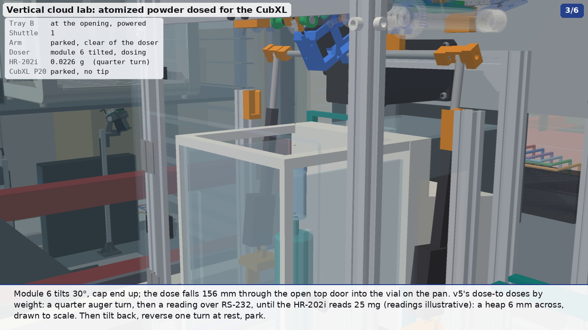
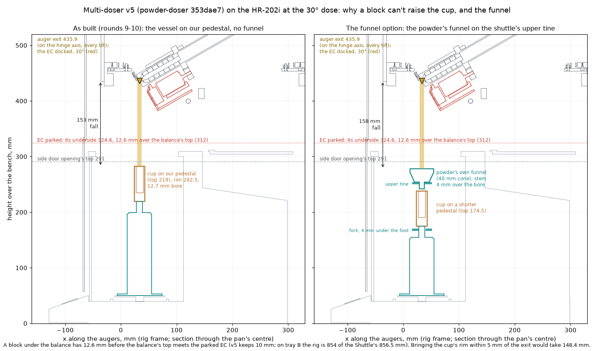
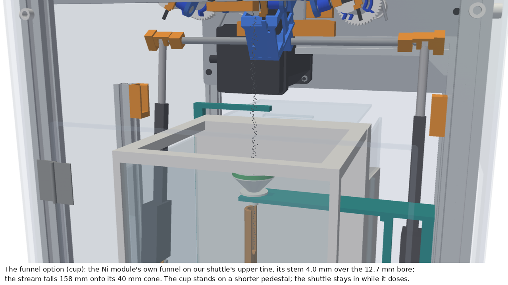
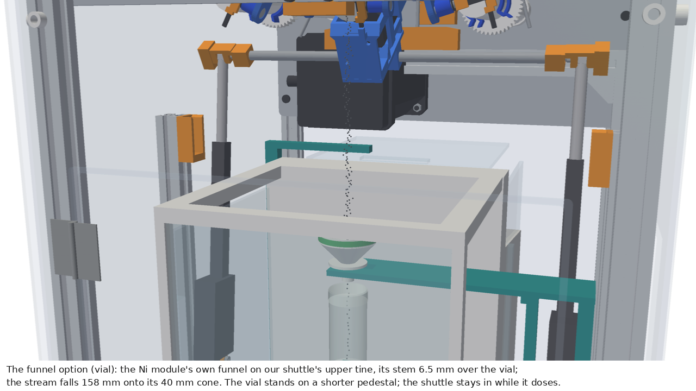

# The multi-doser in the lab: chain carousel v5 on an A&D HR-202i (round 9)

[`carousel.py`](../carousel.py) runs powder-doser's own CAD for the multi-doser: byte-for-byte copies of
[`cad/chain-carousel-v5/`](https://github.com/vertical-cloud-lab/powder-doser/tree/353dae78829ef8fffaa1bd584876a157145a0b76/cad/chain-carousel-v5)
at `353dae7` (PR #185's head, 2026-11-05) and the vendor helpers it imports, in [`../multidoser/`](../multidoser/)
(file list and SHA-256s in its README). It appears in two clips: the 8:37 one (`animate.py workflow`, a vial dosed for
the CubXL) and chapter 1 (`alloy_charge.py`, the atomizer's charge cups), and stands on tray B in every whole-lab
scene (`setup_lab.py`). Sterling's two points of 2026-11-05 22:56 on PR #318 that this answers:

1. "we have an updated version of the multi-doser [powder-doser PR #185 comment]. You'll need to make changes across a
   couple places (both vial dosing and charge cup dosing) ... Noting also that you'll be putting the balance
   underneath."
2. "during the dispensing at 8:37 or so the vial ... is still oriented 90 degrees the wrong way (laying flat instead of
   the top towards the top)."

## What v5 is

From the [v5 comment](https://github.com/vertical-cloud-lab/powder-doser/pull/185#issuecomment-6638969198) and v5's
[README](https://github.com/vertical-cloud-lab/powder-doser/blob/353dae7/cad/chain-carousel-v5/README.md); numbers
marked (computed) are ours, from the copied `layout.py`:

- **v4 with the station rebuilt round an A&D HR-202i** (220 g × 0.1 mg, plus a 51 g × 0.01 mg fine range; RS-232C
  only). It stands on the bench under the dose point, inside the U-shaped base, touching nothing of the doser.
- **The electronics carriage (EC) rides an 8 mm lift bar carried by two Actuonix P16s**, one each side of the balance
  (P16 axes at y ±146 mm), with guided shoes in slots on two station posts that leave their slots as the EC seats. It
  rises 28 mm from park to dock (`PARK_DROP`), docks under the station module and tilts it to 30° (40° at most: past
  about 41° the bar meets the neighbouring modules).
- **The carousel is 80 mm higher** (top rail 831 mm) so the parked EC (328 mm) and the NEMA 34 (332.5 mm) clear the
  316 mm balance. The front base rail and both station rails are gone; the latch rail hangs from a 2020 beam.
- **No funnel and no load cell.** A 25 mL beaker on a printed riser (rim at 282 mm) goes in through the balance's -y
  side door; the top door slides back 205 mm; the dose falls 154 mm into the beaker; `chain_rig.py dose-to` doses by
  weight in quarter auger turns, reading the balance over RS-232 (`Q`, 2400 7E1) after each. The exit stays on the
  hinge axis, 435.8 mm over the bench (computed), at every tilt.
- **Front hatch 300 × 330 mm**, open down to the bench: a hand reaches the side doors through it. The doors are opened
  by hand: v5 says a robot-served station needs an actuator.
- **HR-202i model**: checked against A&D's [HR-i manual](https://www.aandd.jp/products/manual/balances/hr-i.pdf)
  p.59-60 and A&D's 1:1 DXF: 200 × 428 × 310 mm body, pan Ø90 with its top 50 mm up, chamber 183 × 164.5 × 250 mm,
  side doors 148.5 × 251 mm whose opening's top is 291 mm up, doors sliding back 205 mm. A&D has discontinued it
  (MNM Scales: $2,989, out of stock, "replaced by GH-202").
- **Interference** (v5's own OCC checks): 0 at home over all 843 instances, 0 parts in the balance's way, 0 over the
  rise and tilts to 40°, 0 on a chain sweep. **BoM** $2,361.63 ($2,220.24 without test gear), the balance at $0.
- **Not done in v5**: the MuJoCo station model and the swap check re-run; the vibration through the bench (T8a); the
  154 mm fall's strays for fine powders (T8b); the two P16s tracking within 2 mm (T6).

## How it is run here

- `carousel.CL = layout`, `carousel.CP = params` (the copies). `layout.placements(State(...))` gives every part
  instance for a chain shift, the EC's lift (`ext`, 0 parked to 28 docked) and tilt, an auger turn, the solenoid and
  the balance's doors (`top_door`, `side_door`, 0-205 mm). The animation eases those numbers; every frame is the rig's
  own kinematics.
- **Vendor STEPs**: McMaster's, Actuonix's and StepperOnline's files can't be redistributed, so they are not fetched.
  With no `cad/vendor/files/`, the copied builders draw their own parametric stand-ins, exactly as powder-doser does on
  a checkout without them. Sam's plate and EC, the auger and its cap are fetched from v4's `reference/` (the same three
  files round 8 used for v2) and hash-checked.
- **One import quirk**: v5's vendor helpers import `common`, and so does the lab (`lab_models/common.py`, via `vlm.py`).
  `carousel._import_v5` swaps the lab's out for the import and puts it back, and takes `vendor/` off `sys.path` after.
- 841 instances, 96 unique parts, 499k triangles placed (68k tessellated), 13 ms per `placements` call; actors whose
  instances didn't move keep their meshes (and `collide.py` keeps their collision trees).
- Round 8's v2 copies are removed: nothing runs v2 any more.

## What is ours (drawn in the lab's PETG teal)

**Why a shuttle: no gripper reaches v5's pan.** The way to the balance's -y side door passes between the frame's front
post (x ≤ -36.4 mm, rig frame) and the -y station post that carries the P16 (x ≥ 81 mm): 117 mm. The Robotiq 2F-85's
knuckles span 127-138 mm whatever it grips (`ur_arm.gripper_fk`, closure 0.55-1.0), so a 2F-85 carrying a vial or a cup
cannot pass. An FCL sweep of the gripper along that line (`/tmp` check, round 9) hit the front post, the station post
and the P16 from 60 mm out onward. v5's front hatch is for a hand. So:

- **Vessel shuttle**: a fork (36 mm wide, 180 mm long, 4 mm thick, a 13 mm × 30 mm slot at its tip) on a carriage
  that runs on a rail along y, x = 33.4 mm (the pan's centre), the rail 110-130 mm up from y -110 to -470 mm, held by a
  bracket on the -y base rail and a leg on the tray. The arm sets the vessel on the fork at y -270 mm, 71 mm outside
  the -y acrylic panel; the shuttle carries it 254.8 mm in, through the open side door, 6 mm over the pedestal, and
  drops 10 mm: 6 mm sets the vessel down, 4 mm leaves the fork clear under it, and the fork backs out round the
  pedestal through its slot. To take it out, the reverse. Only the vessel's foot touches the balance (on the pedestal).
- **Pedestal riser**: v5's riser (80 mm foot, 44 mm tube) with an 11 mm neck 20 mm tall on top, so the vessel stands
  at 219 mm: the vial's rim at 280 mm (a 155.8 mm fall), a charge cup's at 282.5 mm (153.3 mm), both against v5's 282
  mm and 154 mm. Lifted 6 mm on the fork, the cup's rim (288.5 mm) still passes under the door opening's 291 mm top.
  The neck centres a cup's 12.7 mm bore under the 8 mm stream to within the fork's placement.
- **A port** 67 × 200 mm in the -y acrylic panel (x 0-67, z 100-300 mm) for the shuttle.
- **Door pushers**: v5's doors are slid by hand. Two belt slides on the bench inside the base, 14 mm off the
  balance's sides, whose fingers take a door's grip only while they move it, so nothing touches the balance while it
  weighs: one for the -y side door, one reaching over to the top door's front grip.
- **On tray B the top panel lies on the top rails** (its 6 mm standoffs go into the rails): the rig is 854 mm tall,
  under the Shuttle's 856.5 mm product height (`vlm.MAX_GOODS_H`, our estimate for a 996 mm opening). As powder-doser
  draws it, 860 mm would not pass the opening.

Checked (FCL, rig frame, side door open): the fork at both heights, the vial and a cup, at 41 positions along the
travel, against every part of the rig, the pushers, the rail and the pedestal: **no contact**. With the EC docked and
tilted to 30° and the top door open, the vial and a cup on the pedestal: **no contact**. Designs, not built; their
dimensions are ours and estimates.

## On tray B

- **The rig is no longer turned.** Round 8 stood v2 turned 90° on the tray. v5 stands as powder-doser draws it, its
  -y side (side door, port, shuttle) toward the opening and the arm, at (150, 50) on the tray (`animate.LOADS`): the
  rig spans x 20-540, y -149 to 270 mm, the shuttle's leg reaches y -415. The electronics board lies flat left of the
  rig, behind the vial rack (x -380 to -80, y -310 to 110).
- **Tray B's slot is taller**: `vlm.COLUMNS` R3 from 775 to 900 mm (854 mm of rig, 3 mm of tray floor and 20 mm clear,
  on the 25 mm pitch). Shuttle 1's rear column then fills 3,125 of its 3,390 mm; tray E (R4) moves up 125 mm.
- `services.py`'s fixed box for the carousel (560 mm tall) and `reach.py`'s seat for the doser's cup are round 8's;
  neither is ours to edit.

## The vial (Sterling's point 2)

Round 8's vial lay on its side at 8:37 because it was taken from the rack from above (gripper pointing down) and set in
the doser's cup with the gripper level: the vial turned with the gripper. Now the gripper takes it from above and sets
it down from above, upright, on the shuttle's fork, and the shuttle carries it in and out; it takes it from the fork
from above again for the MiR's holder. It never leaves the vertical.

## Rendered (2026-11-06)

| Clip | Length | Frames (6 fps, 1280 × 720) | Arm audit (same pass) | Files |
|---|---|---|---|---|
| 8:37, `animate.py workflow` (the whole lab, Shuttles see-through) | 111.8 s | 671 | **0 of 574** checked frames in collision | [MP4](../out/mp4/vlm_workflow.mp4) (7.9 MB), [GIF](../out/vlm_workflow.gif) (4.6 MB, made from the MP4 at 4 fps, 560 px: `lab_scene` writes none), stills `out/vlm_workflow_{dose,vial,still}.png`, [audit](../out/collisions/vlm_workflow.json) |
| Chapter 1, `alloy_charge.py` | 254.3 s | 1526 | **0 of 1145** | see [`alloy_charge.md`](alloy_charge.md) |

Two things found on the way, both fixed: v5 swaps the station module's outlet-door spring for its compressed mesh as
the EC docks (`door_spring` / `door_spring_open`), so `Carousel.set` allows that one key to change; and the first
chapter-1 render died at its first frame because its X display (:32) never came up ("bad X server connection"), not
because of the scene; re-queued on another display, it ran.

The CubXL half of the 8:37 clip opens one cap only (the seawater stock), so it needs no parking spot for a second cap
(the cubxl stream's note in [`cubxl_corrosion.md`](cubxl_corrosion.md), round 9).

## Round 10: raising the vessel toward the outlet, measured; the funnel (PR #318, 2026-11-07)

Sterling: "did you get latest multi-doser with the scale? Note the comment about raising the cup on a platform of sorts
so that the nozzle is closer, but we might end up needing to use a funnel anyway." The comment is his on powder-doser
#185 ([2026-11-05 17:52](https://github.com/vertical-cloud-lab/powder-doser/pull/185)): "if we have a shorter scale or
want to get it closer to the dispense point, we just raise the scale up on some kind of block (e.g., granite block)".

**The latest: yes.** PR #185's head was still `353dae7` on 2026-11-07 at 22:15 UTC, the commit round 9 copied. The block
comment is the PR's last.

### Measured on v5's own geometry

[`r10_doser_raise.py`](../r10_doser_raise.py) reads the copied `layout.py`/`params.py` and the tessellated parts, and
writes [`out/doser_raise.json`](../out/doser_raise.json). The numbers are heights over the bench in the rig's frame, in mm.

| What | mm |
|---|---|
| The auger's exit (on the hinge axis, the same at every tilt) | **435.9**, 0.05 off the pan's axis |
| HR-202i: pan top, chamber ceiling inside, body top, top door's grip | 50, 300, 310, **312** |
| Side door opening (the vessel's way in): sill to top, width | 40 to **291**, 148.5 |
| Top door opening | 164 × 148.5 |
| EC parked: the lowest part over the balance | **324.6** (the EC), **12.6 mm** over the top door's grip |
| EC docked and tilted 30°: the lowest part within 14 / 20 mm of the stream's axis | 412.1 / 409.1 (the EC) |
| 20 mL vial: 61 tall, Ø28, mouth Ø25.6 (our model) | rim 280.0, **fall 155.9** |
| Charge cup: 63.5 tall, Ø19.05, bore 12.7 | rim 282.5, **fall 153.4** |
| Carried 6 mm up on the fork, the rim under the side door opening's top | vial 5.0, cup 2.5 |
| Tray B: the rig against the Shuttle's product height | 854 of 856.5 |

### Why a block can't do it in v5

- **A block under the balance gives everything on the pan the same lift, at no cost in capacity.** It also lifts the
  balance's top, though. v5 parks its EC 12.6 mm above that top and keeps 10 mm clear (`HR2_TOP_GAP`), so the block
  can be at most 2.6 mm.
- **Closing the gap would take a much taller block.** Bringing the cup's rim within 5 mm of the exit needs 148 mm (the
  vial 151). The balance's top would then be at 460 mm, through the docked EC, its NEMA 11, the module's plate, the
  outlet door and the frame's front side plate: 32 kinds of part inside its outline box (listed in the JSON). The chamber would have to
  take in the whole station.
- **Raising the carousel with the balance gains nothing.** The exit goes up by the same amount. On tray B the rig has
  2.5 mm to spare anyway.
- **The vessel is already as high as the door allows.** It rides 6 mm up on the fork through the side door, so the cup's
  rim passes 2.5 mm under the opening's top. Raising the vessel on the pan is what v5's riser and our pedestal already
  do.
- **So the free fall stays about 150 mm in v5, whatever the vessel stands on.**
  - A block is the move for a **shorter** balance, as Sterling says. Put one that fits well under v5's 316 mm on a
    granite block ([powder-doser #146](https://github.com/vertical-cloud-lab/powder-doser/issues/146), the vibration
    paver: [#147](https://github.com/vertical-cloud-lab/powder-doser/pull/147) prices a 12 × 18 × 3 in surface
    plate) until its top is 10 mm under the parked EC, and its pan rises with it.
  - The lab's HR-100A is no shorter: 198 × 294 × 315 mm, from its manual
    ([#147](https://github.com/vertical-cloud-lab/powder-doser/pull/147)).
  - On v5 the granite does what #146 bought it for: it goes under the balance for vibration, not height. Even that
    leaves 2.6 mm here, so on tray B it would go under the whole rig, which the 2.5 mm doesn't allow either. That one
    is open below.
- **What would shorten the fall is powder-doser's to change**: bring the outlet down into the chamber at the dose
  (e.g. a short spout on each module, lowered through the open top door as the EC docks), or park the EC off the
  balance's top.

### Does the stream land in the mouth?

v5's `check_stream` finds that an 8 mm column from the exit clears the module at 45°, and at 30° grazes the module's own
outlet face (0.4 mm³). Centred on the pan's axis, that column leaves 8.8 mm on each side in the vial's 25.6 mm mouth and
**2.35 mm** in the cup's 12.7 mm bore. That margin has to cover:
- whatever the stream drifts over a 153 mm fall, which is powder-doser's untested T8b (strays of fine powders);
- the stream's push out of a tilted auger;
- how precisely the fork sets the cup down.

Grains that miss the bore land on the cup's rim or our pedestal. Both are on the pan, so they are weighed as dosed but
are not in the cup.

### The funnel: for the cups, one per powder (designed and checked, not yet in the clips)

- **Cups: a funnel.** 2.35 mm a side is less than a 153 mm fall can be counted on to hold (our judgement; T8b would
  settle it), and a miss reads as a good dose. **The vial: no funnel** (8.8 mm a side).
- **`carousel.Carousel(funnel=<label colour>)`**, off by default, draws it:
  - the powder's own funnel is round 8's (`charge.FUNNEL`): a 40 mm cone, a 9 mm stem with a 6 mm bore, 36 mm tall.
    Its flange rests on an **upper tine** on our shuttle's column, above the fork, in an 11 mm slot;
  - the cup stands lower, on a shorter pedestal (top 174.5 mm, not 219), so cup and funnel go through the side door
    together. Carried, the funnel's rim passes 3 mm under the opening's top (288 against 291).
- **While it doses, the shuttle stays in.** Its fork is dropped 4 mm under the cup's foot and touches nothing. The
  funnel's stem tip is 4 mm over the bore (the vial's rim: 6.5 mm). The stream falls **157.9 mm onto the 40 mm cone:
  16 mm a side instead of 2.35.**
- **Then it backs out**, once the EC has parked and the top door has shut. The stem passes 4 mm over the rim, the side
  door shuts and the reading settles.
  - `dose-to` takes its in-dose readings with the side door open as well as the top one. The final reading is taken
    with both shut.
  - On the pan: the shorter pedestal (about 20 g, estimated) and a topped-up Cu cup (135.7 g), about 156 g of 220.
- **Checked with FCL** (trimesh with python-fcl; `python3 r10_doser_raise.py sweep`, the JSON's `sweep`):
  - The shuttle with the cup or the vial runs through the port and the side door, at 41 positions along its travel
    with the EC parked. Fork, column, tine and funnel touch nothing but the carriage's own rail.
  - At the dose (EC docked and tilted 30°, both doors open) nothing touches. The fork is 4.0 mm from the vessel, the
    funnel 4.6 mm from the cup and 6.5 mm from the vial.
- **Swapping funnels.** Each funnel only ever carries its own powder. The arm swaps it at the hand-over, outside the -y
  panel, when the powder changes. The funnel lifts 16 mm off the tine, taking its stem out of the slot, and goes to
  round 8's stand (`charge.funnel_stand`) on tray B, held level by its band.
  - Chapter 1 has four powders, so four funnels and three swaps. All thirteen modules would need thirteen funnels.
  - The swaps are not animated yet.

| The Ni funnel over a Cu cup on the shorter pedestal | The same over the vial |
|---|---|
|  |  |

**Assumed (ours)**: the tine, the shorter pedestal, using the funnels at the shuttle, the stand's place, and the 6 mm
bore's flow (fine for free-flowing gas-atomised powder; a cohesive one might bridge and want a wider stem). The
pedestal masses are scaled by height from v5's riser (about 30 g at 194 mm). The 8 mm column is v5's. The 3 mm under
the door is our margin. One more simplification, as in round 9: the model drops the whole shuttle carriage 10 mm
(into its rail) when the fork drops, where a real one would carry a small lift for the column.

**Not in the clips this round.** Chapter 1 and the 8:37 clip still dose without a funnel, as v5 does. Putting the
funnel in chapter 1 needs:
- the arm's funnel swaps at the hand-over;
- the shuttle's cycle reordered, since it stays in while the cup doses;
- the cup handed over level under the funnel.
Not one of these is written yet, so neither clip was re-rendered (their code is as round 9 rendered it).

## Open

- **Vibration isolation has no room on tray B.** #146's granite paver fits under neither the HR-202i (2.6 mm to v5's parked EC) nor the whole rig (2.5 mm under the Shuttle's product height). powder-doser's T8a (does the balance read true with the carousel running over it?) decides whether one is needed. If it is, the room has to come from the rig's top panel or the carousel's height.
- **The funnel option isn't in the clips.** It still needs the arm's funnel swaps at the hand-over, the shuttle's cycle reordered (it stays in while the cup doses) and the level hand-over under the funnel, with an arm audit after each.
- **Which balance the lab has.** v5 found no record that the lab owns an HR-202i; the documented 0.1 mg balance is
  the HR-100A (102 g), which fits the station with the hatch door's edge raised. A Cu charge cup reads 135.7 g, over
  the HR-100A's 102 g.
- **The shuttle, the pedestal and the pushers are ours**, not powder-doser's: worth a powder-doser issue if the station
  is to be robot-served. Strays from a 153-156 mm fall, the pedestal's centring of a cup's bore, and whether the
  fork's drop disturbs a reading are untested.
- **The 2F-85's knuckles** are the binding number: a narrower gripper (or a v5 station post moved) would let the arm
  reach the pan itself.

## Round 11: the 8:00 clip under the stricter collision audit

`animate.py workflow`, audited under round 11's rules ([`arm_collisions.md`](arm_collisions.md)): **11 of 574 frames**
(round 10's rules: 0), then **5** after this round's fixes, which don't show, so the clip isn't re-rendered
([before](../out/collisions/vlm_workflow_r11.json), [after](../out/collisions/vlm_workflow_r11fix.json)).

- **Fixed: the vial lifted out of tray B's rack** (frame 109, 25 mm). `props.vial_rack()` is a solid block with the
  vials drawn 32 mm inside it. In this clip the rack gets its bores (`props.pocket_block`, 1 mm round a vial, a lead-in
  at the mouth). The other scenes that draw the rack are unchanged.
- **Fixed: inside the CubXL**, the P20's shaft 6 mm into a tip and the liquid in the tip against its well
  (frames 540-573). A PP tip is pressed onto the P20's cone, an interference by design, so the tips are soft
  (`sc.soft`), and what is in the tip, wells and tubes is liquid (`sc.fluids`).
- **Left, and why: the vial into Ben's 9-vial holder** (frames 511-516). The holder is the capper repository's own
  `9VialHolder20mL_TightFit.step`, whose seats narrow to lips 25.92 mm across for the 20 mL vials (27.5 mm in the
  CubXL model, 28 mm in `props`): a grip by design, the lips flexing as the vial goes in. Rigid meshes overlap
  0.6-1.0 mm a side, which reads as the vial's insertion depth. It is reported rather than hidden, since the holder
  is merged with other parts of the CubXL's body.
