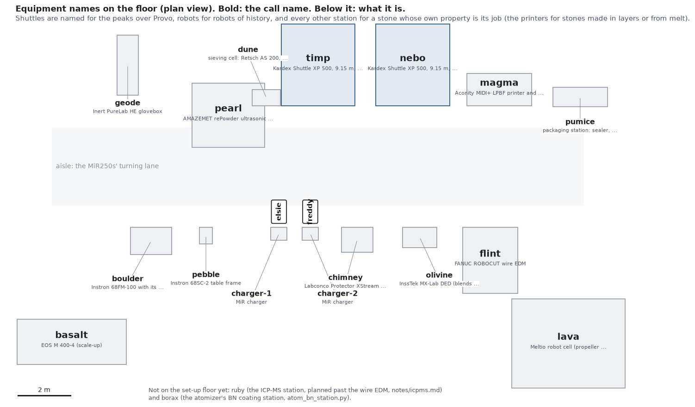
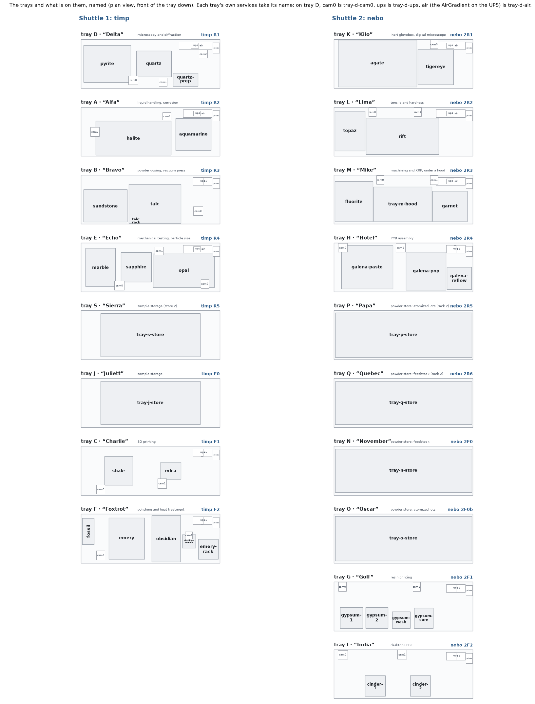

# Equipment names: a scheme for every piece of equipment, generated from the model

Sterling, PR #318, 2026-11-20: "open another PR focused on clever naming schemes for each piece of equipment".
[`naming.py`](../naming.py) names everything in the model and checks the names; [`naming_figures.py`](../naming_figures.py)
draws them. Outputs are in [`out/naming/`](../out/naming/): the registry
([`registry.md`](../out/naming/registry.md), `.csv`, `.json`), the permanent asset numbers
([`asset_ids.json`](../out/naming/asset_ids.json)), the checks ([`checks.json`](../out/naming/checks.json)) and the
figures. Nothing on a real device has been renamed.

## The scheme in one paragraph

Every **station** (an instrument with its computer and accessories, a robot, a Shuttle) gets a **call name** that
people say. The name comes from a family that tells you what class of thing it is, and inside the family from someone
whose own work is the station's job: the XRD is **lonsdale**, the SEM **ruska**, the tensile frame **kirkaldy**, the
doser **lavoisier**, the atomizer **faraday**. Everything **bolted to** a station, a tray, a Shuttle or a robot takes
its parent's name plus a suffix from a fixed list: `lonsdale-pc`, `tray-d-cam0`, `timp-bay-front`, `elsie-arm`. Every
**physical unit** also gets a permanent asset number (`VCL-0023`) for its label and the records. Trays keep their
letters, said aloud as NATO words ("tray Delta").

The model has 238 named units: 41 stations, 31 camera units, 31 computers, 27 other units, 23 AirGradients, 18 trays, 14 docks, 12 UPSs, 12 coupling plates, 12 switches, 6 robot parts, 6 passive stores, 2 pumps, 2 chargers, 1 tray hood.

## Three layers, and why

| Layer | Example | Belongs to | Changes when |
|---|---|---|---|
| Call name | `lonsdale` | the **role**: the XRD station | the lab stops doing that job |
| Child name | `lonsdale-pc`, `tray-d-cam0` | what it is bolted to | it is moved to another parent |
| Asset number | `VCL-0023` | the **physical unit** | never; a number is never reused |

**Why not name things by what or where they are?** The lab's own devices show what happens. The camera named
`picam-ot2` now looks at the atomizer room, not the OT-2 (CLAUDE.md, 2026-10-01), and the Pi behind
`RPI_STREAM_CAM_HOSTNAME` moved to another lab on 2026-11-10, leaving three variables that point at nothing. A name that
says where a thing is, or what it is looking at, is wrong the day it moves. IEC 81346 makes the same split for plants:
what a thing does, what it is, and where it is are three separate designations. Here the call name is the job, the
asset number is the thing, and the location is a field in the registry (`timp, slot R1`), not part of either.

RFC 1178, "Choosing a Name for Your Computer" (1990), says the same of naming a machine after a project or a place:
"If this isn't wrong now, it inevitably will be." It recommends a theme instead.

**Why a name rather than a code like `xrd-01`?** People say these names many times a day, over the noise of a lab, and
the narration voice says them in every video. A short, distinct word is easier to say, hear and remember than a code,
and a code like `xrd-01` is wrong as soon as the lab has a second kind of diffractometer. The codes still exist: the
registry gives each station's type, maker and model.

Labs that run robots already name them. UBC's thin-film self-driving lab is Ada, after Ada Lovelace; King's College's
robot scientists are Adam and Eve; Springer Nature ran a piece on instrument nicknames in 2026 (sources below).

## The families

| Class | Family | Why |
|---|---|---|
| Shuttles | the Wasatch peaks over Provo | the two tallest things in the lab now they are 9.15 m |
| Mobile manipulators | robots of history | Grey Walter's Elsie found her own way back to her hutch to recharge (1949); Edinburgh's Freddy assembled models from a heap of parts by vision (1973). A MiR250 with a UR12e and a wrist camera does both |
| Polymer printers | pioneers of printing | Gutenberg's press, Aldus's pocket books, Senefelder's lithography |
| Metal printers | laser and powder-bed pioneers | the process is the laser and the powder bed |
| Every other station | someone whose own work is the station's job | say the name and you have a hint of what it does |

Every namesake is dead: a living person's name on a machine is a favour you can't ask for. Where a woman's work fits as
well, she is the namesake (Lonsdale, Noddack, Blodgett); Lazarenko and Lavoisier are couples. That is 3 of 41 call
names plus the 2 couples: the balance of the fields' histories, not a target met.

## The call names

| Name | What | Where | Named for | Why it fits |
|---|---|---|---|---|
| **timp** | Kardex Shuttle XP 500, 9.15 m, Shuttle 1 | floor, Shuttle 1 | [Mount Timpanogos](https://en.wikipedia.org/wiki/Mount_Timpanogos), 3,582 m | the peak over Provo; locals call it Timp |
| **nebo** | Kardex Shuttle XP 500, 9.15 m, Shuttle 2 | floor, Shuttle 2 | [Mount Nebo](https://en.wikipedia.org/wiki/Mount_Nebo_(Utah)), 3,637 m | the highest peak of the Wasatch, south of Provo |
| **elsie** | MiR250 + UR12e + Robotiq 2F-85 + RealSense D405, unit 1 | floor, mobile | [W. Grey Walter's Elsie](https://cyberneticzoo.com/?p=491), 1949 | a robot tortoise built to steer home to its lit hutch to recharge |
| **freddy** | MiR250 + UR12e + Robotiq 2F-85 + RealSense D405, unit 2 | floor, mobile | [Edinburgh's Freddy](https://en.wikipedia.org/wiki/Freddy_II), 1969-1976 | a hand-eye robot that assembled models from a heap of parts by vision |
| **ruska** | Hitachi TM4000PlusII SEM with Oxford AZtecOne EDS | timp, slot R1 | [Ernst Ruska](https://en.wikipedia.org/wiki/Ernst_Ruska), 1906-1988 | built the first electron microscope with Max Knoll (1931-33), Nobel 1986 |
| **lonsdale** | Rigaku MiniFlex XRD | timp, slot R1 | [Kathleen Lonsdale](https://en.wikipedia.org/wiki/Kathleen_Lonsdale), 1903-1971 | X-ray crystallographer; showed by X-ray diffraction that the benzene ring is flat (1929); one of the first two women elected FRS (1945) |
| **pasteur** | Opentrons OT-2 liquid handler | timp, slot R2 | [Louis Pasteur](https://en.wikipedia.org/wiki/Pasteur_pipette), 1822-1895 | the Pasteur pipette is named for him; the OT-2 is the lab's pipette |
| **tafel** | CubXL corrosion cell with its EZstat Pro potentiostat | timp, slot R2 | [Julius Tafel](https://en.wikipedia.org/wiki/Tafel_equation), 1862-1918 | the Tafel equation (1905); the CubXL's polarization scans are read as Tafel slopes |
| **lavoisier** | multi-doser (chain carousel v5) on an A&D HR-202i | timp, slot R3 | [Antoine and Marie-Anne Paulze Lavoisier](https://en.wikipedia.org/wiki/Marie-Anne_Paulze_Lavoisier), 1743-1794, 1758-1836 | chemistry by the balance: mass in, mass out; she drew the Traite's 13 plates (1789) |
| **bridgman** | Specac Atlas Autotouch 15T vacuum press | timp, slot R3 | [Percy W. Bridgman](https://en.wikipedia.org/wiki/Percy_Williams_Bridgman), 1882-1961 | high-pressure physics, Nobel 1946 |
| **tabor** | Plastometrex PLX-Benchtop (indentation plastometry) | timp, slot R4 | [David Tabor](https://en.wikipedia.org/wiki/David_Tabor_(physicist)), 1913-2005 | The Hardness of Metals (1951): indentation hardness as about three times the flow stress, at a representative strain; plastometry turns an indent into a stress-strain curve |
| **sneddon** | KLA iMicro nanoindenter | timp, slot R4 | [Ian Sneddon](https://doi.org/10.1016/0020-7225(65)90019-4), 1919-2000 | the elastic solution for an axisymmetric punch of arbitrary profile (1965) that nanoindentation's unloading analysis rests on |
| **tyndall** | Malvern Mastersizer 3000 with Aero S (laser diffraction) | timp, slot R4 | [John Tyndall](https://en.wikipedia.org/wiki/Tyndall_effect), 1820-1893 | the Tyndall effect: light scattered by particles |
| **beilby** | LECO PX500 grinder-polisher with its disc magazine | timp, slot F2 | [George Beilby](https://www.nature.com/articles/137516a0), 1850-1924 | the Beilby layer, the flowed skin polishing leaves on a metal |
| **wilm** | Nabertherm NAT 15/65 furnace with the quench tank | timp, slot F2 | [Alfred Wilm](https://nvlpubs.nist.gov/nistpubs/sp958-lide/html/014-015.html), 1869-1937 | found age hardening in aluminium alloys (c. 1906, published 1911); the furnace does the bars' T6 |
| **baekeland** | LECO MX400 hot mounting press | timp, slot F2 | [Leo Baekeland](https://en.wikipedia.org/wiki/Leo_Baekeland), 1863-1944 | Bakelite, the phenolic of a hot-mounted puck |
| **schlenk** | the tray's N2 glovebox (ours) | nebo, slot 2R1 | [Wilhelm Schlenk](https://en.wikipedia.org/wiki/Wilhelm_Schlenk), 1879-1943 | the Schlenk line: handling air-sensitive material |
| **sorby** | Keyence VHX-7000 digital microscope with EA-300 LIBS | nebo, slot 2R1 | [Henry Clifton Sorby](https://en.wikipedia.org/wiki/Henry_Clifton_Sorby), 1826-1908 | founded metallography (1863): polished, etched steel under the microscope |
| **petch** | ZwickRoell zwickiLine Z5.0 TN (horizontal tensile) | nebo, slot 2R2 | [Norman Petch](https://en.wikipedia.org/wiki/Grain_boundary_strengthening), 1917-1992 | the Hall-Petch relation: yield strength from grain size, read off tensile tests |
| **sandland** | Mitutoyo HM-220 micro-Vickers tester | nebo, slot 2R2 | [George E. Sandland](https://www.gracesguide.co.uk/G._E._Sandland), d. 1961 | devised the Vickers test with Robert L. Smith at Vickers Ltd (1921, published 1922) |
| **noddack** | Bruker S2 PUMA XRF with XY autochanger | nebo, slot 2R3 | [Ida Noddack](https://sites.chemistry.unt.edu/~jimm/REDISCOVERY%207-09-2018/Hexagon%20Articles/rhenium%20and%20technetium.pdf), 1896-1978 | with Walter Noddack and Otto Berg, found rhenium (1925) by its X-ray spectrum, which is what an XRF reads |
| **maudslay** | Makera Carvera CNC mill | nebo, slot 2R3 | [Henry Maudslay](https://en.wikipedia.org/wiki/Henry_Maudslay), 1771-1831 | the screw-cutting lathe and the machine-tool trade |
| **eisler** | PCB line: DDM stencil printer, Opulo LumenPnP, Puhui reflow oven | nebo, slot 2R4 | [Paul Eisler](https://en.wikipedia.org/wiki/Paul_Eisler), 1907-1992 | invented the printed circuit board |
| **faraday** | AMAZEMET rePowder ultrasonic atomizer | floor, (-3.4, -1.9) m | [Michael Faraday](https://en.wikipedia.org/wiki/Ultrasonic_atomization), 1791-1867 | Faraday waves (1831): the capillary waves on a vibrated liquid, one leading explanation of how ultrasonic atomization makes drops |
| **agricola** | sieving cell: Retsch AS 200, tipper and wash module | floor, (-2.0, -1.3) m | [Georgius Agricola](https://library.si.edu/image-gallery/68489), 1494-1555 | De re metallica (1556), whose woodcuts show ore sieved and screened by size |
| **ramsay** | Inert PureLab HE glovebox | floor, (-7.3, -0.0) m | [William Ramsay](https://en.wikipedia.org/wiki/William_Ramsay), 1852-1916 | found argon (with Rayleigh, 1894) and the other noble gases |
| **mclean** | packaging station: sealer, label printers, foam inserts | floor, (+10.1, -1.2) m | [Malcom McLean](https://en.wikipedia.org/wiki/Malcom_McLean), 1913-2001 | the shipping container |
| **kirkaldy** | Instron 68FM-100 with its 3119-608 chamber | floor, (-6.4, -6.8) m | [David Kirkaldy](https://engineeringhalloffame.org/profile/david-kirkaldy), 1820-1897 | built his Universal Testing Machine (1865) and opened the first independent commercial testing works (Southwark, 1866): 'Facts not Opinions' |
| **galileo** | Instron 68SC-2 table frame | floor, (-4.3, -6.6) m | [Galileo Galilei](https://galileoandeinstein.phys.virginia.edu/tns_draft/tns_001to061.html), 1564-1642 | Two New Sciences (1638) began the strength of materials with a bar pulled in tension |
| **davy** | Labconco Protector XStream ducted fume hood | floor, (+1.5, -6.7) m | [Humphry Davy](https://en.wikipedia.org/wiki/Davy_lamp), 1778-1829 | the safety lamp (1815): working safely in bad air |
| **lazarenko** | FANUC ROBOCUT wire EDM | floor, (+6.6, -7.5) m | [Boris and Natalya Lazarenko](https://en.wikipedia.org/wiki/Electrical_discharge_machining), 1910-1979 (Boris) | invented electrical discharge machining (1943) |
| **brunel** | Meltio robot cell (propeller repair) | floor, (+9.6, -10.7) m | [Isambard Kingdom Brunel](https://en.wikipedia.org/wiki/SS_Great_Britain), 1806-1859 | the SS Great Britain (1843), the first iron, screw-propelled ocean liner |
| **aston** | Agilent 7850 ICP-MS with SPS 4, in its own trace-metals hood | floor, south row's east end (planned, notes/icpms.md) | [Francis Aston](https://en.wikipedia.org/wiki/Francis_William_Aston), 1877-1945 | the mass spectrograph and isotopes, Nobel 1922 |
| **blodgett** | the atomizer's BN coating station (ours) | floor, beside the atomizer (atom_bn_station.py) | [Katharine Burr Blodgett](https://en.wikipedia.org/wiki/Katharine_Burr_Blodgett), 1898-1979 | thin coatings (Langmuir-Blodgett films, non-reflective glass) |
| **gutenberg** | Bambu Lab H2D | timp, slot F1 | [Johannes Gutenberg](https://en.wikipedia.org/wiki/Johannes_Gutenberg), c. 1400-1468 | the movable-type press |
| **aldus** | Bambu Lab A1 mini | timp, slot F1 | [Aldus Manutius](https://en.wikipedia.org/wiki/Aldus_Manutius), c. 1450-1515 | the Aldine Press: italic type and the small, portable octavo book; the H2D's small partner |
| **senefelder** | Formlabs Form 4 resin printers with Form Wash and Form Cure | nebo, slot 2F1 | [Alois Senefelder](https://en.wikipedia.org/wiki/Alois_Senefelder), 1771-1834 | invented lithography (1796), which stereolithography is named from |
| **maiman** | SnowX SnowPod desktop LPBF printers with the NitroPod | nebo, slot 2F2 | [Theodore Maiman](https://en.wikipedia.org/wiki/Theodore_Maiman), 1927-2007 | the first working laser (1960): a small laser for small printers |
| **deckard** | Aconity MIDI+ LPBF printer and the depowdering box | floor, (+7.0, -0.9) m | [Carl Deckard](https://en.wikipedia.org/wiki/Carl_Deckard), 1961-2019 | invented selective laser sintering: the powder bed and the laser |
| **gibbs** | InssTek MX-Lab DED (blends compositions in the melt pool) | floor, (+3.9, -6.6) m | [J. Willard Gibbs](https://en.wikipedia.org/wiki/Josiah_Willard_Gibbs), 1839-1903 | the phase rule and free energy, the thermodynamics behind screening alloy compositions |
| **javan** | EOS M 400-4 (scale-up) | floor, (-9.4, -10.6) m | [Ali Javan](https://en.wikipedia.org/wiki/Ali_Javan), 1926-2016 | the first gas laser (helium-neon, 1960, with Bennett and Herriott) |

**Siblings** take a number: the two Form 4s are `senefelder-1` and `-2`, the two SnowPods `maiman-1` and `-2`, and the
three-each plan (notes/three_each.md) would give `pasteur-1` to `-3` and `tafel-1` to `-3`. **Spares** for the next of
each class, checked like the rest, are in `naming.SPARES` (`unimate`, `genghis`; `cascade`, `lonepeak`; `moseley`,
`bragg`, `pourbaix`, `kibble`, `whitworth`; `bodoni`, `schawlow`).

## Everything else: parent plus suffix

A child's name is its parent's name, a hyphen and one word from `naming.SUFFIX`; nothing else may follow a hyphen, and
the call names themselves have none. So a hostname says where to look, and code can build one from the model. Examples:

| Child | Name |
|---|---|
| a station's main computer | `ruska-pc` (the bare `ruska` is the station: a DNS alias for its main computer or service) |
| a station's other units | `ruska-eds`, `tafel-pi`, `sorby-kvm`, `wilm-quench`, `faraday-chiller`, `kirkaldy-oven` |
| a tray's camera units, in the model's order | `tray-d-cam0`, `tray-d-cam1`, `tray-d-cam2` (the model's D0-D2) |
| a tray's services | `tray-d-ups` (its RDU120 card), `tray-d-air` (its AirGradient), `tray-d-sw`, `tray-d-plate` |
| a Shuttle's | `timp-bay-back`, `timp-bay-front` (the bay's ceiling cameras), `timp-bay-dock`, `timp-r2-dock`, `timp-vac` |
| a robot's | `elsie-base` (the MiR250's fleet name), `elsie-arm` (the UR12e control box), `elsie-wrist` (the D405) |
| a floor station's AirGradient | `faraday-air`, `deckard-air` |
| the atomizer's camera units (DAL PR 189) | `faraday-front`, `faraday-left`, `faraday-top` |

`-air`, not `-ag`, because in this lab Ag is silver (the Ag/AgCl reference electrode). Things that belong to no one
station are named for their job: `charger-1`, `exvac-1` (the explosion-proof vacuum), `util-n2`, `util-chiller`.

## The checks

`python3 naming.py check` runs them on every name in the registry and the spares, and exits 1 if a hard one fails.

**Hard (all pass):**

- **Unique.**
- **A valid DNS label** (RFC 1123): lower-case letters, digits and hyphens, at most 63 characters.
- **Windows' 15-character limit** for every `-pc`: the instrument PCs run Windows, whose NetBIOS name stops at 15.
- **Call names 4 to 10 letters, every name at most 20.** A label fits. GitHub masks a secret everywhere it occurs as a
  substring, which turned `byu-vcl` into `byu-***` when a 3-letter username was a secret (CLAUDE.md); no call name is
  that short, and none is a substring of the repo and org names.
- **Suffixes from the list only.**
- **No stream name is a substring of another.** streamingLambda ends every broadcast whose title contains a stream's
  `WORKFLOW_NAME`, and files it under the first playlist whose title contains it (docs/stream-cams.md, "Renaming the
  workflow"). So a stream named `faraday` would end `faraday-top`'s broadcast too. Streams are therefore named after the
  camera unit, a leaf, never a bare station name.
- **Not a maker's name.** No call name is the brand of anything in the lab or a common lab brand (`hamilton`, `olympus`
  and `tyler` would have been).
- **Not a person in the lab.** The first version named the Meltio cell `ericsson` after John Ericsson's screw propeller.
  It sounds exactly like Gage Erickson, who appears 161 times in the notes, so "take it to Erickson" would have been
  ambiguous. It is `brunel` now.

**Soft (reported; a person decides):**

- **Too alike.** Every pair of names is compared by spelling (Damerau-Levenshtein) and by sound (espeak-ng's phonemes,
  the narration voice's front end). Four first choices were changed on this: `caxton` (2 letters from `aston`) to
  `aldus`, `rammler` (the same first sounds as `ramsay`) to `agricola`, `tresca` (sounds 67 % like `ruska`) to
  `galileo`, and the spares that clashed were dropped. Six pairs in use are flagged and kept, since each starts with a
  different consonant:

| Pair | Letters apart | Sound overlap | espeak |
|---|---|---|---|
| tafel / maiman | 5 | 0.5 | teɪfəl / meɪmən |
| bridgman / maiman | 4 | 0.5 | bɹɪdʒmən / meɪmən |
| sneddon / sandland | 5 | 0.5 | snɛdən / sændlənd |
| beilby / davy | 5 | 0.5 | beɪlbi / deɪvi |
| baekeland / sandland | 4 | 0.5 | bikɛlənd / sændlənd |

- **Everyday words.** `gibbs` and `aston` are moderately common words (Zipf 3.65 and 3.66: Gibbs free energy, Aston
  Villa). Nothing is common enough to be misheard as an ordinary word (`hooke` would be "hook", `young`, `poisson`
  "poison", `timp` alone is close to "temp").
- **Said as written by the narration voice.** (in progress in this run: Kokoro speaks each name in two sentences and faster-whisper transcribes them back.)

## Labels

- **A station plate**, 100 x 38 mm: the call name large, then what it is, then the asset number and location, then the
  namesake, so the name teaches its own story. A name the eye can't say gets its sound ("say 'BAKE-land'").
- **A tray end**, 70 x 30 mm: the letter, the NATO word, the Shuttle and slot.
- **A tag** on 12 mm tape for every child: name and asset number.
- **The QR code** holds the asset number and the name (`VCL-0023 lonsdale`): a phone shows it as text, and the arm's
  wrist camera can read it to confirm where it is before it acts. A URL would make the code denser and tie the label
  to a web address.

## Where the names go

## Rolling it out (not done here)

Nothing here renames a real device. When the lab adopts the scheme:

- **Tailscale:** `tailscale set --hostname <name>` on each device, then update the repo variables that hold
  hostnames. The OT-2 lid camera Pi is gone, so its replacement can start with its new name.
- **MQTT topics stay as they are.** `command/ot2/{OT2_SERIAL}/pipette` and the Pico's topics match
  AccelerationConsortium/OT-2-LCM; the serial stays the device's ID there. The registry maps names to serials.
- **YouTube:** a stream's `WORKFLOW_NAME` is its camera unit's name. Follow docs/stream-cams.md's rename steps (end the
  old broadcast first).
- **Windows PCs, the MiR fleet, the UR controllers, Bambu Studio and the Kardex controller** each take the name in their
  own settings.
- **The narration** says the call name the first time with what it is ("the XRD, Lonsdale") and the name after that.

## Other schemes considered

| Scheme | Example | Why not, as the main scheme |
|---|---|---|
| Functional codes | `xrd-01`, `sem-01` | not memorable when said; wrong when a second kind of XRD arrives; kept as the registry's type field |
| Location codes | `s1-r1-xrd` | wrong when anything moves (the `picam-ot2` problem); kept as the registry's location field |
| Chemical elements | `copper`, `nickel` | in a metals lab, "put the Cu cups in Nickel" is ambiguous |
| Utah places for everything | `provo`, `ogden` | a station name and a city are confused; no hint of the job; kept for the Shuttles |
| Greek myth | `atlas`, `argus`, `hephaestus` | fun, but many are brands (Atlas Copco, Argus), and the hint is loose |

## The other open PRs, named

- **#374, cameras on the mobile bases:** `elsie-left`, `elsie-right` and `elsie-mast` (and the same for `freddy`).
- **#370, security cameras:** a camera takes its parent's name and a place suffix, as the Pi units do
  (`tray-d-cam0`, `timp-bay-front`). The scheme doesn't care what kind of camera it is.
- **#366/#369, a third MiR250 for floor cleaning:** the next robot name in `naming.SPARES` (`unimate`, `genghis`).
- **#367, the cup and plug machining station:** a call name from the station family. `whitworth` would fit (Joseph
  Whitworth, the standard screw thread and precision machining). It is in the spares and passes every check.

## Open

- **Sterling's call on the names themselves.** Changing one is a one-line edit in `naming.STATIONS`; the checks and
  figures follow.
- **The ICP-MS station and the BN coating station** have names (`aston`, `blodgett`) but no place on the set-up floor
  yet.
- **Lots and samples** keep DAL's random IDs (`c3k0n5`). Worth considering for new ones: an alphabet without the
  look-alikes 0/o and 1/l (Crockford's base 32).
- **The registry follows the model, not the real lab.** It names the trays and machines the model has; a machine
  bought later gets its name by adding it to the model and re-running.

## Sources

- [RFC 1178](https://www.rfc-editor.org/rfc/rfc1178), "Choosing a Name for Your Computer" (Libes, 1990): use a theme;
  don't name a machine after a project or place.
- [RFC 952](https://www.rfc-editor.org/rfc/rfc952), [RFC 1123 section 2.1](https://www.rfc-editor.org/rfc/rfc1123#section-2.1)
  and [RFC 1035 section 2.3.4](https://www.rfc-editor.org/rfc/rfc1035#section-2.3.4): letters, digits and hyphens, not
  ending in a hyphen, 63 characters a label.
- [Microsoft: computer names](https://learn.microsoft.com/en-us/troubleshoot/windows-server/active-directory/naming-conventions-for-computer-domain-site-ou):
  NetBIOS names stop at 15 characters (the 16th is reserved).
- IEC 81346-1:2022, reference designation: "=" function, "-" product, "+" location
  ([EPLAN's summary](https://www.eplan.help/en-us/infoportal/content/Plattform/2026/Content/htm/projectstructure_k_referenzkennzeichnung.htm)).
- [ISA-5.1](https://www.isa.org/intech/2020/september-october/isa-5-1-instrumentation-symbols-and-identification):
  instrument tags by measured variable, function and loop number (the functional codes this scheme keeps as a field).
- [The ICAO/NATO spelling alphabet](https://en.wikipedia.org/wiki/NATO_phonetic_alphabet) (1956): "Alfa" and "Juliett"
  so that every language says them the same way.
- Precedents: [UBC's Ada](https://chem.ubc.ca/node/36349), named after Ada Lovelace;
  [Adam and Eve](https://www.cam.ac.uk/research/news/robot-scientist-becomes-first-machine-to-discover-new-scientific-knowledge),
  robot scientists; ["Nicknames for lab instruments"](https://communities.springernature.com/posts/nicknames-for-lab-instruments)
  (Springer Nature Communities, 2026).
- docs/stream-cams.md, "Renaming the workflow" (streamingLambda's substring matching).
- The namesakes' sources are linked in the table. Every date and claim was checked against a source on 2026-11-20.
  That check changed:
  - Kirkaldy's "first universal testing machine": Werder's (1852) is usually called the first, so his is now the first
    independent commercial testing works (1866);
  - Wilm's date: c. 1906, published 1911;
  - Sandland's dates: died 1961, birth unknown;
  - Natalya Lazarenko's dates, which no source gives;
  - Elsie's recharging: the robot was built to steer home to its hutch, but how often it really recharged itself is
    disputed;
  - Faraday waves: one leading explanation of ultrasonic atomization (cavitation is the other);
  - Nebo's height: 3,637 m;
  - the credits for Ruska (with Max Knoll), Noddack (with Walter Noddack and Otto Berg) and Javan (with Bennett and
    Herriott);
  - two dead links.
