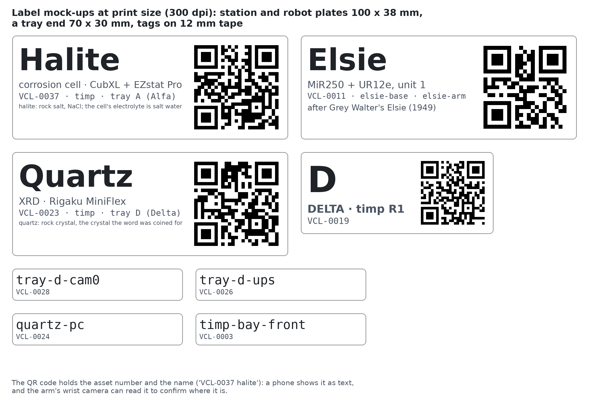

# Equipment names: a scheme for every piece of equipment, generated from the model

Sterling, PR #318, 2026-11-20: "open another PR focused on clever naming schemes for each piece of equipment".
[`naming.py`](../naming.py) names everything in the model and checks the names; [`naming_figures.py`](../naming_figures.py)
draws them. Outputs are in [`out/naming/`](../out/naming/): the registry
([`registry.md`](../out/naming/registry.md), `.csv`, `.json`), the permanent asset numbers
([`asset_ids.json`](../out/naming/asset_ids.json)), the checks ([`checks.json`](../out/naming/checks.json)) and the
figures. Nothing on a real device has been renamed.

This is **round 2**. Round 1 named the stations after people whose work was the station's job (the XRD was Lonsdale,
the PIP Prandtl). Sterling, PR #376, 2026-11-22:

> Overall good, except a lot of people would need the historical context explained to them in advance. Could be fine,
> but definitely necessary. Some will need to be changed anyway. [...] for example "prandtl" hard to spell, pronounce,
> and is obscure. The names also don't have to be real people. It could also be something kind of self-consistent with
> halite. I particularly like the use of mountain names for the vertical lift modules. Referring to one as "timp" would
> be quite good I think.

So the stations are now **stones**, and Shuttle 1 is **timp**.

## The scheme in one paragraph

Every **station** (an instrument with its computer and accessories, a robot, a Shuttle) gets a **call name** that
people say. Stations are named after **stones: minerals, rocks and gems** that most people have heard of. Where it can
be, the stone's own property is the station's job, so the hint needs no history: the CubXL corrosion cell is
**halite** (rock salt, and its electrolyte is salt water), the XRF **fluorite** (fluorescence is named after it), the
Mastersizer **opal** (its colours are diffraction), the PIP **marble** (a ball pressed into the metal), the furnace with
the quench tank **obsidian** (quenched lava). The Shuttles are the peaks over Provo, **timp** and **nebo**, and the robots
**elsie** and **freddy**. Everything **bolted to** a station, a tray, a Shuttle or a robot takes its parent's name plus
a suffix from a fixed list: `quartz-pc`, `tray-d-cam0`, `timp-bay-front`, `elsie-arm`. Every **physical unit** also
gets a permanent asset number (`VCL-0023`) for its label and the records. Trays keep their letters, said aloud as NATO
words ("tray Delta").

The model has 238 named units: 41 stations, 31 camera units, 31 computers, 27 other units, 23 AirGradients, 18 trays, 14 docks, 12 UPSs, 12 coupling plates, 12 switches, 6 robot parts, 6 passive stores, 2 pumps, 2 chargers, 1 tray hood.

## Round 2: why stones

- **"halite" isn't used anywhere yet.** Nothing in this repo's branches, the org's code or issues, or the tailnet's
  device names is called halite. So it is read as an example of a theme, and stones are that theme: halite is a
  mineral. It is also as Utah as the mountains: the Great Salt Lake and the Bonneville Salt Flats are halite. Topaz,
  the micro-Vickers, is Utah's state gem (1969).
- **A stone needs no history lesson.** Round 1's hint was in a person's work, so it only helped someone who already
  knew the person. A stone's hint is a property people know, or can be told in one line that isn't about history:
  talcum powder is a powder (the doser), sandstone is sand pressed into stone (the pellet press), flint throws sparks
  (the EDM cuts with sparks), pebble and boulder are the small and big tensile frames.
- **Spelled as said, said as spelled.** That ruled out round 1's prandtl, kirkaldy, lazarenko, noddack and senefelder,
  however good the story. The stones were picked the same way: no "gneiss" (said "nice") and no "apatite" (said
  "appetite").
- **Every number was kept.** Asset numbers are now keyed by the role (`xrd-pc`), not the name, so quartz is
  `VCL-0023`, the number lonsdale had, and so on for all 238 units. A later rename keeps them too.

| Station | Round 1 (people) | Round 2 |
|---|---|---|
| Kardex Shuttle XP 500, 9.15 m, Shuttle 1 | timpanogos | **timp** |
| Kardex Shuttle XP 500, 9.15 m, Shuttle 2 | nebo | **nebo** (kept) |
| MiR250 + UR12e + Robotiq 2F-85 + RealSense D405, unit 1 | elsie | **elsie** (kept) |
| MiR250 + UR12e + Robotiq 2F-85 + RealSense D405, unit 2 | freddy | **freddy** (kept) |
| Hitachi TM4000PlusII SEM | ruska | **pyrite** |
| Rigaku MiniFlex XRD | lonsdale | **quartz** |
| Opentrons OT-2 liquid handler | ostwald | **aquamarine** |
| CubXL corrosion cell | tafel | **halite** |
| multi-doser | lavoisier | **talc** |
| Specac Atlas Autotouch 15T vacuum press | bridgman | **sandstone** |
| Plastometrex PLX-Benchtop | prandtl | **marble** |
| KLA iMicro nanoindenter | sneddon | **sapphire** |
| Malvern Mastersizer 3000 | tyndall | **opal** |
| Bambu Lab H2D | gutenberg | **shale** |
| Bambu Lab A1 mini | aldus | **mica** |
| LECO PX500 grinder-polisher | beilby | **emery** |
| Nabertherm NAT 15/65 furnace | preston | **obsidian** |
| LECO MX400 hot mounting press | baekeland | **fossil** |
| the tray's N2 glovebox | rutherford | **agate** |
| Keyence VHX-7000 digital microscope | sorby | **tigereye** |
| ZwickRoell zwickiLine Z5.0 TN | griffith | **rift** |
| Mitutoyo HM-220 micro-Vickers tester | sandland | **topaz** |
| Bruker S2 PUMA XRF | noddack | **fluorite** |
| Makera Carvera CNC mill | maudslay | **garnet** |
| PCB line: DDM stencil printer, Opulo LumenPnP, Puhui reflow oven | eisler | **galena** |
| Formlabs Form 4 resin printers | senefelder | **gypsum** |
| SnowX SnowPod desktop LPBF printers | maiman | **cinder** |
| AMAZEMET rePowder ultrasonic atomizer | faraday | **pearl** |
| sieving cell: Retsch AS 200, tipper and wash module | agricola | **dune** |
| Aconity MIDI+ LPBF printer and the depowdering box | deckard | **magma** |
| Inert PureLab HE glovebox | ramsay | **geode** |
| packaging station: sealer, label printers, foam inserts | mclean | **pumice** |
| Instron 68FM-100 | kirkaldy | **boulder** |
| Instron 68SC-2 table frame | galileo | **pebble** |
| Labconco Protector XStream ducted fume hood | davy | **chimney** |
| InssTek MX-Lab DED | gibbs | **olivine** |
| FANUC ROBOCUT wire EDM | lazarenko | **flint** |
| EOS M 400-4 | javan | **basalt** |
| Meltio robot cell | brunel | **lava** |
| Agilent 7850 ICP-MS | aston | **ruby** |
| the atomizer's BN coating station | blodgett | **borax** |

## Three layers, and why

| Layer | Example | Belongs to | Changes when |
|---|---|---|---|
| Call name | `quartz` | the **role**: the XRD station | the lab stops doing that job, or the name is changed |
| Child name | `quartz-pc`, `tray-d-cam0` | what it is bolted to | it is moved to another parent |
| Asset number | `VCL-0023` | the **physical unit** | never; a number is never reused, and a rename keeps it |

**Why not name things by what or where they are?** The lab's own devices show what happens. The camera named
`picam-ot2` now looks at the atomizer room, not the OT-2 (CLAUDE.md, 2026-10-01), and the Pi behind
`RPI_STREAM_CAM_HOSTNAME` moved to another lab on 2026-11-10, leaving three variables that point at nothing. A name that
says where a thing is, or what it is looking at, is wrong the day it moves. IEC 81346 makes the same split for plants:
what a thing does, what it is, and where it is are three separate designations. Here the call name is the job, the
asset number is the thing, and the location is a field in the registry (`timp, slot R1`), not part of either.

RFC 1178, "Choosing a Name for Your Computer" (1990), says the same of naming a machine after a project or a place:
"If this isn't wrong now, it inevitably will be." It recommends a theme instead.

**Why a name rather than a code like `xrd-01`?** People say these names many times a day, over the noise of a lab, and
the narration voice says them in every video. A short, distinct word is easier to say, hear and remember than a code,
and a code like `xrd-01` is wrong as soon as the lab has a second kind of diffractometer. The codes still exist: the
registry gives each station's type, maker and model.

Labs that run robots already name them. UBC's thin-film self-driving lab is Ada, after Ada Lovelace; King's College's
robot scientists are Adam and Eve; Springer Nature ran a piece on instrument nicknames in 2026 (sources below).

## The families

| Class | Family | Why |
|---|---|---|
| Shuttles | the Wasatch peaks over Provo | the two tallest things in the lab now they are 9.15 m: timp (Mount Timpanogos, as everyone here says it) and nebo |
| Mobile manipulators | robots of history | Grey Walter's Elsie was built to steer home to her lit hutch to recharge (1949); Edinburgh's Freddy assembled models from a heap of parts by vision (1973). A MiR250 with a UR12e and a wrist camera does both. Neither name needs the story |
| Polymer printers | stones built in layers | shale and mica split along their layers; gypsum (plaster) is a liquid that sets, as the Form 4's resin does |
| Metal printers | rocks from melt | magma, basalt and cinder; olivine for the DED, which blends compositions as olivine blends magnesium and iron |
| Every other station | stones whose own property is the job | say the name and you have a hint of what it does |

## The call names

| Name | What | Where | The stone | Why it fits |
|---|---|---|---|---|
| **timp** | Kardex Shuttle XP 500, 9.15 m, Shuttle 1 | floor, Shuttle 1 | [Mount Timpanogos](https://en.wikipedia.org/wiki/Mount_Timpanogos) (3,582 m) | the peak over Provo, which everyone in Utah County calls Timp |
| **nebo** | Kardex Shuttle XP 500, 9.15 m, Shuttle 2 | floor, Shuttle 2 | [Mount Nebo](https://en.wikipedia.org/wiki/Mount_Nebo_(Utah)) (3,637 m) | the highest peak of the Wasatch, south of Provo |
| **elsie** | MiR250 + UR12e + Robotiq 2F-85 + RealSense D405, unit 1 | floor, mobile | [W. Grey Walter's Elsie](https://cyberneticzoo.com/?p=491) (1949) | a robot tortoise built to steer home to its lit hutch to recharge |
| **freddy** | MiR250 + UR12e + Robotiq 2F-85 + RealSense D405, unit 2 | floor, mobile | [Edinburgh's Freddy](https://en.wikipedia.org/wiki/Freddy_II) (1969-1976) | a hand-eye robot that assembled models from a heap of parts by vision |
| **pyrite** | Hitachi TM4000PlusII SEM with Oxford AZtecOne EDS | timp, slot R1 | [pyrite (fool's gold)](https://en.wikipedia.org/wiki/Pyrite) (FeS2) | it looks like gold; the SEM's EDS sees the iron and the sulfur |
| **quartz** | Rigaku MiniFlex XRD | timp, slot R1 | [quartz (rock crystal)](https://en.wikipedia.org/wiki/Quartz) (SiO2) | the crystal the word was coined for (Greek krystallos, ice): the XRD tells one crystal from another |
| **aquamarine** | Opentrons OT-2 liquid handler | timp, slot R2 | [aquamarine (sea-blue beryl)](https://en.wikipedia.org/wiki/Aquamarine_(gem)) (Be3Al2Si6O18) | Latin aqua marina, 'sea water': the station that moves liquids |
| **halite** | CubXL corrosion cell with its EZstat Pro potentiostat | timp, slot R2 | [halite (rock salt)](https://en.wikipedia.org/wiki/Halite) (NaCl) | salt: the cell's electrolytes are 0.6, 0.06 and 0.006 M NaCl, and salt water is what corrodes |
| **talc** | multi-doser (chain carousel v5) on an A&D HR-202i | timp, slot R3 | [talc](https://en.wikipedia.org/wiki/Talc) (Mg3Si4O10(OH)2) | talcum powder, the powder everyone knows: the doser weighs out powders |
| **sandstone** | Specac Atlas Autotouch 15T vacuum press | timp, slot R3 | [sandstone](https://en.wikipedia.org/wiki/Sandstone) (rock) | sand pressed and cemented into stone, as the press turns a powder into a pellet |
| **marble** | Plastometrex PLX-Benchtop (indentation plastometry) | timp, slot R4 | [marble](https://en.wikipedia.org/wiki/Marble_(toy)) (rock (CaCO3)) | the rock, and the glass ball: the PIP presses a hard ball into the metal and reads its stress-strain curve from the dent |
| **sapphire** | KLA iMicro nanoindenter | timp, slot R4 | [sapphire (corundum)](https://en.wikipedia.org/wiki/Sapphire) (Al2O3) | Mohs 9: of all minerals only diamond, the indenter's tip, is harder |
| **opal** | Malvern Mastersizer 3000 with Aero S (laser diffraction) | timp, slot R4 | [opal](https://en.wikipedia.org/wiki/Opal) (SiO2·nH2O) | its colours are light diffracted by silica spheres a few hundred nanometres across; the Mastersizer sizes particles by the light they diffract |
| **shale** | Bambu Lab H2D | timp, slot F1 | [shale](https://en.wikipedia.org/wiki/Shale) (rock) | laid down in thin layers, and it splits along them: a print is built the same way |
| **mica** | Bambu Lab A1 mini | timp, slot F1 | [mica](https://en.wikipedia.org/wiki/Mica) (sheet silicate group) | it splits into layers thinner than paper, and a print is built of layers; the H2D's small partner |
| **emery** | LECO PX500 grinder-polisher with its disc magazine | timp, slot F2 | [emery](https://en.wikipedia.org/wiki/Emery_(rock)) (rock (corundum and magnetite)) | the abrasive of emery paper and emery boards |
| **obsidian** | Nabertherm NAT 15/65 furnace with the quench tank | timp, slot F2 | [obsidian](https://en.wikipedia.org/wiki/Obsidian) (volcanic glass) | lava quenched too fast to crystallize: the furnace is the station with the quench tank |
| **fossil** | LECO MX400 hot mounting press | timp, slot F2 | [a fossil](https://en.wikipedia.org/wiki/Fossil) | a specimen set in stone, as the press sets a sample in a resin puck |
| **agate** | the tray's N2 glovebox (ours) | nebo, slot 2R1 | [agate](https://en.wikipedia.org/wiki/Agate) (SiO2) | it grows inside a closed hollow in rock, shut off from the world outside |
| **tigereye** | Keyence VHX-7000 digital microscope with EA-300 LIBS | nebo, slot 2R1 | [tiger's eye](https://en.wikipedia.org/wiki/Tiger's_eye) (quartz with fibres) | the stone with an eye in it: the lab's eye for a close look |
| **rift** | ZwickRoell zwickiLine Z5.0 TN (horizontal tensile) | nebo, slot 2R2 | [a rift](https://en.wikipedia.org/wiki/Rift) (landform) | where the crust is pulled apart, as Utah's Basin and Range is: the frame that pulls sideways |
| **topaz** | Mitutoyo HM-220 micro-Vickers tester | nebo, slot 2R2 | [topaz](https://en.wikipedia.org/wiki/Topaz) (Al2SiO4(F,OH)2) | Mohs 8, the hardness scale everyone learns, and Utah's state gem (1969) |
| **fluorite** | Bruker S2 PUMA XRF with XY autochanger | nebo, slot 2R3 | [fluorite](https://en.wikipedia.org/wiki/Fluorescence) (CaF2) | fluorescence is named after it (Stokes, 1852), and an XRF reads X-ray fluorescence |
| **garnet** | Makera Carvera CNC mill | nebo, slot 2R3 | [garnet](https://en.wikipedia.org/wiki/Garnet) (silicate group) | it cuts metal: the abrasive of garnet paper and of waterjet cutters |
| **galena** | PCB line: DDM stencil printer, Opulo LumenPnP, Puhui reflow oven | nebo, slot 2R4 | [galena](https://en.wikipedia.org/wiki/Galena) (PbS) | lead ore, and the crystal in a crystal radio: electronics' first semiconductor |
| **gypsum** | Formlabs Form 4 resin printers with Form Wash and Form Cure | nebo, slot 2F1 | [gypsum (plaster)](https://en.wikipedia.org/wiki/Gypsum) (CaSO4·2H2O) | plaster of Paris is made from it: a liquid that sets solid, as the Form 4's resin does |
| **cinder** | SnowX SnowPod desktop LPBF printers with the NitroPod | nebo, slot 2F2 | [cinder](https://en.wikipedia.org/wiki/Cinder_cone) (volcanic rock) | small bits of lava that freeze as they fly: the two small powder-bed printers |
| **pearl** | AMAZEMET rePowder ultrasonic atomizer | floor (-3.4, -1.9) m | [a pearl](https://en.wikipedia.org/wiki/Pearl) (aragonite (CaCO3)) | a sphere: the atomizer makes metal powder in spheres |
| **dune** | sieving cell: Retsch AS 200, tipper and wash module | floor (-2.0, -1.3) m | [a dune](https://en.wikipedia.org/wiki/Dune) (sand) | the wind sorts its sand by grain size, as the sieves sort powder |
| **magma** | Aconity MIDI+ LPBF printer and the depowdering box | floor (+7.0, -0.9) m | [magma](https://en.wikipedia.org/wiki/Magma) (molten rock) | the melt every volcanic rock starts as: the printer melts its powder bed with a laser |
| **geode** | Inert PureLab HE glovebox | floor (-7.3, -0.0) m | [a geode](https://en.wikipedia.org/wiki/Geode) | a closed stone with a clean, crystal-lined room inside |
| **pumice** | packaging station: sealer, label printers, foam inserts | floor (+10.1, -1.2) m | [pumice](https://en.wikipedia.org/wiki/Pumice) (volcanic glass foam) | stone foam, light enough to float: the station packs samples in foam |
| **boulder** | Instron 68FM-100 with its 3119-608 chamber | floor (-6.4, -6.8) m | [a boulder](https://en.wikipedia.org/wiki/Boulder) (over 256 mm) | the big stone: the 100 kN frame (the 2 kN one is pebble) |
| **pebble** | Instron 68SC-2 table frame | floor (-4.3, -6.6) m | [a pebble](https://en.wikipedia.org/wiki/Pebble) (4-64 mm) | the small stone: the 2 kN frame (the 100 kN one is boulder) |
| **chimney** | Labconco Protector XStream ducted fume hood | floor (+1.5, -6.7) m | [a rock chimney](https://en.wikipedia.org/wiki/Hydrothermal_vent) (hot-spring vent) | the way the fumes go out; on the sea floor, hot springs build chimneys of rock to vent through |
| **olivine** | InssTek MX-Lab DED (blends compositions in the melt pool) | floor (+3.9, -6.6) m | [olivine](https://en.wikipedia.org/wiki/Olivine) ((Mg,Fe)2SiO4) | one crystal with any blend of magnesium and iron, a solid solution: the DED blends compositions in its melt pool |
| **flint** | FANUC ROBOCUT wire EDM | floor (+6.6, -7.5) m | [flint](https://en.wikipedia.org/wiki/Flint) (SiO2 (chert)) | struck with steel it throws sparks, and the EDM cuts with sparks |
| **basalt** | EOS M 400-4 (scale-up) | floor (-9.4, -10.6) m | [basalt](https://en.wikipedia.org/wiki/Basalt) (volcanic rock) | the commonest rock made from melt, laid down in the biggest volumes: the scale-up printer |
| **lava** | Meltio robot cell (propeller repair) | floor (+9.6, -10.7) m | [lava](https://en.wikipedia.org/wiki/Lava) (molten rock) | new rock laid down on old, as the cell lays new metal on a worn propeller |
| **ruby** | Agilent 7850 ICP-MS with SPS 4, in its own trace-metals hood | floor, south row's east end (planned, notes/icpms.md) | [ruby (corundum)](https://en.wikipedia.org/wiki/Ruby) (Al2O3 + Cr) | red from a trace of chromium: the ICP-MS measures traces |
| **borax** | the atomizer's BN coating station (ours) | floor, beside the atomizer (atom_bn_station.py) | [borax](https://en.wikipedia.org/wiki/Borax) (Na2B4O7·10H2O) | the boron mineral everyone knows: the station coats parts with boron nitride |

**Siblings** take a number: the two Form 4s are `gypsum-1` and `-2`, the two SnowPods `cinder-1` and `-2`, and the
three-each plan (notes/three_each.md) would give `aquamarine-1` to `-3` and `halite-1` to `-3`. **Spares** for the next
of each class, checked like the rest, are in `naming.SPARES` (`unimate`, `genghis`; `cascade`, `lonepeak`; `lapis`,
`turquoise`, `citrine`, `whetstone`).

### timp

Shuttle 1 is `timp` because that is what everyone in Utah County calls Mount Timpanogos, and Sterling asked for it.
Round 1 had made it `timpanogos` for one reason worth keeping in mind: when the narration voice said "Next, the arm takes
the bar to Timp", both recognizers wrote "temp" (round 1's [`tts_check.json`](../out/naming/tts_check.json)). "Timp" and
"temp" differ only in the vowel, and "bring it to temp" is something people say about furnaces. So:

- **Say "Shuttle Timp" or "up to Timp"** in the narration, and wherever a furnace is in the same sentence.
- **The label says "Timp", with "Mount Timpanogos" under it,** for anyone who isn't from here.
- The hostname is `timp`, so its children are short too: `timp-bay-front`, `timp-r2-dock`, `timp-vac`.

## Everything else: parent plus suffix

A child's name is its parent's name, a hyphen and one word from `naming.SUFFIX`; nothing else may follow a hyphen, and
the call names themselves have none. So a hostname says where to look, and code can build one from the model. Examples:

| Child | Name |
|---|---|
| a station's main computer | `pyrite-pc` (the bare `pyrite` is the station: a DNS alias for its main computer or service) |
| a station's other units | `pyrite-eds`, `halite-pi`, `tigereye-kvm`, `obsidian-quench`, `pearl-chiller`, `boulder-oven` |
| a tray's camera units, in the model's order | `tray-d-cam0`, `tray-d-cam1`, `tray-d-cam2` (the model's D0-D2) |
| a tray's services | `tray-d-ups` (its RDU120 card), `tray-d-air` (its AirGradient), `tray-d-sw`, `tray-d-plate` |
| a Shuttle's | `timp-bay-back`, `timp-bay-front` (the bay's ceiling cameras), `timp-bay-dock`, `timp-r2-dock`, `timp-vac` |
| a robot's | `elsie-base` (the MiR250's fleet name), `elsie-arm` (the UR12e control box), `elsie-wrist` (the D405) |
| a floor station's AirGradient | `pearl-air`, `magma-air` |
| the atomizer's camera units (DAL PR 189) | `pearl-front`, `pearl-left`, `pearl-top` |

`-air`, not `-ag`, because in this lab Ag is silver (the Ag/AgCl reference electrode). Things that belong to no one
station are named for their job: `charger-1`, `exvac-1` (the explosion-proof vacuum), `util-n2`, `util-chiller`.

## The checks

`python3 naming.py check` runs them on every name in the registry and the spares, and exits 1 if a hard one fails.

**Hard (all pass):**

- **Unique.**
- **A valid DNS label** (RFC 1123): lower-case letters, digits and hyphens, at most 63 characters.
- **Windows' 15-character limit** for every `-pc`: the instrument PCs run Windows, whose NetBIOS name stops at 15. The
  longest is `aquamarine-pc`, 13.
- **Call names 4 to 10 letters, every name at most 20.** A label fits. GitHub masks a secret everywhere it occurs as a
  substring, which turned `byu-vcl` into `byu-***` when a 3-letter username was a secret (CLAUDE.md); no call name is
  that short, and none is a substring of the repo and org names.
- **Suffixes from the list only.**
- **No stream name is a substring of another.** streamingLambda ends every broadcast whose title contains a stream's
  `WORKFLOW_NAME`, and files it under the first playlist whose title contains it (docs/stream-cams.md, "Renaming the
  workflow"). So a stream named `pearl` would end `pearl-top`'s broadcast too. Streams are therefore named after the
  camera unit, a leaf, never a bare station name.
- **Not a maker's name.** No call name is the brand of anything in the lab or a common lab brand. Two stones were
  dropped for this: `jade` (MDI JADE, the XRD software) and `onyx` (Markforged's filament).
- **Not a person in the lab.** Round 1 named the Meltio cell `ericsson`, after John Ericsson's screw propeller, until
  it turned out to sound exactly like Gage Erickson, who appears 161 times in the notes.

**Soft (reported; a person decides):**

- **Not a word the lab already uses.** Every name is checked against the words in the narration and the notes. That
  dropped `amber` (the beacons "go amber"), `granite` (the balance's granite block), and `diamond` and `graphite` (an
  indenter tip, a crucible).
- **Too alike.** Every pair of names is compared by spelling (Damerau-Levenshtein) and by sound (espeak-ng's phonemes,
  the narration voice's front end). This changed six first choices: `chalk` (too like `talc`) to `mica`, `cobble` (the
  zwickiLine, between pebble and boulder, but too like both `pebble` and `marble`) to `rift`, `beryl` (the VHX: the
  first spectacles were ground from it, hence German *Brille*) to `tigereye` (it sounded like `pebble`), and
  `touchstone`, `calcite` and `corundum`, which were too like `sandstone`, `halite` and "conundrum". Eight pairs in use
  are flagged and kept, none above 0.5, and each pair starts with different sounds:

| Pair | Letters apart | Sound overlap | espeak |
|---|---|---|---|
| timp / chimney | 5 | 0.5 | tɪmp / tʃɪmni |
| pyrite / tigereye | 6 | 0.5 | paɪɹaɪt / taɪɡɚɹaɪ |
| pyrite / fluorite | 4 | 0.5 | paɪɹaɪt / flʊɹɹaɪt |
| halite / sapphire | 5 | 0.5 | hælaɪt / sæfaɪɚ |
| halite / agate | 3 | 0.5 | hælaɪt / æɡeɪt |
| marble / fossil | 6 | 0.5 | mɑɹbəl / fɑsəl |
| marble / pebble | 3 | 0.5 | mɑɹbəl / pɛbəl |
| opal / topaz | 2 | 0.5 | oʊpəl / toʊpæz |

`opal` and `topaz` are the pair to watch: they share "-op-". They are at least on different Shuttles (tray E on timp,
tray L on nebo).

- **Everyday words, now on purpose.** Round 1 avoided them; round 2 wants names people already know how to spell. These
  are common enough to be everyday words (Zipf 3.5 or more): `quartz`, `sandstone`, `marble`, `shale`, `fossil`, `rift`, `pearl`, `boulder`, `chimney`, `flint`, `lava`, `ruby`. None is a word the lab uses for something else.
- **Said right by the narration voice.**
  - **How it was tested:** as in round 1. Every call name and spare was said by the narration's own voice (Kokoro
    `af_heart`, through `longform.py`'s phoneme path) in "Next, the arm takes the bar to {Name}." and "{Name} has
    finished, so the robot comes back." Each was then transcribed back by faster-whisper base.en and small.en and judged
    in its slot ([`tts_check.json`](../out/naming/tts_check.json); listen to all of them in
    [`names.ogg`](../out/naming/names.ogg)). Round 1's check of the people's names is the same file at commit
    [1acf876](https://github.com/vertical-cloud-lab/byu-vcl/blob/1acf876/vertical-lab/out/naming/tts_check.json).
  - **Result:** with the fixes below, 41 of the 49 names were heard right in all four slots (two sentences, two recognizers). At the first try, before any fix, it was 31 of 49, on a list that still had fumarole and chert.
  - **Fixed with a phoneme:** halite is "HAY-lite" (espeak's "HAL-ite" came back once as "highlight"), olivine
    "OL-ih-veen" (espeak said "-vine", which came back as "olive oil"), basalt "buh-SAWLT". Unimate, Genghis and Cascade
    keep round 1's fixes.
  - **Dropped, heard as other words:** the fume hood's first name, `fumarole` ("funeral", even with a fix; it is
    `chimney` now), the spare `chert` ("shirt", "church"), and two candidates, `beryl` ("barrel") and `spinel`
    ("spindle").
  - **Kept: said right, but the recognizer spells them as a name or a homophone:** mica ("Micah"), emery ("Emory"),
    pearl ("purl"), topaz ("Topas"), galena ("Galina"), and a few one-off misspellings (geode, lapis, olivine; talc run into the
    next word as "talkas").
  - **To watch:** `timp` is heard as "temp" after "to" by both recognizers, as in round 1, and right in "Timp has
    finished" (see [timp](#timp)). `cinder` came back once as "center". `mica` sounds just like Micah: nobody in the
    lab has that name today, but a hostname outlives a roster.
  - **Where the fixes live:** `naming.PRONOUNCE`, ready to go into `longform.IPA` when a name is narrated
    (`longform.py` isn't changed here).

## Labels

- **A station plate**, 100 x 38 mm: the call name large, then what it is, then the asset number and location, then the
  stone and why it fits, so the name teaches its own story.
- **A tray end**, 70 x 30 mm: the letter, the NATO word, the Shuttle and slot.
- **A tag** on 12 mm tape for every child: name and asset number.
- **The QR code** holds the asset number and the name (`VCL-0037 halite`): a phone shows it as text, and the arm's
  wrist camera can read it to confirm where it is before it acts. A URL would make the code denser and tie the label
  to a web address.

## Where the names go

## Rolling it out (not done here)

Nothing here renames a real device. When the lab adopts the scheme:

- **Tailscale:** `tailscale set --hostname <name>` on each device, then update the repo variables that hold
  hostnames. The OT-2 lid camera Pi is gone, so its replacement can start with its new name.
- **MQTT topics stay as they are.** `command/ot2/{OT2_SERIAL}/pipette` and the Pico's topics match
  AccelerationConsortium/OT-2-LCM; the serial stays the device's ID there. The registry maps names to serials.
- **YouTube:** a stream's `WORKFLOW_NAME` is its camera unit's name. Follow docs/stream-cams.md's rename steps (end the
  old broadcast first).
- **Windows PCs, the MiR fleet, the UR controllers, Bambu Studio and the Kardex controller** each take the name in their
  own settings.
- **The narration** says the call name the first time with what it is ("the XRF, Fluorite") and the name after that.

## Other schemes considered

| Scheme | Example | Why not, as the main scheme |
|---|---|---|
| People whose work is the job (round 1) | `lonsdale`, `prandtl` | the hint needs the history first, and many are hard to spell or say |
| Functional codes | `xrd-01`, `sem-01` | not memorable when said; wrong when a second kind of XRD arrives; kept as the registry's type field |
| Location codes | `s1-r1-xrd` | wrong when anything moves (the `picam-ot2` problem); kept as the registry's location field |
| Chemical elements | `copper`, `nickel` | in a metals lab, "put the Cu cups in Nickel" is ambiguous |
| Utah places for everything | `provo`, `ogden` | a station name and a city are confused; no hint of the job; kept for the Shuttles |
| Greek myth | `atlas`, `argus`, `hephaestus` | fun, but many are brands (Atlas Copco, Argus), and the hint is loose |

## The other open PRs, named

- **#374, cameras on the mobile bases:** `elsie-left`, `elsie-right` and `elsie-mast` (and the same for `freddy`).
- **#370, security cameras:** a camera takes its parent's name and a place suffix, as the Pi units do
  (`tray-d-cam0`, `timp-bay-front`). The scheme doesn't care what kind of camera it is.
- **#366/#369, a third MiR250 for floor cleaning:** the next robot name in `naming.SPARES` (`unimate`, `genghis`).
- **#367, the cup and plug machining station:** `whetstone`, the stone a machinist sharpens tools on. It is in the
  spares and passes every hard check; by sound it is 0.56 like `sandstone`, but the two start differently.

## Open

- **Sterling's call on the names themselves.** Changing one is a one-line edit in `naming.STATIONS`; the checks,
  figures and labels follow, and the asset numbers don't change.
- **The narration-voice check for round 2's names** (above).
- **The ICP-MS station and the BN coating station** have names (`ruby`, `borax`) but no place on the set-up floor
  yet.
- **Lots and samples** keep DAL's random IDs (`c3k0n5`). Worth considering for new ones: an alphabet without the
  look-alikes 0/o and 1/l (Crockford's base 32).
- **The registry follows the model, not the real lab.** It names the trays and machines the model has; a machine
  bought later gets its name by adding it to the model and re-running.

## Sources

- [RFC 1178](https://www.rfc-editor.org/rfc/rfc1178), "Choosing a Name for Your Computer" (Libes, 1990): use a theme;
  don't name a machine after a project or place.
- [RFC 952](https://www.rfc-editor.org/rfc/rfc952), [RFC 1123 section 2.1](https://www.rfc-editor.org/rfc/rfc1123#section-2.1)
  and [RFC 1035 section 2.3.4](https://www.rfc-editor.org/rfc/rfc1035#section-2.3.4): letters, digits and hyphens, not
  ending in a hyphen, 63 characters a label.
- [Microsoft: computer names](https://learn.microsoft.com/en-us/troubleshoot/windows-server/active-directory/naming-conventions-for-computer-domain-site-ou):
  NetBIOS names stop at 15 characters (the 16th is reserved).
- IEC 81346-1:2022, reference designation: "=" function, "-" product, "+" location
  ([EPLAN's summary](https://www.eplan.help/en-us/infoportal/content/Plattform/2026/Content/htm/projectstructure_k_referenzkennzeichnung.htm)).
- [ISA-5.1](https://www.isa.org/intech/2020/september-october/isa-5-1-instrumentation-symbols-and-identification):
  instrument tags by measured variable, function and loop number (the functional codes this scheme keeps as a field).
- [The ICAO/NATO spelling alphabet](https://en.wikipedia.org/wiki/NATO_phonetic_alphabet) (1956): "Alfa" and "Juliett"
  so that every language says them the same way.
- Precedents: [UBC's Ada](https://chem.ubc.ca/node/36349), named after Ada Lovelace;
  [Adam and Eve](https://www.cam.ac.uk/research/news/robot-scientist-becomes-first-machine-to-discover-new-scientific-knowledge),
  robot scientists; ["Nicknames for lab instruments"](https://communities.springernature.com/posts/nicknames-for-lab-instruments)
  (Springer Nature Communities, 2026).
- docs/stream-cams.md, "Renaming the workflow" (streamingLambda's substring matching).
- notes/cubxl_corrosion.md: the CubXL's 0.6, 0.06 and 0.006 M NaCl stocks (halite).
- The stones' sources are linked in the table. Checked on 2026-11-22: topaz as Utah's state gem, 1969
  ([list of U.S. state minerals](https://en.wikipedia.org/wiki/List_of_U.S._state_minerals,_rocks,_stones_and_gemstones));
  beryl and *Brille* ([Beryl](https://en.wikipedia.org/wiki/Beryl), for the dropped first choice). The grain sizes
  (pebble 4-64 mm, boulder over 256 mm) are Wentworth's scale.
- Round 1's namesakes, with their sources and the 2026-11-20 fact-check, are in this file's history (commit
  [1acf876](https://github.com/vertical-cloud-lab/byu-vcl/blob/1acf876/vertical-lab/notes/naming.md)).
